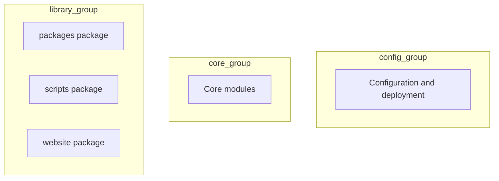

# Architecture report: gregberge/loadable-components

> Automated static analysis. **Observed** = directly seen in files/imports/AST; **Inferred** = interpretation from that evidence. Repository code was not executed.

## 1. Repository at a glance

| Item | Value |
| --- | --- |
| Repository | gregberge/loadable-components |
| Description | The recommended Code Splitting library for React ✂️✨ |
| Language | JavaScript |
| Stars | 7795 |
| Licence | MIT |
| Analysed commit / branch | 18544decdd0e9ecb3e85772708e1f2726430fdeb / main |
| Framework(s) | Express, React |
| Files analysed | 251 |
| Components | 5 |

## 2. Architecture in one minute

gregberge/loadable-components - The recommended Code Splitting library for React ✂️✨. This repository was analysed statically from 251 file(s) (0 Python). Detected technologies (observed from imports/manifests): Express, React, React Router, Jest, TypeScript, webpack. Files are grouped into 5 component(s): Configuration and deployment, Core modules, packages package, scripts package, website package. Findings below distinguish observed facts from inferred interpretation.

## 3. High-level block diagram

## 4. Main components

### Configuration and deployment (`config`)

- **Kind:** config
- **Status:** Observed
- **Confidence:** 0.85
- **Responsibility:** Groups 13 file(s) under configuration and deployment (observed from repository paths and static analysis).
- **Paths:** `lerna.json`, `netlify.toml`, `package.json`, `packages/babel-plugin/package.json`, `packages/codemod/package.json`, `packages/component/.size-snapshot.json`, `packages/component/package.json`, `packages/server/.size-snapshot.json`, `packages/server/__fixtures__/stats.json`, `packages/server/package.json`, `packages/webpack-plugin/package.json`, `website/.eslintrc.json`, `website/package.json`
- **Evidence:** [lerna.json](https://github.com/gregberge/loadable-components/blob/18544decdd0e9ecb3e85772708e1f2726430fdeb/lerna.json); [netlify.toml](https://github.com/gregberge/loadable-components/blob/18544decdd0e9ecb3e85772708e1f2726430fdeb/netlify.toml); [package.json](https://github.com/gregberge/loadable-components/blob/18544decdd0e9ecb3e85772708e1f2726430fdeb/package.json); [packages/babel-plugin/package.json](https://github.com/gregberge/loadable-components/blob/18544decdd0e9ecb3e85772708e1f2726430fdeb/packages/babel-plugin/package.json); [packages/codemod/package.json](https://github.com/gregberge/loadable-components/blob/18544decdd0e9ecb3e85772708e1f2726430fdeb/packages/codemod/package.json); [packages/component/.size-snapshot.json](https://github.com/gregberge/loadable-components/blob/18544decdd0e9ecb3e85772708e1f2726430fdeb/packages/component/.size-snapshot.json); [packages/component/package.json](https://github.com/gregberge/loadable-components/blob/18544decdd0e9ecb3e85772708e1f2726430fdeb/packages/component/package.json); [packages/server/.size-snapshot.json](https://github.com/gregberge/loadable-components/blob/18544decdd0e9ecb3e85772708e1f2726430fdeb/packages/server/.size-snapshot.json)

### Core modules (`core`)

- **Kind:** core
- **Status:** Observed
- **Confidence:** 0.85
- **Responsibility:** Groups 1 file(s) under core modules (observed from repository paths and static analysis).
- **Paths:** `babel.config.js`
- **Evidence:** [babel.config.js](https://github.com/gregberge/loadable-components/blob/18544decdd0e9ecb3e85772708e1f2726430fdeb/babel.config.js)

### packages package (`packages`)

- **Kind:** library
- **Status:** Observed
- **Confidence:** 0.85
- **Responsibility:** Groups 41 file(s) under packages package (observed from repository paths and static analysis).
- **Paths:** `packages/babel-plugin/src/index.js`, `packages/babel-plugin/src/index.test.js`, `packages/babel-plugin/src/properties/chunkName.js`, `packages/babel-plugin/src/properties/importAsync.js`, `packages/babel-plugin/src/properties/isReady.js`, `packages/babel-plugin/src/properties/requireAsync.js`, `packages/babel-plugin/src/properties/requireSync.js`, `packages/babel-plugin/src/properties/resolve.js`, `packages/babel-plugin/src/properties/state.js`, `packages/babel-plugin/src/util.js`, `packages/codemod/bin/main.js`, `packages/codemod/bin/utils/CodemodError.js`, `packages/codemod/transforms/__testfixtures__/react-loadable-to-loadable-component_arrow-no-params.input.js`, `packages/codemod/transforms/__testfixtures__/react-loadable-to-loadable-component_arrow-no-params.output.js`, `packages/codemod/transforms/__testfixtures__/react-loadable-to-loadable-component_arrow-w-params.input.js`, `packages/codemod/transforms/__testfixtures__/react-loadable-to-loadable-component_arrow-w-params.output.js`, `packages/codemod/transforms/__testfixtures__/react-loadable-to-loadable-component_expr.input.js`, `packages/codemod/transforms/__testfixtures__/react-loadable-to-loadable-component_expr.output.js`, `packages/codemod/transforms/__tests__/react-loadable-to-loadable-component-test.js`, `packages/codemod/transforms/react-loadable-to-loadable-component.js`, `packages/component/rollup.config.js`, `packages/component/src/Context.js`, `packages/component/src/createLoadable.js`, `packages/component/src/index.js`, `packages/component/src/library.js`, `packages/component/src/loadable.js`, `packages/component/src/loadable.test.js`, `packages/component/src/loadableReady.js`, `packages/component/src/resolvers.js`, `packages/component/src/shared.js`, `packages/component/src/sharedInternals.js`, `packages/component/src/util.js`, `packages/server/rollup.config.js`, `packages/server/src/ChunkExtractor.js`, `packages/server/src/ChunkExtractor.test.js`, `packages/server/src/ChunkExtractorManager.js`, `packages/server/src/index.js`, `packages/server/src/sharedInternals.js`, `packages/server/src/util.js`, `packages/server/src/util.test.js`, `packages/webpack-plugin/src/index.js`
- **Evidence:** [packages/babel-plugin/src/index.js](https://github.com/gregberge/loadable-components/blob/18544decdd0e9ecb3e85772708e1f2726430fdeb/packages/babel-plugin/src/index.js); [packages/babel-plugin/src/index.test.js](https://github.com/gregberge/loadable-components/blob/18544decdd0e9ecb3e85772708e1f2726430fdeb/packages/babel-plugin/src/index.test.js); [packages/babel-plugin/src/properties/chunkName.js](https://github.com/gregberge/loadable-components/blob/18544decdd0e9ecb3e85772708e1f2726430fdeb/packages/babel-plugin/src/properties/chunkName.js); [packages/babel-plugin/src/properties/importAsync.js](https://github.com/gregberge/loadable-components/blob/18544decdd0e9ecb3e85772708e1f2726430fdeb/packages/babel-plugin/src/properties/importAsync.js); [packages/babel-plugin/src/properties/isReady.js](https://github.com/gregberge/loadable-components/blob/18544decdd0e9ecb3e85772708e1f2726430fdeb/packages/babel-plugin/src/properties/isReady.js); [packages/babel-plugin/src/properties/requireAsync.js](https://github.com/gregberge/loadable-components/blob/18544decdd0e9ecb3e85772708e1f2726430fdeb/packages/babel-plugin/src/properties/requireAsync.js); [packages/babel-plugin/src/properties/requireSync.js](https://github.com/gregberge/loadable-components/blob/18544decdd0e9ecb3e85772708e1f2726430fdeb/packages/babel-plugin/src/properties/requireSync.js); [packages/babel-plugin/src/properties/resolve.js](https://github.com/gregberge/loadable-components/blob/18544decdd0e9ecb3e85772708e1f2726430fdeb/packages/babel-plugin/src/properties/resolve.js)

### scripts package (`scripts`)

- **Kind:** library
- **Status:** Observed
- **Confidence:** 0.85
- **Responsibility:** Groups 3 file(s) under scripts package (observed from repository paths and static analysis).
- **Paths:** `scripts/copy-stats-fixture.js`, `scripts/git-release.sh`, `scripts/prepare.sh`
- **Evidence:** [scripts/copy-stats-fixture.js](https://github.com/gregberge/loadable-components/blob/18544decdd0e9ecb3e85772708e1f2726430fdeb/scripts/copy-stats-fixture.js); [scripts/git-release.sh](https://github.com/gregberge/loadable-components/blob/18544decdd0e9ecb3e85772708e1f2726430fdeb/scripts/git-release.sh); [scripts/prepare.sh](https://github.com/gregberge/loadable-components/blob/18544decdd0e9ecb3e85772708e1f2726430fdeb/scripts/prepare.sh)

### website package (`website`)

- **Kind:** library
- **Status:** Observed
- **Confidence:** 0.85
- **Responsibility:** Groups 3 file(s) under website package (observed from repository paths and static analysis).
- **Paths:** `website/gatsby-config.js`, `website/gatsby-node.js`, `website/src/pages/index.js`
- **Evidence:** [website/gatsby-config.js](https://github.com/gregberge/loadable-components/blob/18544decdd0e9ecb3e85772708e1f2726430fdeb/website/gatsby-config.js); [website/gatsby-node.js](https://github.com/gregberge/loadable-components/blob/18544decdd0e9ecb3e85772708e1f2726430fdeb/website/gatsby-node.js); [website/src/pages/index.js](https://github.com/gregberge/loadable-components/blob/18544decdd0e9ecb3e85772708e1f2726430fdeb/website/src/pages/index.js)

## 5. Execution flow

**Observed** entry point(s):

- [packages/babel-plugin/src/index.js](https://github.com/gregberge/loadable-components/blob/18544decdd0e9ecb3e85772708e1f2726430fdeb/packages/babel-plugin/src/index.js)
- [packages/codemod/bin/main.js](https://github.com/gregberge/loadable-components/blob/18544decdd0e9ecb3e85772708e1f2726430fdeb/packages/codemod/bin/main.js)
- [packages/component/src/index.js](https://github.com/gregberge/loadable-components/blob/18544decdd0e9ecb3e85772708e1f2726430fdeb/packages/component/src/index.js)
- [packages/server/src/index.js](https://github.com/gregberge/loadable-components/blob/18544decdd0e9ecb3e85772708e1f2726430fdeb/packages/server/src/index.js)
- [packages/webpack-plugin/src/index.js](https://github.com/gregberge/loadable-components/blob/18544decdd0e9ecb3e85772708e1f2726430fdeb/packages/webpack-plugin/src/index.js)
- [website/src/pages/index.js](https://github.com/gregberge/loadable-components/blob/18544decdd0e9ecb3e85772708e1f2726430fdeb/website/src/pages/index.js)

Representative flow (derived from observed entry points and the import graph; steps beyond the entry point are **Inferred**):

1. Execution starts at an observed entry point listed above, if present.
2. No internal import relationships between components were observed.

## 6. Project structure

### `(root)`

- `.eslintignore` - other (94 bytes)
- `.eslintrc.json` - config (687 bytes)
- `.gitignore` - other (56 bytes)
- `.npmignore` - other (153 bytes)
- `.nvmrc` - other (38 bytes)
- `.prettierignore` - other (169 bytes)
- `.prettierrc` - other (69 bytes)
- `.travis.yml` - ci, YAML (504 bytes)
- `BACKERS.md` - docs (303 bytes)
- `CHANGELOG.md` - docs (33893 bytes)
- `CODE_OF_CONDUCT.md` - docs (3216 bytes)
- `CONTRIBUTING.md` - docs (3618 bytes)
- `LICENSE` - docs (1051 bytes)
- `README.md` - docs (2694 bytes)
- `babel.config.js` - source, JavaScript (551 bytes)
- `lerna.json` - config (132 bytes)
- `netlify.toml` - config (87 bytes)
- `package.json` - manifest (2252 bytes)

### `.github`

- `.github/FUNDING.yml` - config (44 bytes)
- `.github/ISSUE_TEMPLATE.md` - docs (264 bytes)
- `.github/ISSUE_TEMPLATE/bug.md` - docs (636 bytes)
- `.github/ISSUE_TEMPLATE/feature.md` - docs (378 bytes)
- `.github/ISSUE_TEMPLATE/question.md` - docs (381 bytes)
- `.github/ISSUE_TEMPLATE/regression.md` - docs (759 bytes)
- `.github/PULL_REQUEST_TEMPLATE.md` - docs (448 bytes)
- `.github/SUPPORT.md` - docs (58 bytes)
- `.github/opencollective.yml` - config (578 bytes)
- `.github/stale.yml` - config (496 bytes)

### `examples`

- `examples/client-side/.eslintrc.json` - config (91 bytes)
- `examples/client-side/README.md` - docs (413 bytes)
- `examples/client-side/babel.config.js` - source, JavaScript (109 bytes)
- `examples/client-side/package.json` - manifest (552 bytes)
- `examples/client-side/src/A.js` - source, JavaScript (25 bytes)
- `examples/client-side/src/B.js` - source, JavaScript (25 bytes)
- `examples/client-side/src/Hello.js` - source, JavaScript (29 bytes)
- `examples/client-side/src/index.js` - source, JavaScript (805 bytes)
- `examples/client-side/webpack.config.js` - source, JavaScript (280 bytes)
- `examples/razzle/.eslintrc.json` - config (139 bytes)
- `examples/razzle/.gitignore` - other (136 bytes)
- `examples/razzle/README.md` - docs (446 bytes)
- `examples/razzle/package.json` - manifest (736 bytes)
- `examples/razzle/public/robots.txt` - docs (15 bytes)
- `examples/razzle/razzle.config.js` - source, JavaScript (1180 bytes)
- `examples/razzle/src/About/index.js` - source, JavaScript (91 bytes)
- `examples/razzle/src/App.css` - other (62 bytes)
- `examples/razzle/src/App.js` - source, JavaScript (765 bytes)
- `examples/razzle/src/Contact/index.js` - source, JavaScript (97 bytes)
- `examples/razzle/src/Home/Home.css` - other (455 bytes)
- `examples/razzle/src/Home/Intro.js` - source, JavaScript (265 bytes)
- `examples/razzle/src/Home/Logo.js` - source, JavaScript (150 bytes)
- `examples/razzle/src/Home/Welcome.js` - source, JavaScript (100 bytes)
- `examples/razzle/src/Home/index.js` - source, JavaScript (719 bytes)
- `examples/razzle/src/Home/react.svg` - other (7909 bytes)
- `examples/razzle/src/NotFound/index.js` - source, JavaScript (110 bytes)
- `examples/razzle/src/client.js` - source, JavaScript (301 bytes)
- `examples/razzle/src/index.js` - source, JavaScript (680 bytes)
- `examples/razzle/src/server.js` - source, JavaScript (1425 bytes)
- `examples/server-side-rendering-async-node/.eslintrc.json` - config (139 bytes)
- `examples/server-side-rendering-async-node/.gitignore` - other (11 bytes)
- `examples/server-side-rendering-async-node/README.md` - docs (492 bytes)
- `examples/server-side-rendering-async-node/babel.config.js` - source, JavaScript (700 bytes)
- `examples/server-side-rendering-async-node/nodemon.json` - config (80 bytes)
- `examples/server-side-rendering-async-node/package.json` - manifest (1044 bytes)
- `examples/server-side-rendering-async-node/src/client/App.js` - source, JavaScript (1569 bytes)
- `examples/server-side-rendering-async-node/src/client/Y/file.js` - source, JavaScript (25 bytes)
- `examples/server-side-rendering-async-node/src/client/letters/A.css` - other (12 bytes)
- `examples/server-side-rendering-async-node/src/client/letters/A.js` - source, JavaScript (205 bytes)
- `examples/server-side-rendering-async-node/src/client/letters/B.js` - source, JavaScript (188 bytes)
- `examples/server-side-rendering-async-node/src/client/letters/C.js` - source, JavaScript (25 bytes)
- `examples/server-side-rendering-async-node/src/client/letters/D.js` - source, JavaScript (25 bytes)
- `examples/server-side-rendering-async-node/src/client/letters/E.js` - source, JavaScript (25 bytes)
- `examples/server-side-rendering-async-node/src/client/letters/F.js` - source, JavaScript (25 bytes)
- `examples/server-side-rendering-async-node/src/client/letters/G.js` - source, JavaScript (123 bytes)
- `examples/server-side-rendering-async-node/src/client/letters/Z/file.js` - source, JavaScript (25 bytes)
- `examples/server-side-rendering-async-node/src/client/main-async-node.js` - source, JavaScript (32 bytes)
- `examples/server-side-rendering-async-node/src/client/main-web.js` - source, JavaScript (315 bytes)
- `examples/server-side-rendering-async-node/src/client/main.css` - other (15 bytes)
- `examples/server-side-rendering-async-node/src/server/main.js` - source, JavaScript (1874 bytes)
- `examples/server-side-rendering-async-node/webpack.config.babel.js` - source, JavaScript (1417 bytes)
- `examples/server-side-rendering/.eslintrc.json` - config (139 bytes)
- `examples/server-side-rendering/.gitignore` - other (11 bytes)
- `examples/server-side-rendering/README.md` - docs (540 bytes)
- `examples/server-side-rendering/babel.config.js` - source, JavaScript (700 bytes)
- `examples/server-side-rendering/nodemon.json` - config (80 bytes)
- `examples/server-side-rendering/package.json` - manifest (1273 bytes)
- `examples/server-side-rendering/src/client/App.js` - source, JavaScript (1636 bytes)
- `examples/server-side-rendering/src/client/Y/file.js` - source, JavaScript (25 bytes)
- `examples/server-side-rendering/src/client/letters/A.css` - other (42 bytes)
- `examples/server-side-rendering/src/client/letters/A.js` - source, JavaScript (205 bytes)
- `examples/server-side-rendering/src/client/letters/B.js` - source, JavaScript (188 bytes)
- `examples/server-side-rendering/src/client/letters/C.js` - source, JavaScript (25 bytes)
- `examples/server-side-rendering/src/client/letters/D.js` - source, JavaScript (25 bytes)
- `examples/server-side-rendering/src/client/letters/E.js` - source, JavaScript (25 bytes)
- `examples/server-side-rendering/src/client/letters/F.js` - source, JavaScript (25 bytes)
- `examples/server-side-rendering/src/client/letters/G.js` - source, JavaScript (123 bytes)
- `examples/server-side-rendering/src/client/letters/Z/file.js` - source, JavaScript (25 bytes)
- `examples/server-side-rendering/src/client/main-node.js` - source, JavaScript (62 bytes)
- `examples/server-side-rendering/src/client/main-web.js` - source, JavaScript (315 bytes)
- `examples/server-side-rendering/src/client/main.css` - other (38 bytes)
- `examples/server-side-rendering/src/server/main.js` - source, JavaScript (1868 bytes)
- `examples/server-side-rendering/webpack.config.babel.js` - source, JavaScript (1514 bytes)
- `examples/suspense/.eslintrc.json` - config (91 bytes)
- `examples/suspense/README.md` - docs (407 bytes)
- `examples/suspense/babel.config.js` - source, JavaScript (109 bytes)
- `examples/suspense/package.json` - manifest (552 bytes)
- `examples/suspense/src/Hello.js` - source, JavaScript (29 bytes)
- `examples/suspense/src/index.js` - source, JavaScript (500 bytes)
- `examples/suspense/webpack.config.js` - source, JavaScript (280 bytes)
- `examples/typescript/.eslintrc.json` - config (139 bytes)
- `examples/typescript/.gitignore` - other (11 bytes)
- `examples/typescript/README.md` - docs (461 bytes)
- `examples/typescript/babel.config.js` - source, JavaScript (734 bytes)
- `examples/typescript/nodemon.json` - config (80 bytes)
- `examples/typescript/package.json` - manifest (1588 bytes)
- `examples/typescript/src/client/App.tsx` - source, TypeScript (905 bytes)
- `examples/typescript/src/client/Page.tsx` - source, TypeScript (117 bytes)
- `examples/typescript/src/client/PageWithParam.tsx` - source, TypeScript (169 bytes)
- `examples/typescript/src/client/main-node.js` - source, JavaScript (36 bytes)
- `examples/typescript/src/client/main-web.js` - source, JavaScript (346 bytes)
- `examples/typescript/src/server/main.js` - source, JavaScript (2249 bytes)
- `examples/typescript/tsconfig.json` - config (5986 bytes)
- `examples/typescript/webpack.config.babel.js` - source, JavaScript (1468 bytes)
- `examples/webpack/README.md` - docs (34 bytes)
- `examples/webpack/webpack4/.eslintrc.json` - config (139 bytes)
- `examples/webpack/webpack4/.gitignore` - other (11 bytes)
- `examples/webpack/webpack4/README.md` - docs (461 bytes)
- `examples/webpack/webpack4/babel.config.js` - source, JavaScript (700 bytes)
- `examples/webpack/webpack4/nodemon.json` - config (80 bytes)
- `examples/webpack/webpack4/package.json` - manifest (1406 bytes)
- `examples/webpack/webpack4/src/client/App.js` - source, JavaScript (827 bytes)
- `examples/webpack/webpack4/src/client/letters/A.css` - other (12 bytes)
- `examples/webpack/webpack4/src/client/letters/A.js` - source, JavaScript (68 bytes)
- `examples/webpack/webpack4/src/client/letters/B.js` - source, JavaScript (50 bytes)
- `examples/webpack/webpack4/src/client/letters/C.js` - source, JavaScript (50 bytes)
- `examples/webpack/webpack4/src/client/letters/D.js` - source, JavaScript (56 bytes)
- `examples/webpack/webpack4/src/client/main-node.js` - source, JavaScript (32 bytes)
- `examples/webpack/webpack4/src/client/main-web.js` - source, JavaScript (342 bytes)
- `examples/webpack/webpack4/src/server/main.js` - source, JavaScript (2395 bytes)
- `examples/webpack/webpack4/webpack.config.babel.js` - source, JavaScript (1395 bytes)
- `examples/webpack/webpack5/.eslintrc.json` - config (139 bytes)
- `examples/webpack/webpack5/.gitignore` - other (11 bytes)
- `examples/webpack/webpack5/README.md` - docs (461 bytes)
- `examples/webpack/webpack5/babel.config.js` - source, JavaScript (700 bytes)
- `examples/webpack/webpack5/nodemon.json` - config (80 bytes)
- `examples/webpack/webpack5/package.json` - manifest (1406 bytes)
- `examples/webpack/webpack5/src/client/App.js` - source, JavaScript (827 bytes)
- `examples/webpack/webpack5/src/client/letters/A.css` - other (12 bytes)
- `examples/webpack/webpack5/src/client/letters/A.js` - source, JavaScript (68 bytes)
- `examples/webpack/webpack5/src/client/letters/B.js` - source, JavaScript (50 bytes)
- `examples/webpack/webpack5/src/client/letters/C.js` - source, JavaScript (50 bytes)
- `examples/webpack/webpack5/src/client/letters/D.js` - source, JavaScript (56 bytes)
- `examples/webpack/webpack5/src/client/main-node.js` - source, JavaScript (32 bytes)
- `examples/webpack/webpack5/src/client/main-web.js` - source, JavaScript (342 bytes)
- `examples/webpack/webpack5/src/server/main.js` - source, JavaScript (2249 bytes)
- `examples/webpack/webpack5/webpack.config.babel.js` - source, JavaScript (1434 bytes)

### `packages`

- `packages/babel-plugin/CHANGELOG.md` - docs (7570 bytes)
- `packages/babel-plugin/README.md` - docs (383 bytes)
- `packages/babel-plugin/package.json` - manifest (850 bytes)
- `packages/babel-plugin/src/__snapshots__/index.test.js.snap` - other (31761 bytes)
- `packages/babel-plugin/src/index.js` - source, JavaScript (5062 bytes)
- `packages/babel-plugin/src/index.test.js` - source, JavaScript (9020 bytes)
- `packages/babel-plugin/src/properties/chunkName.js` - source, JavaScript (5749 bytes)
- `packages/babel-plugin/src/properties/importAsync.js` - source, JavaScript (376 bytes)
- `packages/babel-plugin/src/properties/isReady.js` - source, JavaScript (484 bytes)
- `packages/babel-plugin/src/properties/requireAsync.js` - source, JavaScript (461 bytes)
- `packages/babel-plugin/src/properties/requireSync.js` - source, JavaScript (445 bytes)
- `packages/babel-plugin/src/properties/resolve.js` - source, JavaScript (944 bytes)
- `packages/babel-plugin/src/properties/state.js` - source, JavaScript (149 bytes)
- `packages/babel-plugin/src/util.js` - source, JavaScript (131 bytes)
- `packages/codemod/.npmignore` - other (48 bytes)
- `packages/codemod/CHANGELOG.md` - docs (1183 bytes)
- `packages/codemod/README.md` - docs (815 bytes)
- `packages/codemod/bin/main.js` - source, JavaScript (1858 bytes)
- `packages/codemod/bin/utils/CodemodError.js` - source, JavaScript (168 bytes)
- `packages/codemod/package.json` - manifest (782 bytes)
- `packages/codemod/transforms/__testfixtures__/react-loadable-to-loadable-component_arrow-no-params.input.js` - source, JavaScript (250 bytes)
- `packages/codemod/transforms/__testfixtures__/react-loadable-to-loadable-component_arrow-no-params.output.js` - source, JavaScript (236 bytes)
- `packages/codemod/transforms/__testfixtures__/react-loadable-to-loadable-component_arrow-w-params.input.js` - source, JavaScript (412 bytes)
- `packages/codemod/transforms/__testfixtures__/react-loadable-to-loadable-component_arrow-w-params.output.js` - source, JavaScript (461 bytes)
- `packages/codemod/transforms/__testfixtures__/react-loadable-to-loadable-component_expr.input.js` - source, JavaScript (386 bytes)
- `packages/codemod/transforms/__testfixtures__/react-loadable-to-loadable-component_expr.output.js` - source, JavaScript (435 bytes)
- `packages/codemod/transforms/__tests__/react-loadable-to-loadable-component-test.js` - source, JavaScript (475 bytes)
- `packages/codemod/transforms/react-loadable-to-loadable-component.js` - source, JavaScript (4586 bytes)
- `packages/component/.npmignore` - other (24 bytes)
- `packages/component/.size-snapshot.json` - config (362 bytes)
- `packages/component/CHANGELOG.md` - docs (13605 bytes)
- `packages/component/README.md` - docs (226 bytes)
- `packages/component/package.json` - manifest (1359 bytes)
- `packages/component/rollup.config.js` - source, JavaScript (2089 bytes)
- `packages/component/src/Context.js` - source, JavaScript (64 bytes)
- `packages/component/src/createLoadable.js` - source, JavaScript (9924 bytes)
- `packages/component/src/index.js` - source, JavaScript (510 bytes)
- `packages/component/src/library.js` - source, JavaScript (517 bytes)
- `packages/component/src/loadable.js` - source, JavaScript (353 bytes)
- `packages/component/src/loadable.test.js` - source, JavaScript (13596 bytes)
- `packages/component/src/loadableReady.js` - source, JavaScript (2029 bytes)
- `packages/component/src/resolvers.js` - source, JavaScript (212 bytes)
- `packages/component/src/shared.js` - source, JavaScript (56 bytes)
- `packages/component/src/sharedInternals.js` - source, JavaScript (256 bytes)
- `packages/component/src/util.js` - source, JavaScript (365 bytes)
- `packages/server/.npmignore` - other (20 bytes)
- `packages/server/.size-snapshot.json` - config (378 bytes)
- `packages/server/CHANGELOG.md` - docs (15245 bytes)
- `packages/server/README.md` - docs (170 bytes)
- `packages/server/__fixtures__/stats.json` - config (9270 bytes)
- `packages/server/package.json` - manifest (1431 bytes)
- `packages/server/rollup.config.js` - source, JavaScript (1264 bytes)
- `packages/server/src/ChunkExtractor.js` - source, JavaScript (13003 bytes)
- `packages/server/src/ChunkExtractor.test.js` - source, JavaScript (31736 bytes)
- `packages/server/src/ChunkExtractorManager.js` - source, JavaScript (243 bytes)
- `packages/server/src/index.js` - source, JavaScript (142 bytes)
- `packages/server/src/sharedInternals.js` - source, JavaScript (294 bytes)
- `packages/server/src/util.js` - source, JavaScript (1347 bytes)
- `packages/server/src/util.test.js` - source, JavaScript (1111 bytes)
- `packages/webpack-plugin/.npmignore` - other (8 bytes)
- `packages/webpack-plugin/CHANGELOG.md` - docs (7024 bytes)
- `packages/webpack-plugin/README.md` - docs (387 bytes)
- `packages/webpack-plugin/package.json` - manifest (822 bytes)
- `packages/webpack-plugin/src/index.js` - source, JavaScript (3653 bytes)

### `scripts`

- `scripts/copy-stats-fixture.js` - source, JavaScript (362 bytes)
- `scripts/git-release.sh` - source, Shell (561 bytes)
- `scripts/prepare.sh` - source, Shell (262 bytes)

### `website`

- `website/.eslintignore` - other (30 bytes)
- `website/.eslintrc.json` - config (87 bytes)
- `website/.gitignore` - other (30 bytes)
- `website/README.md` - docs (707 bytes)
- `website/_redirects` - other (85 bytes)
- `website/gatsby-config.js` - source, JavaScript (971 bytes)
- `website/gatsby-node.js` - source, JavaScript (173 bytes)
- `website/package.json` - manifest (407 bytes)
- `website/src/pages/docs/api-loadable-component.mdx` - docs (6878 bytes)
- `website/src/pages/docs/api-loadable-server.mdx` - docs (7779 bytes)
- `website/src/pages/docs/api-loadable-webpack-plugin.mdx` - docs (1352 bytes)
- `website/src/pages/docs/babel-plugin.mdx` - docs (4125 bytes)
- `website/src/pages/docs/code-splitting.mdx` - docs (3499 bytes)
- `website/src/pages/docs/component-splitting.mdx` - docs (363 bytes)
- `website/src/pages/docs/delay.mdx` - docs (516 bytes)
- `website/src/pages/docs/dynamic-import.mdx` - docs (1131 bytes)
- `website/src/pages/docs/error-boundaries.mdx` - docs (856 bytes)
- `website/src/pages/docs/fallback.mdx` - docs (596 bytes)
- `website/src/pages/docs/faq.mdx` - docs (1197 bytes)
- `website/src/pages/docs/getting-started.mdx` - docs (978 bytes)
- `website/src/pages/docs/library-splitting.mdx` - docs (1091 bytes)
- `website/src/pages/docs/loadable-vs-react-lazy.mdx` - docs (2552 bytes)
- `website/src/pages/docs/migrate-from-react-loadable.mdx` - docs (1365 bytes)
- `website/src/pages/docs/prefetching.mdx` - docs (1530 bytes)
- `website/src/pages/docs/server-side-rendering.mdx` - docs (8826 bytes)
- `website/src/pages/docs/support.mdx` - docs (316 bytes)
- `website/src/pages/docs/suspense.mdx` - docs (563 bytes)
- `website/src/pages/docs/timeout.mdx` - docs (515 bytes)
- `website/src/pages/index.js` - source, JavaScript (1583 bytes)

## 7. Key dependencies and integrations

| Name | Category | Status | Confidence | Evidence |
| --- | --- | --- | --- | --- |
| Express | framework | Observed | 0.90 | [examples/razzle/package.json:16](https://github.com/gregberge/loadable-components/blob/18544decdd0e9ecb3e85772708e1f2726430fdeb/examples/razzle/package.json#L16); [examples/server-side-rendering-async-node/package.json:31](https://github.com/gregberge/loadable-components/blob/18544decdd0e9ecb3e85772708e1f2726430fdeb/examples/server-side-rendering-async-node/package.json#L31); [examples/server-side-rendering/package.json:32](https://github.com/gregberge/loadable-components/blob/18544decdd0e9ecb3e85772708e1f2726430fdeb/examples/server-side-rendering/package.json#L32); [examples/typescript/package.json:41](https://github.com/gregberge/loadable-components/blob/18544decdd0e9ecb3e85772708e1f2726430fdeb/examples/typescript/package.json#L41) |
| React | framework | Observed | 0.90 | [examples/client-side/package.json:10](https://github.com/gregberge/loadable-components/blob/18544decdd0e9ecb3e85772708e1f2726430fdeb/examples/client-side/package.json#L10); [examples/client-side/package.json:21](https://github.com/gregberge/loadable-components/blob/18544decdd0e9ecb3e85772708e1f2726430fdeb/examples/client-side/package.json#L21); [examples/razzle/package.json:19](https://github.com/gregberge/loadable-components/blob/18544decdd0e9ecb3e85772708e1f2726430fdeb/examples/razzle/package.json#L19); [examples/razzle/package.json:20](https://github.com/gregberge/loadable-components/blob/18544decdd0e9ecb3e85772708e1f2726430fdeb/examples/razzle/package.json#L20) |
| React Router | library | Observed | 0.90 | [examples/typescript/package.json:21](https://github.com/gregberge/loadable-components/blob/18544decdd0e9ecb3e85772708e1f2726430fdeb/examples/typescript/package.json#L21) |
| Jest | tooling | Observed | 0.85 | [package.json:26](https://github.com/gregberge/loadable-components/blob/18544decdd0e9ecb3e85772708e1f2726430fdeb/package.json#L26) |
| TypeScript | tooling | Observed | 0.85 | [examples/typescript/package.json:18](https://github.com/gregberge/loadable-components/blob/18544decdd0e9ecb3e85772708e1f2726430fdeb/examples/typescript/package.json#L18) |
| webpack | tooling | Observed | 0.90 | [examples/client-side/package.json:4](https://github.com/gregberge/loadable-components/blob/18544decdd0e9ecb3e85772708e1f2726430fdeb/examples/client-side/package.json#L4); [examples/server-side-rendering-async-node/package.json:5](https://github.com/gregberge/loadable-components/blob/18544decdd0e9ecb3e85772708e1f2726430fdeb/examples/server-side-rendering-async-node/package.json#L5); [examples/server-side-rendering/package.json:5](https://github.com/gregberge/loadable-components/blob/18544decdd0e9ecb3e85772708e1f2726430fdeb/examples/server-side-rendering/package.json#L5); [examples/suspense/package.json:4](https://github.com/gregberge/loadable-components/blob/18544decdd0e9ecb3e85772708e1f2726430fdeb/examples/suspense/package.json#L4) |

## 8. Data and state

No database, cache, queue, or persistent-state usage was observed in the analysed files. State handling, if any, may be in-memory or in files that were not analysed.

## 9. Configuration and deployment clues

- `.eslintrc.json` (config)
- `.github/FUNDING.yml` (config)
- `.github/opencollective.yml` (config)
- `.github/stale.yml` (config)
- `.travis.yml` (ci)
- `examples/client-side/.eslintrc.json` (config)
- `examples/client-side/package.json` (manifest)
- `examples/razzle/.eslintrc.json` (config)
- `examples/razzle/package.json` (manifest)
- `examples/server-side-rendering-async-node/.eslintrc.json` (config)
- `examples/server-side-rendering-async-node/nodemon.json` (config)
- `examples/server-side-rendering-async-node/package.json` (manifest)
- `examples/server-side-rendering/.eslintrc.json` (config)
- `examples/server-side-rendering/nodemon.json` (config)
- `examples/server-side-rendering/package.json` (manifest)
- `examples/suspense/.eslintrc.json` (config)
- `examples/suspense/package.json` (manifest)
- `examples/typescript/.eslintrc.json` (config)
- `examples/typescript/nodemon.json` (config)
- `examples/typescript/package.json` (manifest)
- `examples/typescript/tsconfig.json` (config)
- `examples/webpack/webpack4/.eslintrc.json` (config)
- `examples/webpack/webpack4/nodemon.json` (config)
- `examples/webpack/webpack4/package.json` (manifest)
- `examples/webpack/webpack5/.eslintrc.json` (config)
- `examples/webpack/webpack5/nodemon.json` (config)
- `examples/webpack/webpack5/package.json` (manifest)
- `lerna.json` (config)
- `netlify.toml` (config)
- `package.json` (manifest)
- `packages/babel-plugin/package.json` (manifest)
- `packages/codemod/package.json` (manifest)
- `packages/component/.size-snapshot.json` (config)
- `packages/component/package.json` (manifest)
- `packages/server/.size-snapshot.json` (config)
- `packages/server/__fixtures__/stats.json` (config)
- `packages/server/package.json` (manifest)
- `packages/webpack-plugin/package.json` (manifest)
- `website/.eslintrc.json` (config)
- `website/package.json` (manifest)

## 10. Design observations

- No strong design patterns could be established from the available evidence.

These observations are interpretations (**Inferred**) of the observed structure, not guarantees about runtime design.

## 11. Limitations and unknowns

- Static analysis only: repository code was not executed, installed, or imported at runtime.
- Components and relationships are inferred from file paths, imports, and AST structure; runtime behaviour, dynamic imports, and reflection may not be visible.
- 2 file(s) were skipped during inventory (1 x likely secret file excluded; 1 x lockfile excluded).
- No clear application entry point was observed in the analysed files.
- Repository text was treated as untrusted data; no instructions found in repository files were followed, and likely secret values were redacted/excluded.
- JavaScript and TypeScript files were inventoried from paths and package manifests. They were not parsed with a full language AST, and repository code was not executed.

## 12. Source references

- [babel.config.js](https://github.com/gregberge/loadable-components/blob/18544decdd0e9ecb3e85772708e1f2726430fdeb/babel.config.js)
- [examples/client-side/package.json:4](https://github.com/gregberge/loadable-components/blob/18544decdd0e9ecb3e85772708e1f2726430fdeb/examples/client-side/package.json#L4)
- [examples/client-side/package.json:10](https://github.com/gregberge/loadable-components/blob/18544decdd0e9ecb3e85772708e1f2726430fdeb/examples/client-side/package.json#L10)
- [examples/client-side/package.json:21](https://github.com/gregberge/loadable-components/blob/18544decdd0e9ecb3e85772708e1f2726430fdeb/examples/client-side/package.json#L21)
- [examples/razzle/package.json:16](https://github.com/gregberge/loadable-components/blob/18544decdd0e9ecb3e85772708e1f2726430fdeb/examples/razzle/package.json#L16)
- [examples/razzle/package.json:19](https://github.com/gregberge/loadable-components/blob/18544decdd0e9ecb3e85772708e1f2726430fdeb/examples/razzle/package.json#L19)
- [examples/razzle/package.json:20](https://github.com/gregberge/loadable-components/blob/18544decdd0e9ecb3e85772708e1f2726430fdeb/examples/razzle/package.json#L20)
- [examples/server-side-rendering-async-node/package.json:5](https://github.com/gregberge/loadable-components/blob/18544decdd0e9ecb3e85772708e1f2726430fdeb/examples/server-side-rendering-async-node/package.json#L5)
- [examples/server-side-rendering-async-node/package.json:15](https://github.com/gregberge/loadable-components/blob/18544decdd0e9ecb3e85772708e1f2726430fdeb/examples/server-side-rendering-async-node/package.json#L15)
- [examples/server-side-rendering-async-node/package.json:31](https://github.com/gregberge/loadable-components/blob/18544decdd0e9ecb3e85772708e1f2726430fdeb/examples/server-side-rendering-async-node/package.json#L31)
- [examples/server-side-rendering-async-node/package.json:34](https://github.com/gregberge/loadable-components/blob/18544decdd0e9ecb3e85772708e1f2726430fdeb/examples/server-side-rendering-async-node/package.json#L34)
- [examples/server-side-rendering/package.json:5](https://github.com/gregberge/loadable-components/blob/18544decdd0e9ecb3e85772708e1f2726430fdeb/examples/server-side-rendering/package.json#L5)
- [examples/server-side-rendering/package.json:16](https://github.com/gregberge/loadable-components/blob/18544decdd0e9ecb3e85772708e1f2726430fdeb/examples/server-side-rendering/package.json#L16)
- [examples/server-side-rendering/package.json:32](https://github.com/gregberge/loadable-components/blob/18544decdd0e9ecb3e85772708e1f2726430fdeb/examples/server-side-rendering/package.json#L32)
- [examples/server-side-rendering/package.json:35](https://github.com/gregberge/loadable-components/blob/18544decdd0e9ecb3e85772708e1f2726430fdeb/examples/server-side-rendering/package.json#L35)
- [examples/suspense/package.json:4](https://github.com/gregberge/loadable-components/blob/18544decdd0e9ecb3e85772708e1f2726430fdeb/examples/suspense/package.json#L4)
- [examples/typescript/package.json:5](https://github.com/gregberge/loadable-components/blob/18544decdd0e9ecb3e85772708e1f2726430fdeb/examples/typescript/package.json#L5)
- [examples/typescript/package.json:18](https://github.com/gregberge/loadable-components/blob/18544decdd0e9ecb3e85772708e1f2726430fdeb/examples/typescript/package.json#L18)
- [examples/typescript/package.json:21](https://github.com/gregberge/loadable-components/blob/18544decdd0e9ecb3e85772708e1f2726430fdeb/examples/typescript/package.json#L21)
- [examples/typescript/package.json:41](https://github.com/gregberge/loadable-components/blob/18544decdd0e9ecb3e85772708e1f2726430fdeb/examples/typescript/package.json#L41)
- [examples/webpack/webpack4/package.json:5](https://github.com/gregberge/loadable-components/blob/18544decdd0e9ecb3e85772708e1f2726430fdeb/examples/webpack/webpack4/package.json#L5)
- [examples/webpack/webpack4/package.json:35](https://github.com/gregberge/loadable-components/blob/18544decdd0e9ecb3e85772708e1f2726430fdeb/examples/webpack/webpack4/package.json#L35)
- [examples/webpack/webpack5/package.json:5](https://github.com/gregberge/loadable-components/blob/18544decdd0e9ecb3e85772708e1f2726430fdeb/examples/webpack/webpack5/package.json#L5)
- [examples/webpack/webpack5/package.json:35](https://github.com/gregberge/loadable-components/blob/18544decdd0e9ecb3e85772708e1f2726430fdeb/examples/webpack/webpack5/package.json#L35)
- [lerna.json](https://github.com/gregberge/loadable-components/blob/18544decdd0e9ecb3e85772708e1f2726430fdeb/lerna.json)
- [netlify.toml](https://github.com/gregberge/loadable-components/blob/18544decdd0e9ecb3e85772708e1f2726430fdeb/netlify.toml)
- [package.json](https://github.com/gregberge/loadable-components/blob/18544decdd0e9ecb3e85772708e1f2726430fdeb/package.json)
- [package.json:26](https://github.com/gregberge/loadable-components/blob/18544decdd0e9ecb3e85772708e1f2726430fdeb/package.json#L26)
- [packages/babel-plugin/package.json](https://github.com/gregberge/loadable-components/blob/18544decdd0e9ecb3e85772708e1f2726430fdeb/packages/babel-plugin/package.json)
- [packages/babel-plugin/src/index.js](https://github.com/gregberge/loadable-components/blob/18544decdd0e9ecb3e85772708e1f2726430fdeb/packages/babel-plugin/src/index.js)
- [packages/babel-plugin/src/index.test.js](https://github.com/gregberge/loadable-components/blob/18544decdd0e9ecb3e85772708e1f2726430fdeb/packages/babel-plugin/src/index.test.js)
- [packages/babel-plugin/src/properties/chunkName.js](https://github.com/gregberge/loadable-components/blob/18544decdd0e9ecb3e85772708e1f2726430fdeb/packages/babel-plugin/src/properties/chunkName.js)
- [packages/babel-plugin/src/properties/importAsync.js](https://github.com/gregberge/loadable-components/blob/18544decdd0e9ecb3e85772708e1f2726430fdeb/packages/babel-plugin/src/properties/importAsync.js)
- [packages/babel-plugin/src/properties/isReady.js](https://github.com/gregberge/loadable-components/blob/18544decdd0e9ecb3e85772708e1f2726430fdeb/packages/babel-plugin/src/properties/isReady.js)
- [packages/babel-plugin/src/properties/requireAsync.js](https://github.com/gregberge/loadable-components/blob/18544decdd0e9ecb3e85772708e1f2726430fdeb/packages/babel-plugin/src/properties/requireAsync.js)
- [packages/babel-plugin/src/properties/requireSync.js](https://github.com/gregberge/loadable-components/blob/18544decdd0e9ecb3e85772708e1f2726430fdeb/packages/babel-plugin/src/properties/requireSync.js)
- [packages/babel-plugin/src/properties/resolve.js](https://github.com/gregberge/loadable-components/blob/18544decdd0e9ecb3e85772708e1f2726430fdeb/packages/babel-plugin/src/properties/resolve.js)
- [packages/codemod/bin/main.js](https://github.com/gregberge/loadable-components/blob/18544decdd0e9ecb3e85772708e1f2726430fdeb/packages/codemod/bin/main.js)
- [packages/codemod/package.json](https://github.com/gregberge/loadable-components/blob/18544decdd0e9ecb3e85772708e1f2726430fdeb/packages/codemod/package.json)
- [packages/component/.size-snapshot.json](https://github.com/gregberge/loadable-components/blob/18544decdd0e9ecb3e85772708e1f2726430fdeb/packages/component/.size-snapshot.json)
- [packages/component/package.json](https://github.com/gregberge/loadable-components/blob/18544decdd0e9ecb3e85772708e1f2726430fdeb/packages/component/package.json)
- [packages/component/src/index.js](https://github.com/gregberge/loadable-components/blob/18544decdd0e9ecb3e85772708e1f2726430fdeb/packages/component/src/index.js)
- [packages/server/.size-snapshot.json](https://github.com/gregberge/loadable-components/blob/18544decdd0e9ecb3e85772708e1f2726430fdeb/packages/server/.size-snapshot.json)
- [packages/server/src/index.js](https://github.com/gregberge/loadable-components/blob/18544decdd0e9ecb3e85772708e1f2726430fdeb/packages/server/src/index.js)
- [packages/webpack-plugin/package.json:2](https://github.com/gregberge/loadable-components/blob/18544decdd0e9ecb3e85772708e1f2726430fdeb/packages/webpack-plugin/package.json#L2)
- [packages/webpack-plugin/src/index.js](https://github.com/gregberge/loadable-components/blob/18544decdd0e9ecb3e85772708e1f2726430fdeb/packages/webpack-plugin/src/index.js)
- [scripts/copy-stats-fixture.js](https://github.com/gregberge/loadable-components/blob/18544decdd0e9ecb3e85772708e1f2726430fdeb/scripts/copy-stats-fixture.js)
- [scripts/git-release.sh](https://github.com/gregberge/loadable-components/blob/18544decdd0e9ecb3e85772708e1f2726430fdeb/scripts/git-release.sh)
- [scripts/prepare.sh](https://github.com/gregberge/loadable-components/blob/18544decdd0e9ecb3e85772708e1f2726430fdeb/scripts/prepare.sh)
- [website/gatsby-config.js](https://github.com/gregberge/loadable-components/blob/18544decdd0e9ecb3e85772708e1f2726430fdeb/website/gatsby-config.js)
- [website/gatsby-node.js](https://github.com/gregberge/loadable-components/blob/18544decdd0e9ecb3e85772708e1f2726430fdeb/website/gatsby-node.js)
- [website/src/pages/index.js](https://github.com/gregberge/loadable-components/blob/18544decdd0e9ecb3e85772708e1f2726430fdeb/website/src/pages/index.js)
