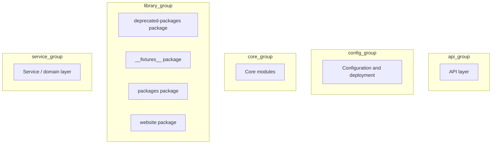

# Architecture report: gregberge/svgr

> Automated static analysis. **Observed** = directly seen in files/imports/AST; **Inferred** = interpretation from that evidence. Repository code was not executed.

## 1. Repository at a glance

| Item | Value |
| --- | --- |
| Repository | gregberge/svgr |
| Description | Transform SVGs into React components 🦁 |
| Language | TypeScript |
| Stars | 11061 |
| Licence | MIT |
| Analysed commit / branch | 975215efe85805cecafc920c103a827d864d2580 / main |
| Framework(s) | React |
| Files analysed | 290 |
| Components | 8 |

## 2. Architecture in one minute

gregberge/svgr - Transform SVGs into React components 🦁. This repository was analysed statically from 290 file(s) (0 Python). Detected technologies (observed from imports/manifests): GitHub Actions, React, Jest, TypeScript, webpack. Files are grouped into 8 component(s): API layer, Configuration and deployment, Core modules, deprecated-packages package, __fixtures__ package, packages package, Service / domain layer, website package. Findings below distinguish observed facts from inferred interpretation.

## 3. High-level block diagram

## 4. Main components

### API layer (`api_layer`)

- **Kind:** api
- **Status:** Observed
- **Confidence:** 0.85
- **Responsibility:** Groups 1 file(s) under api layer (observed from repository paths and static analysis).
- **Paths:** `api/api/svgr.js`
- **Evidence:** [api/api/svgr.js](https://github.com/gregberge/svgr/blob/975215efe85805cecafc920c103a827d864d2580/api/api/svgr.js)

### Configuration and deployment (`config`)

- **Kind:** config
- **Status:** Observed
- **Confidence:** 0.85
- **Responsibility:** Groups 45 file(s) under configuration and deployment (observed from repository paths and static analysis).
- **Paths:** `api/package.json`, `api/pnpm-workspace.yaml`, `api/vercel.json`, `deprecated-packages/svgr/package.json`, `lerna.json`, `package.json`, `packages/babel-plugin-add-jsx-attribute/package.json`, `packages/babel-plugin-add-jsx-attribute/tsconfig.json`, `packages/babel-plugin-remove-jsx-attribute/package.json`, `packages/babel-plugin-remove-jsx-attribute/tsconfig.json`, `packages/babel-plugin-remove-jsx-empty-expression/package.json`, `packages/babel-plugin-remove-jsx-empty-expression/tsconfig.json`, `packages/babel-plugin-replace-jsx-attribute-value/package.json`, `packages/babel-plugin-replace-jsx-attribute-value/tsconfig.json`, `packages/babel-plugin-svg-dynamic-title/package.json`, `packages/babel-plugin-svg-dynamic-title/tsconfig.json`, `packages/babel-plugin-svg-em-dimensions/package.json`, `packages/babel-plugin-svg-em-dimensions/tsconfig.json`, `packages/babel-plugin-transform-react-native-svg/package.json`, `packages/babel-plugin-transform-react-native-svg/tsconfig.json`, `packages/babel-plugin-transform-svg-component/package.json`, `packages/babel-plugin-transform-svg-component/tsconfig.json`, `packages/babel-preset/package.json`, `packages/babel-preset/tsconfig.json`, `packages/cli/package.json`, `packages/cli/tsconfig.json`, `packages/core/package.json`, `packages/core/tsconfig.json`, `packages/hast-util-to-babel-ast/package.json`, `packages/hast-util-to-babel-ast/tsconfig.json`, `packages/plugin-jsx/package.json`, `packages/plugin-jsx/tsconfig.json`, `packages/plugin-prettier/package.json`, `packages/plugin-prettier/tsconfig.json`, `packages/plugin-svgo/package.json`, `packages/plugin-svgo/tsconfig.json`, `packages/rollup/package.json`, `packages/rollup/tsconfig.json`, `packages/webpack/package.json`, `packages/webpack/tsconfig.json`, `pnpm-workspace.yaml`, `tsconfig.json`, `website/netlify.toml`, `website/package.json`, `website/src/components/playground/config/settings.js`
- **Evidence:** [api/package.json](https://github.com/gregberge/svgr/blob/975215efe85805cecafc920c103a827d864d2580/api/package.json); [api/pnpm-workspace.yaml](https://github.com/gregberge/svgr/blob/975215efe85805cecafc920c103a827d864d2580/api/pnpm-workspace.yaml); [api/vercel.json](https://github.com/gregberge/svgr/blob/975215efe85805cecafc920c103a827d864d2580/api/vercel.json); [deprecated-packages/svgr/package.json](https://github.com/gregberge/svgr/blob/975215efe85805cecafc920c103a827d864d2580/deprecated-packages/svgr/package.json); [lerna.json](https://github.com/gregberge/svgr/blob/975215efe85805cecafc920c103a827d864d2580/lerna.json); [package.json](https://github.com/gregberge/svgr/blob/975215efe85805cecafc920c103a827d864d2580/package.json); [packages/babel-plugin-add-jsx-attribute/package.json](https://github.com/gregberge/svgr/blob/975215efe85805cecafc920c103a827d864d2580/packages/babel-plugin-add-jsx-attribute/package.json); [packages/babel-plugin-add-jsx-attribute/tsconfig.json](https://github.com/gregberge/svgr/blob/975215efe85805cecafc920c103a827d864d2580/packages/babel-plugin-add-jsx-attribute/tsconfig.json)

### Core modules (`core`)

- **Kind:** core
- **Status:** Observed
- **Confidence:** 0.85
- **Responsibility:** Groups 2 file(s) under core modules (observed from repository paths and static analysis).
- **Paths:** `babel.config.js`, `jest.config.js`
- **Evidence:** [babel.config.js](https://github.com/gregberge/svgr/blob/975215efe85805cecafc920c103a827d864d2580/babel.config.js); [jest.config.js](https://github.com/gregberge/svgr/blob/975215efe85805cecafc920c103a827d864d2580/jest.config.js)

### deprecated-packages package (`deprecated_packages`)

- **Kind:** library
- **Status:** Observed
- **Confidence:** 0.85
- **Responsibility:** Groups 1 file(s) under deprecated-packages package (observed from repository paths and static analysis).
- **Paths:** `deprecated-packages/svgr/message.js`
- **Evidence:** [deprecated-packages/svgr/message.js](https://github.com/gregberge/svgr/blob/975215efe85805cecafc920c103a827d864d2580/deprecated-packages/svgr/message.js)

### __fixtures__ package (`fixtures`)

- **Kind:** library
- **Status:** Observed
- **Confidence:** 0.85
- **Responsibility:** Groups 9 file(s) under __fixtures__ package (observed from repository paths and static analysis).
- **Paths:** `__fixtures__/custom-index-template.js`, `__fixtures__/custom-index.config.js`, `__fixtures__/overrides.config.js`, `__fixtures__/simple-existing/File..js`, `__fixtures__/simple-existing/File.js`, `__fixtures__/simple-existing/index..js`, `__fixtures__/template.js`, `__fixtures__/withSvgoConfig/svgo.config.cjs`, `__fixtures__/withSvgoConfig/svgo.config.js`
- **Evidence:** [__fixtures__/custom-index-template.js](https://github.com/gregberge/svgr/blob/975215efe85805cecafc920c103a827d864d2580/__fixtures__/custom-index-template.js); [__fixtures__/custom-index.config.js](https://github.com/gregberge/svgr/blob/975215efe85805cecafc920c103a827d864d2580/__fixtures__/custom-index.config.js); [__fixtures__/overrides.config.js](https://github.com/gregberge/svgr/blob/975215efe85805cecafc920c103a827d864d2580/__fixtures__/overrides.config.js); [__fixtures__/simple-existing/File..js](https://github.com/gregberge/svgr/blob/975215efe85805cecafc920c103a827d864d2580/__fixtures__/simple-existing/File..js); [__fixtures__/simple-existing/File.js](https://github.com/gregberge/svgr/blob/975215efe85805cecafc920c103a827d864d2580/__fixtures__/simple-existing/File.js); [__fixtures__/simple-existing/index..js](https://github.com/gregberge/svgr/blob/975215efe85805cecafc920c103a827d864d2580/__fixtures__/simple-existing/index..js); [__fixtures__/template.js](https://github.com/gregberge/svgr/blob/975215efe85805cecafc920c103a827d864d2580/__fixtures__/template.js); [__fixtures__/withSvgoConfig/svgo.config.cjs](https://github.com/gregberge/svgr/blob/975215efe85805cecafc920c103a827d864d2580/__fixtures__/withSvgoConfig/svgo.config.cjs)

### packages package (`packages`)

- **Kind:** library
- **Status:** Observed
- **Confidence:** 0.85
- **Responsibility:** Groups 49 file(s) under packages package (observed from repository paths and static analysis).
- **Paths:** `packages/babel-plugin-add-jsx-attribute/src/index.test.ts`, `packages/babel-plugin-add-jsx-attribute/src/index.ts`, `packages/babel-plugin-remove-jsx-attribute/src/index.test.ts`, `packages/babel-plugin-remove-jsx-attribute/src/index.ts`, `packages/babel-plugin-remove-jsx-empty-expression/src/index.test.ts`, `packages/babel-plugin-remove-jsx-empty-expression/src/index.ts`, `packages/babel-plugin-replace-jsx-attribute-value/src/index.test.ts`, `packages/babel-plugin-replace-jsx-attribute-value/src/index.ts`, `packages/babel-plugin-svg-dynamic-title/src/index.test.ts`, `packages/babel-plugin-svg-dynamic-title/src/index.ts`, `packages/babel-plugin-svg-em-dimensions/src/index.test.ts`, `packages/babel-plugin-svg-em-dimensions/src/index.ts`, `packages/babel-plugin-transform-react-native-svg/src/index.test.ts`, `packages/babel-plugin-transform-react-native-svg/src/index.ts`, `packages/babel-plugin-transform-svg-component/src/defaultTemplate.ts`, `packages/babel-plugin-transform-svg-component/src/index.test.ts`, `packages/babel-plugin-transform-svg-component/src/index.ts`, `packages/babel-plugin-transform-svg-component/src/types.ts`, `packages/babel-plugin-transform-svg-component/src/variables.ts`, `packages/babel-preset/src/index.test.ts`, `packages/babel-preset/src/index.ts`, `packages/cli/src/dirCommand.ts`, `packages/cli/src/fileCommand.ts`, `packages/cli/src/index.test.ts`, `packages/cli/src/index.ts`, `packages/cli/src/util.test.ts`, `packages/cli/src/util.ts`, `packages/hast-util-to-babel-ast/src/all.ts`, `packages/hast-util-to-babel-ast/src/getAttributes.ts`, `packages/hast-util-to-babel-ast/src/handlers.ts`, `packages/hast-util-to-babel-ast/src/helpers.ts`, `packages/hast-util-to-babel-ast/src/index.test.ts`, `packages/hast-util-to-babel-ast/src/index.ts`, `packages/hast-util-to-babel-ast/src/mappings.ts`, `packages/hast-util-to-babel-ast/src/one.ts`, `packages/hast-util-to-babel-ast/src/stringToObjectStyle.ts`, `packages/hast-util-to-babel-ast/src/util.ts`, `packages/plugin-jsx/src/index.test.ts`, `packages/plugin-jsx/src/index.ts`, `packages/plugin-prettier/src/index.test.ts`, `packages/plugin-prettier/src/index.ts`, `packages/plugin-svgo/src/config.test.ts`, `packages/plugin-svgo/src/config.ts`, `packages/plugin-svgo/src/index.test.ts`, `packages/plugin-svgo/src/index.ts`, `packages/rollup/src/index.test.ts`, `packages/rollup/src/index.ts`, `packages/webpack/src/index.test.ts`, `packages/webpack/src/index.ts`
- **Evidence:** [packages/babel-plugin-add-jsx-attribute/src/index.test.ts](https://github.com/gregberge/svgr/blob/975215efe85805cecafc920c103a827d864d2580/packages/babel-plugin-add-jsx-attribute/src/index.test.ts); [packages/babel-plugin-add-jsx-attribute/src/index.ts](https://github.com/gregberge/svgr/blob/975215efe85805cecafc920c103a827d864d2580/packages/babel-plugin-add-jsx-attribute/src/index.ts); [packages/babel-plugin-remove-jsx-attribute/src/index.test.ts](https://github.com/gregberge/svgr/blob/975215efe85805cecafc920c103a827d864d2580/packages/babel-plugin-remove-jsx-attribute/src/index.test.ts); [packages/babel-plugin-remove-jsx-attribute/src/index.ts](https://github.com/gregberge/svgr/blob/975215efe85805cecafc920c103a827d864d2580/packages/babel-plugin-remove-jsx-attribute/src/index.ts); [packages/babel-plugin-remove-jsx-empty-expression/src/index.test.ts](https://github.com/gregberge/svgr/blob/975215efe85805cecafc920c103a827d864d2580/packages/babel-plugin-remove-jsx-empty-expression/src/index.test.ts); [packages/babel-plugin-remove-jsx-empty-expression/src/index.ts](https://github.com/gregberge/svgr/blob/975215efe85805cecafc920c103a827d864d2580/packages/babel-plugin-remove-jsx-empty-expression/src/index.ts); [packages/babel-plugin-replace-jsx-attribute-value/src/index.test.ts](https://github.com/gregberge/svgr/blob/975215efe85805cecafc920c103a827d864d2580/packages/babel-plugin-replace-jsx-attribute-value/src/index.test.ts); [packages/babel-plugin-replace-jsx-attribute-value/src/index.ts](https://github.com/gregberge/svgr/blob/975215efe85805cecafc920c103a827d864d2580/packages/babel-plugin-replace-jsx-attribute-value/src/index.ts)

### Service / domain layer (`service_layer`)

- **Kind:** service
- **Status:** Observed
- **Confidence:** 0.85
- **Responsibility:** Groups 10 file(s) under service / domain layer (observed from repository paths and static analysis).
- **Paths:** `packages/core/src/__fixtures__/svgo/svgo.config.js`, `packages/core/src/config.test.ts`, `packages/core/src/config.ts`, `packages/core/src/index.ts`, `packages/core/src/plugins.test.ts`, `packages/core/src/plugins.ts`, `packages/core/src/state.test.ts`, `packages/core/src/state.ts`, `packages/core/src/transform.test.ts`, `packages/core/src/transform.ts`
- **Evidence:** [packages/core/src/__fixtures__/svgo/svgo.config.js](https://github.com/gregberge/svgr/blob/975215efe85805cecafc920c103a827d864d2580/packages/core/src/__fixtures__/svgo/svgo.config.js); [packages/core/src/config.test.ts](https://github.com/gregberge/svgr/blob/975215efe85805cecafc920c103a827d864d2580/packages/core/src/config.test.ts); [packages/core/src/config.ts](https://github.com/gregberge/svgr/blob/975215efe85805cecafc920c103a827d864d2580/packages/core/src/config.ts); [packages/core/src/index.ts](https://github.com/gregberge/svgr/blob/975215efe85805cecafc920c103a827d864d2580/packages/core/src/index.ts); [packages/core/src/plugins.test.ts](https://github.com/gregberge/svgr/blob/975215efe85805cecafc920c103a827d864d2580/packages/core/src/plugins.test.ts); [packages/core/src/plugins.ts](https://github.com/gregberge/svgr/blob/975215efe85805cecafc920c103a827d864d2580/packages/core/src/plugins.ts); [packages/core/src/state.test.ts](https://github.com/gregberge/svgr/blob/975215efe85805cecafc920c103a827d864d2580/packages/core/src/state.test.ts); [packages/core/src/state.ts](https://github.com/gregberge/svgr/blob/975215efe85805cecafc920c103a827d864d2580/packages/core/src/state.ts)

### website package (`website`)

- **Kind:** library
- **Status:** Observed
- **Confidence:** 0.85
- **Responsibility:** Groups 25 file(s) under website package (observed from repository paths and static analysis).
- **Paths:** `website/.eslintrc.js`, `website/gatsby-config.js`, `website/src/components/Home.js`, `website/src/components/playground/Ad.js`, `website/src/components/playground/CheckGroup.js`, `website/src/components/playground/DropArea.js`, `website/src/components/playground/Editor.js`, `website/src/components/playground/Loading.js`, `website/src/components/playground/Playground.js`, `website/src/components/playground/Query.js`, `website/src/components/playground/Settings.js`, `website/src/components/playground/SettingsFieldBoolean.js`, `website/src/components/playground/SettingsFieldEnum.js`, `website/src/components/playground/SettingsFieldInteger.js`, `website/src/components/playground/SettingsFieldString.js`, `website/src/components/playground/SettingsGroup.js`, `website/src/components/playground/SmallLabel.js`, `website/src/components/playground/controls/CheckboxControl.js`, `website/src/components/playground/controls/InputControl.js`, `website/src/components/playground/controls/RadioControl.js`, `website/src/components/playground/controls/TextareaControl.js`, `website/src/components/playground/defaultSVG.js`, `website/src/components/playground/icons/ChevronLeft.js`, `website/src/components/playground/modules/svgr.js`, `website/src/smooth-doc/theme.js`
- **Evidence:** [website/.eslintrc.js](https://github.com/gregberge/svgr/blob/975215efe85805cecafc920c103a827d864d2580/website/.eslintrc.js); [website/gatsby-config.js](https://github.com/gregberge/svgr/blob/975215efe85805cecafc920c103a827d864d2580/website/gatsby-config.js); [website/src/components/Home.js](https://github.com/gregberge/svgr/blob/975215efe85805cecafc920c103a827d864d2580/website/src/components/Home.js); [website/src/components/playground/Ad.js](https://github.com/gregberge/svgr/blob/975215efe85805cecafc920c103a827d864d2580/website/src/components/playground/Ad.js); [website/src/components/playground/CheckGroup.js](https://github.com/gregberge/svgr/blob/975215efe85805cecafc920c103a827d864d2580/website/src/components/playground/CheckGroup.js); [website/src/components/playground/DropArea.js](https://github.com/gregberge/svgr/blob/975215efe85805cecafc920c103a827d864d2580/website/src/components/playground/DropArea.js); [website/src/components/playground/Editor.js](https://github.com/gregberge/svgr/blob/975215efe85805cecafc920c103a827d864d2580/website/src/components/playground/Editor.js); [website/src/components/playground/Loading.js](https://github.com/gregberge/svgr/blob/975215efe85805cecafc920c103a827d864d2580/website/src/components/playground/Loading.js)

## 5. Execution flow

**Observed** entry point(s):

- [packages/babel-plugin-add-jsx-attribute/src/index.ts](https://github.com/gregberge/svgr/blob/975215efe85805cecafc920c103a827d864d2580/packages/babel-plugin-add-jsx-attribute/src/index.ts)
- [packages/babel-plugin-remove-jsx-attribute/src/index.ts](https://github.com/gregberge/svgr/blob/975215efe85805cecafc920c103a827d864d2580/packages/babel-plugin-remove-jsx-attribute/src/index.ts)
- [packages/babel-plugin-remove-jsx-empty-expression/src/index.ts](https://github.com/gregberge/svgr/blob/975215efe85805cecafc920c103a827d864d2580/packages/babel-plugin-remove-jsx-empty-expression/src/index.ts)
- [packages/babel-plugin-replace-jsx-attribute-value/src/index.ts](https://github.com/gregberge/svgr/blob/975215efe85805cecafc920c103a827d864d2580/packages/babel-plugin-replace-jsx-attribute-value/src/index.ts)
- [packages/babel-plugin-svg-dynamic-title/src/index.ts](https://github.com/gregberge/svgr/blob/975215efe85805cecafc920c103a827d864d2580/packages/babel-plugin-svg-dynamic-title/src/index.ts)
- [packages/babel-plugin-svg-em-dimensions/src/index.ts](https://github.com/gregberge/svgr/blob/975215efe85805cecafc920c103a827d864d2580/packages/babel-plugin-svg-em-dimensions/src/index.ts)
- [packages/babel-plugin-transform-react-native-svg/src/index.ts](https://github.com/gregberge/svgr/blob/975215efe85805cecafc920c103a827d864d2580/packages/babel-plugin-transform-react-native-svg/src/index.ts)
- [packages/babel-plugin-transform-svg-component/src/index.ts](https://github.com/gregberge/svgr/blob/975215efe85805cecafc920c103a827d864d2580/packages/babel-plugin-transform-svg-component/src/index.ts)
- [packages/babel-preset/src/index.ts](https://github.com/gregberge/svgr/blob/975215efe85805cecafc920c103a827d864d2580/packages/babel-preset/src/index.ts)
- [packages/cli/bin/svgr](https://github.com/gregberge/svgr/blob/975215efe85805cecafc920c103a827d864d2580/packages/cli/bin/svgr)
- [packages/cli/src/index.ts](https://github.com/gregberge/svgr/blob/975215efe85805cecafc920c103a827d864d2580/packages/cli/src/index.ts)
- [packages/core/src/index.ts](https://github.com/gregberge/svgr/blob/975215efe85805cecafc920c103a827d864d2580/packages/core/src/index.ts)

Representative flow (derived from observed entry points and the import graph; steps beyond the entry point are **Inferred**):

1. Execution starts at an observed entry point listed above, if present.
2. No internal import relationships between components were observed.

## 6. Project structure

### `(root)`

- `.eslintignore` - other (96 bytes)
- `.eslintrc.json` - config (599 bytes)
- `.gitignore` - other (96 bytes)
- `.nvmrc` - other (2 bytes)
- `.prettierignore` - other (152 bytes)
- `.prettierrc` - other (69 bytes)
- `BACKERS.md` - docs (1313 bytes)
- `CHANGELOG.md` - docs (34422 bytes)
- `CODE_OF_CONDUCT.md` - docs (3214 bytes)
- `CONTRIBUTING.md` - docs (3955 bytes)
- `LICENSE` - docs (1051 bytes)
- `README.md` - docs (4133 bytes)
- `babel.config.js` - source, JavaScript (140 bytes)
- `jest.config.js` - source, JavaScript (192 bytes)
- `lerna.json` - config (93 bytes)
- `package.json` - manifest (1298 bytes)
- `pnpm-workspace.yaml` - config (45 bytes)
- `tsconfig.json` - config (323 bytes)

### `.github`

- `.github/FUNDING.yml` - config (40 bytes)
- `.github/ISSUE_TEMPLATE.md` - docs (358 bytes)
- `.github/ISSUE_TEMPLATE/bug.md` - docs (708 bytes)
- `.github/ISSUE_TEMPLATE/feature.md` - docs (473 bytes)
- `.github/ISSUE_TEMPLATE/question.md` - docs (475 bytes)
- `.github/ISSUE_TEMPLATE/regression.md` - docs (831 bytes)
- `.github/PULL_REQUEST_TEMPLATE.md` - docs (448 bytes)
- `.github/SUPPORT.md` - docs (167 bytes)
- `.github/opencollective.yml` - config (570 bytes)
- `.github/stale.yml` - config (496 bytes)
- `.github/workflows/ci.yml` - ci, YAML (904 bytes)

### `__fixtures__`

- `__fixtures__/cased/PascalCase.svg` - other (1022 bytes)
- `__fixtures__/cased/camelCase.svg` - other (1022 bytes)
- `__fixtures__/cased/kebab-case.svg` - other (1022 bytes)
- `__fixtures__/cased/multiple---dashes.svg` - other (1022 bytes)
- `__fixtures__/complex/skype.svg` - other (4254 bytes)
- `__fixtures__/complex/telegram.svg` - other (1350 bytes)
- `__fixtures__/custom-index-template.js` - source, JavaScript (308 bytes)
- `__fixtures__/custom-index.config.js` - source, JavaScript (288 bytes)
- `__fixtures__/nesting/a/c/three.svg` - other (3014 bytes)
- `__fixtures__/nesting/a/two.svg` - other (3014 bytes)
- `__fixtures__/nesting/one.svg` - other (1021 bytes)
- `__fixtures__/numeric/2.file.svg` - other (1022 bytes)
- `__fixtures__/numeric/file.svg` - other (1022 bytes)
- `__fixtures__/overrides.config.js` - source, JavaScript (98 bytes)
- `__fixtures__/simple-existing/File..js` - source, JavaScript (219 bytes)
- `__fixtures__/simple-existing/File.js` - source, JavaScript (10 bytes)
- `__fixtures__/simple-existing/index..js` - source, JavaScript (40 bytes)
- `__fixtures__/simple/file.svg` - other (1022 bytes)
- `__fixtures__/template.js` - source, JavaScript (146 bytes)
- `__fixtures__/withPrettierRc/.prettierrc` - other (20 bytes)
- `__fixtures__/withPrettierRc/file.svg` - other (1022 bytes)
- `__fixtures__/withSvgoConfig/file.svg` - other (1022 bytes)
- `__fixtures__/withSvgoConfig/svgo.config.cjs` - source, JavaScript (167 bytes)
- `__fixtures__/withSvgoConfig/svgo.config.js` - source, JavaScript (167 bytes)
- `__fixtures__/withSvgrRc/.svgrrc` - other (19 bytes)
- `__fixtures__/withSvgrRc/file.svg` - other (1022 bytes)

### `api`

- `api/api/svgr.js` - source, JavaScript (580 bytes)
- `api/package.json` - manifest (216 bytes)
- `api/pnpm-workspace.yaml` - config (144 bytes)
- `api/vercel.json` - config (691 bytes)

### `deprecated-packages`

- `deprecated-packages/svgr/message.js` - source, JavaScript (610 bytes)
- `deprecated-packages/svgr/package.json` - manifest (509 bytes)

### `examples`

- `examples/mocha-esm/CHANGELOG.md` - docs (466 bytes)
- `examples/mocha-esm/__mocks__/svg.js` - source, JavaScript (22 bytes)
- `examples/mocha-esm/example.js` - source, JavaScript (47 bytes)
- `examples/mocha-esm/example.test.js` - source, JavaScript (120 bytes)
- `examples/mocha-esm/icon.svg` - other (0 bytes)
- `examples/mocha-esm/mock-loader.js` - source, JavaScript (404 bytes)
- `examples/mocha-esm/package.json` - manifest (234 bytes)
- `examples/webpack/.gitignore` - other (6 bytes)
- `examples/webpack/CHANGELOG.md` - docs (763 bytes)
- `examples/webpack/package.json` - manifest (343 bytes)
- `examples/webpack/src/index.js` - source, JavaScript (182 bytes)
- `examples/webpack/src/star.simple.svg` - other (179 bytes)
- `examples/webpack/src/star.url.svg` - other (179 bytes)
- `examples/webpack/webpack.config.js` - source, JavaScript (388 bytes)

### `packages`

- `packages/babel-plugin-add-jsx-attribute/.npmignore` - other (8 bytes)
- `packages/babel-plugin-add-jsx-attribute/CHANGELOG.md` - docs (2464 bytes)
- `packages/babel-plugin-add-jsx-attribute/README.md` - docs (505 bytes)
- `packages/babel-plugin-add-jsx-attribute/package.json` - manifest (976 bytes)
- `packages/babel-plugin-add-jsx-attribute/src/index.test.ts` - source, TypeScript (2577 bytes)
- `packages/babel-plugin-add-jsx-attribute/src/index.ts` - source, TypeScript (2877 bytes)
- `packages/babel-plugin-add-jsx-attribute/tsconfig.json` - config (56 bytes)
- `packages/babel-plugin-remove-jsx-attribute/.npmignore` - other (53 bytes)
- `packages/babel-plugin-remove-jsx-attribute/CHANGELOG.md` - docs (2628 bytes)
- `packages/babel-plugin-remove-jsx-attribute/README.md` - docs (352 bytes)
- `packages/babel-plugin-remove-jsx-attribute/package.json` - manifest (985 bytes)
- `packages/babel-plugin-remove-jsx-attribute/src/index.test.ts` - source, TypeScript (847 bytes)
- `packages/babel-plugin-remove-jsx-attribute/src/index.ts` - source, TypeScript (818 bytes)
- `packages/babel-plugin-remove-jsx-attribute/tsconfig.json` - config (56 bytes)
- `packages/babel-plugin-remove-jsx-empty-expression/.npmignore` - other (53 bytes)
- `packages/babel-plugin-remove-jsx-empty-expression/CHANGELOG.md` - docs (2183 bytes)
- `packages/babel-plugin-remove-jsx-empty-expression/README.md` - docs (263 bytes)
- `packages/babel-plugin-remove-jsx-empty-expression/package.json` - manifest (1006 bytes)
- `packages/babel-plugin-remove-jsx-empty-expression/src/index.test.ts` - source, TypeScript (439 bytes)
- `packages/babel-plugin-remove-jsx-empty-expression/src/index.ts` - source, TypeScript (395 bytes)
- `packages/babel-plugin-remove-jsx-empty-expression/tsconfig.json` - config (56 bytes)
- `packages/babel-plugin-replace-jsx-attribute-value/.npmignore` - other (61 bytes)
- `packages/babel-plugin-replace-jsx-attribute-value/CHANGELOG.md` - docs (2509 bytes)
- `packages/babel-plugin-replace-jsx-attribute-value/README.md` - docs (457 bytes)
- `packages/babel-plugin-replace-jsx-attribute-value/package.json` - manifest (1006 bytes)
- `packages/babel-plugin-replace-jsx-attribute-value/src/index.test.ts` - source, TypeScript (772 bytes)
- `packages/babel-plugin-replace-jsx-attribute-value/src/index.ts` - source, TypeScript (1466 bytes)
- `packages/babel-plugin-replace-jsx-attribute-value/tsconfig.json` - config (56 bytes)
- `packages/babel-plugin-svg-dynamic-title/.npmignore` - other (53 bytes)
- `packages/babel-plugin-svg-dynamic-title/CHANGELOG.md` - docs (4074 bytes)
- `packages/babel-plugin-svg-dynamic-title/README.md` - docs (347 bytes)
- `packages/babel-plugin-svg-dynamic-title/package.json` - manifest (1006 bytes)
- `packages/babel-plugin-svg-dynamic-title/src/index.test.ts` - source, TypeScript (4284 bytes)
- `packages/babel-plugin-svg-dynamic-title/src/index.ts` - source, TypeScript (3950 bytes)
- `packages/babel-plugin-svg-dynamic-title/tsconfig.json` - config (56 bytes)
- `packages/babel-plugin-svg-em-dimensions/.npmignore` - other (61 bytes)
- `packages/babel-plugin-svg-em-dimensions/CHANGELOG.md` - docs (2464 bytes)
- `packages/babel-plugin-svg-em-dimensions/README.md` - docs (274 bytes)
- `packages/babel-plugin-svg-em-dimensions/package.json` - manifest (999 bytes)
- `packages/babel-plugin-svg-em-dimensions/src/index.test.ts` - source, TypeScript (1113 bytes)
- `packages/babel-plugin-svg-em-dimensions/src/index.ts` - source, TypeScript (1771 bytes)
- `packages/babel-plugin-svg-em-dimensions/tsconfig.json` - config (56 bytes)
- `packages/babel-plugin-transform-react-native-svg/.npmignore` - other (61 bytes)
- `packages/babel-plugin-transform-react-native-svg/CHANGELOG.md` - docs (3281 bytes)
- `packages/babel-plugin-transform-react-native-svg/README.md` - docs (260 bytes)
- `packages/babel-plugin-transform-react-native-svg/package.json` - manifest (1032 bytes)
- `packages/babel-plugin-transform-react-native-svg/src/index.test.ts` - source, TypeScript (1448 bytes)
- `packages/babel-plugin-transform-react-native-svg/src/index.ts` - source, TypeScript (3777 bytes)
- `packages/babel-plugin-transform-react-native-svg/tsconfig.json` - config (56 bytes)
- `packages/babel-plugin-transform-svg-component/.npmignore` - other (53 bytes)
- `packages/babel-plugin-transform-svg-component/CHANGELOG.md` - docs (7095 bytes)
- `packages/babel-plugin-transform-svg-component/README.md` - docs (284 bytes)
- `packages/babel-plugin-transform-svg-component/package.json` - manifest (1066 bytes)
- `packages/babel-plugin-transform-svg-component/src/__snapshots__/index.test.ts.snap` - other (15990 bytes)
- `packages/babel-plugin-transform-svg-component/src/defaultTemplate.ts` - source, TypeScript (282 bytes)
- `packages/babel-plugin-transform-svg-component/src/index.test.ts` - source, TypeScript (11727 bytes)
- `packages/babel-plugin-transform-svg-component/src/index.ts` - source, TypeScript (1112 bytes)
- `packages/babel-plugin-transform-svg-component/src/types.ts` - source, TypeScript (1220 bytes)
- `packages/babel-plugin-transform-svg-component/src/variables.ts` - source, TypeScript (7772 bytes)
- `packages/babel-plugin-transform-svg-component/tsconfig.json` - config (56 bytes)
- `packages/babel-preset/.npmignore` - other (53 bytes)
- `packages/babel-preset/CHANGELOG.md` - docs (7149 bytes)
- `packages/babel-preset/README.md` - docs (215 bytes)
- `packages/babel-preset/package.json` - manifest (1527 bytes)
- `packages/babel-preset/src/index.test.ts` - source, TypeScript (5912 bytes)
- `packages/babel-preset/src/index.ts` - source, TypeScript (4001 bytes)
- `packages/babel-preset/tsconfig.json` - config (56 bytes)
- `packages/cli/.npmignore` - other (64 bytes)
- `packages/cli/CHANGELOG.md` - docs (14932 bytes)
- `packages/cli/README.md` - docs (2762 bytes)
- `packages/cli/bin/svgr` - other (46 bytes)
- `packages/cli/package.json` - manifest (1132 bytes)
- `packages/cli/src/__snapshots__/index.test.ts.snap` - other (17513 bytes)
- `packages/cli/src/__snapshots__/util.test.ts.snap` - other (698 bytes)
- `packages/cli/src/dirCommand.ts` - source, TypeScript (5016 bytes)
- `packages/cli/src/fileCommand.ts` - source, TypeScript (1348 bytes)
- `packages/cli/src/index.test.ts` - source, TypeScript (7812 bytes)
- `packages/cli/src/index.ts` - source, TypeScript (6282 bytes)
- `packages/cli/src/util.test.ts` - source, TypeScript (1673 bytes)
- `packages/cli/src/util.ts` - source, TypeScript (1820 bytes)
- `packages/cli/tsconfig.json` - config (56 bytes)
- `packages/core/.npmignore` - other (53 bytes)
- `packages/core/CHANGELOG.md` - docs (15893 bytes)
- `packages/core/README.md` - docs (1363 bytes)
- `packages/core/package.json` - manifest (1149 bytes)
- `packages/core/src/__fixtures__/icon.svg` - other (655 bytes)
- `packages/core/src/__fixtures__/svgo/svgo.config.js` - source, JavaScript (166 bytes)
- `packages/core/src/__fixtures__/svgr/.svgrrc` - other (90 bytes)
- `packages/core/src/__fixtures__/svgr/icon.svg` - other (655 bytes)
- `packages/core/src/__snapshots__/config.test.ts.snap` - other (4983 bytes)
- `packages/core/src/__snapshots__/transform.test.ts.snap` - other (15755 bytes)
- `packages/core/src/config.test.ts` - source, TypeScript (2518 bytes)
- `packages/core/src/config.ts` - source, TypeScript (3484 bytes)
- `packages/core/src/index.ts` - source, TypeScript (156 bytes)
- `packages/core/src/plugins.test.ts` - source, TypeScript (1224 bytes)
- `packages/core/src/plugins.ts` - source, TypeScript (1401 bytes)
- `packages/core/src/state.test.ts` - source, TypeScript (1130 bytes)
- `packages/core/src/state.ts` - source, TypeScript (807 bytes)
- `packages/core/src/transform.test.ts` - source, TypeScript (10463 bytes)
- `packages/core/src/transform.ts` - source, TypeScript (992 bytes)
- `packages/core/tsconfig.json` - config (56 bytes)
- `packages/hast-util-to-babel-ast/.npmignore` - other (61 bytes)
- `packages/hast-util-to-babel-ast/CHANGELOG.md` - docs (5001 bytes)
- `packages/hast-util-to-babel-ast/README.md` - docs (736 bytes)
- `packages/hast-util-to-babel-ast/package.json` - manifest (1123 bytes)
- `packages/hast-util-to-babel-ast/src/__snapshots__/index.test.ts.snap` - other (1811 bytes)
- `packages/hast-util-to-babel-ast/src/all.ts` - source, TypeScript (698 bytes)
- `packages/hast-util-to-babel-ast/src/getAttributes.ts` - source, TypeScript (2042 bytes)
- `packages/hast-util-to-babel-ast/src/handlers.ts` - source, TypeScript (1856 bytes)
- `packages/hast-util-to-babel-ast/src/helpers.ts` - source, TypeScript (114 bytes)
- `packages/hast-util-to-babel-ast/src/index.test.ts` - source, TypeScript (4163 bytes)
- `packages/hast-util-to-babel-ast/src/index.ts` - source, TypeScript (250 bytes)
- `packages/hast-util-to-babel-ast/src/mappings.ts` - source, TypeScript (15882 bytes)
- `packages/hast-util-to-babel-ast/src/one.ts` - source, TypeScript (591 bytes)
- `packages/hast-util-to-babel-ast/src/stringToObjectStyle.ts` - source, TypeScript (1685 bytes)
- `packages/hast-util-to-babel-ast/src/util.ts` - source, TypeScript (1136 bytes)
- `packages/hast-util-to-babel-ast/tsconfig.json` - config (56 bytes)
- `packages/plugin-jsx/.npmignore` - other (53 bytes)
- `packages/plugin-jsx/CHANGELOG.md` - docs (6859 bytes)
- `packages/plugin-jsx/README.md` - docs (2408 bytes)
- `packages/plugin-jsx/package.json` - manifest (1201 bytes)
- `packages/plugin-jsx/src/index.test.ts` - source, TypeScript (3847 bytes)
- `packages/plugin-jsx/src/index.ts` - source, TypeScript (2383 bytes)
- `packages/plugin-jsx/tsconfig.json` - config (56 bytes)
- `packages/plugin-prettier/.npmignore` - other (8 bytes)
- `packages/plugin-prettier/CHANGELOG.md` - docs (4344 bytes)
- `packages/plugin-prettier/README.md` - docs (583 bytes)
- `packages/plugin-prettier/package.json` - manifest (1083 bytes)
- `packages/plugin-prettier/src/index.test.ts` - source, TypeScript (2057 bytes)
- `packages/plugin-prettier/src/index.ts` - source, TypeScript (584 bytes)
- `packages/plugin-prettier/tsconfig.json` - config (56 bytes)
- `packages/plugin-svgo/.npmignore` - other (53 bytes)
- `packages/plugin-svgo/CHANGELOG.md` - docs (6564 bytes)
- `packages/plugin-svgo/README.md` - docs (552 bytes)
- `packages/plugin-svgo/package.json` - manifest (1086 bytes)
- `packages/plugin-svgo/src/__snapshots__/index.test.ts.snap` - other (3275 bytes)
- `packages/plugin-svgo/src/config.test.ts` - source, TypeScript (1317 bytes)
- `packages/plugin-svgo/src/config.ts` - source, TypeScript (1163 bytes)
- `packages/plugin-svgo/src/index.test.ts` - source, TypeScript (3165 bytes)
- `packages/plugin-svgo/src/index.ts` - source, TypeScript (471 bytes)
- `packages/plugin-svgo/tsconfig.json` - config (56 bytes)
- `packages/rollup/.npmignore` - other (53 bytes)
- `packages/rollup/CHANGELOG.md` - docs (9875 bytes)
- `packages/rollup/README.md` - docs (1976 bytes)
- `packages/rollup/package.json` - manifest (1432 bytes)
- `packages/rollup/src/__snapshots__/index.test.ts.snap` - other (5021 bytes)
- `packages/rollup/src/index.test.ts` - source, TypeScript (1215 bytes)
- `packages/rollup/src/index.ts` - source, TypeScript (2537 bytes)
- `packages/rollup/tsconfig.json` - config (56 bytes)
- `packages/webpack/.npmignore` - other (53 bytes)
- `packages/webpack/CHANGELOG.md` - docs (10100 bytes)
- `packages/webpack/README.md` - docs (3092 bytes)
- `packages/webpack/package.json` - manifest (1414 bytes)
- `packages/webpack/src/__fixtures__/icon.svg` - other (655 bytes)
- `packages/webpack/src/__snapshots__/index.test.ts.snap` - other (4026 bytes)
- `packages/webpack/src/index.test.ts` - source, TypeScript (2761 bytes)
- `packages/webpack/src/index.ts` - source, TypeScript (2718 bytes)
- `packages/webpack/tsconfig.json` - config (56 bytes)

### `public`

- `public/.exists` - other (0 bytes)

### `website`

- `website/.eslintignore` - other (30 bytes)
- `website/.eslintrc.js` - source, JavaScript (90 bytes)
- `website/.gitignore` - other (30 bytes)
- `website/.nvmrc` - other (2 bytes)
- `website/README.md` - docs (680 bytes)
- `website/_redirects` - other (61 bytes)
- `website/gatsby-config.js` - source, JavaScript (1010 bytes)
- `website/images/logo-nav-dark.svg` - other (64629 bytes)
- `website/images/logo-nav-light.svg` - other (64629 bytes)
- `website/netlify.toml` - config (87 bytes)
- `website/package.json` - manifest (778 bytes)
- `website/pages/docs/cli.mdx` - docs (3088 bytes)
- `website/pages/docs/configuration-files.mdx` - docs (1784 bytes)
- `website/pages/docs/custom-templates.mdx` - docs (4144 bytes)
- `website/pages/docs/custom-transformations.mdx` - docs (2650 bytes)
- `website/pages/docs/ecosystem.mdx` - docs (2306 bytes)
- `website/pages/docs/getting-started.mdx` - docs (523 bytes)
- `website/pages/docs/index.mdx` - docs (54 bytes)
- `website/pages/docs/jest.mdx` - docs (838 bytes)
- `website/pages/docs/migrate.mdx` - docs (2784 bytes)
- `website/pages/docs/mocha.mdx` - docs (1327 bytes)
- `website/pages/docs/next.mdx` - docs (1940 bytes)
- `website/pages/docs/node-api.mdx` - docs (3678 bytes)
- `website/pages/docs/options.mdx` - docs (11542 bytes)
- `website/pages/docs/parcel.mdx` - docs (586 bytes)
- `website/pages/docs/remix.mdx` - docs (1575 bytes)
- `website/pages/docs/rollup.mdx` - docs (2544 bytes)
- `website/pages/docs/supporting-svgr.mdx` - docs (1063 bytes)
- `website/pages/docs/webpack.mdx` - docs (4174 bytes)
- `website/pages/docs/what-is-svgr.mdx` - docs (2902 bytes)
- `website/pages/index.mdx` - other (117 bytes)
- `website/pages/playground.mdx` - other (117 bytes)
- `website/src/components/Home.js` - source, JavaScript (2449 bytes)
- `website/src/components/playground/Ad.js` - source, JavaScript (404 bytes)
- `website/src/components/playground/CheckGroup.js` - source, JavaScript (181 bytes)
- `website/src/components/playground/DropArea.js` - source, JavaScript (1618 bytes)
- `website/src/components/playground/Editor.js` - source, JavaScript (708 bytes)
- `website/src/components/playground/Loading.js` - source, JavaScript (865 bytes)
- `website/src/components/playground/Playground.js` - source, JavaScript (8864 bytes)
- `website/src/components/playground/Query.js` - source, JavaScript (2080 bytes)
- `website/src/components/playground/Settings.js` - source, JavaScript (1939 bytes)
- `website/src/components/playground/SettingsFieldBoolean.js` - source, JavaScript (363 bytes)
- `website/src/components/playground/SettingsFieldEnum.js` - source, JavaScript (641 bytes)
- `website/src/components/playground/SettingsFieldInteger.js` - source, JavaScript (364 bytes)
- `website/src/components/playground/SettingsFieldString.js` - source, JavaScript (422 bytes)
- `website/src/components/playground/SettingsGroup.js` - source, JavaScript (1566 bytes)
- `website/src/components/playground/SmallLabel.js` - source, JavaScript (194 bytes)
- `website/src/components/playground/config/settings.js` - source, JavaScript (3680 bytes)
- `website/src/components/playground/controls/CheckboxControl.js` - source, JavaScript (249 bytes)
- `website/src/components/playground/controls/InputControl.js` - source, JavaScript (210 bytes)
- `website/src/components/playground/controls/RadioControl.js` - source, JavaScript (243 bytes)
- `website/src/components/playground/controls/TextareaControl.js` - source, JavaScript (406 bytes)
- `website/src/components/playground/defaultSVG.js` - source, JavaScript (1070 bytes)
- `website/src/components/playground/icons/ChevronLeft.js` - source, JavaScript (359 bytes)
- `website/src/components/playground/modules/svgr.js` - source, JavaScript (414 bytes)
- `website/src/smooth-doc/theme.js` - source, JavaScript (176 bytes)

## 7. Key dependencies and integrations

| Name | Category | Status | Confidence | Evidence |
| --- | --- | --- | --- | --- |
| GitHub Actions | ci | Observed | 0.85 | [.github/workflows/ci.yml](https://github.com/gregberge/svgr/blob/975215efe85805cecafc920c103a827d864d2580/.github/workflows/ci.yml) |
| React | framework | Observed | 0.90 | [package.json:30](https://github.com/gregberge/svgr/blob/975215efe85805cecafc920c103a827d864d2580/package.json#L30); [website/package.json:12](https://github.com/gregberge/svgr/blob/975215efe85805cecafc920c103a827d864d2580/website/package.json#L12); [website/package.json:14](https://github.com/gregberge/svgr/blob/975215efe85805cecafc920c103a827d864d2580/website/package.json#L14) |
| Jest | tooling | Observed | 0.85 | [package.json:9](https://github.com/gregberge/svgr/blob/975215efe85805cecafc920c103a827d864d2580/package.json#L9) |
| TypeScript | tooling | Observed | 0.85 | [package.json:17](https://github.com/gregberge/svgr/blob/975215efe85805cecafc920c103a827d864d2580/package.json#L17) |
| webpack | tooling | Observed | 0.90 | [examples/webpack/package.json:2](https://github.com/gregberge/svgr/blob/975215efe85805cecafc920c103a827d864d2580/examples/webpack/package.json#L2); [packages/webpack/package.json:2](https://github.com/gregberge/svgr/blob/975215efe85805cecafc920c103a827d864d2580/packages/webpack/package.json#L2) |

## 8. Data and state

No database, cache, queue, or persistent-state usage was observed in the analysed files. State handling, if any, may be in-memory or in files that were not analysed.

## 9. Configuration and deployment clues

- `.eslintrc.json` (config)
- `.github/FUNDING.yml` (config)
- `.github/opencollective.yml` (config)
- `.github/stale.yml` (config)
- `.github/workflows/ci.yml` (ci)
- `api/package.json` (manifest)
- `api/pnpm-workspace.yaml` (config)
- `api/vercel.json` (config)
- `deprecated-packages/svgr/package.json` (manifest)
- `examples/mocha-esm/package.json` (manifest)
- `examples/webpack/package.json` (manifest)
- `lerna.json` (config)
- `package.json` (manifest)
- `packages/babel-plugin-add-jsx-attribute/package.json` (manifest)
- `packages/babel-plugin-add-jsx-attribute/tsconfig.json` (config)
- `packages/babel-plugin-remove-jsx-attribute/package.json` (manifest)
- `packages/babel-plugin-remove-jsx-attribute/tsconfig.json` (config)
- `packages/babel-plugin-remove-jsx-empty-expression/package.json` (manifest)
- `packages/babel-plugin-remove-jsx-empty-expression/tsconfig.json` (config)
- `packages/babel-plugin-replace-jsx-attribute-value/package.json` (manifest)
- `packages/babel-plugin-replace-jsx-attribute-value/tsconfig.json` (config)
- `packages/babel-plugin-svg-dynamic-title/package.json` (manifest)
- `packages/babel-plugin-svg-dynamic-title/tsconfig.json` (config)
- `packages/babel-plugin-svg-em-dimensions/package.json` (manifest)
- `packages/babel-plugin-svg-em-dimensions/tsconfig.json` (config)
- `packages/babel-plugin-transform-react-native-svg/package.json` (manifest)
- `packages/babel-plugin-transform-react-native-svg/tsconfig.json` (config)
- `packages/babel-plugin-transform-svg-component/package.json` (manifest)
- `packages/babel-plugin-transform-svg-component/tsconfig.json` (config)
- `packages/babel-preset/package.json` (manifest)
- `packages/babel-preset/tsconfig.json` (config)
- `packages/cli/package.json` (manifest)
- `packages/cli/tsconfig.json` (config)
- `packages/core/package.json` (manifest)
- `packages/core/tsconfig.json` (config)
- `packages/hast-util-to-babel-ast/package.json` (manifest)
- `packages/hast-util-to-babel-ast/tsconfig.json` (config)
- `packages/plugin-jsx/package.json` (manifest)
- `packages/plugin-jsx/tsconfig.json` (config)
- `packages/plugin-prettier/package.json` (manifest)
- `packages/plugin-prettier/tsconfig.json` (config)
- `packages/plugin-svgo/package.json` (manifest)
- `packages/plugin-svgo/tsconfig.json` (config)
- `packages/rollup/package.json` (manifest)
- `packages/rollup/tsconfig.json` (config)
- `packages/webpack/package.json` (manifest)
- `packages/webpack/tsconfig.json` (config)
- `pnpm-workspace.yaml` (config)
- `tsconfig.json` (config)
- `website/netlify.toml` (config)
- `website/package.json` (manifest)

## 10. Design observations

- An entry/API layer is separated from other code (Inferred from paths and decorators).
- Service/domain code is distinct from entry and data code, suggesting layered separation (Inferred).

These observations are interpretations (**Inferred**) of the observed structure, not guarantees about runtime design.

## 11. Limitations and unknowns

- Static analysis only: repository code was not executed, installed, or imported at runtime.
- Components and relationships are inferred from file paths, imports, and AST structure; runtime behaviour, dynamic imports, and reflection may not be visible.
- 4 file(s) were skipped during inventory (1 x likely secret file excluded; 2 x lockfile excluded; 1 x vendored/generated directory excluded).
- No clear application entry point was observed in the analysed files.
- Repository text was treated as untrusted data; no instructions found in repository files were followed, and likely secret values were redacted/excluded.
- JavaScript and TypeScript files were inventoried from paths and package manifests. They were not parsed with a full language AST, and repository code was not executed.

## 12. Source references

- [.github/workflows/ci.yml](https://github.com/gregberge/svgr/blob/975215efe85805cecafc920c103a827d864d2580/.github/workflows/ci.yml)
- [__fixtures__/custom-index-template.js](https://github.com/gregberge/svgr/blob/975215efe85805cecafc920c103a827d864d2580/__fixtures__/custom-index-template.js)
- [__fixtures__/custom-index.config.js](https://github.com/gregberge/svgr/blob/975215efe85805cecafc920c103a827d864d2580/__fixtures__/custom-index.config.js)
- [__fixtures__/overrides.config.js](https://github.com/gregberge/svgr/blob/975215efe85805cecafc920c103a827d864d2580/__fixtures__/overrides.config.js)
- [__fixtures__/simple-existing/File..js](https://github.com/gregberge/svgr/blob/975215efe85805cecafc920c103a827d864d2580/__fixtures__/simple-existing/File..js)
- [__fixtures__/simple-existing/File.js](https://github.com/gregberge/svgr/blob/975215efe85805cecafc920c103a827d864d2580/__fixtures__/simple-existing/File.js)
- [__fixtures__/simple-existing/index..js](https://github.com/gregberge/svgr/blob/975215efe85805cecafc920c103a827d864d2580/__fixtures__/simple-existing/index..js)
- [__fixtures__/template.js](https://github.com/gregberge/svgr/blob/975215efe85805cecafc920c103a827d864d2580/__fixtures__/template.js)
- [__fixtures__/withSvgoConfig/svgo.config.cjs](https://github.com/gregberge/svgr/blob/975215efe85805cecafc920c103a827d864d2580/__fixtures__/withSvgoConfig/svgo.config.cjs)
- [api/api/svgr.js](https://github.com/gregberge/svgr/blob/975215efe85805cecafc920c103a827d864d2580/api/api/svgr.js)
- [api/package.json](https://github.com/gregberge/svgr/blob/975215efe85805cecafc920c103a827d864d2580/api/package.json)
- [api/pnpm-workspace.yaml](https://github.com/gregberge/svgr/blob/975215efe85805cecafc920c103a827d864d2580/api/pnpm-workspace.yaml)
- [api/vercel.json](https://github.com/gregberge/svgr/blob/975215efe85805cecafc920c103a827d864d2580/api/vercel.json)
- [babel.config.js](https://github.com/gregberge/svgr/blob/975215efe85805cecafc920c103a827d864d2580/babel.config.js)
- [deprecated-packages/svgr/message.js](https://github.com/gregberge/svgr/blob/975215efe85805cecafc920c103a827d864d2580/deprecated-packages/svgr/message.js)
- [deprecated-packages/svgr/package.json](https://github.com/gregberge/svgr/blob/975215efe85805cecafc920c103a827d864d2580/deprecated-packages/svgr/package.json)
- [examples/webpack/package.json:2](https://github.com/gregberge/svgr/blob/975215efe85805cecafc920c103a827d864d2580/examples/webpack/package.json#L2)
- [jest.config.js](https://github.com/gregberge/svgr/blob/975215efe85805cecafc920c103a827d864d2580/jest.config.js)
- [lerna.json](https://github.com/gregberge/svgr/blob/975215efe85805cecafc920c103a827d864d2580/lerna.json)
- [package.json](https://github.com/gregberge/svgr/blob/975215efe85805cecafc920c103a827d864d2580/package.json)
- [package.json:9](https://github.com/gregberge/svgr/blob/975215efe85805cecafc920c103a827d864d2580/package.json#L9)
- [package.json:17](https://github.com/gregberge/svgr/blob/975215efe85805cecafc920c103a827d864d2580/package.json#L17)
- [package.json:30](https://github.com/gregberge/svgr/blob/975215efe85805cecafc920c103a827d864d2580/package.json#L30)
- [packages/babel-plugin-add-jsx-attribute/package.json](https://github.com/gregberge/svgr/blob/975215efe85805cecafc920c103a827d864d2580/packages/babel-plugin-add-jsx-attribute/package.json)
- [packages/babel-plugin-add-jsx-attribute/src/index.test.ts](https://github.com/gregberge/svgr/blob/975215efe85805cecafc920c103a827d864d2580/packages/babel-plugin-add-jsx-attribute/src/index.test.ts)
- [packages/babel-plugin-add-jsx-attribute/src/index.ts](https://github.com/gregberge/svgr/blob/975215efe85805cecafc920c103a827d864d2580/packages/babel-plugin-add-jsx-attribute/src/index.ts)
- [packages/babel-plugin-add-jsx-attribute/tsconfig.json](https://github.com/gregberge/svgr/blob/975215efe85805cecafc920c103a827d864d2580/packages/babel-plugin-add-jsx-attribute/tsconfig.json)
- [packages/babel-plugin-remove-jsx-attribute/src/index.test.ts](https://github.com/gregberge/svgr/blob/975215efe85805cecafc920c103a827d864d2580/packages/babel-plugin-remove-jsx-attribute/src/index.test.ts)
- [packages/babel-plugin-remove-jsx-attribute/src/index.ts](https://github.com/gregberge/svgr/blob/975215efe85805cecafc920c103a827d864d2580/packages/babel-plugin-remove-jsx-attribute/src/index.ts)
- [packages/babel-plugin-remove-jsx-empty-expression/src/index.test.ts](https://github.com/gregberge/svgr/blob/975215efe85805cecafc920c103a827d864d2580/packages/babel-plugin-remove-jsx-empty-expression/src/index.test.ts)
- [packages/babel-plugin-remove-jsx-empty-expression/src/index.ts](https://github.com/gregberge/svgr/blob/975215efe85805cecafc920c103a827d864d2580/packages/babel-plugin-remove-jsx-empty-expression/src/index.ts)
- [packages/babel-plugin-replace-jsx-attribute-value/src/index.test.ts](https://github.com/gregberge/svgr/blob/975215efe85805cecafc920c103a827d864d2580/packages/babel-plugin-replace-jsx-attribute-value/src/index.test.ts)
- [packages/babel-plugin-replace-jsx-attribute-value/src/index.ts](https://github.com/gregberge/svgr/blob/975215efe85805cecafc920c103a827d864d2580/packages/babel-plugin-replace-jsx-attribute-value/src/index.ts)
- [packages/babel-plugin-svg-dynamic-title/src/index.ts](https://github.com/gregberge/svgr/blob/975215efe85805cecafc920c103a827d864d2580/packages/babel-plugin-svg-dynamic-title/src/index.ts)
- [packages/babel-plugin-svg-em-dimensions/src/index.ts](https://github.com/gregberge/svgr/blob/975215efe85805cecafc920c103a827d864d2580/packages/babel-plugin-svg-em-dimensions/src/index.ts)
- [packages/babel-plugin-transform-react-native-svg/src/index.ts](https://github.com/gregberge/svgr/blob/975215efe85805cecafc920c103a827d864d2580/packages/babel-plugin-transform-react-native-svg/src/index.ts)
- [packages/babel-plugin-transform-svg-component/src/index.ts](https://github.com/gregberge/svgr/blob/975215efe85805cecafc920c103a827d864d2580/packages/babel-plugin-transform-svg-component/src/index.ts)
- [packages/babel-preset/src/index.ts](https://github.com/gregberge/svgr/blob/975215efe85805cecafc920c103a827d864d2580/packages/babel-preset/src/index.ts)
- [packages/cli/bin/svgr](https://github.com/gregberge/svgr/blob/975215efe85805cecafc920c103a827d864d2580/packages/cli/bin/svgr)
- [packages/cli/src/index.ts](https://github.com/gregberge/svgr/blob/975215efe85805cecafc920c103a827d864d2580/packages/cli/src/index.ts)
- [packages/core/src/__fixtures__/svgo/svgo.config.js](https://github.com/gregberge/svgr/blob/975215efe85805cecafc920c103a827d864d2580/packages/core/src/__fixtures__/svgo/svgo.config.js)
- [packages/core/src/config.test.ts](https://github.com/gregberge/svgr/blob/975215efe85805cecafc920c103a827d864d2580/packages/core/src/config.test.ts)
- [packages/core/src/config.ts](https://github.com/gregberge/svgr/blob/975215efe85805cecafc920c103a827d864d2580/packages/core/src/config.ts)
- [packages/core/src/index.ts](https://github.com/gregberge/svgr/blob/975215efe85805cecafc920c103a827d864d2580/packages/core/src/index.ts)
- [packages/core/src/plugins.test.ts](https://github.com/gregberge/svgr/blob/975215efe85805cecafc920c103a827d864d2580/packages/core/src/plugins.test.ts)
- [packages/core/src/plugins.ts](https://github.com/gregberge/svgr/blob/975215efe85805cecafc920c103a827d864d2580/packages/core/src/plugins.ts)
- [packages/core/src/state.test.ts](https://github.com/gregberge/svgr/blob/975215efe85805cecafc920c103a827d864d2580/packages/core/src/state.test.ts)
- [packages/core/src/state.ts](https://github.com/gregberge/svgr/blob/975215efe85805cecafc920c103a827d864d2580/packages/core/src/state.ts)
- [packages/webpack/package.json:2](https://github.com/gregberge/svgr/blob/975215efe85805cecafc920c103a827d864d2580/packages/webpack/package.json#L2)
- [website/.eslintrc.js](https://github.com/gregberge/svgr/blob/975215efe85805cecafc920c103a827d864d2580/website/.eslintrc.js)
- [website/gatsby-config.js](https://github.com/gregberge/svgr/blob/975215efe85805cecafc920c103a827d864d2580/website/gatsby-config.js)
- [website/package.json:12](https://github.com/gregberge/svgr/blob/975215efe85805cecafc920c103a827d864d2580/website/package.json#L12)
- [website/package.json:14](https://github.com/gregberge/svgr/blob/975215efe85805cecafc920c103a827d864d2580/website/package.json#L14)
- [website/src/components/Home.js](https://github.com/gregberge/svgr/blob/975215efe85805cecafc920c103a827d864d2580/website/src/components/Home.js)
- [website/src/components/playground/Ad.js](https://github.com/gregberge/svgr/blob/975215efe85805cecafc920c103a827d864d2580/website/src/components/playground/Ad.js)
- [website/src/components/playground/CheckGroup.js](https://github.com/gregberge/svgr/blob/975215efe85805cecafc920c103a827d864d2580/website/src/components/playground/CheckGroup.js)
- [website/src/components/playground/DropArea.js](https://github.com/gregberge/svgr/blob/975215efe85805cecafc920c103a827d864d2580/website/src/components/playground/DropArea.js)
- [website/src/components/playground/Editor.js](https://github.com/gregberge/svgr/blob/975215efe85805cecafc920c103a827d864d2580/website/src/components/playground/Editor.js)
- [website/src/components/playground/Loading.js](https://github.com/gregberge/svgr/blob/975215efe85805cecafc920c103a827d864d2580/website/src/components/playground/Loading.js)
