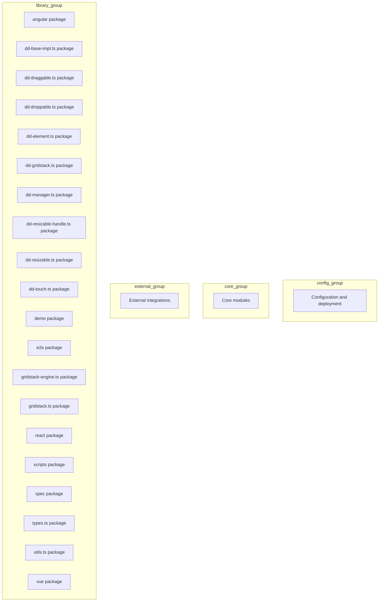

# Architecture report: gridstack/gridstack.js

> Automated static analysis. **Observed** = directly seen in files/imports/AST; **Inferred** = interpretation from that evidence. Repository code was not executed.

## 1. Repository at a glance

| Item | Value |
| --- | --- |
| Repository | gridstack/gridstack.js |
| Description | Build interactive dashboards in minutes. |
| Language | TypeScript |
| Stars | 9244 |
| Licence | MIT |
| Analysed commit / branch | 400eb8c29ab416215d618fdd7006ea2ef3b281a1 / master |
| Framework(s) | React, Vue |
| Files analysed | 279 |
| Components | 23 |

## 2. Architecture in one minute

gridstack/gridstack.js - Build interactive dashboards in minutes.. This repository was analysed statically from 279 file(s) (0 Python). Detected technologies (observed from imports/manifests): GitHub Actions, React, Vue, TypeScript, Vite, Vitest. Files are grouped into 23 component(s): angular package, Configuration and deployment, Core modules, dd-base-impl.ts package, dd-draggable.ts package, dd-droppable.ts package, dd-element.ts package, dd-gridstack.ts package. Findings below distinguish observed facts from inferred interpretation.

## 3. High-level block diagram

## 4. Main components

### angular package (`angular`)

- **Kind:** library
- **Status:** Observed
- **Confidence:** 0.85
- **Responsibility:** Groups 21 file(s) under angular package (observed from repository paths and static analysis).
- **Paths:** `angular/projects/demo/karma.conf.js`, `angular/projects/demo/src/app/app.component.spec.ts`, `angular/projects/demo/src/app/app.component.ts`, `angular/projects/demo/src/app/app.config.ts`, `angular/projects/demo/src/app/app.module.ts`, `angular/projects/demo/src/app/dummy.component.ts`, `angular/projects/demo/src/app/ngFor.ts`, `angular/projects/demo/src/app/ngFor_cmd.ts`, `angular/projects/demo/src/app/simple.ts`, `angular/projects/demo/src/environments/environment.ts`, `angular/projects/demo/src/main.ts`, `angular/projects/demo/src/polyfills.ts`, `angular/projects/demo/src/test.ts`, `angular/projects/lib/karma.conf.js`, `angular/projects/lib/src/index.ts`, `angular/projects/lib/src/lib/base-widget.ts`, `angular/projects/lib/src/lib/gridstack-item.component.ts`, `angular/projects/lib/src/lib/gridstack.component.ts`, `angular/projects/lib/src/lib/gridstack.module.ts`, `angular/projects/lib/src/lib/types.ts`, `angular/projects/lib/src/test.ts`
- **Evidence:** [angular/projects/demo/karma.conf.js](https://github.com/gridstack/gridstack.js/blob/400eb8c29ab416215d618fdd7006ea2ef3b281a1/angular/projects/demo/karma.conf.js); [angular/projects/demo/src/app/app.component.spec.ts](https://github.com/gridstack/gridstack.js/blob/400eb8c29ab416215d618fdd7006ea2ef3b281a1/angular/projects/demo/src/app/app.component.spec.ts); [angular/projects/demo/src/app/app.component.ts](https://github.com/gridstack/gridstack.js/blob/400eb8c29ab416215d618fdd7006ea2ef3b281a1/angular/projects/demo/src/app/app.component.ts); [angular/projects/demo/src/app/app.config.ts](https://github.com/gridstack/gridstack.js/blob/400eb8c29ab416215d618fdd7006ea2ef3b281a1/angular/projects/demo/src/app/app.config.ts); [angular/projects/demo/src/app/app.module.ts](https://github.com/gridstack/gridstack.js/blob/400eb8c29ab416215d618fdd7006ea2ef3b281a1/angular/projects/demo/src/app/app.module.ts); [angular/projects/demo/src/app/dummy.component.ts](https://github.com/gridstack/gridstack.js/blob/400eb8c29ab416215d618fdd7006ea2ef3b281a1/angular/projects/demo/src/app/dummy.component.ts); [angular/projects/demo/src/app/ngFor.ts](https://github.com/gridstack/gridstack.js/blob/400eb8c29ab416215d618fdd7006ea2ef3b281a1/angular/projects/demo/src/app/ngFor.ts); [angular/projects/demo/src/app/ngFor_cmd.ts](https://github.com/gridstack/gridstack.js/blob/400eb8c29ab416215d618fdd7006ea2ef3b281a1/angular/projects/demo/src/app/ngFor_cmd.ts)

### Configuration and deployment (`config`)

- **Kind:** config
- **Status:** Observed
- **Confidence:** 0.85
- **Responsibility:** Groups 36 file(s) under configuration and deployment (observed from repository paths and static analysis).
- **Paths:** `angular/.editorconfig`, `angular/angular.json`, `angular/package.json`, `angular/projects/demo/tsconfig.app.json`, `angular/projects/demo/tsconfig.spec.json`, `angular/projects/lib/ng-package.json`, `angular/projects/lib/package.json`, `angular/projects/lib/tsconfig.lib.json`, `angular/projects/lib/tsconfig.lib.prod.json`, `angular/projects/lib/tsconfig.spec.json`, `angular/tsconfig.doc.json`, `angular/tsconfig.json`, `angular/typedoc.html.json`, `angular/typedoc.json`, `package.json`, `react/package.json`, `react/projects/lib/tsconfig.build.json`, `react/tsconfig.app.json`, `react/tsconfig.doc.json`, `react/tsconfig.json`, `react/tsconfig.node.json`, `react/typedoc.html.json`, `react/typedoc.json`, `tsconfig.build.json`, `tsconfig.docs.json`, `tsconfig.json`, `typedoc.html.json`, `typedoc.json`, `vue/package.json`, `vue/projects/lib/tsconfig.build.json`, `vue/tsconfig.app.json`, `vue/tsconfig.doc.json`, `vue/tsconfig.json`, `vue/tsconfig.node.json`, `vue/typedoc.html.json`, `vue/typedoc.json`
- **Evidence:** [angular/.editorconfig](https://github.com/gridstack/gridstack.js/blob/400eb8c29ab416215d618fdd7006ea2ef3b281a1/angular/.editorconfig); [angular/angular.json](https://github.com/gridstack/gridstack.js/blob/400eb8c29ab416215d618fdd7006ea2ef3b281a1/angular/angular.json); [angular/package.json](https://github.com/gridstack/gridstack.js/blob/400eb8c29ab416215d618fdd7006ea2ef3b281a1/angular/package.json); [angular/projects/demo/tsconfig.app.json](https://github.com/gridstack/gridstack.js/blob/400eb8c29ab416215d618fdd7006ea2ef3b281a1/angular/projects/demo/tsconfig.app.json); [angular/projects/demo/tsconfig.spec.json](https://github.com/gridstack/gridstack.js/blob/400eb8c29ab416215d618fdd7006ea2ef3b281a1/angular/projects/demo/tsconfig.spec.json); [angular/projects/lib/ng-package.json](https://github.com/gridstack/gridstack.js/blob/400eb8c29ab416215d618fdd7006ea2ef3b281a1/angular/projects/lib/ng-package.json); [angular/projects/lib/package.json](https://github.com/gridstack/gridstack.js/blob/400eb8c29ab416215d618fdd7006ea2ef3b281a1/angular/projects/lib/package.json); [angular/projects/lib/tsconfig.lib.json](https://github.com/gridstack/gridstack.js/blob/400eb8c29ab416215d618fdd7006ea2ef3b281a1/angular/projects/lib/tsconfig.lib.json)

### Core modules (`core`)

- **Kind:** core
- **Status:** Observed
- **Confidence:** 0.85
- **Responsibility:** Groups 6 file(s) under core modules (observed from repository paths and static analysis).
- **Paths:** `Gruntfile.js`, `playwright.config.ts`, `protractor.conf.js`, `vitest.config.ts`, `vitest.setup.ts`, `webpack.config.js`
- **Evidence:** [Gruntfile.js](https://github.com/gridstack/gridstack.js/blob/400eb8c29ab416215d618fdd7006ea2ef3b281a1/Gruntfile.js); [playwright.config.ts](https://github.com/gridstack/gridstack.js/blob/400eb8c29ab416215d618fdd7006ea2ef3b281a1/playwright.config.ts); [protractor.conf.js](https://github.com/gridstack/gridstack.js/blob/400eb8c29ab416215d618fdd7006ea2ef3b281a1/protractor.conf.js); [vitest.config.ts](https://github.com/gridstack/gridstack.js/blob/400eb8c29ab416215d618fdd7006ea2ef3b281a1/vitest.config.ts); [vitest.setup.ts](https://github.com/gridstack/gridstack.js/blob/400eb8c29ab416215d618fdd7006ea2ef3b281a1/vitest.setup.ts); [webpack.config.js](https://github.com/gridstack/gridstack.js/blob/400eb8c29ab416215d618fdd7006ea2ef3b281a1/webpack.config.js)

### dd-base-impl.ts package (`dd_base_impl_ts`)

- **Kind:** library
- **Status:** Observed
- **Confidence:** 0.85
- **Responsibility:** Groups 1 file(s) under dd-base-impl.ts package (observed from repository paths and static analysis).
- **Paths:** `src/dd-base-impl.ts`
- **Evidence:** [src/dd-base-impl.ts](https://github.com/gridstack/gridstack.js/blob/400eb8c29ab416215d618fdd7006ea2ef3b281a1/src/dd-base-impl.ts)

### dd-draggable.ts package (`dd_draggable_ts`)

- **Kind:** library
- **Status:** Observed
- **Confidence:** 0.85
- **Responsibility:** Groups 1 file(s) under dd-draggable.ts package (observed from repository paths and static analysis).
- **Paths:** `src/dd-draggable.ts`
- **Evidence:** [src/dd-draggable.ts](https://github.com/gridstack/gridstack.js/blob/400eb8c29ab416215d618fdd7006ea2ef3b281a1/src/dd-draggable.ts)

### dd-droppable.ts package (`dd_droppable_ts`)

- **Kind:** library
- **Status:** Observed
- **Confidence:** 0.85
- **Responsibility:** Groups 1 file(s) under dd-droppable.ts package (observed from repository paths and static analysis).
- **Paths:** `src/dd-droppable.ts`
- **Evidence:** [src/dd-droppable.ts](https://github.com/gridstack/gridstack.js/blob/400eb8c29ab416215d618fdd7006ea2ef3b281a1/src/dd-droppable.ts)

### dd-element.ts package (`dd_element_ts`)

- **Kind:** library
- **Status:** Observed
- **Confidence:** 0.85
- **Responsibility:** Groups 1 file(s) under dd-element.ts package (observed from repository paths and static analysis).
- **Paths:** `src/dd-element.ts`
- **Evidence:** [src/dd-element.ts](https://github.com/gridstack/gridstack.js/blob/400eb8c29ab416215d618fdd7006ea2ef3b281a1/src/dd-element.ts)

### dd-gridstack.ts package (`dd_gridstack_ts`)

- **Kind:** library
- **Status:** Observed
- **Confidence:** 0.85
- **Responsibility:** Groups 1 file(s) under dd-gridstack.ts package (observed from repository paths and static analysis).
- **Paths:** `src/dd-gridstack.ts`
- **Evidence:** [src/dd-gridstack.ts](https://github.com/gridstack/gridstack.js/blob/400eb8c29ab416215d618fdd7006ea2ef3b281a1/src/dd-gridstack.ts)

### dd-manager.ts package (`dd_manager_ts`)

- **Kind:** library
- **Status:** Observed
- **Confidence:** 0.85
- **Responsibility:** Groups 1 file(s) under dd-manager.ts package (observed from repository paths and static analysis).
- **Paths:** `src/dd-manager.ts`
- **Evidence:** [src/dd-manager.ts](https://github.com/gridstack/gridstack.js/blob/400eb8c29ab416215d618fdd7006ea2ef3b281a1/src/dd-manager.ts)

### dd-resizable-handle.ts package (`dd_resizable_handle_ts`)

- **Kind:** library
- **Status:** Observed
- **Confidence:** 0.85
- **Responsibility:** Groups 1 file(s) under dd-resizable-handle.ts package (observed from repository paths and static analysis).
- **Paths:** `src/dd-resizable-handle.ts`
- **Evidence:** [src/dd-resizable-handle.ts](https://github.com/gridstack/gridstack.js/blob/400eb8c29ab416215d618fdd7006ea2ef3b281a1/src/dd-resizable-handle.ts)

### dd-resizable.ts package (`dd_resizable_ts`)

- **Kind:** library
- **Status:** Observed
- **Confidence:** 0.85
- **Responsibility:** Groups 1 file(s) under dd-resizable.ts package (observed from repository paths and static analysis).
- **Paths:** `src/dd-resizable.ts`
- **Evidence:** [src/dd-resizable.ts](https://github.com/gridstack/gridstack.js/blob/400eb8c29ab416215d618fdd7006ea2ef3b281a1/src/dd-resizable.ts)

### dd-touch.ts package (`dd_touch_ts`)

- **Kind:** library
- **Status:** Observed
- **Confidence:** 0.85
- **Responsibility:** Groups 1 file(s) under dd-touch.ts package (observed from repository paths and static analysis).
- **Paths:** `src/dd-touch.ts`
- **Evidence:** [src/dd-touch.ts](https://github.com/gridstack/gridstack.js/blob/400eb8c29ab416215d618fdd7006ea2ef3b281a1/src/dd-touch.ts)

### demo package (`demo`)

- **Kind:** library
- **Status:** Observed
- **Confidence:** 0.85
- **Responsibility:** Groups 1 file(s) under demo package (observed from repository paths and static analysis).
- **Paths:** `demo/events.js`
- **Evidence:** [demo/events.js](https://github.com/gridstack/gridstack.js/blob/400eb8c29ab416215d618fdd7006ea2ef3b281a1/demo/events.js)

### e2e package (`e2e`)

- **Kind:** library
- **Status:** Observed
- **Confidence:** 0.85
- **Responsibility:** Groups 3 file(s) under e2e package (observed from repository paths and static analysis).
- **Paths:** `e2e/cancelled-cross-grid-drag.spec.ts`, `e2e/cancelled-drag-after-leave.spec.ts`, `e2e/gridstack-e2e.spec.ts`
- **Evidence:** [e2e/cancelled-cross-grid-drag.spec.ts](https://github.com/gridstack/gridstack.js/blob/400eb8c29ab416215d618fdd7006ea2ef3b281a1/e2e/cancelled-cross-grid-drag.spec.ts); [e2e/cancelled-drag-after-leave.spec.ts](https://github.com/gridstack/gridstack.js/blob/400eb8c29ab416215d618fdd7006ea2ef3b281a1/e2e/cancelled-drag-after-leave.spec.ts); [e2e/gridstack-e2e.spec.ts](https://github.com/gridstack/gridstack.js/blob/400eb8c29ab416215d618fdd7006ea2ef3b281a1/e2e/gridstack-e2e.spec.ts)

### External integrations (`external_integrations`)

- **Kind:** external
- **Status:** Observed
- **Confidence:** 0.85
- **Responsibility:** Groups 2 file(s) under external integrations (observed from repository paths and static analysis).
- **Paths:** `spec/integration/gridstack-integration.spec.ts`, `spec/integration/gridstack-resize-direction.spec.ts`
- **Evidence:** [spec/integration/gridstack-integration.spec.ts](https://github.com/gridstack/gridstack.js/blob/400eb8c29ab416215d618fdd7006ea2ef3b281a1/spec/integration/gridstack-integration.spec.ts); [spec/integration/gridstack-resize-direction.spec.ts](https://github.com/gridstack/gridstack.js/blob/400eb8c29ab416215d618fdd7006ea2ef3b281a1/spec/integration/gridstack-resize-direction.spec.ts)

### gridstack-engine.ts package (`gridstack_engine_ts`)

- **Kind:** library
- **Status:** Observed
- **Confidence:** 0.85
- **Responsibility:** Groups 1 file(s) under gridstack-engine.ts package (observed from repository paths and static analysis).
- **Paths:** `src/gridstack-engine.ts`
- **Evidence:** [src/gridstack-engine.ts](https://github.com/gridstack/gridstack.js/blob/400eb8c29ab416215d618fdd7006ea2ef3b281a1/src/gridstack-engine.ts)

### gridstack.ts package (`gridstack_ts`)

- **Kind:** library
- **Status:** Observed
- **Confidence:** 0.85
- **Responsibility:** Groups 1 file(s) under gridstack.ts package (observed from repository paths and static analysis).
- **Paths:** `src/gridstack.ts`
- **Evidence:** [src/gridstack.ts](https://github.com/gridstack/gridstack.js/blob/400eb8c29ab416215d618fdd7006ea2ef3b281a1/src/gridstack.ts)

### react package (`react`)

- **Kind:** library
- **Status:** Observed
- **Confidence:** 0.85
- **Responsibility:** Groups 18 file(s) under react package (observed from repository paths and static analysis).
- **Paths:** `react/eslint.config.js`, `react/projects/lib/gridstack-react.test.tsx`, `react/projects/lib/src/base-widget.tsx`, `react/projects/lib/src/gridstack-context.tsx`, `react/projects/lib/src/gridstack-item.tsx`, `react/projects/lib/src/gridstack-widget-context.tsx`, `react/projects/lib/src/gridstack.tsx`, `react/projects/lib/src/hooks.ts`, `react/projects/lib/src/index.ts`, `react/projects/lib/src/registry.ts`, `react/projects/lib/src/types.ts`, `react/src/App.tsx`, `react/src/demo/demo.tsx`, `react/src/main.tsx`, `react/src/vite-env.d.ts`, `react/vite.config.ts`, `react/vitest.config.ts`, `react/vitest.setup.ts`
- **Evidence:** [react/eslint.config.js](https://github.com/gridstack/gridstack.js/blob/400eb8c29ab416215d618fdd7006ea2ef3b281a1/react/eslint.config.js); [react/projects/lib/gridstack-react.test.tsx](https://github.com/gridstack/gridstack.js/blob/400eb8c29ab416215d618fdd7006ea2ef3b281a1/react/projects/lib/gridstack-react.test.tsx); [react/projects/lib/src/base-widget.tsx](https://github.com/gridstack/gridstack.js/blob/400eb8c29ab416215d618fdd7006ea2ef3b281a1/react/projects/lib/src/base-widget.tsx); [react/projects/lib/src/gridstack-context.tsx](https://github.com/gridstack/gridstack.js/blob/400eb8c29ab416215d618fdd7006ea2ef3b281a1/react/projects/lib/src/gridstack-context.tsx); [react/projects/lib/src/gridstack-item.tsx](https://github.com/gridstack/gridstack.js/blob/400eb8c29ab416215d618fdd7006ea2ef3b281a1/react/projects/lib/src/gridstack-item.tsx); [react/projects/lib/src/gridstack-widget-context.tsx](https://github.com/gridstack/gridstack.js/blob/400eb8c29ab416215d618fdd7006ea2ef3b281a1/react/projects/lib/src/gridstack-widget-context.tsx); [react/projects/lib/src/gridstack.tsx](https://github.com/gridstack/gridstack.js/blob/400eb8c29ab416215d618fdd7006ea2ef3b281a1/react/projects/lib/src/gridstack.tsx); [react/projects/lib/src/hooks.ts](https://github.com/gridstack/gridstack.js/blob/400eb8c29ab416215d618fdd7006ea2ef3b281a1/react/projects/lib/src/hooks.ts)

### scripts package (`scripts`)

- **Kind:** library
- **Status:** Observed
- **Confidence:** 0.85
- **Responsibility:** Groups 3 file(s) under scripts package (observed from repository paths and static analysis).
- **Paths:** `scripts/generate-docs.js`, `scripts/reorder-docs.js`, `scripts/reorder-html-docs.js`
- **Evidence:** [scripts/generate-docs.js](https://github.com/gridstack/gridstack.js/blob/400eb8c29ab416215d618fdd7006ea2ef3b281a1/scripts/generate-docs.js); [scripts/reorder-docs.js](https://github.com/gridstack/gridstack.js/blob/400eb8c29ab416215d618fdd7006ea2ef3b281a1/scripts/reorder-docs.js); [scripts/reorder-html-docs.js](https://github.com/gridstack/gridstack.js/blob/400eb8c29ab416215d618fdd7006ea2ef3b281a1/scripts/reorder-html-docs.js)

### spec package (`spec`)

- **Kind:** library
- **Status:** Observed
- **Confidence:** 0.85
- **Responsibility:** Groups 11 file(s) under spec package (observed from repository paths and static analysis).
- **Paths:** `spec/dd-base-impl-spec.ts`, `spec/dd-draggable-touch-spec.ts`, `spec/dd-droppable-spec.ts`, `spec/dd-manager-spec.ts`, `spec/dd-simple-integration-spec.ts`, `spec/dd-touch-spec.ts`, `spec/e2e/gridstack-html-spec.js`, `spec/gridstack-engine-spec.ts`, `spec/gridstack-spec.ts`, `spec/regression-spec.ts`, `spec/utils-spec.ts`
- **Evidence:** [spec/dd-base-impl-spec.ts](https://github.com/gridstack/gridstack.js/blob/400eb8c29ab416215d618fdd7006ea2ef3b281a1/spec/dd-base-impl-spec.ts); [spec/dd-draggable-touch-spec.ts](https://github.com/gridstack/gridstack.js/blob/400eb8c29ab416215d618fdd7006ea2ef3b281a1/spec/dd-draggable-touch-spec.ts); [spec/dd-droppable-spec.ts](https://github.com/gridstack/gridstack.js/blob/400eb8c29ab416215d618fdd7006ea2ef3b281a1/spec/dd-droppable-spec.ts); [spec/dd-manager-spec.ts](https://github.com/gridstack/gridstack.js/blob/400eb8c29ab416215d618fdd7006ea2ef3b281a1/spec/dd-manager-spec.ts); [spec/dd-simple-integration-spec.ts](https://github.com/gridstack/gridstack.js/blob/400eb8c29ab416215d618fdd7006ea2ef3b281a1/spec/dd-simple-integration-spec.ts); [spec/dd-touch-spec.ts](https://github.com/gridstack/gridstack.js/blob/400eb8c29ab416215d618fdd7006ea2ef3b281a1/spec/dd-touch-spec.ts); [spec/e2e/gridstack-html-spec.js](https://github.com/gridstack/gridstack.js/blob/400eb8c29ab416215d618fdd7006ea2ef3b281a1/spec/e2e/gridstack-html-spec.js); [spec/gridstack-engine-spec.ts](https://github.com/gridstack/gridstack.js/blob/400eb8c29ab416215d618fdd7006ea2ef3b281a1/spec/gridstack-engine-spec.ts)

### types.ts package (`types_ts`)

- **Kind:** library
- **Status:** Observed
- **Confidence:** 0.85
- **Responsibility:** Groups 1 file(s) under types.ts package (observed from repository paths and static analysis).
- **Paths:** `src/types.ts`
- **Evidence:** [src/types.ts](https://github.com/gridstack/gridstack.js/blob/400eb8c29ab416215d618fdd7006ea2ef3b281a1/src/types.ts)

### utils.ts package (`utils_ts`)

- **Kind:** library
- **Status:** Observed
- **Confidence:** 0.85
- **Responsibility:** Groups 1 file(s) under utils.ts package (observed from repository paths and static analysis).
- **Paths:** `src/utils.ts`
- **Evidence:** [src/utils.ts](https://github.com/gridstack/gridstack.js/blob/400eb8c29ab416215d618fdd7006ea2ef3b281a1/src/utils.ts)

### vue package (`vue`)

- **Kind:** library
- **Status:** Observed
- **Confidence:** 0.85
- **Responsibility:** Groups 15 file(s) under vue package (observed from repository paths and static analysis).
- **Paths:** `vue/projects/lib/gridstack-vue.test.ts`, `vue/projects/lib/src/base-widget.ts`, `vue/projects/lib/src/composables.ts`, `vue/projects/lib/src/gridstack-context.ts`, `vue/projects/lib/src/gridstack-item.ts`, `vue/projects/lib/src/gridstack.ts`, `vue/projects/lib/src/index.ts`, `vue/projects/lib/src/registry.ts`, `vue/projects/lib/src/types.ts`, `vue/src/App.vue`, `vue/src/demo/demo.vue`, `vue/src/main.ts`, `vue/vite.config.ts`, `vue/vitest.config.ts`, `vue/vitest.setup.ts`
- **Evidence:** [vue/projects/lib/gridstack-vue.test.ts](https://github.com/gridstack/gridstack.js/blob/400eb8c29ab416215d618fdd7006ea2ef3b281a1/vue/projects/lib/gridstack-vue.test.ts); [vue/projects/lib/src/base-widget.ts](https://github.com/gridstack/gridstack.js/blob/400eb8c29ab416215d618fdd7006ea2ef3b281a1/vue/projects/lib/src/base-widget.ts); [vue/projects/lib/src/composables.ts](https://github.com/gridstack/gridstack.js/blob/400eb8c29ab416215d618fdd7006ea2ef3b281a1/vue/projects/lib/src/composables.ts); [vue/projects/lib/src/gridstack-context.ts](https://github.com/gridstack/gridstack.js/blob/400eb8c29ab416215d618fdd7006ea2ef3b281a1/vue/projects/lib/src/gridstack-context.ts); [vue/projects/lib/src/gridstack-item.ts](https://github.com/gridstack/gridstack.js/blob/400eb8c29ab416215d618fdd7006ea2ef3b281a1/vue/projects/lib/src/gridstack-item.ts); [vue/projects/lib/src/gridstack.ts](https://github.com/gridstack/gridstack.js/blob/400eb8c29ab416215d618fdd7006ea2ef3b281a1/vue/projects/lib/src/gridstack.ts); [vue/projects/lib/src/index.ts](https://github.com/gridstack/gridstack.js/blob/400eb8c29ab416215d618fdd7006ea2ef3b281a1/vue/projects/lib/src/index.ts); [vue/projects/lib/src/registry.ts](https://github.com/gridstack/gridstack.js/blob/400eb8c29ab416215d618fdd7006ea2ef3b281a1/vue/projects/lib/src/registry.ts)

## 5. Execution flow

**Observed** entry point(s):

- [react/src/App.tsx](https://github.com/gridstack/gridstack.js/blob/400eb8c29ab416215d618fdd7006ea2ef3b281a1/react/src/App.tsx)
- [react/src/main.tsx](https://github.com/gridstack/gridstack.js/blob/400eb8c29ab416215d618fdd7006ea2ef3b281a1/react/src/main.tsx)
- [vue/src/main.ts](https://github.com/gridstack/gridstack.js/blob/400eb8c29ab416215d618fdd7006ea2ef3b281a1/vue/src/main.ts)

Representative flow (derived from observed entry points and the import graph; steps beyond the entry point are **Inferred**):

1. Execution starts at an observed entry point listed above, if present.
2. No internal import relationships between components were observed.

## 6. Project structure

### `(root)`

- `.eslintignore` - other (24 bytes)
- `.eslintrc.js` - source, JavaScript (746 bytes)
- `.gitignore` - other (173 bytes)
- `.vitestrc.coverage.ts` - source, TypeScript (3422 bytes)
- `Gruntfile.js` - source, JavaScript (3022 bytes)
- `LICENSE` - docs (1135 bytes)
- `PULL_REQUEST_TEMPLATE.md` - docs (302 bytes)
- `README.md` - docs (30139 bytes)
- `TESTING.md` - docs (5583 bytes)
- `TODO.md` - docs (2945 bytes)
- `package.json` - manifest (4436 bytes)
- `playwright.config.ts` - source, TypeScript (1942 bytes)
- `print_README.md` - docs (5706 bytes)
- `protractor.conf.js` - source, JavaScript (245 bytes)
- `tsconfig.build.json` - config (475 bytes)
- `tsconfig.docs.json` - config (327 bytes)
- `tsconfig.json` - config (790 bytes)
- `typedoc.html.json` - config (1418 bytes)
- `typedoc.json` - config (1663 bytes)
- `vitest.config.ts` - source, TypeScript (2334 bytes)
- `vitest.setup.ts` - source, TypeScript (3236 bytes)
- `webpack.config.js` - source, JavaScript (1045 bytes)

### `.github`

- `.github/FUNDING.yml` - config (714 bytes)
- `.github/ISSUE_TEMPLATE/bug_report.md` - docs (858 bytes)
- `.github/workflows/ci.yml` - ci, YAML (1723 bytes)
- `.github/workflows/deploy-docs.yml` - ci, YAML (3647 bytes)

### `angular`

- `angular/.editorconfig` - config (274 bytes)
- `angular/.gitignore` - other (559 bytes)
- `angular/README.md` - docs (8038 bytes)
- `angular/README_build.md` - docs (1068 bytes)
- `angular/angular.json` - config (4177 bytes)
- `angular/doc/api/base-widget.md` - docs (2593 bytes)
- `angular/doc/api/gridstack-item.component.md` - docs (89235 bytes)
- `angular/doc/api/gridstack.component.md` - docs (101901 bytes)
- `angular/doc/api/gridstack.module.md` - docs (1028 bytes)
- `angular/doc/api/index.md` - docs (328 bytes)
- `angular/doc/api/types.md` - docs (3918 bytes)
- `angular/package.json` - manifest (1233 bytes)
- `angular/projects/demo/.browserslistrc` - other (600 bytes)
- `angular/projects/demo/karma.conf.js` - source, JavaScript (1425 bytes)
- `angular/projects/demo/src/app/app.component.css` - other (151 bytes)
- `angular/projects/demo/src/app/app.component.html` - other (5387 bytes)
- `angular/projects/demo/src/app/app.component.spec.ts` - source, TypeScript (754 bytes)
- `angular/projects/demo/src/app/app.component.ts` - source, TypeScript (9295 bytes)
- `angular/projects/demo/src/app/app.config.ts` - source, TypeScript (506 bytes)
- `angular/projects/demo/src/app/app.module.ts` - source, TypeScript (1054 bytes)
- `angular/projects/demo/src/app/dummy.component.ts` - source, TypeScript (2027 bytes)
- `angular/projects/demo/src/app/ngFor.ts` - source, TypeScript (4934 bytes)
- `angular/projects/demo/src/app/ngFor_cmd.ts` - source, TypeScript (4242 bytes)
- `angular/projects/demo/src/app/simple.ts` - source, TypeScript (1534 bytes)
- `angular/projects/demo/src/assets/.gitkeep` - other (0 bytes)
- `angular/projects/demo/src/environments/environment.ts` - source, TypeScript (658 bytes)
- `angular/projects/demo/src/index.html` - other (290 bytes)
- `angular/projects/demo/src/main.ts` - source, TypeScript (372 bytes)
- `angular/projects/demo/src/polyfills.ts` - source, TypeScript (2338 bytes)
- `angular/projects/demo/src/styles.css` - other (6724 bytes)
- `angular/projects/demo/src/test.ts` - source, TypeScript (749 bytes)
- `angular/projects/demo/tsconfig.app.json` - config (295 bytes)
- `angular/projects/demo/tsconfig.spec.json` - config (341 bytes)
- `angular/projects/lib/karma.conf.js` - source, JavaScript (1424 bytes)
- `angular/projects/lib/ng-package.json` - config (155 bytes)
- `angular/projects/lib/package.json` - manifest (196 bytes)
- `angular/projects/lib/src/index.ts` - source, TypeScript (246 bytes)
- `angular/projects/lib/src/lib/base-widget.ts` - source, TypeScript (3374 bytes)
- `angular/projects/lib/src/lib/gridstack-item.component.ts` - source, TypeScript (4066 bytes)
- `angular/projects/lib/src/lib/gridstack.component.ts` - source, TypeScript (17931 bytes)
- `angular/projects/lib/src/lib/gridstack.module.ts` - source, TypeScript (1218 bytes)
- `angular/projects/lib/src/lib/types.ts` - source, TypeScript (1977 bytes)
- `angular/projects/lib/src/test.ts` - source, TypeScript (767 bytes)
- `angular/projects/lib/tsconfig.lib.json` - config (333 bytes)
- `angular/projects/lib/tsconfig.lib.prod.json` - config (240 bytes)
- `angular/projects/lib/tsconfig.spec.json` - config (309 bytes)
- `angular/tsconfig.doc.json` - config (309 bytes)
- `angular/tsconfig.json` - config (1068 bytes)
- `angular/typedoc.html.json` - config (2034 bytes)
- `angular/typedoc.json` - config (2872 bytes)

### `demo`

- `demo/anijs.html` - other (1769 bytes)
- `demo/canvasJS.html` - other (2288 bytes)
- `demo/cell-height.html` - other (3103 bytes)
- `demo/column.html` - other (4501 bytes)
- `demo/css_attributes.html` - other (1529 bytes)
- `demo/custom-engine.html` - other (2484 bytes)
- `demo/demo.css` - other (6598 bytes)
- `demo/esmodule.html` - other (752 bytes)
- `demo/events.js` - source, JavaScript (2927 bytes)
- `demo/float.html` - other (2385 bytes)
- `demo/grid-lines.html` - other (5825 bytes)
- `demo/index.html` - other (3049 bytes)
- `demo/knockout.html` - other (2850 bytes)
- `demo/lazy_load.html` - other (1429 bytes)
- `demo/list.html` - other (1862 bytes)
- `demo/list_advanced.html` - other (2186 bytes)
- `demo/locked.html` - other (1812 bytes)
- `demo/mobile.html` - other (691 bytes)
- `demo/nested.html` - other (5581 bytes)
- `demo/nested_advanced.html` - other (4815 bytes)
- `demo/nested_constraint.html` - other (3757 bytes)
- `demo/old_nested-jq.html` - other (5036 bytes)
- `demo/old_two-jq.html` - other (3528 bytes)
- `demo/print.html` - other (1999 bytes)
- `demo/print_advanced.html` - other (4364 bytes)
- `demo/responsive.html` - other (2048 bytes)
- `demo/responsive_break.html` - other (2114 bytes)
- `demo/responsive_none.html` - other (1511 bytes)
- `demo/right-to-left(rtl).html` - other (1339 bytes)
- `demo/serialization.html` - other (3455 bytes)
- `demo/sizeToContent.html` - other (5006 bytes)
- `demo/static.html` - other (1812 bytes)
- `demo/title_drag.html` - other (1487 bytes)
- `demo/transform.html` - other (3646 bytes)
- `demo/two.html` - other (6253 bytes)
- `demo/two_vertical.html` - other (1386 bytes)
- `demo/web-comp.html` - other (999 bytes)
- `demo/web1.html` - other (2013 bytes)
- `demo/web2.html` - other (3192 bytes)

### `doc`

- `doc/API.md` - docs (196408 bytes)
- `doc/CHANGES.md` - docs (85507 bytes)

### `e2e`

- `e2e/cancelled-cross-grid-drag.spec.ts` - source, TypeScript (2631 bytes)
- `e2e/cancelled-drag-after-leave.spec.ts` - source, TypeScript (2235 bytes)
- `e2e/fixtures/gridstack-with-height.html` - other (3841 bytes)
- `e2e/gridstack-e2e.spec.ts` - source, TypeScript (12781 bytes)

### `react`

- `react/.gitignore` - other (253 bytes)
- `react/DESIGN-DECISIONS.md` - docs (1831 bytes)
- `react/README.md` - docs (5575 bytes)
- `react/doc/api/base-widget.md` - docs (2793 bytes)
- `react/doc/api/gridstack-context.md` - docs (1461 bytes)
- `react/doc/api/gridstack-item.md` - docs (1641 bytes)
- `react/doc/api/gridstack-widget-context.md` - docs (1499 bytes)
- `react/doc/api/gridstack.md` - docs (5331 bytes)
- `react/doc/api/hooks.md` - docs (4187 bytes)
- `react/doc/api/index.md` - docs (410 bytes)
- `react/doc/api/registry.md` - docs (1108 bytes)
- `react/doc/api/types.md` - docs (173064 bytes)
- `react/eslint.config.js` - source, JavaScript (734 bytes)
- `react/index.html` - other (366 bytes)
- `react/package.json` - manifest (1060 bytes)
- `react/projects/lib/gridstack-react.test.tsx` - source, TypeScript (13347 bytes)
- `react/projects/lib/src/base-widget.tsx` - source, TypeScript (906 bytes)
- `react/projects/lib/src/gridstack-context.tsx` - source, TypeScript (824 bytes)
- `react/projects/lib/src/gridstack-item.tsx` - source, TypeScript (4246 bytes)
- `react/projects/lib/src/gridstack-widget-context.tsx` - source, TypeScript (646 bytes)
- `react/projects/lib/src/gridstack.tsx` - source, TypeScript (13082 bytes)
- `react/projects/lib/src/hooks.ts` - source, TypeScript (2715 bytes)
- `react/projects/lib/src/index.ts` - source, TypeScript (949 bytes)
- `react/projects/lib/src/registry.ts` - source, TypeScript (4900 bytes)
- `react/projects/lib/src/types.ts` - source, TypeScript (2748 bytes)
- `react/projects/lib/tsconfig.build.json` - config (498 bytes)
- `react/src/App.tsx` - source, TypeScript (185 bytes)
- `react/src/assets/react.svg` - other (4126 bytes)
- `react/src/demo/demo.css` - other (5057 bytes)
- `react/src/demo/demo.tsx` - source, TypeScript (6764 bytes)
- `react/src/main.tsx` - source, TypeScript (252 bytes)
- `react/src/vite-env.d.ts` - source, TypeScript (38 bytes)
- `react/tsconfig.app.json` - config (720 bytes)
- `react/tsconfig.app.tsbuildinfo` - other (433 bytes)
- `react/tsconfig.doc.json` - config (603 bytes)
- `react/tsconfig.json` - config (119 bytes)
- `react/tsconfig.node.json` - config (479 bytes)
- `react/tsconfig.node.tsbuildinfo` - other (47 bytes)
- `react/typedoc.html.json` - config (1961 bytes)
- `react/typedoc.json` - config (2797 bytes)
- `react/vite.config.ts` - source, TypeScript (768 bytes)
- `react/vitest.config.ts` - source, TypeScript (725 bytes)
- `react/vitest.setup.ts` - source, TypeScript (147 bytes)

### `scripts`

- `scripts/generate-docs.js` - source, JavaScript (10740 bytes)
- `scripts/reorder-docs.js` - source, JavaScript (7019 bytes)
- `scripts/reorder-html-docs.js` - source, JavaScript (7113 bytes)

### `spec`

- `spec/dd-base-impl-spec.ts` - source, TypeScript (2681 bytes)
- `spec/dd-draggable-touch-spec.ts` - source, TypeScript (3061 bytes)
- `spec/dd-droppable-spec.ts` - source, TypeScript (9481 bytes)
- `spec/dd-manager-spec.ts` - source, TypeScript (1809 bytes)
- `spec/dd-simple-integration-spec.ts` - source, TypeScript (13442 bytes)
- `spec/dd-touch-spec.ts` - source, TypeScript (9705 bytes)
- `spec/e2e/gridstack-html-spec.js` - source, JavaScript (1083 bytes)
- `spec/e2e/html/1017-items-no-x-y-for-autoPosition.html` - other (1600 bytes)
- `spec/e2e/html/1102-button-between-grids.html` - other (952 bytes)
- `spec/e2e/html/1142_change_event_missing.html` - other (1473 bytes)
- `spec/e2e/html/1143_nested_acceptWidget_types.html` - other (2396 bytes)
- `spec/e2e/html/1155-max-row.html` - other (738 bytes)
- `spec/e2e/html/1286-load.html` - other (1233 bytes)
- `spec/e2e/html/1330-1559-left-resize-maxW-and-others.html` - other (705 bytes)
- `spec/e2e/html/1419-maxrow1-cant-insert.html` - other (2023 bytes)
- `spec/e2e/html/141_1534_swap.html` - other (5352 bytes)
- `spec/e2e/html/141_swap_old.html` - other (2607 bytes)
- `spec/e2e/html/1471-load-column1.html` - other (1675 bytes)
- `spec/e2e/html/1511-drag-any-content.html` - other (1136 bytes)
- `spec/e2e/html/1535-out-of-order.html` - other (3465 bytes)
- `spec/e2e/html/1545_disable_move_after.html` - other (1618 bytes)
- `spec/e2e/html/1558-vertical-grids-scroll-too-much.html` - other (1343 bytes)
- `spec/e2e/html/1570_drag_bottom_max_row.html` - other (2671 bytes)
- `spec/e2e/html/1571_drop_onto_full.html` - other (7455 bytes)
- `spec/e2e/html/1572_one_column.html` - other (1547 bytes)
- `spec/e2e/html/1581_drag_by_header_h5.html` - other (1583 bytes)
- `spec/e2e/html/1658_enableMove.html` - other (1732 bytes)
- `spec/e2e/html/1693_load_after.html` - other (1011 bytes)
- `spec/e2e/html/1704_scroll_bar.html` - other (1609 bytes)
- `spec/e2e/html/1727_resize_scroll_top.html` - other (2382 bytes)
- `spec/e2e/html/1785_column_many_switch.html` - other (2049 bytes)
- `spec/e2e/html/1858_full_grid_overlap.html` - other (993 bytes)
- `spec/e2e/html/1924-many.html` - other (1604 bytes)
- `spec/e2e/html/1985_read_1_column_wrong_12.html` - other (1271 bytes)
- `spec/e2e/html/2206_load_collision.html` - other (1629 bytes)
- `spec/e2e/html/2232_dom_auto_placement_mix.html` - other (1087 bytes)
- `spec/e2e/html/2357_rem.html` - other (516 bytes)
- `spec/e2e/html/2384_update_content.html` - other (1436 bytes)
- `spec/e2e/html/2394_save_sub_item_moved.html` - other (1493 bytes)
- `spec/e2e/html/2406_inf_loop_autoPosition_column1.html` - other (1325 bytes)
- `spec/e2e/html/2453 _recreated_trash.html` - other (2226 bytes)
- `spec/e2e/html/2469_min-height.html` - other (936 bytes)
- `spec/e2e/html/2492_load_twice.html` - other (984 bytes)
- `spec/e2e/html/2576_insert_column_shift_content.html` - other (1491 bytes)
- `spec/e2e/html/2633_drop_full_crash.html` - other (1261 bytes)
- `spec/e2e/html/2639_load_missing_coord.html` - other (2013 bytes)
- `spec/e2e/html/2677_drag_button.html` - other (751 bytes)
- `spec/e2e/html/2729_web_component_drag_esc.html` - other (2287 bytes)
- `spec/e2e/html/2864_nested_resize_reflow.html` - other (1531 bytes)
- `spec/e2e/html/2947_load_responsive_list_smaller.html` - other (1085 bytes)
- `spec/e2e/html/2951_shadow_dom.html` - other (1894 bytes)
- `spec/e2e/html/3198_drop_large_into_small_subgrid.html` - other (1116 bytes)
- `spec/e2e/html/810-many-columns.css` - other (7566 bytes)
- `spec/e2e/html/810-many-columns.html` - other (1070 bytes)
- `spec/gridstack-engine-spec.ts` - source, TypeScript (27907 bytes)
- `spec/gridstack-spec.ts` - source, TypeScript (84556 bytes)
- `spec/integration/gridstack-integration.spec.ts` - source, TypeScript (7151 bytes)
- `spec/integration/gridstack-resize-direction.spec.ts` - source, TypeScript (2275 bytes)
- `spec/regression-spec.ts` - source, TypeScript (74580 bytes)
- `spec/test.html` - other (1527 bytes)
- `spec/utils-spec.ts` - source, TypeScript (36492 bytes)

### `src`

- `src/dd-base-impl.ts` - source, TypeScript (2936 bytes)
- `src/dd-draggable.ts` - source, TypeScript (37766 bytes)
- `src/dd-droppable.ts` - source, TypeScript (7990 bytes)
- `src/dd-element.ts` - source, TypeScript (3150 bytes)
- `src/dd-gridstack.ts` - source, TypeScript (9149 bytes)
- `src/dd-manager.ts` - source, TypeScript (2045 bytes)
- `src/dd-resizable-handle.ts` - source, TypeScript (5460 bytes)
- `src/dd-resizable.ts` - source, TypeScript (15615 bytes)
- `src/dd-touch.ts` - source, TypeScript (7136 bytes)
- `src/gridstack-engine.ts` - source, TypeScript (58493 bytes)
- `src/gridstack.scss` - other (11542 bytes)
- `src/gridstack.ts` - source, TypeScript (143278 bytes)
- `src/types.ts` - source, TypeScript (26358 bytes)
- `src/utils.ts` - source, TypeScript (27014 bytes)

### `vue`

- `vue/DESIGN-DECISIONS.md` - docs (4274 bytes)
- `vue/README.md` - docs (3679 bytes)
- `vue/doc/api/base-widget.md` - docs (1821 bytes)
- `vue/doc/api/composables.md` - docs (5202 bytes)
- `vue/doc/api/gridstack-context.md` - docs (3185 bytes)
- `vue/doc/api/gridstack-item.md` - docs (1161 bytes)
- `vue/doc/api/gridstack.md` - docs (2152 bytes)
- `vue/doc/api/index.md` - docs (356 bytes)
- `vue/doc/api/registry.md` - docs (1082 bytes)
- `vue/doc/api/types.md` - docs (166231 bytes)
- `vue/index.html` - other (362 bytes)
- `vue/package.json` - manifest (828 bytes)
- `vue/projects/lib/gridstack-vue.test.ts` - source, TypeScript (11600 bytes)
- `vue/projects/lib/src/base-widget.ts` - source, TypeScript (942 bytes)
- `vue/projects/lib/src/composables.ts` - source, TypeScript (4176 bytes)
- `vue/projects/lib/src/gridstack-context.ts` - source, TypeScript (1286 bytes)
- `vue/projects/lib/src/gridstack-item.ts` - source, TypeScript (4467 bytes)
- `vue/projects/lib/src/gridstack.ts` - source, TypeScript (10813 bytes)
- `vue/projects/lib/src/index.ts` - source, TypeScript (807 bytes)
- `vue/projects/lib/src/registry.ts` - source, TypeScript (4037 bytes)
- `vue/projects/lib/src/types.ts` - source, TypeScript (2313 bytes)
- `vue/projects/lib/tsconfig.build.json` - config (456 bytes)
- `vue/src/App.vue` - source, Vue (161 bytes)
- `vue/src/demo/demo.css` - other (4968 bytes)
- `vue/src/demo/demo.vue` - source, Vue (7589 bytes)
- `vue/src/main.ts` - source, TypeScript (90 bytes)
- `vue/tsconfig.app.json` - config (800 bytes)
- `vue/tsconfig.app.tsbuildinfo` - other (415 bytes)
- `vue/tsconfig.doc.json` - config (502 bytes)
- `vue/tsconfig.json` - config (119 bytes)
- `vue/tsconfig.node.json` - config (518 bytes)
- `vue/tsconfig.node.tsbuildinfo` - other (88 bytes)
- `vue/typedoc.html.json` - config (1864 bytes)
- `vue/typedoc.json` - config (2706 bytes)
- `vue/vite.config.ts` - source, TypeScript (634 bytes)
- `vue/vitest.config.ts` - source, TypeScript (713 bytes)
- `vue/vitest.setup.ts` - source, TypeScript (81 bytes)

## 7. Key dependencies and integrations

| Name | Category | Status | Confidence | Evidence |
| --- | --- | --- | --- | --- |
| GitHub Actions | ci | Observed | 0.90 | [.github/workflows/ci.yml](https://github.com/gridstack/gridstack.js/blob/400eb8c29ab416215d618fdd7006ea2ef3b281a1/.github/workflows/ci.yml); [.github/workflows/deploy-docs.yml](https://github.com/gridstack/gridstack.js/blob/400eb8c29ab416215d618fdd7006ea2ef3b281a1/.github/workflows/deploy-docs.yml) |
| React | framework | Observed | 0.90 | [react/package.json:2](https://github.com/gridstack/gridstack.js/blob/400eb8c29ab416215d618fdd7006ea2ef3b281a1/react/package.json#L2); [react/package.json:18](https://github.com/gridstack/gridstack.js/blob/400eb8c29ab416215d618fdd7006ea2ef3b281a1/react/package.json#L18) |
| Vue | framework | Observed | 0.85 | [vue/package.json:2](https://github.com/gridstack/gridstack.js/blob/400eb8c29ab416215d618fdd7006ea2ef3b281a1/vue/package.json#L2) |
| TypeScript | tooling | Observed | 0.90 | [angular/package.json:40](https://github.com/gridstack/gridstack.js/blob/400eb8c29ab416215d618fdd7006ea2ef3b281a1/angular/package.json#L40); [package.json:10](https://github.com/gridstack/gridstack.js/blob/400eb8c29ab416215d618fdd7006ea2ef3b281a1/package.json#L10); [react/package.json:32](https://github.com/gridstack/gridstack.js/blob/400eb8c29ab416215d618fdd7006ea2ef3b281a1/react/package.json#L32); [vue/package.json:26](https://github.com/gridstack/gridstack.js/blob/400eb8c29ab416215d618fdd7006ea2ef3b281a1/vue/package.json#L26) |
| Vite | tooling | Observed | 0.90 | [react/package.json:7](https://github.com/gridstack/gridstack.js/blob/400eb8c29ab416215d618fdd7006ea2ef3b281a1/react/package.json#L7); [vue/package.json:7](https://github.com/gridstack/gridstack.js/blob/400eb8c29ab416215d618fdd7006ea2ef3b281a1/vue/package.json#L7) |
| Vitest | tooling | Observed | 0.90 | [package.json:40](https://github.com/gridstack/gridstack.js/blob/400eb8c29ab416215d618fdd7006ea2ef3b281a1/package.json#L40); [react/package.json:13](https://github.com/gridstack/gridstack.js/blob/400eb8c29ab416215d618fdd7006ea2ef3b281a1/react/package.json#L13); [vue/package.json:13](https://github.com/gridstack/gridstack.js/blob/400eb8c29ab416215d618fdd7006ea2ef3b281a1/vue/package.json#L13) |
| webpack | tooling | Observed | 0.85 | [package.json:29](https://github.com/gridstack/gridstack.js/blob/400eb8c29ab416215d618fdd7006ea2ef3b281a1/package.json#L29) |

## 8. Data and state

No database, cache, queue, or persistent-state usage was observed in the analysed files. State handling, if any, may be in-memory or in files that were not analysed.

## 9. Configuration and deployment clues

- `.github/FUNDING.yml` (config)
- `.github/workflows/ci.yml` (ci)
- `.github/workflows/deploy-docs.yml` (ci)
- `angular/.editorconfig` (config)
- `angular/angular.json` (config)
- `angular/package.json` (manifest)
- `angular/projects/demo/tsconfig.app.json` (config)
- `angular/projects/demo/tsconfig.spec.json` (config)
- `angular/projects/lib/ng-package.json` (config)
- `angular/projects/lib/package.json` (manifest)
- `angular/projects/lib/tsconfig.lib.json` (config)
- `angular/projects/lib/tsconfig.lib.prod.json` (config)
- `angular/projects/lib/tsconfig.spec.json` (config)
- `angular/tsconfig.doc.json` (config)
- `angular/tsconfig.json` (config)
- `angular/typedoc.html.json` (config)
- `angular/typedoc.json` (config)
- `package.json` (manifest)
- `react/package.json` (manifest)
- `react/projects/lib/tsconfig.build.json` (config)
- `react/tsconfig.app.json` (config)
- `react/tsconfig.doc.json` (config)
- `react/tsconfig.json` (config)
- `react/tsconfig.node.json` (config)
- `react/typedoc.html.json` (config)
- `react/typedoc.json` (config)
- `tsconfig.build.json` (config)
- `tsconfig.docs.json` (config)
- `tsconfig.json` (config)
- `typedoc.html.json` (config)
- `typedoc.json` (config)
- `vue/package.json` (manifest)
- `vue/projects/lib/tsconfig.build.json` (config)
- `vue/tsconfig.app.json` (config)
- `vue/tsconfig.doc.json` (config)
- `vue/tsconfig.json` (config)
- `vue/tsconfig.node.json` (config)
- `vue/typedoc.html.json` (config)
- `vue/typedoc.json` (config)

## 10. Design observations

- External integrations appear isolated behind a boundary component (Inferred from imports/paths).

These observations are interpretations (**Inferred**) of the observed structure, not guarantees about runtime design.

## 11. Limitations and unknowns

- Static analysis only: repository code was not executed, installed, or imported at runtime.
- Components and relationships are inferred from file paths, imports, and AST structure; runtime behaviour, dynamic imports, and reflection may not be visible.
- 3 file(s) were skipped during inventory (3 x lockfile excluded).
- No clear application entry point was observed in the analysed files.
- Repository text was treated as untrusted data; no instructions found in repository files were followed, and likely secret values were redacted/excluded.
- JavaScript and TypeScript files were inventoried from paths and package manifests. They were not parsed with a full language AST, and repository code was not executed.

## 12. Source references

- [.github/workflows/ci.yml](https://github.com/gridstack/gridstack.js/blob/400eb8c29ab416215d618fdd7006ea2ef3b281a1/.github/workflows/ci.yml)
- [.github/workflows/deploy-docs.yml](https://github.com/gridstack/gridstack.js/blob/400eb8c29ab416215d618fdd7006ea2ef3b281a1/.github/workflows/deploy-docs.yml)
- [Gruntfile.js](https://github.com/gridstack/gridstack.js/blob/400eb8c29ab416215d618fdd7006ea2ef3b281a1/Gruntfile.js)
- [angular/.editorconfig](https://github.com/gridstack/gridstack.js/blob/400eb8c29ab416215d618fdd7006ea2ef3b281a1/angular/.editorconfig)
- [angular/angular.json](https://github.com/gridstack/gridstack.js/blob/400eb8c29ab416215d618fdd7006ea2ef3b281a1/angular/angular.json)
- [angular/package.json](https://github.com/gridstack/gridstack.js/blob/400eb8c29ab416215d618fdd7006ea2ef3b281a1/angular/package.json)
- [angular/package.json:40](https://github.com/gridstack/gridstack.js/blob/400eb8c29ab416215d618fdd7006ea2ef3b281a1/angular/package.json#L40)
- [angular/projects/demo/karma.conf.js](https://github.com/gridstack/gridstack.js/blob/400eb8c29ab416215d618fdd7006ea2ef3b281a1/angular/projects/demo/karma.conf.js)
- [angular/projects/demo/src/app/app.component.spec.ts](https://github.com/gridstack/gridstack.js/blob/400eb8c29ab416215d618fdd7006ea2ef3b281a1/angular/projects/demo/src/app/app.component.spec.ts)
- [angular/projects/demo/src/app/app.component.ts](https://github.com/gridstack/gridstack.js/blob/400eb8c29ab416215d618fdd7006ea2ef3b281a1/angular/projects/demo/src/app/app.component.ts)
- [angular/projects/demo/src/app/app.config.ts](https://github.com/gridstack/gridstack.js/blob/400eb8c29ab416215d618fdd7006ea2ef3b281a1/angular/projects/demo/src/app/app.config.ts)
- [angular/projects/demo/src/app/app.module.ts](https://github.com/gridstack/gridstack.js/blob/400eb8c29ab416215d618fdd7006ea2ef3b281a1/angular/projects/demo/src/app/app.module.ts)
- [angular/projects/demo/src/app/dummy.component.ts](https://github.com/gridstack/gridstack.js/blob/400eb8c29ab416215d618fdd7006ea2ef3b281a1/angular/projects/demo/src/app/dummy.component.ts)
- [angular/projects/demo/src/app/ngFor.ts](https://github.com/gridstack/gridstack.js/blob/400eb8c29ab416215d618fdd7006ea2ef3b281a1/angular/projects/demo/src/app/ngFor.ts)
- [angular/projects/demo/src/app/ngFor_cmd.ts](https://github.com/gridstack/gridstack.js/blob/400eb8c29ab416215d618fdd7006ea2ef3b281a1/angular/projects/demo/src/app/ngFor_cmd.ts)
- [angular/projects/demo/tsconfig.app.json](https://github.com/gridstack/gridstack.js/blob/400eb8c29ab416215d618fdd7006ea2ef3b281a1/angular/projects/demo/tsconfig.app.json)
- [angular/projects/demo/tsconfig.spec.json](https://github.com/gridstack/gridstack.js/blob/400eb8c29ab416215d618fdd7006ea2ef3b281a1/angular/projects/demo/tsconfig.spec.json)
- [angular/projects/lib/ng-package.json](https://github.com/gridstack/gridstack.js/blob/400eb8c29ab416215d618fdd7006ea2ef3b281a1/angular/projects/lib/ng-package.json)
- [angular/projects/lib/package.json](https://github.com/gridstack/gridstack.js/blob/400eb8c29ab416215d618fdd7006ea2ef3b281a1/angular/projects/lib/package.json)
- [angular/projects/lib/tsconfig.lib.json](https://github.com/gridstack/gridstack.js/blob/400eb8c29ab416215d618fdd7006ea2ef3b281a1/angular/projects/lib/tsconfig.lib.json)
- [demo/events.js](https://github.com/gridstack/gridstack.js/blob/400eb8c29ab416215d618fdd7006ea2ef3b281a1/demo/events.js)
- [e2e/cancelled-cross-grid-drag.spec.ts](https://github.com/gridstack/gridstack.js/blob/400eb8c29ab416215d618fdd7006ea2ef3b281a1/e2e/cancelled-cross-grid-drag.spec.ts)
- [e2e/cancelled-drag-after-leave.spec.ts](https://github.com/gridstack/gridstack.js/blob/400eb8c29ab416215d618fdd7006ea2ef3b281a1/e2e/cancelled-drag-after-leave.spec.ts)
- [e2e/gridstack-e2e.spec.ts](https://github.com/gridstack/gridstack.js/blob/400eb8c29ab416215d618fdd7006ea2ef3b281a1/e2e/gridstack-e2e.spec.ts)
- [package.json:10](https://github.com/gridstack/gridstack.js/blob/400eb8c29ab416215d618fdd7006ea2ef3b281a1/package.json#L10)
- [package.json:29](https://github.com/gridstack/gridstack.js/blob/400eb8c29ab416215d618fdd7006ea2ef3b281a1/package.json#L29)
- [package.json:40](https://github.com/gridstack/gridstack.js/blob/400eb8c29ab416215d618fdd7006ea2ef3b281a1/package.json#L40)
- [playwright.config.ts](https://github.com/gridstack/gridstack.js/blob/400eb8c29ab416215d618fdd7006ea2ef3b281a1/playwright.config.ts)
- [protractor.conf.js](https://github.com/gridstack/gridstack.js/blob/400eb8c29ab416215d618fdd7006ea2ef3b281a1/protractor.conf.js)
- [react/eslint.config.js](https://github.com/gridstack/gridstack.js/blob/400eb8c29ab416215d618fdd7006ea2ef3b281a1/react/eslint.config.js)
- [react/package.json:2](https://github.com/gridstack/gridstack.js/blob/400eb8c29ab416215d618fdd7006ea2ef3b281a1/react/package.json#L2)
- [react/package.json:7](https://github.com/gridstack/gridstack.js/blob/400eb8c29ab416215d618fdd7006ea2ef3b281a1/react/package.json#L7)
- [react/package.json:13](https://github.com/gridstack/gridstack.js/blob/400eb8c29ab416215d618fdd7006ea2ef3b281a1/react/package.json#L13)
- [react/package.json:18](https://github.com/gridstack/gridstack.js/blob/400eb8c29ab416215d618fdd7006ea2ef3b281a1/react/package.json#L18)
- [react/package.json:32](https://github.com/gridstack/gridstack.js/blob/400eb8c29ab416215d618fdd7006ea2ef3b281a1/react/package.json#L32)
- [react/projects/lib/gridstack-react.test.tsx](https://github.com/gridstack/gridstack.js/blob/400eb8c29ab416215d618fdd7006ea2ef3b281a1/react/projects/lib/gridstack-react.test.tsx)
- [react/projects/lib/src/base-widget.tsx](https://github.com/gridstack/gridstack.js/blob/400eb8c29ab416215d618fdd7006ea2ef3b281a1/react/projects/lib/src/base-widget.tsx)
- [react/projects/lib/src/gridstack-context.tsx](https://github.com/gridstack/gridstack.js/blob/400eb8c29ab416215d618fdd7006ea2ef3b281a1/react/projects/lib/src/gridstack-context.tsx)
- [react/projects/lib/src/gridstack-item.tsx](https://github.com/gridstack/gridstack.js/blob/400eb8c29ab416215d618fdd7006ea2ef3b281a1/react/projects/lib/src/gridstack-item.tsx)
- [react/projects/lib/src/gridstack-widget-context.tsx](https://github.com/gridstack/gridstack.js/blob/400eb8c29ab416215d618fdd7006ea2ef3b281a1/react/projects/lib/src/gridstack-widget-context.tsx)
- [react/projects/lib/src/gridstack.tsx](https://github.com/gridstack/gridstack.js/blob/400eb8c29ab416215d618fdd7006ea2ef3b281a1/react/projects/lib/src/gridstack.tsx)
- [react/projects/lib/src/hooks.ts](https://github.com/gridstack/gridstack.js/blob/400eb8c29ab416215d618fdd7006ea2ef3b281a1/react/projects/lib/src/hooks.ts)
- [react/src/App.tsx](https://github.com/gridstack/gridstack.js/blob/400eb8c29ab416215d618fdd7006ea2ef3b281a1/react/src/App.tsx)
- [react/src/main.tsx](https://github.com/gridstack/gridstack.js/blob/400eb8c29ab416215d618fdd7006ea2ef3b281a1/react/src/main.tsx)
- [scripts/generate-docs.js](https://github.com/gridstack/gridstack.js/blob/400eb8c29ab416215d618fdd7006ea2ef3b281a1/scripts/generate-docs.js)
- [scripts/reorder-docs.js](https://github.com/gridstack/gridstack.js/blob/400eb8c29ab416215d618fdd7006ea2ef3b281a1/scripts/reorder-docs.js)
- [scripts/reorder-html-docs.js](https://github.com/gridstack/gridstack.js/blob/400eb8c29ab416215d618fdd7006ea2ef3b281a1/scripts/reorder-html-docs.js)
- [spec/dd-base-impl-spec.ts](https://github.com/gridstack/gridstack.js/blob/400eb8c29ab416215d618fdd7006ea2ef3b281a1/spec/dd-base-impl-spec.ts)
- [spec/dd-draggable-touch-spec.ts](https://github.com/gridstack/gridstack.js/blob/400eb8c29ab416215d618fdd7006ea2ef3b281a1/spec/dd-draggable-touch-spec.ts)
- [spec/dd-droppable-spec.ts](https://github.com/gridstack/gridstack.js/blob/400eb8c29ab416215d618fdd7006ea2ef3b281a1/spec/dd-droppable-spec.ts)
- [spec/dd-manager-spec.ts](https://github.com/gridstack/gridstack.js/blob/400eb8c29ab416215d618fdd7006ea2ef3b281a1/spec/dd-manager-spec.ts)
- [spec/dd-simple-integration-spec.ts](https://github.com/gridstack/gridstack.js/blob/400eb8c29ab416215d618fdd7006ea2ef3b281a1/spec/dd-simple-integration-spec.ts)
- [spec/dd-touch-spec.ts](https://github.com/gridstack/gridstack.js/blob/400eb8c29ab416215d618fdd7006ea2ef3b281a1/spec/dd-touch-spec.ts)
- [spec/e2e/gridstack-html-spec.js](https://github.com/gridstack/gridstack.js/blob/400eb8c29ab416215d618fdd7006ea2ef3b281a1/spec/e2e/gridstack-html-spec.js)
- [spec/gridstack-engine-spec.ts](https://github.com/gridstack/gridstack.js/blob/400eb8c29ab416215d618fdd7006ea2ef3b281a1/spec/gridstack-engine-spec.ts)
- [spec/integration/gridstack-integration.spec.ts](https://github.com/gridstack/gridstack.js/blob/400eb8c29ab416215d618fdd7006ea2ef3b281a1/spec/integration/gridstack-integration.spec.ts)
- [spec/integration/gridstack-resize-direction.spec.ts](https://github.com/gridstack/gridstack.js/blob/400eb8c29ab416215d618fdd7006ea2ef3b281a1/spec/integration/gridstack-resize-direction.spec.ts)
- [src/dd-base-impl.ts](https://github.com/gridstack/gridstack.js/blob/400eb8c29ab416215d618fdd7006ea2ef3b281a1/src/dd-base-impl.ts)
- [src/dd-draggable.ts](https://github.com/gridstack/gridstack.js/blob/400eb8c29ab416215d618fdd7006ea2ef3b281a1/src/dd-draggable.ts)
- [src/dd-droppable.ts](https://github.com/gridstack/gridstack.js/blob/400eb8c29ab416215d618fdd7006ea2ef3b281a1/src/dd-droppable.ts)
- [src/dd-element.ts](https://github.com/gridstack/gridstack.js/blob/400eb8c29ab416215d618fdd7006ea2ef3b281a1/src/dd-element.ts)
- [src/dd-gridstack.ts](https://github.com/gridstack/gridstack.js/blob/400eb8c29ab416215d618fdd7006ea2ef3b281a1/src/dd-gridstack.ts)
- [src/dd-manager.ts](https://github.com/gridstack/gridstack.js/blob/400eb8c29ab416215d618fdd7006ea2ef3b281a1/src/dd-manager.ts)
- [src/dd-resizable-handle.ts](https://github.com/gridstack/gridstack.js/blob/400eb8c29ab416215d618fdd7006ea2ef3b281a1/src/dd-resizable-handle.ts)
- [src/dd-resizable.ts](https://github.com/gridstack/gridstack.js/blob/400eb8c29ab416215d618fdd7006ea2ef3b281a1/src/dd-resizable.ts)
- [src/dd-touch.ts](https://github.com/gridstack/gridstack.js/blob/400eb8c29ab416215d618fdd7006ea2ef3b281a1/src/dd-touch.ts)
- [src/gridstack-engine.ts](https://github.com/gridstack/gridstack.js/blob/400eb8c29ab416215d618fdd7006ea2ef3b281a1/src/gridstack-engine.ts)
- [src/gridstack.ts](https://github.com/gridstack/gridstack.js/blob/400eb8c29ab416215d618fdd7006ea2ef3b281a1/src/gridstack.ts)
- [src/types.ts](https://github.com/gridstack/gridstack.js/blob/400eb8c29ab416215d618fdd7006ea2ef3b281a1/src/types.ts)
- [src/utils.ts](https://github.com/gridstack/gridstack.js/blob/400eb8c29ab416215d618fdd7006ea2ef3b281a1/src/utils.ts)
- [vitest.config.ts](https://github.com/gridstack/gridstack.js/blob/400eb8c29ab416215d618fdd7006ea2ef3b281a1/vitest.config.ts)
- [vitest.setup.ts](https://github.com/gridstack/gridstack.js/blob/400eb8c29ab416215d618fdd7006ea2ef3b281a1/vitest.setup.ts)
- [vue/package.json:2](https://github.com/gridstack/gridstack.js/blob/400eb8c29ab416215d618fdd7006ea2ef3b281a1/vue/package.json#L2)
- [vue/package.json:7](https://github.com/gridstack/gridstack.js/blob/400eb8c29ab416215d618fdd7006ea2ef3b281a1/vue/package.json#L7)
- [vue/package.json:13](https://github.com/gridstack/gridstack.js/blob/400eb8c29ab416215d618fdd7006ea2ef3b281a1/vue/package.json#L13)
- [vue/package.json:26](https://github.com/gridstack/gridstack.js/blob/400eb8c29ab416215d618fdd7006ea2ef3b281a1/vue/package.json#L26)
- [vue/projects/lib/gridstack-vue.test.ts](https://github.com/gridstack/gridstack.js/blob/400eb8c29ab416215d618fdd7006ea2ef3b281a1/vue/projects/lib/gridstack-vue.test.ts)
- [vue/projects/lib/src/base-widget.ts](https://github.com/gridstack/gridstack.js/blob/400eb8c29ab416215d618fdd7006ea2ef3b281a1/vue/projects/lib/src/base-widget.ts)
- [vue/projects/lib/src/composables.ts](https://github.com/gridstack/gridstack.js/blob/400eb8c29ab416215d618fdd7006ea2ef3b281a1/vue/projects/lib/src/composables.ts)
- [vue/projects/lib/src/gridstack-context.ts](https://github.com/gridstack/gridstack.js/blob/400eb8c29ab416215d618fdd7006ea2ef3b281a1/vue/projects/lib/src/gridstack-context.ts)
- [vue/projects/lib/src/gridstack-item.ts](https://github.com/gridstack/gridstack.js/blob/400eb8c29ab416215d618fdd7006ea2ef3b281a1/vue/projects/lib/src/gridstack-item.ts)
- [vue/projects/lib/src/gridstack.ts](https://github.com/gridstack/gridstack.js/blob/400eb8c29ab416215d618fdd7006ea2ef3b281a1/vue/projects/lib/src/gridstack.ts)
- [vue/projects/lib/src/index.ts](https://github.com/gridstack/gridstack.js/blob/400eb8c29ab416215d618fdd7006ea2ef3b281a1/vue/projects/lib/src/index.ts)
- [vue/projects/lib/src/registry.ts](https://github.com/gridstack/gridstack.js/blob/400eb8c29ab416215d618fdd7006ea2ef3b281a1/vue/projects/lib/src/registry.ts)
- [vue/src/main.ts](https://github.com/gridstack/gridstack.js/blob/400eb8c29ab416215d618fdd7006ea2ef3b281a1/vue/src/main.ts)
- [webpack.config.js](https://github.com/gridstack/gridstack.js/blob/400eb8c29ab416215d618fdd7006ea2ef3b281a1/webpack.config.js)
