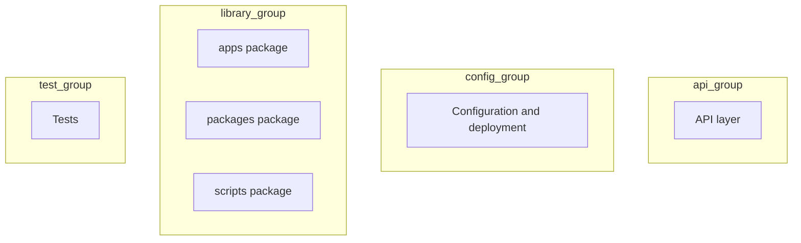

# Architecture report: guilhermerodz/input-otp

> Automated static analysis. **Observed** = directly seen in files/imports/AST; **Inferred** = interpretation from that evidence. Repository code was not executed.

## 1. Repository at a glance

| Item | Value |
| --- | --- |
| Repository | guilhermerodz/input-otp |
| Description | One time passcode Input. Accessible & unstyled. |
| Language | JavaScript |
| Stars | 3275 |
| Licence | MIT |
| Analysed commit / branch | cf81845e59ff43c5885c66b4755085a36f071cc1 / master |
| Framework(s) | Next.js, React |
| Files analysed | 346 |
| Components | 6 |

## 2. Architecture in one minute

guilhermerodz/input-otp - One time passcode Input. Accessible & unstyled.. This repository was analysed statically from 346 file(s) (0 Python). Detected technologies (observed from imports/manifests): GitHub Actions, Next.js, React, Tailwind CSS, TypeScript. Files are grouped into 6 component(s): API layer, apps package, Configuration and deployment, packages package, scripts package, Tests. Findings below distinguish observed facts from inferred interpretation.

## 3. High-level block diagram

## 4. Main components

### API layer (`api_layer`)

- **Kind:** api
- **Status:** Observed
- **Confidence:** 0.85
- **Responsibility:** Groups 1 file(s) under api layer (observed from repository paths and static analysis).
- **Paths:** `apps/website/src/app/api/refresh-stats/route.ts`
- **Evidence:** [apps/website/src/app/api/refresh-stats/route.ts](https://github.com/guilhermerodz/input-otp/blob/cf81845e59ff43c5885c66b4755085a36f071cc1/apps/website/src/app/api/refresh-stats/route.ts)

### apps package (`apps`)

- **Kind:** library
- **Status:** Observed
- **Confidence:** 0.85
- **Responsibility:** Groups 122 file(s) under apps package (observed from repository paths and static analysis).
- **Paths:** `apps/playground/next.config.mjs`, `apps/playground/playwright.config.ts`, `apps/playground/postcss.config.js`, `apps/playground/src/app/base/page.tsx`, `apps/playground/src/app/layout.tsx`, `apps/playground/src/app/page.tsx`, `apps/playground/src/app/props/page.tsx`, `apps/playground/src/app/pwm-space/page.tsx`, `apps/playground/src/app/with-autofocus/page.tsx`, `apps/playground/src/app/with-on-complete/page.tsx`, `apps/playground/src/components/base-input.tsx`, `apps/playground/src/lib/fonts.ts`, `apps/playground/src/lib/utils.ts`, `apps/playground/tailwind.config.ts`, `apps/website/next.config.mjs`, `apps/website/postcss.config.js`, `apps/website/public/rodz-signature.js`, `apps/website/src/app/(docs)/_components/anatomy/assembly.tsx`, `apps/website/src/app/(docs)/_components/anatomy/index.tsx`, `apps/website/src/app/(docs)/_components/anatomy/isometric.tsx`, `apps/website/src/app/(docs)/_components/anatomy/peel.tsx`, `apps/website/src/app/(docs)/_components/anatomy/shared.tsx`, `apps/website/src/app/(docs)/_components/clipboard-seed.tsx`, `apps/website/src/app/(docs)/_components/code-block.tsx`, `apps/website/src/app/(docs)/_components/component-preview.tsx`, `apps/website/src/app/(docs)/_components/docs-header.tsx`, `apps/website/src/app/(docs)/_components/docs-page.tsx`, `apps/website/src/app/(docs)/_components/docs-sidebar.tsx`, `apps/website/src/app/(docs)/_components/docs-toc.tsx`, `apps/website/src/app/(docs)/_components/edge-case.tsx`, `apps/website/src/app/(docs)/_components/install-tabs.tsx`, `apps/website/src/app/(docs)/_components/preview-tabs.tsx`, `apps/website/src/app/(docs)/_components/props-table.tsx`, `apps/website/src/app/(docs)/_components/prose.tsx`, `apps/website/src/app/(docs)/_components/pwm-simulator/fake-badge.tsx`, `apps/website/src/app/(docs)/_components/pwm-simulator/index.tsx`, `apps/website/src/app/(docs)/_components/pwm-simulator/vendors.ts`, `apps/website/src/app/(docs)/_components/selection-inspector.tsx`, `apps/website/src/app/(docs)/_components/version-selector.tsx`, `apps/website/src/app/(docs)/_demos/alphanumeric.tsx`, `apps/website/src/app/(docs)/_demos/auto-submit.tsx`, `apps/website/src/app/(docs)/_demos/basic.tsx`, `apps/website/src/app/(docs)/_demos/context-api.tsx`, `apps/website/src/app/(docs)/_demos/controlled.tsx`, `apps/website/src/app/(docs)/_demos/digits-only.tsx`, `apps/website/src/app/(docs)/_demos/disabled.tsx`, `apps/website/src/app/(docs)/_demos/groups.tsx`, `apps/website/src/app/(docs)/_demos/invalid.tsx`, `apps/website/src/app/(docs)/_demos/keycaps.tsx`, `apps/website/src/app/(docs)/_demos/labelled.tsx`, `apps/website/src/app/(docs)/_demos/masked.tsx`, `apps/website/src/app/(docs)/_demos/paste-transformer.tsx`, `apps/website/src/app/(docs)/_demos/pin.tsx`, `apps/website/src/app/(docs)/_demos/placeholder.tsx`, `apps/website/src/app/(docs)/_demos/rtl.tsx`, `apps/website/src/app/(docs)/_demos/text-align.tsx`, `apps/website/src/app/(docs)/_demos/underlined.tsx`, `apps/website/src/app/(docs)/_demos/verify-card.tsx`, `apps/website/src/app/(docs)/_lib/highlight.ts`, `apps/website/src/app/(docs)/_lib/nav.ts`, `apps/website/src/app/(docs)/_lib/source.ts`, `apps/website/src/app/(docs)/_lib/versions.ts`, `apps/website/src/app/(docs)/layout.tsx`, `apps/website/src/app/(experiment)/_components/clerk-particles.tsx`, `apps/website/src/app/(experiment)/_components/copy-command.tsx`, `apps/website/src/app/(experiment)/_components/cta-daybreak.tsx`, `apps/website/src/app/(experiment)/_components/feature-bento.tsx`, `apps/website/src/app/(experiment)/_components/feature-proof-card.tsx`, `apps/website/src/app/(experiment)/_components/footer-signature.tsx`, `apps/website/src/app/(experiment)/_components/gallery.tsx`, `apps/website/src/app/(experiment)/_components/get-started-button.tsx`, `apps/website/src/app/(experiment)/_components/hero-field.tsx`, `apps/website/src/app/(experiment)/_components/hero-otp.tsx`, `apps/website/src/app/(experiment)/_components/particle-mark.tsx`, `apps/website/src/app/(experiment)/_components/scroll-link.tsx`, `apps/website/src/app/(experiment)/_components/sponsor-border-beam.tsx`, `apps/website/src/app/(experiment)/_components/sponsor-tilt-grid.tsx`, `apps/website/src/app/(experiment)/_components/spotlight.ts`, `apps/website/src/app/(experiment)/_components/spotted-marquee.tsx`, `apps/website/src/app/(experiment)/_components/stats-odometer.tsx`, `apps/website/src/app/(experiment)/_components/story-iso.tsx`, `apps/website/src/app/(experiment)/_components/story-shared.tsx`, `apps/website/src/app/(experiment)/_components/story-v1.tsx`, `apps/website/src/app/(experiment)/_components/story-v2.tsx`, `apps/website/src/app/(experiment)/_components/use-live.ts`, `apps/website/src/app/(experiment)/_components/used-by-marquee.tsx`, `apps/website/src/app/(experiment)/_data/npm-downloads.ts`, `apps/website/src/app/(experiment)/_reveal/choreography.ts`, `apps/website/src/app/(experiment)/_reveal/reveal-root.tsx`, `apps/website/src/app/(experiment)/_reveal/stars.ts`, `apps/website/src/app/(experiment)/experiment-view.tsx`, `apps/website/src/app/(experiment)/layout.tsx`, `apps/website/src/app/(experiment)/page.tsx`, `apps/website/src/app/(experiment)/story-1/page.tsx`, `apps/website/src/app/(experiment)/story-2/page.tsx`, `apps/website/src/app/(local-pages)/example-auto-submit/page.tsx`, `apps/website/src/app/(local-pages)/example-auto-submit/server/form-action.ts`, `apps/website/src/app/(local-pages)/example-playground/code.tsx`, `apps/website/src/app/(local-pages)/example-playground/component.tsx`, `apps/website/src/app/(local-pages)/example-playground/page.tsx`, `apps/website/src/app/(local-pages)/layout.tsx`, `apps/website/src/app/(local-pages)/raw-input/page.tsx`, `apps/website/src/app/(local-pages)/shadcn/page.tsx`, `apps/website/src/app/(local-pages)/shadcn/pwmb/page.tsx`, `apps/website/src/app/(local-pages)/shadcn/static/page.tsx`, `apps/website/src/components/code.tsx`, `apps/website/src/components/copy-button.tsx`, `apps/website/src/components/icons.tsx`, `apps/website/src/components/page-header.tsx`, `apps/website/src/components/site-footer.tsx`, `apps/website/src/components/site-header.tsx`, `apps/website/src/components/ui/badge.tsx`, `apps/website/src/components/ui/button.tsx`, `apps/website/src/components/ui/dropdown-menu.tsx`, `apps/website/src/components/ui/input-otp.tsx`, `apps/website/src/components/ui/otp-slot.tsx`, `apps/website/src/components/ui/scroll-area.tsx`, `apps/website/src/components/ui/sonner.tsx`, `apps/website/src/lib/fonts.ts`, `apps/website/src/lib/scrollbars.ts`, `apps/website/src/lib/utils.ts`, `apps/website/tailwind.config.ts`
- **Evidence:** [apps/playground/next.config.mjs](https://github.com/guilhermerodz/input-otp/blob/cf81845e59ff43c5885c66b4755085a36f071cc1/apps/playground/next.config.mjs); [apps/playground/playwright.config.ts](https://github.com/guilhermerodz/input-otp/blob/cf81845e59ff43c5885c66b4755085a36f071cc1/apps/playground/playwright.config.ts); [apps/playground/postcss.config.js](https://github.com/guilhermerodz/input-otp/blob/cf81845e59ff43c5885c66b4755085a36f071cc1/apps/playground/postcss.config.js); [apps/playground/src/app/base/page.tsx](https://github.com/guilhermerodz/input-otp/blob/cf81845e59ff43c5885c66b4755085a36f071cc1/apps/playground/src/app/base/page.tsx); [apps/playground/src/app/layout.tsx](https://github.com/guilhermerodz/input-otp/blob/cf81845e59ff43c5885c66b4755085a36f071cc1/apps/playground/src/app/layout.tsx); [apps/playground/src/app/page.tsx](https://github.com/guilhermerodz/input-otp/blob/cf81845e59ff43c5885c66b4755085a36f071cc1/apps/playground/src/app/page.tsx); [apps/playground/src/app/props/page.tsx](https://github.com/guilhermerodz/input-otp/blob/cf81845e59ff43c5885c66b4755085a36f071cc1/apps/playground/src/app/props/page.tsx); [apps/playground/src/app/pwm-space/page.tsx](https://github.com/guilhermerodz/input-otp/blob/cf81845e59ff43c5885c66b4755085a36f071cc1/apps/playground/src/app/pwm-space/page.tsx)

### Configuration and deployment (`config`)

- **Kind:** config
- **Status:** Observed
- **Confidence:** 0.85
- **Responsibility:** Groups 14 file(s) under configuration and deployment (observed from repository paths and static analysis).
- **Paths:** `apps/playground/.eslintrc.json`, `apps/playground/package.json`, `apps/playground/tsconfig.json`, `apps/website/.eslintrc.json`, `apps/website/components.json`, `apps/website/package.json`, `apps/website/src/config/site.ts`, `apps/website/tsconfig.json`, `apps/website/vercel.json`, `package.json`, `packages/input-otp/package.json`, `packages/input-otp/tsconfig.json`, `pnpm-workspace.yaml`, `turbo.json`
- **Evidence:** [apps/playground/.eslintrc.json](https://github.com/guilhermerodz/input-otp/blob/cf81845e59ff43c5885c66b4755085a36f071cc1/apps/playground/.eslintrc.json); [apps/playground/package.json](https://github.com/guilhermerodz/input-otp/blob/cf81845e59ff43c5885c66b4755085a36f071cc1/apps/playground/package.json); [apps/playground/tsconfig.json](https://github.com/guilhermerodz/input-otp/blob/cf81845e59ff43c5885c66b4755085a36f071cc1/apps/playground/tsconfig.json); [apps/website/.eslintrc.json](https://github.com/guilhermerodz/input-otp/blob/cf81845e59ff43c5885c66b4755085a36f071cc1/apps/website/.eslintrc.json); [apps/website/components.json](https://github.com/guilhermerodz/input-otp/blob/cf81845e59ff43c5885c66b4755085a36f071cc1/apps/website/components.json); [apps/website/package.json](https://github.com/guilhermerodz/input-otp/blob/cf81845e59ff43c5885c66b4755085a36f071cc1/apps/website/package.json); [apps/website/src/config/site.ts](https://github.com/guilhermerodz/input-otp/blob/cf81845e59ff43c5885c66b4755085a36f071cc1/apps/website/src/config/site.ts); [apps/website/tsconfig.json](https://github.com/guilhermerodz/input-otp/blob/cf81845e59ff43c5885c66b4755085a36f071cc1/apps/website/tsconfig.json)

### packages package (`packages`)

- **Kind:** library
- **Status:** Observed
- **Confidence:** 0.85
- **Responsibility:** Groups 8 file(s) under packages package (observed from repository paths and static analysis).
- **Paths:** `packages/input-otp/src/index.ts`, `packages/input-otp/src/input.tsx`, `packages/input-otp/src/regexp.ts`, `packages/input-otp/src/sync-timeouts.ts`, `packages/input-otp/src/types.ts`, `packages/input-otp/src/use-previous.ts`, `packages/input-otp/src/use-pwm-badge.tsx`, `packages/input-otp/tsup.config.ts`
- **Evidence:** [packages/input-otp/src/index.ts](https://github.com/guilhermerodz/input-otp/blob/cf81845e59ff43c5885c66b4755085a36f071cc1/packages/input-otp/src/index.ts); [packages/input-otp/src/input.tsx](https://github.com/guilhermerodz/input-otp/blob/cf81845e59ff43c5885c66b4755085a36f071cc1/packages/input-otp/src/input.tsx); [packages/input-otp/src/regexp.ts](https://github.com/guilhermerodz/input-otp/blob/cf81845e59ff43c5885c66b4755085a36f071cc1/packages/input-otp/src/regexp.ts); [packages/input-otp/src/sync-timeouts.ts](https://github.com/guilhermerodz/input-otp/blob/cf81845e59ff43c5885c66b4755085a36f071cc1/packages/input-otp/src/sync-timeouts.ts); [packages/input-otp/src/types.ts](https://github.com/guilhermerodz/input-otp/blob/cf81845e59ff43c5885c66b4755085a36f071cc1/packages/input-otp/src/types.ts); [packages/input-otp/src/use-previous.ts](https://github.com/guilhermerodz/input-otp/blob/cf81845e59ff43c5885c66b4755085a36f071cc1/packages/input-otp/src/use-previous.ts); [packages/input-otp/src/use-pwm-badge.tsx](https://github.com/guilhermerodz/input-otp/blob/cf81845e59ff43c5885c66b4755085a36f071cc1/packages/input-otp/src/use-pwm-badge.tsx); [packages/input-otp/tsup.config.ts](https://github.com/guilhermerodz/input-otp/blob/cf81845e59ff43c5885c66b4755085a36f071cc1/packages/input-otp/tsup.config.ts)

### scripts package (`scripts`)

- **Kind:** library
- **Status:** Observed
- **Confidence:** 0.85
- **Responsibility:** Groups 1 file(s) under scripts package (observed from repository paths and static analysis).
- **Paths:** `scripts/release.mjs`
- **Evidence:** [scripts/release.mjs](https://github.com/guilhermerodz/input-otp/blob/cf81845e59ff43c5885c66b4755085a36f071cc1/scripts/release.mjs)

### Tests (`tests`)

- **Kind:** test
- **Status:** Observed
- **Confidence:** 0.85
- **Responsibility:** Groups 10 file(s) under tests (observed from repository paths and static analysis).
- **Paths:** `apps/playground/src/tests/base.delete-word.spec.ts`, `apps/playground/src/tests/base.props.spec.ts`, `apps/playground/src/tests/base.render.spec.ts`, `apps/playground/src/tests/base.selections.spec.ts`, `apps/playground/src/tests/base.slot.spec.ts`, `apps/playground/src/tests/base.typing.spec.ts`, `apps/playground/src/tests/pwm-space.spec.ts`, `apps/playground/src/tests/util/modifier.ts`, `apps/playground/src/tests/with-autofocus.spec.ts`, `apps/playground/src/tests/with-on-complete.spec.ts`
- **Evidence:** [apps/playground/src/tests/base.delete-word.spec.ts](https://github.com/guilhermerodz/input-otp/blob/cf81845e59ff43c5885c66b4755085a36f071cc1/apps/playground/src/tests/base.delete-word.spec.ts); [apps/playground/src/tests/base.props.spec.ts](https://github.com/guilhermerodz/input-otp/blob/cf81845e59ff43c5885c66b4755085a36f071cc1/apps/playground/src/tests/base.props.spec.ts); [apps/playground/src/tests/base.render.spec.ts](https://github.com/guilhermerodz/input-otp/blob/cf81845e59ff43c5885c66b4755085a36f071cc1/apps/playground/src/tests/base.render.spec.ts); [apps/playground/src/tests/base.selections.spec.ts](https://github.com/guilhermerodz/input-otp/blob/cf81845e59ff43c5885c66b4755085a36f071cc1/apps/playground/src/tests/base.selections.spec.ts); [apps/playground/src/tests/base.slot.spec.ts](https://github.com/guilhermerodz/input-otp/blob/cf81845e59ff43c5885c66b4755085a36f071cc1/apps/playground/src/tests/base.slot.spec.ts); [apps/playground/src/tests/base.typing.spec.ts](https://github.com/guilhermerodz/input-otp/blob/cf81845e59ff43c5885c66b4755085a36f071cc1/apps/playground/src/tests/base.typing.spec.ts); [apps/playground/src/tests/pwm-space.spec.ts](https://github.com/guilhermerodz/input-otp/blob/cf81845e59ff43c5885c66b4755085a36f071cc1/apps/playground/src/tests/pwm-space.spec.ts); [apps/playground/src/tests/util/modifier.ts](https://github.com/guilhermerodz/input-otp/blob/cf81845e59ff43c5885c66b4755085a36f071cc1/apps/playground/src/tests/util/modifier.ts)

## 5. Execution flow

**Observed** entry point(s):

- [packages/input-otp/src/index.ts](https://github.com/guilhermerodz/input-otp/blob/cf81845e59ff43c5885c66b4755085a36f071cc1/packages/input-otp/src/index.ts)

Representative flow (derived from observed entry points and the import graph; steps beyond the entry point are **Inferred**):

1. Execution starts at an observed entry point listed above, if present.
2. No internal import relationships between components were observed.

## 6. Project structure

### `(root)`

- `.editorconfig` - config (229 bytes)
- `.eslintignore` - other (52 bytes)
- `.gitignore` - other (543 bytes)
- `CHANGELOG.md` - docs (10074 bytes)
- `CLAUDE.md` - docs (2934 bytes)
- `LICENSE` - docs (1071 bytes)
- `README.md` - docs (11767 bytes)
- `RELEASING.md` - docs (3277 bytes)
- `package.json` - manifest (2109 bytes)
- `pnpm-workspace.yaml` - config (104 bytes)
- `turbo.json` - config (582 bytes)

### `.agents`

- `.agents/skills/impeccable/SKILL.md` - docs (10121 bytes)
- `.agents/skills/impeccable/agents/impeccable_asset_producer.toml` - config (8477 bytes)
- `.agents/skills/impeccable/agents/impeccable_finish_reviewer.toml` - config (2366 bytes)
- `.agents/skills/impeccable/agents/impeccable_manual_edit_applier.toml` - config (7116 bytes)
- `.agents/skills/impeccable/agents/openai.yaml` - config (235 bytes)
- `.agents/skills/impeccable/reference/adapt.md` - docs (10307 bytes)
- `.agents/skills/impeccable/reference/adapt.native.md` - docs (3910 bytes)
- `.agents/skills/impeccable/reference/android.md` - docs (3253 bytes)
- `.agents/skills/impeccable/reference/animate.md` - docs (4795 bytes)
- `.agents/skills/impeccable/reference/audit.md` - docs (7735 bytes)
- `.agents/skills/impeccable/reference/audit.native.md` - docs (8357 bytes)
- `.agents/skills/impeccable/reference/bolder.md` - docs (3301 bytes)
- `.agents/skills/impeccable/reference/clarify.md` - docs (4590 bytes)
- `.agents/skills/impeccable/reference/colorize.md` - docs (4537 bytes)
- `.agents/skills/impeccable/reference/craft-floor.md` - docs (3755 bytes)
- `.agents/skills/impeccable/reference/craft.md` - docs (555 bytes)
- `.agents/skills/impeccable/reference/critique.md` - docs (43463 bytes)
- `.agents/skills/impeccable/reference/delight.md` - docs (3716 bytes)
- `.agents/skills/impeccable/reference/distill.md` - docs (5703 bytes)
- `.agents/skills/impeccable/reference/doctor.md` - docs (4752 bytes)
- `.agents/skills/impeccable/reference/document.md` - docs (27515 bytes)
- `.agents/skills/impeccable/reference/extract.md` - docs (3430 bytes)
- `.agents/skills/impeccable/reference/harden.md` - docs (8368 bytes)
- `.agents/skills/impeccable/reference/hooks.md` - docs (11871 bytes)
- `.agents/skills/impeccable/reference/init.md` - docs (8259 bytes)
- `.agents/skills/impeccable/reference/ios.md` - docs (2975 bytes)
- `.agents/skills/impeccable/reference/layout.md` - docs (5159 bytes)
- `.agents/skills/impeccable/reference/live.md` - docs (64717 bytes)
- `.agents/skills/impeccable/reference/new-work.md` - docs (21560 bytes)
- `.agents/skills/impeccable/reference/onboard.md` - docs (7740 bytes)
- `.agents/skills/impeccable/reference/operate.md` - docs (4145 bytes)
- `.agents/skills/impeccable/reference/optimize.md` - docs (7598 bytes)
- `.agents/skills/impeccable/reference/overdrive.md` - docs (8895 bytes)
- `.agents/skills/impeccable/reference/polish.md` - docs (5200 bytes)
- `.agents/skills/impeccable/reference/quieter.md` - docs (4938 bytes)
- `.agents/skills/impeccable/reference/routing.md` - docs (2915 bytes)
- `.agents/skills/impeccable/reference/shape.md` - docs (3547 bytes)
- `.agents/skills/impeccable/reference/typeset.md` - docs (5254 bytes)
- `.agents/skills/impeccable/reference/visualize.md` - docs (4096 bytes)
- `.agents/skills/impeccable/scripts/command-metadata.json` - config (7934 bytes)
- `.agents/skills/impeccable/scripts/concept-seed.mjs` - source, JavaScript (27102 bytes)
- `.agents/skills/impeccable/scripts/context-signals.mjs` - source, JavaScript (8045 bytes)
- `.agents/skills/impeccable/scripts/context.mjs` - source, JavaScript (59832 bytes)
- `.agents/skills/impeccable/scripts/critique-storage.mjs` - source, JavaScript (8128 bytes)
- `.agents/skills/impeccable/scripts/detect-csp.mjs` - source, JavaScript (6761 bytes)
- `.agents/skills/impeccable/scripts/detect.mjs` - source, JavaScript (620 bytes)
- `.agents/skills/impeccable/scripts/detector/browser/injected/index.mjs` - source, JavaScript (80775 bytes)
- `.agents/skills/impeccable/scripts/detector/cli/main.mjs` - source, JavaScript (19297 bytes)
- `.agents/skills/impeccable/scripts/detector/design-system.mjs` - source, JavaScript (35110 bytes)
- `.agents/skills/impeccable/scripts/detector/detect-antipatterns.mjs` - source, JavaScript (1843 bytes)
- `.agents/skills/impeccable/scripts/detector/engines/browser/detect-url.mjs` - source, JavaScript (12791 bytes)
- `.agents/skills/impeccable/scripts/detector/engines/regex/detect-text.mjs` - source, JavaScript (35058 bytes)
- `.agents/skills/impeccable/scripts/detector/engines/static-html/css-cascade.mjs` - source, JavaScript (42724 bytes)
- `.agents/skills/impeccable/scripts/detector/engines/static-html/detect-html.mjs` - source, JavaScript (11098 bytes)
- `.agents/skills/impeccable/scripts/detector/engines/visual/screenshot-contrast.mjs` - source, JavaScript (6529 bytes)
- `.agents/skills/impeccable/scripts/detector/findings.mjs` - source, JavaScript (766 bytes)
- `.agents/skills/impeccable/scripts/detector/node/file-system.mjs` - source, JavaScript (6859 bytes)
- `.agents/skills/impeccable/scripts/detector/profile/profiler.mjs` - source, JavaScript (4550 bytes)
- `.agents/skills/impeccable/scripts/detector/registry/antipatterns.mjs` - source, JavaScript (27693 bytes)
- `.agents/skills/impeccable/scripts/detector/shared/color.mjs` - source, JavaScript (4512 bytes)
- `.agents/skills/impeccable/scripts/detector/shared/constants.mjs` - source, JavaScript (4675 bytes)
- `.agents/skills/impeccable/scripts/detector/shared/fonts.mjs` - source, JavaScript (852 bytes)
- `.agents/skills/impeccable/scripts/detector/shared/inline-ignores.mjs` - source, JavaScript (6194 bytes)
- `.agents/skills/impeccable/scripts/detector/shared/page.mjs` - source, JavaScript (252 bytes)
- `.agents/skills/impeccable/scripts/doctor.mjs` - source, JavaScript (11849 bytes)
- `.agents/skills/impeccable/scripts/generate-image.mjs` - source, JavaScript (9147 bytes)
- `.agents/skills/impeccable/scripts/hook-admin.mjs` - source, JavaScript (29116 bytes)
- `.agents/skills/impeccable/scripts/hook-before-edit.mjs` - source, JavaScript (18708 bytes)
- `.agents/skills/impeccable/scripts/hook-lib.mjs` - source, JavaScript (83258 bytes)
- `.agents/skills/impeccable/scripts/hook.mjs` - source, JavaScript (2687 bytes)
- `.agents/skills/impeccable/scripts/lib/artifact-schema.mjs` - source, JavaScript (3896 bytes)
- `.agents/skills/impeccable/scripts/lib/composition-catalog.mjs` - source, JavaScript (8023 bytes)
- `.agents/skills/impeccable/scripts/lib/concept-catalog.mjs` - source, JavaScript (15881 bytes)
- `.agents/skills/impeccable/scripts/lib/design-parser.mjs` - source, JavaScript (25824 bytes)
- `.agents/skills/impeccable/scripts/lib/impeccable-config.mjs` - source, JavaScript (22553 bytes)
- `.agents/skills/impeccable/scripts/lib/impeccable-paths.mjs` - source, JavaScript (4976 bytes)
- `.agents/skills/impeccable/scripts/lib/is-generated.mjs` - source, JavaScript (2269 bytes)
- `.agents/skills/impeccable/scripts/lib/provider.mjs` - source, JavaScript (327 bytes)
- `.agents/skills/impeccable/scripts/lib/staleness-deep.mjs` - source, JavaScript (20079 bytes)
- `.agents/skills/impeccable/scripts/lib/staleness-notice.mjs` - source, JavaScript (6706 bytes)
- `.agents/skills/impeccable/scripts/lib/staleness.mjs` - source, JavaScript (19463 bytes)
- `.agents/skills/impeccable/scripts/lib/surface-briefs.mjs` - source, JavaScript (6206 bytes)
- `.agents/skills/impeccable/scripts/lib/target-args.mjs` - source, JavaScript (1145 bytes)
- `.agents/skills/impeccable/scripts/lib/target-slug.mjs` - source, JavaScript (1075 bytes)
- `.agents/skills/impeccable/scripts/lib/template-extensions.mjs` - source, JavaScript (5457 bytes)
- `.agents/skills/impeccable/scripts/live-accept.mjs` - source, JavaScript (36264 bytes)
- `.agents/skills/impeccable/scripts/live-browser-dom.js` - source, JavaScript (4250 bytes)
- `.agents/skills/impeccable/scripts/live-browser-session.js` - source, JavaScript (3297 bytes)
- `.agents/skills/impeccable/scripts/live-commit-manual-edits.mjs` - source, JavaScript (42166 bytes)
- `.agents/skills/impeccable/scripts/live-complete.mjs` - source, JavaScript (2942 bytes)
- `.agents/skills/impeccable/scripts/live-copy-edit-agent.mjs` - source, JavaScript (28868 bytes)
- `.agents/skills/impeccable/scripts/live-discard-manual-edits.mjs` - source, JavaScript (1687 bytes)
- `.agents/skills/impeccable/scripts/live-inject.mjs` - source, JavaScript (29852 bytes)
- `.agents/skills/impeccable/scripts/live-insert.mjs` - source, JavaScript (10012 bytes)
- `.agents/skills/impeccable/scripts/live-manual-edit-evidence.mjs` - source, JavaScript (11857 bytes)
- `.agents/skills/impeccable/scripts/live-poll.mjs` - source, JavaScript (15293 bytes)
- `.agents/skills/impeccable/scripts/live-resume.mjs` - source, JavaScript (4459 bytes)
- `.agents/skills/impeccable/scripts/live-server.mjs` - source, JavaScript (59365 bytes)
- `.agents/skills/impeccable/scripts/live-status.mjs` - source, JavaScript (2208 bytes)
- `.agents/skills/impeccable/scripts/live-target.mjs` - source, JavaScript (934 bytes)
- `.agents/skills/impeccable/scripts/live-wrap.mjs` - source, JavaScript (37852 bytes)
- `.agents/skills/impeccable/scripts/live.mjs` - source, JavaScript (10700 bytes)
- `.agents/skills/impeccable/scripts/live/browser-script-parts.mjs` - source, JavaScript (1821 bytes)
- `.agents/skills/impeccable/scripts/live/completion.mjs` - source, JavaScript (1444 bytes)
- `.agents/skills/impeccable/scripts/live/event-validation.mjs` - source, JavaScript (7200 bytes)
- `.agents/skills/impeccable/scripts/live/generation-preflight.mjs` - source, JavaScript (5937 bytes)
- `.agents/skills/impeccable/scripts/live/insert-ui.mjs` - source, JavaScript (15664 bytes)
- `.agents/skills/impeccable/scripts/live/manual-apply.mjs` - source, JavaScript (34898 bytes)
- `.agents/skills/impeccable/scripts/live/manual-edit-routes.mjs` - source, JavaScript (14933 bytes)
- `.agents/skills/impeccable/scripts/live/manual-edits-buffer.mjs` - source, JavaScript (5112 bytes)
- `.agents/skills/impeccable/scripts/live/poll-lanes.mjs` - source, JavaScript (759 bytes)
- `.agents/skills/impeccable/scripts/live/session-store.mjs` - source, JavaScript (14338 bytes)
- `.agents/skills/impeccable/scripts/live/source-lock.mjs` - source, JavaScript (3707 bytes)
- `.agents/skills/impeccable/scripts/live/source-search.mjs` - source, JavaScript (4349 bytes)
- `.agents/skills/impeccable/scripts/live/svelte-component.mjs` - source, JavaScript (27899 bytes)
- `.agents/skills/impeccable/scripts/live/sveltekit-adapter.mjs` - source, JavaScript (9497 bytes)
- `.agents/skills/impeccable/scripts/live/tanstack-adapter.mjs` - source, JavaScript (9747 bytes)
- `.agents/skills/impeccable/scripts/live/ui-core.mjs` - source, JavaScript (5541 bytes)
- `.agents/skills/impeccable/scripts/live/vocabulary.mjs` - source, JavaScript (3307 bytes)
- `.agents/skills/impeccable/scripts/modern-screenshot.umd.js` - source, JavaScript (29290 bytes)
- `.agents/skills/impeccable/scripts/palette.mjs` - source, JavaScript (56787 bytes)
- `.agents/skills/impeccable/scripts/pin.mjs` - source, JavaScript (6501 bytes)
- `.agents/skills/impeccable/scripts/serve-question.mjs` - source, JavaScript (37769 bytes)
- `.agents/skills/impeccable/scripts/surface-brief.mjs` - source, JavaScript (2517 bytes)

### `.claude`

- `.claude/launch.json` - config (1716 bytes)

### `.codex`

- `.codex/hooks.json` - config (740 bytes)

### `.github`

- `.github/ISSUE_TEMPLATE/bad-design-choice.md` - docs (294 bytes)
- `.github/ISSUE_TEMPLATE/bug-report.md` - docs (1308 bytes)
- `.github/ISSUE_TEMPLATE/feature_request.md` - docs (595 bytes)
- `.github/workflows/playwright.yml` - ci, YAML (714 bytes)
- `.github/workflows/release.yml` - ci, YAML (3852 bytes)

### `apps`

- `apps/playground/.eslintrc.json` - config (106 bytes)
- `apps/playground/.gitignore` - other (403 bytes)
- `apps/playground/README.md` - docs (1383 bytes)
- `apps/playground/next.config.mjs` - source, JavaScript (392 bytes)
- `apps/playground/package.json` - manifest (678 bytes)
- `apps/playground/playwright.config.ts` - source, TypeScript (2061 bytes)
- `apps/playground/postcss.config.js` - source, JavaScript (83 bytes)
- `apps/playground/public/next.svg` - other (1375 bytes)
- `apps/playground/public/vercel.svg` - other (629 bytes)
- `apps/playground/src/app/base/page.tsx` - source, TypeScript (433 bytes)
- `apps/playground/src/app/globals.css` - other (606 bytes)
- `apps/playground/src/app/layout.tsx` - source, TypeScript (625 bytes)
- `apps/playground/src/app/page.tsx` - source, TypeScript (2696 bytes)
- `apps/playground/src/app/props/page.tsx` - source, TypeScript (733 bytes)
- `apps/playground/src/app/pwm-space/page.tsx` - source, TypeScript (683 bytes)
- `apps/playground/src/app/with-autofocus/page.tsx` - source, TypeScript (286 bytes)
- `apps/playground/src/app/with-on-complete/page.tsx` - source, TypeScript (390 bytes)
- `apps/playground/src/components/base-input.tsx` - source, TypeScript (1573 bytes)
- `apps/playground/src/lib/fonts.ts` - source, TypeScript (459 bytes)
- `apps/playground/src/lib/utils.ts` - source, TypeScript (166 bytes)
- `apps/playground/src/tests/base.delete-word.spec.ts` - test, TypeScript (2433 bytes)
- `apps/playground/src/tests/base.props.spec.ts` - test, TypeScript (1113 bytes)
- `apps/playground/src/tests/base.render.spec.ts` - test, TypeScript (1133 bytes)
- `apps/playground/src/tests/base.selections.spec.ts` - test, TypeScript (4361 bytes)
- `apps/playground/src/tests/base.slot.spec.ts` - test, TypeScript (1237 bytes)
- `apps/playground/src/tests/base.typing.spec.ts` - test, TypeScript (947 bytes)
- `apps/playground/src/tests/pwm-space.spec.ts` - test, TypeScript (1922 bytes)
- `apps/playground/src/tests/util/modifier.ts` - test, TypeScript (74 bytes)
- `apps/playground/src/tests/with-autofocus.spec.ts` - test, TypeScript (314 bytes)
- `apps/playground/src/tests/with-on-complete.spec.ts` - test, TypeScript (466 bytes)
- `apps/playground/tailwind.config.ts` - source, TypeScript (510 bytes)
- `apps/playground/tsconfig.json` - config (578 bytes)
- `apps/website/.eslintrc.json` - config (40 bytes)
- `apps/website/.gitignore` - other (403 bytes)
- `apps/website/HANDOFF.md` - docs (5642 bytes)
- `apps/website/README.md` - docs (4303 bytes)
- `apps/website/components.json` - config (345 bytes)
- `apps/website/next.config.mjs` - source, JavaScript (608 bytes)
- `apps/website/package.json` - manifest (1367 bytes)
- `apps/website/postcss.config.js` - source, JavaScript (83 bytes)
- `apps/website/public/icon.svg` - other (316 bytes)
- `apps/website/public/logos/clerk.svg` - other (835 bytes)
- `apps/website/public/logos/cluely.svg` - other (6137 bytes)
- `apps/website/public/logos/elevenlabs.svg` - other (292 bytes)
- `apps/website/public/logos/lovable.svg` - other (515 bytes)
- `apps/website/public/logos/mongodb.svg` - other (665 bytes)
- `apps/website/public/logos/sanity.svg` - other (731 bytes)
- `apps/website/public/logos/vercel.svg` - other (271 bytes)
- `apps/website/public/logos/xai.svg` - other (415 bytes)
- `apps/website/public/next.svg` - other (1375 bytes)
- `apps/website/public/rodz-signature.js` - source, JavaScript (3518 bytes)
- `apps/website/public/site.webmanifest` - other (377 bytes)
- `apps/website/public/sponsors/clerk-wordmark-black-trimmed.svg` - other (5007 bytes)
- `apps/website/public/sponsors/clerk-wordmark-black.svg` - other (4994 bytes)
- `apps/website/public/sponsors/clerk-wordmark-white-in-black-bg.svg` - other (5157 bytes)
- `apps/website/public/sponsors/clerk-wordmark-white-trimmed.svg` - other (5004 bytes)
- `apps/website/public/sponsors/clerk-wordmark-white.svg` - other (4991 bytes)
- `apps/website/public/sponsors/evomi-wordmark-black-trimmed.svg` - other (4758 bytes)
- `apps/website/public/sponsors/evomi-wordmark-black.svg` - other (4745 bytes)
- `apps/website/public/sponsors/evomi-wordmark-white-in-black-bg.svg` - other (4936 bytes)
- `apps/website/public/sponsors/evomi-wordmark-white-trimmed.svg` - other (4759 bytes)
- `apps/website/public/sponsors/evomi-wordmark-white.svg` - other (4746 bytes)
- `apps/website/public/vercel.svg` - other (629 bytes)
- `apps/website/src/app/(docs)/_components/anatomy/assembly.tsx` - source, TypeScript (11034 bytes)
- `apps/website/src/app/(docs)/_components/anatomy/index.tsx` - source, TypeScript (2448 bytes)
- `apps/website/src/app/(docs)/_components/anatomy/isometric.tsx` - source, TypeScript (8051 bytes)
- `apps/website/src/app/(docs)/_components/anatomy/peel.tsx` - source, TypeScript (7551 bytes)
- `apps/website/src/app/(docs)/_components/anatomy/shared.tsx` - source, TypeScript (7880 bytes)
- `apps/website/src/app/(docs)/_components/clipboard-seed.tsx` - source, TypeScript (1097 bytes)
- `apps/website/src/app/(docs)/_components/code-block.tsx` - source, TypeScript (1291 bytes)
- `apps/website/src/app/(docs)/_components/component-preview.tsx` - source, TypeScript (963 bytes)
- `apps/website/src/app/(docs)/_components/docs-header.tsx` - source, TypeScript (2998 bytes)
- `apps/website/src/app/(docs)/_components/docs-page.tsx` - source, TypeScript (3088 bytes)
- `apps/website/src/app/(docs)/_components/docs-sidebar.tsx` - source, TypeScript (3655 bytes)
- `apps/website/src/app/(docs)/_components/docs-toc.tsx` - source, TypeScript (3030 bytes)
- `apps/website/src/app/(docs)/_components/edge-case.tsx` - source, TypeScript (2754 bytes)
- `apps/website/src/app/(docs)/_components/install-tabs.tsx` - source, TypeScript (1705 bytes)
- `apps/website/src/app/(docs)/_components/preview-tabs.tsx` - source, TypeScript (2732 bytes)
- `apps/website/src/app/(docs)/_components/props-table.tsx` - source, TypeScript (3474 bytes)
- `apps/website/src/app/(docs)/_components/prose.tsx` - source, TypeScript (7148 bytes)
- `apps/website/src/app/(docs)/_components/pwm-simulator/fake-badge.tsx` - source, TypeScript (1945 bytes)
- `apps/website/src/app/(docs)/_components/pwm-simulator/index.tsx` - source, TypeScript (12507 bytes)
- `apps/website/src/app/(docs)/_components/pwm-simulator/vendors.ts` - source, TypeScript (2402 bytes)
- `apps/website/src/app/(docs)/_components/selection-inspector.tsx` - source, TypeScript (6313 bytes)
- `apps/website/src/app/(docs)/_components/version-selector.tsx` - source, TypeScript (2259 bytes)
- `apps/website/src/app/(docs)/_demos/alphanumeric.tsx` - source, TypeScript (656 bytes)
- `apps/website/src/app/(docs)/_demos/auto-submit.tsx` - source, TypeScript (1882 bytes)
- `apps/website/src/app/(docs)/_demos/basic.tsx` - source, TypeScript (446 bytes)
- `apps/website/src/app/(docs)/_demos/context-api.tsx` - source, TypeScript (1047 bytes)
- `apps/website/src/app/(docs)/_demos/controlled.tsx` - source, TypeScript (1453 bytes)
- `apps/website/src/app/(docs)/_demos/digits-only.tsx` - source, TypeScript (505 bytes)
- `apps/website/src/app/(docs)/_demos/disabled.tsx` - source, TypeScript (1388 bytes)
- `apps/website/src/app/(docs)/_demos/groups.tsx` - source, TypeScript (685 bytes)
- `apps/website/src/app/(docs)/_demos/invalid.tsx` - source, TypeScript (2278 bytes)
- `apps/website/src/app/(docs)/_demos/keycaps.tsx` - source, TypeScript (1515 bytes)
- `apps/website/src/app/(docs)/_demos/labelled.tsx` - source, TypeScript (1080 bytes)
- `apps/website/src/app/(docs)/_demos/masked.tsx` - source, TypeScript (1930 bytes)
- `apps/website/src/app/(docs)/_demos/paste-transformer.tsx` - source, TypeScript (705 bytes)
- `apps/website/src/app/(docs)/_demos/pin.tsx` - source, TypeScript (1086 bytes)
- `apps/website/src/app/(docs)/_demos/placeholder.tsx` - source, TypeScript (452 bytes)
- `apps/website/src/app/(docs)/_demos/rtl.tsx` - source, TypeScript (994 bytes)
- `apps/website/src/app/(docs)/_demos/text-align.tsx` - source, TypeScript (1882 bytes)
- `apps/website/src/app/(docs)/_demos/underlined.tsx` - source, TypeScript (1284 bytes)
- `apps/website/src/app/(docs)/_demos/verify-card.tsx` - source, TypeScript (4041 bytes)
- `apps/website/src/app/(docs)/_lib/highlight.ts` - source, TypeScript (751 bytes)
- `apps/website/src/app/(docs)/_lib/nav.ts` - source, TypeScript (5640 bytes)
- `apps/website/src/app/(docs)/_lib/source.ts` - source, TypeScript (881 bytes)
- `apps/website/src/app/(docs)/_lib/versions.ts` - source, TypeScript (1328 bytes)
- `apps/website/src/app/(docs)/anatomy.css` - other (5008 bytes)
- `apps/website/src/app/(docs)/docs.css` - other (1600 bytes)
- `apps/website/src/app/(docs)/docs/accessibility/page.tsx` - docs (10173 bytes)
- `apps/website/src/app/(docs)/docs/anatomy/page.tsx` - docs (12918 bytes)
- `apps/website/src/app/(docs)/docs/api/page.tsx` - docs (16349 bytes)
- `apps/website/src/app/(docs)/docs/edge-cases/page.tsx` - docs (30430 bytes)
- `apps/website/src/app/(docs)/docs/examples/page.tsx` - docs (6470 bytes)
- `apps/website/src/app/(docs)/docs/forms/page.tsx` - docs (8539 bytes)
- `apps/website/src/app/(docs)/docs/installation/page.tsx` - docs (5377 bytes)
- `apps/website/src/app/(docs)/docs/mobile/page.tsx` - docs (12590 bytes)
- `apps/website/src/app/(docs)/docs/page.tsx` - docs (8389 bytes)
- `apps/website/src/app/(docs)/docs/password-managers/page.tsx` - docs (12134 bytes)
- `apps/website/src/app/(docs)/docs/styling/page.tsx` - docs (7861 bytes)
- `apps/website/src/app/(docs)/docs/troubleshooting/page.tsx` - docs (10569 bytes)
- `apps/website/src/app/(docs)/docs/validation/page.tsx` - docs (7954 bytes)
- `apps/website/src/app/(docs)/layout.tsx` - source, TypeScript (2077 bytes)
- `apps/website/src/app/(experiment)/_components/clerk-particles.tsx` - source, TypeScript (1816 bytes)
- `apps/website/src/app/(experiment)/_components/copy-command.tsx` - source, TypeScript (1953 bytes)
- `apps/website/src/app/(experiment)/_components/cta-daybreak.tsx` - source, TypeScript (7898 bytes)
- `apps/website/src/app/(experiment)/_components/feature-bento.tsx` - source, TypeScript (12062 bytes)
- `apps/website/src/app/(experiment)/_components/feature-proof-card.tsx` - source, TypeScript (11959 bytes)
- `apps/website/src/app/(experiment)/_components/footer-signature.tsx` - source, TypeScript (1693 bytes)
- `apps/website/src/app/(experiment)/_components/gallery.tsx` - source, TypeScript (5963 bytes)
- `apps/website/src/app/(experiment)/_components/get-started-button.tsx` - source, TypeScript (1062 bytes)
- `apps/website/src/app/(experiment)/_components/hero-field.tsx` - source, TypeScript (1170 bytes)
- `apps/website/src/app/(experiment)/_components/hero-otp.tsx` - source, TypeScript (29219 bytes)
- `apps/website/src/app/(experiment)/_components/particle-mark.tsx` - source, TypeScript (18813 bytes)
- `apps/website/src/app/(experiment)/_components/scroll-link.tsx` - source, TypeScript (3026 bytes)
- `apps/website/src/app/(experiment)/_components/sponsor-border-beam.tsx` - source, TypeScript (1355 bytes)
- `apps/website/src/app/(experiment)/_components/sponsor-tilt-grid.tsx` - source, TypeScript (6035 bytes)
- `apps/website/src/app/(experiment)/_components/spotlight.ts` - source, TypeScript (6202 bytes)
- `apps/website/src/app/(experiment)/_components/spotted-marquee.tsx` - source, TypeScript (12395 bytes)
- `apps/website/src/app/(experiment)/_components/stats-odometer.tsx` - source, TypeScript (8169 bytes)
- `apps/website/src/app/(experiment)/_components/story-iso.tsx` - source, TypeScript (37120 bytes)
- `apps/website/src/app/(experiment)/_components/story-shared.tsx` - source, TypeScript (17541 bytes)
- `apps/website/src/app/(experiment)/_components/story-v1.tsx` - source, TypeScript (1523 bytes)
- `apps/website/src/app/(experiment)/_components/story-v2.tsx` - source, TypeScript (1673 bytes)
- `apps/website/src/app/(experiment)/_components/use-live.ts` - source, TypeScript (2383 bytes)
- `apps/website/src/app/(experiment)/_components/used-by-marquee.tsx` - source, TypeScript (16129 bytes)
- `apps/website/src/app/(experiment)/_data/npm-downloads.ts` - source, TypeScript (3779 bytes)
- `apps/website/src/app/(experiment)/_reveal/choreography.ts` - source, TypeScript (3637 bytes)
- `apps/website/src/app/(experiment)/_reveal/reveal-root.tsx` - source, TypeScript (11694 bytes)
- `apps/website/src/app/(experiment)/_reveal/stars.ts` - source, TypeScript (488 bytes)
- `apps/website/src/app/(experiment)/experiment-view.tsx` - source, TypeScript (15887 bytes)
- `apps/website/src/app/(experiment)/experiment.css` - other (43850 bytes)
- `apps/website/src/app/(experiment)/feature-bento.css` - other (25148 bytes)
- `apps/website/src/app/(experiment)/feature-proof-card.css` - other (15181 bytes)
- `apps/website/src/app/(experiment)/layout.tsx` - source, TypeScript (2419 bytes)
- `apps/website/src/app/(experiment)/page.tsx` - source, TypeScript (417 bytes)
- `apps/website/src/app/(experiment)/reveal.css` - other (1854 bytes)
- `apps/website/src/app/(experiment)/stats-odometer.css` - other (4224 bytes)
- `apps/website/src/app/(experiment)/story-1/page.tsx` - source, TypeScript (453 bytes)
- `apps/website/src/app/(experiment)/story-2/page.tsx` - source, TypeScript (449 bytes)
- `apps/website/src/app/(local-pages)/example-auto-submit/page.tsx` - source, TypeScript (636 bytes)
- `apps/website/src/app/(local-pages)/example-auto-submit/server/form-action.ts` - source, TypeScript (161 bytes)
- `apps/website/src/app/(local-pages)/example-playground/code.tsx` - source, TypeScript (2657 bytes)
- `apps/website/src/app/(local-pages)/example-playground/component.tsx` - source, TypeScript (2557 bytes)
- `apps/website/src/app/(local-pages)/example-playground/page.tsx` - source, TypeScript (239 bytes)
- `apps/website/src/app/(local-pages)/layout.tsx` - source, TypeScript (1025 bytes)
- `apps/website/src/app/(local-pages)/raw-input/page.tsx` - source, TypeScript (345 bytes)
- `apps/website/src/app/(local-pages)/shadcn/page.tsx` - source, TypeScript (1477 bytes)
- `apps/website/src/app/(local-pages)/shadcn/pwmb/page.tsx` - source, TypeScript (1438 bytes)
- `apps/website/src/app/(local-pages)/shadcn/static/page.tsx` - source, TypeScript (173 bytes)
- `apps/website/src/app/api/refresh-stats/route.ts` - source, TypeScript (1815 bytes)
- `apps/website/src/app/globals.css` - other (8418 bytes)
- `apps/website/src/components/code.tsx` - source, TypeScript (1001 bytes)
- `apps/website/src/components/copy-button.tsx` - source, TypeScript (4714 bytes)
- `apps/website/src/components/icons.tsx` - source, TypeScript (12772 bytes)
- `apps/website/src/components/page-header.tsx` - source, TypeScript (1323 bytes)
- `apps/website/src/components/site-footer.tsx` - source, TypeScript (1347 bytes)
- `apps/website/src/components/site-header.tsx` - source, TypeScript (2536 bytes)
- `apps/website/src/components/ui/badge.tsx` - source, TypeScript (1140 bytes)
- `apps/website/src/components/ui/button.tsx` - source, TypeScript (1839 bytes)
- `apps/website/src/components/ui/dropdown-menu.tsx` - source, TypeScript (7309 bytes)
- `apps/website/src/components/ui/input-otp.tsx` - source, TypeScript (3385 bytes)
- `apps/website/src/components/ui/otp-slot.tsx` - source, TypeScript (2249 bytes)
- `apps/website/src/components/ui/scroll-area.tsx` - source, TypeScript (1656 bytes)
- `apps/website/src/components/ui/sonner.tsx` - source, TypeScript (878 bytes)
- `apps/website/src/config/site.ts` - source, TypeScript (463 bytes)
- `apps/website/src/lib/fonts.ts` - source, TypeScript (642 bytes)
- `apps/website/src/lib/scrollbars.ts` - source, TypeScript (1381 bytes)
- `apps/website/src/lib/utils.ts` - source, TypeScript (166 bytes)
- `apps/website/tailwind.config.ts` - source, TypeScript (2981 bytes)
- `apps/website/tsconfig.json` - config (712 bytes)
- `apps/website/vercel.json` - config (153 bytes)

### `packages`

- `packages/input-otp/package.json` - manifest (3154 bytes)
- `packages/input-otp/src/index.ts` - source, TypeScript (113 bytes)
- `packages/input-otp/src/input.tsx` - source, TypeScript (18612 bytes)
- `packages/input-otp/src/regexp.ts` - source, TypeScript (151 bytes)
- `packages/input-otp/src/sync-timeouts.ts` - source, TypeScript (218 bytes)
- `packages/input-otp/src/types.ts` - source, TypeScript (1244 bytes)
- `packages/input-otp/src/use-previous.ts` - source, TypeScript (185 bytes)
- `packages/input-otp/src/use-pwm-badge.tsx` - source, TypeScript (5830 bytes)
- `packages/input-otp/tsconfig.json` - config (283 bytes)
- `packages/input-otp/tsup.config.ts` - source, TypeScript (203 bytes)

### `scripts`

- `scripts/release.mjs` - source, JavaScript (5324 bytes)

## 7. Key dependencies and integrations

| Name | Category | Status | Confidence | Evidence |
| --- | --- | --- | --- | --- |
| GitHub Actions | ci | Observed | 0.90 | [.github/workflows/playwright.yml](https://github.com/guilhermerodz/input-otp/blob/cf81845e59ff43c5885c66b4755085a36f071cc1/.github/workflows/playwright.yml); [.github/workflows/release.yml](https://github.com/guilhermerodz/input-otp/blob/cf81845e59ff43c5885c66b4755085a36f071cc1/.github/workflows/release.yml) |
| Next.js | framework | Observed | 0.90 | [apps/playground/package.json:5](https://github.com/guilhermerodz/input-otp/blob/cf81845e59ff43c5885c66b4755085a36f071cc1/apps/playground/package.json#L5); [apps/website/package.json:6](https://github.com/guilhermerodz/input-otp/blob/cf81845e59ff43c5885c66b4755085a36f071cc1/apps/website/package.json#L6) |
| React | framework | Observed | 0.90 | [apps/playground/package.json:13](https://github.com/guilhermerodz/input-otp/blob/cf81845e59ff43c5885c66b4755085a36f071cc1/apps/playground/package.json#L13); [apps/playground/package.json:14](https://github.com/guilhermerodz/input-otp/blob/cf81845e59ff43c5885c66b4755085a36f071cc1/apps/playground/package.json#L14); [apps/website/package.json:12](https://github.com/guilhermerodz/input-otp/blob/cf81845e59ff43c5885c66b4755085a36f071cc1/apps/website/package.json#L12); [apps/website/package.json:28](https://github.com/guilhermerodz/input-otp/blob/cf81845e59ff43c5885c66b4755085a36f071cc1/apps/website/package.json#L28) |
| Tailwind CSS | library | Observed | 0.90 | [apps/playground/package.json:27](https://github.com/guilhermerodz/input-otp/blob/cf81845e59ff43c5885c66b4755085a36f071cc1/apps/playground/package.json#L27); [apps/website/package.json:36](https://github.com/guilhermerodz/input-otp/blob/cf81845e59ff43c5885c66b4755085a36f071cc1/apps/website/package.json#L36) |
| TypeScript | tooling | Observed | 0.90 | [apps/playground/package.json:28](https://github.com/guilhermerodz/input-otp/blob/cf81845e59ff43c5885c66b4755085a36f071cc1/apps/playground/package.json#L28); [apps/website/package.json:48](https://github.com/guilhermerodz/input-otp/blob/cf81845e59ff43c5885c66b4755085a36f071cc1/apps/website/package.json#L48); [package.json:49](https://github.com/guilhermerodz/input-otp/blob/cf81845e59ff43c5885c66b4755085a36f071cc1/package.json#L49); [packages/input-otp/package.json:62](https://github.com/guilhermerodz/input-otp/blob/cf81845e59ff43c5885c66b4755085a36f071cc1/packages/input-otp/package.json#L62) |

## 8. Data and state

No database, cache, queue, or persistent-state usage was observed in the analysed files. State handling, if any, may be in-memory or in files that were not analysed.

## 9. Configuration and deployment clues

- `.agents/skills/impeccable/agents/impeccable_asset_producer.toml` (config)
- `.agents/skills/impeccable/agents/impeccable_finish_reviewer.toml` (config)
- `.agents/skills/impeccable/agents/impeccable_manual_edit_applier.toml` (config)
- `.agents/skills/impeccable/agents/openai.yaml` (config)
- `.agents/skills/impeccable/scripts/command-metadata.json` (config)
- `.claude/launch.json` (config)
- `.codex/hooks.json` (config)
- `.editorconfig` (config)
- `.github/workflows/playwright.yml` (ci)
- `.github/workflows/release.yml` (ci)
- `apps/playground/.eslintrc.json` (config)
- `apps/playground/package.json` (manifest)
- `apps/playground/tsconfig.json` (config)
- `apps/website/.eslintrc.json` (config)
- `apps/website/components.json` (config)
- `apps/website/package.json` (manifest)
- `apps/website/tsconfig.json` (config)
- `apps/website/vercel.json` (config)
- `package.json` (manifest)
- `packages/input-otp/package.json` (manifest)
- `packages/input-otp/tsconfig.json` (config)
- `pnpm-workspace.yaml` (config)
- `turbo.json` (config)

## 10. Design observations

- An entry/API layer is separated from other code (Inferred from paths and decorators).
- Tests are present alongside source code (Observed from test file paths).

These observations are interpretations (**Inferred**) of the observed structure, not guarantees about runtime design.

## 11. Limitations and unknowns

- Static analysis only: repository code was not executed, installed, or imported at runtime.
- Components and relationships are inferred from file paths, imports, and AST structure; runtime behaviour, dynamic imports, and reflection may not be visible.
- 1 file(s) were skipped during inventory (1 x lockfile excluded).
- No clear application entry point was observed in the analysed files.
- Repository text was treated as untrusted data; no instructions found in repository files were followed, and likely secret values were redacted/excluded.
- JavaScript and TypeScript files were inventoried from paths and package manifests. They were not parsed with a full language AST, and repository code was not executed.

## 12. Source references

- [.github/workflows/playwright.yml](https://github.com/guilhermerodz/input-otp/blob/cf81845e59ff43c5885c66b4755085a36f071cc1/.github/workflows/playwright.yml)
- [.github/workflows/release.yml](https://github.com/guilhermerodz/input-otp/blob/cf81845e59ff43c5885c66b4755085a36f071cc1/.github/workflows/release.yml)
- [apps/playground/.eslintrc.json](https://github.com/guilhermerodz/input-otp/blob/cf81845e59ff43c5885c66b4755085a36f071cc1/apps/playground/.eslintrc.json)
- [apps/playground/next.config.mjs](https://github.com/guilhermerodz/input-otp/blob/cf81845e59ff43c5885c66b4755085a36f071cc1/apps/playground/next.config.mjs)
- [apps/playground/package.json](https://github.com/guilhermerodz/input-otp/blob/cf81845e59ff43c5885c66b4755085a36f071cc1/apps/playground/package.json)
- [apps/playground/package.json:5](https://github.com/guilhermerodz/input-otp/blob/cf81845e59ff43c5885c66b4755085a36f071cc1/apps/playground/package.json#L5)
- [apps/playground/package.json:13](https://github.com/guilhermerodz/input-otp/blob/cf81845e59ff43c5885c66b4755085a36f071cc1/apps/playground/package.json#L13)
- [apps/playground/package.json:14](https://github.com/guilhermerodz/input-otp/blob/cf81845e59ff43c5885c66b4755085a36f071cc1/apps/playground/package.json#L14)
- [apps/playground/package.json:27](https://github.com/guilhermerodz/input-otp/blob/cf81845e59ff43c5885c66b4755085a36f071cc1/apps/playground/package.json#L27)
- [apps/playground/package.json:28](https://github.com/guilhermerodz/input-otp/blob/cf81845e59ff43c5885c66b4755085a36f071cc1/apps/playground/package.json#L28)
- [apps/playground/playwright.config.ts](https://github.com/guilhermerodz/input-otp/blob/cf81845e59ff43c5885c66b4755085a36f071cc1/apps/playground/playwright.config.ts)
- [apps/playground/postcss.config.js](https://github.com/guilhermerodz/input-otp/blob/cf81845e59ff43c5885c66b4755085a36f071cc1/apps/playground/postcss.config.js)
- [apps/playground/src/app/base/page.tsx](https://github.com/guilhermerodz/input-otp/blob/cf81845e59ff43c5885c66b4755085a36f071cc1/apps/playground/src/app/base/page.tsx)
- [apps/playground/src/app/layout.tsx](https://github.com/guilhermerodz/input-otp/blob/cf81845e59ff43c5885c66b4755085a36f071cc1/apps/playground/src/app/layout.tsx)
- [apps/playground/src/app/page.tsx](https://github.com/guilhermerodz/input-otp/blob/cf81845e59ff43c5885c66b4755085a36f071cc1/apps/playground/src/app/page.tsx)
- [apps/playground/src/app/props/page.tsx](https://github.com/guilhermerodz/input-otp/blob/cf81845e59ff43c5885c66b4755085a36f071cc1/apps/playground/src/app/props/page.tsx)
- [apps/playground/src/app/pwm-space/page.tsx](https://github.com/guilhermerodz/input-otp/blob/cf81845e59ff43c5885c66b4755085a36f071cc1/apps/playground/src/app/pwm-space/page.tsx)
- [apps/playground/src/tests/base.delete-word.spec.ts](https://github.com/guilhermerodz/input-otp/blob/cf81845e59ff43c5885c66b4755085a36f071cc1/apps/playground/src/tests/base.delete-word.spec.ts)
- [apps/playground/src/tests/base.props.spec.ts](https://github.com/guilhermerodz/input-otp/blob/cf81845e59ff43c5885c66b4755085a36f071cc1/apps/playground/src/tests/base.props.spec.ts)
- [apps/playground/src/tests/base.render.spec.ts](https://github.com/guilhermerodz/input-otp/blob/cf81845e59ff43c5885c66b4755085a36f071cc1/apps/playground/src/tests/base.render.spec.ts)
- [apps/playground/src/tests/base.selections.spec.ts](https://github.com/guilhermerodz/input-otp/blob/cf81845e59ff43c5885c66b4755085a36f071cc1/apps/playground/src/tests/base.selections.spec.ts)
- [apps/playground/src/tests/base.slot.spec.ts](https://github.com/guilhermerodz/input-otp/blob/cf81845e59ff43c5885c66b4755085a36f071cc1/apps/playground/src/tests/base.slot.spec.ts)
- [apps/playground/src/tests/base.typing.spec.ts](https://github.com/guilhermerodz/input-otp/blob/cf81845e59ff43c5885c66b4755085a36f071cc1/apps/playground/src/tests/base.typing.spec.ts)
- [apps/playground/src/tests/pwm-space.spec.ts](https://github.com/guilhermerodz/input-otp/blob/cf81845e59ff43c5885c66b4755085a36f071cc1/apps/playground/src/tests/pwm-space.spec.ts)
- [apps/playground/src/tests/util/modifier.ts](https://github.com/guilhermerodz/input-otp/blob/cf81845e59ff43c5885c66b4755085a36f071cc1/apps/playground/src/tests/util/modifier.ts)
- [apps/playground/tsconfig.json](https://github.com/guilhermerodz/input-otp/blob/cf81845e59ff43c5885c66b4755085a36f071cc1/apps/playground/tsconfig.json)
- [apps/website/.eslintrc.json](https://github.com/guilhermerodz/input-otp/blob/cf81845e59ff43c5885c66b4755085a36f071cc1/apps/website/.eslintrc.json)
- [apps/website/components.json](https://github.com/guilhermerodz/input-otp/blob/cf81845e59ff43c5885c66b4755085a36f071cc1/apps/website/components.json)
- [apps/website/package.json](https://github.com/guilhermerodz/input-otp/blob/cf81845e59ff43c5885c66b4755085a36f071cc1/apps/website/package.json)
- [apps/website/package.json:6](https://github.com/guilhermerodz/input-otp/blob/cf81845e59ff43c5885c66b4755085a36f071cc1/apps/website/package.json#L6)
- [apps/website/package.json:12](https://github.com/guilhermerodz/input-otp/blob/cf81845e59ff43c5885c66b4755085a36f071cc1/apps/website/package.json#L12)
- [apps/website/package.json:28](https://github.com/guilhermerodz/input-otp/blob/cf81845e59ff43c5885c66b4755085a36f071cc1/apps/website/package.json#L28)
- [apps/website/package.json:36](https://github.com/guilhermerodz/input-otp/blob/cf81845e59ff43c5885c66b4755085a36f071cc1/apps/website/package.json#L36)
- [apps/website/package.json:48](https://github.com/guilhermerodz/input-otp/blob/cf81845e59ff43c5885c66b4755085a36f071cc1/apps/website/package.json#L48)
- [apps/website/src/app/api/refresh-stats/route.ts](https://github.com/guilhermerodz/input-otp/blob/cf81845e59ff43c5885c66b4755085a36f071cc1/apps/website/src/app/api/refresh-stats/route.ts)
- [apps/website/src/config/site.ts](https://github.com/guilhermerodz/input-otp/blob/cf81845e59ff43c5885c66b4755085a36f071cc1/apps/website/src/config/site.ts)
- [apps/website/tsconfig.json](https://github.com/guilhermerodz/input-otp/blob/cf81845e59ff43c5885c66b4755085a36f071cc1/apps/website/tsconfig.json)
- [package.json:49](https://github.com/guilhermerodz/input-otp/blob/cf81845e59ff43c5885c66b4755085a36f071cc1/package.json#L49)
- [packages/input-otp/package.json:5](https://github.com/guilhermerodz/input-otp/blob/cf81845e59ff43c5885c66b4755085a36f071cc1/packages/input-otp/package.json#L5)
- [packages/input-otp/package.json:62](https://github.com/guilhermerodz/input-otp/blob/cf81845e59ff43c5885c66b4755085a36f071cc1/packages/input-otp/package.json#L62)
- [packages/input-otp/package.json:112](https://github.com/guilhermerodz/input-otp/blob/cf81845e59ff43c5885c66b4755085a36f071cc1/packages/input-otp/package.json#L112)
- [packages/input-otp/src/index.ts](https://github.com/guilhermerodz/input-otp/blob/cf81845e59ff43c5885c66b4755085a36f071cc1/packages/input-otp/src/index.ts)
- [packages/input-otp/src/input.tsx](https://github.com/guilhermerodz/input-otp/blob/cf81845e59ff43c5885c66b4755085a36f071cc1/packages/input-otp/src/input.tsx)
- [packages/input-otp/src/regexp.ts](https://github.com/guilhermerodz/input-otp/blob/cf81845e59ff43c5885c66b4755085a36f071cc1/packages/input-otp/src/regexp.ts)
- [packages/input-otp/src/sync-timeouts.ts](https://github.com/guilhermerodz/input-otp/blob/cf81845e59ff43c5885c66b4755085a36f071cc1/packages/input-otp/src/sync-timeouts.ts)
- [packages/input-otp/src/types.ts](https://github.com/guilhermerodz/input-otp/blob/cf81845e59ff43c5885c66b4755085a36f071cc1/packages/input-otp/src/types.ts)
- [packages/input-otp/src/use-previous.ts](https://github.com/guilhermerodz/input-otp/blob/cf81845e59ff43c5885c66b4755085a36f071cc1/packages/input-otp/src/use-previous.ts)
- [packages/input-otp/src/use-pwm-badge.tsx](https://github.com/guilhermerodz/input-otp/blob/cf81845e59ff43c5885c66b4755085a36f071cc1/packages/input-otp/src/use-pwm-badge.tsx)
- [packages/input-otp/tsup.config.ts](https://github.com/guilhermerodz/input-otp/blob/cf81845e59ff43c5885c66b4755085a36f071cc1/packages/input-otp/tsup.config.ts)
- [scripts/release.mjs](https://github.com/guilhermerodz/input-otp/blob/cf81845e59ff43c5885c66b4755085a36f071cc1/scripts/release.mjs)
