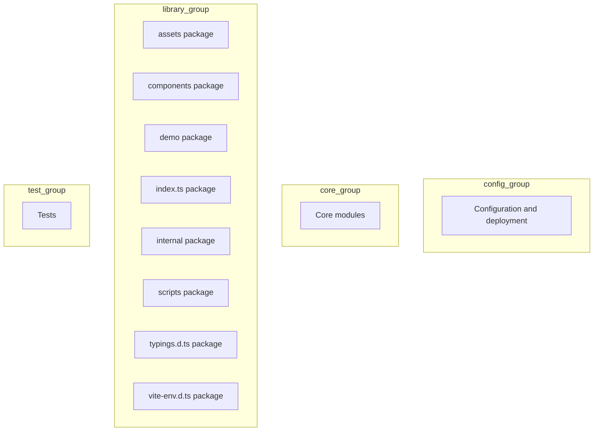

# Architecture report: guokaigdg/animal-island-ui

> Automated static analysis. **Observed** = directly seen in files/imports/AST; **Inferred** = interpretation from that evidence. Repository code was not executed.

## 1. Repository at a glance

| Item | Value |
| --- | --- |
| Repository | guokaigdg/animal-island-ui |
| Description | A Kawaii React UI component library  一个可爱的 React UI  组件库 |
| Language | TypeScript |
| Stars | 5157 |
| Licence | MIT |
| Analysed commit / branch | 956f23cb7a388f178dbd98c8cfb9df958a3e3f9f / main |
| Framework(s) | React |
| Files analysed | 429 |
| Components | 11 |

## 2. Architecture in one minute

guokaigdg/animal-island-ui - A Kawaii React UI component library  一个可爱的 React UI  组件库. This repository was analysed statically from 429 file(s) (0 Python). Detected technologies (observed from imports/manifests): GitHub Actions, React, TypeScript, Vite, Vitest. Files are grouped into 11 component(s): assets package, components package, Configuration and deployment, Core modules, demo package, index.ts package, internal package, scripts package. Findings below distinguish observed facts from inferred interpretation.

## 3. High-level block diagram

## 4. Main components

### assets package (`assets`)

- **Kind:** library
- **Status:** Observed
- **Confidence:** 0.85
- **Responsibility:** Groups 1 file(s) under assets package (observed from repository paths and static analysis).
- **Paths:** `src/assets/image/sceneImages.ts`
- **Evidence:** [src/assets/image/sceneImages.ts](https://github.com/guokaigdg/animal-island-ui/blob/956f23cb7a388f178dbd98c8cfb9df958a3e3f9f/src/assets/image/sceneImages.ts)

### components package (`components`)

- **Kind:** library
- **Status:** Observed
- **Confidence:** 0.85
- **Responsibility:** Groups 144 file(s) under components package (observed from repository paths and static analysis).
- **Paths:** `src/components/Avatar/Avatar.test.tsx`, `src/components/Avatar/Avatar.tsx`, `src/components/Avatar/index.ts`, `src/components/BackTop/BackTop.test.tsx`, `src/components/BackTop/BackTop.tsx`, `src/components/BackTop/index.ts`, `src/components/Background/Background.test.tsx`, `src/components/Background/Background.tsx`, `src/components/Background/index.ts`, `src/components/Badge/Badge.test.tsx`, `src/components/Badge/Badge.tsx`, `src/components/Badge/index.ts`, `src/components/Button/Button.test.tsx`, `src/components/Button/Button.tsx`, `src/components/Button/index.ts`, `src/components/Calendar/Calendar.test.tsx`, `src/components/Calendar/Calendar.tsx`, `src/components/Calendar/index.ts`, `src/components/Card/Card.test.tsx`, `src/components/Card/Card.tsx`, `src/components/Card/index.ts`, `src/components/Carousel/Carousel.test.tsx`, `src/components/Carousel/Carousel.tsx`, `src/components/Carousel/index.ts`, `src/components/Chart/Cartesian.tsx`, `src/components/Chart/Chart.test.tsx`, `src/components/Chart/Chart.tsx`, `src/components/Chart/ChartTooltip.tsx`, `src/components/Chart/Polar.tsx`, `src/components/Chart/Specialty.tsx`, `src/components/Chart/geometry.ts`, `src/components/Chart/index.ts`, `src/components/Chart/interaction.ts`, `src/components/Chart/types.ts`, `src/components/Checkbox/Checkbox.test.tsx`, `src/components/Checkbox/Checkbox.tsx`, `src/components/Checkbox/index.ts`, `src/components/CodeBlock/CodeBlock.test.tsx`, `src/components/CodeBlock/CodeBlock.tsx`, `src/components/CodeBlock/index.ts`, `src/components/Collapse/Collapse.test.tsx`, `src/components/Collapse/Collapse.tsx`, `src/components/Collapse/index.ts`, `src/components/CountUp/CountUp.test.tsx`, `src/components/CountUp/CountUp.tsx`, `src/components/CountUp/index.ts`, `src/components/Countdown/Countdown.test.tsx`, `src/components/Countdown/Countdown.tsx`, `src/components/Countdown/index.ts`, `src/components/Countdown/motion.ts`, `src/components/Cursor/Cursor.test.tsx`, `src/components/Cursor/Cursor.tsx`, `src/components/Cursor/index.ts`, `src/components/DatePicker/DatePicker.test.tsx`, `src/components/DatePicker/DatePicker.tsx`, `src/components/DatePicker/index.ts`, `src/components/Divider/Divider.test.tsx`, `src/components/Divider/Divider.tsx`, `src/components/Divider/index.ts`, `src/components/Drawer/Drawer.test.tsx`, `src/components/Drawer/Drawer.tsx`, `src/components/Drawer/index.ts`, `src/components/Footer/Footer.test.tsx`, `src/components/Footer/Footer.tsx`, `src/components/Footer/index.ts`, `src/components/Form/Form.test.tsx`, `src/components/Form/Form.tsx`, `src/components/Form/FormItem.tsx`, `src/components/Form/context.ts`, `src/components/Form/index.ts`, `src/components/Form/types.ts`, `src/components/Form/useForm.ts`, `src/components/Form/validators.ts`, `src/components/Image/Image.test.tsx`, `src/components/Image/Image.tsx`, `src/components/Image/index.ts`, `src/components/Input/Input.test.tsx`, `src/components/Input/Input.tsx`, `src/components/Input/index.ts`, `src/components/Loading/Loading.test.tsx`, `src/components/Loading/Loading.tsx`, `src/components/Loading/Sailboat.tsx`, `src/components/Loading/index.ts`, `src/components/Loading/types.ts`, `src/components/Modal/Modal.test.tsx`, `src/components/Modal/Modal.tsx`, `src/components/Modal/index.ts`, `src/components/NoData/NoData.test.tsx`, `src/components/NoData/NoData.tsx`, `src/components/NoData/index.ts`, `src/components/Notification/Notification.test.tsx`, `src/components/Notification/Notification.tsx`, `src/components/Notification/NotificationPortal.tsx`, `src/components/Notification/index.ts`, `src/components/Notification/types.ts`, `src/components/Pagination/Pagination.test.tsx`, `src/components/Pagination/Pagination.tsx`, `src/components/Pagination/index.ts`, `src/components/Progress/Progress.test.tsx`, `src/components/Progress/Progress.tsx`, `src/components/Progress/index.ts`, `src/components/Progress/types.ts`, `src/components/Radio/Radio.test.tsx`, `src/components/Radio/Radio.tsx`, `src/components/Radio/index.ts`, `src/components/Rate/Rate.test.tsx`, `src/components/Rate/Rate.tsx`, `src/components/Rate/index.ts`, `src/components/Select/Select.test.tsx`, `src/components/Select/Select.tsx`, `src/components/Select/index.ts`, `src/components/Skeleton/Skeleton.test.tsx`, `src/components/Skeleton/Skeleton.tsx`, `src/components/Skeleton/index.ts`, `src/components/Switch/Switch.test.tsx`, `src/components/Switch/Switch.tsx`, `src/components/Switch/index.ts`, `src/components/Table/Table.test.tsx`, `src/components/Table/Table.tsx`, `src/components/Table/index.ts`, `src/components/Tabs/Tabs.test.tsx`, `src/components/Tabs/Tabs.tsx`, `src/components/Tabs/index.ts`, `src/components/Tag/Tag.test.tsx`, `src/components/Tag/Tag.tsx`, `src/components/Tag/index.ts`, `src/components/Time/Time.test.tsx`, `src/components/Time/Time.tsx`, `src/components/Time/index.ts`, `src/components/TimePicker/TimePicker.test.tsx`, `src/components/TimePicker/TimePicker.tsx`, `src/components/TimePicker/index.ts`, `src/components/Title/Title.test.tsx`, `src/components/Title/Title.tsx`, `src/components/Title/index.ts`, `src/components/Tooltip/Tooltip.test.tsx`, `src/components/Tooltip/Tooltip.tsx`, `src/components/Tooltip/index.ts`, `src/components/Typewriter/Typewriter.test.tsx`, `src/components/Typewriter/Typewriter.tsx`, `src/components/Typewriter/index.ts`, `src/components/Upload/Upload.test.tsx`, `src/components/Upload/Upload.tsx`, `src/components/Upload/index.ts`
- **Evidence:** [src/components/Avatar/Avatar.test.tsx](https://github.com/guokaigdg/animal-island-ui/blob/956f23cb7a388f178dbd98c8cfb9df958a3e3f9f/src/components/Avatar/Avatar.test.tsx); [src/components/Avatar/Avatar.tsx](https://github.com/guokaigdg/animal-island-ui/blob/956f23cb7a388f178dbd98c8cfb9df958a3e3f9f/src/components/Avatar/Avatar.tsx); [src/components/Avatar/index.ts](https://github.com/guokaigdg/animal-island-ui/blob/956f23cb7a388f178dbd98c8cfb9df958a3e3f9f/src/components/Avatar/index.ts); [src/components/BackTop/BackTop.test.tsx](https://github.com/guokaigdg/animal-island-ui/blob/956f23cb7a388f178dbd98c8cfb9df958a3e3f9f/src/components/BackTop/BackTop.test.tsx); [src/components/BackTop/BackTop.tsx](https://github.com/guokaigdg/animal-island-ui/blob/956f23cb7a388f178dbd98c8cfb9df958a3e3f9f/src/components/BackTop/BackTop.tsx); [src/components/BackTop/index.ts](https://github.com/guokaigdg/animal-island-ui/blob/956f23cb7a388f178dbd98c8cfb9df958a3e3f9f/src/components/BackTop/index.ts); [src/components/Background/Background.test.tsx](https://github.com/guokaigdg/animal-island-ui/blob/956f23cb7a388f178dbd98c8cfb9df958a3e3f9f/src/components/Background/Background.test.tsx); [src/components/Background/Background.tsx](https://github.com/guokaigdg/animal-island-ui/blob/956f23cb7a388f178dbd98c8cfb9df958a3e3f9f/src/components/Background/Background.tsx)

### Configuration and deployment (`config`)

- **Kind:** config
- **Status:** Observed
- **Confidence:** 0.85
- **Responsibility:** Groups 4 file(s) under configuration and deployment (observed from repository paths and static analysis).
- **Paths:** `package.json`, `tsconfig.build.json`, `tsconfig.json`, `tsconfig.test.json`
- **Evidence:** [package.json](https://github.com/guokaigdg/animal-island-ui/blob/956f23cb7a388f178dbd98c8cfb9df958a3e3f9f/package.json); [tsconfig.build.json](https://github.com/guokaigdg/animal-island-ui/blob/956f23cb7a388f178dbd98c8cfb9df958a3e3f9f/tsconfig.build.json); [tsconfig.json](https://github.com/guokaigdg/animal-island-ui/blob/956f23cb7a388f178dbd98c8cfb9df958a3e3f9f/tsconfig.json); [tsconfig.test.json](https://github.com/guokaigdg/animal-island-ui/blob/956f23cb7a388f178dbd98c8cfb9df958a3e3f9f/tsconfig.test.json)

### Core modules (`core`)

- **Kind:** core
- **Status:** Observed
- **Confidence:** 0.85
- **Responsibility:** Groups 6 file(s) under core modules (observed from repository paths and static analysis).
- **Paths:** `eslint.config.js`, `items.d.ts`, `vite.config.demo.ts`, `vite.config.ts`, `vitest.a11y.config.ts`, `vitest.config.ts`
- **Evidence:** [eslint.config.js](https://github.com/guokaigdg/animal-island-ui/blob/956f23cb7a388f178dbd98c8cfb9df958a3e3f9f/eslint.config.js); [items.d.ts](https://github.com/guokaigdg/animal-island-ui/blob/956f23cb7a388f178dbd98c8cfb9df958a3e3f9f/items.d.ts); [vite.config.demo.ts](https://github.com/guokaigdg/animal-island-ui/blob/956f23cb7a388f178dbd98c8cfb9df958a3e3f9f/vite.config.demo.ts); [vite.config.ts](https://github.com/guokaigdg/animal-island-ui/blob/956f23cb7a388f178dbd98c8cfb9df958a3e3f9f/vite.config.ts); [vitest.a11y.config.ts](https://github.com/guokaigdg/animal-island-ui/blob/956f23cb7a388f178dbd98c8cfb9df958a3e3f9f/vitest.a11y.config.ts); [vitest.config.ts](https://github.com/guokaigdg/animal-island-ui/blob/956f23cb7a388f178dbd98c8cfb9df958a3e3f9f/vitest.config.ts)

### demo package (`demo`)

- **Kind:** library
- **Status:** Observed
- **Confidence:** 0.85
- **Responsibility:** Groups 72 file(s) under demo package (observed from repository paths and static analysis).
- **Paths:** `demo/App.tsx`, `demo/ComponentPage.tsx`, `demo/HomePage.tsx`, `demo/chartPages.ts`, `demo/components/Avatar/index.tsx`, `demo/components/BackTop/index.tsx`, `demo/components/Background/index.tsx`, `demo/components/Badge/index.tsx`, `demo/components/Button/index.tsx`, `demo/components/Calendar/index.tsx`, `demo/components/Card/index.tsx`, `demo/components/Carousel/index.tsx`, `demo/components/Chart/ChartGalleryDemo.tsx`, `demo/components/Chart/ChartInteractionDemo.tsx`, `demo/components/Chart/MountCurveDemo.tsx`, `demo/components/Chart/data.ts`, `demo/components/Chart/gallery-cartesian.ts`, `demo/components/Chart/gallery-polar.ts`, `demo/components/Chart/gallery-shared.ts`, `demo/components/Chart/gallery-specialty.ts`, `demo/components/Chart/index.tsx`, `demo/components/Checkbox/index.tsx`, `demo/components/CodeBlock/index.tsx`, `demo/components/Collapse/index.tsx`, `demo/components/CountUp/index.tsx`, `demo/components/Countdown/CountdownFinishDemo.tsx`, `demo/components/Countdown/CountdownMotionDemo.tsx`, `demo/components/Countdown/CountdownReminderDemo.tsx`, `demo/components/Countdown/CountdownShakeDemo.tsx`, `demo/components/Countdown/index.tsx`, `demo/components/Cursor/index.tsx`, `demo/components/DatePicker/index.tsx`, `demo/components/Divider/OceanWaveDemo.tsx`, `demo/components/Divider/index.tsx`, `demo/components/Drawer/DrawerDemo.tsx`, `demo/components/Footer/index.tsx`, `demo/components/Form/index.tsx`, `demo/components/Icon/IconDemo.tsx`, `demo/components/Image/index.tsx`, `demo/components/Input/index.tsx`, `demo/components/Loading/index.tsx`, `demo/components/Modal/index.tsx`, `demo/components/NoData/NoDataAppearanceDemo.tsx`, `demo/components/NoData/index.tsx`, `demo/components/Notification/index.tsx`, `demo/components/Pagination/index.tsx`, `demo/components/Progress/ProgressAppearanceDemo.tsx`, `demo/components/Progress/index.tsx`, `demo/components/Radio/index.tsx`, `demo/components/Rate/index.tsx`, `demo/components/Select/index.tsx`, `demo/components/Skeleton/index.tsx`, `demo/components/Skill/ShellCode.tsx`, `demo/components/Skill/data.ts`, `demo/components/Skill/index.tsx`, `demo/components/Skill/parts.tsx`, `demo/components/Switch/index.tsx`, `demo/components/Table/TableDemo.tsx`, `demo/components/Tabs/index.tsx`, `demo/components/Tag/index.tsx`, `demo/components/Time/index.tsx`, `demo/components/TimePicker/index.tsx`, `demo/components/Title/index.tsx`, `demo/components/Tooltip/index.tsx`, `demo/components/Typewriter/index.tsx`, `demo/components/Upload/UploadProgressDemo.tsx`, `demo/components/Upload/index.tsx`, `demo/gradients.ts`, `demo/main.tsx`, `demo/pageInfo.ts`, `demo/tools/index.tsx`, `demo/vite-env.d.ts`
- **Evidence:** [demo/App.tsx](https://github.com/guokaigdg/animal-island-ui/blob/956f23cb7a388f178dbd98c8cfb9df958a3e3f9f/demo/App.tsx); [demo/ComponentPage.tsx](https://github.com/guokaigdg/animal-island-ui/blob/956f23cb7a388f178dbd98c8cfb9df958a3e3f9f/demo/ComponentPage.tsx); [demo/HomePage.tsx](https://github.com/guokaigdg/animal-island-ui/blob/956f23cb7a388f178dbd98c8cfb9df958a3e3f9f/demo/HomePage.tsx); [demo/chartPages.ts](https://github.com/guokaigdg/animal-island-ui/blob/956f23cb7a388f178dbd98c8cfb9df958a3e3f9f/demo/chartPages.ts); [demo/components/Avatar/index.tsx](https://github.com/guokaigdg/animal-island-ui/blob/956f23cb7a388f178dbd98c8cfb9df958a3e3f9f/demo/components/Avatar/index.tsx); [demo/components/BackTop/index.tsx](https://github.com/guokaigdg/animal-island-ui/blob/956f23cb7a388f178dbd98c8cfb9df958a3e3f9f/demo/components/BackTop/index.tsx); [demo/components/Background/index.tsx](https://github.com/guokaigdg/animal-island-ui/blob/956f23cb7a388f178dbd98c8cfb9df958a3e3f9f/demo/components/Background/index.tsx); [demo/components/Badge/index.tsx](https://github.com/guokaigdg/animal-island-ui/blob/956f23cb7a388f178dbd98c8cfb9df958a3e3f9f/demo/components/Badge/index.tsx)

### index.ts package (`index_ts`)

- **Kind:** library
- **Status:** Observed
- **Confidence:** 0.85
- **Responsibility:** Groups 1 file(s) under index.ts package (observed from repository paths and static analysis).
- **Paths:** `src/index.ts`
- **Evidence:** [src/index.ts](https://github.com/guokaigdg/animal-island-ui/blob/956f23cb7a388f178dbd98c8cfb9df958a3e3f9f/src/index.ts)

### internal package (`internal`)

- **Kind:** library
- **Status:** Observed
- **Confidence:** 0.85
- **Responsibility:** Groups 1 file(s) under internal package (observed from repository paths and static analysis).
- **Paths:** `src/internal/Wave.tsx`
- **Evidence:** [src/internal/Wave.tsx](https://github.com/guokaigdg/animal-island-ui/blob/956f23cb7a388f178dbd98c8cfb9df958a3e3f9f/src/internal/Wave.tsx)

### scripts package (`scripts`)

- **Kind:** library
- **Status:** Observed
- **Confidence:** 0.85
- **Responsibility:** Groups 3 file(s) under scripts package (observed from repository paths and static analysis).
- **Paths:** `scripts/check-bundle.mjs`, `scripts/check-docs-sync.mjs`, `scripts/generate-coverage-badges.mjs`
- **Evidence:** [scripts/check-bundle.mjs](https://github.com/guokaigdg/animal-island-ui/blob/956f23cb7a388f178dbd98c8cfb9df958a3e3f9f/scripts/check-bundle.mjs); [scripts/check-docs-sync.mjs](https://github.com/guokaigdg/animal-island-ui/blob/956f23cb7a388f178dbd98c8cfb9df958a3e3f9f/scripts/check-docs-sync.mjs); [scripts/generate-coverage-badges.mjs](https://github.com/guokaigdg/animal-island-ui/blob/956f23cb7a388f178dbd98c8cfb9df958a3e3f9f/scripts/generate-coverage-badges.mjs)

### Tests (`tests`)

- **Kind:** test
- **Status:** Observed
- **Confidence:** 0.85
- **Responsibility:** Groups 4 file(s) under tests (observed from repository paths and static analysis).
- **Paths:** `test/a11y.test.tsx`, `test/components.tsx`, `test/setup.ts`, `test/utils.tsx`
- **Evidence:** [test/a11y.test.tsx](https://github.com/guokaigdg/animal-island-ui/blob/956f23cb7a388f178dbd98c8cfb9df958a3e3f9f/test/a11y.test.tsx); [test/components.tsx](https://github.com/guokaigdg/animal-island-ui/blob/956f23cb7a388f178dbd98c8cfb9df958a3e3f9f/test/components.tsx); [test/setup.ts](https://github.com/guokaigdg/animal-island-ui/blob/956f23cb7a388f178dbd98c8cfb9df958a3e3f9f/test/setup.ts); [test/utils.tsx](https://github.com/guokaigdg/animal-island-ui/blob/956f23cb7a388f178dbd98c8cfb9df958a3e3f9f/test/utils.tsx)

### typings.d.ts package (`typings_d_ts`)

- **Kind:** library
- **Status:** Observed
- **Confidence:** 0.85
- **Responsibility:** Groups 1 file(s) under typings.d.ts package (observed from repository paths and static analysis).
- **Paths:** `src/typings.d.ts`
- **Evidence:** [src/typings.d.ts](https://github.com/guokaigdg/animal-island-ui/blob/956f23cb7a388f178dbd98c8cfb9df958a3e3f9f/src/typings.d.ts)

### vite-env.d.ts package (`vite_env_d_ts`)

- **Kind:** library
- **Status:** Observed
- **Confidence:** 0.85
- **Responsibility:** Groups 1 file(s) under vite-env.d.ts package (observed from repository paths and static analysis).
- **Paths:** `src/vite-env.d.ts`
- **Evidence:** [src/vite-env.d.ts](https://github.com/guokaigdg/animal-island-ui/blob/956f23cb7a388f178dbd98c8cfb9df958a3e3f9f/src/vite-env.d.ts)

## 5. Execution flow

**Observed** entry point(s):

- [demo/App.tsx](https://github.com/guokaigdg/animal-island-ui/blob/956f23cb7a388f178dbd98c8cfb9df958a3e3f9f/demo/App.tsx)
- [demo/components/Avatar/index.tsx](https://github.com/guokaigdg/animal-island-ui/blob/956f23cb7a388f178dbd98c8cfb9df958a3e3f9f/demo/components/Avatar/index.tsx)
- [demo/components/BackTop/index.tsx](https://github.com/guokaigdg/animal-island-ui/blob/956f23cb7a388f178dbd98c8cfb9df958a3e3f9f/demo/components/BackTop/index.tsx)
- [demo/components/Background/index.tsx](https://github.com/guokaigdg/animal-island-ui/blob/956f23cb7a388f178dbd98c8cfb9df958a3e3f9f/demo/components/Background/index.tsx)
- [demo/components/Badge/index.tsx](https://github.com/guokaigdg/animal-island-ui/blob/956f23cb7a388f178dbd98c8cfb9df958a3e3f9f/demo/components/Badge/index.tsx)
- [demo/components/Button/index.tsx](https://github.com/guokaigdg/animal-island-ui/blob/956f23cb7a388f178dbd98c8cfb9df958a3e3f9f/demo/components/Button/index.tsx)
- [demo/components/Calendar/index.tsx](https://github.com/guokaigdg/animal-island-ui/blob/956f23cb7a388f178dbd98c8cfb9df958a3e3f9f/demo/components/Calendar/index.tsx)
- [demo/components/Card/index.tsx](https://github.com/guokaigdg/animal-island-ui/blob/956f23cb7a388f178dbd98c8cfb9df958a3e3f9f/demo/components/Card/index.tsx)
- [demo/components/Carousel/index.tsx](https://github.com/guokaigdg/animal-island-ui/blob/956f23cb7a388f178dbd98c8cfb9df958a3e3f9f/demo/components/Carousel/index.tsx)
- [demo/components/Chart/index.tsx](https://github.com/guokaigdg/animal-island-ui/blob/956f23cb7a388f178dbd98c8cfb9df958a3e3f9f/demo/components/Chart/index.tsx)
- [demo/components/Checkbox/index.tsx](https://github.com/guokaigdg/animal-island-ui/blob/956f23cb7a388f178dbd98c8cfb9df958a3e3f9f/demo/components/Checkbox/index.tsx)
- [demo/components/CodeBlock/index.tsx](https://github.com/guokaigdg/animal-island-ui/blob/956f23cb7a388f178dbd98c8cfb9df958a3e3f9f/demo/components/CodeBlock/index.tsx)

Representative flow (derived from observed entry points and the import graph; steps beyond the entry point are **Inferred**):

1. Execution starts at an observed entry point listed above, if present.
2. No internal import relationships between components were observed.

## 6. Project structure

### `(root)`

- `.editorconfig` - config (259 bytes)
- `.gitignore` - other (492 bytes)
- `.prettierignore` - other (431 bytes)
- `.prettierrc` - other (218 bytes)
- `AGENTS.md` - docs (7457 bytes)
- `CHANGELOG.md` - docs (23222 bytes)
- `CLAUDE.md` - docs (11 bytes)
- `CONTRIBUTING.md` - docs (750 bytes)
- `LICENSE` - docs (1065 bytes)
- `README.md` - docs (9044 bytes)
- `eslint.config.js` - source, JavaScript (2746 bytes)
- `index.html` - other (537 bytes)
- `items.d.ts` - source, TypeScript (245 bytes)
- `package.json` - manifest (3883 bytes)
- `tsconfig.build.json` - config (462 bytes)
- `tsconfig.json` - config (771 bytes)
- `tsconfig.test.json` - config (347 bytes)
- `vite.config.demo.ts` - source, TypeScript (1032 bytes)
- `vite.config.ts` - source, TypeScript (15291 bytes)
- `vitest.a11y.config.ts` - source, TypeScript (1919 bytes)
- `vitest.config.ts` - source, TypeScript (1912 bytes)

### `.githooks`

- `.githooks/pre-commit` - other (1923 bytes)

### `.github`

- `.github/FUNDING.yml` - config (54 bytes)
- `.github/workflows/ci.yml` - ci, YAML (2867 bytes)

### `.trae`

- `.trae/documents/icon-refactor.md` - docs (8428 bytes)

### `demo`

- `demo/App.tsx` - source, TypeScript (24698 bytes)
- `demo/ComponentPage.tsx` - source, TypeScript (4984 bytes)
- `demo/HomePage.tsx` - source, TypeScript (28482 bytes)
- `demo/chartPages.ts` - source, TypeScript (2941 bytes)
- `demo/components/Avatar/index.tsx` - source, TypeScript (9150 bytes)
- `demo/components/BackTop/index.tsx` - source, TypeScript (13318 bytes)
- `demo/components/Background/index.tsx` - source, TypeScript (6078 bytes)
- `demo/components/Badge/index.tsx` - source, TypeScript (8342 bytes)
- `demo/components/Button/index.tsx` - source, TypeScript (5869 bytes)
- `demo/components/Calendar/index.tsx` - source, TypeScript (6724 bytes)
- `demo/components/Card/index.tsx` - source, TypeScript (9685 bytes)
- `demo/components/Carousel/index.tsx` - source, TypeScript (3364 bytes)
- `demo/components/Chart/ChartGalleryDemo.tsx` - source, TypeScript (4739 bytes)
- `demo/components/Chart/ChartInteractionDemo.tsx` - source, TypeScript (5399 bytes)
- `demo/components/Chart/MountCurveDemo.tsx` - source, TypeScript (2170 bytes)
- `demo/components/Chart/data.ts` - source, TypeScript (6271 bytes)
- `demo/components/Chart/demo.module.less` - other (2956 bytes)
- `demo/components/Chart/gallery-cartesian.ts` - source, TypeScript (12527 bytes)
- `demo/components/Chart/gallery-polar.ts` - source, TypeScript (10476 bytes)
- `demo/components/Chart/gallery-shared.ts` - source, TypeScript (2598 bytes)
- `demo/components/Chart/gallery-specialty.ts` - source, TypeScript (21609 bytes)
- `demo/components/Chart/gallery.module.less` - other (2306 bytes)
- `demo/components/Chart/index.tsx` - source, TypeScript (9768 bytes)
- `demo/components/Checkbox/index.tsx` - source, TypeScript (4819 bytes)
- `demo/components/CodeBlock/index.tsx` - source, TypeScript (3144 bytes)
- `demo/components/Collapse/index.tsx` - source, TypeScript (3004 bytes)
- `demo/components/CountUp/index.tsx` - source, TypeScript (12152 bytes)
- `demo/components/Countdown/CountdownFinishDemo.tsx` - source, TypeScript (3286 bytes)
- `demo/components/Countdown/CountdownMotionDemo.tsx` - source, TypeScript (11221 bytes)
- `demo/components/Countdown/CountdownReminderDemo.tsx` - source, TypeScript (2648 bytes)
- `demo/components/Countdown/CountdownShakeDemo.tsx` - source, TypeScript (3410 bytes)
- `demo/components/Countdown/index.tsx` - source, TypeScript (5221 bytes)
- `demo/components/Cursor/index.tsx` - source, TypeScript (4838 bytes)
- `demo/components/DatePicker/index.tsx` - source, TypeScript (7179 bytes)
- `demo/components/Divider/OceanWaveDemo.tsx` - source, TypeScript (1207 bytes)
- `demo/components/Divider/index.tsx` - source, TypeScript (3680 bytes)
- `demo/components/Drawer/DrawerDemo.tsx` - source, TypeScript (5699 bytes)
- `demo/components/Footer/index.tsx` - source, TypeScript (2144 bytes)
- `demo/components/Form/index.tsx` - source, TypeScript (18246 bytes)
- `demo/components/Icon/IconDemo.tsx` - source, TypeScript (24501 bytes)
- `demo/components/Image/index.tsx` - source, TypeScript (9210 bytes)
- `demo/components/Input/index.tsx` - source, TypeScript (5273 bytes)
- `demo/components/Loading/index.tsx` - source, TypeScript (6589 bytes)
- `demo/components/Modal/index.tsx` - source, TypeScript (9337 bytes)
- `demo/components/NoData/NoDataAppearanceDemo.tsx` - source, TypeScript (1329 bytes)
- `demo/components/NoData/index.tsx` - source, TypeScript (6742 bytes)
- `demo/components/Notification/index.tsx` - source, TypeScript (20032 bytes)
- `demo/components/Pagination/index.tsx` - source, TypeScript (5527 bytes)
- `demo/components/Progress/ProgressAppearanceDemo.tsx` - source, TypeScript (2563 bytes)
- `demo/components/Progress/index.tsx` - source, TypeScript (10190 bytes)
- `demo/components/Radio/index.tsx` - source, TypeScript (5386 bytes)
- `demo/components/Rate/index.tsx` - source, TypeScript (4964 bytes)
- `demo/components/Select/index.tsx` - source, TypeScript (8139 bytes)
- `demo/components/Skeleton/index.tsx` - source, TypeScript (7187 bytes)
- `demo/components/Skill/ShellCode.tsx` - source, TypeScript (3377 bytes)
- `demo/components/Skill/data.ts` - source, TypeScript (11175 bytes)
- `demo/components/Skill/index.tsx` - source, TypeScript (6609 bytes)
- `demo/components/Skill/parts.tsx` - source, TypeScript (6276 bytes)
- `demo/components/Skill/skill.module.less` - other (5904 bytes)
- `demo/components/Switch/index.tsx` - source, TypeScript (3589 bytes)
- `demo/components/Table/TableDemo.tsx` - source, TypeScript (7500 bytes)
- `demo/components/Tabs/index.tsx` - source, TypeScript (6460 bytes)
- `demo/components/Tag/index.tsx` - source, TypeScript (13673 bytes)
- `demo/components/Time/index.tsx` - source, TypeScript (3677 bytes)
- `demo/components/TimePicker/index.tsx` - source, TypeScript (4751 bytes)
- `demo/components/Title/index.tsx` - source, TypeScript (7823 bytes)
- `demo/components/Tooltip/index.tsx` - source, TypeScript (12374 bytes)
- `demo/components/Typewriter/index.tsx` - source, TypeScript (3743 bytes)
- `demo/components/Upload/UploadProgressDemo.tsx` - source, TypeScript (2676 bytes)
- `demo/components/Upload/index.tsx` - source, TypeScript (18244 bytes)
- `demo/fonts.css` - other (10888 bytes)
- `demo/gradients.ts` - source, TypeScript (1800 bytes)
- `demo/main.tsx` - source, TypeScript (424 bytes)
- `demo/pageInfo.ts` - source, TypeScript (9202 bytes)
- `demo/tools/index.tsx` - source, TypeScript (5088 bytes)
- `demo/vite-env.d.ts` - source, TypeScript (38 bytes)

### `docs`

- `docs/README.zh-CN.md` - docs (8575 bytes)
- `docs/adr/0001-zero-runtime-dependencies.md` - docs (3872 bytes)
- `docs/adr/0002-dual-design-token-system.md` - docs (3366 bytes)
- `docs/adr/0003-vite-library-mode-build.md` - docs (5423 bytes)
- `docs/adr/0004-docs-sync-automation.md` - docs (4087 bytes)
- `docs/adr/0005-dayjs-as-the-date-layer.md` - docs (5608 bytes)
- `docs/adr/0006-time-locale-formatting.md` - docs (3363 bytes)
- `docs/adr/0007-timepicker-date-layer.md` - docs (4295 bytes)
- `docs/adr/README.md` - docs (3876 bytes)
- `docs/design-prompts.md` - docs (5856 bytes)
- `docs/design-system/README.md` - docs (16639 bytes)
- `docs/design-system/components/Form.md` - docs (3783 bytes)
- `docs/design-system/components/Notification.md` - docs (9960 bytes)
- `docs/design-system/components/charts.md` - docs (10958 bytes)
- `docs/design-system/components/countdown-motion.md` - docs (5164 bytes)
- `docs/design-system/components/data-display.md` - docs (52097 bytes)
- `docs/design-system/components/decorative.md` - docs (774 bytes)
- `docs/design-system/components/feedback.md` - docs (26549 bytes)
- `docs/design-system/components/form-controls.md` - docs (23584 bytes)
- `docs/design-system/components/general.md` - docs (12430 bytes)
- `docs/design-system/components/layout.md` - docs (16278 bytes)
- `docs/design-system/components/no-data.md` - docs (3859 bytes)
- `docs/design-system/components/overlays.md` - docs (9234 bytes)
- `docs/design-system/components/upload.md` - docs (16792 bytes)
- `docs/design-system/css-variables.md` - docs (2033 bytes)
- `docs/design-system/demo-site.md` - docs (5424 bytes)
- `docs/design-system/design-rules.md` - docs (7213 bytes)
- `docs/design-system/design-tokens.md` - docs (7495 bytes)
- `docs/development/README.md` - docs (1438 bytes)
- `docs/development/build-and-release.md` - docs (3933 bytes)
- `docs/development/coding-standards.md` - docs (5365 bytes)
- `docs/development/component-development.md` - docs (8563 bytes)
- `docs/development/contributing.md` - docs (2806 bytes)
- `docs/development/repository-structure.md` - docs (4538 bytes)
- `docs/development/testing.md` - docs (4536 bytes)
- `docs/one-click-prompt.md` - docs (2552 bytes)
- `docs/zh-CN/adr/0001-zero-runtime-dependencies.md` - docs (3610 bytes)
- `docs/zh-CN/adr/0002-dual-design-token-system.md` - docs (3199 bytes)
- `docs/zh-CN/adr/0003-vite-library-mode-build.md` - docs (5374 bytes)
- `docs/zh-CN/adr/0004-docs-sync-automation.md` - docs (3777 bytes)
- `docs/zh-CN/adr/0005-dayjs-as-the-date-layer.md` - docs (5050 bytes)
- `docs/zh-CN/adr/0006-time-locale-formatting.md` - docs (3161 bytes)
- `docs/zh-CN/adr/0007-timepicker-date-layer.md` - docs (4016 bytes)
- `docs/zh-CN/adr/README.md` - docs (2710 bytes)
- `docs/zh-CN/design-prompts.md` - docs (5630 bytes)
- `docs/zh-CN/design-system/README.md` - docs (15734 bytes)
- `docs/zh-CN/design-system/components/Form.md` - docs (3530 bytes)
- `docs/zh-CN/design-system/components/Notification.md` - docs (9529 bytes)
- `docs/zh-CN/design-system/components/charts.md` - docs (9730 bytes)
- `docs/zh-CN/design-system/components/countdown-motion.md` - docs (4662 bytes)
- `docs/zh-CN/design-system/components/data-display.md` - docs (50266 bytes)
- `docs/zh-CN/design-system/components/decorative.md` - docs (733 bytes)
- `docs/zh-CN/design-system/components/feedback.md` - docs (25420 bytes)
- `docs/zh-CN/design-system/components/form-controls.md` - docs (22712 bytes)
- `docs/zh-CN/design-system/components/general.md` - docs (11326 bytes)
- `docs/zh-CN/design-system/components/layout.md` - docs (16616 bytes)
- `docs/zh-CN/design-system/components/no-data.md` - docs (3562 bytes)
- `docs/zh-CN/design-system/components/overlays.md` - docs (9091 bytes)
- `docs/zh-CN/design-system/components/upload.md` - docs (16274 bytes)
- `docs/zh-CN/design-system/css-variables.md` - docs (1909 bytes)
- `docs/zh-CN/design-system/demo-site.md` - docs (5328 bytes)
- `docs/zh-CN/design-system/design-rules.md` - docs (6607 bytes)
- `docs/zh-CN/design-system/design-tokens.md` - docs (7241 bytes)
- `docs/zh-CN/development/README.md` - docs (1358 bytes)
- `docs/zh-CN/development/build-and-release.md` - docs (3816 bytes)
- `docs/zh-CN/development/coding-standards.md` - docs (5166 bytes)
- `docs/zh-CN/development/component-development.md` - docs (8226 bytes)
- `docs/zh-CN/development/contributing.md` - docs (2699 bytes)
- `docs/zh-CN/development/repository-structure.md` - docs (4368 bytes)
- `docs/zh-CN/development/testing.md` - docs (4363 bytes)
- `docs/zh-CN/one-click-prompt.md` - docs (2595 bytes)

### `scripts`

- `scripts/check-bundle.mjs` - source, JavaScript (4192 bytes)
- `scripts/check-docs-sync.mjs` - source, JavaScript (5389 bytes)
- `scripts/generate-coverage-badges.mjs` - source, JavaScript (4059 bytes)

### `skills`

- `skills/animal-island-ui-style/README.md` - docs (1924 bytes)
- `skills/animal-island-ui-style/SKILL.md` - docs (7413 bytes)
- `skills/animal-island-ui-style/SKILL.zh-CN.md` - docs (7032 bytes)
- `skills/animal-island-ui-style/references/components/CountUp.md` - docs (5217 bytes)
- `skills/animal-island-ui-style/references/components/Form.md` - docs (8103 bytes)
- `skills/animal-island-ui-style/references/components/Notification.md` - docs (6660 bytes)
- `skills/animal-island-ui-style/references/components/calendar.md` - docs (4627 bytes)
- `skills/animal-island-ui-style/references/components/chart-data.md` - docs (2705 bytes)
- `skills/animal-island-ui-style/references/components/chart-interaction.md` - docs (3201 bytes)
- `skills/animal-island-ui-style/references/components/charts.md` - docs (6194 bytes)
- `skills/animal-island-ui-style/references/components/countdown-motion.md` - docs (6023 bytes)
- `skills/animal-island-ui-style/references/components/countdown.md` - docs (4375 bytes)
- `skills/animal-island-ui-style/references/components/data-display.md` - docs (8785 bytes)
- `skills/animal-island-ui-style/references/components/date-time.md` - docs (4148 bytes)
- `skills/animal-island-ui-style/references/components/decorative.md` - docs (2843 bytes)
- `skills/animal-island-ui-style/references/components/feedback.md` - docs (13904 bytes)
- `skills/animal-island-ui-style/references/components/form-controls.md` - docs (8064 bytes)
- `skills/animal-island-ui-style/references/components/general.md` - docs (6523 bytes)
- `skills/animal-island-ui-style/references/components/layout.md` - docs (7285 bytes)
- `skills/animal-island-ui-style/references/components/media.md` - docs (6066 bytes)
- `skills/animal-island-ui-style/references/components/no-data.md` - docs (3049 bytes)
- `skills/animal-island-ui-style/references/components/overlays.md` - docs (7098 bytes)
- `skills/animal-island-ui-style/references/components/upload.md` - docs (12842 bytes)
- `skills/animal-island-ui-style/references/react-project.md` - docs (3862 bytes)
- `skills/animal-island-ui-style/references/standalone-html.md` - docs (4525 bytes)

### `src`

- `src/assets/image/coffee-break.svg` - other (31656 bytes)
- `src/assets/image/forest-grove.svg` - other (62606 bytes)
- `src/assets/image/sceneImages.ts` - source, TypeScript (541 bytes)
- `src/assets/image/starry-camp.svg` - other (59191 bytes)
- `src/assets/image/svg/desktop/01-sky-drift.svg` - other (94264 bytes)
- `src/assets/image/svg/desktop/03-forest-grove.svg` - other (91528 bytes)
- `src/assets/image/svg/desktop/04-wildflower.svg` - other (109687 bytes)
- `src/assets/image/svg/desktop/05-orchard.svg` - other (100266 bytes)
- `src/assets/image/svg/desktop/07-cat-love.svg` - other (46876 bytes)
- `src/assets/image/svg/desktop/09-desert-sun.svg` - other (92676 bytes)
- `src/assets/image/svg/desktop/10-rainy-day.svg` - other (103532 bytes)
- `src/assets/image/svg/desktop/11-ocean-dreams.svg` - other (94172 bytes)
- `src/assets/image/svg/desktop/12-polar-post.svg` - other (90662 bytes)
- `src/assets/image/svg/desktop/13-honey-garden.svg` - other (108497 bytes)
- `src/assets/image/svg/desktop/14-coffee-break.svg` - other (47346 bytes)
- `src/assets/image/svg/desktop/15-reading-nook.svg` - other (94189 bytes)
- `src/assets/image/svg/desktop/17-woodland-fox.svg` - other (87654 bytes)
- `src/assets/image/svg/desktop/18-frog-pond.svg` - other (94397 bytes)
- `src/assets/image/svg/desktop/19-ladybug-meadow.svg` - other (47470 bytes)
- `src/assets/image/svg/desktop/21-owl-library.svg` - other (86869 bytes)
- `src/assets/image/svg/desktop/22-sail-away.svg` - other (95585 bytes)
- `src/assets/image/svg/desktop/23-train-journey.svg` - other (87207 bytes)
- `src/assets/image/svg/desktop/24-bicycle-day.svg` - other (95838 bytes)
- `src/assets/image/svg/desktop/25-berry-fields.svg` - other (45819 bytes)
- `src/assets/image/svg/desktop/26-lemon-grove.svg` - other (46526 bytes)
- `src/assets/image/svg/desktop/28-gift-party.svg` - other (95381 bytes)
- `src/assets/image/svg/desktop/29-trophy-day.svg` - other (88139 bytes)
- `src/assets/image/svg/desktop/30-starry-camp.svg` - other (87891 bytes)
- `src/assets/image/sweet-corner.svg` - other (162176 bytes)
- `src/components/Avatar/Avatar.test.tsx` - source, TypeScript (6569 bytes)
- `src/components/Avatar/Avatar.tsx` - source, TypeScript (7214 bytes)
- `src/components/Avatar/avatar.module.less` - other (1365 bytes)
- `src/components/Avatar/index.ts` - source, TypeScript (136 bytes)
- `src/components/BackTop/BackTop.test.tsx` - source, TypeScript (1962 bytes)
- `src/components/BackTop/BackTop.tsx` - source, TypeScript (3157 bytes)
- `src/components/BackTop/back-top.module.less` - other (1314 bytes)
- `src/components/BackTop/index.ts` - source, TypeScript (84 bytes)
- `src/components/Background/Background.test.tsx` - source, TypeScript (2775 bytes)
- `src/components/Background/Background.tsx` - source, TypeScript (1959 bytes)
- `src/components/Background/background.module.less` - other (10858 bytes)
- `src/components/Background/index.ts` - source, TypeScript (112 bytes)
- `src/components/Badge/Badge.test.tsx` - source, TypeScript (8708 bytes)
- `src/components/Badge/Badge.tsx` - source, TypeScript (4352 bytes)
- `src/components/Badge/badge.module.less` - other (4127 bytes)
- `src/components/Badge/index.ts` - source, TypeScript (99 bytes)
- `src/components/Button/Button.test.tsx` - source, TypeScript (8304 bytes)
- `src/components/Button/Button.tsx` - source, TypeScript (2034 bytes)
- `src/components/Button/button.module.less` - other (5967 bytes)
- `src/components/Button/index.ts` - source, TypeScript (104 bytes)
- `src/components/Calendar/Calendar.test.tsx` - source, TypeScript (34660 bytes)
- `src/components/Calendar/Calendar.tsx` - source, TypeScript (31919 bytes)
- `src/components/Calendar/calendar.module.less` - other (10160 bytes)
- `src/components/Calendar/index.ts` - source, TypeScript (118 bytes)
- `src/components/Card/Card.test.tsx` - source, TypeScript (8081 bytes)
- `src/components/Card/Card.tsx` - source, TypeScript (1876 bytes)
- `src/components/Card/card.module.less` - other (7271 bytes)
- `src/components/Card/index.ts` - source, TypeScript (106 bytes)
- `src/components/Carousel/Carousel.test.tsx` - source, TypeScript (5471 bytes)
- `src/components/Carousel/Carousel.tsx` - source, TypeScript (7459 bytes)
- `src/components/Carousel/carousel.module.less` - other (4455 bytes)
- `src/components/Carousel/index.ts` - source, TypeScript (88 bytes)
- `src/components/Chart/Cartesian.tsx` - source, TypeScript (13260 bytes)
- `src/components/Chart/Chart.test.tsx` - source, TypeScript (17113 bytes)
- `src/components/Chart/Chart.tsx` - source, TypeScript (31514 bytes)
- `src/components/Chart/ChartTooltip.tsx` - source, TypeScript (2558 bytes)
- `src/components/Chart/Polar.tsx` - source, TypeScript (10070 bytes)
- `src/components/Chart/Specialty.tsx` - source, TypeScript (7405 bytes)
- `src/components/Chart/chart.module.less` - other (8254 bytes)
- `src/components/Chart/geometry.ts` - source, TypeScript (9079 bytes)
- `src/components/Chart/index.ts` - source, TypeScript (274 bytes)
- `src/components/Chart/interaction.ts` - source, TypeScript (2683 bytes)
- `src/components/Chart/types.ts` - source, TypeScript (6394 bytes)
- `src/components/Checkbox/Checkbox.test.tsx` - source, TypeScript (8753 bytes)
- `src/components/Checkbox/Checkbox.tsx` - source, TypeScript (3783 bytes)
- `src/components/Checkbox/checkbox.module.less` - other (4377 bytes)
- `src/components/Checkbox/index.ts` - source, TypeScript (118 bytes)
- `src/components/CodeBlock/CodeBlock.test.tsx` - source, TypeScript (5981 bytes)
- `src/components/CodeBlock/CodeBlock.tsx` - source, TypeScript (8753 bytes)
- `src/components/CodeBlock/code-block.module.less` - other (848 bytes)
- `src/components/CodeBlock/index.ts` - source, TypeScript (92 bytes)
- `src/components/Collapse/Collapse.test.tsx` - source, TypeScript (3824 bytes)
- `src/components/Collapse/Collapse.tsx` - source, TypeScript (2114 bytes)
- `src/components/Collapse/collapse.module.less` - other (3433 bytes)
- `src/components/Collapse/index.ts` - source, TypeScript (88 bytes)
- `src/components/CountUp/CountUp.test.tsx` - source, TypeScript (11401 bytes)
- `src/components/CountUp/CountUp.tsx` - source, TypeScript (15284 bytes)
- `src/components/CountUp/count-up.module.less` - other (6410 bytes)
- `src/components/CountUp/index.ts` - source, TypeScript (275 bytes)
- `src/components/Countdown/Countdown.test.tsx` - source, TypeScript (16918 bytes)
- `src/components/Countdown/Countdown.tsx` - source, TypeScript (17408 bytes)
- `src/components/Countdown/countdown.module.less` - other (6834 bytes)
- `src/components/Countdown/index.ts` - source, TypeScript (329 bytes)
- `src/components/Countdown/motion.ts` - source, TypeScript (8154 bytes)
- `src/components/Cursor/Cursor.test.tsx` - source, TypeScript (2231 bytes)
- `src/components/Cursor/Cursor.tsx` - source, TypeScript (1309 bytes)
- `src/components/Cursor/cursor.css` - other (5706 bytes)
- `src/components/Cursor/index.ts` - source, TypeScript (92 bytes)
- `src/components/DatePicker/DatePicker.test.tsx` - source, TypeScript (23209 bytes)
- `src/components/DatePicker/DatePicker.tsx` - source, TypeScript (45055 bytes)
- `src/components/DatePicker/date-picker.module.less` - other (7571 bytes)
- `src/components/DatePicker/index.ts` - source, TypeScript (147 bytes)
- `src/components/Divider/Divider.test.tsx` - source, TypeScript (2420 bytes)
- `src/components/Divider/Divider.tsx` - source, TypeScript (2916 bytes)
- `src/components/Divider/divider.module.less` - other (2346 bytes)
- `src/components/Divider/index.ts` - source, TypeScript (84 bytes)
- `src/components/Drawer/Drawer.test.tsx` - source, TypeScript (13587 bytes)
- `src/components/Drawer/Drawer.tsx` - source, TypeScript (12692 bytes)
- `src/components/Drawer/drawer.module.less` - other (4887 bytes)
- `src/components/Drawer/index.ts` - source, TypeScript (97 bytes)
- `src/components/Footer/Footer.test.tsx` - source, TypeScript (1845 bytes)
- `src/components/Footer/Footer.tsx` - source, TypeScript (764 bytes)
- `src/components/Footer/footer.module.less` - other (304 bytes)
- `src/components/Footer/index.ts` - source, TypeScript (80 bytes)
- `src/components/Form/Form.module.less` - other (4004 bytes)
- `src/components/Form/Form.test.tsx` - source, TypeScript (53149 bytes)
- `src/components/Form/Form.tsx` - source, TypeScript (6679 bytes)
- `src/components/Form/FormItem.tsx` - source, TypeScript (10765 bytes)
- `src/components/Form/context.ts` - source, TypeScript (818 bytes)
- `src/components/Form/index.ts` - source, TypeScript (651 bytes)
- `src/components/Form/types.ts` - source, TypeScript (7425 bytes)
- `src/components/Form/useForm.ts` - source, TypeScript (13400 bytes)
- `src/components/Form/validators.ts` - source, TypeScript (5463 bytes)
- `src/components/Image/Image.test.tsx` - source, TypeScript (6476 bytes)
- `src/components/Image/Image.tsx` - source, TypeScript (7260 bytes)
- `src/components/Image/image.module.less` - other (8964 bytes)
- `src/components/Image/index.ts` - source, TypeScript (88 bytes)
- `src/components/Input/Input.test.tsx` - source, TypeScript (6331 bytes)
- `src/components/Input/Input.tsx` - source, TypeScript (3390 bytes)
- `src/components/Input/index.ts` - source, TypeScript (87 bytes)
- `src/components/Input/input.module.less` - other (3008 bytes)
- `src/components/Loading/Loading.test.tsx` - source, TypeScript (14256 bytes)
- `src/components/Loading/Loading.tsx` - source, TypeScript (5794 bytes)
- `src/components/Loading/Sailboat.tsx` - source, TypeScript (4090 bytes)
- `src/components/Loading/index.ts` - source, TypeScript (95 bytes)
- `src/components/Loading/loading.module.less` - other (4777 bytes)
- `src/components/Loading/sailboat.module.less` - other (1242 bytes)
- `src/components/Loading/types.ts` - source, TypeScript (977 bytes)
- `src/components/Modal/Modal.test.tsx` - source, TypeScript (11037 bytes)
- `src/components/Modal/Modal.tsx` - source, TypeScript (8384 bytes)
- `src/components/Modal/index.ts` - source, TypeScript (90 bytes)
- `src/components/Modal/modal.module.less` - other (4130 bytes)
- `src/components/NoData/NoData.test.tsx` - source, TypeScript (1680 bytes)
- `src/components/NoData/NoData.tsx` - source, TypeScript (3508 bytes)
- `src/components/NoData/index.ts` - source, TypeScript (107 bytes)
- `src/components/NoData/no-data.module.less` - other (2205 bytes)
- `src/components/Notification/Notification.test.tsx` - source, TypeScript (19090 bytes)
- `src/components/Notification/Notification.tsx` - source, TypeScript (5585 bytes)
- `src/components/Notification/NotificationPortal.tsx` - source, TypeScript (7541 bytes)
- `src/components/Notification/index.ts` - source, TypeScript (418 bytes)
- `src/components/Notification/notification.module.less` - other (6535 bytes)
- `src/components/Notification/types.ts` - source, TypeScript (1993 bytes)
- `src/components/Pagination/Pagination.test.tsx` - source, TypeScript (5413 bytes)
- `src/components/Pagination/Pagination.tsx` - source, TypeScript (9735 bytes)
- `src/components/Pagination/index.ts` - source, TypeScript (96 bytes)
- `src/components/Pagination/pagination.module.less` - other (6602 bytes)
- `src/components/Progress/Progress.test.tsx` - source, TypeScript (5996 bytes)
- `src/components/Progress/Progress.tsx` - source, TypeScript (4202 bytes)
- `src/components/Progress/index.ts` - source, TypeScript (99 bytes)
- `src/components/Progress/progress.module.less` - other (3680 bytes)
- `src/components/Progress/types.ts` - source, TypeScript (1731 bytes)
- `src/components/Radio/Radio.test.tsx` - source, TypeScript (6991 bytes)
- `src/components/Radio/Radio.tsx` - source, TypeScript (6580 bytes)
- `src/components/Radio/index.ts` - source, TypeScript (100 bytes)
- `src/components/Radio/radio.module.less` - other (4366 bytes)
- `src/components/Rate/Rate.test.tsx` - source, TypeScript (14437 bytes)
- `src/components/Rate/Rate.tsx` - source, TypeScript (7284 bytes)
- `src/components/Rate/index.ts` - source, TypeScript (82 bytes)
- `src/components/Rate/rate.module.less` - other (4646 bytes)
- `src/components/Select/Select.test.tsx` - source, TypeScript (31868 bytes)
- `src/components/Select/Select.tsx` - source, TypeScript (18051 bytes)
- `src/components/Select/index.ts` - source, TypeScript (109 bytes)
- `src/components/Select/select.module.less` - other (4013 bytes)
- `src/components/Skeleton/Skeleton.test.tsx` - source, TypeScript (2338 bytes)
- `src/components/Skeleton/Skeleton.tsx` - source, TypeScript (6151 bytes)
- `src/components/Skeleton/index.ts` - source, TypeScript (235 bytes)
- `src/components/Skeleton/skeleton.module.less` - other (1648 bytes)
- `src/components/Switch/Switch.test.tsx` - source, TypeScript (5600 bytes)
- `src/components/Switch/Switch.tsx` - source, TypeScript (2760 bytes)
- `src/components/Switch/index.ts` - source, TypeScript (92 bytes)
- `src/components/Switch/switch.module.less` - other (2866 bytes)
- `src/components/Table/Table.test.tsx` - source, TypeScript (6438 bytes)
- `src/components/Table/Table.tsx` - source, TypeScript (8234 bytes)
- `src/components/Table/index.ts` - source, TypeScript (89 bytes)
- `src/components/Table/table.module.less` - other (3760 bytes)
- `src/components/Tabs/Tabs.test.tsx` - source, TypeScript (5415 bytes)
- `src/components/Tabs/Tabs.tsx` - source, TypeScript (4801 bytes)
- `src/components/Tabs/index.ts` - source, TypeScript (81 bytes)
- `src/components/Tabs/tabs.module.less` - other (2145 bytes)
- `src/components/Tag/Tag.test.tsx` - source, TypeScript (8050 bytes)
- `src/components/Tag/Tag.tsx` - source, TypeScript (3907 bytes)
- `src/components/Tag/index.ts` - source, TypeScript (99 bytes)
- `src/components/Tag/tag.module.less` - other (6697 bytes)
- `src/components/Time/Time.test.tsx` - source, TypeScript (2640 bytes)
- `src/components/Time/Time.tsx` - source, TypeScript (2638 bytes)
- `src/components/Time/index.ts` - source, TypeScript (84 bytes)
- `src/components/Time/time.module.less` - other (2120 bytes)
- `src/components/TimePicker/TimePicker.test.tsx` - source, TypeScript (8843 bytes)
- `src/components/TimePicker/TimePicker.tsx` - source, TypeScript (17854 bytes)
- `src/components/TimePicker/index.ts` - source, TypeScript (140 bytes)
- `src/components/TimePicker/time-picker.module.less` - other (4649 bytes)
- `src/components/Title/Title.test.tsx` - source, TypeScript (3320 bytes)
- `src/components/Title/Title.tsx` - source, TypeScript (3227 bytes)
- `src/components/Title/index.ts` - source, TypeScript (99 bytes)
- `src/components/Title/title.module.less` - other (7208 bytes)
- `src/components/Tooltip/Tooltip.test.tsx` - source, TypeScript (5210 bytes)
- `src/components/Tooltip/Tooltip.tsx` - source, TypeScript (6866 bytes)
- `src/components/Tooltip/index.ts` - source, TypeScript (134 bytes)
- `src/components/Tooltip/tooltip.module.less` - other (11362 bytes)
- `src/components/Typewriter/Typewriter.test.tsx` - source, TypeScript (2321 bytes)
- `src/components/Typewriter/Typewriter.tsx` - source, TypeScript (4036 bytes)
- `src/components/Typewriter/index.ts` - source, TypeScript (96 bytes)
- `src/components/Upload/Upload.test.tsx` - source, TypeScript (55643 bytes)
- `src/components/Upload/Upload.tsx` - source, TypeScript (46993 bytes)
- `src/components/Upload/index.ts` - source, TypeScript (294 bytes)
- `src/components/Upload/upload.module.less` - other (11674 bytes)
- `src/index.ts` - source, TypeScript (6836 bytes)
- `src/internal/Wave.tsx` - source, TypeScript (1841 bytes)
- `src/internal/wave.module.less` - other (1452 bytes)
- `src/styles/fonts.less` - other (2552 bytes)
- `src/styles/index.less` - other (103 bytes)
- `src/styles/reset.less` - other (369 bytes)
- `src/styles/themes/default.less` - other (2565 bytes)
- `src/styles/variables.less` - other (2387 bytes)
- `src/typings.d.ts` - source, TypeScript (724 bytes)
- `src/vite-env.d.ts` - source, TypeScript (204 bytes)

### `test`

- `test/a11y.test.tsx` - test, TypeScript (20106 bytes)
- `test/components.tsx` - test, TypeScript (1231 bytes)
- `test/setup.ts` - test, TypeScript (43 bytes)
- `test/utils.tsx` - test, TypeScript (553 bytes)

## 7. Key dependencies and integrations

| Name | Category | Status | Confidence | Evidence |
| --- | --- | --- | --- | --- |
| GitHub Actions | ci | Observed | 0.85 | [.github/workflows/ci.yml](https://github.com/guokaigdg/animal-island-ui/blob/956f23cb7a388f178dbd98c8cfb9df958a3e3f9f/.github/workflows/ci.yml) |
| React | framework | Observed | 0.90 | [package.json:4](https://github.com/guokaigdg/animal-island-ui/blob/956f23cb7a388f178dbd98c8cfb9df958a3e3f9f/package.json#L4); [package.json:60](https://github.com/guokaigdg/animal-island-ui/blob/956f23cb7a388f178dbd98c8cfb9df958a3e3f9f/package.json#L60) |
| TypeScript | tooling | Observed | 0.85 | [package.json:94](https://github.com/guokaigdg/animal-island-ui/blob/956f23cb7a388f178dbd98c8cfb9df958a3e3f9f/package.json#L94) |
| Vite | tooling | Observed | 0.85 | [package.json:36](https://github.com/guokaigdg/animal-island-ui/blob/956f23cb7a388f178dbd98c8cfb9df958a3e3f9f/package.json#L36) |
| Vitest | tooling | Observed | 0.85 | [package.json:41](https://github.com/guokaigdg/animal-island-ui/blob/956f23cb7a388f178dbd98c8cfb9df958a3e3f9f/package.json#L41) |

## 8. Data and state

No database, cache, queue, or persistent-state usage was observed in the analysed files. State handling, if any, may be in-memory or in files that were not analysed.

## 9. Configuration and deployment clues

- `.editorconfig` (config)
- `.github/FUNDING.yml` (config)
- `.github/workflows/ci.yml` (ci)
- `package.json` (manifest)
- `tsconfig.build.json` (config)
- `tsconfig.json` (config)
- `tsconfig.test.json` (config)

## 10. Design observations

- Tests are present alongside source code (Observed from test file paths).

These observations are interpretations (**Inferred**) of the observed structure, not guarantees about runtime design.

## 11. Limitations and unknowns

- Static analysis only: repository code was not executed, installed, or imported at runtime.
- Components and relationships are inferred from file paths, imports, and AST structure; runtime behaviour, dynamic imports, and reflection may not be visible.
- No clear application entry point was observed in the analysed files.
- Repository text was treated as untrusted data; no instructions found in repository files were followed, and likely secret values were redacted/excluded.
- JavaScript and TypeScript files were inventoried from paths and package manifests. They were not parsed with a full language AST, and repository code was not executed.

## 12. Source references

- [.github/workflows/ci.yml](https://github.com/guokaigdg/animal-island-ui/blob/956f23cb7a388f178dbd98c8cfb9df958a3e3f9f/.github/workflows/ci.yml)
- [demo/App.tsx](https://github.com/guokaigdg/animal-island-ui/blob/956f23cb7a388f178dbd98c8cfb9df958a3e3f9f/demo/App.tsx)
- [demo/ComponentPage.tsx](https://github.com/guokaigdg/animal-island-ui/blob/956f23cb7a388f178dbd98c8cfb9df958a3e3f9f/demo/ComponentPage.tsx)
- [demo/HomePage.tsx](https://github.com/guokaigdg/animal-island-ui/blob/956f23cb7a388f178dbd98c8cfb9df958a3e3f9f/demo/HomePage.tsx)
- [demo/chartPages.ts](https://github.com/guokaigdg/animal-island-ui/blob/956f23cb7a388f178dbd98c8cfb9df958a3e3f9f/demo/chartPages.ts)
- [demo/components/Avatar/index.tsx](https://github.com/guokaigdg/animal-island-ui/blob/956f23cb7a388f178dbd98c8cfb9df958a3e3f9f/demo/components/Avatar/index.tsx)
- [demo/components/BackTop/index.tsx](https://github.com/guokaigdg/animal-island-ui/blob/956f23cb7a388f178dbd98c8cfb9df958a3e3f9f/demo/components/BackTop/index.tsx)
- [demo/components/Background/index.tsx](https://github.com/guokaigdg/animal-island-ui/blob/956f23cb7a388f178dbd98c8cfb9df958a3e3f9f/demo/components/Background/index.tsx)
- [demo/components/Badge/index.tsx](https://github.com/guokaigdg/animal-island-ui/blob/956f23cb7a388f178dbd98c8cfb9df958a3e3f9f/demo/components/Badge/index.tsx)
- [demo/components/Button/index.tsx](https://github.com/guokaigdg/animal-island-ui/blob/956f23cb7a388f178dbd98c8cfb9df958a3e3f9f/demo/components/Button/index.tsx)
- [demo/components/Calendar/index.tsx](https://github.com/guokaigdg/animal-island-ui/blob/956f23cb7a388f178dbd98c8cfb9df958a3e3f9f/demo/components/Calendar/index.tsx)
- [demo/components/Card/index.tsx](https://github.com/guokaigdg/animal-island-ui/blob/956f23cb7a388f178dbd98c8cfb9df958a3e3f9f/demo/components/Card/index.tsx)
- [demo/components/Carousel/index.tsx](https://github.com/guokaigdg/animal-island-ui/blob/956f23cb7a388f178dbd98c8cfb9df958a3e3f9f/demo/components/Carousel/index.tsx)
- [demo/components/Chart/index.tsx](https://github.com/guokaigdg/animal-island-ui/blob/956f23cb7a388f178dbd98c8cfb9df958a3e3f9f/demo/components/Chart/index.tsx)
- [demo/components/Checkbox/index.tsx](https://github.com/guokaigdg/animal-island-ui/blob/956f23cb7a388f178dbd98c8cfb9df958a3e3f9f/demo/components/Checkbox/index.tsx)
- [demo/components/CodeBlock/index.tsx](https://github.com/guokaigdg/animal-island-ui/blob/956f23cb7a388f178dbd98c8cfb9df958a3e3f9f/demo/components/CodeBlock/index.tsx)
- [eslint.config.js](https://github.com/guokaigdg/animal-island-ui/blob/956f23cb7a388f178dbd98c8cfb9df958a3e3f9f/eslint.config.js)
- [items.d.ts](https://github.com/guokaigdg/animal-island-ui/blob/956f23cb7a388f178dbd98c8cfb9df958a3e3f9f/items.d.ts)
- [package.json](https://github.com/guokaigdg/animal-island-ui/blob/956f23cb7a388f178dbd98c8cfb9df958a3e3f9f/package.json)
- [package.json:4](https://github.com/guokaigdg/animal-island-ui/blob/956f23cb7a388f178dbd98c8cfb9df958a3e3f9f/package.json#L4)
- [package.json:36](https://github.com/guokaigdg/animal-island-ui/blob/956f23cb7a388f178dbd98c8cfb9df958a3e3f9f/package.json#L36)
- [package.json:41](https://github.com/guokaigdg/animal-island-ui/blob/956f23cb7a388f178dbd98c8cfb9df958a3e3f9f/package.json#L41)
- [package.json:60](https://github.com/guokaigdg/animal-island-ui/blob/956f23cb7a388f178dbd98c8cfb9df958a3e3f9f/package.json#L60)
- [package.json:94](https://github.com/guokaigdg/animal-island-ui/blob/956f23cb7a388f178dbd98c8cfb9df958a3e3f9f/package.json#L94)
- [scripts/check-bundle.mjs](https://github.com/guokaigdg/animal-island-ui/blob/956f23cb7a388f178dbd98c8cfb9df958a3e3f9f/scripts/check-bundle.mjs)
- [scripts/check-docs-sync.mjs](https://github.com/guokaigdg/animal-island-ui/blob/956f23cb7a388f178dbd98c8cfb9df958a3e3f9f/scripts/check-docs-sync.mjs)
- [scripts/generate-coverage-badges.mjs](https://github.com/guokaigdg/animal-island-ui/blob/956f23cb7a388f178dbd98c8cfb9df958a3e3f9f/scripts/generate-coverage-badges.mjs)
- [src/assets/image/sceneImages.ts](https://github.com/guokaigdg/animal-island-ui/blob/956f23cb7a388f178dbd98c8cfb9df958a3e3f9f/src/assets/image/sceneImages.ts)
- [src/components/Avatar/Avatar.test.tsx](https://github.com/guokaigdg/animal-island-ui/blob/956f23cb7a388f178dbd98c8cfb9df958a3e3f9f/src/components/Avatar/Avatar.test.tsx)
- [src/components/Avatar/Avatar.tsx](https://github.com/guokaigdg/animal-island-ui/blob/956f23cb7a388f178dbd98c8cfb9df958a3e3f9f/src/components/Avatar/Avatar.tsx)
- [src/components/Avatar/index.ts](https://github.com/guokaigdg/animal-island-ui/blob/956f23cb7a388f178dbd98c8cfb9df958a3e3f9f/src/components/Avatar/index.ts)
- [src/components/BackTop/BackTop.test.tsx](https://github.com/guokaigdg/animal-island-ui/blob/956f23cb7a388f178dbd98c8cfb9df958a3e3f9f/src/components/BackTop/BackTop.test.tsx)
- [src/components/BackTop/BackTop.tsx](https://github.com/guokaigdg/animal-island-ui/blob/956f23cb7a388f178dbd98c8cfb9df958a3e3f9f/src/components/BackTop/BackTop.tsx)
- [src/components/BackTop/index.ts](https://github.com/guokaigdg/animal-island-ui/blob/956f23cb7a388f178dbd98c8cfb9df958a3e3f9f/src/components/BackTop/index.ts)
- [src/components/Background/Background.test.tsx](https://github.com/guokaigdg/animal-island-ui/blob/956f23cb7a388f178dbd98c8cfb9df958a3e3f9f/src/components/Background/Background.test.tsx)
- [src/components/Background/Background.tsx](https://github.com/guokaigdg/animal-island-ui/blob/956f23cb7a388f178dbd98c8cfb9df958a3e3f9f/src/components/Background/Background.tsx)
- [src/index.ts](https://github.com/guokaigdg/animal-island-ui/blob/956f23cb7a388f178dbd98c8cfb9df958a3e3f9f/src/index.ts)
- [src/internal/Wave.tsx](https://github.com/guokaigdg/animal-island-ui/blob/956f23cb7a388f178dbd98c8cfb9df958a3e3f9f/src/internal/Wave.tsx)
- [src/typings.d.ts](https://github.com/guokaigdg/animal-island-ui/blob/956f23cb7a388f178dbd98c8cfb9df958a3e3f9f/src/typings.d.ts)
- [src/vite-env.d.ts](https://github.com/guokaigdg/animal-island-ui/blob/956f23cb7a388f178dbd98c8cfb9df958a3e3f9f/src/vite-env.d.ts)
- [test/a11y.test.tsx](https://github.com/guokaigdg/animal-island-ui/blob/956f23cb7a388f178dbd98c8cfb9df958a3e3f9f/test/a11y.test.tsx)
- [test/components.tsx](https://github.com/guokaigdg/animal-island-ui/blob/956f23cb7a388f178dbd98c8cfb9df958a3e3f9f/test/components.tsx)
- [test/setup.ts](https://github.com/guokaigdg/animal-island-ui/blob/956f23cb7a388f178dbd98c8cfb9df958a3e3f9f/test/setup.ts)
- [test/utils.tsx](https://github.com/guokaigdg/animal-island-ui/blob/956f23cb7a388f178dbd98c8cfb9df958a3e3f9f/test/utils.tsx)
- [tsconfig.build.json](https://github.com/guokaigdg/animal-island-ui/blob/956f23cb7a388f178dbd98c8cfb9df958a3e3f9f/tsconfig.build.json)
- [tsconfig.json](https://github.com/guokaigdg/animal-island-ui/blob/956f23cb7a388f178dbd98c8cfb9df958a3e3f9f/tsconfig.json)
- [tsconfig.test.json](https://github.com/guokaigdg/animal-island-ui/blob/956f23cb7a388f178dbd98c8cfb9df958a3e3f9f/tsconfig.test.json)
- [vite.config.demo.ts](https://github.com/guokaigdg/animal-island-ui/blob/956f23cb7a388f178dbd98c8cfb9df958a3e3f9f/vite.config.demo.ts)
- [vite.config.ts](https://github.com/guokaigdg/animal-island-ui/blob/956f23cb7a388f178dbd98c8cfb9df958a3e3f9f/vite.config.ts)
- [vitest.a11y.config.ts](https://github.com/guokaigdg/animal-island-ui/blob/956f23cb7a388f178dbd98c8cfb9df958a3e3f9f/vitest.a11y.config.ts)
- [vitest.config.ts](https://github.com/guokaigdg/animal-island-ui/blob/956f23cb7a388f178dbd98c8cfb9df958a3e3f9f/vitest.config.ts)
