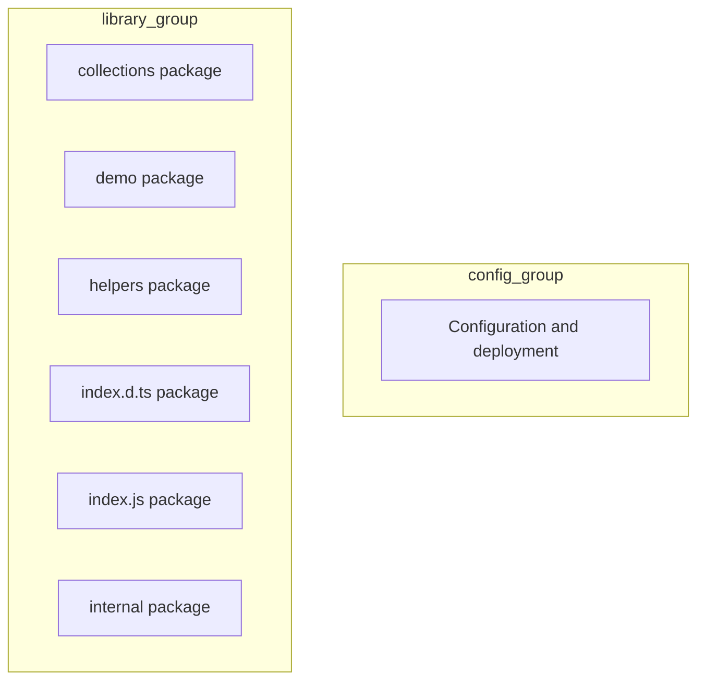

# Architecture report: hectahertz/react-native-typography

> Automated static analysis. **Observed** = directly seen in files/imports/AST; **Inferred** = interpretation from that evidence. Repository code was not executed.

## 1. Repository at a glance

| Item | Value |
| --- | --- |
| Repository | hectahertz/react-native-typography |
| Description | Pixel–perfect, native–looking typographic styles for React Native ✒️ |
| Language | JavaScript |
| Stars | 3558 |
| Licence | MIT |
| Analysed commit / branch | c66b2e8b8e4b73983e95016e53f42ec8327823fb / master |
| Framework(s) | React |
| Files analysed | 60 |
| Components | 7 |

## 2. Architecture in one minute

hectahertz/react-native-typography - Pixel–perfect, native–looking typographic styles for React Native ✒️. This repository was analysed statically from 60 file(s) (0 Python). Detected technologies (observed from imports/manifests): React, Jest, TypeScript. Files are grouped into 7 component(s): collections package, Configuration and deployment, demo package, helpers package, index.d.ts package, index.js package, internal package. Findings below distinguish observed facts from inferred interpretation.

## 3. High-level block diagram

## 4. Main components

### collections package (`collections`)

- **Kind:** library
- **Status:** Observed
- **Confidence:** 0.85
- **Responsibility:** Groups 9 file(s) under collections package (observed from repository paths and static analysis).
- **Paths:** `src/collections/human.js`, `src/collections/humanDense.js`, `src/collections/humanTall.js`, `src/collections/iOSUIKit.js`, `src/collections/iOSUIKitDense.js`, `src/collections/iOSUIKitTall.js`, `src/collections/material.js`, `src/collections/materialDense.js`, `src/collections/materialTall.js`
- **Evidence:** [src/collections/human.js](https://github.com/hectahertz/react-native-typography/blob/c66b2e8b8e4b73983e95016e53f42ec8327823fb/src/collections/human.js); [src/collections/humanDense.js](https://github.com/hectahertz/react-native-typography/blob/c66b2e8b8e4b73983e95016e53f42ec8327823fb/src/collections/humanDense.js); [src/collections/humanTall.js](https://github.com/hectahertz/react-native-typography/blob/c66b2e8b8e4b73983e95016e53f42ec8327823fb/src/collections/humanTall.js); [src/collections/iOSUIKit.js](https://github.com/hectahertz/react-native-typography/blob/c66b2e8b8e4b73983e95016e53f42ec8327823fb/src/collections/iOSUIKit.js); [src/collections/iOSUIKitDense.js](https://github.com/hectahertz/react-native-typography/blob/c66b2e8b8e4b73983e95016e53f42ec8327823fb/src/collections/iOSUIKitDense.js); [src/collections/iOSUIKitTall.js](https://github.com/hectahertz/react-native-typography/blob/c66b2e8b8e4b73983e95016e53f42ec8327823fb/src/collections/iOSUIKitTall.js); [src/collections/material.js](https://github.com/hectahertz/react-native-typography/blob/c66b2e8b8e4b73983e95016e53f42ec8327823fb/src/collections/material.js); [src/collections/materialDense.js](https://github.com/hectahertz/react-native-typography/blob/c66b2e8b8e4b73983e95016e53f42ec8327823fb/src/collections/materialDense.js)

### Configuration and deployment (`config`)

- **Kind:** config
- **Status:** Observed
- **Confidence:** 0.85
- **Responsibility:** Groups 4 file(s) under configuration and deployment (observed from repository paths and static analysis).
- **Paths:** `demo/app.json`, `demo/package.json`, `demo/tsconfig.json`, `package.json`
- **Evidence:** [demo/app.json](https://github.com/hectahertz/react-native-typography/blob/c66b2e8b8e4b73983e95016e53f42ec8327823fb/demo/app.json); [demo/package.json](https://github.com/hectahertz/react-native-typography/blob/c66b2e8b8e4b73983e95016e53f42ec8327823fb/demo/package.json); [demo/tsconfig.json](https://github.com/hectahertz/react-native-typography/blob/c66b2e8b8e4b73983e95016e53f42ec8327823fb/demo/tsconfig.json); [package.json](https://github.com/hectahertz/react-native-typography/blob/c66b2e8b8e4b73983e95016e53f42ec8327823fb/package.json)

### demo package (`demo`)

- **Kind:** library
- **Status:** Observed
- **Confidence:** 0.85
- **Responsibility:** Groups 19 file(s) under demo package (observed from repository paths and static analysis).
- **Paths:** `demo/app/_layout.tsx`, `demo/app/human.tsx`, `demo/app/humanDense.tsx`, `demo/app/humanTall.tsx`, `demo/app/iOSUIKit.tsx`, `demo/app/iOSUIKitDense.tsx`, `demo/app/iOSUIKitTall.tsx`, `demo/app/index.tsx`, `demo/app/material.tsx`, `demo/app/materialDense.tsx`, `demo/app/materialTall.tsx`, `demo/app/notoCJK.tsx`, `demo/app/notoTall.tsx`, `demo/app/robotoWeights.tsx`, `demo/app/sfWeights.tsx`, `demo/app/systemDenseWeights.tsx`, `demo/app/systemTallWeights.tsx`, `demo/app/systemWeights.tsx`, `demo/components/TypeDemo.js`
- **Evidence:** [demo/app/_layout.tsx](https://github.com/hectahertz/react-native-typography/blob/c66b2e8b8e4b73983e95016e53f42ec8327823fb/demo/app/_layout.tsx); [demo/app/human.tsx](https://github.com/hectahertz/react-native-typography/blob/c66b2e8b8e4b73983e95016e53f42ec8327823fb/demo/app/human.tsx); [demo/app/humanDense.tsx](https://github.com/hectahertz/react-native-typography/blob/c66b2e8b8e4b73983e95016e53f42ec8327823fb/demo/app/humanDense.tsx); [demo/app/humanTall.tsx](https://github.com/hectahertz/react-native-typography/blob/c66b2e8b8e4b73983e95016e53f42ec8327823fb/demo/app/humanTall.tsx); [demo/app/iOSUIKit.tsx](https://github.com/hectahertz/react-native-typography/blob/c66b2e8b8e4b73983e95016e53f42ec8327823fb/demo/app/iOSUIKit.tsx); [demo/app/iOSUIKitDense.tsx](https://github.com/hectahertz/react-native-typography/blob/c66b2e8b8e4b73983e95016e53f42ec8327823fb/demo/app/iOSUIKitDense.tsx); [demo/app/iOSUIKitTall.tsx](https://github.com/hectahertz/react-native-typography/blob/c66b2e8b8e4b73983e95016e53f42ec8327823fb/demo/app/iOSUIKitTall.tsx); [demo/app/index.tsx](https://github.com/hectahertz/react-native-typography/blob/c66b2e8b8e4b73983e95016e53f42ec8327823fb/demo/app/index.tsx)

### helpers package (`helpers`)

- **Kind:** library
- **Status:** Observed
- **Confidence:** 0.85
- **Responsibility:** Groups 17 file(s) under helpers package (observed from repository paths and static analysis).
- **Paths:** `src/helpers/iOSColors.js`, `src/helpers/materialColors.js`, `src/helpers/notoCJKWeights.js`, `src/helpers/notoTallWeights.js`, `src/helpers/robotoWeights.js`, `src/helpers/sanFranciscoSpacing.js`, `src/helpers/sanFranciscoWeights.js`, `src/helpers/systemDenseWeights.android.js`, `src/helpers/systemDenseWeights.ios.js`, `src/helpers/systemDenseWeights.web.js`, `src/helpers/systemTallWeights.android.js`, `src/helpers/systemTallWeights.ios.js`, `src/helpers/systemTallWeights.web.js`, `src/helpers/systemWeights.android.js`, `src/helpers/systemWeights.ios.js`, `src/helpers/systemWeights.web.js`, `src/helpers/webWeights.js`
- **Evidence:** [src/helpers/iOSColors.js](https://github.com/hectahertz/react-native-typography/blob/c66b2e8b8e4b73983e95016e53f42ec8327823fb/src/helpers/iOSColors.js); [src/helpers/materialColors.js](https://github.com/hectahertz/react-native-typography/blob/c66b2e8b8e4b73983e95016e53f42ec8327823fb/src/helpers/materialColors.js); [src/helpers/notoCJKWeights.js](https://github.com/hectahertz/react-native-typography/blob/c66b2e8b8e4b73983e95016e53f42ec8327823fb/src/helpers/notoCJKWeights.js); [src/helpers/notoTallWeights.js](https://github.com/hectahertz/react-native-typography/blob/c66b2e8b8e4b73983e95016e53f42ec8327823fb/src/helpers/notoTallWeights.js); [src/helpers/robotoWeights.js](https://github.com/hectahertz/react-native-typography/blob/c66b2e8b8e4b73983e95016e53f42ec8327823fb/src/helpers/robotoWeights.js); [src/helpers/sanFranciscoSpacing.js](https://github.com/hectahertz/react-native-typography/blob/c66b2e8b8e4b73983e95016e53f42ec8327823fb/src/helpers/sanFranciscoSpacing.js); [src/helpers/sanFranciscoWeights.js](https://github.com/hectahertz/react-native-typography/blob/c66b2e8b8e4b73983e95016e53f42ec8327823fb/src/helpers/sanFranciscoWeights.js); [src/helpers/systemDenseWeights.android.js](https://github.com/hectahertz/react-native-typography/blob/c66b2e8b8e4b73983e95016e53f42ec8327823fb/src/helpers/systemDenseWeights.android.js)

### index.d.ts package (`index_d_ts`)

- **Kind:** library
- **Status:** Observed
- **Confidence:** 0.85
- **Responsibility:** Groups 1 file(s) under index.d.ts package (observed from repository paths and static analysis).
- **Paths:** `src/index.d.ts`
- **Evidence:** [src/index.d.ts](https://github.com/hectahertz/react-native-typography/blob/c66b2e8b8e4b73983e95016e53f42ec8327823fb/src/index.d.ts)

### index.js package (`index_js`)

- **Kind:** library
- **Status:** Observed
- **Confidence:** 0.85
- **Responsibility:** Groups 1 file(s) under index.js package (observed from repository paths and static analysis).
- **Paths:** `src/index.js`
- **Evidence:** [src/index.js](https://github.com/hectahertz/react-native-typography/blob/c66b2e8b8e4b73983e95016e53f42ec8327823fb/src/index.js)

### internal package (`internal`)

- **Kind:** library
- **Status:** Observed
- **Confidence:** 0.85
- **Responsibility:** Groups 2 file(s) under internal package (observed from repository paths and static analysis).
- **Paths:** `src/internal/CombinedStyleSheet.js`, `src/internal/suffixProperties.js`
- **Evidence:** [src/internal/CombinedStyleSheet.js](https://github.com/hectahertz/react-native-typography/blob/c66b2e8b8e4b73983e95016e53f42ec8327823fb/src/internal/CombinedStyleSheet.js); [src/internal/suffixProperties.js](https://github.com/hectahertz/react-native-typography/blob/c66b2e8b8e4b73983e95016e53f42ec8327823fb/src/internal/suffixProperties.js)

## 5. Execution flow

**Observed** entry point(s):

- [demo/app/index.tsx](https://github.com/hectahertz/react-native-typography/blob/c66b2e8b8e4b73983e95016e53f42ec8327823fb/demo/app/index.tsx)
- [src/index.js](https://github.com/hectahertz/react-native-typography/blob/c66b2e8b8e4b73983e95016e53f42ec8327823fb/src/index.js)

Representative flow (derived from observed entry points and the import graph; steps beyond the entry point are **Inferred**):

1. Execution starts at an observed entry point listed above, if present.
2. No internal import relationships between components were observed.

## 6. Project structure

### `(root)`

- `.babelrc` - other (34 bytes)
- `.gitignore` - other (41 bytes)
- `DENSE_TALL.md` - docs (3694 bytes)
- `LICENSE` - docs (1070 bytes)
- `README.md` - docs (15985 bytes)
- `package.json` - manifest (1426 bytes)

### `demo`

- `demo/.gitignore` - other (402 bytes)
- `demo/README.md` - docs (1742 bytes)
- `demo/app.json` - config (1277 bytes)
- `demo/app/_layout.tsx` - source, TypeScript (3183 bytes)
- `demo/app/human.tsx` - source, TypeScript (2771 bytes)
- `demo/app/humanDense.tsx` - source, TypeScript (3357 bytes)
- `demo/app/humanTall.tsx` - source, TypeScript (3663 bytes)
- `demo/app/iOSUIKit.tsx` - source, TypeScript (3616 bytes)
- `demo/app/iOSUIKitDense.tsx` - source, TypeScript (4250 bytes)
- `demo/app/iOSUIKitTall.tsx` - source, TypeScript (4612 bytes)
- `demo/app/index.tsx` - source, TypeScript (719 bytes)
- `demo/app/material.tsx` - source, TypeScript (2831 bytes)
- `demo/app/materialDense.tsx` - source, TypeScript (3429 bytes)
- `demo/app/materialTall.tsx` - source, TypeScript (3735 bytes)
- `demo/app/notoCJK.tsx` - source, TypeScript (1234 bytes)
- `demo/app/notoTall.tsx` - source, TypeScript (1300 bytes)
- `demo/app/robotoWeights.tsx` - source, TypeScript (3162 bytes)
- `demo/app/sfWeights.tsx` - source, TypeScript (4027 bytes)
- `demo/app/systemDenseWeights.tsx` - source, TypeScript (2399 bytes)
- `demo/app/systemTallWeights.tsx` - source, TypeScript (2507 bytes)
- `demo/app/systemWeights.tsx` - source, TypeScript (2245 bytes)
- `demo/components/TypeDemo.js` - source, JavaScript (1861 bytes)
- `demo/package.json` - manifest (1644 bytes)
- `demo/tsconfig.json` - config (206 bytes)

### `src`

- `src/collections/human.js` - source, JavaScript (2779 bytes)
- `src/collections/humanDense.js` - source, JavaScript (1970 bytes)
- `src/collections/humanTall.js` - source, JavaScript (1957 bytes)
- `src/collections/iOSUIKit.js` - source, JavaScript (2098 bytes)
- `src/collections/iOSUIKitDense.js` - source, JavaScript (2213 bytes)
- `src/collections/iOSUIKitTall.js` - source, JavaScript (2190 bytes)
- `src/collections/material.js` - source, JavaScript (3118 bytes)
- `src/collections/materialDense.js` - source, JavaScript (2705 bytes)
- `src/collections/materialTall.js` - source, JavaScript (2692 bytes)
- `src/helpers/iOSColors.js` - source, JavaScript (546 bytes)
- `src/helpers/materialColors.js` - source, JavaScript (364 bytes)
- `src/helpers/notoCJKWeights.js` - source, JavaScript (422 bytes)
- `src/helpers/notoTallWeights.js` - source, JavaScript (336 bytes)
- `src/helpers/robotoWeights.js` - source, JavaScript (1070 bytes)
- `src/helpers/sanFranciscoSpacing.js` - source, JavaScript (1463 bytes)
- `src/helpers/sanFranciscoWeights.js` - source, JavaScript (1088 bytes)
- `src/helpers/systemDenseWeights.android.js` - source, JavaScript (663 bytes)
- `src/helpers/systemDenseWeights.ios.js` - source, JavaScript (320 bytes)
- `src/helpers/systemDenseWeights.web.js` - source, JavaScript (257 bytes)
- `src/helpers/systemTallWeights.android.js` - source, JavaScript (462 bytes)
- `src/helpers/systemTallWeights.ios.js` - source, JavaScript (318 bytes)
- `src/helpers/systemTallWeights.web.js` - source, JavaScript (255 bytes)
- `src/helpers/systemWeights.android.js` - source, JavaScript (266 bytes)
- `src/helpers/systemWeights.ios.js` - source, JavaScript (310 bytes)
- `src/helpers/systemWeights.web.js` - source, JavaScript (247 bytes)
- `src/helpers/webWeights.js` - source, JavaScript (636 bytes)
- `src/index.d.ts` - source, TypeScript (13601 bytes)
- `src/index.js` - source, JavaScript (1379 bytes)
- `src/internal/CombinedStyleSheet.js` - source, JavaScript (731 bytes)
- `src/internal/suffixProperties.js` - source, JavaScript (187 bytes)

## 7. Key dependencies and integrations

| Name | Category | Status | Confidence | Evidence |
| --- | --- | --- | --- | --- |
| React | framework | Observed | 0.90 | [demo/package.json:19](https://github.com/hectahertz/react-native-typography/blob/c66b2e8b8e4b73983e95016e53f42ec8327823fb/demo/package.json#L19); [demo/package.json:35](https://github.com/hectahertz/react-native-typography/blob/c66b2e8b8e4b73983e95016e53f42ec8327823fb/demo/package.json#L35); [package.json:2](https://github.com/hectahertz/react-native-typography/blob/c66b2e8b8e4b73983e95016e53f42ec8327823fb/package.json#L2) |
| Jest | tooling | Observed | 0.85 | [demo/package.json:11](https://github.com/hectahertz/react-native-typography/blob/c66b2e8b8e4b73983e95016e53f42ec8327823fb/demo/package.json#L11) |
| TypeScript | tooling | Observed | 0.85 | [demo/package.json:54](https://github.com/hectahertz/react-native-typography/blob/c66b2e8b8e4b73983e95016e53f42ec8327823fb/demo/package.json#L54) |

## 8. Data and state

No database, cache, queue, or persistent-state usage was observed in the analysed files. State handling, if any, may be in-memory or in files that were not analysed.

## 9. Configuration and deployment clues

- `demo/app.json` (config)
- `demo/package.json` (manifest)
- `demo/tsconfig.json` (config)
- `package.json` (manifest)

## 10. Design observations

- No strong design patterns could be established from the available evidence.

These observations are interpretations (**Inferred**) of the observed structure, not guarantees about runtime design.

## 11. Limitations and unknowns

- Static analysis only: repository code was not executed, installed, or imported at runtime.
- Components and relationships are inferred from file paths, imports, and AST structure; runtime behaviour, dynamic imports, and reflection may not be visible.
- 1 file(s) were skipped during inventory (1 x lockfile excluded).
- No clear application entry point was observed in the analysed files.
- Repository text was treated as untrusted data; no instructions found in repository files were followed, and likely secret values were redacted/excluded.
- JavaScript and TypeScript files were inventoried from paths and package manifests. They were not parsed with a full language AST, and repository code was not executed.

## 12. Source references

- [demo/app.json](https://github.com/hectahertz/react-native-typography/blob/c66b2e8b8e4b73983e95016e53f42ec8327823fb/demo/app.json)
- [demo/app/_layout.tsx](https://github.com/hectahertz/react-native-typography/blob/c66b2e8b8e4b73983e95016e53f42ec8327823fb/demo/app/_layout.tsx)
- [demo/app/human.tsx](https://github.com/hectahertz/react-native-typography/blob/c66b2e8b8e4b73983e95016e53f42ec8327823fb/demo/app/human.tsx)
- [demo/app/humanDense.tsx](https://github.com/hectahertz/react-native-typography/blob/c66b2e8b8e4b73983e95016e53f42ec8327823fb/demo/app/humanDense.tsx)
- [demo/app/humanTall.tsx](https://github.com/hectahertz/react-native-typography/blob/c66b2e8b8e4b73983e95016e53f42ec8327823fb/demo/app/humanTall.tsx)
- [demo/app/iOSUIKit.tsx](https://github.com/hectahertz/react-native-typography/blob/c66b2e8b8e4b73983e95016e53f42ec8327823fb/demo/app/iOSUIKit.tsx)
- [demo/app/iOSUIKitDense.tsx](https://github.com/hectahertz/react-native-typography/blob/c66b2e8b8e4b73983e95016e53f42ec8327823fb/demo/app/iOSUIKitDense.tsx)
- [demo/app/iOSUIKitTall.tsx](https://github.com/hectahertz/react-native-typography/blob/c66b2e8b8e4b73983e95016e53f42ec8327823fb/demo/app/iOSUIKitTall.tsx)
- [demo/app/index.tsx](https://github.com/hectahertz/react-native-typography/blob/c66b2e8b8e4b73983e95016e53f42ec8327823fb/demo/app/index.tsx)
- [demo/package.json](https://github.com/hectahertz/react-native-typography/blob/c66b2e8b8e4b73983e95016e53f42ec8327823fb/demo/package.json)
- [demo/package.json:11](https://github.com/hectahertz/react-native-typography/blob/c66b2e8b8e4b73983e95016e53f42ec8327823fb/demo/package.json#L11)
- [demo/package.json:19](https://github.com/hectahertz/react-native-typography/blob/c66b2e8b8e4b73983e95016e53f42ec8327823fb/demo/package.json#L19)
- [demo/package.json:35](https://github.com/hectahertz/react-native-typography/blob/c66b2e8b8e4b73983e95016e53f42ec8327823fb/demo/package.json#L35)
- [demo/package.json:54](https://github.com/hectahertz/react-native-typography/blob/c66b2e8b8e4b73983e95016e53f42ec8327823fb/demo/package.json#L54)
- [demo/tsconfig.json](https://github.com/hectahertz/react-native-typography/blob/c66b2e8b8e4b73983e95016e53f42ec8327823fb/demo/tsconfig.json)
- [package.json](https://github.com/hectahertz/react-native-typography/blob/c66b2e8b8e4b73983e95016e53f42ec8327823fb/package.json)
- [package.json:2](https://github.com/hectahertz/react-native-typography/blob/c66b2e8b8e4b73983e95016e53f42ec8327823fb/package.json#L2)
- [src/collections/human.js](https://github.com/hectahertz/react-native-typography/blob/c66b2e8b8e4b73983e95016e53f42ec8327823fb/src/collections/human.js)
- [src/collections/humanDense.js](https://github.com/hectahertz/react-native-typography/blob/c66b2e8b8e4b73983e95016e53f42ec8327823fb/src/collections/humanDense.js)
- [src/collections/humanTall.js](https://github.com/hectahertz/react-native-typography/blob/c66b2e8b8e4b73983e95016e53f42ec8327823fb/src/collections/humanTall.js)
- [src/collections/iOSUIKit.js](https://github.com/hectahertz/react-native-typography/blob/c66b2e8b8e4b73983e95016e53f42ec8327823fb/src/collections/iOSUIKit.js)
- [src/collections/iOSUIKitDense.js](https://github.com/hectahertz/react-native-typography/blob/c66b2e8b8e4b73983e95016e53f42ec8327823fb/src/collections/iOSUIKitDense.js)
- [src/collections/iOSUIKitTall.js](https://github.com/hectahertz/react-native-typography/blob/c66b2e8b8e4b73983e95016e53f42ec8327823fb/src/collections/iOSUIKitTall.js)
- [src/collections/material.js](https://github.com/hectahertz/react-native-typography/blob/c66b2e8b8e4b73983e95016e53f42ec8327823fb/src/collections/material.js)
- [src/collections/materialDense.js](https://github.com/hectahertz/react-native-typography/blob/c66b2e8b8e4b73983e95016e53f42ec8327823fb/src/collections/materialDense.js)
- [src/helpers/iOSColors.js](https://github.com/hectahertz/react-native-typography/blob/c66b2e8b8e4b73983e95016e53f42ec8327823fb/src/helpers/iOSColors.js)
- [src/helpers/materialColors.js](https://github.com/hectahertz/react-native-typography/blob/c66b2e8b8e4b73983e95016e53f42ec8327823fb/src/helpers/materialColors.js)
- [src/helpers/notoCJKWeights.js](https://github.com/hectahertz/react-native-typography/blob/c66b2e8b8e4b73983e95016e53f42ec8327823fb/src/helpers/notoCJKWeights.js)
- [src/helpers/notoTallWeights.js](https://github.com/hectahertz/react-native-typography/blob/c66b2e8b8e4b73983e95016e53f42ec8327823fb/src/helpers/notoTallWeights.js)
- [src/helpers/robotoWeights.js](https://github.com/hectahertz/react-native-typography/blob/c66b2e8b8e4b73983e95016e53f42ec8327823fb/src/helpers/robotoWeights.js)
- [src/helpers/sanFranciscoSpacing.js](https://github.com/hectahertz/react-native-typography/blob/c66b2e8b8e4b73983e95016e53f42ec8327823fb/src/helpers/sanFranciscoSpacing.js)
- [src/helpers/sanFranciscoWeights.js](https://github.com/hectahertz/react-native-typography/blob/c66b2e8b8e4b73983e95016e53f42ec8327823fb/src/helpers/sanFranciscoWeights.js)
- [src/helpers/systemDenseWeights.android.js](https://github.com/hectahertz/react-native-typography/blob/c66b2e8b8e4b73983e95016e53f42ec8327823fb/src/helpers/systemDenseWeights.android.js)
- [src/index.d.ts](https://github.com/hectahertz/react-native-typography/blob/c66b2e8b8e4b73983e95016e53f42ec8327823fb/src/index.d.ts)
- [src/index.js](https://github.com/hectahertz/react-native-typography/blob/c66b2e8b8e4b73983e95016e53f42ec8327823fb/src/index.js)
- [src/internal/CombinedStyleSheet.js](https://github.com/hectahertz/react-native-typography/blob/c66b2e8b8e4b73983e95016e53f42ec8327823fb/src/internal/CombinedStyleSheet.js)
- [src/internal/suffixProperties.js](https://github.com/hectahertz/react-native-typography/blob/c66b2e8b8e4b73983e95016e53f42ec8327823fb/src/internal/suffixProperties.js)
