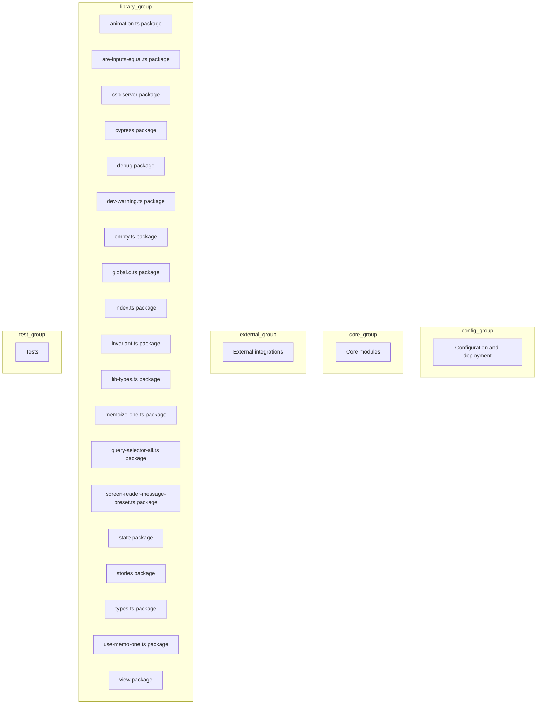

# Architecture report: hello-pangea/dnd

> Automated static analysis. **Observed** = directly seen in files/imports/AST; **Inferred** = interpretation from that evidence. Repository code was not executed.

## 1. Repository at a glance

| Item | Value |
| --- | --- |
| Repository | hello-pangea/dnd |
| Description | 💅 Beautiful and accessible drag and drop for lists with React. ⭐️ Star to support our work! |
| Language | TypeScript |
| Stars | 4048 |
| Licence | Other |
| Analysed commit / branch | 28c47a7a0139a09b1bf0a77a010e7121c39246d4 / main |
| Framework(s) | Express, React |
| Files analysed | 742 |
| Components | 23 |

## 2. Architecture in one minute

hello-pangea/dnd - 💅 Beautiful and accessible drag and drop for lists with React. ⭐️ Star to support our work!. This repository was analysed statically from 742 file(s) (0 Python). Detected technologies (observed from imports/manifests): GitHub Actions, Express, React, Redux, Jest, TypeScript. Files are grouped into 23 component(s): animation.ts package, are-inputs-equal.ts package, Configuration and deployment, Core modules, csp-server package, cypress package, debug package, dev-warning.ts package. Findings below distinguish observed facts from inferred interpretation.

## 3. High-level block diagram

## 4. Main components

### animation.ts package (`animation_ts`)

- **Kind:** library
- **Status:** Observed
- **Confidence:** 0.85
- **Responsibility:** Groups 1 file(s) under animation.ts package (observed from repository paths and static analysis).
- **Paths:** `src/animation.ts`
- **Evidence:** [src/animation.ts](https://github.com/hello-pangea/dnd/blob/28c47a7a0139a09b1bf0a77a010e7121c39246d4/src/animation.ts)

### are-inputs-equal.ts package (`are_inputs_equal_ts`)

- **Kind:** library
- **Status:** Observed
- **Confidence:** 0.85
- **Responsibility:** Groups 1 file(s) under are-inputs-equal.ts package (observed from repository paths and static analysis).
- **Paths:** `src/are-inputs-equal.ts`
- **Evidence:** [src/are-inputs-equal.ts](https://github.com/hello-pangea/dnd/blob/28c47a7a0139a09b1bf0a77a010e7121c39246d4/src/are-inputs-equal.ts)

### Configuration and deployment (`config`)

- **Kind:** config
- **Status:** Observed
- **Confidence:** 0.85
- **Responsibility:** Groups 5 file(s) under configuration and deployment (observed from repository paths and static analysis).
- **Paths:** `csp-server/tsconfig.json`, `cypress/tsconfig.json`, `package.json`, `stories/tsconfig.json`, `tsconfig.json`
- **Evidence:** [csp-server/tsconfig.json](https://github.com/hello-pangea/dnd/blob/28c47a7a0139a09b1bf0a77a010e7121c39246d4/csp-server/tsconfig.json); [cypress/tsconfig.json](https://github.com/hello-pangea/dnd/blob/28c47a7a0139a09b1bf0a77a010e7121c39246d4/cypress/tsconfig.json); [package.json](https://github.com/hello-pangea/dnd/blob/28c47a7a0139a09b1bf0a77a010e7121c39246d4/package.json); [stories/tsconfig.json](https://github.com/hello-pangea/dnd/blob/28c47a7a0139a09b1bf0a77a010e7121c39246d4/stories/tsconfig.json); [tsconfig.json](https://github.com/hello-pangea/dnd/blob/28c47a7a0139a09b1bf0a77a010e7121c39246d4/tsconfig.json)

### Core modules (`core`)

- **Kind:** core
- **Status:** Observed
- **Confidence:** 0.85
- **Responsibility:** Groups 8 file(s) under core modules (observed from repository paths and static analysis).
- **Paths:** `a11y-audit-parse.js`, `babel.config.js`, `browser-test-harness.js`, `cypress.config.ts`, `jest.config.ts`, `lighthouse.config.js`, `rollup.config.mjs`, `server-ports.js`
- **Evidence:** [a11y-audit-parse.js](https://github.com/hello-pangea/dnd/blob/28c47a7a0139a09b1bf0a77a010e7121c39246d4/a11y-audit-parse.js); [babel.config.js](https://github.com/hello-pangea/dnd/blob/28c47a7a0139a09b1bf0a77a010e7121c39246d4/babel.config.js); [browser-test-harness.js](https://github.com/hello-pangea/dnd/blob/28c47a7a0139a09b1bf0a77a010e7121c39246d4/browser-test-harness.js); [cypress.config.ts](https://github.com/hello-pangea/dnd/blob/28c47a7a0139a09b1bf0a77a010e7121c39246d4/cypress.config.ts); [jest.config.ts](https://github.com/hello-pangea/dnd/blob/28c47a7a0139a09b1bf0a77a010e7121c39246d4/jest.config.ts); [lighthouse.config.js](https://github.com/hello-pangea/dnd/blob/28c47a7a0139a09b1bf0a77a010e7121c39246d4/lighthouse.config.js); [rollup.config.mjs](https://github.com/hello-pangea/dnd/blob/28c47a7a0139a09b1bf0a77a010e7121c39246d4/rollup.config.mjs); [server-ports.js](https://github.com/hello-pangea/dnd/blob/28c47a7a0139a09b1bf0a77a010e7121c39246d4/server-ports.js)

### csp-server package (`csp_server`)

- **Kind:** library
- **Status:** Observed
- **Confidence:** 0.85
- **Responsibility:** Groups 7 file(s) under csp-server package (observed from repository paths and static analysis).
- **Paths:** `csp-server/app.tsx`, `csp-server/client.tsx`, `csp-server/environment.d.ts`, `csp-server/main.js`, `csp-server/server.tsx`, `csp-server/start.sh`, `csp-server/webpack.config.js`
- **Evidence:** [csp-server/app.tsx](https://github.com/hello-pangea/dnd/blob/28c47a7a0139a09b1bf0a77a010e7121c39246d4/csp-server/app.tsx); [csp-server/client.tsx](https://github.com/hello-pangea/dnd/blob/28c47a7a0139a09b1bf0a77a010e7121c39246d4/csp-server/client.tsx); [csp-server/environment.d.ts](https://github.com/hello-pangea/dnd/blob/28c47a7a0139a09b1bf0a77a010e7121c39246d4/csp-server/environment.d.ts); [csp-server/main.js](https://github.com/hello-pangea/dnd/blob/28c47a7a0139a09b1bf0a77a010e7121c39246d4/csp-server/main.js); [csp-server/server.tsx](https://github.com/hello-pangea/dnd/blob/28c47a7a0139a09b1bf0a77a010e7121c39246d4/csp-server/server.tsx); [csp-server/start.sh](https://github.com/hello-pangea/dnd/blob/28c47a7a0139a09b1bf0a77a010e7121c39246d4/csp-server/start.sh); [csp-server/webpack.config.js](https://github.com/hello-pangea/dnd/blob/28c47a7a0139a09b1bf0a77a010e7121c39246d4/csp-server/webpack.config.js)

### cypress package (`cypress`)

- **Kind:** library
- **Status:** Observed
- **Confidence:** 0.85
- **Responsibility:** Groups 4 file(s) under cypress package (observed from repository paths and static analysis).
- **Paths:** `cypress/.eslintrc.js`, `cypress/support/commands.ts`, `cypress/support/component.ts`, `cypress/support/e2e.ts`
- **Evidence:** [cypress/.eslintrc.js](https://github.com/hello-pangea/dnd/blob/28c47a7a0139a09b1bf0a77a010e7121c39246d4/cypress/.eslintrc.js); [cypress/support/commands.ts](https://github.com/hello-pangea/dnd/blob/28c47a7a0139a09b1bf0a77a010e7121c39246d4/cypress/support/commands.ts); [cypress/support/component.ts](https://github.com/hello-pangea/dnd/blob/28c47a7a0139a09b1bf0a77a010e7121c39246d4/cypress/support/component.ts); [cypress/support/e2e.ts](https://github.com/hello-pangea/dnd/blob/28c47a7a0139a09b1bf0a77a010e7121c39246d4/cypress/support/e2e.ts)

### debug package (`debug`)

- **Kind:** library
- **Status:** Observed
- **Confidence:** 0.85
- **Responsibility:** Groups 5 file(s) under debug package (observed from repository paths and static analysis).
- **Paths:** `src/debug/middleware/action-timing-average.ts`, `src/debug/middleware/action-timing.ts`, `src/debug/middleware/log.ts`, `src/debug/middleware/user-timing.ts`, `src/debug/timings.ts`
- **Evidence:** [src/debug/middleware/action-timing-average.ts](https://github.com/hello-pangea/dnd/blob/28c47a7a0139a09b1bf0a77a010e7121c39246d4/src/debug/middleware/action-timing-average.ts); [src/debug/middleware/action-timing.ts](https://github.com/hello-pangea/dnd/blob/28c47a7a0139a09b1bf0a77a010e7121c39246d4/src/debug/middleware/action-timing.ts); [src/debug/middleware/log.ts](https://github.com/hello-pangea/dnd/blob/28c47a7a0139a09b1bf0a77a010e7121c39246d4/src/debug/middleware/log.ts); [src/debug/middleware/user-timing.ts](https://github.com/hello-pangea/dnd/blob/28c47a7a0139a09b1bf0a77a010e7121c39246d4/src/debug/middleware/user-timing.ts); [src/debug/timings.ts](https://github.com/hello-pangea/dnd/blob/28c47a7a0139a09b1bf0a77a010e7121c39246d4/src/debug/timings.ts)

### dev-warning.ts package (`dev_warning_ts`)

- **Kind:** library
- **Status:** Observed
- **Confidence:** 0.85
- **Responsibility:** Groups 1 file(s) under dev-warning.ts package (observed from repository paths and static analysis).
- **Paths:** `src/dev-warning.ts`
- **Evidence:** [src/dev-warning.ts](https://github.com/hello-pangea/dnd/blob/28c47a7a0139a09b1bf0a77a010e7121c39246d4/src/dev-warning.ts)

### empty.ts package (`empty_ts`)

- **Kind:** library
- **Status:** Observed
- **Confidence:** 0.85
- **Responsibility:** Groups 1 file(s) under empty.ts package (observed from repository paths and static analysis).
- **Paths:** `src/empty.ts`
- **Evidence:** [src/empty.ts](https://github.com/hello-pangea/dnd/blob/28c47a7a0139a09b1bf0a77a010e7121c39246d4/src/empty.ts)

### External integrations (`external_integrations`)

- **Kind:** external
- **Status:** Observed
- **Confidence:** 0.85
- **Responsibility:** Groups 7 file(s) under external integrations (observed from repository paths and static analysis).
- **Paths:** `cypress/integration/content-security-policy.spec.ts`, `cypress/integration/focus.spec.ts`, `cypress/integration/move-between-lists.spec.ts`, `cypress/integration/reorder-lists.spec.ts`, `cypress/integration/reorder-virtual.spec.ts`, `cypress/integration/reorder.spec.ts`, `cypress/integration/util.ts`
- **Evidence:** [cypress/integration/content-security-policy.spec.ts](https://github.com/hello-pangea/dnd/blob/28c47a7a0139a09b1bf0a77a010e7121c39246d4/cypress/integration/content-security-policy.spec.ts); [cypress/integration/focus.spec.ts](https://github.com/hello-pangea/dnd/blob/28c47a7a0139a09b1bf0a77a010e7121c39246d4/cypress/integration/focus.spec.ts); [cypress/integration/move-between-lists.spec.ts](https://github.com/hello-pangea/dnd/blob/28c47a7a0139a09b1bf0a77a010e7121c39246d4/cypress/integration/move-between-lists.spec.ts); [cypress/integration/reorder-lists.spec.ts](https://github.com/hello-pangea/dnd/blob/28c47a7a0139a09b1bf0a77a010e7121c39246d4/cypress/integration/reorder-lists.spec.ts); [cypress/integration/reorder-virtual.spec.ts](https://github.com/hello-pangea/dnd/blob/28c47a7a0139a09b1bf0a77a010e7121c39246d4/cypress/integration/reorder-virtual.spec.ts); [cypress/integration/reorder.spec.ts](https://github.com/hello-pangea/dnd/blob/28c47a7a0139a09b1bf0a77a010e7121c39246d4/cypress/integration/reorder.spec.ts); [cypress/integration/util.ts](https://github.com/hello-pangea/dnd/blob/28c47a7a0139a09b1bf0a77a010e7121c39246d4/cypress/integration/util.ts)

### global.d.ts package (`global_d_ts`)

- **Kind:** library
- **Status:** Observed
- **Confidence:** 0.85
- **Responsibility:** Groups 1 file(s) under global.d.ts package (observed from repository paths and static analysis).
- **Paths:** `src/global.d.ts`
- **Evidence:** [src/global.d.ts](https://github.com/hello-pangea/dnd/blob/28c47a7a0139a09b1bf0a77a010e7121c39246d4/src/global.d.ts)

### index.ts package (`index_ts`)

- **Kind:** library
- **Status:** Observed
- **Confidence:** 0.85
- **Responsibility:** Groups 1 file(s) under index.ts package (observed from repository paths and static analysis).
- **Paths:** `src/index.ts`
- **Evidence:** [src/index.ts](https://github.com/hello-pangea/dnd/blob/28c47a7a0139a09b1bf0a77a010e7121c39246d4/src/index.ts)

### invariant.ts package (`invariant_ts`)

- **Kind:** library
- **Status:** Observed
- **Confidence:** 0.85
- **Responsibility:** Groups 1 file(s) under invariant.ts package (observed from repository paths and static analysis).
- **Paths:** `src/invariant.ts`
- **Evidence:** [src/invariant.ts](https://github.com/hello-pangea/dnd/blob/28c47a7a0139a09b1bf0a77a010e7121c39246d4/src/invariant.ts)

### lib-types.ts package (`lib_types_ts`)

- **Kind:** library
- **Status:** Observed
- **Confidence:** 0.85
- **Responsibility:** Groups 1 file(s) under lib-types.ts package (observed from repository paths and static analysis).
- **Paths:** `src/lib-types.ts`
- **Evidence:** [src/lib-types.ts](https://github.com/hello-pangea/dnd/blob/28c47a7a0139a09b1bf0a77a010e7121c39246d4/src/lib-types.ts)

### memoize-one.ts package (`memoize_one_ts`)

- **Kind:** library
- **Status:** Observed
- **Confidence:** 0.85
- **Responsibility:** Groups 1 file(s) under memoize-one.ts package (observed from repository paths and static analysis).
- **Paths:** `src/memoize-one.ts`
- **Evidence:** [src/memoize-one.ts](https://github.com/hello-pangea/dnd/blob/28c47a7a0139a09b1bf0a77a010e7121c39246d4/src/memoize-one.ts)

### query-selector-all.ts package (`query_selector_all_ts`)

- **Kind:** library
- **Status:** Observed
- **Confidence:** 0.85
- **Responsibility:** Groups 1 file(s) under query-selector-all.ts package (observed from repository paths and static analysis).
- **Paths:** `src/query-selector-all.ts`
- **Evidence:** [src/query-selector-all.ts](https://github.com/hello-pangea/dnd/blob/28c47a7a0139a09b1bf0a77a010e7121c39246d4/src/query-selector-all.ts)

### screen-reader-message-preset.ts package (`screen_reader_message_preset_ts`)

- **Kind:** library
- **Status:** Observed
- **Confidence:** 0.85
- **Responsibility:** Groups 1 file(s) under screen-reader-message-preset.ts package (observed from repository paths and static analysis).
- **Paths:** `src/screen-reader-message-preset.ts`
- **Evidence:** [src/screen-reader-message-preset.ts](https://github.com/hello-pangea/dnd/blob/28c47a7a0139a09b1bf0a77a010e7121c39246d4/src/screen-reader-message-preset.ts)

### state package (`state`)

- **Kind:** library
- **Status:** Observed
- **Confidence:** 0.85
- **Responsibility:** Groups 127 file(s) under state package (observed from repository paths and static analysis).
- **Paths:** `src/state/action-creators.ts`, `src/state/auto-scroller/auto-scroller-types.ts`, `src/state/auto-scroller/can-scroll.ts`, `src/state/auto-scroller/fluid-scroller/auto-scroller-options-types.ts`, `src/state/auto-scroller/fluid-scroller/config.ts`, `src/state/auto-scroller/fluid-scroller/get-best-scrollable-droppable.ts`, `src/state/auto-scroller/fluid-scroller/get-droppable-scroll-change.ts`, `src/state/auto-scroller/fluid-scroller/get-percentage.ts`, `src/state/auto-scroller/fluid-scroller/get-scroll/adjust-for-size-limits.ts`, `src/state/auto-scroller/fluid-scroller/get-scroll/get-scroll-on-axis/dampen-value-by-time.ts`, `src/state/auto-scroller/fluid-scroller/get-scroll/get-scroll-on-axis/get-distance-thresholds.ts`, `src/state/auto-scroller/fluid-scroller/get-scroll/get-scroll-on-axis/get-value-from-distance.ts`, `src/state/auto-scroller/fluid-scroller/get-scroll/get-scroll-on-axis/get-value.ts`, `src/state/auto-scroller/fluid-scroller/get-scroll/get-scroll-on-axis/index.ts`, `src/state/auto-scroller/fluid-scroller/get-scroll/get-scroll-on-axis/min-scroll.ts`, `src/state/auto-scroller/fluid-scroller/get-scroll/index.ts`, `src/state/auto-scroller/fluid-scroller/get-window-scroll-change.ts`, `src/state/auto-scroller/fluid-scroller/index.ts`, `src/state/auto-scroller/fluid-scroller/scroll.ts`, `src/state/auto-scroller/index.ts`, `src/state/auto-scroller/jump-scroller.ts`, `src/state/axis.ts`, `src/state/calculate-drag-impact/calculate-reorder-impact.ts`, `src/state/can-start-drag.ts`, `src/state/create-store.ts`, `src/state/did-start-after-critical.ts`, `src/state/dimension-marshal/dimension-marshal-types.ts`, `src/state/dimension-marshal/dimension-marshal.ts`, `src/state/dimension-marshal/get-initial-publish.ts`, `src/state/dimension-marshal/while-dragging-publisher.ts`, `src/state/dimension-structures.ts`, `src/state/droppable/get-droppable.ts`, `src/state/droppable/is-home-of.ts`, `src/state/droppable/scroll-droppable.ts`, `src/state/droppable/should-use-placeholder.ts`, `src/state/droppable/util/clip.ts`, `src/state/droppable/util/get-subject.ts`, `src/state/droppable/what-is-dragged-over-from-result.ts`, `src/state/droppable/what-is-dragged-over.ts`, `src/state/droppable/with-placeholder.ts`, `src/state/get-center-from-impact/get-client-border-box-center/get-client-from-page-border-box-center.ts`, `src/state/get-center-from-impact/get-client-border-box-center/index.ts`, `src/state/get-center-from-impact/get-page-border-box-center/index.ts`, `src/state/get-center-from-impact/get-page-border-box-center/when-combining.ts`, `src/state/get-center-from-impact/get-page-border-box-center/when-reordering.ts`, `src/state/get-center-from-impact/move-relative-to.ts`, `src/state/get-combined-item-displacement.ts`, `src/state/get-displaced-by.ts`, `src/state/get-displacement-groups.ts`, `src/state/get-drag-impact/get-combine-impact.ts`, `src/state/get-drag-impact/get-reorder-impact.ts`, `src/state/get-drag-impact/index.ts`, `src/state/get-draggables-inside-droppable.ts`, `src/state/get-droppable-over.ts`, `src/state/get-frame.ts`, `src/state/get-home-location.ts`, `src/state/get-impact-location.ts`, `src/state/get-is-displaced.ts`, `src/state/get-lift-effect.ts`, `src/state/get-max-scroll.ts`, `src/state/is-dragging.ts`, `src/state/is-movement-allowed.ts`, `src/state/is-within.ts`, `src/state/middleware/auto-scroll.ts`, `src/state/middleware/dimension-marshal-stopper.ts`, `src/state/middleware/drop/drop-animation-finish-middleware.ts`, `src/state/middleware/drop/drop-animation-flush-on-scroll-middleware.ts`, `src/state/middleware/drop/drop-middleware.ts`, `src/state/middleware/drop/get-drop-duration.ts`, `src/state/middleware/drop/get-drop-impact.ts`, `src/state/middleware/drop/get-new-home-client-offset.ts`, `src/state/middleware/drop/index.ts`, `src/state/middleware/focus.ts`, `src/state/middleware/lift.ts`, `src/state/middleware/pending-drop.ts`, `src/state/middleware/responders/async-marshal.ts`, `src/state/middleware/responders/expiring-announce.ts`, `src/state/middleware/responders/index.ts`, `src/state/middleware/responders/is-equal.ts`, `src/state/middleware/responders/publisher.ts`, `src/state/middleware/responders/responders-middleware.ts`, `src/state/middleware/scroll-listener.ts`, `src/state/middleware/style.ts`, `src/state/middleware/util/validate-dimensions.ts`, `src/state/move-in-direction/index.ts`, `src/state/move-in-direction/move-cross-axis/get-best-cross-axis-droppable.ts`, `src/state/move-in-direction/move-cross-axis/get-closest-draggable.ts`, `src/state/move-in-direction/move-cross-axis/index.ts`, `src/state/move-in-direction/move-cross-axis/move-to-new-droppable.ts`, `src/state/move-in-direction/move-cross-axis/without-starting-displacement.ts`, `src/state/move-in-direction/move-in-direction-types.ts`, `src/state/move-in-direction/move-to-next-place/index.ts`, `src/state/move-in-direction/move-to-next-place/is-totally-visible-in-new-location.ts`, `src/state/move-in-direction/move-to-next-place/move-to-next-combine/index.ts`, `src/state/move-in-direction/move-to-next-place/move-to-next-index/from-combine.ts`, `src/state/move-in-direction/move-to-next-place/move-to-next-index/from-reorder.ts`, `src/state/move-in-direction/move-to-next-place/move-to-next-index/index.ts`, `src/state/no-impact.ts`, `src/state/patch-dimension-map.ts`, `src/state/patch-droppable-map.ts`, `src/state/position.ts`, `src/state/post-reducer/when-moving/refresh-snap.ts`, `src/state/post-reducer/when-moving/update.ts`, `src/state/publish-while-dragging-in-virtual/adjust-additions-for-scroll-changes.ts`, `src/state/publish-while-dragging-in-virtual/index.ts`, `src/state/publish-while-dragging-in-virtual/offset-draggable.ts`, `src/state/recompute-placeholders.ts`, `src/state/rect.ts`, `src/state/reducer.ts`, `src/state/registry/create-registry.ts`, `src/state/registry/registry-types.ts`, `src/state/registry/use-registry.ts`, `src/state/remove-draggable-from-list.ts`, `src/state/scroll-viewport.ts`, `src/state/spacing.ts`, `src/state/store-types.ts`, `src/state/update-displacement-visibility/recompute.ts`, `src/state/update-displacement-visibility/speculatively-increase.ts`, `src/state/visibility/is-partially-visible-through-frame.ts`, `src/state/visibility/is-position-in-frame.ts`, `src/state/visibility/is-totally-visible-through-frame-on-axis.ts`, `src/state/visibility/is-totally-visible-through-frame.ts`, `src/state/visibility/is-visible.ts`, `src/state/with-scroll-change/with-all-displacement.ts`, `src/state/with-scroll-change/with-droppable-displacement.ts`, `src/state/with-scroll-change/with-droppable-scroll.ts`, `src/state/with-scroll-change/with-viewport-displacement.ts`
- **Evidence:** [src/state/action-creators.ts](https://github.com/hello-pangea/dnd/blob/28c47a7a0139a09b1bf0a77a010e7121c39246d4/src/state/action-creators.ts); [src/state/auto-scroller/auto-scroller-types.ts](https://github.com/hello-pangea/dnd/blob/28c47a7a0139a09b1bf0a77a010e7121c39246d4/src/state/auto-scroller/auto-scroller-types.ts); [src/state/auto-scroller/can-scroll.ts](https://github.com/hello-pangea/dnd/blob/28c47a7a0139a09b1bf0a77a010e7121c39246d4/src/state/auto-scroller/can-scroll.ts); [src/state/auto-scroller/fluid-scroller/auto-scroller-options-types.ts](https://github.com/hello-pangea/dnd/blob/28c47a7a0139a09b1bf0a77a010e7121c39246d4/src/state/auto-scroller/fluid-scroller/auto-scroller-options-types.ts); [src/state/auto-scroller/fluid-scroller/config.ts](https://github.com/hello-pangea/dnd/blob/28c47a7a0139a09b1bf0a77a010e7121c39246d4/src/state/auto-scroller/fluid-scroller/config.ts); [src/state/auto-scroller/fluid-scroller/get-best-scrollable-droppable.ts](https://github.com/hello-pangea/dnd/blob/28c47a7a0139a09b1bf0a77a010e7121c39246d4/src/state/auto-scroller/fluid-scroller/get-best-scrollable-droppable.ts); [src/state/auto-scroller/fluid-scroller/get-droppable-scroll-change.ts](https://github.com/hello-pangea/dnd/blob/28c47a7a0139a09b1bf0a77a010e7121c39246d4/src/state/auto-scroller/fluid-scroller/get-droppable-scroll-change.ts); [src/state/auto-scroller/fluid-scroller/get-percentage.ts](https://github.com/hello-pangea/dnd/blob/28c47a7a0139a09b1bf0a77a010e7121c39246d4/src/state/auto-scroller/fluid-scroller/get-percentage.ts)

### stories package (`stories`)

- **Kind:** library
- **Status:** Observed
- **Confidence:** 0.85
- **Responsibility:** Groups 83 file(s) under stories package (observed from repository paths and static analysis).
- **Paths:** `stories/.eslintrc.js`, `stories/examples/1-single-vertical-list.stories.tsx`, `stories/examples/10-table.stories.tsx`, `stories/examples/11-portal.stories.tsx`, `stories/examples/12-dynamic.stories.tsx`, `stories/examples/15-on-before-capture.stories.tsx`, `stories/examples/2-single-horizontal.stories.tsx`, `stories/examples/20-super-simple.stories.tsx`, `stories/examples/21-change-on-drag-start.stories.tsx`, `stories/examples/25-fixed-list.stories.tsx`, `stories/examples/3-board.stories.stories.tsx`, `stories/examples/30-custom-drop.stories.tsx`, `stories/examples/35-function-component.stories.tsx`, `stories/examples/4-complex-vertical-list.stories.tsx`, `stories/examples/40-programmatic.stories.tsx`, `stories/examples/45-virtual.stories.tsx`, `stories/examples/5-multiple-vertical-lists.stories.tsx`, `stories/examples/50-multiple-contexts.stories.tsx`, `stories/examples/55-mixed-sizes.stories.tsx`, `stories/examples/6-multiple-horizontal-lists.stories.tsx`, `stories/examples/60-autoscroll-options.stories.tsx`, `stories/examples/7-interactive-elements.stories.tsx`, `stories/examples/8-accessibility.stories.tsx`, `stories/examples/9-multi-drag.stories.tsx`, `stories/examples/99-debug.stories.tsx`, `stories/src/accessible/blur-context.ts`, `stories/src/accessible/data.ts`, `stories/src/accessible/task-app.tsx`, `stories/src/accessible/task-list.tsx`, `stories/src/accessible/task.tsx`, `stories/src/board/board.tsx`, `stories/src/board/column.tsx`, `stories/src/constants.ts`, `stories/src/custom-drop/funny-drop.tsx`, `stories/src/custom-drop/no-drop.tsx`, `stories/src/customize-autoscroll/autoscroll-setter.tsx`, `stories/src/customize-autoscroll/customize-autoscroll-app.tsx`, `stories/src/data.ts`, `stories/src/dynamic/lazy-loading.tsx`, `stories/src/dynamic/with-controls.tsx`, `stories/src/fixed-list/fixed-sidebar.tsx`, `stories/src/function-component/quote-app.tsx`, `stories/src/horizontal/author-app.tsx`, `stories/src/interactive-elements/interactive-elements-app.tsx`, `stories/src/mixed-sizes/mixed-size-items.tsx`, `stories/src/mixed-sizes/mixed-size-lists-experiment.tsx`, `stories/src/mixed-sizes/mixed-size-lists.tsx`, `stories/src/multi-drag/column.tsx`, `stories/src/multi-drag/data.ts`, `stories/src/multi-drag/task-app.tsx`, `stories/src/multi-drag/task.tsx`, `stories/src/multi-drag/types.ts`, `stories/src/multi-drag/utils.ts`, `stories/src/multiple-horizontal/quote-app.tsx`, `stories/src/multiple-vertical/quote-app.tsx`, `stories/src/on-before-capture/adding-things.tsx`, `stories/src/portal/portal-app.tsx`, `stories/src/primatives/author-item.tsx`, `stories/src/primatives/author-list.tsx`, `stories/src/primatives/quote-item.tsx`, `stories/src/primatives/quote-list.tsx`, `stories/src/primatives/title.tsx`, `stories/src/programmatic/multiple-contexts.tsx`, `stories/src/programmatic/runsheet.tsx`, `stories/src/programmatic/with-controls.tsx`, `stories/src/reorder.ts`, `stories/src/simple/simple-mixed-spacing.tsx`, `stories/src/simple/simple-scrollable.tsx`, `stories/src/simple/simple.tsx`, `stories/src/table/with-clone.tsx`, `stories/src/table/with-dimension-locking.tsx`, `stories/src/table/with-fixed-columns.tsx`, `stories/src/table/with-portal.tsx`, `stories/src/types.ts`, `stories/src/vertical-grouped/quote-app.tsx`, `stories/src/vertical-nested/quote-app.tsx`, `stories/src/vertical-nested/quote-list.tsx`, `stories/src/vertical-nested/types.ts`, `stories/src/vertical/quote-app.tsx`, `stories/src/virtual/quote-count-chooser.tsx`, `stories/src/virtual/react-window/board.tsx`, `stories/src/virtual/react-window/list.tsx`, `stories/typings.d.ts`
- **Evidence:** [stories/.eslintrc.js](https://github.com/hello-pangea/dnd/blob/28c47a7a0139a09b1bf0a77a010e7121c39246d4/stories/.eslintrc.js); [stories/examples/1-single-vertical-list.stories.tsx](https://github.com/hello-pangea/dnd/blob/28c47a7a0139a09b1bf0a77a010e7121c39246d4/stories/examples/1-single-vertical-list.stories.tsx); [stories/examples/10-table.stories.tsx](https://github.com/hello-pangea/dnd/blob/28c47a7a0139a09b1bf0a77a010e7121c39246d4/stories/examples/10-table.stories.tsx); [stories/examples/11-portal.stories.tsx](https://github.com/hello-pangea/dnd/blob/28c47a7a0139a09b1bf0a77a010e7121c39246d4/stories/examples/11-portal.stories.tsx); [stories/examples/12-dynamic.stories.tsx](https://github.com/hello-pangea/dnd/blob/28c47a7a0139a09b1bf0a77a010e7121c39246d4/stories/examples/12-dynamic.stories.tsx); [stories/examples/15-on-before-capture.stories.tsx](https://github.com/hello-pangea/dnd/blob/28c47a7a0139a09b1bf0a77a010e7121c39246d4/stories/examples/15-on-before-capture.stories.tsx); [stories/examples/2-single-horizontal.stories.tsx](https://github.com/hello-pangea/dnd/blob/28c47a7a0139a09b1bf0a77a010e7121c39246d4/stories/examples/2-single-horizontal.stories.tsx); [stories/examples/20-super-simple.stories.tsx](https://github.com/hello-pangea/dnd/blob/28c47a7a0139a09b1bf0a77a010e7121c39246d4/stories/examples/20-super-simple.stories.tsx)

### Tests (`tests`)

- **Kind:** test
- **Status:** Observed
- **Confidence:** 0.85
- **Responsibility:** Groups 310 file(s) under tests (observed from repository paths and static analysis).
- **Paths:** `test/.eslintrc.js`, `test/setup/attach-raf-stub.ts`, `test/setup/browser.ts`, `test/setup/env-setup.ts`, `test/setup/environment.ts`, `test/setup/test-setup.ts`, `test/setup/transition-event-polyfill.ts`, `test/tsconfig.json`, `test/typings/environment.d.ts`, `test/typings/raf-stub.d.ts`, `test/typings/testing-library-dom.d.ts`, `test/unit/dev-warning.spec.ts`, `test/unit/docs/content.spec.ts`, `test/unit/docs/no-broken-links.spec.ts`, `test/unit/health/drop-dev-warnings-for-prod.spec.ts`, `test/unit/health/src-file-name-convention.spec.ts`, `test/unit/integration/accessibility/axe-audit.spec.tsx`, `test/unit/integration/body-removal-before-unmount.spec.tsx`, `test/unit/integration/combine-on-start.spec.tsx`, `test/unit/integration/disable-on-start.spec.tsx`, `test/unit/integration/drag-drop-context/check-doctype.spec.ts`, `test/unit/integration/drag-drop-context/check-react-version.spec.ts`, `test/unit/integration/drag-drop-context/clashing-with-consumers-redux.spec.tsx`, `test/unit/integration/drag-drop-context/error-handling/error-in-react-tree.spec.tsx`, `test/unit/integration/drag-drop-context/error-handling/error-on-window.spec.tsx`, `test/unit/integration/drag-drop-context/on-before-capture/additions.spec.tsx`, `test/unit/integration/drag-drop-context/on-before-capture/removals.spec.tsx`, `test/unit/integration/drag-drop-context/unmount.spec.tsx`, `test/unit/integration/drag-handle/keyboard-sensor/directional-movement.spec.tsx`, `test/unit/integration/drag-handle/keyboard-sensor/no-click-blocking.spec.tsx`, `test/unit/integration/drag-handle/keyboard-sensor/prevent-keyboard-scroll.spec.tsx`, `test/unit/integration/drag-handle/keyboard-sensor/prevent-standard-keys-while-dragging.spec.tsx`, `test/unit/integration/drag-handle/keyboard-sensor/starting-a-drag.spec.tsx`, `test/unit/integration/drag-handle/keyboard-sensor/stopping-a-drag.spec.tsx`, `test/unit/integration/drag-handle/mouse-sensor/cancel-while-pending.spec.tsx`, `test/unit/integration/drag-handle/mouse-sensor/click-blocking.spec.tsx`, `test/unit/integration/drag-handle/mouse-sensor/force-press.spec.tsx`, `test/unit/integration/drag-handle/mouse-sensor/prevent-standard-keys-while-dragging.spec.tsx`, `test/unit/integration/drag-handle/mouse-sensor/starting-a-dragging.spec.tsx`, `test/unit/integration/drag-handle/mouse-sensor/stopping-a-drag.spec.tsx`, `test/unit/integration/drag-handle/sensor-marshal/click-blocking.spec.tsx`, `test/unit/integration/drag-handle/sensor-marshal/force-releasing-locks.spec.tsx`, `test/unit/integration/drag-handle/sensor-marshal/is-lock-claimed.spec.tsx`, `test/unit/integration/drag-handle/sensor-marshal/lock-context-isolation.spec.tsx`, `test/unit/integration/drag-handle/sensor-marshal/move-throttling.spec.tsx`, `test/unit/integration/drag-handle/sensor-marshal/no-double-lift.spec.tsx`, `test/unit/integration/drag-handle/sensor-marshal/obtaining-lock.spec.tsx`, `test/unit/integration/drag-handle/sensor-marshal/outdated-locks.spec.tsx`, `test/unit/integration/drag-handle/shared-behaviours/abort-on-error.spec.tsx`, `test/unit/integration/drag-handle/shared-behaviours/cancel-while-dragging.spec.tsx`, `test/unit/integration/drag-handle/shared-behaviours/cannot-start-when-disabled.spec.tsx`, `test/unit/integration/drag-handle/shared-behaviours/cannot-start-when-something-else-has-lock.spec.tsx`, `test/unit/integration/drag-handle/shared-behaviours/cannot-start-when-unmounted.spec.tsx`, `test/unit/integration/drag-handle/shared-behaviours/cleanup.spec.tsx`, `test/unit/integration/drag-handle/shared-behaviours/contenteditable.spec.tsx`, `test/unit/integration/drag-handle/shared-behaviours/disable-default-sensors.spec.tsx`, `test/unit/integration/drag-handle/shared-behaviours/interactive-elements.spec.tsx`, `test/unit/integration/drag-handle/shared-behaviours/lock-released-mid-drag.spec.tsx`, `test/unit/integration/drag-handle/shared-behaviours/lock-released-pre-drag.spec.tsx`, `test/unit/integration/drag-handle/shared-behaviours/nested-handles.spec.tsx`, `test/unit/integration/drag-handle/shared-behaviours/no-dragging-svgs.spec.tsx`, `test/unit/integration/drag-handle/shared-behaviours/parent-rendering-should-not-kill-drag.spec.tsx`, `test/unit/integration/drag-handle/shared-behaviours/validate-controls.spec.tsx`, `test/unit/integration/drag-handle/touch-sensor/cancel-while-pending.spec.tsx`, `test/unit/integration/drag-handle/touch-sensor/click-blocking.spec.tsx`, `test/unit/integration/drag-handle/touch-sensor/context-menu-opt-out.spec.tsx`, `test/unit/integration/drag-handle/touch-sensor/force-press.spec.tsx`, `test/unit/integration/drag-handle/touch-sensor/starting-a-drag.spec.tsx`, `test/unit/integration/drag-handle/touch-sensor/stopping-a-drag.spec.tsx`, `test/unit/integration/drag-handle/touch-sensor/unmounted-while-pending-timer-running.spec.tsx`, `test/unit/integration/draggable/combined-with.spec.tsx`, `test/unit/integration/draggable/dragging.spec.tsx`, `test/unit/integration/draggable/dropping.spec.tsx`, `test/unit/integration/draggable/moving-out-of-the-way.spec.tsx`, `test/unit/integration/draggable/portal.spec.tsx`, `test/unit/integration/draggable/resting.spec.tsx`, `test/unit/integration/draggable/validation.spec.tsx`, `test/unit/integration/droppable/clone.spec.tsx`, `test/unit/integration/droppable/placeholder.spec.tsx`, `test/unit/integration/reorder-render-sync.spec.tsx`, `test/unit/integration/responders-integration.spec.tsx`, `test/unit/integration/responders-timing.spec.tsx`, `test/unit/integration/server-side-rendering/__snapshots__/server-rendering.spec.tsx.snap`, `test/unit/integration/server-side-rendering/client-hydration.spec.tsx`, `test/unit/integration/server-side-rendering/server-rendering.spec.tsx`, `test/unit/integration/util/app.tsx`, `test/unit/integration/util/board.tsx`, `test/unit/integration/util/controls.ts`, `test/unit/integration/util/expanded-mouse.ts`, `test/unit/integration/util/helpers.ts`, `test/unit/memoize-one.spec.ts`, `test/unit/state/auto-scroll/can-scroll.spec.ts`, `test/unit/state/auto-scroll/choosing-the-right-scroller.spec.ts`, `test/unit/state/auto-scroll/fluid-scroller/big-draggables.spec.ts`, `test/unit/state/auto-scroll/fluid-scroller/droppable-scrolling.spec.ts`, `test/unit/state/auto-scroll/fluid-scroller/lifecycle.spec.ts`, `test/unit/state/auto-scroll/fluid-scroller/time-dampening.spec.ts`, `test/unit/state/auto-scroll/fluid-scroller/util/drag-to.ts`, `test/unit/state/auto-scroll/fluid-scroller/util/for-each.ts`, `test/unit/state/auto-scroll/fluid-scroller/util/get-args-mock.ts`, `test/unit/state/auto-scroll/fluid-scroller/util/get-droppable.ts`, `test/unit/state/auto-scroll/fluid-scroller/util/viewport.ts`, `test/unit/state/auto-scroll/fluid-scroller/window-before-droppable.spec.ts`, `test/unit/state/auto-scroll/fluid-scroller/window-scrolling.spec.ts`, `test/unit/state/auto-scroll/jump-scroller.spec.ts`, `test/unit/state/can-start-drag.spec.ts`, `test/unit/state/dimension-structures.spec.ts`, `test/unit/state/droppable/clip.spec.ts`, `test/unit/state/droppable/get-droppable.spec.ts`, `test/unit/state/droppable/get-subject.spec.ts`, `test/unit/state/droppable/is-home-of.spec.ts`, `test/unit/state/droppable/scroll-droppable.spec.ts`, `test/unit/state/droppable/what-is-dragged-over.spec.ts`, `test/unit/state/droppable/with-placeholder.spec.ts`, `test/unit/state/get-center-from-impact/get-client-border-box-center.spec.ts`, `test/unit/state/get-center-from-impact/get-client-from-page-border-box-center.spec.ts`, `test/unit/state/get-center-from-impact/get-page-border-box-center/combine/when-combining.spec.ts`, `test/unit/state/get-center-from-impact/get-page-border-box-center/combine/with-droppable-scroll.spec.ts`, `test/unit/state/get-center-from-impact/get-page-border-box-center/in-home-location.spec.ts`, `test/unit/state/get-center-from-impact/get-page-border-box-center/over-nothing.spec.ts`, `test/unit/state/get-center-from-impact/get-page-border-box-center/reorder/in-empty-list.spec.ts`, `test/unit/state/get-center-from-impact/get-page-border-box-center/reorder/nothing-displaced.spec.ts`, `test/unit/state/get-center-from-impact/get-page-border-box-center/reorder/there-is-displacement.spec.ts`, `test/unit/state/get-center-from-impact/get-page-border-box-center/reorder/with-droppable-scroll.spec.ts`, `test/unit/state/get-center-from-impact/move-relative-to.spec.ts`, `test/unit/state/get-displacement-groups/get-displacement-groups.spec.ts`, `test/unit/state/get-displacement-groups/use-initial-position-not-displaced.spec.ts`, `test/unit/state/get-drag-impact/combine/is-combine-disabled.spec.ts`, `test/unit/state/get-drag-impact/combine/should-not-combine-with-home-draggable.spec.ts`, `test/unit/state/get-drag-impact/combine/started-after-critical.spec.ts`, `test/unit/state/get-drag-impact/combine/started-before-critical.spec.ts`, `test/unit/state/get-drag-impact/combine/with-droppable-scroll.spec.ts`, `test/unit/state/get-drag-impact/is-disabled.spec.ts`, `test/unit/state/get-drag-impact/over-nothing.spec.ts`, `test/unit/state/get-drag-impact/reorder/over-foreign-list/did-not-start-displaced.spec.ts`, `test/unit/state/get-drag-impact/reorder/over-foreign-list/move-backward-from-last-item.spec.ts`, `test/unit/state/get-drag-impact/reorder/over-foreign-list/move-past-last-item.spec.ts`, `test/unit/state/get-drag-impact/reorder/over-home-list/displacement-visibility.spec.ts`, `test/unit/state/get-drag-impact/reorder/over-home-list/move-past-last-item.spec.ts`, `test/unit/state/get-drag-impact/reorder/over-home-list/started-after-critical.spec.ts`, `test/unit/state/get-drag-impact/reorder/over-home-list/started-before-critical.spec.ts`, `test/unit/state/get-drag-impact/reorder/over-home-list/with-droppable-scroll.spec.ts`, `test/unit/state/get-drag-impact/util/get-combine-threshold.ts`, `test/unit/state/get-drag-impact/util/get-offset-for-edge.ts`, `test/unit/state/get-draggables-inside-droppable.spec.ts`, `test/unit/state/get-droppable-over/center-is-over.spec.ts`, `test/unit/state/get-droppable-over/is-disabled.spec.ts`, `test/unit/state/get-droppable-over/is-not-visible.spec.ts`, `test/unit/state/get-droppable-over/is-over-nothing.spec.ts`, `test/unit/state/get-droppable-over/item-edge-is-over-list-center.spec.ts`, `test/unit/state/get-droppable-over/item-is-totally-over.spec.ts`, `test/unit/state/get-droppable-over/preferencing.spec.ts`, `test/unit/state/get-lift-effect/get-lift-effect.spec.ts`, `test/unit/state/is-dragging.spec.ts`, `test/unit/state/is-within.spec.ts`, `test/unit/state/middleware/auto-scroll.spec.ts`, `test/unit/state/middleware/dimension-marshal-stopper.spec.ts`, `test/unit/state/middleware/drop/conditionally-animate-drop.spec.ts`, `test/unit/state/middleware/drop/drop-animation-finish-middleware.spec.ts`, `test/unit/state/middleware/drop/drop-animation-flush-on-scroll-middleware.spec.ts`, `test/unit/state/middleware/drop/drop-impact.spec.ts`, `test/unit/state/middleware/drop/drop-position.spec.ts`, `test/unit/state/middleware/drop/get-drop-duration.spec.ts`, `test/unit/state/middleware/drop/result-impact-mismatch.spec.ts`, `test/unit/state/middleware/drop/timing.spec.ts`, `test/unit/state/middleware/lift.spec.ts`, `test/unit/state/middleware/pending-drop.spec.ts`, `test/unit/state/middleware/responders/abort.spec.ts`, `test/unit/state/middleware/responders/announcements.spec.ts`, `test/unit/state/middleware/responders/drop.spec.ts`, `test/unit/state/middleware/responders/flushing.spec.ts`, `test/unit/state/middleware/responders/repeated-use.spec.ts`, `test/unit/state/middleware/responders/start.spec.ts`, `test/unit/state/middleware/responders/update.spec.ts`, `test/unit/state/middleware/responders/util/get-announce-stub.ts`, `test/unit/state/middleware/responders/util/get-completed-with-result.ts`, `test/unit/state/middleware/responders/util/get-responders-stub.ts`, `test/unit/state/middleware/style.spec.ts`, `test/unit/state/middleware/util/create-store.ts`, `test/unit/state/middleware/util/pass-through-middleware.ts`, `test/unit/state/middleware/validate-indexes.spec.ts`, `test/unit/state/move-in-direction/move-cross-axis/get-best-cross-axis-droppable.spec.ts`, `test/unit/state/move-in-direction/move-cross-axis/get-closest-draggable/with-starting-displacement.spec.ts`, `test/unit/state/move-in-direction/move-cross-axis/get-closest-draggable/without-starting-displacement.spec.ts`, `test/unit/state/move-in-direction/move-cross-axis/move-to-new-droppable/to-foreign-list.spec.ts`, `test/unit/state/move-in-direction/move-cross-axis/move-to-new-droppable/to-home-list.spec.ts`, `test/unit/state/move-in-direction/move-cross-axis/no-visible-targets-in-list.spec.ts`, `test/unit/state/move-in-direction/move-in-direction.spec.ts`, `test/unit/state/move-in-direction/move-to-next-place/move-to-next-combine/in-foreign-list.legacy.spec.ts`, `test/unit/state/move-in-direction/move-to-next-place/move-to-next-combine/in-home-list.legacy.spec.ts`, `test/unit/state/move-in-direction/move-to-next-place/move-to-next-index/from-combine/did-not-start-after-critical.spec.ts`, `test/unit/state/move-in-direction/move-to-next-place/move-to-next-index/from-combine/started-after-critical.spec.ts`, `test/unit/state/move-in-direction/move-to-next-place/move-to-next-index/from-reorder/in-foreign-list.spec.ts`, `test/unit/state/move-in-direction/move-to-next-place/move-to-next-index/from-reorder/in-home-list.spec.ts`, `test/unit/state/move-in-direction/move-to-next-place/moving-to-invisible-place/not-visible-in-droppable.spec.ts`, `test/unit/state/move-in-direction/move-to-next-place/moving-to-invisible-place/not-visible-in-viewport.spec.ts`, `test/unit/state/position.spec.ts`, `test/unit/state/post-reducer/.gitkeep`, `test/unit/state/publish-while-dragging/adjust-additions-for-scroll-change.spec.ts`, `test/unit/state/publish-while-dragging/displacement-animation.spec.ts`, `test/unit/state/publish-while-dragging/droppable-scroll-change.spec.ts`, `test/unit/state/publish-while-dragging/nothing-changed.spec.ts`, `test/unit/state/publish-while-dragging/phase-change.spec.ts`, `test/unit/state/publish-while-dragging/recompute-after-critical.spec.ts`, `test/unit/state/publish-while-dragging/util.ts`, `test/unit/state/recompute-placeholders.spec.ts`, `test/unit/state/registry/cleanup.spec.ts`, `test/unit/state/registry/draggable-registration.spec.ts`, `test/unit/state/registry/droppable-registration.spec.ts`, `test/unit/state/registry/event-listeners.spec.ts`, `test/unit/state/registry/queries.spec.ts`, `test/unit/state/registry/use-registry.spec.tsx`, `test/unit/state/scroll-viewport.spec.ts`, `test/unit/state/spacing.spec.ts`, `test/unit/state/update-displacement-visibility/recompute.spec.ts`, `test/unit/state/update-displacement-visibility/speculative-displacement.spec.ts`, `test/unit/state/visibility/is-partially-visible-through-frame.spec.ts`, `test/unit/state/visibility/is-partially-visible.spec.ts`, `test/unit/state/visibility/is-position-in-frame.spec.ts`, `test/unit/state/visibility/is-totally-visible-on-axis.spec.ts`, `test/unit/state/visibility/is-totally-visible-through-frame.spec.ts`, `test/unit/state/visibility/is-totally-visible.spec.ts`, `test/unit/use-memo-one.spec.tsx`, `test/unit/view/animate-in-out/animate-in-out.spec.tsx`, `test/unit/view/animate-in-out/child-rendering.spec.tsx`, `test/unit/view/announcer.spec.tsx`, `test/unit/view/connected-draggable/child-render-behaviour.spec.tsx`, `test/unit/view/connected-draggable/combine-target-for.spec.ts`, `test/unit/view/connected-draggable/combine-with.spec.ts`, `test/unit/view/connected-draggable/dragging.spec.ts`, `test/unit/view/connected-draggable/dropping-something-else.spec.ts`, `test/unit/view/connected-draggable/dropping-with-result-mismatch.spec.ts`, `test/unit/view/connected-draggable/dropping.spec.ts`, `test/unit/view/connected-draggable/nothing-is-dragging.spec.ts`, `test/unit/view/connected-draggable/selector-isolation.spec.ts`, `test/unit/view/connected-draggable/something-else-dragging-in-virtual.spec.ts`, `test/unit/view/connected-draggable/something-else-is-dragging.spec.ts`, `test/unit/view/connected-draggable/util/get-dragging-map-props.ts`, `test/unit/view/connected-draggable/util/get-own-props.ts`, `test/unit/view/connected-draggable/util/get-secondary-map-props.ts`, `test/unit/view/connected-draggable/util/get-snapshot.ts`, `test/unit/view/connected-droppable/child-render-behaviour.spec.tsx`, `test/unit/view/connected-droppable/disabled.spec.ts`, `test/unit/view/connected-droppable/dragging.spec.ts`, `test/unit/view/connected-droppable/dropping.spec.ts`, `test/unit/view/connected-droppable/post-drop.spec.ts`, `test/unit/view/connected-droppable/selector-isolation.spec.ts`, `test/unit/view/connected-droppable/util/get-own-props.ts`, `test/unit/view/connected-droppable/util/resting-props.ts`, `test/unit/view/connected-droppable/util/with-combine-impact.ts`, `test/unit/view/dimension-marshal/droppable-passthrough.spec.ts`, `test/unit/view/dimension-marshal/initial-publish.spec.ts`, `test/unit/view/dimension-marshal/publish-while-dragging.spec.ts`, `test/unit/view/dimension-marshal/util.ts`, `test/unit/view/drag-drop-context/content-security-protection-nonce.spec.tsx`, `test/unit/view/droppable/home-list-placeholder-cleanup.spec.tsx`, `test/unit/view/droppable/inner-ref-validation.spec.tsx`, `test/unit/view/droppable/own-props-validation.spec.tsx`, `test/unit/view/droppable/pass-through-snapshot.spec.tsx`, `test/unit/view/droppable/placeholder-setup-warning.spec.tsx`, `test/unit/view/droppable/placeholder.spec.tsx`, `test/unit/view/droppable/update-max-window-scroll.spec.tsx`, `test/unit/view/droppable/util/app.tsx`, `test/unit/view/droppable/util/get-props.ts`, `test/unit/view/droppable/util/get-stubber.tsx`, `test/unit/view/is-type-of-element/is-element.spec.ts`, `test/unit/view/is-type-of-element/is-html-element.spec.ts`, `test/unit/view/is-type-of-element/is-svg-element.spec.ts`, `test/unit/view/is-type-of-element/util/get-svg.ts`, `test/unit/view/placeholder/animated-mount.spec.tsx`, `test/unit/view/placeholder/on-close.spec.tsx`, `test/unit/view/placeholder/on-transition-end.spec.tsx`, `test/unit/view/placeholder/util/data.ts`, `test/unit/view/placeholder/util/expect.ts`, `test/unit/view/placeholder/util/get-placeholder-style.ts`, `test/unit/view/style-marshal/get-styles.spec.ts`, `test/unit/view/style-marshal/style-marshal.spec.tsx`, `test/unit/view/use-draggable-publisher.spec.tsx`, `test/unit/view/use-droppable-publisher/forced-scroll.spec.tsx`, `test/unit/view/use-droppable-publisher/is-combined-enabled-change.spec.tsx`, `test/unit/view/use-droppable-publisher/is-element-scrollable.spec.ts`, `test/unit/view/use-droppable-publisher/is-enabled-change.spec.tsx`, `test/unit/view/use-droppable-publisher/publishing.spec.tsx`, `test/unit/view/use-droppable-publisher/recollection.spec.tsx`, `test/unit/view/use-droppable-publisher/registration.spec.tsx`, `test/unit/view/use-droppable-publisher/scroll-watching.spec.tsx`, `test/unit/view/use-droppable-publisher/util/shared.tsx`, `test/util/after-point.ts`, `test/util/before-point.ts`, `test/util/cause-runtime-error.ts`, `test/util/clone-impact.ts`, `test/util/console.ts`, `test/util/create-ref.ts`, `test/util/dimension-marshal.ts`, `test/util/dimension.ts`, `test/util/dragging-state.ts`, `test/util/get-react-major-version.ts`, `test/util/get-simple-state-preset.ts`, `test/util/impact.ts`, `test/util/is-running-in-ci.ts`, `test/util/no-after-critical.ts`, `test/util/preset-action-args.ts`, `test/util/registry.ts`, `test/util/reorder.ts`, `test/util/set-dom-rect.ts`, `test/util/set-window-scroll-size.ts`, `test/util/set-window-scroll.ts`, `test/util/spacing.ts`, `test/util/viewport.ts`, `test/util/writable.ts`
- **Evidence:** [test/.eslintrc.js](https://github.com/hello-pangea/dnd/blob/28c47a7a0139a09b1bf0a77a010e7121c39246d4/test/.eslintrc.js); [test/setup/attach-raf-stub.ts](https://github.com/hello-pangea/dnd/blob/28c47a7a0139a09b1bf0a77a010e7121c39246d4/test/setup/attach-raf-stub.ts); [test/setup/browser.ts](https://github.com/hello-pangea/dnd/blob/28c47a7a0139a09b1bf0a77a010e7121c39246d4/test/setup/browser.ts); [test/setup/env-setup.ts](https://github.com/hello-pangea/dnd/blob/28c47a7a0139a09b1bf0a77a010e7121c39246d4/test/setup/env-setup.ts); [test/setup/environment.ts](https://github.com/hello-pangea/dnd/blob/28c47a7a0139a09b1bf0a77a010e7121c39246d4/test/setup/environment.ts); [test/setup/test-setup.ts](https://github.com/hello-pangea/dnd/blob/28c47a7a0139a09b1bf0a77a010e7121c39246d4/test/setup/test-setup.ts); [test/setup/transition-event-polyfill.ts](https://github.com/hello-pangea/dnd/blob/28c47a7a0139a09b1bf0a77a010e7121c39246d4/test/setup/transition-event-polyfill.ts); [test/tsconfig.json](https://github.com/hello-pangea/dnd/blob/28c47a7a0139a09b1bf0a77a010e7121c39246d4/test/tsconfig.json)

### types.ts package (`types_ts`)

- **Kind:** library
- **Status:** Observed
- **Confidence:** 0.85
- **Responsibility:** Groups 1 file(s) under types.ts package (observed from repository paths and static analysis).
- **Paths:** `src/types.ts`
- **Evidence:** [src/types.ts](https://github.com/hello-pangea/dnd/blob/28c47a7a0139a09b1bf0a77a010e7121c39246d4/src/types.ts)

### use-memo-one.ts package (`use_memo_one_ts`)

- **Kind:** library
- **Status:** Observed
- **Confidence:** 0.85
- **Responsibility:** Groups 1 file(s) under use-memo-one.ts package (observed from repository paths and static analysis).
- **Paths:** `src/use-memo-one.ts`
- **Evidence:** [src/use-memo-one.ts](https://github.com/hello-pangea/dnd/blob/28c47a7a0139a09b1bf0a77a010e7121c39246d4/src/use-memo-one.ts)

### view package (`view`)

- **Kind:** library
- **Status:** Observed
- **Confidence:** 0.85
- **Responsibility:** Groups 92 file(s) under view package (observed from repository paths and static analysis).
- **Paths:** `src/view/animate-in-out/animate-in-out.tsx`, `src/view/animate-in-out/index.ts`, `src/view/check-is-valid-inner-ref.ts`, `src/view/context/app-context.ts`, `src/view/context/droppable-context.ts`, `src/view/context/store-context.ts`, `src/view/data-attributes.ts`, `src/view/drag-drop-context/app.tsx`, `src/view/drag-drop-context/check-doctype.ts`, `src/view/drag-drop-context/check-react-version.ts`, `src/view/drag-drop-context/drag-drop-context-types.ts`, `src/view/drag-drop-context/drag-drop-context.tsx`, `src/view/drag-drop-context/error-boundary.tsx`, `src/view/drag-drop-context/index.ts`, `src/view/drag-drop-context/use-startup-validation.ts`, `src/view/drag-drop-context/use-unique-context-id.ts`, `src/view/draggable/connected-draggable.ts`, `src/view/draggable/draggable-api.tsx`, `src/view/draggable/draggable-types.ts`, `src/view/draggable/draggable.tsx`, `src/view/draggable/get-style.ts`, `src/view/draggable/index.ts`, `src/view/draggable/use-validation.ts`, `src/view/droppable/connected-droppable.ts`, `src/view/droppable/droppable-types.ts`, `src/view/droppable/droppable.tsx`, `src/view/droppable/index.ts`, `src/view/droppable/use-validation.ts`, `src/view/event-bindings/bind-events.ts`, `src/view/event-bindings/event-types.ts`, `src/view/get-body-element.ts`, `src/view/get-border-box-center-position.ts`, `src/view/get-document-element.ts`, `src/view/get-elements/find-drag-handle.ts`, `src/view/get-elements/find-draggable.ts`, `src/view/is-strict-equal.ts`, `src/view/is-type-of-element/is-element.ts`, `src/view/is-type-of-element/is-html-element.ts`, `src/view/is-type-of-element/is-svg-element.ts`, `src/view/key-codes.ts`, `src/view/placeholder/index.ts`, `src/view/placeholder/placeholder-types.ts`, `src/view/placeholder/placeholder.tsx`, `src/view/scroll-listener.ts`, `src/view/throw-if-invalid-inner-ref.ts`, `src/view/use-announcer/index.ts`, `src/view/use-announcer/use-announcer.ts`, `src/view/use-dev-setup-warning.ts`, `src/view/use-dev.ts`, `src/view/use-draggable-publisher/get-dimension.ts`, `src/view/use-draggable-publisher/index.ts`, `src/view/use-draggable-publisher/use-draggable-publisher.ts`, `src/view/use-droppable-publisher/check-for-nested-scroll-container.ts`, `src/view/use-droppable-publisher/get-closest-scrollable.ts`, `src/view/use-droppable-publisher/get-dimension.ts`, `src/view/use-droppable-publisher/get-env.ts`, `src/view/use-droppable-publisher/get-listener-options.ts`, `src/view/use-droppable-publisher/get-scroll.ts`, `src/view/use-droppable-publisher/index.ts`, `src/view/use-droppable-publisher/is-in-fixed-container.ts`, `src/view/use-droppable-publisher/use-droppable-publisher.ts`, `src/view/use-focus-marshal/focus-marshal-types.ts`, `src/view/use-focus-marshal/index.ts`, `src/view/use-focus-marshal/use-focus-marshal.ts`, `src/view/use-hidden-text-element/index.ts`, `src/view/use-hidden-text-element/use-hidden-text-element.ts`, `src/view/use-isomorphic-layout-effect.ts`, `src/view/use-previous-ref.ts`, `src/view/use-required-context.ts`, `src/view/use-sensor-marshal/closest.ts`, `src/view/use-sensor-marshal/find-closest-draggable-id-from-event.ts`, `src/view/use-sensor-marshal/index.ts`, `src/view/use-sensor-marshal/is-event-in-interactive-element.ts`, `src/view/use-sensor-marshal/lock.ts`, `src/view/use-sensor-marshal/sensors/use-keyboard-sensor.ts`, `src/view/use-sensor-marshal/sensors/use-mouse-sensor.ts`, `src/view/use-sensor-marshal/sensors/use-touch-sensor.ts`, `src/view/use-sensor-marshal/sensors/util/prevent-standard-key-events.ts`, `src/view/use-sensor-marshal/sensors/util/supported-page-visibility-event-name.ts`, `src/view/use-sensor-marshal/use-sensor-marshal.ts`, `src/view/use-sensor-marshal/use-validate-sensor-hooks.ts`, `src/view/use-style-marshal/get-styles.ts`, `src/view/use-style-marshal/index.ts`, `src/view/use-style-marshal/style-marshal-types.ts`, `src/view/use-style-marshal/use-style-marshal.ts`, `src/view/use-unique-id.ts`, `src/view/visually-hidden-style.ts`, `src/view/window/get-max-window-scroll.ts`, `src/view/window/get-viewport.ts`, `src/view/window/get-window-from-el.ts`, `src/view/window/get-window-scroll.ts`, `src/view/window/scroll-window.ts`
- **Evidence:** [src/view/animate-in-out/animate-in-out.tsx](https://github.com/hello-pangea/dnd/blob/28c47a7a0139a09b1bf0a77a010e7121c39246d4/src/view/animate-in-out/animate-in-out.tsx); [src/view/animate-in-out/index.ts](https://github.com/hello-pangea/dnd/blob/28c47a7a0139a09b1bf0a77a010e7121c39246d4/src/view/animate-in-out/index.ts); [src/view/check-is-valid-inner-ref.ts](https://github.com/hello-pangea/dnd/blob/28c47a7a0139a09b1bf0a77a010e7121c39246d4/src/view/check-is-valid-inner-ref.ts); [src/view/context/app-context.ts](https://github.com/hello-pangea/dnd/blob/28c47a7a0139a09b1bf0a77a010e7121c39246d4/src/view/context/app-context.ts); [src/view/context/droppable-context.ts](https://github.com/hello-pangea/dnd/blob/28c47a7a0139a09b1bf0a77a010e7121c39246d4/src/view/context/droppable-context.ts); [src/view/context/store-context.ts](https://github.com/hello-pangea/dnd/blob/28c47a7a0139a09b1bf0a77a010e7121c39246d4/src/view/context/store-context.ts); [src/view/data-attributes.ts](https://github.com/hello-pangea/dnd/blob/28c47a7a0139a09b1bf0a77a010e7121c39246d4/src/view/data-attributes.ts); [src/view/drag-drop-context/app.tsx](https://github.com/hello-pangea/dnd/blob/28c47a7a0139a09b1bf0a77a010e7121c39246d4/src/view/drag-drop-context/app.tsx)

## 5. Execution flow

**Observed** entry point(s):

- [.storybook/main.ts](https://github.com/hello-pangea/dnd/blob/28c47a7a0139a09b1bf0a77a010e7121c39246d4/.storybook/main.ts)
- [csp-server/app.tsx](https://github.com/hello-pangea/dnd/blob/28c47a7a0139a09b1bf0a77a010e7121c39246d4/csp-server/app.tsx)
- [csp-server/main.js](https://github.com/hello-pangea/dnd/blob/28c47a7a0139a09b1bf0a77a010e7121c39246d4/csp-server/main.js)
- [src/index.ts](https://github.com/hello-pangea/dnd/blob/28c47a7a0139a09b1bf0a77a010e7121c39246d4/src/index.ts)
- [src/state/auto-scroller/index.ts](https://github.com/hello-pangea/dnd/blob/28c47a7a0139a09b1bf0a77a010e7121c39246d4/src/state/auto-scroller/index.ts)
- [src/state/get-drag-impact/index.ts](https://github.com/hello-pangea/dnd/blob/28c47a7a0139a09b1bf0a77a010e7121c39246d4/src/state/get-drag-impact/index.ts)
- [src/state/move-in-direction/index.ts](https://github.com/hello-pangea/dnd/blob/28c47a7a0139a09b1bf0a77a010e7121c39246d4/src/state/move-in-direction/index.ts)
- [src/state/publish-while-dragging-in-virtual/index.ts](https://github.com/hello-pangea/dnd/blob/28c47a7a0139a09b1bf0a77a010e7121c39246d4/src/state/publish-while-dragging-in-virtual/index.ts)
- [src/view/animate-in-out/index.ts](https://github.com/hello-pangea/dnd/blob/28c47a7a0139a09b1bf0a77a010e7121c39246d4/src/view/animate-in-out/index.ts)
- [src/view/drag-drop-context/app.tsx](https://github.com/hello-pangea/dnd/blob/28c47a7a0139a09b1bf0a77a010e7121c39246d4/src/view/drag-drop-context/app.tsx)
- [src/view/drag-drop-context/index.ts](https://github.com/hello-pangea/dnd/blob/28c47a7a0139a09b1bf0a77a010e7121c39246d4/src/view/drag-drop-context/index.ts)
- [src/view/draggable/index.ts](https://github.com/hello-pangea/dnd/blob/28c47a7a0139a09b1bf0a77a010e7121c39246d4/src/view/draggable/index.ts)

Representative flow (derived from observed entry points and the import graph; steps beyond the entry point are **Inferred**):

1. Execution starts at an observed entry point listed above, if present.
2. No internal import relationships between components were observed.

## 6. Project structure

### `(root)`

- `.browserslistrc` - other (156 bytes)
- `.commitlintrc.json` - config (53 bytes)
- `.czrc` - other (42 bytes)
- `.eslintignore` - other (175 bytes)
- `.eslintrc.js` - source, JavaScript (8485 bytes)
- `.gitignore` - other (341 bytes)
- `.node-version` - other (8 bytes)
- `.prettierignore` - other (15 bytes)
- `.prettierrc` - other (105 bytes)
- `.release-it.json` - config (1716 bytes)
- `.stylelintignore` - other (10 bytes)
- `.stylelintrc.json` - config (350 bytes)
- `CHANGELOG.md` - docs (73567 bytes)
- `CODE_OF_CONDUCT.md` - docs (3219 bytes)
- `CONTRIBUTING.md` - docs (7822 bytes)
- `LICENSE` - docs (591 bytes)
- `README.md` - docs (10875 bytes)
- `SECURITY.md` - docs (1196 bytes)
- `a11y-audit-parse.js` - source, JavaScript (695 bytes)
- `babel.config.js` - source, JavaScript (1143 bytes)
- `browser-test-harness.js` - source, JavaScript (1991 bytes)
- `cypress.config.ts` - source, TypeScript (254 bytes)
- `jest.config.ts` - source, TypeScript (1352 bytes)
- `lighthouse.config.js` - source, JavaScript (264 bytes)
- `package.json` - manifest (7805 bytes)
- `renovate.json5` - other (1519 bytes)
- `rollup.config.mjs` - source, JavaScript (3452 bytes)
- `server-ports.js` - source, JavaScript (82 bytes)
- `tsconfig.json` - config (633 bytes)

### `.circleci`

- `.circleci/config.yml` - ci, YAML (4062 bytes)

### `.github`

- `.github/ISSUE_TEMPLATE/bug-report.md` - docs (2763 bytes)
- `.github/ISSUE_TEMPLATE/feature-request.md` - docs (734 bytes)
- `.github/ISSUE_TEMPLATE/tree-issue.md` - docs (315 bytes)
- `.github/workflows/chromatic.yml` - ci, YAML (759 bytes)
- `.github/workflows/commitlint.yml` - ci, YAML (263 bytes)

### `.husky`

- `.husky/commit-msg` - other (25 bytes)

### `.storybook`

- `.storybook/.eslintrc.js` - source, JavaScript (63 bytes)
- `.storybook/custom-decorators/global-styles.ts` - source, TypeScript (193 bytes)
- `.storybook/environment.d.ts` - source, TypeScript (168 bytes)
- `.storybook/main.ts` - source, TypeScript (1834 bytes)
- `.storybook/manager.ts` - source, TypeScript (121 bytes)
- `.storybook/preview-head.html` - other (203 bytes)
- `.storybook/preview.tsx` - source, TypeScript (667 bytes)
- `.storybook/storybook-theme.ts` - source, TypeScript (3200 bytes)
- `.storybook/tsconfig.json` - config (176 bytes)
- `.storybook/typings.d.ts` - source, TypeScript (141 bytes)
- `.storybook/welcome-message.ts` - source, TypeScript (1223 bytes)

### `csp-server`

- `csp-server/app.tsx` - source, TypeScript (3253 bytes)
- `csp-server/client.tsx` - source, TypeScript (360 bytes)
- `csp-server/environment.d.ts` - source, TypeScript (163 bytes)
- `csp-server/main.js` - source, JavaScript (663 bytes)
- `csp-server/server.tsx` - source, TypeScript (1909 bytes)
- `csp-server/start.sh` - source, Shell (40 bytes)
- `csp-server/tsconfig.json` - config (175 bytes)
- `csp-server/webpack.config.js` - source, JavaScript (1263 bytes)

### `cypress`

- `cypress/.eslintrc.js` - source, JavaScript (194 bytes)
- `cypress/fixtures/.gitkeep` - other (0 bytes)
- `cypress/integration/content-security-policy.spec.ts` - source, TypeScript (1644 bytes)
- `cypress/integration/focus.spec.ts` - source, TypeScript (4448 bytes)
- `cypress/integration/move-between-lists.spec.ts` - source, TypeScript (1258 bytes)
- `cypress/integration/reorder-lists.spec.ts` - source, TypeScript (1193 bytes)
- `cypress/integration/reorder-virtual.spec.ts` - source, TypeScript (1693 bytes)
- `cypress/integration/reorder.spec.ts` - source, TypeScript (1320 bytes)
- `cypress/integration/util.ts` - source, TypeScript (635 bytes)
- `cypress/support/commands.ts` - source, TypeScript (853 bytes)
- `cypress/support/component-index.html` - other (290 bytes)
- `cypress/support/component.ts` - source, TypeScript (1079 bytes)
- `cypress/support/e2e.ts` - source, TypeScript (556 bytes)
- `cypress/tsconfig.json` - config (120 bytes)

### `docs`

- `docs/about/accessibility.md` - docs (1131 bytes)
- `docs/about/animations.md` - docs (1610 bytes)
- `docs/about/browser-support.md` - docs (945 bytes)
- `docs/about/design-principles.md` - docs (4804 bytes)
- `docs/about/examples.md` - docs (1153 bytes)
- `docs/about/installation.md` - docs (2711 bytes)
- `docs/api/drag-drop-context.md` - docs (4801 bytes)
- `docs/api/draggable.md` - docs (19159 bytes)
- `docs/api/droppable.md` - docs (15545 bytes)
- `docs/guides/auto-scrolling.md` - docs (5705 bytes)
- `docs/guides/avoiding-image-flickering.md` - docs (2838 bytes)
- `docs/guides/browser-focus.md` - docs (2191 bytes)
- `docs/guides/changes-while-dragging.md` - docs (4239 bytes)
- `docs/guides/combining.md` - docs (3563 bytes)
- `docs/guides/common-setup-issues.md` - docs (2843 bytes)
- `docs/guides/content-security-policy.md` - docs (1891 bytes)
- `docs/guides/doctype.md` - docs (824 bytes)
- `docs/guides/dragging-svgs.md` - docs (3773 bytes)
- `docs/guides/drop-animation.md` - docs (4208 bytes)
- `docs/guides/how-we-detect-scroll-containers.md` - docs (3756 bytes)
- `docs/guides/how-we-use-dom-events.md` - docs (9884 bytes)
- `docs/guides/identifiers.md` - docs (2303 bytes)
- `docs/guides/preset-styles.md` - docs (4935 bytes)
- `docs/guides/reparenting.md` - docs (5769 bytes)
- `docs/guides/responders.md` - docs (10884 bytes)
- `docs/guides/screen-reader.md` - docs (19655 bytes)
- `docs/guides/setup-problem-detection-and-error-recovery.md` - docs (4194 bytes)
- `docs/guides/types.md` - docs (4945 bytes)
- `docs/guides/using-inner-ref.md` - docs (6436 bytes)
- `docs/patterns/multi-drag.md` - docs (17190 bytes)
- `docs/patterns/tables.md` - docs (5968 bytes)
- `docs/patterns/virtual-lists.md` - docs (6777 bytes)
- `docs/sensors/keyboard.md` - docs (2997 bytes)
- `docs/sensors/mouse.md` - docs (1770 bytes)
- `docs/sensors/sensor-api.md` - docs (14653 bytes)
- `docs/sensors/touch.md` - docs (2484 bytes)
- `docs/support/community-and-addons.md` - docs (1466 bytes)
- `docs/support/engineering-health.md` - docs (2542 bytes)
- `docs/support/media.md` - docs (8135 bytes)
- `docs/support/upgrading.md` - docs (1098 bytes)

### `src`

- `src/animation.ts` - source, TypeScript (2043 bytes)
- `src/are-inputs-equal.ts` - source, TypeScript (874 bytes)
- `src/debug/middleware/action-timing-average.ts` - source, TypeScript (1219 bytes)
- `src/debug/middleware/action-timing.ts` - source, TypeScript (406 bytes)
- `src/debug/middleware/log.ts` - source, TypeScript (661 bytes)
- `src/debug/middleware/user-timing.ts` - source, TypeScript (472 bytes)
- `src/debug/timings.ts` - source, TypeScript (1868 bytes)
- `src/dev-warning.ts` - source, TypeScript (1361 bytes)
- `src/empty.ts` - source, TypeScript (94 bytes)
- `src/global.d.ts` - source, TypeScript (795 bytes)
- `src/index.ts` - source, TypeScript (1351 bytes)
- `src/invariant.ts` - source, TypeScript (1035 bytes)
- `src/lib-types.ts` - source, TypeScript (254 bytes)
- `src/memoize-one.ts` - source, TypeScript (1806 bytes)
- `src/query-selector-all.ts` - source, TypeScript (161 bytes)
- `src/screen-reader-message-preset.ts` - source, TypeScript (3326 bytes)
- `src/state/action-creators.ts` - source, TypeScript (9406 bytes)
- `src/state/auto-scroller/auto-scroller-types.ts` - source, TypeScript (187 bytes)
- `src/state/auto-scroller/can-scroll.ts` - source, TypeScript (3615 bytes)
- `src/state/auto-scroller/fluid-scroller/auto-scroller-options-types.ts` - source, TypeScript (1256 bytes)
- `src/state/auto-scroller/fluid-scroller/config.ts` - source, TypeScript (418 bytes)
- `src/state/auto-scroller/fluid-scroller/get-best-scrollable-droppable.ts` - source, TypeScript (1959 bytes)
- `src/state/auto-scroller/fluid-scroller/get-droppable-scroll-change.ts` - source, TypeScript (1085 bytes)
- `src/state/auto-scroller/fluid-scroller/get-percentage.ts` - source, TypeScript (614 bytes)
- `src/state/auto-scroller/fluid-scroller/get-scroll/adjust-for-size-limits.ts` - source, TypeScript (789 bytes)
- `src/state/auto-scroller/fluid-scroller/get-scroll/get-scroll-on-axis/dampen-value-by-time.ts` - source, TypeScript (1299 bytes)
- `src/state/auto-scroller/fluid-scroller/get-scroll/get-scroll-on-axis/get-distance-thresholds.ts` - source, TypeScript (965 bytes)
- `src/state/auto-scroller/fluid-scroller/get-scroll/get-scroll-on-axis/get-value-from-distance.ts` - source, TypeScript (2329 bytes)
- `src/state/auto-scroller/fluid-scroller/get-scroll/get-scroll-on-axis/get-value.ts` - source, TypeScript (1258 bytes)
- `src/state/auto-scroller/fluid-scroller/get-scroll/get-scroll-on-axis/index.ts` - source, TypeScript (1328 bytes)
- `src/state/auto-scroller/fluid-scroller/get-scroll/get-scroll-on-axis/min-scroll.ts` - source, TypeScript (104 bytes)
- `src/state/auto-scroller/fluid-scroller/get-scroll/index.ts` - source, TypeScript (2295 bytes)
- `src/state/auto-scroller/fluid-scroller/get-window-scroll-change.ts` - source, TypeScript (858 bytes)
- `src/state/auto-scroller/fluid-scroller/index.ts` - source, TypeScript (2577 bytes)
- `src/state/auto-scroller/fluid-scroller/scroll.ts` - source, TypeScript (2032 bytes)
- `src/state/auto-scroller/index.ts` - source, TypeScript (1704 bytes)
- `src/state/auto-scroller/jump-scroller.ts` - source, TypeScript (3758 bytes)
- `src/state/axis.ts` - source, TypeScript (532 bytes)
- `src/state/calculate-drag-impact/calculate-reorder-impact.ts` - source, TypeScript (2945 bytes)
- `src/state/can-start-drag.ts` - source, TypeScript (983 bytes)
- `src/state/create-store.ts` - source, TypeScript (4407 bytes)
- `src/state/did-start-after-critical.ts` - source, TypeScript (232 bytes)
- `src/state/dimension-marshal/dimension-marshal-types.ts` - source, TypeScript (1467 bytes)
- `src/state/dimension-marshal/dimension-marshal.ts` - source, TypeScript (5913 bytes)
- `src/state/dimension-marshal/get-initial-publish.ts` - source, TypeScript (1724 bytes)
- `src/state/dimension-marshal/while-dragging-publisher.ts` - source, TypeScript (3452 bytes)
- `src/state/dimension-structures.ts` - source, TypeScript (912 bytes)
- `src/state/droppable/get-droppable.ts` - source, TypeScript (2220 bytes)
- `src/state/droppable/is-home-of.ts` - source, TypeScript (239 bytes)
- `src/state/droppable/scroll-droppable.ts` - source, TypeScript (1441 bytes)
- `src/state/droppable/should-use-placeholder.ts` - source, TypeScript (297 bytes)
- `src/state/droppable/util/clip.ts` - source, TypeScript (484 bytes)
- `src/state/droppable/util/get-subject.ts` - source, TypeScript (1475 bytes)
- `src/state/droppable/what-is-dragged-over-from-result.ts` - source, TypeScript (300 bytes)
- `src/state/droppable/what-is-dragged-over.ts` - source, TypeScript (332 bytes)
- `src/state/droppable/with-placeholder.ts` - source, TypeScript (4467 bytes)
- `src/state/get-center-from-impact/get-client-border-box-center/get-client-from-page-border-box-center.ts` - source, TypeScript (738 bytes)
- `src/state/get-center-from-impact/get-client-border-box-center/index.ts` - source, TypeScript (946 bytes)
- `src/state/get-center-from-impact/get-page-border-box-center/index.ts` - source, TypeScript (1513 bytes)
- `src/state/get-center-from-impact/get-page-border-box-center/when-combining.ts` - source, TypeScript (1152 bytes)
- `src/state/get-center-from-impact/get-page-border-box-center/when-reordering.ts` - source, TypeScript (3201 bytes)
- `src/state/get-center-from-impact/move-relative-to.ts` - source, TypeScript (2032 bytes)
- `src/state/get-combined-item-displacement.ts` - source, TypeScript (784 bytes)
- `src/state/get-displaced-by.ts` - source, TypeScript (457 bytes)
- `src/state/get-displacement-groups.ts` - source, TypeScript (3252 bytes)
- `src/state/get-drag-impact/get-combine-impact.ts` - source, TypeScript (3391 bytes)
- `src/state/get-drag-impact/get-reorder-impact.ts` - source, TypeScript (4037 bytes)
- `src/state/get-drag-impact/index.ts` - source, TypeScript (2403 bytes)
- `src/state/get-draggables-inside-droppable.ts` - source, TypeScript (933 bytes)
- `src/state/get-droppable-over.ts` - source, TypeScript (4614 bytes)
- `src/state/get-frame.ts` - source, TypeScript (301 bytes)
- `src/state/get-home-location.ts` - source, TypeScript (217 bytes)
- `src/state/get-impact-location.ts` - source, TypeScript (437 bytes)
- `src/state/get-is-displaced.ts` - source, TypeScript (283 bytes)
- `src/state/get-lift-effect.ts` - source, TypeScript (2309 bytes)
- `src/state/get-max-scroll.ts` - source, TypeScript (578 bytes)
- `src/state/is-dragging.ts` - source, TypeScript (336 bytes)
- `src/state/is-movement-allowed.ts` - source, TypeScript (323 bytes)
- `src/state/is-within.ts` - source, TypeScript (216 bytes)
- `src/state/middleware/auto-scroll.ts` - source, TypeScript (1111 bytes)
- `src/state/middleware/dimension-marshal-stopper.ts` - source, TypeScript (632 bytes)
- `src/state/middleware/drop/drop-animation-finish-middleware.ts` - source, TypeScript (678 bytes)
- `src/state/middleware/drop/drop-animation-flush-on-scroll-middleware.ts` - source, TypeScript (1912 bytes)
- `src/state/middleware/drop/drop-middleware.ts` - source, TypeScript (4398 bytes)
- `src/state/middleware/drop/get-drop-duration.ts` - source, TypeScript (1386 bytes)
- `src/state/middleware/drop/get-drop-impact.ts` - source, TypeScript (1715 bytes)
- `src/state/middleware/drop/get-new-home-client-offset.ts` - source, TypeScript (1362 bytes)
- `src/state/middleware/drop/index.ts` - source, TypeScript (45 bytes)
- `src/state/middleware/focus.ts` - source, TypeScript (1118 bytes)
- `src/state/middleware/lift.ts` - source, TypeScript (2066 bytes)
- `src/state/middleware/pending-drop.ts` - source, TypeScript (838 bytes)
- `src/state/middleware/responders/async-marshal.ts` - source, TypeScript (1133 bytes)
- `src/state/middleware/responders/expiring-announce.ts` - source, TypeScript (1008 bytes)
- `src/state/middleware/responders/index.ts` - source, TypeScript (51 bytes)
- `src/state/middleware/responders/is-equal.ts` - source, TypeScript (1522 bytes)
- `src/state/middleware/responders/publisher.ts` - source, TypeScript (6719 bytes)
- `src/state/middleware/responders/responders-middleware.ts` - source, TypeScript (1884 bytes)
- `src/state/middleware/scroll-listener.ts` - source, TypeScript (900 bytes)
- `src/state/middleware/style.ts` - source, TypeScript (646 bytes)
- `src/state/middleware/util/validate-dimensions.ts` - source, TypeScript (1720 bytes)
- `src/state/move-in-direction/index.ts` - source, TypeScript (2616 bytes)
- `src/state/move-in-direction/move-cross-axis/get-best-cross-axis-droppable.ts` - source, TypeScript (5615 bytes)
- `src/state/move-in-direction/move-cross-axis/get-closest-draggable.ts` - source, TypeScript (2396 bytes)
- `src/state/move-in-direction/move-cross-axis/index.ts` - source, TypeScript (2858 bytes)
- `src/state/move-in-direction/move-cross-axis/move-to-new-droppable.ts` - source, TypeScript (3451 bytes)
- `src/state/move-in-direction/move-cross-axis/without-starting-displacement.ts` - source, TypeScript (1144 bytes)
- `src/state/move-in-direction/move-in-direction-types.ts` - source, TypeScript (218 bytes)
- `src/state/move-in-direction/move-to-next-place/index.ts` - source, TypeScript (3525 bytes)
- `src/state/move-in-direction/move-to-next-place/is-totally-visible-in-new-location.ts` - source, TypeScript (1551 bytes)
- `src/state/move-in-direction/move-to-next-place/move-to-next-combine/index.ts` - source, TypeScript (2329 bytes)
- `src/state/move-in-direction/move-to-next-place/move-to-next-index/from-combine.ts` - source, TypeScript (1166 bytes)
- `src/state/move-in-direction/move-to-next-place/move-to-next-index/from-reorder.ts` - source, TypeScript (1083 bytes)
- `src/state/move-in-direction/move-to-next-place/move-to-next-index/index.ts` - source, TypeScript (2041 bytes)
- `src/state/no-impact.ts` - source, TypeScript (556 bytes)
- `src/state/patch-dimension-map.ts` - source, TypeScript (326 bytes)
- `src/state/patch-droppable-map.ts` - source, TypeScript (249 bytes)
- `src/state/position.ts` - source, TypeScript (1778 bytes)
- `src/state/post-reducer/when-moving/refresh-snap.ts` - source, TypeScript (1942 bytes)
- `src/state/post-reducer/when-moving/update.ts` - source, TypeScript (3231 bytes)
- `src/state/publish-while-dragging-in-virtual/adjust-additions-for-scroll-changes.ts` - source, TypeScript (1864 bytes)
- `src/state/publish-while-dragging-in-virtual/index.ts` - source, TypeScript (4166 bytes)
- `src/state/publish-while-dragging-in-virtual/offset-draggable.ts` - source, TypeScript (688 bytes)
- `src/state/recompute-placeholders.ts` - source, TypeScript (2227 bytes)
- `src/state/rect.ts` - source, TypeScript (258 bytes)
- `src/state/reducer.ts` - source, TypeScript (11711 bytes)
- `src/state/registry/create-registry.ts` - source, TypeScript (4521 bytes)
- `src/state/registry/registry-types.ts` - source, TypeScript (2494 bytes)
- `src/state/registry/use-registry.ts` - source, TypeScript (694 bytes)
- `src/state/remove-draggable-from-list.ts` - source, TypeScript (330 bytes)
- `src/state/scroll-viewport.ts` - source, TypeScript (952 bytes)
- `src/state/spacing.ts` - source, TypeScript (1134 bytes)
- `src/state/store-types.ts` - source, TypeScript (1845 bytes)
- `src/state/update-displacement-visibility/recompute.ts` - source, TypeScript (1130 bytes)
- `src/state/update-displacement-visibility/speculatively-increase.ts` - source, TypeScript (2896 bytes)
- `src/state/visibility/is-partially-visible-through-frame.ts` - source, TypeScript (1979 bytes)
- `src/state/visibility/is-position-in-frame.ts` - source, TypeScript (398 bytes)
- `src/state/visibility/is-totally-visible-through-frame-on-axis.ts` - source, TypeScript (593 bytes)
- `src/state/visibility/is-totally-visible-through-frame.ts` - source, TypeScript (511 bytes)
- `src/state/visibility/is-visible.ts` - source, TypeScript (2934 bytes)
- `src/state/with-scroll-change/with-all-displacement.ts` - source, TypeScript (453 bytes)
- `src/state/with-scroll-change/with-droppable-displacement.ts` - source, TypeScript (376 bytes)
- `src/state/with-scroll-change/with-droppable-scroll.ts` - source, TypeScript (384 bytes)
- `src/state/with-scroll-change/with-viewport-displacement.ts` - source, TypeScript (243 bytes)
- `src/types.ts` - source, TypeScript (14573 bytes)
- `src/use-memo-one.ts` - source, TypeScript (1694 bytes)
- `src/view/animate-in-out/animate-in-out.tsx` - source, TypeScript (2096 bytes)
- `src/view/animate-in-out/index.ts` - source, TypeScript (44 bytes)
- `src/view/check-is-valid-inner-ref.ts` - source, TypeScript (457 bytes)
- `src/view/context/app-context.ts` - source, TypeScript (663 bytes)
- `src/view/context/droppable-context.ts` - source, TypeScript (296 bytes)
- `src/view/context/store-context.ts` - source, TypeScript (317 bytes)
- `src/view/data-attributes.ts` - source, TypeScript (721 bytes)
- `src/view/drag-drop-context/app.tsx` - source, TypeScript (9101 bytes)
- `src/view/drag-drop-context/check-doctype.ts` - source, TypeScript (795 bytes)
- `src/view/drag-drop-context/check-react-version.ts` - source, TypeScript (1589 bytes)
- `src/view/drag-drop-context/drag-drop-context-types.ts` - source, TypeScript (153 bytes)
- `src/view/drag-drop-context/drag-drop-context.tsx` - source, TypeScript (2123 bytes)
- `src/view/drag-drop-context/error-boundary.tsx` - source, TypeScript (2139 bytes)
- `src/view/drag-drop-context/index.ts` - source, TypeScript (112 bytes)
- `src/view/drag-drop-context/use-startup-validation.ts` - source, TypeScript (430 bytes)
- `src/view/drag-drop-context/use-unique-context-id.ts` - source, TypeScript (179 bytes)
- `src/view/draggable/connected-draggable.ts` - source, TypeScript (11199 bytes)
- `src/view/draggable/draggable-api.tsx` - source, TypeScript (1615 bytes)
- `src/view/draggable/draggable-types.ts` - source, TypeScript (5536 bytes)
- `src/view/draggable/draggable.tsx` - source, TypeScript (5054 bytes)
- `src/view/draggable/get-style.ts` - source, TypeScript (3129 bytes)
- `src/view/draggable/index.ts` - source, TypeScript (62 bytes)
- `src/view/draggable/use-validation.ts` - source, TypeScript (2095 bytes)
- `src/view/droppable/connected-droppable.ts` - source, TypeScript (9093 bytes)
- `src/view/droppable/droppable-types.ts` - source, TypeScript (2837 bytes)
- `src/view/droppable/droppable.tsx` - source, TypeScript (5144 bytes)
- `src/view/droppable/index.ts` - source, TypeScript (49 bytes)
- `src/view/droppable/use-validation.ts` - source, TypeScript (2689 bytes)
- `src/view/event-bindings/bind-events.ts` - source, TypeScript (925 bytes)
- `src/view/event-bindings/event-types.ts` - source, TypeScript (1718 bytes)
- `src/view/get-body-element.ts` - source, TypeScript (198 bytes)
- `src/view/get-border-box-center-position.ts` - source, TypeScript (182 bytes)
- `src/view/get-document-element.ts` - source, TypeScript (214 bytes)
- `src/view/get-elements/find-drag-handle.ts` - source, TypeScript (1183 bytes)
- `src/view/get-elements/find-draggable.ts` - source, TypeScript (932 bytes)
- `src/view/is-strict-equal.ts` - source, TypeScript (61 bytes)
- `src/view/is-type-of-element/is-element.ts` - source, TypeScript (175 bytes)
- `src/view/is-type-of-element/is-html-element.ts` - source, TypeScript (187 bytes)
- `src/view/is-type-of-element/is-svg-element.ts` - source, TypeScript (399 bytes)
- `src/view/key-codes.ts` - source, TypeScript (314 bytes)
- `src/view/placeholder/index.ts` - source, TypeScript (41 bytes)
- `src/view/placeholder/placeholder-types.ts` - source, TypeScript (292 bytes)
- `src/view/placeholder/placeholder.tsx` - source, TypeScript (5203 bytes)
- `src/view/scroll-listener.ts` - source, TypeScript (2276 bytes)
- `src/view/throw-if-invalid-inner-ref.ts` - source, TypeScript (431 bytes)
- `src/view/use-announcer/index.ts` - source, TypeScript (43 bytes)
- `src/view/use-announcer/use-announcer.ts` - source, TypeScript (2512 bytes)
- `src/view/use-dev-setup-warning.ts` - source, TypeScript (524 bytes)
- `src/view/use-dev.ts` - source, TypeScript (225 bytes)
- `src/view/use-draggable-publisher/get-dimension.ts` - source, TypeScript (1046 bytes)
- `src/view/use-draggable-publisher/index.ts` - source, TypeScript (53 bytes)
- `src/view/use-draggable-publisher/use-draggable-publisher.ts` - source, TypeScript (2313 bytes)
- `src/view/use-droppable-publisher/check-for-nested-scroll-container.ts` - source, TypeScript (768 bytes)
- `src/view/use-droppable-publisher/get-closest-scrollable.ts` - source, TypeScript (2907 bytes)
- `src/view/use-droppable-publisher/get-dimension.ts` - source, TypeScript (3702 bytes)
- `src/view/use-droppable-publisher/get-env.ts` - source, TypeScript (825 bytes)
- `src/view/use-droppable-publisher/get-listener-options.ts` - source, TypeScript (250 bytes)
- `src/view/use-droppable-publisher/get-scroll.ts` - source, TypeScript (136 bytes)
- `src/view/use-droppable-publisher/index.ts` - source, TypeScript (53 bytes)
- `src/view/use-droppable-publisher/is-in-fixed-container.ts` - source, TypeScript (365 bytes)
- `src/view/use-droppable-publisher/use-droppable-publisher.ts` - source, TypeScript (8918 bytes)
- `src/view/use-focus-marshal/focus-marshal-types.ts` - source, TypeScript (389 bytes)
- `src/view/use-focus-marshal/index.ts` - source, TypeScript (47 bytes)
- `src/view/use-focus-marshal/use-focus-marshal.ts` - source, TypeScript (3528 bytes)
- `src/view/use-hidden-text-element/index.ts` - source, TypeScript (53 bytes)
- `src/view/use-hidden-text-element/use-hidden-text-element.ts` - source, TypeScript (1494 bytes)
- `src/view/use-isomorphic-layout-effect.ts` - source, TypeScript (800 bytes)
- `src/view/use-previous-ref.ts` - source, TypeScript (307 bytes)
- `src/view/use-required-context.ts` - source, TypeScript (343 bytes)
- `src/view/use-sensor-marshal/closest.ts` - source, TypeScript (1201 bytes)
- `src/view/use-sensor-marshal/find-closest-draggable-id-from-event.ts` - source, TypeScript (1248 bytes)
- `src/view/use-sensor-marshal/index.ts` - source, TypeScript (270 bytes)
- `src/view/use-sensor-marshal/is-event-in-interactive-element.ts` - source, TypeScript (1963 bytes)
- `src/view/use-sensor-marshal/lock.ts` - source, TypeScript (1005 bytes)
- `src/view/use-sensor-marshal/sensors/use-keyboard-sensor.ts` - source, TypeScript (6009 bytes)
- `src/view/use-sensor-marshal/sensors/use-mouse-sensor.ts` - source, TypeScript (10039 bytes)
- `src/view/use-sensor-marshal/sensors/use-touch-sensor.ts` - source, TypeScript (13500 bytes)
- `src/view/use-sensor-marshal/sensors/util/prevent-standard-key-events.ts` - source, TypeScript (325 bytes)
- `src/view/use-sensor-marshal/sensors/util/supported-page-visibility-event-name.ts` - source, TypeScript (556 bytes)
- `src/view/use-sensor-marshal/use-sensor-marshal.ts` - source, TypeScript (12200 bytes)
- `src/view/use-sensor-marshal/use-validate-sensor-hooks.ts` - source, TypeScript (631 bytes)
- `src/view/use-style-marshal/get-styles.ts` - source, TypeScript (5322 bytes)
- `src/view/use-style-marshal/index.ts` - source, TypeScript (47 bytes)
- `src/view/use-style-marshal/style-marshal-types.ts` - source, TypeScript (171 bytes)
- `src/view/use-style-marshal/use-style-marshal.ts` - source, TypeScript (3876 bytes)
- `src/view/use-unique-id.ts` - source, TypeScript (439 bytes)
- `src/view/visually-hidden-style.ts` - source, TypeScript (364 bytes)
- `src/view/window/get-max-window-scroll.ts` - source, TypeScript (538 bytes)
- `src/view/window/get-viewport.ts` - source, TypeScript (1336 bytes)
- `src/view/window/get-window-from-el.ts` - source, TypeScript (187 bytes)
- `src/view/window/get-window-scroll.ts` - source, TypeScript (854 bytes)
- `src/view/window/scroll-window.ts` - source, TypeScript (184 bytes)

### `stories`

- `stories/.eslintrc.js` - source, JavaScript (637 bytes)
- `stories/Welcome.mdx` - other (467 bytes)
- `stories/examples/1-single-vertical-list.stories.tsx` - source, TypeScript (2081 bytes)
- `stories/examples/10-table.stories.tsx` - source, TypeScript (902 bytes)
- `stories/examples/11-portal.stories.tsx` - source, TypeScript (307 bytes)
- `stories/examples/12-dynamic.stories.tsx` - source, TypeScript (433 bytes)
- `stories/examples/15-on-before-capture.stories.tsx` - source, TypeScript (275 bytes)
- `stories/examples/2-single-horizontal.stories.tsx` - source, TypeScript (938 bytes)
- `stories/examples/20-super-simple.stories.tsx` - source, TypeScript (797 bytes)
- `stories/examples/21-change-on-drag-start.stories.tsx` - source, TypeScript (3959 bytes)
- `stories/examples/25-fixed-list.stories.tsx` - source, TypeScript (268 bytes)
- `stories/examples/3-board.stories.stories.tsx` - source, TypeScript (1324 bytes)
- `stories/examples/30-custom-drop.stories.tsx` - source, TypeScript (392 bytes)
- `stories/examples/35-function-component.stories.tsx` - source, TypeScript (300 bytes)
- `stories/examples/4-complex-vertical-list.stories.tsx` - source, TypeScript (485 bytes)
- `stories/examples/40-programmatic.stories.tsx` - source, TypeScript (733 bytes)
- `stories/examples/45-virtual.stories.tsx` - source, TypeScript (449 bytes)
- `stories/examples/5-multiple-vertical-lists.stories.tsx` - source, TypeScript (575 bytes)
- `stories/examples/50-multiple-contexts.stories.tsx` - source, TypeScript (470 bytes)
- `stories/examples/55-mixed-sizes.stories.tsx` - source, TypeScript (711 bytes)
- `stories/examples/6-multiple-horizontal-lists.stories.tsx` - source, TypeScript (421 bytes)
- `stories/examples/60-autoscroll-options.stories.tsx` - source, TypeScript (393 bytes)
- `stories/examples/7-interactive-elements.stories.tsx` - source, TypeScript (286 bytes)
- `stories/examples/8-accessibility.stories.tsx` - source, TypeScript (217 bytes)
- `stories/examples/9-multi-drag.stories.tsx` - source, TypeScript (207 bytes)
- `stories/examples/99-debug.stories.tsx` - source, TypeScript (388 bytes)
- `stories/src/accessible/blur-context.ts` - source, TypeScript (109 bytes)
- `stories/src/accessible/data.ts` - source, TypeScript (266 bytes)
- `stories/src/accessible/task-app.tsx` - source, TypeScript (3818 bytes)
- `stories/src/accessible/task-list.tsx` - source, TypeScript (1709 bytes)
- `stories/src/accessible/task.tsx` - source, TypeScript (2389 bytes)
- `stories/src/board/board.tsx` - source, TypeScript (4759 bytes)
- `stories/src/board/column.tsx` - source, TypeScript (2321 bytes)
- `stories/src/constants.ts` - source, TypeScript (54 bytes)
- `stories/src/custom-drop/funny-drop.tsx` - source, TypeScript (3208 bytes)
- `stories/src/custom-drop/no-drop.tsx` - source, TypeScript (2673 bytes)
- `stories/src/customize-autoscroll/autoscroll-setter.tsx` - source, TypeScript (8299 bytes)
- `stories/src/customize-autoscroll/customize-autoscroll-app.tsx` - source, TypeScript (5205 bytes)
- `stories/src/data.ts` - source, TypeScript (3762 bytes)
- `stories/src/dynamic/lazy-loading.tsx` - source, TypeScript (2246 bytes)
- `stories/src/dynamic/with-controls.tsx` - source, TypeScript (7417 bytes)
- `stories/src/fixed-list/fixed-sidebar.tsx` - source, TypeScript (4592 bytes)
- `stories/src/function-component/quote-app.tsx` - source, TypeScript (2241 bytes)
- `stories/src/horizontal/author-app.tsx` - source, TypeScript (1871 bytes)
- `stories/src/interactive-elements/interactive-elements-app.tsx` - source, TypeScript (6190 bytes)
- `stories/src/mixed-sizes/mixed-size-items.tsx` - source, TypeScript (1340 bytes)
- `stories/src/mixed-sizes/mixed-size-lists-experiment.tsx` - source, TypeScript (7189 bytes)
- `stories/src/mixed-sizes/mixed-size-lists.tsx` - source, TypeScript (3737 bytes)
- `stories/src/multi-drag/column.tsx` - source, TypeScript (3380 bytes)
- `stories/src/multi-drag/data.ts` - source, TypeScript (822 bytes)
- `stories/src/multi-drag/task-app.tsx` - source, TypeScript (5553 bytes)
- `stories/src/multi-drag/task.tsx` - source, TypeScript (5880 bytes)
- `stories/src/multi-drag/types.ts` - source, TypeScript (317 bytes)
- `stories/src/multi-drag/utils.ts` - source, TypeScript (7477 bytes)
- `stories/src/multiple-horizontal/quote-app.tsx` - source, TypeScript (1678 bytes)
- `stories/src/multiple-vertical/quote-app.tsx` - source, TypeScript (5547 bytes)
- `stories/src/on-before-capture/adding-things.tsx` - source, TypeScript (4251 bytes)
- `stories/src/portal/portal-app.tsx` - source, TypeScript (4072 bytes)
- `stories/src/primatives/author-item.tsx` - source, TypeScript (1546 bytes)
- `stories/src/primatives/author-list.tsx` - source, TypeScript (3189 bytes)
- `stories/src/primatives/quote-item.tsx` - source, TypeScript (4996 bytes)
- `stories/src/primatives/quote-list.tsx` - source, TypeScript (5020 bytes)
- `stories/src/primatives/title.tsx` - source, TypeScript (351 bytes)
- `stories/src/programmatic/multiple-contexts.tsx` - source, TypeScript (3760 bytes)
- `stories/src/programmatic/runsheet.tsx` - source, TypeScript (2145 bytes)
- `stories/src/programmatic/with-controls.tsx` - source, TypeScript (6047 bytes)
- `stories/src/reorder.ts` - source, TypeScript (2405 bytes)
- `stories/src/simple/simple-mixed-spacing.tsx` - source, TypeScript (3544 bytes)
- `stories/src/simple/simple-scrollable.tsx` - source, TypeScript (3629 bytes)
- `stories/src/simple/simple.tsx` - source, TypeScript (3181 bytes)
- `stories/src/table/with-clone.tsx` - source, TypeScript (10154 bytes)
- `stories/src/table/with-dimension-locking.tsx` - source, TypeScript (7673 bytes)
- `stories/src/table/with-fixed-columns.tsx` - source, TypeScript (5566 bytes)
- `stories/src/table/with-portal.tsx` - source, TypeScript (9764 bytes)
- `stories/src/types.ts` - source, TypeScript (550 bytes)
- `stories/src/vertical-grouped/quote-app.tsx` - source, TypeScript (1834 bytes)
- `stories/src/vertical-nested/quote-app.tsx` - source, TypeScript (2822 bytes)
- `stories/src/vertical-nested/quote-list.tsx` - source, TypeScript (2953 bytes)
- `stories/src/vertical-nested/types.ts` - source, TypeScript (147 bytes)
- `stories/src/vertical/quote-app.tsx` - source, TypeScript (1861 bytes)
- `stories/src/virtual/quote-count-chooser.tsx` - source, TypeScript (1409 bytes)
- `stories/src/virtual/react-window/board.tsx` - source, TypeScript (6789 bytes)
- `stories/src/virtual/react-window/list.tsx` - source, TypeScript (2667 bytes)
- `stories/tsconfig.json` - config (201 bytes)
- `stories/typings.d.ts` - source, TypeScript (70 bytes)

### `test`

- `test/.eslintrc.js` - test, JavaScript (878 bytes)
- `test/setup/attach-raf-stub.ts` - test, TypeScript (2518 bytes)
- `test/setup/browser.ts` - test, TypeScript (989 bytes)
- `test/setup/env-setup.ts` - test, TypeScript (20 bytes)
- `test/setup/environment.ts` - test, TypeScript (1003 bytes)
- `test/setup/test-setup.ts` - test, TypeScript (698 bytes)
- `test/setup/transition-event-polyfill.ts` - test, TypeScript (1152 bytes)
- `test/tsconfig.json` - test (128 bytes)
- `test/typings/environment.d.ts` - test, TypeScript (163 bytes)
- `test/typings/raf-stub.d.ts` - test, TypeScript (356 bytes)
- `test/typings/testing-library-dom.d.ts` - test, TypeScript (2901 bytes)
- `test/unit/dev-warning.spec.ts` - test, TypeScript (741 bytes)
- `test/unit/docs/content.spec.ts` - test, TypeScript (1957 bytes)
- `test/unit/docs/no-broken-links.spec.ts` - test, TypeScript (2001 bytes)
- `test/unit/health/drop-dev-warnings-for-prod.spec.ts` - test, TypeScript (1319 bytes)
- `test/unit/health/src-file-name-convention.spec.ts` - test, TypeScript (1123 bytes)
- `test/unit/integration/accessibility/axe-audit.spec.tsx` - test, TypeScript (493 bytes)
- `test/unit/integration/body-removal-before-unmount.spec.tsx` - test, TypeScript (1093 bytes)
- `test/unit/integration/combine-on-start.spec.tsx` - test, TypeScript (3974 bytes)
- `test/unit/integration/disable-on-start.spec.tsx` - test, TypeScript (3873 bytes)
- `test/unit/integration/drag-drop-context/check-doctype.spec.ts` - test, TypeScript (1062 bytes)
- `test/unit/integration/drag-drop-context/check-react-version.spec.ts` - test, TypeScript (2797 bytes)
- `test/unit/integration/drag-drop-context/clashing-with-consumers-redux.spec.tsx` - test, TypeScript (3319 bytes)
- `test/unit/integration/drag-drop-context/error-handling/error-in-react-tree.spec.tsx` - test, TypeScript (2533 bytes)
- `test/unit/integration/drag-drop-context/error-handling/error-on-window.spec.tsx` - test, TypeScript (1680 bytes)
- `test/unit/integration/drag-drop-context/on-before-capture/additions.spec.tsx` - test, TypeScript (4735 bytes)
- `test/unit/integration/drag-drop-context/on-before-capture/removals.spec.tsx` - test, TypeScript (3164 bytes)
- `test/unit/integration/drag-drop-context/unmount.spec.tsx` - test, TypeScript (894 bytes)
- `test/unit/integration/drag-handle/keyboard-sensor/directional-movement.spec.tsx` - test, TypeScript (2849 bytes)
- `test/unit/integration/drag-handle/keyboard-sensor/no-click-blocking.spec.tsx` - test, TypeScript (1003 bytes)
- `test/unit/integration/drag-handle/keyboard-sensor/prevent-keyboard-scroll.spec.tsx` - test, TypeScript (851 bytes)
- `test/unit/integration/drag-handle/keyboard-sensor/prevent-standard-keys-while-dragging.spec.tsx` - test, TypeScript (763 bytes)
- `test/unit/integration/drag-handle/keyboard-sensor/starting-a-drag.spec.tsx` - test, TypeScript (611 bytes)
- `test/unit/integration/drag-handle/keyboard-sensor/stopping-a-drag.spec.tsx` - test, TypeScript (2207 bytes)
- `test/unit/integration/drag-handle/mouse-sensor/cancel-while-pending.spec.tsx` - test, TypeScript (1754 bytes)
- `test/unit/integration/drag-handle/mouse-sensor/click-blocking.spec.tsx` - test, TypeScript (2222 bytes)
- `test/unit/integration/drag-handle/mouse-sensor/force-press.spec.tsx` - test, TypeScript (3260 bytes)
- `test/unit/integration/drag-handle/mouse-sensor/prevent-standard-keys-while-dragging.spec.tsx` - test, TypeScript (800 bytes)
- `test/unit/integration/drag-handle/mouse-sensor/starting-a-dragging.spec.tsx` - test, TypeScript (4869 bytes)
- `test/unit/integration/drag-handle/mouse-sensor/stopping-a-drag.spec.tsx` - test, TypeScript (2415 bytes)
- `test/unit/integration/drag-handle/sensor-marshal/click-blocking.spec.tsx` - test, TypeScript (2613 bytes)
- `test/unit/integration/drag-handle/sensor-marshal/force-releasing-locks.spec.tsx` - test, TypeScript (975 bytes)
- `test/unit/integration/drag-handle/sensor-marshal/is-lock-claimed.spec.tsx` - test, TypeScript (1034 bytes)
- `test/unit/integration/drag-handle/sensor-marshal/lock-context-isolation.spec.tsx` - test, TypeScript (1052 bytes)
- `test/unit/integration/drag-handle/sensor-marshal/move-throttling.spec.tsx` - test, TypeScript (2324 bytes)
- `test/unit/integration/drag-handle/sensor-marshal/no-double-lift.spec.tsx` - test, TypeScript (903 bytes)
- `test/unit/integration/drag-handle/sensor-marshal/obtaining-lock.spec.tsx` - test, TypeScript (5022 bytes)
- `test/unit/integration/drag-handle/sensor-marshal/outdated-locks.spec.tsx` - test, TypeScript (2752 bytes)
- `test/unit/integration/drag-handle/shared-behaviours/abort-on-error.spec.tsx` - test, TypeScript (3945 bytes)
- `test/unit/integration/drag-handle/shared-behaviours/cancel-while-dragging.spec.tsx` - test, TypeScript (2506 bytes)
- `test/unit/integration/drag-handle/shared-behaviours/cannot-start-when-disabled.spec.tsx` - test, TypeScript (672 bytes)
- `test/unit/integration/drag-handle/shared-behaviours/cannot-start-when-something-else-has-lock.spec.tsx` - test, TypeScript (961 bytes)
- `test/unit/integration/drag-handle/shared-behaviours/cannot-start-when-unmounted.spec.tsx` - test, TypeScript (599 bytes)
- `test/unit/integration/drag-handle/shared-behaviours/cleanup.spec.tsx` - test, TypeScript (1363 bytes)
- `test/unit/integration/drag-handle/shared-behaviours/contenteditable.spec.tsx` - test, TypeScript (4345 bytes)
- `test/unit/integration/drag-handle/shared-behaviours/disable-default-sensors.spec.tsx` - test, TypeScript (608 bytes)
- `test/unit/integration/drag-handle/shared-behaviours/interactive-elements.spec.tsx` - test, TypeScript (4864 bytes)
- `test/unit/integration/drag-handle/shared-behaviours/lock-released-mid-drag.spec.tsx` - test, TypeScript (1198 bytes)
- `test/unit/integration/drag-handle/shared-behaviours/lock-released-pre-drag.spec.tsx` - test, TypeScript (1449 bytes)
- `test/unit/integration/drag-handle/shared-behaviours/nested-handles.spec.tsx` - test, TypeScript (1131 bytes)
- `test/unit/integration/drag-handle/shared-behaviours/no-dragging-svgs.spec.tsx` - test, TypeScript (2441 bytes)
- `test/unit/integration/drag-handle/shared-behaviours/parent-rendering-should-not-kill-drag.spec.tsx` - test, TypeScript (754 bytes)
- `test/unit/integration/drag-handle/shared-behaviours/validate-controls.spec.tsx` - test, TypeScript (2216 bytes)
- `test/unit/integration/drag-handle/touch-sensor/cancel-while-pending.spec.tsx` - test, TypeScript (1222 bytes)
- `test/unit/integration/drag-handle/touch-sensor/click-blocking.spec.tsx` - test, TypeScript (1122 bytes)
- `test/unit/integration/drag-handle/touch-sensor/context-menu-opt-out.spec.tsx` - test, TypeScript (953 bytes)
- `test/unit/integration/drag-handle/touch-sensor/force-press.spec.tsx` - test, TypeScript (5222 bytes)
- `test/unit/integration/drag-handle/touch-sensor/starting-a-drag.spec.tsx` - test, TypeScript (2554 bytes)
- `test/unit/integration/drag-handle/touch-sensor/stopping-a-drag.spec.tsx` - test, TypeScript (2563 bytes)
- `test/unit/integration/drag-handle/touch-sensor/unmounted-while-pending-timer-running.spec.tsx` - test, TypeScript (781 bytes)
- `test/unit/integration/draggable/combined-with.spec.tsx` - test, TypeScript (1586 bytes)
- `test/unit/integration/draggable/dragging.spec.tsx` - test, TypeScript (3872 bytes)
- `test/unit/integration/draggable/dropping.spec.tsx` - test, TypeScript (6349 bytes)
- `test/unit/integration/draggable/moving-out-of-the-way.spec.tsx` - test, TypeScript (1500 bytes)
- `test/unit/integration/draggable/portal.spec.tsx` - test, TypeScript (1893 bytes)
- `test/unit/integration/draggable/resting.spec.tsx` - test, TypeScript (1600 bytes)
- `test/unit/integration/draggable/validation.spec.tsx` - test, TypeScript (6411 bytes)
- `test/unit/integration/droppable/clone.spec.tsx` - test, TypeScript (4060 bytes)
- `test/unit/integration/droppable/placeholder.spec.tsx` - test, TypeScript (12089 bytes)
- `test/unit/integration/reorder-render-sync.spec.tsx` - test, TypeScript (5936 bytes)
- `test/unit/integration/responders-integration.spec.tsx` - test, TypeScript (12156 bytes)
- `test/unit/integration/responders-timing.spec.tsx` - test, TypeScript (4164 bytes)
- `test/unit/integration/server-side-rendering/__snapshots__/server-rendering.spec.tsx.snap` - test (2846 bytes)
- `test/unit/integration/server-side-rendering/client-hydration.spec.tsx` - test, TypeScript (1253 bytes)
- `test/unit/integration/server-side-rendering/server-rendering.spec.tsx` - test, TypeScript (1522 bytes)
- `test/unit/integration/util/app.tsx` - test, TypeScript (5080 bytes)
- `test/unit/integration/util/board.tsx` - test, TypeScript (5827 bytes)
- `test/unit/integration/util/controls.ts` - test, TypeScript (3522 bytes)
- `test/unit/integration/util/expanded-mouse.ts` - test, TypeScript (1712 bytes)
- `test/unit/integration/util/helpers.ts` - test, TypeScript (5581 bytes)
- `test/unit/memoize-one.spec.ts` - test, TypeScript (20466 bytes)
- `test/unit/state/auto-scroll/can-scroll.spec.ts` - test, TypeScript (15919 bytes)
- `test/unit/state/auto-scroll/choosing-the-right-scroller.spec.ts` - test, TypeScript (3111 bytes)
- `test/unit/state/auto-scroll/fluid-scroller/big-draggables.spec.ts` - test, TypeScript (7848 bytes)
- `test/unit/state/auto-scroll/fluid-scroller/droppable-scrolling.spec.ts` - test, TypeScript (14494 bytes)
- `test/unit/state/auto-scroll/fluid-scroller/lifecycle.spec.ts` - test, TypeScript (1639 bytes)
- `test/unit/state/auto-scroll/fluid-scroller/time-dampening.spec.ts` - test, TypeScript (7559 bytes)
- `test/unit/state/auto-scroll/fluid-scroller/util/drag-to.ts` - test, TypeScript (997 bytes)
- `test/unit/state/auto-scroll/fluid-scroller/util/for-each.ts` - test, TypeScript (918 bytes)
- `test/unit/state/auto-scroll/fluid-scroller/util/get-args-mock.ts` - test, TypeScript (504 bytes)
- `test/unit/state/auto-scroll/fluid-scroller/util/get-droppable.ts` - test, TypeScript (1244 bytes)
- `test/unit/state/auto-scroll/fluid-scroller/util/viewport.ts` - test, TypeScript (780 bytes)
- `test/unit/state/auto-scroll/fluid-scroller/window-before-droppable.spec.ts` - test, TypeScript (2503 bytes)
- `test/unit/state/auto-scroll/fluid-scroller/window-scrolling.spec.ts` - test, TypeScript (13221 bytes)
- `test/unit/state/auto-scroll/jump-scroller.spec.ts` - test, TypeScript (21446 bytes)
- `test/unit/state/can-start-drag.spec.ts` - test, TypeScript (1716 bytes)
- `test/unit/state/dimension-structures.spec.ts` - test, TypeScript (1273 bytes)
- `test/unit/state/droppable/clip.spec.ts` - test, TypeScript (1064 bytes)
- `test/unit/state/droppable/get-droppable.spec.ts` - test, TypeScript (8186 bytes)
- `test/unit/state/droppable/get-subject.spec.ts` - test, TypeScript (3770 bytes)
- `test/unit/state/droppable/is-home-of.spec.ts` - test, TypeScript (616 bytes)
- `test/unit/state/droppable/scroll-droppable.spec.ts` - test, TypeScript (4518 bytes)
- `test/unit/state/droppable/what-is-dragged-over.spec.ts` - test, TypeScript (1060 bytes)
- `test/unit/state/droppable/with-placeholder.spec.ts` - test, TypeScript (12360 bytes)
- `test/unit/state/get-center-from-impact/get-client-border-box-center.spec.ts` - test, TypeScript (4490 bytes)
- `test/unit/state/get-center-from-impact/get-client-from-page-border-box-center.spec.ts` - test, TypeScript (1560 bytes)
- `test/unit/state/get-center-from-impact/get-page-border-box-center/combine/when-combining.spec.ts` - test, TypeScript (6083 bytes)
- `test/unit/state/get-center-from-impact/get-page-border-box-center/combine/with-droppable-scroll.spec.ts` - test, TypeScript (3286 bytes)
- `test/unit/state/get-center-from-impact/get-page-border-box-center/in-home-location.spec.ts` - test, TypeScript (1180 bytes)
- `test/unit/state/get-center-from-impact/get-page-border-box-center/over-nothing.spec.ts` - test, TypeScript (1173 bytes)
- `test/unit/state/get-center-from-impact/get-page-border-box-center/reorder/in-empty-list.spec.ts` - test, TypeScript (1362 bytes)
- `test/unit/state/get-center-from-impact/get-page-border-box-center/reorder/nothing-displaced.spec.ts` - test, TypeScript (4197 bytes)
- `test/unit/state/get-center-from-impact/get-page-border-box-center/reorder/there-is-displacement.spec.ts` - test, TypeScript (4210 bytes)
- `test/unit/state/get-center-from-impact/get-page-border-box-center/reorder/with-droppable-scroll.spec.ts` - test, TypeScript (2989 bytes)
- `test/unit/state/get-center-from-impact/move-relative-to.spec.ts` - test, TypeScript (3655 bytes)
- `test/unit/state/get-displacement-groups/get-displacement-groups.spec.ts` - test, TypeScript (8436 bytes)
- `test/unit/state/get-displacement-groups/use-initial-position-not-displaced.spec.ts` - test, TypeScript (2785 bytes)
- `test/unit/state/get-drag-impact/combine/is-combine-disabled.spec.ts` - test, TypeScript (3324 bytes)
- `test/unit/state/get-drag-impact/combine/should-not-combine-with-home-draggable.spec.ts` - test, TypeScript (1352 bytes)
- `test/unit/state/get-drag-impact/combine/started-after-critical.spec.ts` - test, TypeScript (11237 bytes)
- `test/unit/state/get-drag-impact/combine/started-before-critical.spec.ts` - test, TypeScript (11047 bytes)
- `test/unit/state/get-drag-impact/combine/with-droppable-scroll.spec.ts` - test, TypeScript (3473 bytes)
- `test/unit/state/get-drag-impact/is-disabled.spec.ts` - test, TypeScript (2134 bytes)
- `test/unit/state/get-drag-impact/over-nothing.spec.ts` - test, TypeScript (1313 bytes)
- `test/unit/state/get-drag-impact/reorder/over-foreign-list/did-not-start-displaced.spec.ts` - test, TypeScript (5504 bytes)
- `test/unit/state/get-drag-impact/reorder/over-foreign-list/move-backward-from-last-item.spec.ts` - test, TypeScript (2716 bytes)
- `test/unit/state/get-drag-impact/reorder/over-foreign-list/move-past-last-item.spec.ts` - test, TypeScript (2264 bytes)
- `test/unit/state/get-drag-impact/reorder/over-home-list/displacement-visibility.spec.ts` - test, TypeScript (10281 bytes)
- `test/unit/state/get-drag-impact/reorder/over-home-list/move-past-last-item.spec.ts` - test, TypeScript (2136 bytes)
- `test/unit/state/get-drag-impact/reorder/over-home-list/started-after-critical.spec.ts` - test, TypeScript (5995 bytes)
- `test/unit/state/get-drag-impact/reorder/over-home-list/started-before-critical.spec.ts` - test, TypeScript (6107 bytes)
- `test/unit/state/get-drag-impact/reorder/over-home-list/with-droppable-scroll.spec.ts` - test, TypeScript (5541 bytes)
- `test/unit/state/get-drag-impact/util/get-combine-threshold.ts` - test, TypeScript (480 bytes)
- `test/unit/state/get-drag-impact/util/get-offset-for-edge.ts` - test, TypeScript (1620 bytes)
- `test/unit/state/get-draggables-inside-droppable.spec.ts` - test, TypeScript (1606 bytes)
- `test/unit/state/get-droppable-over/center-is-over.spec.ts` - test, TypeScript (2414 bytes)
- `test/unit/state/get-droppable-over/is-disabled.spec.ts` - test, TypeScript (918 bytes)
- `test/unit/state/get-droppable-over/is-not-visible.spec.ts` - test, TypeScript (4798 bytes)
- `test/unit/state/get-droppable-over/is-over-nothing.spec.ts` - test, TypeScript (607 bytes)
- `test/unit/state/get-droppable-over/item-edge-is-over-list-center.spec.ts` - test, TypeScript (3428 bytes)
- `test/unit/state/get-droppable-over/item-is-totally-over.spec.ts` - test, TypeScript (3833 bytes)
- `test/unit/state/get-droppable-over/preferencing.spec.ts` - test, TypeScript (3587 bytes)
- `test/unit/state/get-lift-effect/get-lift-effect.spec.ts` - test, TypeScript (1536 bytes)
- `test/unit/state/is-dragging.spec.ts` - test, TypeScript (1059 bytes)
- `test/unit/state/is-within.spec.ts` - test, TypeScript (832 bytes)
- `test/unit/state/middleware/auto-scroll.spec.ts` - test, TypeScript (1764 bytes)
- `test/unit/state/middleware/dimension-marshal-stopper.spec.ts` - test, TypeScript (2880 bytes)
- `test/unit/state/middleware/drop/conditionally-animate-drop.spec.ts` - test, TypeScript (6822 bytes)
- `test/unit/state/middleware/drop/drop-animation-finish-middleware.spec.ts` - test, TypeScript (1991 bytes)
- `test/unit/state/middleware/drop/drop-animation-flush-on-scroll-middleware.spec.ts` - test, TypeScript (3054 bytes)
- `test/unit/state/middleware/drop/drop-impact.spec.ts` - test, TypeScript (4208 bytes)
- `test/unit/state/middleware/drop/drop-position.spec.ts` - test, TypeScript (5689 bytes)
- `test/unit/state/middleware/drop/get-drop-duration.spec.ts` - test, TypeScript (1351 bytes)
- `test/unit/state/middleware/drop/result-impact-mismatch.spec.ts` - test, TypeScript (4349 bytes)
- `test/unit/state/middleware/drop/timing.spec.ts` - test, TypeScript (3101 bytes)
- `test/unit/state/middleware/lift.spec.ts` - test, TypeScript (3964 bytes)
- `test/unit/state/middleware/pending-drop.spec.ts` - test, TypeScript (2333 bytes)
- `test/unit/state/middleware/responders/abort.spec.ts` - test, TypeScript (4094 bytes)
- `test/unit/state/middleware/responders/announcements.spec.ts` - test, TypeScript (6751 bytes)
- `test/unit/state/middleware/responders/drop.spec.ts` - test, TypeScript (3288 bytes)
- `test/unit/state/middleware/responders/flushing.spec.ts` - test, TypeScript (3871 bytes)
- `test/unit/state/middleware/responders/repeated-use.spec.ts` - test, TypeScript (2245 bytes)
- `test/unit/state/middleware/responders/start.spec.ts` - test, TypeScript (3092 bytes)
- `test/unit/state/middleware/responders/update.spec.ts` - test, TypeScript (3154 bytes)
- `test/unit/state/middleware/responders/util/get-announce-stub.ts` - test, TypeScript (125 bytes)
- `test/unit/state/middleware/responders/util/get-completed-with-result.ts` - test, TypeScript (477 bytes)
- `test/unit/state/middleware/responders/util/get-responders-stub.ts` - test, TypeScript (374 bytes)
- `test/unit/state/middleware/style.spec.ts` - test, TypeScript (2161 bytes)
- `test/unit/state/middleware/util/create-store.ts` - test, TypeScript (301 bytes)
- `test/unit/state/middleware/util/pass-through-middleware.ts` - test, TypeScript (323 bytes)
- `test/unit/state/middleware/validate-indexes.spec.ts` - test, TypeScript (4378 bytes)
- `test/unit/state/move-in-direction/move-cross-axis/get-best-cross-axis-droppable.spec.ts` - test, TypeScript (33319 bytes)
- `test/unit/state/move-in-direction/move-cross-axis/get-closest-draggable/with-starting-displacement.spec.ts` - test, TypeScript (6234 bytes)
- `test/unit/state/move-in-direction/move-cross-axis/get-closest-draggable/without-starting-displacement.spec.ts` - test, TypeScript (12576 bytes)
- `test/unit/state/move-in-direction/move-cross-axis/move-to-new-droppable/to-foreign-list.spec.ts` - test, TypeScript (14743 bytes)
- `test/unit/state/move-in-direction/move-cross-axis/move-to-new-droppable/to-home-list.spec.ts` - test, TypeScript (5963 bytes)
- `test/unit/state/move-in-direction/move-cross-axis/no-visible-targets-in-list.spec.ts` - test, TypeScript (2439 bytes)
- `test/unit/state/move-in-direction/move-in-direction.spec.ts` - test, TypeScript (5936 bytes)
- `test/unit/state/move-in-direction/move-to-next-place/move-to-next-combine/in-foreign-list.legacy.spec.ts` - test, TypeScript (5381 bytes)
- `test/unit/state/move-in-direction/move-to-next-place/move-to-next-combine/in-home-list.legacy.spec.ts` - test, TypeScript (6511 bytes)
- `test/unit/state/move-in-direction/move-to-next-place/move-to-next-index/from-combine/did-not-start-after-critical.spec.ts` - test, TypeScript (9057 bytes)
- `test/unit/state/move-in-direction/move-to-next-place/move-to-next-index/from-combine/started-after-critical.spec.ts` - test, TypeScript (7136 bytes)
- `test/unit/state/move-in-direction/move-to-next-place/move-to-next-index/from-reorder/in-foreign-list.spec.ts` - test, TypeScript (15346 bytes)
- `test/unit/state/move-in-direction/move-to-next-place/move-to-next-index/from-reorder/in-home-list.spec.ts` - test, TypeScript (11701 bytes)
- `test/unit/state/move-in-direction/move-to-next-place/moving-to-invisible-place/not-visible-in-droppable.spec.ts` - test, TypeScript (10973 bytes)
- `test/unit/state/move-in-direction/move-to-next-place/moving-to-invisible-place/not-visible-in-viewport.spec.ts` - test, TypeScript (10793 bytes)
- `test/unit/state/position.spec.ts` - test, TypeScript (3999 bytes)
- `test/unit/state/post-reducer/.gitkeep` - test (0 bytes)
- `test/unit/state/publish-while-dragging/adjust-additions-for-scroll-change.spec.ts` - test, TypeScript (4315 bytes)
- `test/unit/state/publish-while-dragging/displacement-animation.spec.ts` - test, TypeScript (3602 bytes)
- `test/unit/state/publish-while-dragging/droppable-scroll-change.spec.ts` - test, TypeScript (1961 bytes)
- `test/unit/state/publish-while-dragging/nothing-changed.spec.ts` - test, TypeScript (926 bytes)
- `test/unit/state/publish-while-dragging/phase-change.spec.ts` - test, TypeScript (962 bytes)
- `test/unit/state/publish-while-dragging/recompute-after-critical.spec.ts` - test, TypeScript (3751 bytes)
- `test/unit/state/publish-while-dragging/util.ts` - test, TypeScript (1961 bytes)
- `test/unit/state/recompute-placeholders.spec.ts` - test, TypeScript (6362 bytes)
- `test/unit/state/registry/cleanup.spec.ts` - test, TypeScript (1681 bytes)
- `test/unit/state/registry/draggable-registration.spec.ts` - test, TypeScript (4007 bytes)
- `test/unit/state/registry/droppable-registration.spec.ts` - test, TypeScript (2590 bytes)
- `test/unit/state/registry/event-listeners.spec.ts` - test, TypeScript (2023 bytes)
- `test/unit/state/registry/queries.spec.ts` - test, TypeScript (4131 bytes)
- `test/unit/state/registry/use-registry.spec.tsx` - test, TypeScript (1247 bytes)
- `test/unit/state/scroll-viewport.spec.ts` - test, TypeScript (3921 bytes)
- `test/unit/state/spacing.spec.ts` - test, TypeScript (1560 bytes)
- `test/unit/state/update-displacement-visibility/recompute.spec.ts` - test, TypeScript (2466 bytes)
- `test/unit/state/update-displacement-visibility/speculative-displacement.spec.ts` - test, TypeScript (13834 bytes)
- `test/unit/state/visibility/is-partially-visible-through-frame.spec.ts` - test, TypeScript (4238 bytes)
- `test/unit/state/visibility/is-partially-visible.spec.ts` - test, TypeScript (16460 bytes)
- `test/unit/state/visibility/is-position-in-frame.spec.ts` - test, TypeScript (1207 bytes)
- `test/unit/state/visibility/is-totally-visible-on-axis.spec.ts` - test, TypeScript (2387 bytes)
- `test/unit/state/visibility/is-totally-visible-through-frame.spec.ts` - test, TypeScript (2760 bytes)
- `test/unit/state/visibility/is-totally-visible.spec.ts` - test, TypeScript (16824 bytes)
- `test/unit/use-memo-one.spec.tsx` - test, TypeScript (7942 bytes)
- `test/unit/view/animate-in-out/animate-in-out.spec.tsx` - test, TypeScript (4635 bytes)
- `test/unit/view/animate-in-out/child-rendering.spec.tsx` - test, TypeScript (2260 bytes)
- `test/unit/view/announcer.spec.tsx` - test, TypeScript (2453 bytes)
- `test/unit/view/connected-draggable/child-render-behaviour.spec.tsx` - test, TypeScript (2774 bytes)
- `test/unit/view/connected-draggable/combine-target-for.spec.ts` - test, TypeScript (3226 bytes)
- `test/unit/view/connected-draggable/combine-with.spec.ts` - test, TypeScript (3345 bytes)
- `test/unit/view/connected-draggable/dragging.spec.ts` - test, TypeScript (4923 bytes)
- `test/unit/view/connected-draggable/dropping-something-else.spec.ts` - test, TypeScript (3529 bytes)
- `test/unit/view/connected-draggable/dropping-with-result-mismatch.spec.ts` - test, TypeScript (1945 bytes)
- `test/unit/view/connected-draggable/dropping.spec.ts` - test, TypeScript (3569 bytes)
- `test/unit/view/connected-draggable/nothing-is-dragging.spec.ts` - test, TypeScript (1151 bytes)
- `test/unit/view/connected-draggable/selector-isolation.spec.ts` - test, TypeScript (1228 bytes)
- `test/unit/view/connected-draggable/something-else-dragging-in-virtual.spec.ts` - test, TypeScript (4531 bytes)
- `test/unit/view/connected-draggable/something-else-is-dragging.spec.ts` - test, TypeScript (9533 bytes)
- `test/unit/view/connected-draggable/util/get-dragging-map-props.ts` - test, TypeScript (347 bytes)
- `test/unit/view/connected-draggable/util/get-own-props.ts` - test, TypeScript (475 bytes)
- `test/unit/view/connected-draggable/util/get-secondary-map-props.ts` - test, TypeScript (350 bytes)
- `test/unit/view/connected-draggable/util/get-snapshot.ts` - test, TypeScript (1116 bytes)
- `test/unit/view/connected-droppable/child-render-behaviour.spec.tsx` - test, TypeScript (2080 bytes)
- `test/unit/view/connected-droppable/disabled.spec.ts` - test, TypeScript (2777 bytes)
- `test/unit/view/connected-droppable/dragging.spec.ts` - test, TypeScript (8705 bytes)
- `test/unit/view/connected-droppable/dropping.spec.ts` - test, TypeScript (5948 bytes)
- `test/unit/view/connected-droppable/post-drop.spec.ts` - test, TypeScript (5779 bytes)
- `test/unit/view/connected-droppable/selector-isolation.spec.ts` - test, TypeScript (1129 bytes)
- `test/unit/view/connected-droppable/util/get-own-props.ts` - test, TypeScript (610 bytes)
- `test/unit/view/connected-droppable/util/resting-props.ts` - test, TypeScript (361 bytes)
- `test/unit/view/connected-droppable/util/with-combine-impact.ts` - test, TypeScript (207 bytes)
- `test/unit/view/dimension-marshal/droppable-passthrough.spec.ts` - test, TypeScript (5935 bytes)
- `test/unit/view/dimension-marshal/initial-publish.spec.ts` - test, TypeScript (10276 bytes)
- `test/unit/view/dimension-marshal/publish-while-dragging.spec.ts` - test, TypeScript (17835 bytes)
- `test/unit/view/dimension-marshal/util.ts` - test, TypeScript (631 bytes)
- `test/unit/view/drag-drop-context/content-security-protection-nonce.spec.tsx` - test, TypeScript (692 bytes)
- `test/unit/view/droppable/home-list-placeholder-cleanup.spec.tsx` - test, TypeScript (2477 bytes)
- `test/unit/view/droppable/inner-ref-validation.spec.tsx` - test, TypeScript (1352 bytes)
- `test/unit/view/droppable/own-props-validation.spec.tsx` - test, TypeScript (1791 bytes)
- `test/unit/view/droppable/pass-through-snapshot.spec.tsx` - test, TypeScript (1553 bytes)
- `test/unit/view/droppable/placeholder-setup-warning.spec.tsx` - test, TypeScript (2353 bytes)
- `test/unit/view/droppable/placeholder.spec.tsx` - test, TypeScript (2334 bytes)
- `test/unit/view/droppable/update-max-window-scroll.spec.tsx` - test, TypeScript (2363 bytes)
- `test/unit/view/droppable/util/app.tsx` - test, TypeScript (2289 bytes)
- `test/unit/view/droppable/util/get-props.ts` - test, TypeScript (2822 bytes)
- `test/unit/view/droppable/util/get-stubber.tsx` - test, TypeScript (672 bytes)
- `test/unit/view/is-type-of-element/is-element.spec.ts` - test, TypeScript (1110 bytes)
- `test/unit/view/is-type-of-element/is-html-element.spec.ts` - test, TypeScript (1559 bytes)
- `test/unit/view/is-type-of-element/is-svg-element.spec.ts` - test, TypeScript (1680 bytes)
- `test/unit/view/is-type-of-element/util/get-svg.ts` - test, TypeScript (106 bytes)
- `test/unit/view/placeholder/animated-mount.spec.tsx` - test, TypeScript (3490 bytes)
- `test/unit/view/placeholder/on-close.spec.tsx` - test, TypeScript (2645 bytes)
- `test/unit/view/placeholder/on-transition-end.spec.tsx` - test, TypeScript (2039 bytes)
- `test/unit/view/placeholder/util/data.ts` - test, TypeScript (221 bytes)
- `test/unit/view/placeholder/util/expect.ts` - test, TypeScript (878 bytes)
- `test/unit/view/placeholder/util/get-placeholder-style.ts` - test, TypeScript (186 bytes)
- `test/unit/view/style-marshal/get-styles.spec.ts` - test, TypeScript (1227 bytes)
- `test/unit/view/style-marshal/style-marshal.spec.tsx` - test, TypeScript (6753 bytes)
- `test/unit/view/use-draggable-publisher.spec.tsx` - test, TypeScript (11347 bytes)
- `test/unit/view/use-droppable-publisher/forced-scroll.spec.tsx` - test, TypeScript (4348 bytes)
- `test/unit/view/use-droppable-publisher/is-combined-enabled-change.spec.tsx` - test, TypeScript (3743 bytes)
- `test/unit/view/use-droppable-publisher/is-element-scrollable.spec.ts` - test, TypeScript (2503 bytes)
- `test/unit/view/use-droppable-publisher/is-enabled-change.spec.tsx` - test, TypeScript (3306 bytes)
- `test/unit/view/use-droppable-publisher/publishing.spec.tsx` - test, TypeScript (17535 bytes)
- `test/unit/view/use-droppable-publisher/recollection.spec.tsx` - test, TypeScript (4286 bytes)
- `test/unit/view/use-droppable-publisher/registration.spec.tsx` - test, TypeScript (3822 bytes)
- `test/unit/view/use-droppable-publisher/scroll-watching.spec.tsx` - test, TypeScript (13835 bytes)
- `test/unit/view/use-droppable-publisher/util/shared.tsx` - test, TypeScript (5850 bytes)
- `test/util/after-point.ts` - test, TypeScript (399 bytes)
- `test/util/before-point.ts` - test, TypeScript (416 bytes)
- `test/util/cause-runtime-error.ts` - test, TypeScript (240 bytes)
- `test/util/clone-impact.ts` - test, TypeScript (141 bytes)
- `test/util/console.ts` - test, TypeScript (1151 bytes)
- `test/util/create-ref.ts` - test, TypeScript (248 bytes)
- `test/util/dimension-marshal.ts` - test, TypeScript (3526 bytes)
- `test/util/dimension.ts` - test, TypeScript (19185 bytes)
- `test/util/dragging-state.ts` - test, TypeScript (1341 bytes)
- `test/util/get-react-major-version.ts` - test, TypeScript (114 bytes)
- `test/util/get-simple-state-preset.ts` - test, TypeScript (5537 bytes)
- `test/util/impact.ts` - test, TypeScript (1711 bytes)
- `test/util/is-running-in-ci.ts` - test, TypeScript (87 bytes)
- `test/util/no-after-critical.ts` - test, TypeScript (258 bytes)
- `test/util/preset-action-args.ts` - test, TypeScript (4694 bytes)
- `test/util/registry.ts` - test, TypeScript (3976 bytes)
- `test/util/reorder.ts` - test, TypeScript (270 bytes)
- `test/util/set-dom-rect.ts` - test, TypeScript (190 bytes)
- `test/util/set-window-scroll-size.ts` - test, TypeScript (739 bytes)
- `test/util/set-window-scroll.ts` - test, TypeScript (580 bytes)
- `test/util/spacing.ts` - test, TypeScript (723 bytes)
- `test/util/viewport.ts` - test, TypeScript (2412 bytes)
- `test/util/writable.ts` - test, TypeScript (175 bytes)

### `test-reports`

- `test-reports/lighthouse/.gitkeep` - other (0 bytes)

## 7. Key dependencies and integrations

| Name | Category | Status | Confidence | Evidence |
| --- | --- | --- | --- | --- |
| GitHub Actions | ci | Observed | 0.90 | [.github/workflows/chromatic.yml](https://github.com/hello-pangea/dnd/blob/28c47a7a0139a09b1bf0a77a010e7121c39246d4/.github/workflows/chromatic.yml); [.github/workflows/commitlint.yml](https://github.com/hello-pangea/dnd/blob/28c47a7a0139a09b1bf0a77a010e7121c39246d4/.github/workflows/commitlint.yml) |
| Express | framework | Observed | 0.85 | [package.json:123](https://github.com/hello-pangea/dnd/blob/28c47a7a0139a09b1bf0a77a010e7121c39246d4/package.json#L123) |
| React | framework | Observed | 0.90 | [package.json:5](https://github.com/hello-pangea/dnd/blob/28c47a7a0139a09b1bf0a77a010e7121c39246d4/package.json#L5); [package.json:133](https://github.com/hello-pangea/dnd/blob/28c47a7a0139a09b1bf0a77a010e7121c39246d4/package.json#L133) |
| Redux | library | Observed | 0.85 | [package.json:79](https://github.com/hello-pangea/dnd/blob/28c47a7a0139a09b1bf0a77a010e7121c39246d4/package.json#L79) |
| Jest | tooling | Observed | 0.85 | [package.json:51](https://github.com/hello-pangea/dnd/blob/28c47a7a0139a09b1bf0a77a010e7121c39246d4/package.json#L51) |
| TypeScript | tooling | Observed | 0.85 | [package.json:95](https://github.com/hello-pangea/dnd/blob/28c47a7a0139a09b1bf0a77a010e7121c39246d4/package.json#L95) |
| webpack | tooling | Observed | 0.85 | [package.json:114](https://github.com/hello-pangea/dnd/blob/28c47a7a0139a09b1bf0a77a010e7121c39246d4/package.json#L114) |

## 8. Data and state

No database, cache, queue, or persistent-state usage was observed in the analysed files. State handling, if any, may be in-memory or in files that were not analysed.

## 9. Configuration and deployment clues

- `.circleci/config.yml` (ci)
- `.commitlintrc.json` (config)
- `.github/workflows/chromatic.yml` (ci)
- `.github/workflows/commitlint.yml` (ci)
- `.release-it.json` (config)
- `.storybook/tsconfig.json` (config)
- `.stylelintrc.json` (config)
- `csp-server/tsconfig.json` (config)
- `cypress/tsconfig.json` (config)
- `package.json` (manifest)
- `stories/tsconfig.json` (config)
- `tsconfig.json` (config)

## 10. Design observations

- Tests are present alongside source code (Observed from test file paths).
- External integrations appear isolated behind a boundary component (Inferred from imports/paths).

These observations are interpretations (**Inferred**) of the observed structure, not guarantees about runtime design.

## 11. Limitations and unknowns

- Static analysis only: repository code was not executed, installed, or imported at runtime.
- Components and relationships are inferred from file paths, imports, and AST structure; runtime behaviour, dynamic imports, and reflection may not be visible.
- 1 file(s) were skipped during inventory (1 x likely secret file excluded).
- No clear application entry point was observed in the analysed files.
- Repository text was treated as untrusted data; no instructions found in repository files were followed, and likely secret values were redacted/excluded.
- JavaScript and TypeScript files were inventoried from paths and package manifests. They were not parsed with a full language AST, and repository code was not executed.

## 12. Source references

- [.github/workflows/chromatic.yml](https://github.com/hello-pangea/dnd/blob/28c47a7a0139a09b1bf0a77a010e7121c39246d4/.github/workflows/chromatic.yml)
- [.github/workflows/commitlint.yml](https://github.com/hello-pangea/dnd/blob/28c47a7a0139a09b1bf0a77a010e7121c39246d4/.github/workflows/commitlint.yml)
- [.storybook/main.ts](https://github.com/hello-pangea/dnd/blob/28c47a7a0139a09b1bf0a77a010e7121c39246d4/.storybook/main.ts)
- [a11y-audit-parse.js](https://github.com/hello-pangea/dnd/blob/28c47a7a0139a09b1bf0a77a010e7121c39246d4/a11y-audit-parse.js)
- [babel.config.js](https://github.com/hello-pangea/dnd/blob/28c47a7a0139a09b1bf0a77a010e7121c39246d4/babel.config.js)
- [browser-test-harness.js](https://github.com/hello-pangea/dnd/blob/28c47a7a0139a09b1bf0a77a010e7121c39246d4/browser-test-harness.js)
- [csp-server/app.tsx](https://github.com/hello-pangea/dnd/blob/28c47a7a0139a09b1bf0a77a010e7121c39246d4/csp-server/app.tsx)
- [csp-server/client.tsx](https://github.com/hello-pangea/dnd/blob/28c47a7a0139a09b1bf0a77a010e7121c39246d4/csp-server/client.tsx)
- [csp-server/environment.d.ts](https://github.com/hello-pangea/dnd/blob/28c47a7a0139a09b1bf0a77a010e7121c39246d4/csp-server/environment.d.ts)
- [csp-server/main.js](https://github.com/hello-pangea/dnd/blob/28c47a7a0139a09b1bf0a77a010e7121c39246d4/csp-server/main.js)
- [csp-server/server.tsx](https://github.com/hello-pangea/dnd/blob/28c47a7a0139a09b1bf0a77a010e7121c39246d4/csp-server/server.tsx)
- [csp-server/start.sh](https://github.com/hello-pangea/dnd/blob/28c47a7a0139a09b1bf0a77a010e7121c39246d4/csp-server/start.sh)
- [csp-server/tsconfig.json](https://github.com/hello-pangea/dnd/blob/28c47a7a0139a09b1bf0a77a010e7121c39246d4/csp-server/tsconfig.json)
- [csp-server/webpack.config.js](https://github.com/hello-pangea/dnd/blob/28c47a7a0139a09b1bf0a77a010e7121c39246d4/csp-server/webpack.config.js)
- [cypress.config.ts](https://github.com/hello-pangea/dnd/blob/28c47a7a0139a09b1bf0a77a010e7121c39246d4/cypress.config.ts)
- [cypress/.eslintrc.js](https://github.com/hello-pangea/dnd/blob/28c47a7a0139a09b1bf0a77a010e7121c39246d4/cypress/.eslintrc.js)
- [cypress/integration/content-security-policy.spec.ts](https://github.com/hello-pangea/dnd/blob/28c47a7a0139a09b1bf0a77a010e7121c39246d4/cypress/integration/content-security-policy.spec.ts)
- [cypress/integration/focus.spec.ts](https://github.com/hello-pangea/dnd/blob/28c47a7a0139a09b1bf0a77a010e7121c39246d4/cypress/integration/focus.spec.ts)
- [cypress/integration/move-between-lists.spec.ts](https://github.com/hello-pangea/dnd/blob/28c47a7a0139a09b1bf0a77a010e7121c39246d4/cypress/integration/move-between-lists.spec.ts)
- [cypress/integration/reorder-lists.spec.ts](https://github.com/hello-pangea/dnd/blob/28c47a7a0139a09b1bf0a77a010e7121c39246d4/cypress/integration/reorder-lists.spec.ts)
- [cypress/integration/reorder-virtual.spec.ts](https://github.com/hello-pangea/dnd/blob/28c47a7a0139a09b1bf0a77a010e7121c39246d4/cypress/integration/reorder-virtual.spec.ts)
- [cypress/integration/reorder.spec.ts](https://github.com/hello-pangea/dnd/blob/28c47a7a0139a09b1bf0a77a010e7121c39246d4/cypress/integration/reorder.spec.ts)
- [cypress/integration/util.ts](https://github.com/hello-pangea/dnd/blob/28c47a7a0139a09b1bf0a77a010e7121c39246d4/cypress/integration/util.ts)
- [cypress/support/commands.ts](https://github.com/hello-pangea/dnd/blob/28c47a7a0139a09b1bf0a77a010e7121c39246d4/cypress/support/commands.ts)
- [cypress/support/component.ts](https://github.com/hello-pangea/dnd/blob/28c47a7a0139a09b1bf0a77a010e7121c39246d4/cypress/support/component.ts)
- [cypress/support/e2e.ts](https://github.com/hello-pangea/dnd/blob/28c47a7a0139a09b1bf0a77a010e7121c39246d4/cypress/support/e2e.ts)
- [cypress/tsconfig.json](https://github.com/hello-pangea/dnd/blob/28c47a7a0139a09b1bf0a77a010e7121c39246d4/cypress/tsconfig.json)
- [jest.config.ts](https://github.com/hello-pangea/dnd/blob/28c47a7a0139a09b1bf0a77a010e7121c39246d4/jest.config.ts)
- [lighthouse.config.js](https://github.com/hello-pangea/dnd/blob/28c47a7a0139a09b1bf0a77a010e7121c39246d4/lighthouse.config.js)
- [package.json](https://github.com/hello-pangea/dnd/blob/28c47a7a0139a09b1bf0a77a010e7121c39246d4/package.json)
- [package.json:5](https://github.com/hello-pangea/dnd/blob/28c47a7a0139a09b1bf0a77a010e7121c39246d4/package.json#L5)
- [package.json:51](https://github.com/hello-pangea/dnd/blob/28c47a7a0139a09b1bf0a77a010e7121c39246d4/package.json#L51)
- [package.json:79](https://github.com/hello-pangea/dnd/blob/28c47a7a0139a09b1bf0a77a010e7121c39246d4/package.json#L79)
- [package.json:95](https://github.com/hello-pangea/dnd/blob/28c47a7a0139a09b1bf0a77a010e7121c39246d4/package.json#L95)
- [package.json:114](https://github.com/hello-pangea/dnd/blob/28c47a7a0139a09b1bf0a77a010e7121c39246d4/package.json#L114)
- [package.json:123](https://github.com/hello-pangea/dnd/blob/28c47a7a0139a09b1bf0a77a010e7121c39246d4/package.json#L123)
- [package.json:133](https://github.com/hello-pangea/dnd/blob/28c47a7a0139a09b1bf0a77a010e7121c39246d4/package.json#L133)
- [rollup.config.mjs](https://github.com/hello-pangea/dnd/blob/28c47a7a0139a09b1bf0a77a010e7121c39246d4/rollup.config.mjs)
- [server-ports.js](https://github.com/hello-pangea/dnd/blob/28c47a7a0139a09b1bf0a77a010e7121c39246d4/server-ports.js)
- [src/animation.ts](https://github.com/hello-pangea/dnd/blob/28c47a7a0139a09b1bf0a77a010e7121c39246d4/src/animation.ts)
- [src/are-inputs-equal.ts](https://github.com/hello-pangea/dnd/blob/28c47a7a0139a09b1bf0a77a010e7121c39246d4/src/are-inputs-equal.ts)
- [src/debug/middleware/action-timing-average.ts](https://github.com/hello-pangea/dnd/blob/28c47a7a0139a09b1bf0a77a010e7121c39246d4/src/debug/middleware/action-timing-average.ts)
- [src/debug/middleware/action-timing.ts](https://github.com/hello-pangea/dnd/blob/28c47a7a0139a09b1bf0a77a010e7121c39246d4/src/debug/middleware/action-timing.ts)
- [src/debug/middleware/log.ts](https://github.com/hello-pangea/dnd/blob/28c47a7a0139a09b1bf0a77a010e7121c39246d4/src/debug/middleware/log.ts)
- [src/debug/middleware/user-timing.ts](https://github.com/hello-pangea/dnd/blob/28c47a7a0139a09b1bf0a77a010e7121c39246d4/src/debug/middleware/user-timing.ts)
- [src/debug/timings.ts](https://github.com/hello-pangea/dnd/blob/28c47a7a0139a09b1bf0a77a010e7121c39246d4/src/debug/timings.ts)
- [src/dev-warning.ts](https://github.com/hello-pangea/dnd/blob/28c47a7a0139a09b1bf0a77a010e7121c39246d4/src/dev-warning.ts)
- [src/empty.ts](https://github.com/hello-pangea/dnd/blob/28c47a7a0139a09b1bf0a77a010e7121c39246d4/src/empty.ts)
- [src/global.d.ts](https://github.com/hello-pangea/dnd/blob/28c47a7a0139a09b1bf0a77a010e7121c39246d4/src/global.d.ts)
- [src/index.ts](https://github.com/hello-pangea/dnd/blob/28c47a7a0139a09b1bf0a77a010e7121c39246d4/src/index.ts)
- [src/invariant.ts](https://github.com/hello-pangea/dnd/blob/28c47a7a0139a09b1bf0a77a010e7121c39246d4/src/invariant.ts)
- [src/lib-types.ts](https://github.com/hello-pangea/dnd/blob/28c47a7a0139a09b1bf0a77a010e7121c39246d4/src/lib-types.ts)
- [src/memoize-one.ts](https://github.com/hello-pangea/dnd/blob/28c47a7a0139a09b1bf0a77a010e7121c39246d4/src/memoize-one.ts)
- [src/query-selector-all.ts](https://github.com/hello-pangea/dnd/blob/28c47a7a0139a09b1bf0a77a010e7121c39246d4/src/query-selector-all.ts)
- [src/screen-reader-message-preset.ts](https://github.com/hello-pangea/dnd/blob/28c47a7a0139a09b1bf0a77a010e7121c39246d4/src/screen-reader-message-preset.ts)
- [src/state/action-creators.ts](https://github.com/hello-pangea/dnd/blob/28c47a7a0139a09b1bf0a77a010e7121c39246d4/src/state/action-creators.ts)
- [src/state/auto-scroller/auto-scroller-types.ts](https://github.com/hello-pangea/dnd/blob/28c47a7a0139a09b1bf0a77a010e7121c39246d4/src/state/auto-scroller/auto-scroller-types.ts)
- [src/state/auto-scroller/can-scroll.ts](https://github.com/hello-pangea/dnd/blob/28c47a7a0139a09b1bf0a77a010e7121c39246d4/src/state/auto-scroller/can-scroll.ts)
- [src/state/auto-scroller/fluid-scroller/auto-scroller-options-types.ts](https://github.com/hello-pangea/dnd/blob/28c47a7a0139a09b1bf0a77a010e7121c39246d4/src/state/auto-scroller/fluid-scroller/auto-scroller-options-types.ts)
- [src/state/auto-scroller/fluid-scroller/config.ts](https://github.com/hello-pangea/dnd/blob/28c47a7a0139a09b1bf0a77a010e7121c39246d4/src/state/auto-scroller/fluid-scroller/config.ts)
- [src/state/auto-scroller/fluid-scroller/get-best-scrollable-droppable.ts](https://github.com/hello-pangea/dnd/blob/28c47a7a0139a09b1bf0a77a010e7121c39246d4/src/state/auto-scroller/fluid-scroller/get-best-scrollable-droppable.ts)
- [src/state/auto-scroller/fluid-scroller/get-droppable-scroll-change.ts](https://github.com/hello-pangea/dnd/blob/28c47a7a0139a09b1bf0a77a010e7121c39246d4/src/state/auto-scroller/fluid-scroller/get-droppable-scroll-change.ts)
- [src/state/auto-scroller/fluid-scroller/get-percentage.ts](https://github.com/hello-pangea/dnd/blob/28c47a7a0139a09b1bf0a77a010e7121c39246d4/src/state/auto-scroller/fluid-scroller/get-percentage.ts)
- [src/state/auto-scroller/index.ts](https://github.com/hello-pangea/dnd/blob/28c47a7a0139a09b1bf0a77a010e7121c39246d4/src/state/auto-scroller/index.ts)
- [src/state/get-drag-impact/index.ts](https://github.com/hello-pangea/dnd/blob/28c47a7a0139a09b1bf0a77a010e7121c39246d4/src/state/get-drag-impact/index.ts)
- [src/state/move-in-direction/index.ts](https://github.com/hello-pangea/dnd/blob/28c47a7a0139a09b1bf0a77a010e7121c39246d4/src/state/move-in-direction/index.ts)
- [src/state/publish-while-dragging-in-virtual/index.ts](https://github.com/hello-pangea/dnd/blob/28c47a7a0139a09b1bf0a77a010e7121c39246d4/src/state/publish-while-dragging-in-virtual/index.ts)
- [src/types.ts](https://github.com/hello-pangea/dnd/blob/28c47a7a0139a09b1bf0a77a010e7121c39246d4/src/types.ts)
- [src/use-memo-one.ts](https://github.com/hello-pangea/dnd/blob/28c47a7a0139a09b1bf0a77a010e7121c39246d4/src/use-memo-one.ts)
- [src/view/animate-in-out/animate-in-out.tsx](https://github.com/hello-pangea/dnd/blob/28c47a7a0139a09b1bf0a77a010e7121c39246d4/src/view/animate-in-out/animate-in-out.tsx)
- [src/view/animate-in-out/index.ts](https://github.com/hello-pangea/dnd/blob/28c47a7a0139a09b1bf0a77a010e7121c39246d4/src/view/animate-in-out/index.ts)
- [src/view/check-is-valid-inner-ref.ts](https://github.com/hello-pangea/dnd/blob/28c47a7a0139a09b1bf0a77a010e7121c39246d4/src/view/check-is-valid-inner-ref.ts)
- [src/view/context/app-context.ts](https://github.com/hello-pangea/dnd/blob/28c47a7a0139a09b1bf0a77a010e7121c39246d4/src/view/context/app-context.ts)
- [src/view/context/droppable-context.ts](https://github.com/hello-pangea/dnd/blob/28c47a7a0139a09b1bf0a77a010e7121c39246d4/src/view/context/droppable-context.ts)
- [src/view/context/store-context.ts](https://github.com/hello-pangea/dnd/blob/28c47a7a0139a09b1bf0a77a010e7121c39246d4/src/view/context/store-context.ts)
- [src/view/data-attributes.ts](https://github.com/hello-pangea/dnd/blob/28c47a7a0139a09b1bf0a77a010e7121c39246d4/src/view/data-attributes.ts)
- [src/view/drag-drop-context/app.tsx](https://github.com/hello-pangea/dnd/blob/28c47a7a0139a09b1bf0a77a010e7121c39246d4/src/view/drag-drop-context/app.tsx)
- [src/view/drag-drop-context/index.ts](https://github.com/hello-pangea/dnd/blob/28c47a7a0139a09b1bf0a77a010e7121c39246d4/src/view/drag-drop-context/index.ts)
- [src/view/draggable/index.ts](https://github.com/hello-pangea/dnd/blob/28c47a7a0139a09b1bf0a77a010e7121c39246d4/src/view/draggable/index.ts)
- [stories/.eslintrc.js](https://github.com/hello-pangea/dnd/blob/28c47a7a0139a09b1bf0a77a010e7121c39246d4/stories/.eslintrc.js)
- [stories/examples/1-single-vertical-list.stories.tsx](https://github.com/hello-pangea/dnd/blob/28c47a7a0139a09b1bf0a77a010e7121c39246d4/stories/examples/1-single-vertical-list.stories.tsx)
- [stories/examples/10-table.stories.tsx](https://github.com/hello-pangea/dnd/blob/28c47a7a0139a09b1bf0a77a010e7121c39246d4/stories/examples/10-table.stories.tsx)
- [stories/examples/11-portal.stories.tsx](https://github.com/hello-pangea/dnd/blob/28c47a7a0139a09b1bf0a77a010e7121c39246d4/stories/examples/11-portal.stories.tsx)
- [stories/examples/12-dynamic.stories.tsx](https://github.com/hello-pangea/dnd/blob/28c47a7a0139a09b1bf0a77a010e7121c39246d4/stories/examples/12-dynamic.stories.tsx)
- [stories/examples/15-on-before-capture.stories.tsx](https://github.com/hello-pangea/dnd/blob/28c47a7a0139a09b1bf0a77a010e7121c39246d4/stories/examples/15-on-before-capture.stories.tsx)
- [stories/examples/2-single-horizontal.stories.tsx](https://github.com/hello-pangea/dnd/blob/28c47a7a0139a09b1bf0a77a010e7121c39246d4/stories/examples/2-single-horizontal.stories.tsx)
- [stories/examples/20-super-simple.stories.tsx](https://github.com/hello-pangea/dnd/blob/28c47a7a0139a09b1bf0a77a010e7121c39246d4/stories/examples/20-super-simple.stories.tsx)
- [stories/tsconfig.json](https://github.com/hello-pangea/dnd/blob/28c47a7a0139a09b1bf0a77a010e7121c39246d4/stories/tsconfig.json)
- [test/.eslintrc.js](https://github.com/hello-pangea/dnd/blob/28c47a7a0139a09b1bf0a77a010e7121c39246d4/test/.eslintrc.js)
- [test/setup/attach-raf-stub.ts](https://github.com/hello-pangea/dnd/blob/28c47a7a0139a09b1bf0a77a010e7121c39246d4/test/setup/attach-raf-stub.ts)
- [test/setup/browser.ts](https://github.com/hello-pangea/dnd/blob/28c47a7a0139a09b1bf0a77a010e7121c39246d4/test/setup/browser.ts)
- [test/setup/env-setup.ts](https://github.com/hello-pangea/dnd/blob/28c47a7a0139a09b1bf0a77a010e7121c39246d4/test/setup/env-setup.ts)
- [test/setup/environment.ts](https://github.com/hello-pangea/dnd/blob/28c47a7a0139a09b1bf0a77a010e7121c39246d4/test/setup/environment.ts)
- [test/setup/test-setup.ts](https://github.com/hello-pangea/dnd/blob/28c47a7a0139a09b1bf0a77a010e7121c39246d4/test/setup/test-setup.ts)
- [test/setup/transition-event-polyfill.ts](https://github.com/hello-pangea/dnd/blob/28c47a7a0139a09b1bf0a77a010e7121c39246d4/test/setup/transition-event-polyfill.ts)
- [test/tsconfig.json](https://github.com/hello-pangea/dnd/blob/28c47a7a0139a09b1bf0a77a010e7121c39246d4/test/tsconfig.json)
- [tsconfig.json](https://github.com/hello-pangea/dnd/blob/28c47a7a0139a09b1bf0a77a010e7121c39246d4/tsconfig.json)
