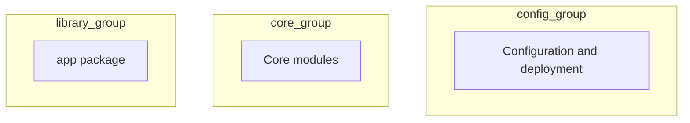

# Architecture report: henryboldi/felony

> Automated static analysis. **Observed** = directly seen in files/imports/AST; **Inferred** = interpretation from that evidence. Repository code was not executed.

## 1. Repository at a glance

| Item | Value |
| --- | --- |
| Repository | henryboldi/felony |
| Description | 🔑🔥📈 Next Level PGP |
| Language | JavaScript |
| Stars | 3451 |
| Licence | MIT |
| Analysed commit / branch | 8e948160125e3fb69ff1992f03ae0e246577aca7 / master |
| Framework(s) | Express, React |
| Files analysed | 106 |
| Components | 3 |

## 2. Architecture in one minute

henryboldi/felony - 🔑🔥📈 Next Level PGP. This repository was analysed statically from 106 file(s) (0 Python). Detected technologies (observed from imports/manifests): Express, React, React Router, Redux, webpack. Files are grouped into 3 component(s): app package, Configuration and deployment, Core modules. Findings below distinguish observed facts from inferred interpretation.

## 3. High-level block diagram

## 4. Main components

### app package (`app`)

- **Kind:** library
- **Status:** Observed
- **Confidence:** 0.85
- **Responsibility:** Groups 52 file(s) under app package (observed from repository paths and static analysis).
- **Paths:** `app/actions/AliasesActions.js`, `app/actions/KeychainActions.js`, `app/actions/UIActions.js`, `app/actions/index.js`, `app/assets/styles/variables/colors.js`, `app/assets/styles/variables/utils.js`, `app/components/Felony.js`, `app/components/alias/Alias.js`, `app/components/alias/AliasComposerForm.js`, `app/components/common/Avatar.js`, `app/components/common/Button.js`, `app/components/common/Icon.js`, `app/components/common/Overlay.js`, `app/components/common/User.js`, `app/components/common/index.js`, `app/components/composer/Composer.js`, `app/components/composer/ComposerAliasForm.js`, `app/components/composer/ComposerAliasFormInput.js`, `app/components/composer/ComposerAliasSuccess.js`, `app/components/composer/ComposerForm.js`, `app/components/composer/ComposerFormSubmit.js`, `app/components/decrypt/Decrypt.js`, `app/components/decrypt/DecryptActions.js`, `app/components/floating-button/FloatingButton.js`, `app/components/floating-button/FloatingButtonItem.js`, `app/components/floating-button/FloatingButtonItemLabel.js`, `app/components/header/Header.js`, `app/components/header/HeaderKeyCopy.js`, `app/components/header/HeaderKeyStatus.js`, `app/components/header/HeaderKeyStatusSpinner.js`, `app/components/header/HeaderKeyStatusTooltip.js`, `app/components/keychain/Keychain.js`, `app/components/keychain/KeychainComposerOpener.js`, `app/components/keychain/KeychainList.js`, `app/components/keychain/KeychainListItem.js`, `app/components/output/Output.js`, `app/constants/KeychainConstants.js`, `app/constants/UIConstants.js`, `app/containers/App.js`, `app/containers/ComposerContainer.js`, `app/containers/DevTools.js`, `app/containers/FloatingButtonContainer.js`, `app/containers/HeaderContainer.js`, `app/containers/KeychainContainer.js`, `app/containers/OutputContainer.js`, `app/index.js`, `app/reducers/index.js`, `app/reducers/keychainReducer.js`, `app/reducers/uiReducer.js`, `app/routes.js`, `app/utils/icons.js`, `app/utils/pgp.js`
- **Evidence:** [app/actions/AliasesActions.js](https://github.com/henryboldi/felony/blob/8e948160125e3fb69ff1992f03ae0e246577aca7/app/actions/AliasesActions.js); [app/actions/KeychainActions.js](https://github.com/henryboldi/felony/blob/8e948160125e3fb69ff1992f03ae0e246577aca7/app/actions/KeychainActions.js); [app/actions/UIActions.js](https://github.com/henryboldi/felony/blob/8e948160125e3fb69ff1992f03ae0e246577aca7/app/actions/UIActions.js); [app/actions/index.js](https://github.com/henryboldi/felony/blob/8e948160125e3fb69ff1992f03ae0e246577aca7/app/actions/index.js); [app/assets/styles/variables/colors.js](https://github.com/henryboldi/felony/blob/8e948160125e3fb69ff1992f03ae0e246577aca7/app/assets/styles/variables/colors.js); [app/assets/styles/variables/utils.js](https://github.com/henryboldi/felony/blob/8e948160125e3fb69ff1992f03ae0e246577aca7/app/assets/styles/variables/utils.js); [app/components/Felony.js](https://github.com/henryboldi/felony/blob/8e948160125e3fb69ff1992f03ae0e246577aca7/app/components/Felony.js); [app/components/alias/Alias.js](https://github.com/henryboldi/felony/blob/8e948160125e3fb69ff1992f03ae0e246577aca7/app/components/alias/Alias.js)

### Configuration and deployment (`config`)

- **Kind:** config
- **Status:** Observed
- **Confidence:** 0.85
- **Responsibility:** Groups 3 file(s) under configuration and deployment (observed from repository paths and static analysis).
- **Paths:** `app/config/database.js`, `app/package.json`, `package.json`
- **Evidence:** [app/config/database.js](https://github.com/henryboldi/felony/blob/8e948160125e3fb69ff1992f03ae0e246577aca7/app/config/database.js); [app/package.json](https://github.com/henryboldi/felony/blob/8e948160125e3fb69ff1992f03ae0e246577aca7/app/package.json); [package.json](https://github.com/henryboldi/felony/blob/8e948160125e3fb69ff1992f03ae0e246577aca7/package.json)

### Core modules (`core`)

- **Kind:** core
- **Status:** Observed
- **Confidence:** 0.85
- **Responsibility:** Groups 8 file(s) under core modules (observed from repository paths and static analysis).
- **Paths:** `main.development.js`, `package.js`, `server.js`, `webpack.config.base.js`, `webpack.config.development.js`, `webpack.config.electron.js`, `webpack.config.node.js`, `webpack.config.production.js`
- **Evidence:** [main.development.js](https://github.com/henryboldi/felony/blob/8e948160125e3fb69ff1992f03ae0e246577aca7/main.development.js); [package.js](https://github.com/henryboldi/felony/blob/8e948160125e3fb69ff1992f03ae0e246577aca7/package.js); [server.js](https://github.com/henryboldi/felony/blob/8e948160125e3fb69ff1992f03ae0e246577aca7/server.js); [webpack.config.base.js](https://github.com/henryboldi/felony/blob/8e948160125e3fb69ff1992f03ae0e246577aca7/webpack.config.base.js); [webpack.config.development.js](https://github.com/henryboldi/felony/blob/8e948160125e3fb69ff1992f03ae0e246577aca7/webpack.config.development.js); [webpack.config.electron.js](https://github.com/henryboldi/felony/blob/8e948160125e3fb69ff1992f03ae0e246577aca7/webpack.config.electron.js); [webpack.config.node.js](https://github.com/henryboldi/felony/blob/8e948160125e3fb69ff1992f03ae0e246577aca7/webpack.config.node.js); [webpack.config.production.js](https://github.com/henryboldi/felony/blob/8e948160125e3fb69ff1992f03ae0e246577aca7/webpack.config.production.js)

## 5. Execution flow

**Observed** entry point(s):

- [app/actions/index.js](https://github.com/henryboldi/felony/blob/8e948160125e3fb69ff1992f03ae0e246577aca7/app/actions/index.js)
- [app/components/common/index.js](https://github.com/henryboldi/felony/blob/8e948160125e3fb69ff1992f03ae0e246577aca7/app/components/common/index.js)
- [app/containers/App.js](https://github.com/henryboldi/felony/blob/8e948160125e3fb69ff1992f03ae0e246577aca7/app/containers/App.js)
- [app/index.js](https://github.com/henryboldi/felony/blob/8e948160125e3fb69ff1992f03ae0e246577aca7/app/index.js)
- [app/reducers/index.js](https://github.com/henryboldi/felony/blob/8e948160125e3fb69ff1992f03ae0e246577aca7/app/reducers/index.js)
- [server.js](https://github.com/henryboldi/felony/blob/8e948160125e3fb69ff1992f03ae0e246577aca7/server.js)

Representative flow (derived from observed entry points and the import graph; steps beyond the entry point are **Inferred**):

1. Execution starts at an observed entry point listed above, if present.
2. No internal import relationships between components were observed.

## 6. Project structure

### `(root)`

- `.babelrc` - other (50 bytes)
- `.editorconfig` - config (285 bytes)
- `.eslintignore` - other (75 bytes)
- `.eslintrc.js` - source, JavaScript (1003 bytes)
- `.gitattributes` - other (12 bytes)
- `.gitignore` - other (592 bytes)
- `.jscsrc` - other (219 bytes)
- `.travis.yml` - ci, YAML (486 bytes)
- `CONTRIBUTING.md` - docs (900 bytes)
- `LICENSE` - docs (1097 bytes)
- `README.md` - docs (2447 bytes)
- `main.development.js` - source, JavaScript (7094 bytes)
- `package.js` - source, JavaScript (3837 bytes)
- `package.json` - manifest (4879 bytes)
- `server.js` - source, JavaScript (648 bytes)
- `webpack.config.base.js` - source, JavaScript (756 bytes)
- `webpack.config.development.js` - source, JavaScript (1448 bytes)
- `webpack.config.electron.js` - source, JavaScript (805 bytes)
- `webpack.config.node.js` - source, JavaScript (249 bytes)
- `webpack.config.production.js` - source, JavaScript (1353 bytes)

### `.github`

- `.github/ISSUE_TEMPLATE` - other (1114 bytes)
- `.github/PULL_REQUEST_TEMPLATE` - other (494 bytes)

### `app`

- `app/actions/AliasesActions.js` - source, JavaScript (827 bytes)
- `app/actions/KeychainActions.js` - source, JavaScript (733 bytes)
- `app/actions/UIActions.js` - source, JavaScript (652 bytes)
- `app/actions/index.js` - source, JavaScript (62 bytes)
- `app/app.global.css` - other (551 bytes)
- `app/app.html` - other (686 bytes)
- `app/assets/fonts/work-sans/WorkSans.css` - other (389 bytes)
- `app/assets/images/avatar1.svg` - other (3979 bytes)
- `app/assets/images/avatar10.svg` - other (4612 bytes)
- `app/assets/images/avatar11.svg` - other (2821 bytes)
- `app/assets/images/avatar12.svg` - other (3143 bytes)
- `app/assets/images/avatar13.svg` - other (3233 bytes)
- `app/assets/images/avatar14.svg` - other (3660 bytes)
- `app/assets/images/avatar15.svg` - other (4073 bytes)
- `app/assets/images/avatar16.svg` - other (3405 bytes)
- `app/assets/images/avatar17.svg` - other (5580 bytes)
- `app/assets/images/avatar18.svg` - other (2893 bytes)
- `app/assets/images/avatar19.svg` - other (4517 bytes)
- `app/assets/images/avatar2.svg` - other (3584 bytes)
- `app/assets/images/avatar20.svg` - other (4016 bytes)
- `app/assets/images/avatar21.svg` - other (2946 bytes)
- `app/assets/images/avatar22.svg` - other (3428 bytes)
- `app/assets/images/avatar23.svg` - other (2863 bytes)
- `app/assets/images/avatar3.svg` - other (4546 bytes)
- `app/assets/images/avatar4.svg` - other (4983 bytes)
- `app/assets/images/avatar5.svg` - other (3434 bytes)
- `app/assets/images/avatar6.svg` - other (7860 bytes)
- `app/assets/images/avatar7.svg` - other (4092 bytes)
- `app/assets/images/avatar8.svg` - other (2948 bytes)
- `app/assets/images/avatar9.svg` - other (3113 bytes)
- `app/assets/images/slant.svg` - other (807 bytes)
- `app/assets/styles/felony.css` - other (100 bytes)
- `app/assets/styles/spinner.css` - other (770 bytes)
- `app/assets/styles/variables/colors.js` - source, JavaScript (253 bytes)
- `app/assets/styles/variables/utils.js` - source, JavaScript (117 bytes)
- `app/components/Felony.js` - source, JavaScript (1675 bytes)
- `app/components/alias/Alias.js` - source, JavaScript (605 bytes)
- `app/components/alias/AliasComposerForm.js` - source, JavaScript (1592 bytes)
- `app/components/common/Avatar.js` - source, JavaScript (465 bytes)
- `app/components/common/Button.js` - source, JavaScript (650 bytes)
- `app/components/common/Icon.js` - source, JavaScript (491 bytes)
- `app/components/common/Overlay.js` - source, JavaScript (679 bytes)
- `app/components/common/User.js` - source, JavaScript (1622 bytes)
- `app/components/common/index.js` - source, JavaScript (219 bytes)
- `app/components/composer/Composer.js` - source, JavaScript (1330 bytes)
- `app/components/composer/ComposerAliasForm.js` - source, JavaScript (5792 bytes)
- `app/components/composer/ComposerAliasFormInput.js` - source, JavaScript (1412 bytes)
- `app/components/composer/ComposerAliasSuccess.js` - source, JavaScript (2060 bytes)
- `app/components/composer/ComposerForm.js` - source, JavaScript (6349 bytes)
- `app/components/composer/ComposerFormSubmit.js` - source, JavaScript (1194 bytes)
- `app/components/decrypt/Decrypt.js` - source, JavaScript (161 bytes)
- `app/components/decrypt/DecryptActions.js` - source, JavaScript (175 bytes)
- `app/components/floating-button/FloatingButton.js` - source, JavaScript (1909 bytes)
- `app/components/floating-button/FloatingButtonItem.js` - source, JavaScript (2302 bytes)
- `app/components/floating-button/FloatingButtonItemLabel.js` - source, JavaScript (1062 bytes)
- `app/components/header/Header.js` - source, JavaScript (1597 bytes)
- `app/components/header/HeaderKeyCopy.js` - source, JavaScript (1159 bytes)
- `app/components/header/HeaderKeyStatus.js` - source, JavaScript (1368 bytes)
- `app/components/header/HeaderKeyStatusSpinner.js` - source, JavaScript (356 bytes)
- `app/components/header/HeaderKeyStatusTooltip.js` - source, JavaScript (1628 bytes)
- `app/components/keychain/Keychain.js` - source, JavaScript (872 bytes)
- `app/components/keychain/KeychainComposerOpener.js` - source, JavaScript (1785 bytes)
- `app/components/keychain/KeychainList.js` - source, JavaScript (665 bytes)
- `app/components/keychain/KeychainListItem.js` - source, JavaScript (1408 bytes)
- `app/components/output/Output.js` - source, JavaScript (4178 bytes)
- `app/config/database.js` - source, JavaScript (284 bytes)
- `app/constants/KeychainConstants.js` - source, JavaScript (76 bytes)
- `app/constants/UIConstants.js` - source, JavaScript (412 bytes)
- `app/containers/App.js` - source, JavaScript (579 bytes)
- `app/containers/ComposerContainer.js` - source, JavaScript (1352 bytes)
- `app/containers/DevTools.js` - source, JavaScript (334 bytes)
- `app/containers/FloatingButtonContainer.js` - source, JavaScript (500 bytes)
- `app/containers/HeaderContainer.js` - source, JavaScript (1041 bytes)
- `app/containers/KeychainContainer.js` - source, JavaScript (1125 bytes)
- `app/containers/OutputContainer.js` - source, JavaScript (838 bytes)
- `app/index.js` - source, JavaScript (440 bytes)
- `app/package.json` - manifest (122 bytes)
- `app/reducers/index.js` - source, JavaScript (226 bytes)
- `app/reducers/keychainReducer.js` - source, JavaScript (1376 bytes)
- `app/reducers/uiReducer.js` - source, JavaScript (1541 bytes)
- `app/routes.js` - source, JavaScript (259 bytes)
- `app/utils/.gitkeep` - other (0 bytes)
- `app/utils/icons.js` - source, JavaScript (2685 bytes)
- `app/utils/pgp.js` - source, JavaScript (4272 bytes)

## 7. Key dependencies and integrations

| Name | Category | Status | Confidence | Evidence |
| --- | --- | --- | --- | --- |
| Express | framework | Observed | 0.85 | [package.json:79](https://github.com/henryboldi/felony/blob/8e948160125e3fb69ff1992f03ae0e246577aca7/package.json#L79) |
| React | framework | Observed | 0.90 | [package.json:42](https://github.com/henryboldi/felony/blob/8e948160125e3fb69ff1992f03ae0e246577aca7/package.json#L42); [package.json:124](https://github.com/henryboldi/felony/blob/8e948160125e3fb69ff1992f03ae0e246577aca7/package.json#L124) |
| React Router | library | Observed | 0.85 | [package.json:43](https://github.com/henryboldi/felony/blob/8e948160125e3fb69ff1992f03ae0e246577aca7/package.json#L43) |
| Redux | library | Observed | 0.85 | [package.json:89](https://github.com/henryboldi/felony/blob/8e948160125e3fb69ff1992f03ae0e246577aca7/package.json#L89) |
| webpack | tooling | Observed | 0.85 | [package.json:18](https://github.com/henryboldi/felony/blob/8e948160125e3fb69ff1992f03ae0e246577aca7/package.json#L18) |

## 8. Data and state

No database, cache, queue, or persistent-state usage was observed in the analysed files. State handling, if any, may be in-memory or in files that were not analysed.

## 9. Configuration and deployment clues

- `.editorconfig` (config)
- `.travis.yml` (ci)
- `app/package.json` (manifest)
- `package.json` (manifest)

## 10. Design observations

- No strong design patterns could be established from the available evidence.

These observations are interpretations (**Inferred**) of the observed structure, not guarantees about runtime design.

## 11. Limitations and unknowns

- Static analysis only: repository code was not executed, installed, or imported at runtime.
- Components and relationships are inferred from file paths, imports, and AST structure; runtime behaviour, dynamic imports, and reflection may not be visible.
- No clear application entry point was observed in the analysed files.
- Repository text was treated as untrusted data; no instructions found in repository files were followed, and likely secret values were redacted/excluded.
- JavaScript and TypeScript files were inventoried from paths and package manifests. They were not parsed with a full language AST, and repository code was not executed.

## 12. Source references

- [app/actions/AliasesActions.js](https://github.com/henryboldi/felony/blob/8e948160125e3fb69ff1992f03ae0e246577aca7/app/actions/AliasesActions.js)
- [app/actions/KeychainActions.js](https://github.com/henryboldi/felony/blob/8e948160125e3fb69ff1992f03ae0e246577aca7/app/actions/KeychainActions.js)
- [app/actions/UIActions.js](https://github.com/henryboldi/felony/blob/8e948160125e3fb69ff1992f03ae0e246577aca7/app/actions/UIActions.js)
- [app/actions/index.js](https://github.com/henryboldi/felony/blob/8e948160125e3fb69ff1992f03ae0e246577aca7/app/actions/index.js)
- [app/assets/styles/variables/colors.js](https://github.com/henryboldi/felony/blob/8e948160125e3fb69ff1992f03ae0e246577aca7/app/assets/styles/variables/colors.js)
- [app/assets/styles/variables/utils.js](https://github.com/henryboldi/felony/blob/8e948160125e3fb69ff1992f03ae0e246577aca7/app/assets/styles/variables/utils.js)
- [app/components/Felony.js](https://github.com/henryboldi/felony/blob/8e948160125e3fb69ff1992f03ae0e246577aca7/app/components/Felony.js)
- [app/components/alias/Alias.js](https://github.com/henryboldi/felony/blob/8e948160125e3fb69ff1992f03ae0e246577aca7/app/components/alias/Alias.js)
- [app/components/common/index.js](https://github.com/henryboldi/felony/blob/8e948160125e3fb69ff1992f03ae0e246577aca7/app/components/common/index.js)
- [app/config/database.js](https://github.com/henryboldi/felony/blob/8e948160125e3fb69ff1992f03ae0e246577aca7/app/config/database.js)
- [app/containers/App.js](https://github.com/henryboldi/felony/blob/8e948160125e3fb69ff1992f03ae0e246577aca7/app/containers/App.js)
- [app/index.js](https://github.com/henryboldi/felony/blob/8e948160125e3fb69ff1992f03ae0e246577aca7/app/index.js)
- [app/package.json](https://github.com/henryboldi/felony/blob/8e948160125e3fb69ff1992f03ae0e246577aca7/app/package.json)
- [app/reducers/index.js](https://github.com/henryboldi/felony/blob/8e948160125e3fb69ff1992f03ae0e246577aca7/app/reducers/index.js)
- [main.development.js](https://github.com/henryboldi/felony/blob/8e948160125e3fb69ff1992f03ae0e246577aca7/main.development.js)
- [package.js](https://github.com/henryboldi/felony/blob/8e948160125e3fb69ff1992f03ae0e246577aca7/package.js)
- [package.json](https://github.com/henryboldi/felony/blob/8e948160125e3fb69ff1992f03ae0e246577aca7/package.json)
- [package.json:18](https://github.com/henryboldi/felony/blob/8e948160125e3fb69ff1992f03ae0e246577aca7/package.json#L18)
- [package.json:42](https://github.com/henryboldi/felony/blob/8e948160125e3fb69ff1992f03ae0e246577aca7/package.json#L42)
- [package.json:43](https://github.com/henryboldi/felony/blob/8e948160125e3fb69ff1992f03ae0e246577aca7/package.json#L43)
- [package.json:79](https://github.com/henryboldi/felony/blob/8e948160125e3fb69ff1992f03ae0e246577aca7/package.json#L79)
- [package.json:89](https://github.com/henryboldi/felony/blob/8e948160125e3fb69ff1992f03ae0e246577aca7/package.json#L89)
- [package.json:124](https://github.com/henryboldi/felony/blob/8e948160125e3fb69ff1992f03ae0e246577aca7/package.json#L124)
- [server.js](https://github.com/henryboldi/felony/blob/8e948160125e3fb69ff1992f03ae0e246577aca7/server.js)
- [webpack.config.base.js](https://github.com/henryboldi/felony/blob/8e948160125e3fb69ff1992f03ae0e246577aca7/webpack.config.base.js)
- [webpack.config.development.js](https://github.com/henryboldi/felony/blob/8e948160125e3fb69ff1992f03ae0e246577aca7/webpack.config.development.js)
- [webpack.config.electron.js](https://github.com/henryboldi/felony/blob/8e948160125e3fb69ff1992f03ae0e246577aca7/webpack.config.electron.js)
- [webpack.config.node.js](https://github.com/henryboldi/felony/blob/8e948160125e3fb69ff1992f03ae0e246577aca7/webpack.config.node.js)
- [webpack.config.production.js](https://github.com/henryboldi/felony/blob/8e948160125e3fb69ff1992f03ae0e246577aca7/webpack.config.production.js)
