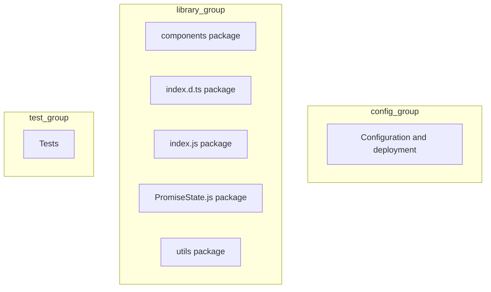

# Architecture report: heroku/react-refetch

> Automated static analysis. **Observed** = directly seen in files/imports/AST; **Inferred** = interpretation from that evidence. Repository code was not executed.

## 1. Repository at a glance

| Item | Value |
| --- | --- |
| Repository | heroku/react-refetch |
| Description | A simple, declarative, and composable way to fetch data for React components |
| Language | JavaScript |
| Stars | 3398 |
| Licence | Other |
| Analysed commit / branch | acdf8d91e8b856183040db5b1f35545f793c4b71 / master |
| Framework(s) | React |
| Files analysed | 35 |
| Components | 7 |

## 2. Architecture in one minute

heroku/react-refetch - A simple, declarative, and composable way to fetch data for React components. This repository was analysed statically from 35 file(s) (0 Python). Detected technologies (observed from imports/manifests): GitHub Actions, React, TypeScript. Files are grouped into 7 component(s): components package, Configuration and deployment, index.d.ts package, index.js package, PromiseState.js package, Tests, utils package. Findings below distinguish observed facts from inferred interpretation.

## 3. High-level block diagram

## 4. Main components

### components package (`components`)

- **Kind:** library
- **Status:** Observed
- **Confidence:** 0.85
- **Responsibility:** Groups 1 file(s) under components package (observed from repository paths and static analysis).
- **Paths:** `src/components/connect.js`
- **Evidence:** [src/components/connect.js](https://github.com/heroku/react-refetch/blob/acdf8d91e8b856183040db5b1f35545f793c4b71/src/components/connect.js)

### Configuration and deployment (`config`)

- **Kind:** config
- **Status:** Observed
- **Confidence:** 0.85
- **Responsibility:** Groups 1 file(s) under configuration and deployment (observed from repository paths and static analysis).
- **Paths:** `package.json`
- **Evidence:** [package.json](https://github.com/heroku/react-refetch/blob/acdf8d91e8b856183040db5b1f35545f793c4b71/package.json)

### index.d.ts package (`index_d_ts`)

- **Kind:** library
- **Status:** Observed
- **Confidence:** 0.85
- **Responsibility:** Groups 1 file(s) under index.d.ts package (observed from repository paths and static analysis).
- **Paths:** `src/index.d.ts`
- **Evidence:** [src/index.d.ts](https://github.com/heroku/react-refetch/blob/acdf8d91e8b856183040db5b1f35545f793c4b71/src/index.d.ts)

### index.js package (`index_js`)

- **Kind:** library
- **Status:** Observed
- **Confidence:** 0.85
- **Responsibility:** Groups 1 file(s) under index.js package (observed from repository paths and static analysis).
- **Paths:** `src/index.js`
- **Evidence:** [src/index.js](https://github.com/heroku/react-refetch/blob/acdf8d91e8b856183040db5b1f35545f793c4b71/src/index.js)

### PromiseState.js package (`promisestate_js`)

- **Kind:** library
- **Status:** Observed
- **Confidence:** 0.85
- **Responsibility:** Groups 1 file(s) under promisestate.js package (observed from repository paths and static analysis).
- **Paths:** `src/PromiseState.js`
- **Evidence:** [src/PromiseState.js](https://github.com/heroku/react-refetch/blob/acdf8d91e8b856183040db5b1f35545f793c4b71/src/PromiseState.js)

### Tests (`tests`)

- **Kind:** test
- **Status:** Observed
- **Confidence:** 0.85
- **Responsibility:** Groups 6 file(s) under tests (observed from repository paths and static analysis).
- **Paths:** `test/PromiseState.spec.js`, `test/components/connect.spec.js`, `test/setup.js`, `test/utils/errors.spec.js`, `test/utils/isPlainObject.spec.js`, `test/utils/shallowEqual.spec.js`
- **Evidence:** [test/PromiseState.spec.js](https://github.com/heroku/react-refetch/blob/acdf8d91e8b856183040db5b1f35545f793c4b71/test/PromiseState.spec.js); [test/components/connect.spec.js](https://github.com/heroku/react-refetch/blob/acdf8d91e8b856183040db5b1f35545f793c4b71/test/components/connect.spec.js); [test/setup.js](https://github.com/heroku/react-refetch/blob/acdf8d91e8b856183040db5b1f35545f793c4b71/test/setup.js); [test/utils/errors.spec.js](https://github.com/heroku/react-refetch/blob/acdf8d91e8b856183040db5b1f35545f793c4b71/test/utils/errors.spec.js); [test/utils/isPlainObject.spec.js](https://github.com/heroku/react-refetch/blob/acdf8d91e8b856183040db5b1f35545f793c4b71/test/utils/isPlainObject.spec.js); [test/utils/shallowEqual.spec.js](https://github.com/heroku/react-refetch/blob/acdf8d91e8b856183040db5b1f35545f793c4b71/test/utils/shallowEqual.spec.js)

### utils package (`utils`)

- **Kind:** library
- **Status:** Observed
- **Confidence:** 0.85
- **Responsibility:** Groups 6 file(s) under utils package (observed from repository paths and static analysis).
- **Paths:** `src/utils/buildRequest.js`, `src/utils/checkTypes.js`, `src/utils/errors.js`, `src/utils/handleResponse.js`, `src/utils/isPlainObject.js`, `src/utils/shallowEqual.js`
- **Evidence:** [src/utils/buildRequest.js](https://github.com/heroku/react-refetch/blob/acdf8d91e8b856183040db5b1f35545f793c4b71/src/utils/buildRequest.js); [src/utils/checkTypes.js](https://github.com/heroku/react-refetch/blob/acdf8d91e8b856183040db5b1f35545f793c4b71/src/utils/checkTypes.js); [src/utils/errors.js](https://github.com/heroku/react-refetch/blob/acdf8d91e8b856183040db5b1f35545f793c4b71/src/utils/errors.js); [src/utils/handleResponse.js](https://github.com/heroku/react-refetch/blob/acdf8d91e8b856183040db5b1f35545f793c4b71/src/utils/handleResponse.js); [src/utils/isPlainObject.js](https://github.com/heroku/react-refetch/blob/acdf8d91e8b856183040db5b1f35545f793c4b71/src/utils/isPlainObject.js); [src/utils/shallowEqual.js](https://github.com/heroku/react-refetch/blob/acdf8d91e8b856183040db5b1f35545f793c4b71/src/utils/shallowEqual.js)

## 5. Execution flow

**Observed** entry point(s):

- [src/index.js](https://github.com/heroku/react-refetch/blob/acdf8d91e8b856183040db5b1f35545f793c4b71/src/index.js)

Representative flow (derived from observed entry points and the import graph; steps beyond the entry point are **Inferred**):

1. Execution starts at an observed entry point listed above, if present.
2. No internal import relationships between components were observed.

## 6. Project structure

### `(root)`

- `.babelrc` - other (966 bytes)
- `.eslintignore` - other (17 bytes)
- `.eslintrc` - other (291 bytes)
- `.gitignore` - other (67 bytes)
- `CHANGELOG.md` - docs (108 bytes)
- `CODEOWNERS` - other (140 bytes)
- `CODE_OF_CONDUCT.md` - docs (1424 bytes)
- `LICENSE.md` - docs (2231 bytes)
- `README.md` - docs (31380 bytes)
- `SECURITY.md` - docs (408 bytes)
- `package.json` - manifest (2885 bytes)

### `.github`

- `.github/workflows/ci.yml` - ci, YAML (931 bytes)

### `docs`

- `docs/api.md` - docs (13121 bytes)

### `examples`

- `examples/ts/.gitignore` - other (6 bytes)
- `examples/ts/UserPage.tsx` - source, TypeScript (392 bytes)
- `examples/ts/UserWidgetComp.tsx` - source, TypeScript (598 bytes)
- `examples/ts/UserWidgetFunc.tsx` - source, TypeScript (540 bytes)
- `examples/ts/tsconfig.json` - config (5880 bytes)
- `examples/ts/types.ts` - source, TypeScript (67 bytes)

### `src`

- `src/PromiseState.js` - source, JavaScript (4447 bytes)
- `src/components/connect.js` - source, JavaScript (14664 bytes)
- `src/index.d.ts` - source, TypeScript (4924 bytes)
- `src/index.js` - source, JavaScript (119 bytes)
- `src/utils/buildRequest.js` - source, JavaScript (274 bytes)
- `src/utils/checkTypes.js` - source, JavaScript (2283 bytes)
- `src/utils/errors.js` - source, JavaScript (276 bytes)
- `src/utils/handleResponse.js` - source, JavaScript (450 bytes)
- `src/utils/isPlainObject.js` - source, JavaScript (635 bytes)
- `src/utils/shallowEqual.js` - source, JavaScript (609 bytes)

### `test`

- `test/PromiseState.spec.js` - test, JavaScript (8935 bytes)
- `test/components/connect.spec.js` - test, JavaScript (86570 bytes)
- `test/setup.js` - test, JavaScript (760 bytes)
- `test/utils/errors.spec.js` - test, JavaScript (721 bytes)
- `test/utils/isPlainObject.spec.js` - test, JavaScript (581 bytes)
- `test/utils/shallowEqual.spec.js` - test, JavaScript (1897 bytes)

## 7. Key dependencies and integrations

| Name | Category | Status | Confidence | Evidence |
| --- | --- | --- | --- | --- |
| GitHub Actions | ci | Observed | 0.85 | [.github/workflows/ci.yml](https://github.com/heroku/react-refetch/blob/acdf8d91e8b856183040db5b1f35545f793c4b71/.github/workflows/ci.yml) |
| React | framework | Observed | 0.90 | [package.json:2](https://github.com/heroku/react-refetch/blob/acdf8d91e8b856183040db5b1f35545f793c4b71/package.json#L2); [package.json:65](https://github.com/heroku/react-refetch/blob/acdf8d91e8b856183040db5b1f35545f793c4b71/package.json#L65) |
| TypeScript | tooling | Observed | 0.85 | [package.json:78](https://github.com/heroku/react-refetch/blob/acdf8d91e8b856183040db5b1f35545f793c4b71/package.json#L78) |

## 8. Data and state

No database, cache, queue, or persistent-state usage was observed in the analysed files. State handling, if any, may be in-memory or in files that were not analysed.

## 9. Configuration and deployment clues

- `.github/workflows/ci.yml` (ci)
- `examples/ts/tsconfig.json` (config)
- `package.json` (manifest)

## 10. Design observations

- Tests are present alongside source code (Observed from test file paths).

These observations are interpretations (**Inferred**) of the observed structure, not guarantees about runtime design.

## 11. Limitations and unknowns

- Static analysis only: repository code was not executed, installed, or imported at runtime.
- Components and relationships are inferred from file paths, imports, and AST structure; runtime behaviour, dynamic imports, and reflection may not be visible.
- No clear application entry point was observed in the analysed files.
- Repository text was treated as untrusted data; no instructions found in repository files were followed, and likely secret values were redacted/excluded.
- JavaScript and TypeScript files were inventoried from paths and package manifests. They were not parsed with a full language AST, and repository code was not executed.

## 12. Source references

- [.github/workflows/ci.yml](https://github.com/heroku/react-refetch/blob/acdf8d91e8b856183040db5b1f35545f793c4b71/.github/workflows/ci.yml)
- [package.json](https://github.com/heroku/react-refetch/blob/acdf8d91e8b856183040db5b1f35545f793c4b71/package.json)
- [package.json:2](https://github.com/heroku/react-refetch/blob/acdf8d91e8b856183040db5b1f35545f793c4b71/package.json#L2)
- [package.json:65](https://github.com/heroku/react-refetch/blob/acdf8d91e8b856183040db5b1f35545f793c4b71/package.json#L65)
- [package.json:78](https://github.com/heroku/react-refetch/blob/acdf8d91e8b856183040db5b1f35545f793c4b71/package.json#L78)
- [src/PromiseState.js](https://github.com/heroku/react-refetch/blob/acdf8d91e8b856183040db5b1f35545f793c4b71/src/PromiseState.js)
- [src/components/connect.js](https://github.com/heroku/react-refetch/blob/acdf8d91e8b856183040db5b1f35545f793c4b71/src/components/connect.js)
- [src/index.d.ts](https://github.com/heroku/react-refetch/blob/acdf8d91e8b856183040db5b1f35545f793c4b71/src/index.d.ts)
- [src/index.js](https://github.com/heroku/react-refetch/blob/acdf8d91e8b856183040db5b1f35545f793c4b71/src/index.js)
- [src/utils/buildRequest.js](https://github.com/heroku/react-refetch/blob/acdf8d91e8b856183040db5b1f35545f793c4b71/src/utils/buildRequest.js)
- [src/utils/checkTypes.js](https://github.com/heroku/react-refetch/blob/acdf8d91e8b856183040db5b1f35545f793c4b71/src/utils/checkTypes.js)
- [src/utils/errors.js](https://github.com/heroku/react-refetch/blob/acdf8d91e8b856183040db5b1f35545f793c4b71/src/utils/errors.js)
- [src/utils/handleResponse.js](https://github.com/heroku/react-refetch/blob/acdf8d91e8b856183040db5b1f35545f793c4b71/src/utils/handleResponse.js)
- [src/utils/isPlainObject.js](https://github.com/heroku/react-refetch/blob/acdf8d91e8b856183040db5b1f35545f793c4b71/src/utils/isPlainObject.js)
- [src/utils/shallowEqual.js](https://github.com/heroku/react-refetch/blob/acdf8d91e8b856183040db5b1f35545f793c4b71/src/utils/shallowEqual.js)
- [test/PromiseState.spec.js](https://github.com/heroku/react-refetch/blob/acdf8d91e8b856183040db5b1f35545f793c4b71/test/PromiseState.spec.js)
- [test/components/connect.spec.js](https://github.com/heroku/react-refetch/blob/acdf8d91e8b856183040db5b1f35545f793c4b71/test/components/connect.spec.js)
- [test/setup.js](https://github.com/heroku/react-refetch/blob/acdf8d91e8b856183040db5b1f35545f793c4b71/test/setup.js)
- [test/utils/errors.spec.js](https://github.com/heroku/react-refetch/blob/acdf8d91e8b856183040db5b1f35545f793c4b71/test/utils/errors.spec.js)
- [test/utils/isPlainObject.spec.js](https://github.com/heroku/react-refetch/blob/acdf8d91e8b856183040db5b1f35545f793c4b71/test/utils/isPlainObject.spec.js)
- [test/utils/shallowEqual.spec.js](https://github.com/heroku/react-refetch/blob/acdf8d91e8b856183040db5b1f35545f793c4b71/test/utils/shallowEqual.spec.js)
