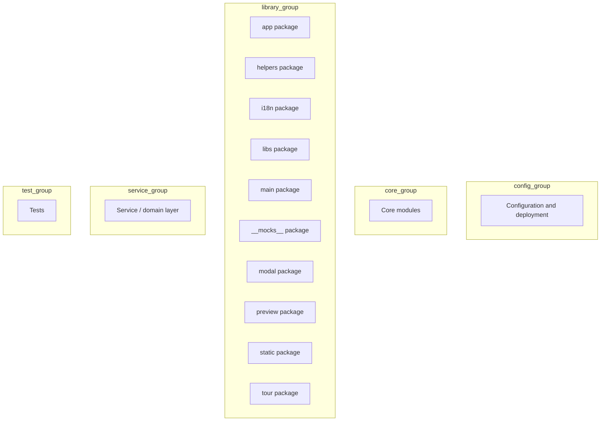

# Architecture report: hql287/Manta

> Automated static analysis. **Observed** = directly seen in files/imports/AST; **Inferred** = interpretation from that evidence. Repository code was not executed.

## 1. Repository at a glance

| Item | Value |
| --- | --- |
| Repository | hql287/Manta |
| Description | 🎉 Flexible invoicing desktop app with beautiful & customizable templates. |
| Language | JavaScript |
| Stars | 5488 |
| Licence | LGPL-3.0 |
| Analysed commit / branch | c530133998a99dae1010931055c52906ae410a9e / master |
| Framework(s) | Electron, React |
| Files analysed | 342 |
| Components | 14 |

## 2. Architecture in one minute

hql287/Manta - 🎉 Flexible invoicing desktop app with beautiful & customizable templates.. This repository was analysed statically from 342 file(s) (0 Python). Detected technologies (observed from imports/manifests): Electron, React, Redux, Jest, webpack. Files are grouped into 14 component(s): app package, Configuration and deployment, Core modules, helpers package, i18n package, libs package, main package, __mocks__ package. Findings below distinguish observed facts from inferred interpretation.

## 3. High-level block diagram

## 4. Main components

### app package (`app`)

- **Kind:** library
- **Status:** Observed
- **Confidence:** 0.85
- **Responsibility:** Groups 119 file(s) under app package (observed from repository paths and static analysis).
- **Paths:** `app/App.jsx`, `app/actions/__tests__/contacts.spec.js`, `app/actions/__tests__/form.spec.js`, `app/actions/__tests__/invoices.spec.js`, `app/actions/__tests__/settings.spec.js`, `app/actions/__tests__/ui.spec.js`, `app/actions/contacts.jsx`, `app/actions/form.jsx`, `app/actions/invoices.jsx`, `app/actions/settings.jsx`, `app/actions/ui.jsx`, `app/components/contacts/Contact.jsx`, `app/components/contacts/__tests__/Contact.spec.js`, `app/components/form/Currency.jsx`, `app/components/form/Discount.jsx`, `app/components/form/DueDate.jsx`, `app/components/form/DueDatePicker.jsx`, `app/components/form/DueDateTerms.jsx`, `app/components/form/InvoiceID.jsx`, `app/components/form/ItemRow.jsx`, `app/components/form/ItemsList.jsx`, `app/components/form/Note.jsx`, `app/components/form/Recipient.jsx`, `app/components/form/RecipientForm.jsx`, `app/components/form/RecipientsList.jsx`, `app/components/form/Settings.jsx`, `app/components/form/Tax.jsx`, `app/components/form/__tests__/Currency.spec.jsx`, `app/components/form/__tests__/Discount.spec.jsx`, `app/components/form/__tests__/DueDate.spec.jsx`, `app/components/form/__tests__/DueDatePicker.spec.jsx`, `app/components/form/__tests__/DueDateTerms.spec.jsx`, `app/components/form/__tests__/InvoiceID.spec.jsx`, `app/components/form/__tests__/ItemRow.spec.jsx`, `app/components/form/__tests__/ItemsList.spec.jsx`, `app/components/form/__tests__/Note.spec.jsx`, `app/components/form/__tests__/Recipient.spec.jsx`, `app/components/form/__tests__/RecipientForm.spec.jsx`, `app/components/form/__tests__/RecipientsList.spec.jsx`, `app/components/form/__tests__/Settings.spec.jsx`, `app/components/form/__tests__/Tax.spec.jsx`, `app/components/form/hoc/_withAnimation.jsx`, `app/components/form/hoc/_withDragNDrop.jsx`, `app/components/form/hoc/_withDraggable.jsx`, `app/components/invoices/Invoice.jsx`, `app/components/invoices/__tests__/Invoice.spec.js`, `app/components/layout/AppMain.jsx`, `app/components/layout/AppNav.jsx`, `app/components/layout/AppNoti.jsx`, `app/components/layout/AppUpdate.jsx`, `app/components/layout/__tests__/AppMain.spec.js`, `app/components/layout/__tests__/AppNav.spec.js`, `app/components/shared/Button.jsx`, `app/components/shared/Card.jsx`, `app/components/shared/ErrorBoundary.jsx`, `app/components/shared/Layout.jsx`, `app/components/shared/Message.jsx`, `app/components/shared/Notification.jsx`, `app/components/shared/Part.jsx`, `app/components/shared/Section.jsx`, `app/components/shared/SplitButton.jsx`, `app/components/shared/Switch.jsx`, `app/components/shared/Table.jsx`, `app/components/shared/Tabs.jsx`, `app/components/shared/TransitionList.jsx`, `app/components/shared/_tests_/Button.spec.js`, `app/components/shared/_tests_/Layout.spec.js`, `app/components/shared/_tests_/Message.spec.js`, `app/components/shared/_tests_/Section.spec.js`, `app/components/shared/_tests_/SplitButton.spec.js`, `app/components/shared/hoc/_withFadeInAnimation.jsx`, `app/constants/ItemTypes.jsx`, `app/constants/actions.jsx`, `app/containers/Contacts.jsx`, `app/containers/Form.jsx`, `app/containers/Invoices.jsx`, `app/containers/Settings.jsx`, `app/containers/__tests__/Contacts.spec.js`, `app/containers/__tests__/Form.spec.js`, `app/containers/__tests__/Invoices.spec.js`, `app/containers/__tests__/Settings.spec.js`, `app/helpers/__mocks__/form.js`, `app/helpers/__mocks__/invoice.js`, `app/helpers/__mocks__/pouchDB.js`, `app/helpers/__tests__/form.spec.js`, `app/helpers/__tests__/invoice.spec.js`, `app/helpers/form.js`, `app/helpers/image.js`, `app/helpers/invoice.js`, `app/helpers/pouchDB.js`, `app/index.jsx`, `app/middlewares/ContactsMW.jsx`, `app/middlewares/FormMW.jsx`, `app/middlewares/InvoicesMW.jsx`, `app/middlewares/MeasureMW.jsx`, `app/middlewares/SettingsMW.jsx`, `app/middlewares/UIMiddleware.jsx`, `app/middlewares/__tests__/ContactsMW.spec.js`, `app/middlewares/__tests__/FormMW.spec.js`, `app/middlewares/__tests__/InvoicesMW.spec.js`, `app/middlewares/__tests__/SettingsMW.spec.js`, `app/middlewares/__tests__/UIMiddleware.spec.js`, `app/reducers/ContactsReducer.jsx`, `app/reducers/FormReducer.jsx`, `app/reducers/InvoicesReducer.jsx`, `app/reducers/SettingsReducer.jsx`, `app/reducers/UIReducer.jsx`, `app/reducers/__tests__/ContactsReducer.spec.js`, `app/reducers/__tests__/FormReducer.spec.js`, `app/reducers/__tests__/InvoicesReducer.spec.js`, `app/reducers/__tests__/SettingsReducer.spec.js`, `app/reducers/__tests__/UIReducer.spec.js`, `app/reducers/index.jsx`, `app/renderers/__mocks__/dialog.js`, `app/renderers/dialog.js`, `app/renderers/menu.js`, `app/renderers/startup.js`, `app/store/enhancer.jsx`, `app/store/index.jsx`
- **Evidence:** [app/App.jsx](https://github.com/hql287/Manta/blob/c530133998a99dae1010931055c52906ae410a9e/app/App.jsx); [app/actions/__tests__/contacts.spec.js](https://github.com/hql287/Manta/blob/c530133998a99dae1010931055c52906ae410a9e/app/actions/__tests__/contacts.spec.js); [app/actions/__tests__/form.spec.js](https://github.com/hql287/Manta/blob/c530133998a99dae1010931055c52906ae410a9e/app/actions/__tests__/form.spec.js); [app/actions/__tests__/invoices.spec.js](https://github.com/hql287/Manta/blob/c530133998a99dae1010931055c52906ae410a9e/app/actions/__tests__/invoices.spec.js); [app/actions/__tests__/settings.spec.js](https://github.com/hql287/Manta/blob/c530133998a99dae1010931055c52906ae410a9e/app/actions/__tests__/settings.spec.js); [app/actions/__tests__/ui.spec.js](https://github.com/hql287/Manta/blob/c530133998a99dae1010931055c52906ae410a9e/app/actions/__tests__/ui.spec.js); [app/actions/contacts.jsx](https://github.com/hql287/Manta/blob/c530133998a99dae1010931055c52906ae410a9e/app/actions/contacts.jsx); [app/actions/form.jsx](https://github.com/hql287/Manta/blob/c530133998a99dae1010931055c52906ae410a9e/app/actions/form.jsx)

### Configuration and deployment (`config`)

- **Kind:** config
- **Status:** Observed
- **Confidence:** 0.85
- **Responsibility:** Groups 95 file(s) under configuration and deployment (observed from repository paths and static analysis).
- **Paths:** `app/components/settings/General.jsx`, `app/components/settings/Invoice.jsx`, `app/components/settings/Profile.jsx`, `app/components/settings/__tests__/General.spec.js`, `app/components/settings/_partials/invoice/Currency.jsx`, `app/components/settings/_partials/invoice/Fields.jsx`, `app/components/settings/_partials/invoice/Other.jsx`, `app/components/settings/_partials/invoice/Tax.jsx`, `app/components/settings/_partials/profile/Logo.jsx`, `app/components/settings/_partials/profile/TargetBox.jsx`, `dev-app-update.yml`, `electron-builder.yml`, `i18n/de/common.json`, `i18n/de/contacts.json`, `i18n/de/dialog.json`, `i18n/de/form.json`, `i18n/de/invoices.json`, `i18n/de/messages.json`, `i18n/de/preview.json`, `i18n/de/settings.json`, `i18n/de/tour.json`, `i18n/en/common.json`, `i18n/en/contacts.json`, `i18n/en/dialog.json`, `i18n/en/form.json`, `i18n/en/invoices.json`, `i18n/en/messages.json`, `i18n/en/preview.json`, `i18n/en/settings.json`, `i18n/en/tour.json`, `i18n/fr/common.json`, `i18n/fr/contacts.json`, `i18n/fr/dialog.json`, `i18n/fr/form.json`, `i18n/fr/invoices.json`, `i18n/fr/messages.json`, `i18n/fr/preview.json`, `i18n/fr/settings.json`, `i18n/fr/tour.json`, `i18n/id/common.json`, `i18n/id/contacts.json`, `i18n/id/dialog.json`, `i18n/id/form.json`, `i18n/id/invoices.json`, `i18n/id/messages.json`, `i18n/id/preview.json`, `i18n/id/settings.json`, `i18n/id/tour.json`, `i18n/it/common.json`, `i18n/it/contacts.json`, `i18n/it/dialog.json`, `i18n/it/form.json`, `i18n/it/invoices.json`, `i18n/it/messages.json`, `i18n/it/preview.json`, `i18n/it/settings.json`, `i18n/it/tour.json`, `i18n/sk/common.json`, `i18n/sk/contacts.json`, `i18n/sk/dialog.json`, `i18n/sk/form.json`, `i18n/sk/invoices.json`, `i18n/sk/messages.json`, `i18n/sk/preview.json`, `i18n/sk/settings.json`, `i18n/sk/tour.json`, `i18n/ur-PK/common.json`, `i18n/ur-PK/contacts.json`, `i18n/ur-PK/dialog.json`, `i18n/ur-PK/form.json`, `i18n/ur-PK/invoices.json`, `i18n/ur-PK/messages.json`, `i18n/ur-PK/preview.json`, `i18n/ur-PK/settings.json`, `i18n/ur-PK/tour.json`, `i18n/vi/common.json`, `i18n/vi/contacts.json`, `i18n/vi/dialog.json`, `i18n/vi/form.json`, `i18n/vi/invoices.json`, `i18n/vi/messages.json`, `i18n/vi/preview.json`, `i18n/vi/settings.json`, `i18n/vi/tour.json`, `i18n/zh-CN/common.json`, `i18n/zh-CN/contacts.json`, `i18n/zh-CN/dialog.json`, `i18n/zh-CN/form.json`, `i18n/zh-CN/invoices.json`, `i18n/zh-CN/messages.json`, `i18n/zh-CN/preview.json`, `i18n/zh-CN/settings.json`, `i18n/zh-CN/tour.json`, `libs/currencies.json`, `package.json`
- **Evidence:** [app/components/settings/General.jsx](https://github.com/hql287/Manta/blob/c530133998a99dae1010931055c52906ae410a9e/app/components/settings/General.jsx); [app/components/settings/Invoice.jsx](https://github.com/hql287/Manta/blob/c530133998a99dae1010931055c52906ae410a9e/app/components/settings/Invoice.jsx); [app/components/settings/Profile.jsx](https://github.com/hql287/Manta/blob/c530133998a99dae1010931055c52906ae410a9e/app/components/settings/Profile.jsx); [app/components/settings/__tests__/General.spec.js](https://github.com/hql287/Manta/blob/c530133998a99dae1010931055c52906ae410a9e/app/components/settings/__tests__/General.spec.js); [app/components/settings/_partials/invoice/Currency.jsx](https://github.com/hql287/Manta/blob/c530133998a99dae1010931055c52906ae410a9e/app/components/settings/_partials/invoice/Currency.jsx); [app/components/settings/_partials/invoice/Fields.jsx](https://github.com/hql287/Manta/blob/c530133998a99dae1010931055c52906ae410a9e/app/components/settings/_partials/invoice/Fields.jsx); [app/components/settings/_partials/invoice/Other.jsx](https://github.com/hql287/Manta/blob/c530133998a99dae1010931055c52906ae410a9e/app/components/settings/_partials/invoice/Other.jsx); [app/components/settings/_partials/invoice/Tax.jsx](https://github.com/hql287/Manta/blob/c530133998a99dae1010931055c52906ae410a9e/app/components/settings/_partials/invoice/Tax.jsx)

### Core modules (`core`)

- **Kind:** core
- **Status:** Observed
- **Confidence:** 0.85
- **Responsibility:** Groups 6 file(s) under core modules (observed from repository paths and static analysis).
- **Paths:** `app.js`, `jest.config.js`, `jest.setup.js`, `jest.shim.js`, `webpack.config.js`, `webpack.parts.js`
- **Evidence:** [app.js](https://github.com/hql287/Manta/blob/c530133998a99dae1010931055c52906ae410a9e/app.js); [jest.config.js](https://github.com/hql287/Manta/blob/c530133998a99dae1010931055c52906ae410a9e/jest.config.js); [jest.setup.js](https://github.com/hql287/Manta/blob/c530133998a99dae1010931055c52906ae410a9e/jest.setup.js); [jest.shim.js](https://github.com/hql287/Manta/blob/c530133998a99dae1010931055c52906ae410a9e/jest.shim.js); [webpack.config.js](https://github.com/hql287/Manta/blob/c530133998a99dae1010931055c52906ae410a9e/webpack.config.js); [webpack.parts.js](https://github.com/hql287/Manta/blob/c530133998a99dae1010931055c52906ae410a9e/webpack.parts.js)

### helpers package (`helpers`)

- **Kind:** library
- **Status:** Observed
- **Confidence:** 0.85
- **Responsibility:** Groups 5 file(s) under helpers package (observed from repository paths and static analysis).
- **Paths:** `helpers/__tests__/formatNumber.spec.js`, `helpers/center-on-primary-display.js`, `helpers/date.js`, `helpers/formatNumber.js`, `helpers/notify.js`
- **Evidence:** [helpers/__tests__/formatNumber.spec.js](https://github.com/hql287/Manta/blob/c530133998a99dae1010931055c52906ae410a9e/helpers/__tests__/formatNumber.spec.js); [helpers/center-on-primary-display.js](https://github.com/hql287/Manta/blob/c530133998a99dae1010931055c52906ae410a9e/helpers/center-on-primary-display.js); [helpers/date.js](https://github.com/hql287/Manta/blob/c530133998a99dae1010931055c52906ae410a9e/helpers/date.js); [helpers/formatNumber.js](https://github.com/hql287/Manta/blob/c530133998a99dae1010931055c52906ae410a9e/helpers/formatNumber.js); [helpers/notify.js](https://github.com/hql287/Manta/blob/c530133998a99dae1010931055c52906ae410a9e/helpers/notify.js)

### i18n package (`i18n`)

- **Kind:** library
- **Status:** Observed
- **Confidence:** 0.85
- **Responsibility:** Groups 10 file(s) under i18n package (observed from repository paths and static analysis).
- **Paths:** `i18n/de/index.js`, `i18n/en/index.js`, `i18n/fr/index.js`, `i18n/i18n.js`, `i18n/id/index.js`, `i18n/it/index.js`, `i18n/sk/index.js`, `i18n/ur-PK/index.js`, `i18n/vi/index.js`, `i18n/zh-CN/index.js`
- **Evidence:** [i18n/de/index.js](https://github.com/hql287/Manta/blob/c530133998a99dae1010931055c52906ae410a9e/i18n/de/index.js); [i18n/en/index.js](https://github.com/hql287/Manta/blob/c530133998a99dae1010931055c52906ae410a9e/i18n/en/index.js); [i18n/fr/index.js](https://github.com/hql287/Manta/blob/c530133998a99dae1010931055c52906ae410a9e/i18n/fr/index.js); [i18n/i18n.js](https://github.com/hql287/Manta/blob/c530133998a99dae1010931055c52906ae410a9e/i18n/i18n.js); [i18n/id/index.js](https://github.com/hql287/Manta/blob/c530133998a99dae1010931055c52906ae410a9e/i18n/id/index.js); [i18n/it/index.js](https://github.com/hql287/Manta/blob/c530133998a99dae1010931055c52906ae410a9e/i18n/it/index.js); [i18n/sk/index.js](https://github.com/hql287/Manta/blob/c530133998a99dae1010931055c52906ae410a9e/i18n/sk/index.js); [i18n/ur-PK/index.js](https://github.com/hql287/Manta/blob/c530133998a99dae1010931055c52906ae410a9e/i18n/ur-PK/index.js)

### libs package (`libs`)

- **Kind:** library
- **Status:** Observed
- **Confidence:** 0.85
- **Responsibility:** Groups 5 file(s) under libs package (observed from repository paths and static analysis).
- **Paths:** `libs/__mocks__/sounds.js`, `libs/__tests__/sounds.spec.js`, `libs/dragNdrop.js`, `libs/paymentTerms.js`, `libs/sounds.js`
- **Evidence:** [libs/__mocks__/sounds.js](https://github.com/hql287/Manta/blob/c530133998a99dae1010931055c52906ae410a9e/libs/__mocks__/sounds.js); [libs/__tests__/sounds.spec.js](https://github.com/hql287/Manta/blob/c530133998a99dae1010931055c52906ae410a9e/libs/__tests__/sounds.spec.js); [libs/dragNdrop.js](https://github.com/hql287/Manta/blob/c530133998a99dae1010931055c52906ae410a9e/libs/dragNdrop.js); [libs/paymentTerms.js](https://github.com/hql287/Manta/blob/c530133998a99dae1010931055c52906ae410a9e/libs/paymentTerms.js); [libs/sounds.js](https://github.com/hql287/Manta/blob/c530133998a99dae1010931055c52906ae410a9e/libs/sounds.js)

### main package (`main`)

- **Kind:** library
- **Status:** Observed
- **Confidence:** 0.85
- **Responsibility:** Groups 6 file(s) under main package (observed from repository paths and static analysis).
- **Paths:** `main/preview-window.js`, `main/save-pdf.js`, `main/select-export-directory.js`, `main/select-logo-file.js`, `main/tour.js`, `main/updater.js`
- **Evidence:** [main/preview-window.js](https://github.com/hql287/Manta/blob/c530133998a99dae1010931055c52906ae410a9e/main/preview-window.js); [main/save-pdf.js](https://github.com/hql287/Manta/blob/c530133998a99dae1010931055c52906ae410a9e/main/save-pdf.js); [main/select-export-directory.js](https://github.com/hql287/Manta/blob/c530133998a99dae1010931055c52906ae410a9e/main/select-export-directory.js); [main/select-logo-file.js](https://github.com/hql287/Manta/blob/c530133998a99dae1010931055c52906ae410a9e/main/select-logo-file.js); [main/tour.js](https://github.com/hql287/Manta/blob/c530133998a99dae1010931055c52906ae410a9e/main/tour.js); [main/updater.js](https://github.com/hql287/Manta/blob/c530133998a99dae1010931055c52906ae410a9e/main/updater.js)

### __mocks__ package (`mocks`)

- **Kind:** library
- **Status:** Observed
- **Confidence:** 0.85
- **Responsibility:** Groups 4 file(s) under __mocks__ package (observed from repository paths and static analysis).
- **Paths:** `__mocks__/electron-settings.js`, `__mocks__/electron.js`, `__mocks__/pouchdb-browser.js`, `__mocks__/uuid/v4.js`
- **Evidence:** [__mocks__/electron-settings.js](https://github.com/hql287/Manta/blob/c530133998a99dae1010931055c52906ae410a9e/__mocks__/electron-settings.js); [__mocks__/electron.js](https://github.com/hql287/Manta/blob/c530133998a99dae1010931055c52906ae410a9e/__mocks__/electron.js); [__mocks__/pouchdb-browser.js](https://github.com/hql287/Manta/blob/c530133998a99dae1010931055c52906ae410a9e/__mocks__/pouchdb-browser.js); [__mocks__/uuid/v4.js](https://github.com/hql287/Manta/blob/c530133998a99dae1010931055c52906ae410a9e/__mocks__/uuid/v4.js)

### modal package (`modal`)

- **Kind:** library
- **Status:** Observed
- **Confidence:** 0.85
- **Responsibility:** Groups 2 file(s) under modal package (observed from repository paths and static analysis).
- **Paths:** `modal/Dialog.jsx`, `modal/index.jsx`
- **Evidence:** [modal/Dialog.jsx](https://github.com/hql287/Manta/blob/c530133998a99dae1010931055c52906ae410a9e/modal/Dialog.jsx); [modal/index.jsx](https://github.com/hql287/Manta/blob/c530133998a99dae1010931055c52906ae410a9e/modal/index.jsx)

### preview package (`preview`)

- **Kind:** library
- **Status:** Observed
- **Confidence:** 0.85
- **Responsibility:** Groups 24 file(s) under preview package (observed from repository paths and static analysis).
- **Paths:** `preview/Viewer.jsx`, `preview/actions/__test__/index.spec.js`, `preview/actions/index.jsx`, `preview/components/shared/index.js`, `preview/components/sidebar/AccentColor.jsx`, `preview/components/sidebar/Actions.jsx`, `preview/components/sidebar/Alignment.jsx`, `preview/components/sidebar/DateFormat.jsx`, `preview/components/sidebar/FontSize.jsx`, `preview/components/sidebar/Language.jsx`, `preview/components/sidebar/LogoSize.jsx`, `preview/components/sidebar/Template.jsx`, `preview/components/sidebar/Toggler.jsx`, `preview/constants/actions.jsx`, `preview/containers/MainContent.jsx`, `preview/containers/SideBar.jsx`, `preview/helper/index.js`, `preview/index.jsx`, `preview/reducers/__test__/index.spec.js`, `preview/reducers/index.jsx`, `preview/templates/minimal/components/Footer.jsx`, `preview/templates/minimal/components/Header.jsx`, `preview/templates/minimal/components/Main.jsx`, `preview/templates/minimal/index.jsx`
- **Evidence:** [preview/Viewer.jsx](https://github.com/hql287/Manta/blob/c530133998a99dae1010931055c52906ae410a9e/preview/Viewer.jsx); [preview/actions/__test__/index.spec.js](https://github.com/hql287/Manta/blob/c530133998a99dae1010931055c52906ae410a9e/preview/actions/__test__/index.spec.js); [preview/actions/index.jsx](https://github.com/hql287/Manta/blob/c530133998a99dae1010931055c52906ae410a9e/preview/actions/index.jsx); [preview/components/shared/index.js](https://github.com/hql287/Manta/blob/c530133998a99dae1010931055c52906ae410a9e/preview/components/shared/index.js); [preview/components/sidebar/AccentColor.jsx](https://github.com/hql287/Manta/blob/c530133998a99dae1010931055c52906ae410a9e/preview/components/sidebar/AccentColor.jsx); [preview/components/sidebar/Actions.jsx](https://github.com/hql287/Manta/blob/c530133998a99dae1010931055c52906ae410a9e/preview/components/sidebar/Actions.jsx); [preview/components/sidebar/Alignment.jsx](https://github.com/hql287/Manta/blob/c530133998a99dae1010931055c52906ae410a9e/preview/components/sidebar/Alignment.jsx); [preview/components/sidebar/DateFormat.jsx](https://github.com/hql287/Manta/blob/c530133998a99dae1010931055c52906ae410a9e/preview/components/sidebar/DateFormat.jsx)

### Service / domain layer (`service_layer`)

- **Kind:** service
- **Status:** Observed
- **Confidence:** 0.85
- **Responsibility:** Groups 5 file(s) under service / domain layer (observed from repository paths and static analysis).
- **Paths:** `preview/templates/business/components/Footer.jsx`, `preview/templates/business/components/Header.jsx`, `preview/templates/business/components/Logo.jsx`, `preview/templates/business/components/Main.jsx`, `preview/templates/business/index.jsx`
- **Evidence:** [preview/templates/business/components/Footer.jsx](https://github.com/hql287/Manta/blob/c530133998a99dae1010931055c52906ae410a9e/preview/templates/business/components/Footer.jsx); [preview/templates/business/components/Header.jsx](https://github.com/hql287/Manta/blob/c530133998a99dae1010931055c52906ae410a9e/preview/templates/business/components/Header.jsx); [preview/templates/business/components/Logo.jsx](https://github.com/hql287/Manta/blob/c530133998a99dae1010931055c52906ae410a9e/preview/templates/business/components/Logo.jsx); [preview/templates/business/components/Main.jsx](https://github.com/hql287/Manta/blob/c530133998a99dae1010931055c52906ae410a9e/preview/templates/business/components/Main.jsx); [preview/templates/business/index.jsx](https://github.com/hql287/Manta/blob/c530133998a99dae1010931055c52906ae410a9e/preview/templates/business/index.jsx)

### static package (`static`)

- **Kind:** library
- **Status:** Observed
- **Confidence:** 0.85
- **Responsibility:** Groups 2 file(s) under static package (observed from repository paths and static analysis).
- **Paths:** `static/sounds/cs/index.js`, `static/sounds/default/index.js`
- **Evidence:** [static/sounds/cs/index.js](https://github.com/hql287/Manta/blob/c530133998a99dae1010931055c52906ae410a9e/static/sounds/cs/index.js); [static/sounds/default/index.js](https://github.com/hql287/Manta/blob/c530133998a99dae1010931055c52906ae410a9e/static/sounds/default/index.js)

### Tests (`tests`)

- **Kind:** test
- **Status:** Observed
- **Confidence:** 0.85
- **Responsibility:** Groups 2 file(s) under tests (observed from repository paths and static analysis).
- **Paths:** `test/helper.js`, `test/spec.js`
- **Evidence:** [test/helper.js](https://github.com/hql287/Manta/blob/c530133998a99dae1010931055c52906ae410a9e/test/helper.js); [test/spec.js](https://github.com/hql287/Manta/blob/c530133998a99dae1010931055c52906ae410a9e/test/spec.js)

### tour package (`tour`)

- **Kind:** library
- **Status:** Observed
- **Confidence:** 0.85
- **Responsibility:** Groups 10 file(s) under tour package (observed from repository paths and static analysis).
- **Paths:** `tour/Tour.jsx`, `tour/components/Actions.jsx`, `tour/components/Slide.jsx`, `tour/components/slides/Create.jsx`, `tour/components/slides/Preview.jsx`, `tour/components/slides/Save.jsx`, `tour/components/slides/Success.jsx`, `tour/components/slides/Welcome.jsx`, `tour/containers/Slider.jsx`, `tour/index.jsx`
- **Evidence:** [tour/Tour.jsx](https://github.com/hql287/Manta/blob/c530133998a99dae1010931055c52906ae410a9e/tour/Tour.jsx); [tour/components/Actions.jsx](https://github.com/hql287/Manta/blob/c530133998a99dae1010931055c52906ae410a9e/tour/components/Actions.jsx); [tour/components/Slide.jsx](https://github.com/hql287/Manta/blob/c530133998a99dae1010931055c52906ae410a9e/tour/components/Slide.jsx); [tour/components/slides/Create.jsx](https://github.com/hql287/Manta/blob/c530133998a99dae1010931055c52906ae410a9e/tour/components/slides/Create.jsx); [tour/components/slides/Preview.jsx](https://github.com/hql287/Manta/blob/c530133998a99dae1010931055c52906ae410a9e/tour/components/slides/Preview.jsx); [tour/components/slides/Save.jsx](https://github.com/hql287/Manta/blob/c530133998a99dae1010931055c52906ae410a9e/tour/components/slides/Save.jsx); [tour/components/slides/Success.jsx](https://github.com/hql287/Manta/blob/c530133998a99dae1010931055c52906ae410a9e/tour/components/slides/Success.jsx); [tour/components/slides/Welcome.jsx](https://github.com/hql287/Manta/blob/c530133998a99dae1010931055c52906ae410a9e/tour/components/slides/Welcome.jsx)

## 5. Execution flow

**Observed** entry point(s):

- [app.js](https://github.com/hql287/Manta/blob/c530133998a99dae1010931055c52906ae410a9e/app.js)
- [app/App.jsx](https://github.com/hql287/Manta/blob/c530133998a99dae1010931055c52906ae410a9e/app/App.jsx)
- [app/index.jsx](https://github.com/hql287/Manta/blob/c530133998a99dae1010931055c52906ae410a9e/app/index.jsx)
- [app/reducers/index.jsx](https://github.com/hql287/Manta/blob/c530133998a99dae1010931055c52906ae410a9e/app/reducers/index.jsx)
- [app/store/index.jsx](https://github.com/hql287/Manta/blob/c530133998a99dae1010931055c52906ae410a9e/app/store/index.jsx)
- [i18n/de/index.js](https://github.com/hql287/Manta/blob/c530133998a99dae1010931055c52906ae410a9e/i18n/de/index.js)
- [i18n/en/index.js](https://github.com/hql287/Manta/blob/c530133998a99dae1010931055c52906ae410a9e/i18n/en/index.js)
- [i18n/fr/index.js](https://github.com/hql287/Manta/blob/c530133998a99dae1010931055c52906ae410a9e/i18n/fr/index.js)
- [i18n/id/index.js](https://github.com/hql287/Manta/blob/c530133998a99dae1010931055c52906ae410a9e/i18n/id/index.js)
- [i18n/it/index.js](https://github.com/hql287/Manta/blob/c530133998a99dae1010931055c52906ae410a9e/i18n/it/index.js)
- [i18n/sk/index.js](https://github.com/hql287/Manta/blob/c530133998a99dae1010931055c52906ae410a9e/i18n/sk/index.js)
- [i18n/ur-PK/index.js](https://github.com/hql287/Manta/blob/c530133998a99dae1010931055c52906ae410a9e/i18n/ur-PK/index.js)

Representative flow (derived from observed entry points and the import graph; steps beyond the entry point are **Inferred**):

1. Execution starts at an observed entry point listed above, if present.
2. No internal import relationships between components were observed.

## 6. Project structure

### `(root)`

- `.babelrc` - other (183 bytes)
- `.eslintrc.yml` - config (1478 bytes)
- `.gitignore` - other (50 bytes)
- `.travis.yml` - ci, YAML (967 bytes)
- `LICENSE` - docs (7651 bytes)
- `README.md` - docs (10095 bytes)
- `app.js` - source, JavaScript (12294 bytes)
- `dev-app-update.yml` - config (43 bytes)
- `electron-builder.yml` - config (436 bytes)
- `jest.config.js` - source, JavaScript (188 bytes)
- `jest.setup.js` - source, JavaScript (156 bytes)
- `jest.shim.js` - source, JavaScript (75 bytes)
- `package.json` - manifest (3890 bytes)
- `webpack.config.js` - source, JavaScript (3069 bytes)
- `webpack.parts.js` - source, JavaScript (1026 bytes)

### `.github`

- `.github/CODE_OF_CONDUCT.md` - docs (3210 bytes)
- `.github/CONTRIBUTING.md` - docs (3225 bytes)
- `.github/FUNDING.yml` - config (879 bytes)
- `.github/ISSUE_TEMPLATE.md` - docs (1502 bytes)
- `.github/PULL_REQUEST_TEMPLATE.md` - docs (1715 bytes)

### `__mocks__`

- `__mocks__/electron-settings.js` - source, JavaScript (28 bytes)
- `__mocks__/electron.js` - source, JavaScript (308 bytes)
- `__mocks__/pouchdb-browser.js` - source, JavaScript (55 bytes)
- `__mocks__/uuid/v4.js` - source, JavaScript (45 bytes)

### `app`

- `app/App.jsx` - source, JavaScript (3639 bytes)
- `app/actions/__tests__/contacts.spec.js` - source, JavaScript (746 bytes)
- `app/actions/__tests__/form.spec.js` - source, JavaScript (2973 bytes)
- `app/actions/__tests__/invoices.spec.js` - source, JavaScript (2660 bytes)
- `app/actions/__tests__/settings.spec.js` - source, JavaScript (889 bytes)
- `app/actions/__tests__/ui.spec.js` - source, JavaScript (1546 bytes)
- `app/actions/contacts.jsx` - source, JavaScript (443 bytes)
- `app/actions/form.jsx` - source, JavaScript (1561 bytes)
- `app/actions/invoices.jsx` - source, JavaScript (1102 bytes)
- `app/actions/settings.jsx` - source, JavaScript (463 bytes)
- `app/actions/ui.jsx` - source, JavaScript (746 bytes)
- `app/components/contacts/Contact.jsx` - source, JavaScript (1267 bytes)
- `app/components/contacts/__tests__/Contact.spec.js` - source, JavaScript (2800 bytes)
- `app/components/contacts/__tests__/__snapshots__/Contact.spec.js.snap` - other (798 bytes)
- `app/components/form/Currency.jsx` - source, JavaScript (5334 bytes)
- `app/components/form/Discount.jsx` - source, JavaScript (3597 bytes)
- `app/components/form/DueDate.jsx` - source, JavaScript (2921 bytes)
- `app/components/form/DueDatePicker.jsx` - source, JavaScript (2048 bytes)
- `app/components/form/DueDateTerms.jsx` - source, JavaScript (1627 bytes)
- `app/components/form/InvoiceID.jsx` - source, JavaScript (1568 bytes)
- `app/components/form/ItemRow.jsx` - source, JavaScript (4825 bytes)
- `app/components/form/ItemsList.jsx` - source, JavaScript (3177 bytes)
- `app/components/form/Note.jsx` - source, JavaScript (1827 bytes)
- `app/components/form/Recipient.jsx` - source, JavaScript (4646 bytes)
- `app/components/form/RecipientForm.jsx` - source, JavaScript (1830 bytes)
- `app/components/form/RecipientsList.jsx` - source, JavaScript (1953 bytes)
- `app/components/form/Settings.jsx` - source, JavaScript (5339 bytes)
- `app/components/form/Tax.jsx` - source, JavaScript (3881 bytes)
- `app/components/form/__tests__/Currency.spec.jsx` - source, JavaScript (3265 bytes)
- `app/components/form/__tests__/Discount.spec.jsx` - source, JavaScript (2389 bytes)
- `app/components/form/__tests__/DueDate.spec.jsx` - source, JavaScript (2407 bytes)
- `app/components/form/__tests__/DueDatePicker.spec.jsx` - source, JavaScript (2155 bytes)
- `app/components/form/__tests__/DueDateTerms.spec.jsx` - source, JavaScript (1770 bytes)
- `app/components/form/__tests__/InvoiceID.spec.jsx` - source, JavaScript (1657 bytes)
- `app/components/form/__tests__/ItemRow.spec.jsx` - source, JavaScript (4690 bytes)
- `app/components/form/__tests__/ItemsList.spec.jsx` - source, JavaScript (1768 bytes)
- `app/components/form/__tests__/Note.spec.jsx` - source, JavaScript (1461 bytes)
- `app/components/form/__tests__/Recipient.spec.jsx` - source, JavaScript (2027 bytes)
- `app/components/form/__tests__/RecipientForm.spec.jsx` - source, JavaScript (1706 bytes)
- `app/components/form/__tests__/RecipientsList.spec.jsx` - source, JavaScript (1778 bytes)
- `app/components/form/__tests__/Settings.spec.jsx` - source, JavaScript (4066 bytes)
- `app/components/form/__tests__/Tax.spec.jsx` - source, JavaScript (2370 bytes)
- `app/components/form/__tests__/__snapshots__/Currency.spec.jsx.snap` - other (14088 bytes)
- `app/components/form/__tests__/__snapshots__/Discount.spec.jsx.snap` - other (1292 bytes)
- `app/components/form/__tests__/__snapshots__/DueDatePicker.spec.jsx.snap` - other (1587 bytes)
- `app/components/form/__tests__/__snapshots__/DueDateTerms.spec.jsx.snap` - other (555 bytes)
- `app/components/form/__tests__/__snapshots__/InvoiceID.spec.jsx.snap` - other (315 bytes)
- `app/components/form/__tests__/__snapshots__/ItemRow.spec.jsx.snap` - other (1323 bytes)
- `app/components/form/__tests__/__snapshots__/ItemsList.spec.jsx.snap` - other (909 bytes)
- `app/components/form/__tests__/__snapshots__/Note.spec.jsx.snap` - other (368 bytes)
- `app/components/form/__tests__/__snapshots__/Recipient.spec.jsx.snap` - other (2488 bytes)
- `app/components/form/__tests__/__snapshots__/RecipientForm.spec.jsx.snap` - other (1331 bytes)
- `app/components/form/__tests__/__snapshots__/RecipientsList.spec.jsx.snap` - other (470 bytes)
- `app/components/form/__tests__/__snapshots__/Settings.spec.jsx.snap` - other (3732 bytes)
- `app/components/form/__tests__/__snapshots__/Tax.spec.jsx.snap` - other (1737 bytes)
- `app/components/form/hoc/_withAnimation.jsx` - source, JavaScript (623 bytes)
- `app/components/form/hoc/_withDragNDrop.jsx` - source, JavaScript (1154 bytes)
- `app/components/form/hoc/_withDraggable.jsx` - source, JavaScript (1433 bytes)
- `app/components/invoices/Invoice.jsx` - source, JavaScript (9465 bytes)
- `app/components/invoices/__tests__/Invoice.spec.js` - source, JavaScript (7591 bytes)
- `app/components/invoices/__tests__/__snapshots__/Invoice.spec.js.snap` - other (3219 bytes)
- `app/components/layout/AppMain.jsx` - source, JavaScript (914 bytes)
- `app/components/layout/AppNav.jsx` - source, JavaScript (2826 bytes)
- `app/components/layout/AppNoti.jsx` - source, JavaScript (943 bytes)
- `app/components/layout/AppUpdate.jsx` - source, JavaScript (4070 bytes)
- `app/components/layout/__tests__/AppMain.spec.js` - source, JavaScript (275 bytes)
- `app/components/layout/__tests__/AppNav.spec.js` - source, JavaScript (833 bytes)
- `app/components/settings/General.jsx` - source, JavaScript (3856 bytes)
- `app/components/settings/Invoice.jsx` - source, JavaScript (4098 bytes)
- `app/components/settings/Profile.jsx` - source, JavaScript (3688 bytes)
- `app/components/settings/__tests__/General.spec.js` - source, JavaScript (53 bytes)
- `app/components/settings/_partials/invoice/Currency.jsx` - source, JavaScript (2827 bytes)
- `app/components/settings/_partials/invoice/Fields.jsx` - source, JavaScript (2966 bytes)
- `app/components/settings/_partials/invoice/Other.jsx` - source, JavaScript (3646 bytes)
- `app/components/settings/_partials/invoice/Tax.jsx` - source, JavaScript (1516 bytes)
- `app/components/settings/_partials/profile/Logo.jsx` - source, JavaScript (3392 bytes)
- `app/components/settings/_partials/profile/TargetBox.jsx` - source, JavaScript (1249 bytes)
- `app/components/shared/Button.jsx` - source, JavaScript (2249 bytes)
- `app/components/shared/Card.jsx` - source, JavaScript (1142 bytes)
- `app/components/shared/ErrorBoundary.jsx` - source, JavaScript (1464 bytes)
- `app/components/shared/Layout.jsx` - source, JavaScript (2326 bytes)
- `app/components/shared/Message.jsx` - source, JavaScript (957 bytes)
- `app/components/shared/Notification.jsx` - source, JavaScript (1742 bytes)
- `app/components/shared/Part.jsx` - source, JavaScript (769 bytes)
- `app/components/shared/Section.jsx` - source, JavaScript (628 bytes)
- `app/components/shared/SplitButton.jsx` - source, JavaScript (3971 bytes)
- `app/components/shared/Switch.jsx` - source, JavaScript (1286 bytes)
- `app/components/shared/Table.jsx` - source, JavaScript (2201 bytes)
- `app/components/shared/Tabs.jsx` - source, JavaScript (1046 bytes)
- `app/components/shared/TransitionList.jsx` - source, JavaScript (1863 bytes)
- `app/components/shared/_tests_/Button.spec.js` - source, JavaScript (994 bytes)
- `app/components/shared/_tests_/Layout.spec.js` - source, JavaScript (3652 bytes)
- `app/components/shared/_tests_/Message.spec.js` - source, JavaScript (2011 bytes)
- `app/components/shared/_tests_/Section.spec.js` - source, JavaScript (659 bytes)
- `app/components/shared/_tests_/SplitButton.spec.js` - source, JavaScript (3187 bytes)
- `app/components/shared/_tests_/__snapshots__/SplitButton.spec.js.snap` - other (507 bytes)
- `app/components/shared/hoc/_withFadeInAnimation.jsx` - source, JavaScript (1165 bytes)
- `app/constants/ItemTypes.jsx` - source, JavaScript (44 bytes)
- `app/constants/actions.jsx` - source, JavaScript (2052 bytes)
- `app/containers/Contacts.jsx` - source, JavaScript (3432 bytes)
- `app/containers/Form.jsx` - source, JavaScript (5672 bytes)
- `app/containers/Invoices.jsx` - source, JavaScript (4866 bytes)
- `app/containers/Settings.jsx` - source, JavaScript (4617 bytes)
- `app/containers/__tests__/Contacts.spec.js` - source, JavaScript (55 bytes)
- `app/containers/__tests__/Form.spec.js` - source, JavaScript (47 bytes)
- `app/containers/__tests__/Invoices.spec.js` - source, JavaScript (3493 bytes)
- `app/containers/__tests__/Settings.spec.js` - source, JavaScript (55 bytes)
- `app/containers/__tests__/__snapshots__/Invoices.spec.js.snap` - other (1452 bytes)
- `app/helpers/__mocks__/form.js` - source, JavaScript (274 bytes)
- `app/helpers/__mocks__/invoice.js` - source, JavaScript (121 bytes)
- `app/helpers/__mocks__/pouchDB.js` - source, JavaScript (2479 bytes)
- `app/helpers/__tests__/form.spec.js` - source, JavaScript (23273 bytes)
- `app/helpers/__tests__/invoice.spec.js` - source, JavaScript (2108 bytes)
- `app/helpers/form.js` - source, JavaScript (8106 bytes)
- `app/helpers/image.js` - source, JavaScript (1194 bytes)
- `app/helpers/invoice.js` - source, JavaScript (1226 bytes)
- `app/helpers/pouchDB.js` - source, JavaScript (5014 bytes)
- `app/index.html` - other (1260 bytes)
- `app/index.jsx` - source, JavaScript (651 bytes)
- `app/middlewares/ContactsMW.jsx` - source, JavaScript (2234 bytes)
- `app/middlewares/FormMW.jsx` - source, JavaScript (2808 bytes)
- `app/middlewares/InvoicesMW.jsx` - source, JavaScript (6076 bytes)
- `app/middlewares/MeasureMW.jsx` - source, JavaScript (173 bytes)
- `app/middlewares/SettingsMW.jsx` - source, JavaScript (2229 bytes)
- `app/middlewares/UIMiddleware.jsx` - source, JavaScript (1509 bytes)
- `app/middlewares/__tests__/ContactsMW.spec.js` - source, JavaScript (7999 bytes)
- `app/middlewares/__tests__/FormMW.spec.js` - source, JavaScript (5143 bytes)
- `app/middlewares/__tests__/InvoicesMW.spec.js` - source, JavaScript (18288 bytes)
- `app/middlewares/__tests__/SettingsMW.spec.js` - source, JavaScript (3603 bytes)
- `app/middlewares/__tests__/UIMiddleware.spec.js` - source, JavaScript (3785 bytes)
- `app/reducers/ContactsReducer.jsx` - source, JavaScript (545 bytes)
- `app/reducers/FormReducer.jsx` - source, JavaScript (6207 bytes)
- `app/reducers/InvoicesReducer.jsx` - source, JavaScript (637 bytes)
- `app/reducers/SettingsReducer.jsx` - source, JavaScript (1046 bytes)
- `app/reducers/UIReducer.jsx` - source, JavaScript (954 bytes)
- `app/reducers/__tests__/ContactsReducer.spec.js` - source, JavaScript (1507 bytes)
- `app/reducers/__tests__/FormReducer.spec.js` - source, JavaScript (15626 bytes)
- `app/reducers/__tests__/InvoicesReducer.spec.js` - source, JavaScript (1388 bytes)
- `app/reducers/__tests__/SettingsReducer.spec.js` - source, JavaScript (4460 bytes)
- `app/reducers/__tests__/UIReducer.spec.js` - source, JavaScript (2222 bytes)
- `app/reducers/index.jsx` - source, JavaScript (429 bytes)
- `app/renderers/__mocks__/dialog.js` - source, JavaScript (28 bytes)
- `app/renderers/dialog.js` - source, JavaScript (1216 bytes)
- `app/renderers/menu.js` - source, JavaScript (5194 bytes)
- `app/renderers/startup.js` - source, JavaScript (221 bytes)
- `app/store/enhancer.jsx` - source, JavaScript (334 bytes)
- `app/store/index.jsx` - source, JavaScript (1288 bytes)

### `helpers`

- `helpers/__tests__/formatNumber.spec.js` - source, JavaScript (1521 bytes)
- `helpers/center-on-primary-display.js` - source, JavaScript (525 bytes)
- `helpers/date.js` - source, JavaScript (623 bytes)
- `helpers/formatNumber.js` - source, JavaScript (1126 bytes)
- `helpers/notify.js` - source, JavaScript (110 bytes)

### `i18n`

- `i18n/de/common.json` - config (349 bytes)
- `i18n/de/contacts.json` - config (149 bytes)
- `i18n/de/dialog.json` - config (2636 bytes)
- `i18n/de/form.json` - config (1886 bytes)
- `i18n/de/index.js` - source, JavaScript (448 bytes)
- `i18n/de/invoices.json` - config (462 bytes)
- `i18n/de/messages.json` - config (495 bytes)
- `i18n/de/preview.json` - config (995 bytes)
- `i18n/de/settings.json` - config (1823 bytes)
- `i18n/de/tour.json` - config (1385 bytes)
- `i18n/en/common.json` - config (326 bytes)
- `i18n/en/contacts.json` - config (145 bytes)
- `i18n/en/dialog.json` - config (2510 bytes)
- `i18n/en/form.json` - config (1664 bytes)
- `i18n/en/index.js` - source, JavaScript (448 bytes)
- `i18n/en/invoices.json` - config (422 bytes)
- `i18n/en/messages.json` - config (449 bytes)
- `i18n/en/preview.json` - config (932 bytes)
- `i18n/en/settings.json` - config (1671 bytes)
- `i18n/en/tour.json` - config (1183 bytes)
- `i18n/fr/common.json` - config (387 bytes)
- `i18n/fr/contacts.json` - config (155 bytes)
- `i18n/fr/dialog.json` - config (2751 bytes)
- `i18n/fr/form.json` - config (1831 bytes)
- `i18n/fr/index.js` - source, JavaScript (448 bytes)
- `i18n/fr/invoices.json` - config (467 bytes)
- `i18n/fr/messages.json` - config (502 bytes)
- `i18n/fr/preview.json` - config (959 bytes)
- `i18n/fr/settings.json` - config (1720 bytes)
- `i18n/fr/tour.json` - config (1398 bytes)
- `i18n/i18n.js` - source, JavaScript (1148 bytes)
- `i18n/id/common.json` - config (350 bytes)
- `i18n/id/contacts.json` - config (146 bytes)
- `i18n/id/dialog.json` - config (2652 bytes)
- `i18n/id/form.json` - config (1786 bytes)
- `i18n/id/index.js` - source, JavaScript (448 bytes)
- `i18n/id/invoices.json` - config (464 bytes)
- `i18n/id/messages.json` - config (461 bytes)
- `i18n/id/preview.json` - config (944 bytes)
- `i18n/id/settings.json` - config (1721 bytes)
- `i18n/id/tour.json` - config (1398 bytes)
- `i18n/it/common.json` - config (351 bytes)
- `i18n/it/contacts.json` - config (151 bytes)
- `i18n/it/dialog.json` - config (2763 bytes)
- `i18n/it/form.json` - config (1781 bytes)
- `i18n/it/index.js` - source, JavaScript (448 bytes)
- `i18n/it/invoices.json` - config (471 bytes)
- `i18n/it/messages.json` - config (475 bytes)
- `i18n/it/preview.json` - config (999 bytes)
- `i18n/it/settings.json` - config (1774 bytes)
- `i18n/it/tour.json` - config (1240 bytes)
- `i18n/sk/common.json` - config (369 bytes)
- `i18n/sk/contacts.json` - config (150 bytes)
- `i18n/sk/dialog.json` - config (2613 bytes)
- `i18n/sk/form.json` - config (1856 bytes)
- `i18n/sk/index.js` - source, JavaScript (448 bytes)
- `i18n/sk/invoices.json` - config (472 bytes)
- `i18n/sk/messages.json` - config (490 bytes)
- `i18n/sk/preview.json` - config (952 bytes)
- `i18n/sk/settings.json` - config (1806 bytes)
- `i18n/sk/tour.json` - config (1369 bytes)
- `i18n/ur-PK/common.json` - config (445 bytes)
- `i18n/ur-PK/contacts.json` - config (164 bytes)
- `i18n/ur-PK/dialog.json` - config (3369 bytes)
- `i18n/ur-PK/form.json` - config (2186 bytes)
- `i18n/ur-PK/index.js` - source, JavaScript (448 bytes)
- `i18n/ur-PK/invoices.json` - config (578 bytes)
- `i18n/ur-PK/messages.json` - config (706 bytes)
- `i18n/ur-PK/preview.json` - config (1188 bytes)
- `i18n/ur-PK/settings.json` - config (1989 bytes)
- `i18n/ur-PK/tour.json` - config (1941 bytes)
- `i18n/vi/common.json` - config (406 bytes)
- `i18n/vi/contacts.json` - config (190 bytes)
- `i18n/vi/dialog.json` - config (2991 bytes)
- `i18n/vi/form.json` - config (1888 bytes)
- `i18n/vi/index.js` - source, JavaScript (448 bytes)
- `i18n/vi/invoices.json` - config (503 bytes)
- `i18n/vi/messages.json` - config (588 bytes)
- `i18n/vi/preview.json` - config (1027 bytes)
- `i18n/vi/settings.json` - config (2046 bytes)
- `i18n/vi/tour.json` - config (1523 bytes)
- `i18n/zh-CN/common.json` - config (337 bytes)
- `i18n/zh-CN/contacts.json` - config (156 bytes)
- `i18n/zh-CN/dialog.json` - config (2338 bytes)
- `i18n/zh-CN/form.json` - config (1654 bytes)
- `i18n/zh-CN/index.js` - source, JavaScript (448 bytes)
- `i18n/zh-CN/invoices.json` - config (445 bytes)
- `i18n/zh-CN/messages.json` - config (407 bytes)
- `i18n/zh-CN/preview.json` - config (928 bytes)
- `i18n/zh-CN/settings.json` - config (1748 bytes)
- `i18n/zh-CN/tour.json` - config (1190 bytes)

### `libs`

- `libs/__mocks__/sounds.js` - source, JavaScript (63 bytes)
- `libs/__tests__/sounds.spec.js` - source, JavaScript (51 bytes)
- `libs/currencies.json` - config (23241 bytes)
- `libs/dragNdrop.js` - source, JavaScript (464 bytes)
- `libs/paymentTerms.js` - source, JavaScript (74 bytes)
- `libs/sounds.js` - source, JavaScript (1225 bytes)

### `main`

- `main/preview-window.js` - source, JavaScript (1265 bytes)
- `main/save-pdf.js` - source, JavaScript (1286 bytes)
- `main/select-export-directory.js` - source, JavaScript (771 bytes)
- `main/select-logo-file.js` - source, JavaScript (372 bytes)
- `main/tour.js` - source, JavaScript (2419 bytes)
- `main/updater.js` - source, JavaScript (1968 bytes)

### `modal`

- `modal/Dialog.jsx` - source, JavaScript (4248 bytes)
- `modal/index.html` - other (897 bytes)
- `modal/index.jsx` - source, JavaScript (247 bytes)

### `preview`

- `preview/Viewer.jsx` - source, JavaScript (2727 bytes)
- `preview/actions/__test__/index.spec.js` - source, JavaScript (1289 bytes)
- `preview/actions/index.jsx` - source, JavaScript (649 bytes)
- `preview/components/shared/index.js` - source, JavaScript (527 bytes)
- `preview/components/sidebar/AccentColor.jsx` - source, JavaScript (1177 bytes)
- `preview/components/sidebar/Actions.jsx` - source, JavaScript (1192 bytes)
- `preview/components/sidebar/Alignment.jsx` - source, JavaScript (928 bytes)
- `preview/components/sidebar/DateFormat.jsx` - source, JavaScript (1878 bytes)
- `preview/components/sidebar/FontSize.jsx` - source, JavaScript (717 bytes)
- `preview/components/sidebar/Language.jsx` - source, JavaScript (1416 bytes)
- `preview/components/sidebar/LogoSize.jsx` - source, JavaScript (714 bytes)
- `preview/components/sidebar/Template.jsx` - source, JavaScript (731 bytes)
- `preview/components/sidebar/Toggler.jsx` - source, JavaScript (1669 bytes)
- `preview/constants/actions.jsx` - source, JavaScript (347 bytes)
- `preview/containers/MainContent.jsx` - source, JavaScript (1741 bytes)
- `preview/containers/SideBar.jsx` - source, JavaScript (4439 bytes)
- `preview/helper/index.js` - source, JavaScript (412 bytes)
- `preview/index.html` - other (1039 bytes)
- `preview/index.jsx` - source, JavaScript (1011 bytes)
- `preview/reducers/__test__/index.spec.js` - source, JavaScript (3274 bytes)
- `preview/reducers/index.jsx` - source, JavaScript (2574 bytes)
- `preview/templates/business/components/Footer.jsx` - source, JavaScript (904 bytes)
- `preview/templates/business/components/Header.jsx` - source, JavaScript (3653 bytes)
- `preview/templates/business/components/Logo.jsx` - source, JavaScript (881 bytes)
- `preview/templates/business/components/Main.jsx` - source, JavaScript (6493 bytes)
- `preview/templates/business/index.jsx` - source, JavaScript (1512 bytes)
- `preview/templates/minimal/components/Footer.jsx` - source, JavaScript (1442 bytes)
- `preview/templates/minimal/components/Header.jsx` - source, JavaScript (2841 bytes)
- `preview/templates/minimal/components/Main.jsx` - source, JavaScript (5479 bytes)
- `preview/templates/minimal/index.jsx` - source, JavaScript (1352 bytes)

### `static`

- `static/css/contact.css` - other (65 bytes)
- `static/css/date-picker.css` - other (18066 bytes)
- `static/css/form.css` - other (157 bytes)
- `static/css/general.css` - other (4477 bytes)
- `static/css/items.css` - other (528 bytes)
- `static/css/layout.css` - other (1833 bytes)
- `static/css/preview/font.css` - other (1109 bytes)
- `static/css/preview/print.css` - other (425 bytes)
- `static/imgs/default_logo.svg` - other (1765 bytes)
- `static/sounds/cs/index.js` - source, JavaScript (919 bytes)
- `static/sounds/default/index.js` - source, JavaScript (958 bytes)

### `test`

- `test/helper.js` - test, JavaScript (442 bytes)
- `test/spec.js` - test, JavaScript (5517 bytes)

### `tour`

- `tour/Tour.jsx` - source, JavaScript (1349 bytes)
- `tour/components/Actions.jsx` - source, JavaScript (1779 bytes)
- `tour/components/Slide.jsx` - source, JavaScript (1717 bytes)
- `tour/components/slides/Create.jsx` - source, JavaScript (402 bytes)
- `tour/components/slides/Preview.jsx` - source, JavaScript (448 bytes)
- `tour/components/slides/Save.jsx` - source, JavaScript (392 bytes)
- `tour/components/slides/Success.jsx` - source, JavaScript (407 bytes)
- `tour/components/slides/Welcome.jsx` - source, JavaScript (422 bytes)
- `tour/containers/Slider.jsx` - source, JavaScript (981 bytes)
- `tour/imgs/Create.svg` - other (3306 bytes)
- `tour/imgs/Preview.svg` - other (5390 bytes)
- `tour/imgs/Save.svg` - other (12779 bytes)
- `tour/imgs/Success.svg` - other (2936 bytes)
- `tour/imgs/Templates.svg` - other (5386 bytes)
- `tour/imgs/Welcome.svg` - other (5989 bytes)
- `tour/index.html` - other (953 bytes)
- `tour/index.jsx` - source, JavaScript (433 bytes)

## 7. Key dependencies and integrations

| Name | Category | Status | Confidence | Evidence |
| --- | --- | --- | --- | --- |
| Electron | framework | Observed | 0.85 | [package.json:14](https://github.com/hql287/Manta/blob/c530133998a99dae1010931055c52906ae410a9e/package.json#L14) |
| React | framework | Observed | 0.90 | [package.json:45](https://github.com/hql287/Manta/blob/c530133998a99dae1010931055c52906ae410a9e/package.json#L45); [package.json:52](https://github.com/hql287/Manta/blob/c530133998a99dae1010931055c52906ae410a9e/package.json#L52) |
| Redux | library | Observed | 0.85 | [package.json:55](https://github.com/hql287/Manta/blob/c530133998a99dae1010931055c52906ae410a9e/package.json#L55) |
| Jest | tooling | Observed | 0.85 | [package.json:17](https://github.com/hql287/Manta/blob/c530133998a99dae1010931055c52906ae410a9e/package.json#L17) |
| webpack | tooling | Observed | 0.85 | [package.json:15](https://github.com/hql287/Manta/blob/c530133998a99dae1010931055c52906ae410a9e/package.json#L15) |

## 8. Data and state

No database, cache, queue, or persistent-state usage was observed in the analysed files. State handling, if any, may be in-memory or in files that were not analysed.

## 9. Configuration and deployment clues

- `.eslintrc.yml` (config)
- `.github/FUNDING.yml` (config)
- `.travis.yml` (ci)
- `dev-app-update.yml` (config)
- `electron-builder.yml` (config)
- `i18n/de/common.json` (config)
- `i18n/de/contacts.json` (config)
- `i18n/de/dialog.json` (config)
- `i18n/de/form.json` (config)
- `i18n/de/invoices.json` (config)
- `i18n/de/messages.json` (config)
- `i18n/de/preview.json` (config)
- `i18n/de/settings.json` (config)
- `i18n/de/tour.json` (config)
- `i18n/en/common.json` (config)
- `i18n/en/contacts.json` (config)
- `i18n/en/dialog.json` (config)
- `i18n/en/form.json` (config)
- `i18n/en/invoices.json` (config)
- `i18n/en/messages.json` (config)
- `i18n/en/preview.json` (config)
- `i18n/en/settings.json` (config)
- `i18n/en/tour.json` (config)
- `i18n/fr/common.json` (config)
- `i18n/fr/contacts.json` (config)
- `i18n/fr/dialog.json` (config)
- `i18n/fr/form.json` (config)
- `i18n/fr/invoices.json` (config)
- `i18n/fr/messages.json` (config)
- `i18n/fr/preview.json` (config)
- `i18n/fr/settings.json` (config)
- `i18n/fr/tour.json` (config)
- `i18n/id/common.json` (config)
- `i18n/id/contacts.json` (config)
- `i18n/id/dialog.json` (config)
- `i18n/id/form.json` (config)
- `i18n/id/invoices.json` (config)
- `i18n/id/messages.json` (config)
- `i18n/id/preview.json` (config)
- `i18n/id/settings.json` (config)
- `i18n/id/tour.json` (config)
- `i18n/it/common.json` (config)
- `i18n/it/contacts.json` (config)
- `i18n/it/dialog.json` (config)
- `i18n/it/form.json` (config)
- `i18n/it/invoices.json` (config)
- `i18n/it/messages.json` (config)
- `i18n/it/preview.json` (config)
- `i18n/it/settings.json` (config)
- `i18n/it/tour.json` (config)
- `i18n/sk/common.json` (config)
- `i18n/sk/contacts.json` (config)
- `i18n/sk/dialog.json` (config)
- `i18n/sk/form.json` (config)
- `i18n/sk/invoices.json` (config)
- `i18n/sk/messages.json` (config)
- `i18n/sk/preview.json` (config)
- `i18n/sk/settings.json` (config)
- `i18n/sk/tour.json` (config)
- `i18n/ur-PK/common.json` (config)
- `i18n/ur-PK/contacts.json` (config)
- `i18n/ur-PK/dialog.json` (config)
- `i18n/ur-PK/form.json` (config)
- `i18n/ur-PK/invoices.json` (config)
- `i18n/ur-PK/messages.json` (config)
- `i18n/ur-PK/preview.json` (config)
- `i18n/ur-PK/settings.json` (config)
- `i18n/ur-PK/tour.json` (config)
- `i18n/vi/common.json` (config)
- `i18n/vi/contacts.json` (config)
- `i18n/vi/dialog.json` (config)
- `i18n/vi/form.json` (config)
- `i18n/vi/invoices.json` (config)
- `i18n/vi/messages.json` (config)
- `i18n/vi/preview.json` (config)
- `i18n/vi/settings.json` (config)
- `i18n/vi/tour.json` (config)
- `i18n/zh-CN/common.json` (config)
- `i18n/zh-CN/contacts.json` (config)
- `i18n/zh-CN/dialog.json` (config)
- `i18n/zh-CN/form.json` (config)
- `i18n/zh-CN/invoices.json` (config)
- `i18n/zh-CN/messages.json` (config)
- `i18n/zh-CN/preview.json` (config)
- `i18n/zh-CN/settings.json` (config)
- `i18n/zh-CN/tour.json` (config)
- `libs/currencies.json` (config)
- `package.json` (manifest)

## 10. Design observations

- Service/domain code is distinct from entry and data code, suggesting layered separation (Inferred).
- Tests are present alongside source code (Observed from test file paths).

These observations are interpretations (**Inferred**) of the observed structure, not guarantees about runtime design.

## 11. Limitations and unknowns

- Static analysis only: repository code was not executed, installed, or imported at runtime.
- Components and relationships are inferred from file paths, imports, and AST structure; runtime behaviour, dynamic imports, and reflection may not be visible.
- 2 file(s) were skipped during inventory (2 x generated/minified file excluded).
- No clear application entry point was observed in the analysed files.
- Repository text was treated as untrusted data; no instructions found in repository files were followed, and likely secret values were redacted/excluded.
- JavaScript and TypeScript files were inventoried from paths and package manifests. They were not parsed with a full language AST, and repository code was not executed.

## 12. Source references

- [__mocks__/electron-settings.js](https://github.com/hql287/Manta/blob/c530133998a99dae1010931055c52906ae410a9e/__mocks__/electron-settings.js)
- [__mocks__/electron.js](https://github.com/hql287/Manta/blob/c530133998a99dae1010931055c52906ae410a9e/__mocks__/electron.js)
- [__mocks__/pouchdb-browser.js](https://github.com/hql287/Manta/blob/c530133998a99dae1010931055c52906ae410a9e/__mocks__/pouchdb-browser.js)
- [__mocks__/uuid/v4.js](https://github.com/hql287/Manta/blob/c530133998a99dae1010931055c52906ae410a9e/__mocks__/uuid/v4.js)
- [app.js](https://github.com/hql287/Manta/blob/c530133998a99dae1010931055c52906ae410a9e/app.js)
- [app/App.jsx](https://github.com/hql287/Manta/blob/c530133998a99dae1010931055c52906ae410a9e/app/App.jsx)
- [app/actions/__tests__/contacts.spec.js](https://github.com/hql287/Manta/blob/c530133998a99dae1010931055c52906ae410a9e/app/actions/__tests__/contacts.spec.js)
- [app/actions/__tests__/form.spec.js](https://github.com/hql287/Manta/blob/c530133998a99dae1010931055c52906ae410a9e/app/actions/__tests__/form.spec.js)
- [app/actions/__tests__/invoices.spec.js](https://github.com/hql287/Manta/blob/c530133998a99dae1010931055c52906ae410a9e/app/actions/__tests__/invoices.spec.js)
- [app/actions/__tests__/settings.spec.js](https://github.com/hql287/Manta/blob/c530133998a99dae1010931055c52906ae410a9e/app/actions/__tests__/settings.spec.js)
- [app/actions/__tests__/ui.spec.js](https://github.com/hql287/Manta/blob/c530133998a99dae1010931055c52906ae410a9e/app/actions/__tests__/ui.spec.js)
- [app/actions/contacts.jsx](https://github.com/hql287/Manta/blob/c530133998a99dae1010931055c52906ae410a9e/app/actions/contacts.jsx)
- [app/actions/form.jsx](https://github.com/hql287/Manta/blob/c530133998a99dae1010931055c52906ae410a9e/app/actions/form.jsx)
- [app/components/settings/General.jsx](https://github.com/hql287/Manta/blob/c530133998a99dae1010931055c52906ae410a9e/app/components/settings/General.jsx)
- [app/components/settings/Invoice.jsx](https://github.com/hql287/Manta/blob/c530133998a99dae1010931055c52906ae410a9e/app/components/settings/Invoice.jsx)
- [app/components/settings/Profile.jsx](https://github.com/hql287/Manta/blob/c530133998a99dae1010931055c52906ae410a9e/app/components/settings/Profile.jsx)
- [app/components/settings/__tests__/General.spec.js](https://github.com/hql287/Manta/blob/c530133998a99dae1010931055c52906ae410a9e/app/components/settings/__tests__/General.spec.js)
- [app/components/settings/_partials/invoice/Currency.jsx](https://github.com/hql287/Manta/blob/c530133998a99dae1010931055c52906ae410a9e/app/components/settings/_partials/invoice/Currency.jsx)
- [app/components/settings/_partials/invoice/Fields.jsx](https://github.com/hql287/Manta/blob/c530133998a99dae1010931055c52906ae410a9e/app/components/settings/_partials/invoice/Fields.jsx)
- [app/components/settings/_partials/invoice/Other.jsx](https://github.com/hql287/Manta/blob/c530133998a99dae1010931055c52906ae410a9e/app/components/settings/_partials/invoice/Other.jsx)
- [app/components/settings/_partials/invoice/Tax.jsx](https://github.com/hql287/Manta/blob/c530133998a99dae1010931055c52906ae410a9e/app/components/settings/_partials/invoice/Tax.jsx)
- [app/index.jsx](https://github.com/hql287/Manta/blob/c530133998a99dae1010931055c52906ae410a9e/app/index.jsx)
- [app/reducers/index.jsx](https://github.com/hql287/Manta/blob/c530133998a99dae1010931055c52906ae410a9e/app/reducers/index.jsx)
- [app/store/index.jsx](https://github.com/hql287/Manta/blob/c530133998a99dae1010931055c52906ae410a9e/app/store/index.jsx)
- [helpers/__tests__/formatNumber.spec.js](https://github.com/hql287/Manta/blob/c530133998a99dae1010931055c52906ae410a9e/helpers/__tests__/formatNumber.spec.js)
- [helpers/center-on-primary-display.js](https://github.com/hql287/Manta/blob/c530133998a99dae1010931055c52906ae410a9e/helpers/center-on-primary-display.js)
- [helpers/date.js](https://github.com/hql287/Manta/blob/c530133998a99dae1010931055c52906ae410a9e/helpers/date.js)
- [helpers/formatNumber.js](https://github.com/hql287/Manta/blob/c530133998a99dae1010931055c52906ae410a9e/helpers/formatNumber.js)
- [helpers/notify.js](https://github.com/hql287/Manta/blob/c530133998a99dae1010931055c52906ae410a9e/helpers/notify.js)
- [i18n/de/index.js](https://github.com/hql287/Manta/blob/c530133998a99dae1010931055c52906ae410a9e/i18n/de/index.js)
- [i18n/en/index.js](https://github.com/hql287/Manta/blob/c530133998a99dae1010931055c52906ae410a9e/i18n/en/index.js)
- [i18n/fr/index.js](https://github.com/hql287/Manta/blob/c530133998a99dae1010931055c52906ae410a9e/i18n/fr/index.js)
- [i18n/i18n.js](https://github.com/hql287/Manta/blob/c530133998a99dae1010931055c52906ae410a9e/i18n/i18n.js)
- [i18n/id/index.js](https://github.com/hql287/Manta/blob/c530133998a99dae1010931055c52906ae410a9e/i18n/id/index.js)
- [i18n/it/index.js](https://github.com/hql287/Manta/blob/c530133998a99dae1010931055c52906ae410a9e/i18n/it/index.js)
- [i18n/sk/index.js](https://github.com/hql287/Manta/blob/c530133998a99dae1010931055c52906ae410a9e/i18n/sk/index.js)
- [i18n/ur-PK/index.js](https://github.com/hql287/Manta/blob/c530133998a99dae1010931055c52906ae410a9e/i18n/ur-PK/index.js)
- [jest.config.js](https://github.com/hql287/Manta/blob/c530133998a99dae1010931055c52906ae410a9e/jest.config.js)
- [jest.setup.js](https://github.com/hql287/Manta/blob/c530133998a99dae1010931055c52906ae410a9e/jest.setup.js)
- [jest.shim.js](https://github.com/hql287/Manta/blob/c530133998a99dae1010931055c52906ae410a9e/jest.shim.js)
- [libs/__mocks__/sounds.js](https://github.com/hql287/Manta/blob/c530133998a99dae1010931055c52906ae410a9e/libs/__mocks__/sounds.js)
- [libs/__tests__/sounds.spec.js](https://github.com/hql287/Manta/blob/c530133998a99dae1010931055c52906ae410a9e/libs/__tests__/sounds.spec.js)
- [libs/dragNdrop.js](https://github.com/hql287/Manta/blob/c530133998a99dae1010931055c52906ae410a9e/libs/dragNdrop.js)
- [libs/paymentTerms.js](https://github.com/hql287/Manta/blob/c530133998a99dae1010931055c52906ae410a9e/libs/paymentTerms.js)
- [libs/sounds.js](https://github.com/hql287/Manta/blob/c530133998a99dae1010931055c52906ae410a9e/libs/sounds.js)
- [main/preview-window.js](https://github.com/hql287/Manta/blob/c530133998a99dae1010931055c52906ae410a9e/main/preview-window.js)
- [main/save-pdf.js](https://github.com/hql287/Manta/blob/c530133998a99dae1010931055c52906ae410a9e/main/save-pdf.js)
- [main/select-export-directory.js](https://github.com/hql287/Manta/blob/c530133998a99dae1010931055c52906ae410a9e/main/select-export-directory.js)
- [main/select-logo-file.js](https://github.com/hql287/Manta/blob/c530133998a99dae1010931055c52906ae410a9e/main/select-logo-file.js)
- [main/tour.js](https://github.com/hql287/Manta/blob/c530133998a99dae1010931055c52906ae410a9e/main/tour.js)
- [main/updater.js](https://github.com/hql287/Manta/blob/c530133998a99dae1010931055c52906ae410a9e/main/updater.js)
- [modal/Dialog.jsx](https://github.com/hql287/Manta/blob/c530133998a99dae1010931055c52906ae410a9e/modal/Dialog.jsx)
- [modal/index.jsx](https://github.com/hql287/Manta/blob/c530133998a99dae1010931055c52906ae410a9e/modal/index.jsx)
- [package.json:14](https://github.com/hql287/Manta/blob/c530133998a99dae1010931055c52906ae410a9e/package.json#L14)
- [package.json:15](https://github.com/hql287/Manta/blob/c530133998a99dae1010931055c52906ae410a9e/package.json#L15)
- [package.json:17](https://github.com/hql287/Manta/blob/c530133998a99dae1010931055c52906ae410a9e/package.json#L17)
- [package.json:45](https://github.com/hql287/Manta/blob/c530133998a99dae1010931055c52906ae410a9e/package.json#L45)
- [package.json:52](https://github.com/hql287/Manta/blob/c530133998a99dae1010931055c52906ae410a9e/package.json#L52)
- [package.json:55](https://github.com/hql287/Manta/blob/c530133998a99dae1010931055c52906ae410a9e/package.json#L55)
- [preview/Viewer.jsx](https://github.com/hql287/Manta/blob/c530133998a99dae1010931055c52906ae410a9e/preview/Viewer.jsx)
- [preview/actions/__test__/index.spec.js](https://github.com/hql287/Manta/blob/c530133998a99dae1010931055c52906ae410a9e/preview/actions/__test__/index.spec.js)
- [preview/actions/index.jsx](https://github.com/hql287/Manta/blob/c530133998a99dae1010931055c52906ae410a9e/preview/actions/index.jsx)
- [preview/components/shared/index.js](https://github.com/hql287/Manta/blob/c530133998a99dae1010931055c52906ae410a9e/preview/components/shared/index.js)
- [preview/components/sidebar/AccentColor.jsx](https://github.com/hql287/Manta/blob/c530133998a99dae1010931055c52906ae410a9e/preview/components/sidebar/AccentColor.jsx)
- [preview/components/sidebar/Actions.jsx](https://github.com/hql287/Manta/blob/c530133998a99dae1010931055c52906ae410a9e/preview/components/sidebar/Actions.jsx)
- [preview/components/sidebar/Alignment.jsx](https://github.com/hql287/Manta/blob/c530133998a99dae1010931055c52906ae410a9e/preview/components/sidebar/Alignment.jsx)
- [preview/components/sidebar/DateFormat.jsx](https://github.com/hql287/Manta/blob/c530133998a99dae1010931055c52906ae410a9e/preview/components/sidebar/DateFormat.jsx)
- [preview/templates/business/components/Footer.jsx](https://github.com/hql287/Manta/blob/c530133998a99dae1010931055c52906ae410a9e/preview/templates/business/components/Footer.jsx)
- [preview/templates/business/components/Header.jsx](https://github.com/hql287/Manta/blob/c530133998a99dae1010931055c52906ae410a9e/preview/templates/business/components/Header.jsx)
- [preview/templates/business/components/Logo.jsx](https://github.com/hql287/Manta/blob/c530133998a99dae1010931055c52906ae410a9e/preview/templates/business/components/Logo.jsx)
- [preview/templates/business/components/Main.jsx](https://github.com/hql287/Manta/blob/c530133998a99dae1010931055c52906ae410a9e/preview/templates/business/components/Main.jsx)
- [preview/templates/business/index.jsx](https://github.com/hql287/Manta/blob/c530133998a99dae1010931055c52906ae410a9e/preview/templates/business/index.jsx)
- [static/sounds/cs/index.js](https://github.com/hql287/Manta/blob/c530133998a99dae1010931055c52906ae410a9e/static/sounds/cs/index.js)
- [static/sounds/default/index.js](https://github.com/hql287/Manta/blob/c530133998a99dae1010931055c52906ae410a9e/static/sounds/default/index.js)
- [test/helper.js](https://github.com/hql287/Manta/blob/c530133998a99dae1010931055c52906ae410a9e/test/helper.js)
- [test/spec.js](https://github.com/hql287/Manta/blob/c530133998a99dae1010931055c52906ae410a9e/test/spec.js)
- [tour/Tour.jsx](https://github.com/hql287/Manta/blob/c530133998a99dae1010931055c52906ae410a9e/tour/Tour.jsx)
- [tour/components/Actions.jsx](https://github.com/hql287/Manta/blob/c530133998a99dae1010931055c52906ae410a9e/tour/components/Actions.jsx)
- [tour/components/Slide.jsx](https://github.com/hql287/Manta/blob/c530133998a99dae1010931055c52906ae410a9e/tour/components/Slide.jsx)
- [tour/components/slides/Create.jsx](https://github.com/hql287/Manta/blob/c530133998a99dae1010931055c52906ae410a9e/tour/components/slides/Create.jsx)
- [tour/components/slides/Preview.jsx](https://github.com/hql287/Manta/blob/c530133998a99dae1010931055c52906ae410a9e/tour/components/slides/Preview.jsx)
- [tour/components/slides/Save.jsx](https://github.com/hql287/Manta/blob/c530133998a99dae1010931055c52906ae410a9e/tour/components/slides/Save.jsx)
- [tour/components/slides/Success.jsx](https://github.com/hql287/Manta/blob/c530133998a99dae1010931055c52906ae410a9e/tour/components/slides/Success.jsx)
- [tour/components/slides/Welcome.jsx](https://github.com/hql287/Manta/blob/c530133998a99dae1010931055c52906ae410a9e/tour/components/slides/Welcome.jsx)
- [webpack.config.js](https://github.com/hql287/Manta/blob/c530133998a99dae1010931055c52906ae410a9e/webpack.config.js)
- [webpack.parts.js](https://github.com/hql287/Manta/blob/c530133998a99dae1010931055c52906ae410a9e/webpack.parts.js)
