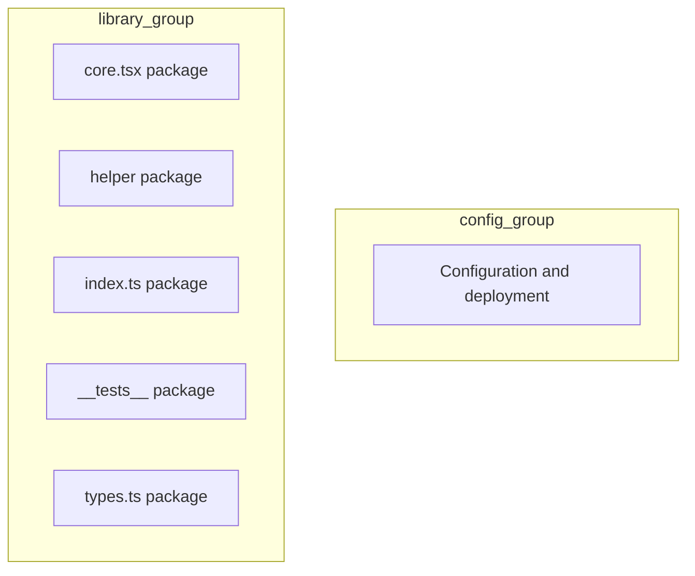

# Architecture report: hustcc/echarts-for-react

> Automated static analysis. **Observed** = directly seen in files/imports/AST; **Inferred** = interpretation from that evidence. Repository code was not executed.

## 1. Repository at a glance

| Item | Value |
| --- | --- |
| Repository | hustcc/echarts-for-react |
| Description | ⛳️  Apache ECharts components for React wrapper. 一个简单的 Apache echarts 的 React 封装。 |
| Language | TypeScript |
| Stars | 5009 |
| Licence | MIT |
| Analysed commit / branch | a0e9565e858824896f9bff526253e59065f57e44 / master |
| Framework(s) | React |
| Files analysed | 39 |
| Components | 6 |

## 2. Architecture in one minute

hustcc/echarts-for-react - ⛳️  Apache ECharts components for React wrapper. 一个简单的 Apache echarts 的 React 封装。. This repository was analysed statically from 39 file(s) (0 Python). Detected technologies (observed from imports/manifests): GitHub Actions, React, Jest, TypeScript. Files are grouped into 6 component(s): Configuration and deployment, core.tsx package, helper package, index.ts package, __tests__ package, types.ts package. Findings below distinguish observed facts from inferred interpretation.

## 3. High-level block diagram

## 4. Main components

### Configuration and deployment (`config`)

- **Kind:** config
- **Status:** Observed
- **Confidence:** 0.85
- **Responsibility:** Groups 2 file(s) under configuration and deployment (observed from repository paths and static analysis).
- **Paths:** `package.json`, `tsconfig.json`
- **Evidence:** [package.json](https://github.com/hustcc/echarts-for-react/blob/a0e9565e858824896f9bff526253e59065f57e44/package.json); [tsconfig.json](https://github.com/hustcc/echarts-for-react/blob/a0e9565e858824896f9bff526253e59065f57e44/tsconfig.json)

### core.tsx package (`core_tsx`)

- **Kind:** library
- **Status:** Observed
- **Confidence:** 0.85
- **Responsibility:** Groups 1 file(s) under core.tsx package (observed from repository paths and static analysis).
- **Paths:** `src/core.tsx`
- **Evidence:** [src/core.tsx](https://github.com/hustcc/echarts-for-react/blob/a0e9565e858824896f9bff526253e59065f57e44/src/core.tsx)

### helper package (`helper`)

- **Kind:** library
- **Status:** Observed
- **Confidence:** 0.85
- **Responsibility:** Groups 4 file(s) under helper package (observed from repository paths and static analysis).
- **Paths:** `src/helper/is-equal.ts`, `src/helper/is-function.ts`, `src/helper/is-string.ts`, `src/helper/pick.ts`
- **Evidence:** [src/helper/is-equal.ts](https://github.com/hustcc/echarts-for-react/blob/a0e9565e858824896f9bff526253e59065f57e44/src/helper/is-equal.ts); [src/helper/is-function.ts](https://github.com/hustcc/echarts-for-react/blob/a0e9565e858824896f9bff526253e59065f57e44/src/helper/is-function.ts); [src/helper/is-string.ts](https://github.com/hustcc/echarts-for-react/blob/a0e9565e858824896f9bff526253e59065f57e44/src/helper/is-string.ts); [src/helper/pick.ts](https://github.com/hustcc/echarts-for-react/blob/a0e9565e858824896f9bff526253e59065f57e44/src/helper/pick.ts)

### index.ts package (`index_ts`)

- **Kind:** library
- **Status:** Observed
- **Confidence:** 0.85
- **Responsibility:** Groups 1 file(s) under index.ts package (observed from repository paths and static analysis).
- **Paths:** `src/index.ts`
- **Evidence:** [src/index.ts](https://github.com/hustcc/echarts-for-react/blob/a0e9565e858824896f9bff526253e59065f57e44/src/index.ts)

### __tests__ package (`tests`)

- **Kind:** library
- **Status:** Observed
- **Confidence:** 0.85
- **Responsibility:** Groups 6 file(s) under __tests__ package (observed from repository paths and static analysis).
- **Paths:** `__tests__/charts/simple-spec.tsx`, `__tests__/helper/is-equal-spec.ts`, `__tests__/helper/is-fucntion-spec.ts`, `__tests__/helper/is-string-spec.ts`, `__tests__/helper/pick-spec.ts`, `__tests__/utils/index.ts`
- **Evidence:** [__tests__/charts/simple-spec.tsx](https://github.com/hustcc/echarts-for-react/blob/a0e9565e858824896f9bff526253e59065f57e44/__tests__/charts/simple-spec.tsx); [__tests__/helper/is-equal-spec.ts](https://github.com/hustcc/echarts-for-react/blob/a0e9565e858824896f9bff526253e59065f57e44/__tests__/helper/is-equal-spec.ts); [__tests__/helper/is-fucntion-spec.ts](https://github.com/hustcc/echarts-for-react/blob/a0e9565e858824896f9bff526253e59065f57e44/__tests__/helper/is-fucntion-spec.ts); [__tests__/helper/is-string-spec.ts](https://github.com/hustcc/echarts-for-react/blob/a0e9565e858824896f9bff526253e59065f57e44/__tests__/helper/is-string-spec.ts); [__tests__/helper/pick-spec.ts](https://github.com/hustcc/echarts-for-react/blob/a0e9565e858824896f9bff526253e59065f57e44/__tests__/helper/pick-spec.ts); [__tests__/utils/index.ts](https://github.com/hustcc/echarts-for-react/blob/a0e9565e858824896f9bff526253e59065f57e44/__tests__/utils/index.ts)

### types.ts package (`types_ts`)

- **Kind:** library
- **Status:** Observed
- **Confidence:** 0.85
- **Responsibility:** Groups 1 file(s) under types.ts package (observed from repository paths and static analysis).
- **Paths:** `src/types.ts`
- **Evidence:** [src/types.ts](https://github.com/hustcc/echarts-for-react/blob/a0e9565e858824896f9bff526253e59065f57e44/src/types.ts)

## 5. Execution flow

**Observed** entry point(s):

- [src/index.ts](https://github.com/hustcc/echarts-for-react/blob/a0e9565e858824896f9bff526253e59065f57e44/src/index.ts)

Representative flow (derived from observed entry points and the import graph; steps beyond the entry point are **Inferred**):

1. Execution starts at an observed entry point listed above, if present.
2. No internal import relationships between components were observed.

## 6. Project structure

### `(root)`

- `.commitlintrc.js` - source, JavaScript (241 bytes)
- `.editorconfig` - config (372 bytes)
- `.eslintignore` - other (30 bytes)
- `.eslintrc` - other (1422 bytes)
- `.gitignore` - other (1063 bytes)
- `.lintmdrc` - other (42 bytes)
- `.prettierignore` - other (28 bytes)
- `.prettierrc` - other (165 bytes)
- `.umirc.js` - source, JavaScript (1070 bytes)
- `LICENSE` - docs (1070 bytes)
- `README.md` - docs (12288 bytes)
- `package.json` - manifest (3703 bytes)
- `tsconfig.json` - config (472 bytes)

### `.github`

- `.github/workflows/build.yml` - ci, YAML (590 bytes)

### `__tests__`

- `__tests__/charts/simple-spec.tsx` - source, TypeScript (7803 bytes)
- `__tests__/helper/is-equal-spec.ts` - source, TypeScript (157 bytes)
- `__tests__/helper/is-fucntion-spec.ts` - source, TypeScript (295 bytes)
- `__tests__/helper/is-string-spec.ts` - source, TypeScript (283 bytes)
- `__tests__/helper/pick-spec.ts` - source, TypeScript (338 bytes)
- `__tests__/utils/index.ts` - source, TypeScript (826 bytes)

### `docs`

- `docs/examples/api.md` - docs (2646 bytes)
- `docs/examples/dynamic.md` - docs (4128 bytes)
- `docs/examples/event.md` - docs (1792 bytes)
- `docs/examples/gl.md` - docs (539 bytes)
- `docs/examples/graph.md` - docs (48276 bytes)
- `docs/examples/html-props.md` - docs (1834 bytes)
- `docs/examples/loading.md` - docs (1800 bytes)
- `docs/examples/locale.md` - docs (807 bytes)
- `docs/examples/simple.md` - docs (1443 bytes)
- `docs/examples/svg.md` - docs (642 bytes)
- `docs/examples/theme.md` - docs (2890 bytes)
- `docs/index.md` - docs (1786 bytes)

### `src`

- `src/core.tsx` - source, TypeScript (7566 bytes)
- `src/helper/is-equal.ts` - source, TypeScript (60 bytes)
- `src/helper/is-function.ts` - source, TypeScript (82 bytes)
- `src/helper/is-string.ts` - source, TypeScript (78 bytes)
- `src/helper/pick.ts` - source, TypeScript (261 bytes)
- `src/index.ts` - source, TypeScript (459 bytes)
- `src/types.ts` - source, TypeScript (1874 bytes)

## 7. Key dependencies and integrations

| Name | Category | Status | Confidence | Evidence |
| --- | --- | --- | --- | --- |
| GitHub Actions | ci | Observed | 0.85 | [.github/workflows/build.yml](https://github.com/hustcc/echarts-for-react/blob/a0e9565e858824896f9bff526253e59065f57e44/.github/workflows/build.yml) |
| React | framework | Observed | 0.85 | [package.json:2](https://github.com/hustcc/echarts-for-react/blob/a0e9565e858824896f9bff526253e59065f57e44/package.json#L2) |
| Jest | tooling | Observed | 0.85 | [package.json:43](https://github.com/hustcc/echarts-for-react/blob/a0e9565e858824896f9bff526253e59065f57e44/package.json#L43) |
| TypeScript | tooling | Observed | 0.85 | [package.json:76](https://github.com/hustcc/echarts-for-react/blob/a0e9565e858824896f9bff526253e59065f57e44/package.json#L76) |

## 8. Data and state

No database, cache, queue, or persistent-state usage was observed in the analysed files. State handling, if any, may be in-memory or in files that were not analysed.

## 9. Configuration and deployment clues

- `.editorconfig` (config)
- `.github/workflows/build.yml` (ci)
- `package.json` (manifest)
- `tsconfig.json` (config)

## 10. Design observations

- No strong design patterns could be established from the available evidence.

These observations are interpretations (**Inferred**) of the observed structure, not guarantees about runtime design.

## 11. Limitations and unknowns

- Static analysis only: repository code was not executed, installed, or imported at runtime.
- Components and relationships are inferred from file paths, imports, and AST structure; runtime behaviour, dynamic imports, and reflection may not be visible.
- No clear application entry point was observed in the analysed files.
- Repository text was treated as untrusted data; no instructions found in repository files were followed, and likely secret values were redacted/excluded.
- JavaScript and TypeScript files were inventoried from paths and package manifests. They were not parsed with a full language AST, and repository code was not executed.

## 12. Source references

- [.github/workflows/build.yml](https://github.com/hustcc/echarts-for-react/blob/a0e9565e858824896f9bff526253e59065f57e44/.github/workflows/build.yml)
- [__tests__/charts/simple-spec.tsx](https://github.com/hustcc/echarts-for-react/blob/a0e9565e858824896f9bff526253e59065f57e44/__tests__/charts/simple-spec.tsx)
- [__tests__/helper/is-equal-spec.ts](https://github.com/hustcc/echarts-for-react/blob/a0e9565e858824896f9bff526253e59065f57e44/__tests__/helper/is-equal-spec.ts)
- [__tests__/helper/is-fucntion-spec.ts](https://github.com/hustcc/echarts-for-react/blob/a0e9565e858824896f9bff526253e59065f57e44/__tests__/helper/is-fucntion-spec.ts)
- [__tests__/helper/is-string-spec.ts](https://github.com/hustcc/echarts-for-react/blob/a0e9565e858824896f9bff526253e59065f57e44/__tests__/helper/is-string-spec.ts)
- [__tests__/helper/pick-spec.ts](https://github.com/hustcc/echarts-for-react/blob/a0e9565e858824896f9bff526253e59065f57e44/__tests__/helper/pick-spec.ts)
- [__tests__/utils/index.ts](https://github.com/hustcc/echarts-for-react/blob/a0e9565e858824896f9bff526253e59065f57e44/__tests__/utils/index.ts)
- [package.json](https://github.com/hustcc/echarts-for-react/blob/a0e9565e858824896f9bff526253e59065f57e44/package.json)
- [package.json:2](https://github.com/hustcc/echarts-for-react/blob/a0e9565e858824896f9bff526253e59065f57e44/package.json#L2)
- [package.json:43](https://github.com/hustcc/echarts-for-react/blob/a0e9565e858824896f9bff526253e59065f57e44/package.json#L43)
- [package.json:76](https://github.com/hustcc/echarts-for-react/blob/a0e9565e858824896f9bff526253e59065f57e44/package.json#L76)
- [src/core.tsx](https://github.com/hustcc/echarts-for-react/blob/a0e9565e858824896f9bff526253e59065f57e44/src/core.tsx)
- [src/helper/is-equal.ts](https://github.com/hustcc/echarts-for-react/blob/a0e9565e858824896f9bff526253e59065f57e44/src/helper/is-equal.ts)
- [src/helper/is-function.ts](https://github.com/hustcc/echarts-for-react/blob/a0e9565e858824896f9bff526253e59065f57e44/src/helper/is-function.ts)
- [src/helper/is-string.ts](https://github.com/hustcc/echarts-for-react/blob/a0e9565e858824896f9bff526253e59065f57e44/src/helper/is-string.ts)
- [src/helper/pick.ts](https://github.com/hustcc/echarts-for-react/blob/a0e9565e858824896f9bff526253e59065f57e44/src/helper/pick.ts)
- [src/index.ts](https://github.com/hustcc/echarts-for-react/blob/a0e9565e858824896f9bff526253e59065f57e44/src/index.ts)
- [src/types.ts](https://github.com/hustcc/echarts-for-react/blob/a0e9565e858824896f9bff526253e59065f57e44/src/types.ts)
- [tsconfig.json](https://github.com/hustcc/echarts-for-react/blob/a0e9565e858824896f9bff526253e59065f57e44/tsconfig.json)
