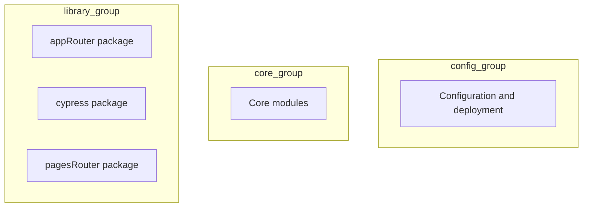

# Architecture report: i18next/next-i18next

> Automated static analysis. **Observed** = directly seen in files/imports/AST; **Inferred** = interpretation from that evidence. Repository code was not executed.

## 1. Repository at a glance

| Item | Value |
| --- | --- |
| Repository | i18next/next-i18next |
| Description | The easiest way to translate your NextJs apps. |
| Language | TypeScript |
| Stars | 6164 |
| Licence | MIT |
| Analysed commit / branch | 09a2aa0975b54cd4684dcee9ab7b77224180d338 / master |
| Framework(s) | Next.js, React |
| Files analysed | 266 |
| Components | 5 |

## 2. Architecture in one minute

i18next/next-i18next - The easiest way to translate your NextJs apps.. This repository was analysed statically from 266 file(s) (0 Python). Detected technologies (observed from imports/manifests): GitHub Actions, Next.js, React, Jest, TypeScript. Files are grouped into 5 component(s): appRouter package, Configuration and deployment, Core modules, cypress package, pagesRouter package. Findings below distinguish observed facts from inferred interpretation.

## 3. High-level block diagram

## 4. Main components

### appRouter package (`approuter`)

- **Kind:** library
- **Status:** Observed
- **Confidence:** 0.85
- **Responsibility:** Groups 17 file(s) under approuter package (observed from repository paths and static analysis).
- **Paths:** `src/appRouter/client.ondemand.test.tsx`, `src/appRouter/client.ssr.test.tsx`, `src/appRouter/client.test.tsx`, `src/appRouter/client.tsx`, `src/appRouter/config.test.ts`, `src/appRouter/config.ts`, `src/appRouter/icu.test.tsx`, `src/appRouter/icu.tsx`, `src/appRouter/index.ts`, `src/appRouter/mf2.tsx`, `src/appRouter/proxy/createProxy.test.ts`, `src/appRouter/proxy/index.ts`, `src/appRouter/proxy/languageDetector.test.ts`, `src/appRouter/proxy/languageDetector.ts`, `src/appRouter/server.test.ts`, `src/appRouter/server.ts`, `src/appRouter/types.ts`
- **Evidence:** [src/appRouter/client.ondemand.test.tsx](https://github.com/i18next/next-i18next/blob/09a2aa0975b54cd4684dcee9ab7b77224180d338/src/appRouter/client.ondemand.test.tsx); [src/appRouter/client.ssr.test.tsx](https://github.com/i18next/next-i18next/blob/09a2aa0975b54cd4684dcee9ab7b77224180d338/src/appRouter/client.ssr.test.tsx); [src/appRouter/client.test.tsx](https://github.com/i18next/next-i18next/blob/09a2aa0975b54cd4684dcee9ab7b77224180d338/src/appRouter/client.test.tsx); [src/appRouter/client.tsx](https://github.com/i18next/next-i18next/blob/09a2aa0975b54cd4684dcee9ab7b77224180d338/src/appRouter/client.tsx); [src/appRouter/config.test.ts](https://github.com/i18next/next-i18next/blob/09a2aa0975b54cd4684dcee9ab7b77224180d338/src/appRouter/config.test.ts); [src/appRouter/config.ts](https://github.com/i18next/next-i18next/blob/09a2aa0975b54cd4684dcee9ab7b77224180d338/src/appRouter/config.ts); [src/appRouter/icu.test.tsx](https://github.com/i18next/next-i18next/blob/09a2aa0975b54cd4684dcee9ab7b77224180d338/src/appRouter/icu.test.tsx); [src/appRouter/icu.tsx](https://github.com/i18next/next-i18next/blob/09a2aa0975b54cd4684dcee9ab7b77224180d338/src/appRouter/icu.tsx)

### Configuration and deployment (`config`)

- **Kind:** config
- **Status:** Observed
- **Confidence:** 0.85
- **Responsibility:** Groups 10 file(s) under configuration and deployment (observed from repository paths and static analysis).
- **Paths:** `babel.config.json`, `cypress/tsconfig.json`, `package.json`, `src/pagesRouter/config/createConfig.test.ts`, `src/pagesRouter/config/createConfig.ts`, `src/pagesRouter/config/defaultConfig.ts`, `src/pagesRouter/config/serverSideConfig.ts`, `tsconfig.appRouter.json`, `tsconfig.json`, `tsconfig.pagesRouter.json`
- **Evidence:** [babel.config.json](https://github.com/i18next/next-i18next/blob/09a2aa0975b54cd4684dcee9ab7b77224180d338/babel.config.json); [cypress/tsconfig.json](https://github.com/i18next/next-i18next/blob/09a2aa0975b54cd4684dcee9ab7b77224180d338/cypress/tsconfig.json); [package.json](https://github.com/i18next/next-i18next/blob/09a2aa0975b54cd4684dcee9ab7b77224180d338/package.json); [src/pagesRouter/config/createConfig.test.ts](https://github.com/i18next/next-i18next/blob/09a2aa0975b54cd4684dcee9ab7b77224180d338/src/pagesRouter/config/createConfig.test.ts); [src/pagesRouter/config/createConfig.ts](https://github.com/i18next/next-i18next/blob/09a2aa0975b54cd4684dcee9ab7b77224180d338/src/pagesRouter/config/createConfig.ts); [src/pagesRouter/config/defaultConfig.ts](https://github.com/i18next/next-i18next/blob/09a2aa0975b54cd4684dcee9ab7b77224180d338/src/pagesRouter/config/defaultConfig.ts); [src/pagesRouter/config/serverSideConfig.ts](https://github.com/i18next/next-i18next/blob/09a2aa0975b54cd4684dcee9ab7b77224180d338/src/pagesRouter/config/serverSideConfig.ts); [tsconfig.appRouter.json](https://github.com/i18next/next-i18next/blob/09a2aa0975b54cd4684dcee9ab7b77224180d338/tsconfig.appRouter.json)

### Core modules (`core`)

- **Kind:** core
- **Status:** Observed
- **Confidence:** 0.85
- **Responsibility:** Groups 7 file(s) under core modules (observed from repository paths and static analysis).
- **Paths:** `cypress.config.ts`, `eslint.config.mjs`, `jest.config.js`, `prettier.config.js`, `serverSideTranslations.d.ts`, `serverSideTranslations.js`, `tsdown.config.ts`
- **Evidence:** [cypress.config.ts](https://github.com/i18next/next-i18next/blob/09a2aa0975b54cd4684dcee9ab7b77224180d338/cypress.config.ts); [eslint.config.mjs](https://github.com/i18next/next-i18next/blob/09a2aa0975b54cd4684dcee9ab7b77224180d338/eslint.config.mjs); [jest.config.js](https://github.com/i18next/next-i18next/blob/09a2aa0975b54cd4684dcee9ab7b77224180d338/jest.config.js); [prettier.config.js](https://github.com/i18next/next-i18next/blob/09a2aa0975b54cd4684dcee9ab7b77224180d338/prettier.config.js); [serverSideTranslations.d.ts](https://github.com/i18next/next-i18next/blob/09a2aa0975b54cd4684dcee9ab7b77224180d338/serverSideTranslations.d.ts); [serverSideTranslations.js](https://github.com/i18next/next-i18next/blob/09a2aa0975b54cd4684dcee9ab7b77224180d338/serverSideTranslations.js); [tsdown.config.ts](https://github.com/i18next/next-i18next/blob/09a2aa0975b54cd4684dcee9ab7b77224180d338/tsdown.config.ts)

### cypress package (`cypress`)

- **Kind:** library
- **Status:** Observed
- **Confidence:** 0.85
- **Responsibility:** Groups 1 file(s) under cypress package (observed from repository paths and static analysis).
- **Paths:** `cypress/e2e/spec.cy.ts`
- **Evidence:** [cypress/e2e/spec.cy.ts](https://github.com/i18next/next-i18next/blob/09a2aa0975b54cd4684dcee9ab7b77224180d338/cypress/e2e/spec.cy.ts)

### pagesRouter package (`pagesrouter`)

- **Kind:** library
- **Status:** Observed
- **Confidence:** 0.85
- **Responsibility:** Groups 13 file(s) under pagesrouter package (observed from repository paths and static analysis).
- **Paths:** `src/pagesRouter/appWithTranslation.client.test.tsx`, `src/pagesRouter/appWithTranslation.server.test.tsx`, `src/pagesRouter/appWithTranslation.tsx`, `src/pagesRouter/createClient/browser.test.ts`, `src/pagesRouter/createClient/browser.ts`, `src/pagesRouter/createClient/node.test.ts`, `src/pagesRouter/createClient/node.ts`, `src/pagesRouter/index.tsx`, `src/pagesRouter/serverSideTranslations.test.tsx`, `src/pagesRouter/serverSideTranslations.ts`, `src/pagesRouter/types.test.ts`, `src/pagesRouter/types.ts`, `src/pagesRouter/utils.ts`
- **Evidence:** [src/pagesRouter/appWithTranslation.client.test.tsx](https://github.com/i18next/next-i18next/blob/09a2aa0975b54cd4684dcee9ab7b77224180d338/src/pagesRouter/appWithTranslation.client.test.tsx); [src/pagesRouter/appWithTranslation.server.test.tsx](https://github.com/i18next/next-i18next/blob/09a2aa0975b54cd4684dcee9ab7b77224180d338/src/pagesRouter/appWithTranslation.server.test.tsx); [src/pagesRouter/appWithTranslation.tsx](https://github.com/i18next/next-i18next/blob/09a2aa0975b54cd4684dcee9ab7b77224180d338/src/pagesRouter/appWithTranslation.tsx); [src/pagesRouter/createClient/browser.test.ts](https://github.com/i18next/next-i18next/blob/09a2aa0975b54cd4684dcee9ab7b77224180d338/src/pagesRouter/createClient/browser.test.ts); [src/pagesRouter/createClient/browser.ts](https://github.com/i18next/next-i18next/blob/09a2aa0975b54cd4684dcee9ab7b77224180d338/src/pagesRouter/createClient/browser.ts); [src/pagesRouter/createClient/node.test.ts](https://github.com/i18next/next-i18next/blob/09a2aa0975b54cd4684dcee9ab7b77224180d338/src/pagesRouter/createClient/node.test.ts); [src/pagesRouter/createClient/node.ts](https://github.com/i18next/next-i18next/blob/09a2aa0975b54cd4684dcee9ab7b77224180d338/src/pagesRouter/createClient/node.ts); [src/pagesRouter/index.tsx](https://github.com/i18next/next-i18next/blob/09a2aa0975b54cd4684dcee9ab7b77224180d338/src/pagesRouter/index.tsx)

## 5. Execution flow

**Observed** entry point(s):

- [src/appRouter/index.ts](https://github.com/i18next/next-i18next/blob/09a2aa0975b54cd4684dcee9ab7b77224180d338/src/appRouter/index.ts)
- [src/appRouter/proxy/index.ts](https://github.com/i18next/next-i18next/blob/09a2aa0975b54cd4684dcee9ab7b77224180d338/src/appRouter/proxy/index.ts)
- [src/appRouter/server.ts](https://github.com/i18next/next-i18next/blob/09a2aa0975b54cd4684dcee9ab7b77224180d338/src/appRouter/server.ts)
- [src/pagesRouter/index.tsx](https://github.com/i18next/next-i18next/blob/09a2aa0975b54cd4684dcee9ab7b77224180d338/src/pagesRouter/index.tsx)

Representative flow (derived from observed entry points and the import graph; steps beyond the entry point are **Inferred**):

1. Execution starts at an observed entry point listed above, if present.
2. No internal import relationships between components were observed.

## 6. Project structure

### `(root)`

- `.all-contributorsrc` - other (4205 bytes)
- `.editorconfig` - config (297 bytes)
- `.gitignore` - other (471 bytes)
- `.npmignore` - other (483 bytes)
- `.size-limit.cjs` - source, JavaScript (2354 bytes)
- `CHANGELOG.md` - docs (34523 bytes)
- `CODE_OF_CONDUCT.md` - docs (3331 bytes)
- `CONTRIBUTING.md` - docs (1826 bytes)
- `LICENSE` - docs (1082 bytes)
- `README.md` - docs (48574 bytes)
- `TROUBLESHOOT.md` - docs (5462 bytes)
- `babel.config.json` - config (452 bytes)
- `cypress.config.ts` - source, TypeScript (256 bytes)
- `eslint.config.mjs` - source, JavaScript (596 bytes)
- `jest.config.js` - source, JavaScript (571 bytes)
- `package.json` - manifest (11285 bytes)
- `prettier.config.js` - source, JavaScript (743 bytes)
- `serverSideTranslations.d.ts` - source, TypeScript (77 bytes)
- `serverSideTranslations.js` - source, JavaScript (67 bytes)
- `tsconfig.appRouter.json` - config (484 bytes)
- `tsconfig.json` - config (132 bytes)
- `tsconfig.pagesRouter.json` - config (381 bytes)
- `tsdown.config.ts` - source, TypeScript (2040 bytes)

### `.github`

- `.github/stale.yml` - config (805 bytes)
- `.github/workflows/ci.yml` - ci, YAML (1337 bytes)
- `.github/workflows/next-compat.yml` - ci, YAML (1768 bytes)

### `.husky`

- `.husky/.gitignore` - other (2 bytes)
- `.husky/pre-commit` - other (62 bytes)

### `cypress`

- `cypress/e2e/spec.cy.ts` - source, TypeScript (2235 bytes)
- `cypress/tsconfig.json` - config (171 bytes)

### `examples`

- `examples/app-router-icu/.gitignore` - other (29 bytes)
- `examples/app-router-icu/@types/i18next.d.ts` - source, TypeScript (435 bytes)
- `examples/app-router-icu/@types/resources.d.ts` - source, TypeScript (727 bytes)
- `examples/app-router-icu/README.md` - docs (1443 bytes)
- `examples/app-router-icu/app/[lng]/components/Cart.tsx` - source, TypeScript (939 bytes)
- `examples/app-router-icu/app/[lng]/layout.tsx` - source, TypeScript (895 bytes)
- `examples/app-router-icu/app/[lng]/page.tsx` - source, TypeScript (1413 bytes)
- `examples/app-router-icu/app/i18n/locales/de/common.json` - config (641 bytes)
- `examples/app-router-icu/app/i18n/locales/en/common.json` - config (578 bytes)
- `examples/app-router-icu/i18n.config.ts` - source, TypeScript (453 bytes)
- `examples/app-router-icu/i18next.config.ts` - source, TypeScript (553 bytes)
- `examples/app-router-icu/next-env.d.ts` - source, TypeScript (251 bytes)
- `examples/app-router-icu/package.json` - manifest (580 bytes)
- `examples/app-router-icu/proxy.ts` - source, TypeScript (227 bytes)
- `examples/app-router-icu/tsconfig.json` - config (682 bytes)
- `examples/app-router-no-locale-path/.gitignore` - other (49 bytes)
- `examples/app-router-no-locale-path/README.md` - docs (1330 bytes)
- `examples/app-router-no-locale-path/app/client-page/layout.js` - source, JavaScript (241 bytes)
- `examples/app-router-no-locale-path/app/client-page/page.js` - source, JavaScript (931 bytes)
- `examples/app-router-no-locale-path/app/components/Footer/FooterBase.js` - source, JavaScript (970 bytes)
- `examples/app-router-no-locale-path/app/components/Footer/LangSelect.js` - source, JavaScript (1055 bytes)
- `examples/app-router-no-locale-path/app/components/Footer/client.js` - source, JavaScript (244 bytes)
- `examples/app-router-no-locale-path/app/components/Footer/index.js` - source, JavaScript (244 bytes)
- `examples/app-router-no-locale-path/app/components/Header.js` - source, JavaScript (298 bytes)
- `examples/app-router-no-locale-path/app/global.css` - other (1560 bytes)
- `examples/app-router-no-locale-path/app/i18n/locales/de/client-page.json` - config (324 bytes)
- `examples/app-router-no-locale-path/app/i18n/locales/de/footer.json` - config (268 bytes)
- `examples/app-router-no-locale-path/app/i18n/locales/de/second-client-page.json` - config (161 bytes)
- `examples/app-router-no-locale-path/app/i18n/locales/de/second-page.json` - config (135 bytes)
- `examples/app-router-no-locale-path/app/i18n/locales/de/translation.json` - config (396 bytes)
- `examples/app-router-no-locale-path/app/i18n/locales/en/client-page.json` - config (281 bytes)
- `examples/app-router-no-locale-path/app/i18n/locales/en/footer.json` - config (235 bytes)
- `examples/app-router-no-locale-path/app/i18n/locales/en/second-client-page.json` - config (134 bytes)
- `examples/app-router-no-locale-path/app/i18n/locales/en/second-page.json` - config (111 bytes)
- `examples/app-router-no-locale-path/app/i18n/locales/en/translation.json` - config (369 bytes)
- `examples/app-router-no-locale-path/app/i18n/locales/it/client-page.json` - config (367 bytes)
- `examples/app-router-no-locale-path/app/i18n/locales/it/footer.json` - config (254 bytes)
- `examples/app-router-no-locale-path/app/i18n/locales/it/second-client-page.json` - config (162 bytes)
- `examples/app-router-no-locale-path/app/i18n/locales/it/second-page.json` - config (140 bytes)
- `examples/app-router-no-locale-path/app/i18n/locales/it/translation.json` - config (377 bytes)
- `examples/app-router-no-locale-path/app/layout.js` - source, JavaScript (930 bytes)
- `examples/app-router-no-locale-path/app/page.js` - source, JavaScript (1434 bytes)
- `examples/app-router-no-locale-path/app/second-client-page/layout.js` - source, JavaScript (248 bytes)
- `examples/app-router-no-locale-path/app/second-client-page/page.js` - source, JavaScript (527 bytes)
- `examples/app-router-no-locale-path/app/second-page/layout.js` - source, JavaScript (241 bytes)
- `examples/app-router-no-locale-path/app/second-page/page.js` - source, JavaScript (504 bytes)
- `examples/app-router-no-locale-path/eslint.config.mjs` - source, JavaScript (265 bytes)
- `examples/app-router-no-locale-path/i18n.config.js` - source, JavaScript (1232 bytes)
- `examples/app-router-no-locale-path/next.config.js` - source, JavaScript (118 bytes)
- `examples/app-router-no-locale-path/package.json` - manifest (1063 bytes)
- `examples/app-router-no-locale-path/proxy.js` - source, JavaScript (257 bytes)
- `examples/app-router-no-locale-path/public/site.webmanifest` - other (263 bytes)
- `examples/app-router-simple/.gitignore` - other (42 bytes)
- `examples/app-router-simple/@types/i18next.d.ts` - source, TypeScript (173 bytes)
- `examples/app-router-simple/@types/resources.d.ts` - source, TypeScript (1368 bytes)
- `examples/app-router-simple/README.md` - docs (1160 bytes)
- `examples/app-router-simple/app/[lng]/client-page/layout.tsx` - source, TypeScript (419 bytes)
- `examples/app-router-simple/app/[lng]/client-page/page.tsx` - source, TypeScript (981 bytes)
- `examples/app-router-simple/app/[lng]/components/Footer/FooterBase.tsx` - source, TypeScript (1403 bytes)
- `examples/app-router-simple/app/[lng]/components/Footer/client.tsx` - source, TypeScript (268 bytes)
- `examples/app-router-simple/app/[lng]/components/Footer/index.tsx` - source, TypeScript (257 bytes)
- `examples/app-router-simple/app/[lng]/components/Header.tsx` - source, TypeScript (319 bytes)
- `examples/app-router-simple/app/[lng]/components/Link/LinkBase.tsx` - source, TypeScript (380 bytes)
- `examples/app-router-simple/app/[lng]/components/Link/client.tsx` - source, TypeScript (300 bytes)
- `examples/app-router-simple/app/[lng]/components/Link/index.tsx` - source, TypeScript (308 bytes)
- `examples/app-router-simple/app/[lng]/global.css` - other (1582 bytes)
- `examples/app-router-simple/app/[lng]/layout.tsx` - source, TypeScript (1105 bytes)
- `examples/app-router-simple/app/[lng]/page.tsx` - source, TypeScript (1448 bytes)
- `examples/app-router-simple/app/[lng]/second-client-page/layout.tsx` - source, TypeScript (426 bytes)
- `examples/app-router-simple/app/[lng]/second-client-page/page.tsx` - source, TypeScript (806 bytes)
- `examples/app-router-simple/app/[lng]/second-page/layout.tsx` - source, TypeScript (382 bytes)
- `examples/app-router-simple/app/[lng]/second-page/page.tsx` - source, TypeScript (534 bytes)
- `examples/app-router-simple/app/i18n/locales/de/client-page.json` - config (324 bytes)
- `examples/app-router-simple/app/i18n/locales/de/footer.json` - config (268 bytes)
- `examples/app-router-simple/app/i18n/locales/de/second-client-page.json` - config (201 bytes)
- `examples/app-router-simple/app/i18n/locales/de/second-page.json` - config (135 bytes)
- `examples/app-router-simple/app/i18n/locales/de/translation.json` - config (396 bytes)
- `examples/app-router-simple/app/i18n/locales/en/client-page.json` - config (281 bytes)
- `examples/app-router-simple/app/i18n/locales/en/footer.json` - config (235 bytes)
- `examples/app-router-simple/app/i18n/locales/en/second-client-page.json` - config (172 bytes)
- `examples/app-router-simple/app/i18n/locales/en/second-page.json` - config (111 bytes)
- `examples/app-router-simple/app/i18n/locales/en/translation.json` - config (369 bytes)
- `examples/app-router-simple/app/i18n/locales/it/client-page.json` - config (367 bytes)
- `examples/app-router-simple/app/i18n/locales/it/footer.json` - config (254 bytes)
- `examples/app-router-simple/app/i18n/locales/it/second-client-page.json` - config (204 bytes)
- `examples/app-router-simple/app/i18n/locales/it/second-page.json` - config (140 bytes)
- `examples/app-router-simple/app/i18n/locales/it/translation.json` - config (377 bytes)
- `examples/app-router-simple/eslint.config.mjs` - source, JavaScript (265 bytes)
- `examples/app-router-simple/i18n.config.ts` - source, TypeScript (1242 bytes)
- `examples/app-router-simple/next-env.d.ts` - source, TypeScript (251 bytes)
- `examples/app-router-simple/next.config.js` - source, JavaScript (118 bytes)
- `examples/app-router-simple/package.json` - manifest (1445 bytes)
- `examples/app-router-simple/proxy.ts` - source, TypeScript (257 bytes)
- `examples/app-router-simple/public/site.webmanifest` - other (263 bytes)
- `examples/app-router-simple/tsconfig.json` - config (682 bytes)
- `examples/mixed-routers/app/app-router/[locale]/components/FooterServer.tsx` - source, TypeScript (767 bytes)
- `examples/mixed-routers/app/app-router/[locale]/layout.tsx` - source, TypeScript (1685 bytes)
- `examples/mixed-routers/app/app-router/[locale]/page.tsx` - source, TypeScript (5080 bytes)
- `examples/mixed-routers/app/app-router/[locale]/second-page/page.tsx` - source, TypeScript (731 bytes)
- `examples/mixed-routers/components/Footer.tsx` - source, TypeScript (691 bytes)
- `examples/mixed-routers/components/Header.tsx` - source, TypeScript (489 bytes)
- `examples/mixed-routers/i18n.config.ts` - source, TypeScript (386 bytes)
- `examples/mixed-routers/i18n.shared.js` - source, JavaScript (212 bytes)
- `examples/mixed-routers/next-env.d.ts` - source, TypeScript (317 bytes)
- `examples/mixed-routers/next-i18next.config.js` - source, JavaScript (407 bytes)
- `examples/mixed-routers/next.config.js` - source, JavaScript (193 bytes)
- `examples/mixed-routers/package.json` - manifest (605 bytes)
- `examples/mixed-routers/pages/_app.tsx` - source, TypeScript (229 bytes)
- `examples/mixed-routers/pages/_document.tsx` - source, TypeScript (1346 bytes)
- `examples/mixed-routers/pages/index.tsx` - source, TypeScript (5751 bytes)
- `examples/mixed-routers/pages/second-page.tsx` - source, TypeScript (1089 bytes)
- `examples/mixed-routers/proxy.ts` - source, TypeScript (196 bytes)
- `examples/mixed-routers/public/app.css` - other (4618 bytes)
- `examples/mixed-routers/public/locales/de/common.json` - config (2854 bytes)
- `examples/mixed-routers/public/locales/de/footer.json` - config (209 bytes)
- `examples/mixed-routers/public/locales/de/second-page.json` - config (151 bytes)
- `examples/mixed-routers/public/locales/en/common.json` - config (2648 bytes)
- `examples/mixed-routers/public/locales/en/footer.json` - config (179 bytes)
- `examples/mixed-routers/public/locales/en/second-page.json` - config (127 bytes)
- `examples/mixed-routers/tsconfig.json` - config (626 bytes)
- `examples/mixed-routers/vercel.json` - config (41 bytes)
- `examples/pages-router-auto-static-optimize/@types/i18next.d.ts` - source, TypeScript (437 bytes)
- `examples/pages-router-auto-static-optimize/@types/resources.ts` - source, TypeScript (354 bytes)
- `examples/pages-router-auto-static-optimize/components/Footer.tsx` - source, TypeScript (796 bytes)
- `examples/pages-router-auto-static-optimize/components/Header.tsx` - source, TypeScript (454 bytes)
- `examples/pages-router-auto-static-optimize/next-env.d.ts` - source, TypeScript (253 bytes)
- `examples/pages-router-auto-static-optimize/next-i18next.config.js` - source, JavaScript (1698 bytes)
- `examples/pages-router-auto-static-optimize/next-utils.config.js` - source, JavaScript (608 bytes)
- `examples/pages-router-auto-static-optimize/next.config.js` - source, JavaScript (538 bytes)
- `examples/pages-router-auto-static-optimize/package.json` - manifest (1237 bytes)
- `examples/pages-router-auto-static-optimize/pages/_app.tsx` - source, TypeScript (378 bytes)
- `examples/pages-router-auto-static-optimize/pages/_document.tsx` - source, TypeScript (1398 bytes)
- `examples/pages-router-auto-static-optimize/pages/auto-static.tsx` - source, TypeScript (794 bytes)
- `examples/pages-router-auto-static-optimize/pages/index.tsx` - source, TypeScript (4376 bytes)
- `examples/pages-router-auto-static-optimize/pages/second-page.tsx` - source, TypeScript (1095 bytes)
- `examples/pages-router-auto-static-optimize/public/app.css` - other (1557 bytes)
- `examples/pages-router-auto-static-optimize/public/locales/de/common.json` - config (1137 bytes)
- `examples/pages-router-auto-static-optimize/public/locales/de/footer.json` - config (209 bytes)
- `examples/pages-router-auto-static-optimize/public/locales/de/second-page.json` - config (151 bytes)
- `examples/pages-router-auto-static-optimize/public/locales/de/staticpage.json` - config (21 bytes)
- `examples/pages-router-auto-static-optimize/public/locales/en/common.json` - config (1040 bytes)
- `examples/pages-router-auto-static-optimize/public/locales/en/footer.json` - config (179 bytes)
- `examples/pages-router-auto-static-optimize/public/locales/en/second-page.json` - config (127 bytes)
- `examples/pages-router-auto-static-optimize/public/locales/en/staticpage.json` - config (21 bytes)
- `examples/pages-router-auto-static-optimize/tsconfig.json` - config (718 bytes)
- `examples/pages-router-auto-static-optimize/vercel.json` - config (41 bytes)
- `examples/pages-router-simple/@types/i18next.d.ts` - source, TypeScript (437 bytes)
- `examples/pages-router-simple/@types/resources.ts` - source, TypeScript (282 bytes)
- `examples/pages-router-simple/components/Footer.tsx` - source, TypeScript (796 bytes)
- `examples/pages-router-simple/components/Header.tsx` - source, TypeScript (489 bytes)
- `examples/pages-router-simple/next-env.d.ts` - source, TypeScript (253 bytes)
- `examples/pages-router-simple/next-i18next.config.js` - source, JavaScript (726 bytes)
- `examples/pages-router-simple/next-utils.config.js` - source, JavaScript (608 bytes)
- `examples/pages-router-simple/next.config.js` - source, JavaScript (538 bytes)
- `examples/pages-router-simple/package.json` - manifest (1098 bytes)
- `examples/pages-router-simple/pages/_app.tsx` - source, TypeScript (381 bytes)
- `examples/pages-router-simple/pages/_document.tsx` - source, TypeScript (1398 bytes)
- `examples/pages-router-simple/pages/index.tsx` - source, TypeScript (4850 bytes)
- `examples/pages-router-simple/pages/second-page.tsx` - source, TypeScript (1095 bytes)
- `examples/pages-router-simple/public/app.css` - other (3371 bytes)
- `examples/pages-router-simple/public/locales/de/common.json` - config (1278 bytes)
- `examples/pages-router-simple/public/locales/de/footer.json` - config (209 bytes)
- `examples/pages-router-simple/public/locales/de/second-page.json` - config (151 bytes)
- `examples/pages-router-simple/public/locales/en/common.json` - config (1178 bytes)
- `examples/pages-router-simple/public/locales/en/footer.json` - config (179 bytes)
- `examples/pages-router-simple/public/locales/en/second-page.json` - config (127 bytes)
- `examples/pages-router-simple/tsconfig.json` - config (718 bytes)
- `examples/pages-router-simple/vercel.json` - config (41 bytes)
- `examples/pages-router-ssg/.gitignore` - other (93 bytes)
- `examples/pages-router-ssg/README.md` - docs (2251 bytes)
- `examples/pages-router-ssg/components/Footer.js` - source, JavaScript (974 bytes)
- `examples/pages-router-ssg/components/Header.js` - source, JavaScript (404 bytes)
- `examples/pages-router-ssg/components/LanguageSwitchLink.js` - source, JavaScript (976 bytes)
- `examples/pages-router-ssg/components/Link.js` - source, JavaScript (632 bytes)
- `examples/pages-router-ssg/eslint.config.mjs` - source, JavaScript (222 bytes)
- `examples/pages-router-ssg/lib/getStatic.js` - source, JavaScript (679 bytes)
- `examples/pages-router-ssg/lib/languageDetector.js` - source, JavaScript (237 bytes)
- `examples/pages-router-ssg/lib/redirect.js` - source, JavaScript (908 bytes)
- `examples/pages-router-ssg/next-i18next.config.js` - source, JavaScript (143 bytes)
- `examples/pages-router-ssg/next.config.js` - source, JavaScript (129 bytes)
- `examples/pages-router-ssg/package.json` - manifest (973 bytes)
- `examples/pages-router-ssg/pages/404.js` - source, JavaScript (67 bytes)
- `examples/pages-router-ssg/pages/[locale]/404.js` - source, JavaScript (761 bytes)
- `examples/pages-router-ssg/pages/[locale]/index.js` - source, JavaScript (753 bytes)
- `examples/pages-router-ssg/pages/[locale]/second-page.js` - source, JavaScript (1200 bytes)
- `examples/pages-router-ssg/pages/_app.js` - source, JavaScript (178 bytes)
- `examples/pages-router-ssg/pages/_document.js` - source, JavaScript (1247 bytes)
- `examples/pages-router-ssg/pages/index.js` - source, JavaScript (317 bytes)
- `examples/pages-router-ssg/pages/second-page.js` - source, JavaScript (327 bytes)
- `examples/pages-router-ssg/public/app.css` - other (1542 bytes)
- `examples/pages-router-ssg/public/locales/de/404.json` - config (137 bytes)
- `examples/pages-router-ssg/public/locales/de/common.json` - config (318 bytes)
- `examples/pages-router-ssg/public/locales/de/footer.json` - config (138 bytes)
- `examples/pages-router-ssg/public/locales/de/second-page.json` - config (107 bytes)
- `examples/pages-router-ssg/public/locales/en/404.json` - config (124 bytes)
- `examples/pages-router-ssg/public/locales/en/common.json` - config (266 bytes)
- `examples/pages-router-ssg/public/locales/en/footer.json` - config (120 bytes)
- `examples/pages-router-ssg/public/locales/en/second-page.json` - config (93 bytes)
- `examples/pages-router-ssg/public/locales/it/404.json` - config (126 bytes)
- `examples/pages-router-ssg/public/locales/it/common.json` - config (320 bytes)
- `examples/pages-router-ssg/public/locales/it/footer.json` - config (131 bytes)
- `examples/pages-router-ssg/public/locales/it/second-page.json` - config (103 bytes)

### `src`

- `src/appRouter/client.ondemand.test.tsx` - source, TypeScript (3413 bytes)
- `src/appRouter/client.ssr.test.tsx` - source, TypeScript (4507 bytes)
- `src/appRouter/client.test.tsx` - source, TypeScript (13849 bytes)
- `src/appRouter/client.tsx` - source, TypeScript (11740 bytes)
- `src/appRouter/config.test.ts` - source, TypeScript (4806 bytes)
- `src/appRouter/config.ts` - source, TypeScript (2126 bytes)
- `src/appRouter/icu.test.tsx` - source, TypeScript (1939 bytes)
- `src/appRouter/icu.tsx` - source, TypeScript (1042 bytes)
- `src/appRouter/index.ts` - source, TypeScript (246 bytes)
- `src/appRouter/mf2.tsx` - source, TypeScript (514 bytes)
- `src/appRouter/proxy/createProxy.test.ts` - source, TypeScript (31348 bytes)
- `src/appRouter/proxy/index.ts` - source, TypeScript (8894 bytes)
- `src/appRouter/proxy/languageDetector.test.ts` - source, TypeScript (3726 bytes)
- `src/appRouter/proxy/languageDetector.ts` - source, TypeScript (2251 bytes)
- `src/appRouter/server.test.ts` - source, TypeScript (25619 bytes)
- `src/appRouter/server.ts` - source, TypeScript (14870 bytes)
- `src/appRouter/types.ts` - source, TypeScript (5433 bytes)
- `src/pagesRouter/appWithTranslation.client.test.tsx` - source, TypeScript (10293 bytes)
- `src/pagesRouter/appWithTranslation.server.test.tsx` - source, TypeScript (2222 bytes)
- `src/pagesRouter/appWithTranslation.tsx` - source, TypeScript (4760 bytes)
- `src/pagesRouter/config/createConfig.test.ts` - source, TypeScript (20235 bytes)
- `src/pagesRouter/config/createConfig.ts` - source, TypeScript (5053 bytes)
- `src/pagesRouter/config/defaultConfig.ts` - source, TypeScript (810 bytes)
- `src/pagesRouter/config/serverSideConfig.ts` - source, TypeScript (5467 bytes)
- `src/pagesRouter/createClient/browser.test.ts` - source, TypeScript (897 bytes)
- `src/pagesRouter/createClient/browser.ts` - source, TypeScript (679 bytes)
- `src/pagesRouter/createClient/node.test.ts` - source, TypeScript (3042 bytes)
- `src/pagesRouter/createClient/node.ts` - source, TypeScript (2037 bytes)
- `src/pagesRouter/index.tsx` - source, TypeScript (335 bytes)
- `src/pagesRouter/serverSideTranslations.test.tsx` - source, TypeScript (16409 bytes)
- `src/pagesRouter/serverSideTranslations.ts` - source, TypeScript (4710 bytes)
- `src/pagesRouter/types.test.ts` - source, TypeScript (560 bytes)
- `src/pagesRouter/types.ts` - source, TypeScript (2526 bytes)
- `src/pagesRouter/utils.ts` - source, TypeScript (1133 bytes)

## 7. Key dependencies and integrations

| Name | Category | Status | Confidence | Evidence |
| --- | --- | --- | --- | --- |
| GitHub Actions | ci | Observed | 0.90 | [.github/workflows/ci.yml](https://github.com/i18next/next-i18next/blob/09a2aa0975b54cd4684dcee9ab7b77224180d338/.github/workflows/ci.yml); [.github/workflows/next-compat.yml](https://github.com/i18next/next-i18next/blob/09a2aa0975b54cd4684dcee9ab7b77224180d338/.github/workflows/next-compat.yml) |
| Next.js | framework | Observed | 0.90 | [examples/app-router-icu/package.json:2](https://github.com/i18next/next-i18next/blob/09a2aa0975b54cd4684dcee9ab7b77224180d338/examples/app-router-icu/package.json#L2); [examples/app-router-no-locale-path/package.json:2](https://github.com/i18next/next-i18next/blob/09a2aa0975b54cd4684dcee9ab7b77224180d338/examples/app-router-no-locale-path/package.json#L2); [examples/app-router-simple/package.json:2](https://github.com/i18next/next-i18next/blob/09a2aa0975b54cd4684dcee9ab7b77224180d338/examples/app-router-simple/package.json#L2); [examples/mixed-routers/package.json:2](https://github.com/i18next/next-i18next/blob/09a2aa0975b54cd4684dcee9ab7b77224180d338/examples/mixed-routers/package.json#L2) |
| React | framework | Observed | 0.90 | [examples/app-router-icu/package.json:17](https://github.com/i18next/next-i18next/blob/09a2aa0975b54cd4684dcee9ab7b77224180d338/examples/app-router-icu/package.json#L17); [examples/app-router-icu/package.json:18](https://github.com/i18next/next-i18next/blob/09a2aa0975b54cd4684dcee9ab7b77224180d338/examples/app-router-icu/package.json#L18); [examples/app-router-no-locale-path/package.json:18](https://github.com/i18next/next-i18next/blob/09a2aa0975b54cd4684dcee9ab7b77224180d338/examples/app-router-no-locale-path/package.json#L18); [examples/app-router-no-locale-path/package.json:19](https://github.com/i18next/next-i18next/blob/09a2aa0975b54cd4684dcee9ab7b77224180d338/examples/app-router-no-locale-path/package.json#L19) |
| Jest | tooling | Observed | 0.85 | [package.json:155](https://github.com/i18next/next-i18next/blob/09a2aa0975b54cd4684dcee9ab7b77224180d338/package.json#L155) |
| TypeScript | tooling | Observed | 0.90 | [examples/app-router-icu/package.json:24](https://github.com/i18next/next-i18next/blob/09a2aa0975b54cd4684dcee9ab7b77224180d338/examples/app-router-icu/package.json#L24); [examples/app-router-simple/package.json:32](https://github.com/i18next/next-i18next/blob/09a2aa0975b54cd4684dcee9ab7b77224180d338/examples/app-router-simple/package.json#L32); [examples/mixed-routers/package.json:23](https://github.com/i18next/next-i18next/blob/09a2aa0975b54cd4684dcee9ab7b77224180d338/examples/mixed-routers/package.json#L23); [examples/pages-router-auto-static-optimize/package.json:35](https://github.com/i18next/next-i18next/blob/09a2aa0975b54cd4684dcee9ab7b77224180d338/examples/pages-router-auto-static-optimize/package.json#L35) |

## 8. Data and state

No database, cache, queue, or persistent-state usage was observed in the analysed files. State handling, if any, may be in-memory or in files that were not analysed.

## 9. Configuration and deployment clues

- `.editorconfig` (config)
- `.github/stale.yml` (config)
- `.github/workflows/ci.yml` (ci)
- `.github/workflows/next-compat.yml` (ci)
- `babel.config.json` (config)
- `cypress/tsconfig.json` (config)
- `examples/app-router-icu/app/i18n/locales/de/common.json` (config)
- `examples/app-router-icu/app/i18n/locales/en/common.json` (config)
- `examples/app-router-icu/package.json` (manifest)
- `examples/app-router-icu/tsconfig.json` (config)
- `examples/app-router-no-locale-path/app/i18n/locales/de/client-page.json` (config)
- `examples/app-router-no-locale-path/app/i18n/locales/de/footer.json` (config)
- `examples/app-router-no-locale-path/app/i18n/locales/de/second-client-page.json` (config)
- `examples/app-router-no-locale-path/app/i18n/locales/de/second-page.json` (config)
- `examples/app-router-no-locale-path/app/i18n/locales/de/translation.json` (config)
- `examples/app-router-no-locale-path/app/i18n/locales/en/client-page.json` (config)
- `examples/app-router-no-locale-path/app/i18n/locales/en/footer.json` (config)
- `examples/app-router-no-locale-path/app/i18n/locales/en/second-client-page.json` (config)
- `examples/app-router-no-locale-path/app/i18n/locales/en/second-page.json` (config)
- `examples/app-router-no-locale-path/app/i18n/locales/en/translation.json` (config)
- `examples/app-router-no-locale-path/app/i18n/locales/it/client-page.json` (config)
- `examples/app-router-no-locale-path/app/i18n/locales/it/footer.json` (config)
- `examples/app-router-no-locale-path/app/i18n/locales/it/second-client-page.json` (config)
- `examples/app-router-no-locale-path/app/i18n/locales/it/second-page.json` (config)
- `examples/app-router-no-locale-path/app/i18n/locales/it/translation.json` (config)
- `examples/app-router-no-locale-path/package.json` (manifest)
- `examples/app-router-simple/app/i18n/locales/de/client-page.json` (config)
- `examples/app-router-simple/app/i18n/locales/de/footer.json` (config)
- `examples/app-router-simple/app/i18n/locales/de/second-client-page.json` (config)
- `examples/app-router-simple/app/i18n/locales/de/second-page.json` (config)
- `examples/app-router-simple/app/i18n/locales/de/translation.json` (config)
- `examples/app-router-simple/app/i18n/locales/en/client-page.json` (config)
- `examples/app-router-simple/app/i18n/locales/en/footer.json` (config)
- `examples/app-router-simple/app/i18n/locales/en/second-client-page.json` (config)
- `examples/app-router-simple/app/i18n/locales/en/second-page.json` (config)
- `examples/app-router-simple/app/i18n/locales/en/translation.json` (config)
- `examples/app-router-simple/app/i18n/locales/it/client-page.json` (config)
- `examples/app-router-simple/app/i18n/locales/it/footer.json` (config)
- `examples/app-router-simple/app/i18n/locales/it/second-client-page.json` (config)
- `examples/app-router-simple/app/i18n/locales/it/second-page.json` (config)
- `examples/app-router-simple/app/i18n/locales/it/translation.json` (config)
- `examples/app-router-simple/package.json` (manifest)
- `examples/app-router-simple/tsconfig.json` (config)
- `examples/mixed-routers/package.json` (manifest)
- `examples/mixed-routers/public/locales/de/common.json` (config)
- `examples/mixed-routers/public/locales/de/footer.json` (config)
- `examples/mixed-routers/public/locales/de/second-page.json` (config)
- `examples/mixed-routers/public/locales/en/common.json` (config)
- `examples/mixed-routers/public/locales/en/footer.json` (config)
- `examples/mixed-routers/public/locales/en/second-page.json` (config)
- `examples/mixed-routers/tsconfig.json` (config)
- `examples/mixed-routers/vercel.json` (config)
- `examples/pages-router-auto-static-optimize/package.json` (manifest)
- `examples/pages-router-auto-static-optimize/public/locales/de/common.json` (config)
- `examples/pages-router-auto-static-optimize/public/locales/de/footer.json` (config)
- `examples/pages-router-auto-static-optimize/public/locales/de/second-page.json` (config)
- `examples/pages-router-auto-static-optimize/public/locales/de/staticpage.json` (config)
- `examples/pages-router-auto-static-optimize/public/locales/en/common.json` (config)
- `examples/pages-router-auto-static-optimize/public/locales/en/footer.json` (config)
- `examples/pages-router-auto-static-optimize/public/locales/en/second-page.json` (config)
- `examples/pages-router-auto-static-optimize/public/locales/en/staticpage.json` (config)
- `examples/pages-router-auto-static-optimize/tsconfig.json` (config)
- `examples/pages-router-auto-static-optimize/vercel.json` (config)
- `examples/pages-router-simple/package.json` (manifest)
- `examples/pages-router-simple/public/locales/de/common.json` (config)
- `examples/pages-router-simple/public/locales/de/footer.json` (config)
- `examples/pages-router-simple/public/locales/de/second-page.json` (config)
- `examples/pages-router-simple/public/locales/en/common.json` (config)
- `examples/pages-router-simple/public/locales/en/footer.json` (config)
- `examples/pages-router-simple/public/locales/en/second-page.json` (config)
- `examples/pages-router-simple/tsconfig.json` (config)
- `examples/pages-router-simple/vercel.json` (config)
- `examples/pages-router-ssg/package.json` (manifest)
- `examples/pages-router-ssg/public/locales/de/404.json` (config)
- `examples/pages-router-ssg/public/locales/de/common.json` (config)
- `examples/pages-router-ssg/public/locales/de/footer.json` (config)
- `examples/pages-router-ssg/public/locales/de/second-page.json` (config)
- `examples/pages-router-ssg/public/locales/en/404.json` (config)
- `examples/pages-router-ssg/public/locales/en/common.json` (config)
- `examples/pages-router-ssg/public/locales/en/footer.json` (config)
- `examples/pages-router-ssg/public/locales/en/second-page.json` (config)
- `examples/pages-router-ssg/public/locales/it/404.json` (config)
- `examples/pages-router-ssg/public/locales/it/common.json` (config)
- `examples/pages-router-ssg/public/locales/it/footer.json` (config)
- `examples/pages-router-ssg/public/locales/it/second-page.json` (config)
- `package.json` (manifest)
- `tsconfig.appRouter.json` (config)
- `tsconfig.json` (config)
- `tsconfig.pagesRouter.json` (config)

## 10. Design observations

- No strong design patterns could be established from the available evidence.

These observations are interpretations (**Inferred**) of the observed structure, not guarantees about runtime design.

## 11. Limitations and unknowns

- Static analysis only: repository code was not executed, installed, or imported at runtime.
- Components and relationships are inferred from file paths, imports, and AST structure; runtime behaviour, dynamic imports, and reflection may not be visible.
- No clear application entry point was observed in the analysed files.
- Repository text was treated as untrusted data; no instructions found in repository files were followed, and likely secret values were redacted/excluded.
- JavaScript and TypeScript files were inventoried from paths and package manifests. They were not parsed with a full language AST, and repository code was not executed.

## 12. Source references

- [.github/workflows/ci.yml](https://github.com/i18next/next-i18next/blob/09a2aa0975b54cd4684dcee9ab7b77224180d338/.github/workflows/ci.yml)
- [.github/workflows/next-compat.yml](https://github.com/i18next/next-i18next/blob/09a2aa0975b54cd4684dcee9ab7b77224180d338/.github/workflows/next-compat.yml)
- [babel.config.json](https://github.com/i18next/next-i18next/blob/09a2aa0975b54cd4684dcee9ab7b77224180d338/babel.config.json)
- [cypress.config.ts](https://github.com/i18next/next-i18next/blob/09a2aa0975b54cd4684dcee9ab7b77224180d338/cypress.config.ts)
- [cypress/e2e/spec.cy.ts](https://github.com/i18next/next-i18next/blob/09a2aa0975b54cd4684dcee9ab7b77224180d338/cypress/e2e/spec.cy.ts)
- [cypress/tsconfig.json](https://github.com/i18next/next-i18next/blob/09a2aa0975b54cd4684dcee9ab7b77224180d338/cypress/tsconfig.json)
- [eslint.config.mjs](https://github.com/i18next/next-i18next/blob/09a2aa0975b54cd4684dcee9ab7b77224180d338/eslint.config.mjs)
- [examples/app-router-icu/package.json:2](https://github.com/i18next/next-i18next/blob/09a2aa0975b54cd4684dcee9ab7b77224180d338/examples/app-router-icu/package.json#L2)
- [examples/app-router-icu/package.json:17](https://github.com/i18next/next-i18next/blob/09a2aa0975b54cd4684dcee9ab7b77224180d338/examples/app-router-icu/package.json#L17)
- [examples/app-router-icu/package.json:18](https://github.com/i18next/next-i18next/blob/09a2aa0975b54cd4684dcee9ab7b77224180d338/examples/app-router-icu/package.json#L18)
- [examples/app-router-icu/package.json:24](https://github.com/i18next/next-i18next/blob/09a2aa0975b54cd4684dcee9ab7b77224180d338/examples/app-router-icu/package.json#L24)
- [examples/app-router-no-locale-path/package.json:2](https://github.com/i18next/next-i18next/blob/09a2aa0975b54cd4684dcee9ab7b77224180d338/examples/app-router-no-locale-path/package.json#L2)
- [examples/app-router-no-locale-path/package.json:18](https://github.com/i18next/next-i18next/blob/09a2aa0975b54cd4684dcee9ab7b77224180d338/examples/app-router-no-locale-path/package.json#L18)
- [examples/app-router-no-locale-path/package.json:19](https://github.com/i18next/next-i18next/blob/09a2aa0975b54cd4684dcee9ab7b77224180d338/examples/app-router-no-locale-path/package.json#L19)
- [examples/app-router-simple/package.json:2](https://github.com/i18next/next-i18next/blob/09a2aa0975b54cd4684dcee9ab7b77224180d338/examples/app-router-simple/package.json#L2)
- [examples/app-router-simple/package.json:21](https://github.com/i18next/next-i18next/blob/09a2aa0975b54cd4684dcee9ab7b77224180d338/examples/app-router-simple/package.json#L21)
- [examples/app-router-simple/package.json:22](https://github.com/i18next/next-i18next/blob/09a2aa0975b54cd4684dcee9ab7b77224180d338/examples/app-router-simple/package.json#L22)
- [examples/app-router-simple/package.json:32](https://github.com/i18next/next-i18next/blob/09a2aa0975b54cd4684dcee9ab7b77224180d338/examples/app-router-simple/package.json#L32)
- [examples/mixed-routers/package.json:2](https://github.com/i18next/next-i18next/blob/09a2aa0975b54cd4684dcee9ab7b77224180d338/examples/mixed-routers/package.json#L2)
- [examples/mixed-routers/package.json:15](https://github.com/i18next/next-i18next/blob/09a2aa0975b54cd4684dcee9ab7b77224180d338/examples/mixed-routers/package.json#L15)
- [examples/mixed-routers/package.json:16](https://github.com/i18next/next-i18next/blob/09a2aa0975b54cd4684dcee9ab7b77224180d338/examples/mixed-routers/package.json#L16)
- [examples/mixed-routers/package.json:23](https://github.com/i18next/next-i18next/blob/09a2aa0975b54cd4684dcee9ab7b77224180d338/examples/mixed-routers/package.json#L23)
- [examples/pages-router-auto-static-optimize/package.json:2](https://github.com/i18next/next-i18next/blob/09a2aa0975b54cd4684dcee9ab7b77224180d338/examples/pages-router-auto-static-optimize/package.json#L2)
- [examples/pages-router-auto-static-optimize/package.json:35](https://github.com/i18next/next-i18next/blob/09a2aa0975b54cd4684dcee9ab7b77224180d338/examples/pages-router-auto-static-optimize/package.json#L35)
- [examples/pages-router-simple/package.json:2](https://github.com/i18next/next-i18next/blob/09a2aa0975b54cd4684dcee9ab7b77224180d338/examples/pages-router-simple/package.json#L2)
- [examples/pages-router-simple/package.json:32](https://github.com/i18next/next-i18next/blob/09a2aa0975b54cd4684dcee9ab7b77224180d338/examples/pages-router-simple/package.json#L32)
- [examples/pages-router-ssg/package.json:2](https://github.com/i18next/next-i18next/blob/09a2aa0975b54cd4684dcee9ab7b77224180d338/examples/pages-router-ssg/package.json#L2)
- [jest.config.js](https://github.com/i18next/next-i18next/blob/09a2aa0975b54cd4684dcee9ab7b77224180d338/jest.config.js)
- [package.json](https://github.com/i18next/next-i18next/blob/09a2aa0975b54cd4684dcee9ab7b77224180d338/package.json)
- [package.json:2](https://github.com/i18next/next-i18next/blob/09a2aa0975b54cd4684dcee9ab7b77224180d338/package.json#L2)
- [package.json:155](https://github.com/i18next/next-i18next/blob/09a2aa0975b54cd4684dcee9ab7b77224180d338/package.json#L155)
- [package.json:193](https://github.com/i18next/next-i18next/blob/09a2aa0975b54cd4684dcee9ab7b77224180d338/package.json#L193)
- [prettier.config.js](https://github.com/i18next/next-i18next/blob/09a2aa0975b54cd4684dcee9ab7b77224180d338/prettier.config.js)
- [serverSideTranslations.d.ts](https://github.com/i18next/next-i18next/blob/09a2aa0975b54cd4684dcee9ab7b77224180d338/serverSideTranslations.d.ts)
- [serverSideTranslations.js](https://github.com/i18next/next-i18next/blob/09a2aa0975b54cd4684dcee9ab7b77224180d338/serverSideTranslations.js)
- [src/appRouter/client.ondemand.test.tsx](https://github.com/i18next/next-i18next/blob/09a2aa0975b54cd4684dcee9ab7b77224180d338/src/appRouter/client.ondemand.test.tsx)
- [src/appRouter/client.ssr.test.tsx](https://github.com/i18next/next-i18next/blob/09a2aa0975b54cd4684dcee9ab7b77224180d338/src/appRouter/client.ssr.test.tsx)
- [src/appRouter/client.test.tsx](https://github.com/i18next/next-i18next/blob/09a2aa0975b54cd4684dcee9ab7b77224180d338/src/appRouter/client.test.tsx)
- [src/appRouter/client.tsx](https://github.com/i18next/next-i18next/blob/09a2aa0975b54cd4684dcee9ab7b77224180d338/src/appRouter/client.tsx)
- [src/appRouter/config.test.ts](https://github.com/i18next/next-i18next/blob/09a2aa0975b54cd4684dcee9ab7b77224180d338/src/appRouter/config.test.ts)
- [src/appRouter/config.ts](https://github.com/i18next/next-i18next/blob/09a2aa0975b54cd4684dcee9ab7b77224180d338/src/appRouter/config.ts)
- [src/appRouter/icu.test.tsx](https://github.com/i18next/next-i18next/blob/09a2aa0975b54cd4684dcee9ab7b77224180d338/src/appRouter/icu.test.tsx)
- [src/appRouter/icu.tsx](https://github.com/i18next/next-i18next/blob/09a2aa0975b54cd4684dcee9ab7b77224180d338/src/appRouter/icu.tsx)
- [src/appRouter/index.ts](https://github.com/i18next/next-i18next/blob/09a2aa0975b54cd4684dcee9ab7b77224180d338/src/appRouter/index.ts)
- [src/appRouter/proxy/index.ts](https://github.com/i18next/next-i18next/blob/09a2aa0975b54cd4684dcee9ab7b77224180d338/src/appRouter/proxy/index.ts)
- [src/appRouter/server.ts](https://github.com/i18next/next-i18next/blob/09a2aa0975b54cd4684dcee9ab7b77224180d338/src/appRouter/server.ts)
- [src/pagesRouter/appWithTranslation.client.test.tsx](https://github.com/i18next/next-i18next/blob/09a2aa0975b54cd4684dcee9ab7b77224180d338/src/pagesRouter/appWithTranslation.client.test.tsx)
- [src/pagesRouter/appWithTranslation.server.test.tsx](https://github.com/i18next/next-i18next/blob/09a2aa0975b54cd4684dcee9ab7b77224180d338/src/pagesRouter/appWithTranslation.server.test.tsx)
- [src/pagesRouter/appWithTranslation.tsx](https://github.com/i18next/next-i18next/blob/09a2aa0975b54cd4684dcee9ab7b77224180d338/src/pagesRouter/appWithTranslation.tsx)
- [src/pagesRouter/config/createConfig.test.ts](https://github.com/i18next/next-i18next/blob/09a2aa0975b54cd4684dcee9ab7b77224180d338/src/pagesRouter/config/createConfig.test.ts)
- [src/pagesRouter/config/createConfig.ts](https://github.com/i18next/next-i18next/blob/09a2aa0975b54cd4684dcee9ab7b77224180d338/src/pagesRouter/config/createConfig.ts)
- [src/pagesRouter/config/defaultConfig.ts](https://github.com/i18next/next-i18next/blob/09a2aa0975b54cd4684dcee9ab7b77224180d338/src/pagesRouter/config/defaultConfig.ts)
- [src/pagesRouter/config/serverSideConfig.ts](https://github.com/i18next/next-i18next/blob/09a2aa0975b54cd4684dcee9ab7b77224180d338/src/pagesRouter/config/serverSideConfig.ts)
- [src/pagesRouter/createClient/browser.test.ts](https://github.com/i18next/next-i18next/blob/09a2aa0975b54cd4684dcee9ab7b77224180d338/src/pagesRouter/createClient/browser.test.ts)
- [src/pagesRouter/createClient/browser.ts](https://github.com/i18next/next-i18next/blob/09a2aa0975b54cd4684dcee9ab7b77224180d338/src/pagesRouter/createClient/browser.ts)
- [src/pagesRouter/createClient/node.test.ts](https://github.com/i18next/next-i18next/blob/09a2aa0975b54cd4684dcee9ab7b77224180d338/src/pagesRouter/createClient/node.test.ts)
- [src/pagesRouter/createClient/node.ts](https://github.com/i18next/next-i18next/blob/09a2aa0975b54cd4684dcee9ab7b77224180d338/src/pagesRouter/createClient/node.ts)
- [src/pagesRouter/index.tsx](https://github.com/i18next/next-i18next/blob/09a2aa0975b54cd4684dcee9ab7b77224180d338/src/pagesRouter/index.tsx)
- [tsconfig.appRouter.json](https://github.com/i18next/next-i18next/blob/09a2aa0975b54cd4684dcee9ab7b77224180d338/tsconfig.appRouter.json)
- [tsdown.config.ts](https://github.com/i18next/next-i18next/blob/09a2aa0975b54cd4684dcee9ab7b77224180d338/tsdown.config.ts)
