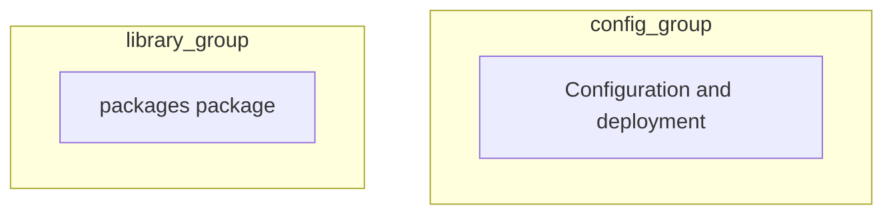

# Architecture report: iamvishnusankar/next-sitemap

> Automated static analysis. **Observed** = directly seen in files/imports/AST; **Inferred** = interpretation from that evidence. Repository code was not executed.

## 1. Repository at a glance

| Item | Value |
| --- | --- |
| Repository | iamvishnusankar/next-sitemap |
| Description | Sitemap generator for next.js. Generate sitemap(s) and robots.txt for all static/pre-rendered/dynamic/server-side pages. |
| Language | TypeScript |
| Stars | 3751 |
| Licence | MIT |
| Analysed commit / branch | 144fad921e8ee30f03c73ed72208bfa7355eb75d / master |
| Framework(s) | Next.js, React |
| Files analysed | 235 |
| Components | 2 |

## 2. Architecture in one minute

iamvishnusankar/next-sitemap - Sitemap generator for next.js. Generate sitemap(s) and robots.txt for all static/pre-rendered/dynamic/server-side pages.. This repository was analysed statically from 235 file(s) (0 Python). Detected technologies (observed from imports/manifests): GitHub Actions, Next.js, React, Tailwind CSS, TypeScript. Files are grouped into 2 component(s): Configuration and deployment, packages package. Findings below distinguish observed facts from inferred interpretation.

## 3. High-level block diagram

## 4. Main components

### Configuration and deployment (`config`)

- **Kind:** config
- **Status:** Observed
- **Confidence:** 0.85
- **Responsibility:** Groups 6 file(s) under configuration and deployment (observed from repository paths and static analysis).
- **Paths:** `azure-pipeline.yml`, `package.json`, `packages/next-sitemap/package.json`, `packages/next-sitemap/tsconfig.json`, `tsconfig.json`, `turbo.json`
- **Evidence:** [azure-pipeline.yml](https://github.com/iamvishnusankar/next-sitemap/blob/144fad921e8ee30f03c73ed72208bfa7355eb75d/azure-pipeline.yml); [package.json](https://github.com/iamvishnusankar/next-sitemap/blob/144fad921e8ee30f03c73ed72208bfa7355eb75d/package.json); [packages/next-sitemap/package.json](https://github.com/iamvishnusankar/next-sitemap/blob/144fad921e8ee30f03c73ed72208bfa7355eb75d/packages/next-sitemap/package.json); [packages/next-sitemap/tsconfig.json](https://github.com/iamvishnusankar/next-sitemap/blob/144fad921e8ee30f03c73ed72208bfa7355eb75d/packages/next-sitemap/tsconfig.json); [tsconfig.json](https://github.com/iamvishnusankar/next-sitemap/blob/144fad921e8ee30f03c73ed72208bfa7355eb75d/tsconfig.json); [turbo.json](https://github.com/iamvishnusankar/next-sitemap/blob/144fad921e8ee30f03c73ed72208bfa7355eb75d/turbo.json)

### packages package (`packages`)

- **Kind:** library
- **Status:** Observed
- **Confidence:** 0.85
- **Responsibility:** Groups 32 file(s) under packages package (observed from repository paths and static analysis).
- **Paths:** `packages/next-sitemap/bin/next-sitemap.cjs`, `packages/next-sitemap/bin/next-sitemap.mjs`, `packages/next-sitemap/src/__fixtures__/config.ts`, `packages/next-sitemap/src/__fixtures__/manifest.ts`, `packages/next-sitemap/src/builders/__tests__/robots-txt-builder/generate-robots-txt.test.ts`, `packages/next-sitemap/src/builders/__tests__/sitemap-builder/build-sitemap-xml.test.ts`, `packages/next-sitemap/src/builders/__tests__/url-set-builder/absolute-url.test.ts`, `packages/next-sitemap/src/builders/__tests__/url-set-builder/create-url-set.test.ts`, `packages/next-sitemap/src/builders/__tests__/url-set-builder/normalize-sitemap-field.test.ts`, `packages/next-sitemap/src/builders/exportable-builder.ts`, `packages/next-sitemap/src/builders/robots-txt-builder.ts`, `packages/next-sitemap/src/builders/sitemap-builder.ts`, `packages/next-sitemap/src/builders/url-set-builder.ts`, `packages/next-sitemap/src/cli.ts`, `packages/next-sitemap/src/index.ts`, `packages/next-sitemap/src/interface.ts`, `packages/next-sitemap/src/logger.ts`, `packages/next-sitemap/src/parsers/config-parser.ts`, `packages/next-sitemap/src/parsers/manifest-parser.ts`, `packages/next-sitemap/src/ssr/response.ts`, `packages/next-sitemap/src/ssr/sitemap-index.ts`, `packages/next-sitemap/src/ssr/sitemap.ts`, `packages/next-sitemap/src/utils/__tests__/array.test.ts`, `packages/next-sitemap/src/utils/__tests__/defaults.test.ts`, `packages/next-sitemap/src/utils/__tests__/url.test.ts`, `packages/next-sitemap/src/utils/array.ts`, `packages/next-sitemap/src/utils/defaults.ts`, `packages/next-sitemap/src/utils/file.ts`, `packages/next-sitemap/src/utils/matcher.ts`, `packages/next-sitemap/src/utils/merge.ts`, `packages/next-sitemap/src/utils/path.ts`, `packages/next-sitemap/src/utils/url.ts`
- **Evidence:** [packages/next-sitemap/bin/next-sitemap.cjs](https://github.com/iamvishnusankar/next-sitemap/blob/144fad921e8ee30f03c73ed72208bfa7355eb75d/packages/next-sitemap/bin/next-sitemap.cjs); [packages/next-sitemap/bin/next-sitemap.mjs](https://github.com/iamvishnusankar/next-sitemap/blob/144fad921e8ee30f03c73ed72208bfa7355eb75d/packages/next-sitemap/bin/next-sitemap.mjs); [packages/next-sitemap/src/__fixtures__/config.ts](https://github.com/iamvishnusankar/next-sitemap/blob/144fad921e8ee30f03c73ed72208bfa7355eb75d/packages/next-sitemap/src/__fixtures__/config.ts); [packages/next-sitemap/src/__fixtures__/manifest.ts](https://github.com/iamvishnusankar/next-sitemap/blob/144fad921e8ee30f03c73ed72208bfa7355eb75d/packages/next-sitemap/src/__fixtures__/manifest.ts); [packages/next-sitemap/src/builders/__tests__/robots-txt-builder/generate-robots-txt.test.ts](https://github.com/iamvishnusankar/next-sitemap/blob/144fad921e8ee30f03c73ed72208bfa7355eb75d/packages/next-sitemap/src/builders/__tests__/robots-txt-builder/generate-robots-txt.test.ts); [packages/next-sitemap/src/builders/__tests__/sitemap-builder/build-sitemap-xml.test.ts](https://github.com/iamvishnusankar/next-sitemap/blob/144fad921e8ee30f03c73ed72208bfa7355eb75d/packages/next-sitemap/src/builders/__tests__/sitemap-builder/build-sitemap-xml.test.ts); [packages/next-sitemap/src/builders/__tests__/url-set-builder/absolute-url.test.ts](https://github.com/iamvishnusankar/next-sitemap/blob/144fad921e8ee30f03c73ed72208bfa7355eb75d/packages/next-sitemap/src/builders/__tests__/url-set-builder/absolute-url.test.ts); [packages/next-sitemap/src/builders/__tests__/url-set-builder/create-url-set.test.ts](https://github.com/iamvishnusankar/next-sitemap/blob/144fad921e8ee30f03c73ed72208bfa7355eb75d/packages/next-sitemap/src/builders/__tests__/url-set-builder/create-url-set.test.ts)

## 5. Execution flow

**Observed** entry point(s):

- [packages/next-sitemap/bin/next-sitemap.cjs](https://github.com/iamvishnusankar/next-sitemap/blob/144fad921e8ee30f03c73ed72208bfa7355eb75d/packages/next-sitemap/bin/next-sitemap.cjs)
- [packages/next-sitemap/bin/next-sitemap.mjs](https://github.com/iamvishnusankar/next-sitemap/blob/144fad921e8ee30f03c73ed72208bfa7355eb75d/packages/next-sitemap/bin/next-sitemap.mjs)
- [packages/next-sitemap/src/index.ts](https://github.com/iamvishnusankar/next-sitemap/blob/144fad921e8ee30f03c73ed72208bfa7355eb75d/packages/next-sitemap/src/index.ts)

Representative flow (derived from observed entry points and the import graph; steps beyond the entry point are **Inferred**):

1. Execution starts at an observed entry point listed above, if present.
2. No internal import relationships between components were observed.

## 6. Project structure

### `(root)`

- `.eslintignore` - other (40 bytes)
- `.eslintrc` - other (84 bytes)
- `.gitattributes` - other (91 bytes)
- `.gitignore` - other (1031 bytes)
- `.prettierignore` - other (61 bytes)
- `.prettierrc` - other (43 bytes)
- `CODE_OF_CONDUCT.md` - docs (5226 bytes)
- `LICENSE` - docs (1070 bytes)
- `README.md` - docs (28326 bytes)
- `SECURITY.md` - docs (619 bytes)
- `azure-pipeline.yml` - config (2561 bytes)
- `changelog.md` - docs (685 bytes)
- `package.json` - manifest (1151 bytes)
- `tsconfig.json` - config (93 bytes)
- `turbo.json` - config (472 bytes)

### `.github`

- `.github/FUNDING.yml` - config (73 bytes)
- `.github/ISSUE_TEMPLATE/bug_report.md` - docs (549 bytes)
- `.github/ISSUE_TEMPLATE/feature_request.md` - docs (616 bytes)
- `.github/dependabot.yml` - config (285 bytes)
- `.github/workflows/codeql-analysis.yml` - ci, YAML (2386 bytes)
- `.github/workflows/stale.yml` - ci, YAML (758 bytes)
- `.github/workflows/test.yml` - ci, YAML (1479 bytes)

### `.vscode`

- `.vscode/settings.json` - config (38 bytes)

### `assets`

- `assets/NextJS/icon/dark/nextjs-icon-dark.svg` - other (2010 bytes)
- `assets/NextJS/icon/light/nextjs-icon-light.svg` - other (2010 bytes)
- `assets/NextJS/logotype/dark/nextjs-logotype-dark.svg` - other (1796 bytes)
- `assets/NextJS/logotype/light/nextjs-logotype-light.svg` - other (1796 bytes)
- `assets/Vercel/icon/dark/vercel-icon-dark.svg` - other (173 bytes)
- `assets/Vercel/icon/light/vercel-icon-light.svg` - other (173 bytes)
- `assets/Vercel/logotype/dark/vercel-logotype-dark.svg` - other (1773 bytes)
- `assets/Vercel/logotype/light/vercel-logotype-light.svg` - other (1773 bytes)
- `assets/banner.svg` - other (113436 bytes)

### `docs`

- `docs/.eslintrc` - docs (50 bytes)
- `docs/.gitignore` - docs (397 bytes)
- `docs/app/api/og/route.tsx` - docs (3894 bytes)
- `docs/app/components/CodeCopyButton.tsx` - docs (1359 bytes)
- `docs/app/components/Footer.tsx` - docs (1516 bytes)
- `docs/app/components/GithubStars.tsx` - docs (2295 bytes)
- `docs/app/components/Hero.tsx` - docs (1532 bytes)
- `docs/app/components/Icons.tsx` - docs (219 bytes)
- `docs/app/components/Navbar.tsx` - docs (1228 bytes)
- `docs/app/components/Navbar/MobileMenu.tsx` - docs (968 bytes)
- `docs/app/components/Navbar/Navbar.tsx` - docs (1953 bytes)
- `docs/app/components/Navbar/NavbarItem.tsx` - docs (380 bytes)
- `docs/app/components/Providers.tsx` - docs (365 bytes)
- `docs/app/components/ThemeToggle.tsx` - docs (1493 bytes)
- `docs/app/components/blocks/Button.tsx` - docs (2193 bytes)
- `docs/app/components/blocks/DropdownMenu.tsx` - docs (7170 bytes)
- `docs/app/components/blocks/SocialIcons.tsx` - docs (1586 bytes)
- `docs/app/components/callout.tsx` - docs (674 bytes)
- `docs/app/components/cards/card.tsx` - docs (640 bytes)
- `docs/app/components/cards/cardItem.tsx` - docs (574 bytes)
- `docs/app/components/cards/data.tsx` - docs (1179 bytes)
- `docs/app/components/docsMenu/But.tsx` - docs (1145 bytes)
- `docs/app/components/docsMenu/MenuButton.tsx` - docs (654 bytes)
- `docs/app/components/mdx-card.tsx` - docs (910 bytes)
- `docs/app/components/mdx-components.tsx` - docs (5142 bytes)
- `docs/app/components/page-header.tsx` - docs (692 bytes)
- `docs/app/components/pager.tsx` - docs (1636 bytes)
- `docs/app/components/sidebar-nav.tsx` - docs (1979 bytes)
- `docs/app/components/toc.tsx` - docs (2674 bytes)
- `docs/app/components/ui/Toaster.tsx` - docs (802 bytes)
- `docs/app/components/ui/toast.tsx` - docs (4862 bytes)
- `docs/app/components/ui/use-toast.ts` - docs (3928 bytes)
- `docs/app/docs/[[...slug]]/layout.tsx` - docs (905 bytes)
- `docs/app/docs/[[...slug]]/page.tsx` - docs (2697 bytes)
- `docs/app/examples/page.tsx` - docs (1873 bytes)
- `docs/app/layout.tsx` - docs (1123 bytes)
- `docs/app/page.tsx` - docs (4846 bytes)
- `docs/config/docs.ts` - docs (1877 bytes)
- `docs/config/site.ts` - docs (825 bytes)
- `docs/content/docs/documentation/additional-path.mdx` - docs (1506 bytes)
- `docs/content/docs/documentation/code-blocks.mdx` - docs (1481 bytes)
- `docs/content/docs/documentation/configuration.mdx` - docs (12811 bytes)
- `docs/content/docs/documentation/custom-transformation.mdx` - docs (1597 bytes)
- `docs/content/docs/documentation/dynamic-sitemaps.mdx` - docs (886 bytes)
- `docs/content/docs/documentation/full-example.mdx` - docs (2102 bytes)
- `docs/content/docs/documentation/getServerSideSitemap.mdx` - docs (2386 bytes)
- `docs/content/docs/documentation/getServerSideSitemapIndex.mdx` - docs (2093 bytes)
- `docs/content/docs/documentation/google-sitemap.mdx` - docs (1448 bytes)
- `docs/content/docs/documentation/index-sitemap.mdx` - docs (945 bytes)
- `docs/content/docs/documentation/installation.mdx` - docs (1351 bytes)
- `docs/content/docs/documentation/typescriptjsdoc.mdx` - docs (346 bytes)
- `docs/content/docs/index.mdx` - docs (790 bytes)
- `docs/contentlayer.config.js` - docs (1892 bytes)
- `docs/env.mjs` - docs (482 bytes)
- `docs/hooks/use-mounted.ts` - docs (194 bytes)
- `docs/lib/toc.ts` - docs (1545 bytes)
- `docs/lib/utils.ts` - docs (489 bytes)
- `docs/lib/validations/og.ts` - docs (163 bytes)
- `docs/next-sitemap.config.js` - docs (158 bytes)
- `docs/next.config.js` - docs (246 bytes)
- `docs/package.json` - manifest (1305 bytes)
- `docs/postcss.config.js` - docs (82 bytes)
- `docs/public/next.svg` - docs (1375 bytes)
- `docs/public/vercel.svg` - docs (629 bytes)
- `docs/styles/globals.css` - docs (2559 bytes)
- `docs/styles/mdx.css` - docs (905 bytes)
- `docs/tailwind.config.js` - docs (1077 bytes)
- `docs/tsconfig.json` - config (721 bytes)
- `docs/types/index.d.ts` - docs (770 bytes)

### `examples`

- `examples/amp/README.md` - docs (1631 bytes)
- `examples/amp/next-env.d.ts` - source, TypeScript (201 bytes)
- `examples/amp/next-sitemap.config.js` - source, JavaScript (406 bytes)
- `examples/amp/package.json` - manifest (468 bytes)
- `examples/amp/pages/about.tsx` - source, TypeScript (252 bytes)
- `examples/amp/pages/index.tsx` - source, TypeScript (249 bytes)
- `examples/amp/tsconfig.json` - config (528 bytes)
- `examples/app-dir/.vscode/settings.json` - config (108 bytes)
- `examples/app-dir/app/(sitemaps)/server-sitemap-index.xml/route.ts` - source, TypeScript (372 bytes)
- `examples/app-dir/app/(sitemaps)/server-sitemap.xml/route.ts` - source, TypeScript (553 bytes)
- `examples/app-dir/app/[dynamic]/page.tsx` - source, TypeScript (435 bytes)
- `examples/app-dir/app/layout.tsx` - source, TypeScript (204 bytes)
- `examples/app-dir/app/page.tsx` - source, TypeScript (159 bytes)
- `examples/app-dir/next-env.d.ts` - source, TypeScript (201 bytes)
- `examples/app-dir/next-sitemap.config.js` - source, JavaScript (427 bytes)
- `examples/app-dir/next.config.js` - source, JavaScript (81 bytes)
- `examples/app-dir/package.json` - manifest (522 bytes)
- `examples/app-dir/tsconfig.json` - config (596 bytes)
- `examples/basic/.gitignore` - other (6 bytes)
- `examples/basic/README.md` - docs (1631 bytes)
- `examples/basic/next-env.d.ts` - source, TypeScript (201 bytes)
- `examples/basic/next-sitemap.config.js` - source, JavaScript (427 bytes)
- `examples/basic/package.json` - manifest (452 bytes)
- `examples/basic/pages/[dynamic]/index.tsx` - source, TypeScript (561 bytes)
- `examples/basic/pages/index.tsx` - source, TypeScript (165 bytes)
- `examples/basic/pages/server-sitemap-index.xml/index.tsx` - source, TypeScript (617 bytes)
- `examples/basic/pages/server-sitemap.xml/index.tsx` - source, TypeScript (793 bytes)
- `examples/basic/tsconfig.json` - config (510 bytes)
- `examples/commonjs/.gitignore` - other (6 bytes)
- `examples/commonjs/README.md` - docs (1631 bytes)
- `examples/commonjs/next-env.d.ts` - source, TypeScript (201 bytes)
- `examples/commonjs/next-sitemap.config.js` - source, JavaScript (406 bytes)
- `examples/commonjs/package.json` - manifest (435 bytes)
- `examples/commonjs/pages/[dynamic]/index.tsx` - source, TypeScript (561 bytes)
- `examples/commonjs/pages/index.tsx` - source, TypeScript (165 bytes)
- `examples/commonjs/pages/server-sitemap-index.xml/index.tsx` - source, TypeScript (617 bytes)
- `examples/commonjs/pages/server-sitemap.xml/index.tsx` - source, TypeScript (793 bytes)
- `examples/commonjs/tsconfig.json` - config (510 bytes)
- `examples/custom-config-file/.gitignore` - other (6 bytes)
- `examples/custom-config-file/README.md` - docs (1631 bytes)
- `examples/custom-config-file/awesome-sitemap.config.js` - source, JavaScript (458 bytes)
- `examples/custom-config-file/next-env.d.ts` - source, TypeScript (201 bytes)
- `examples/custom-config-file/package.json` - manifest (500 bytes)
- `examples/custom-config-file/pages/[dynamic]/index.tsx` - source, TypeScript (561 bytes)
- `examples/custom-config-file/pages/index.tsx` - source, TypeScript (165 bytes)
- `examples/custom-config-file/pages/server-sitemap-index.xml/index.tsx` - source, TypeScript (617 bytes)
- `examples/custom-config-file/pages/server-sitemap.xml/index.tsx` - source, TypeScript (793 bytes)
- `examples/custom-config-file/tsconfig.json` - config (510 bytes)
- `examples/custom-overrides/.gitignore` - other (6 bytes)
- `examples/custom-overrides/next-env.d.ts` - source, TypeScript (201 bytes)
- `examples/custom-overrides/next-sitemap.config.js` - source, JavaScript (509 bytes)
- `examples/custom-overrides/next.config.js` - source, JavaScript (90 bytes)
- `examples/custom-overrides/package.json` - manifest (468 bytes)
- `examples/custom-overrides/pages/index.tsx` - source, TypeScript (159 bytes)
- `examples/custom-overrides/tsconfig.json` - config (510 bytes)
- `examples/custom-robots-txt-transformer/.gitignore` - other (6 bytes)
- `examples/custom-robots-txt-transformer/README.md` - docs (1631 bytes)
- `examples/custom-robots-txt-transformer/art.js` - source, JavaScript (4004 bytes)
- `examples/custom-robots-txt-transformer/next-env.d.ts` - source, TypeScript (201 bytes)
- `examples/custom-robots-txt-transformer/next-sitemap.config.js` - source, JavaScript (368 bytes)
- `examples/custom-robots-txt-transformer/package.json` - manifest (481 bytes)
- `examples/custom-robots-txt-transformer/pages/[dynamic]/index.tsx` - source, TypeScript (561 bytes)
- `examples/custom-robots-txt-transformer/pages/index.tsx` - source, TypeScript (165 bytes)
- `examples/custom-robots-txt-transformer/tsconfig.json` - config (510 bytes)
- `examples/no-index-sitemaps/.gitignore` - other (6 bytes)
- `examples/no-index-sitemaps/README.md` - docs (1631 bytes)
- `examples/no-index-sitemaps/next-env.d.ts` - source, TypeScript (201 bytes)
- `examples/no-index-sitemaps/next-sitemap.config.js` - source, JavaScript (225 bytes)
- `examples/no-index-sitemaps/package.json` - manifest (469 bytes)
- `examples/no-index-sitemaps/pages/[dynamic]/index.tsx` - source, TypeScript (561 bytes)
- `examples/no-index-sitemaps/pages/index.tsx` - source, TypeScript (165 bytes)
- `examples/no-index-sitemaps/tsconfig.json` - config (510 bytes)
- `examples/static-export/.gitignore` - other (368 bytes)
- `examples/static-export/README.md` - docs (1370 bytes)
- `examples/static-export/app/about/more/page.tsx` - source, TypeScript (134 bytes)
- `examples/static-export/app/about/page.tsx` - source, TypeScript (129 bytes)
- `examples/static-export/app/layout.tsx` - source, TypeScript (167 bytes)
- `examples/static-export/app/page.tsx` - source, TypeScript (137 bytes)
- `examples/static-export/next-sitemap.config.js` - source, JavaScript (277 bytes)
- `examples/static-export/next.config.js` - source, JavaScript (113 bytes)
- `examples/static-export/package.json` - manifest (369 bytes)
- `examples/static-export/public/next.svg` - other (1375 bytes)
- `examples/static-export/public/vercel.svg` - other (629 bytes)
- `examples/static-export/tsconfig.json` - config (638 bytes)
- `examples/with-next-sitemap-i18n/README.md` - docs (1631 bytes)
- `examples/with-next-sitemap-i18n/next-env.d.ts` - source, TypeScript (201 bytes)
- `examples/with-next-sitemap-i18n/next-sitemap.config.js` - source, JavaScript (576 bytes)
- `examples/with-next-sitemap-i18n/next.config.js` - source, JavaScript (133 bytes)
- `examples/with-next-sitemap-i18n/package.json` - manifest (469 bytes)
- `examples/with-next-sitemap-i18n/pages/[dynamic]/index.tsx` - source, TypeScript (821 bytes)
- `examples/with-next-sitemap-i18n/pages/about.tsx` - source, TypeScript (383 bytes)
- `examples/with-next-sitemap-i18n/pages/index.tsx` - source, TypeScript (395 bytes)
- `examples/with-next-sitemap-i18n/pages/server-sitemap-index.xml/index.tsx` - source, TypeScript (617 bytes)
- `examples/with-next-sitemap-i18n/pages/server-sitemap.xml/index.tsx` - source, TypeScript (793 bytes)
- `examples/with-next-sitemap-i18n/tsconfig.json` - config (528 bytes)

### `packages`

- `packages/next-sitemap/.npmignore` - other (18 bytes)
- `packages/next-sitemap/README.md` - docs (65 bytes)
- `packages/next-sitemap/bin/next-sitemap.cjs` - source, JavaScript (307 bytes)
- `packages/next-sitemap/bin/next-sitemap.mjs` - source, JavaScript (241 bytes)
- `packages/next-sitemap/package.json` - manifest (1452 bytes)
- `packages/next-sitemap/src/__fixtures__/config.ts` - source, TypeScript (835 bytes)
- `packages/next-sitemap/src/__fixtures__/manifest.ts` - source, TypeScript (2488 bytes)
- `packages/next-sitemap/src/builders/__tests__/robots-txt-builder/__snapshots__/generate-robots-txt.test.ts.snap` - other (507 bytes)
- `packages/next-sitemap/src/builders/__tests__/robots-txt-builder/generate-robots-txt.test.ts` - source, TypeScript (393 bytes)
- `packages/next-sitemap/src/builders/__tests__/sitemap-builder/__snapshots__/build-sitemap-xml.test.ts.snap` - other (4809 bytes)
- `packages/next-sitemap/src/builders/__tests__/sitemap-builder/build-sitemap-xml.test.ts` - source, TypeScript (4641 bytes)
- `packages/next-sitemap/src/builders/__tests__/url-set-builder/__snapshots__/absolute-url.test.ts.snap` - other (159 bytes)
- `packages/next-sitemap/src/builders/__tests__/url-set-builder/absolute-url.test.ts` - source, TypeScript (1116 bytes)
- `packages/next-sitemap/src/builders/__tests__/url-set-builder/create-url-set.test.ts` - source, TypeScript (20604 bytes)
- `packages/next-sitemap/src/builders/__tests__/url-set-builder/normalize-sitemap-field.test.ts` - source, TypeScript (1761 bytes)
- `packages/next-sitemap/src/builders/exportable-builder.ts` - source, TypeScript (6062 bytes)
- `packages/next-sitemap/src/builders/robots-txt-builder.ts` - source, TypeScript (1712 bytes)
- `packages/next-sitemap/src/builders/sitemap-builder.ts` - source, TypeScript (9337 bytes)
- `packages/next-sitemap/src/builders/url-set-builder.ts` - source, TypeScript (4704 bytes)
- `packages/next-sitemap/src/cli.ts` - source, TypeScript (1782 bytes)
- `packages/next-sitemap/src/index.ts` - source, TypeScript (258 bytes)
- `packages/next-sitemap/src/interface.ts` - source, TypeScript (6361 bytes)
- `packages/next-sitemap/src/logger.ts` - source, TypeScript (2392 bytes)
- `packages/next-sitemap/src/parsers/config-parser.ts` - source, TypeScript (2835 bytes)
- `packages/next-sitemap/src/parsers/manifest-parser.ts` - source, TypeScript (2085 bytes)
- `packages/next-sitemap/src/ssr/response.ts` - source, TypeScript (851 bytes)
- `packages/next-sitemap/src/ssr/sitemap-index.ts` - source, TypeScript (1157 bytes)
- `packages/next-sitemap/src/ssr/sitemap.ts` - source, TypeScript (1125 bytes)
- `packages/next-sitemap/src/utils/__tests__/array.test.ts` - source, TypeScript (948 bytes)
- `packages/next-sitemap/src/utils/__tests__/defaults.test.ts` - source, TypeScript (5442 bytes)
- `packages/next-sitemap/src/utils/__tests__/url.test.ts` - source, TypeScript (2876 bytes)
- `packages/next-sitemap/src/utils/array.ts` - source, TypeScript (1169 bytes)
- `packages/next-sitemap/src/utils/defaults.ts` - source, TypeScript (1681 bytes)
- `packages/next-sitemap/src/utils/file.ts` - source, TypeScript (1075 bytes)
- `packages/next-sitemap/src/utils/matcher.ts` - source, TypeScript (3629 bytes)
- `packages/next-sitemap/src/utils/merge.ts` - source, TypeScript (327 bytes)
- `packages/next-sitemap/src/utils/path.ts` - source, TypeScript (2093 bytes)
- `packages/next-sitemap/src/utils/url.ts` - source, TypeScript (1922 bytes)
- `packages/next-sitemap/tsconfig.json` - config (215 bytes)

## 7. Key dependencies and integrations

| Name | Category | Status | Confidence | Evidence |
| --- | --- | --- | --- | --- |
| GitHub Actions | ci | Observed | 0.90 | [.github/workflows/codeql-analysis.yml](https://github.com/iamvishnusankar/next-sitemap/blob/144fad921e8ee30f03c73ed72208bfa7355eb75d/.github/workflows/codeql-analysis.yml); [.github/workflows/stale.yml](https://github.com/iamvishnusankar/next-sitemap/blob/144fad921e8ee30f03c73ed72208bfa7355eb75d/.github/workflows/stale.yml); [.github/workflows/test.yml](https://github.com/iamvishnusankar/next-sitemap/blob/144fad921e8ee30f03c73ed72208bfa7355eb75d/.github/workflows/test.yml) |
| Next.js | framework | Observed | 0.90 | [docs/package.json:6](https://github.com/iamvishnusankar/next-sitemap/blob/144fad921e8ee30f03c73ed72208bfa7355eb75d/docs/package.json#L6); [examples/amp/package.json:2](https://github.com/iamvishnusankar/next-sitemap/blob/144fad921e8ee30f03c73ed72208bfa7355eb75d/examples/amp/package.json#L2); [examples/app-dir/package.json:2](https://github.com/iamvishnusankar/next-sitemap/blob/144fad921e8ee30f03c73ed72208bfa7355eb75d/examples/app-dir/package.json#L2); [examples/basic/package.json:9](https://github.com/iamvishnusankar/next-sitemap/blob/144fad921e8ee30f03c73ed72208bfa7355eb75d/examples/basic/package.json#L9) |
| React | framework | Observed | 0.90 | [docs/package.json:13](https://github.com/iamvishnusankar/next-sitemap/blob/144fad921e8ee30f03c73ed72208bfa7355eb75d/docs/package.json#L13); [docs/package.json:18](https://github.com/iamvishnusankar/next-sitemap/blob/144fad921e8ee30f03c73ed72208bfa7355eb75d/docs/package.json#L18); [examples/amp/package.json:14](https://github.com/iamvishnusankar/next-sitemap/blob/144fad921e8ee30f03c73ed72208bfa7355eb75d/examples/amp/package.json#L14); [examples/app-dir/package.json:14](https://github.com/iamvishnusankar/next-sitemap/blob/144fad921e8ee30f03c73ed72208bfa7355eb75d/examples/app-dir/package.json#L14) |
| Tailwind CSS | library | Observed | 0.85 | [docs/package.json:41](https://github.com/iamvishnusankar/next-sitemap/blob/144fad921e8ee30f03c73ed72208bfa7355eb75d/docs/package.json#L41) |
| TypeScript | tooling | Observed | 0.90 | [docs/package.json:42](https://github.com/iamvishnusankar/next-sitemap/blob/144fad921e8ee30f03c73ed72208bfa7355eb75d/docs/package.json#L42); [packages/next-sitemap/package.json:65](https://github.com/iamvishnusankar/next-sitemap/blob/144fad921e8ee30f03c73ed72208bfa7355eb75d/packages/next-sitemap/package.json#L65) |

## 8. Data and state

No database, cache, queue, or persistent-state usage was observed in the analysed files. State handling, if any, may be in-memory or in files that were not analysed.

## 9. Configuration and deployment clues

- `.github/FUNDING.yml` (config)
- `.github/dependabot.yml` (config)
- `.github/workflows/codeql-analysis.yml` (ci)
- `.github/workflows/stale.yml` (ci)
- `.github/workflows/test.yml` (ci)
- `.vscode/settings.json` (config)
- `azure-pipeline.yml` (config)
- `docs/package.json` (manifest)
- `docs/tsconfig.json` (config)
- `examples/amp/package.json` (manifest)
- `examples/amp/tsconfig.json` (config)
- `examples/app-dir/.vscode/settings.json` (config)
- `examples/app-dir/package.json` (manifest)
- `examples/app-dir/tsconfig.json` (config)
- `examples/basic/package.json` (manifest)
- `examples/basic/tsconfig.json` (config)
- `examples/commonjs/package.json` (manifest)
- `examples/commonjs/tsconfig.json` (config)
- `examples/custom-config-file/package.json` (manifest)
- `examples/custom-config-file/tsconfig.json` (config)
- `examples/custom-overrides/package.json` (manifest)
- `examples/custom-overrides/tsconfig.json` (config)
- `examples/custom-robots-txt-transformer/package.json` (manifest)
- `examples/custom-robots-txt-transformer/tsconfig.json` (config)
- `examples/no-index-sitemaps/package.json` (manifest)
- `examples/no-index-sitemaps/tsconfig.json` (config)
- `examples/static-export/package.json` (manifest)
- `examples/static-export/tsconfig.json` (config)
- `examples/with-next-sitemap-i18n/package.json` (manifest)
- `examples/with-next-sitemap-i18n/tsconfig.json` (config)
- `package.json` (manifest)
- `packages/next-sitemap/package.json` (manifest)
- `packages/next-sitemap/tsconfig.json` (config)
- `tsconfig.json` (config)
- `turbo.json` (config)

## 10. Design observations

- No strong design patterns could be established from the available evidence.

These observations are interpretations (**Inferred**) of the observed structure, not guarantees about runtime design.

## 11. Limitations and unknowns

- Static analysis only: repository code was not executed, installed, or imported at runtime.
- Components and relationships are inferred from file paths, imports, and AST structure; runtime behaviour, dynamic imports, and reflection may not be visible.
- 1 file(s) were skipped during inventory (1 x likely secret file excluded).
- No clear application entry point was observed in the analysed files.
- Repository text was treated as untrusted data; no instructions found in repository files were followed, and likely secret values were redacted/excluded.
- JavaScript and TypeScript files were inventoried from paths and package manifests. They were not parsed with a full language AST, and repository code was not executed.

## 12. Source references

- [.github/workflows/codeql-analysis.yml](https://github.com/iamvishnusankar/next-sitemap/blob/144fad921e8ee30f03c73ed72208bfa7355eb75d/.github/workflows/codeql-analysis.yml)
- [.github/workflows/stale.yml](https://github.com/iamvishnusankar/next-sitemap/blob/144fad921e8ee30f03c73ed72208bfa7355eb75d/.github/workflows/stale.yml)
- [.github/workflows/test.yml](https://github.com/iamvishnusankar/next-sitemap/blob/144fad921e8ee30f03c73ed72208bfa7355eb75d/.github/workflows/test.yml)
- [azure-pipeline.yml](https://github.com/iamvishnusankar/next-sitemap/blob/144fad921e8ee30f03c73ed72208bfa7355eb75d/azure-pipeline.yml)
- [docs/package.json:6](https://github.com/iamvishnusankar/next-sitemap/blob/144fad921e8ee30f03c73ed72208bfa7355eb75d/docs/package.json#L6)
- [docs/package.json:13](https://github.com/iamvishnusankar/next-sitemap/blob/144fad921e8ee30f03c73ed72208bfa7355eb75d/docs/package.json#L13)
- [docs/package.json:18](https://github.com/iamvishnusankar/next-sitemap/blob/144fad921e8ee30f03c73ed72208bfa7355eb75d/docs/package.json#L18)
- [docs/package.json:41](https://github.com/iamvishnusankar/next-sitemap/blob/144fad921e8ee30f03c73ed72208bfa7355eb75d/docs/package.json#L41)
- [docs/package.json:42](https://github.com/iamvishnusankar/next-sitemap/blob/144fad921e8ee30f03c73ed72208bfa7355eb75d/docs/package.json#L42)
- [examples/amp/package.json:2](https://github.com/iamvishnusankar/next-sitemap/blob/144fad921e8ee30f03c73ed72208bfa7355eb75d/examples/amp/package.json#L2)
- [examples/amp/package.json:14](https://github.com/iamvishnusankar/next-sitemap/blob/144fad921e8ee30f03c73ed72208bfa7355eb75d/examples/amp/package.json#L14)
- [examples/app-dir/package.json:2](https://github.com/iamvishnusankar/next-sitemap/blob/144fad921e8ee30f03c73ed72208bfa7355eb75d/examples/app-dir/package.json#L2)
- [examples/app-dir/package.json:14](https://github.com/iamvishnusankar/next-sitemap/blob/144fad921e8ee30f03c73ed72208bfa7355eb75d/examples/app-dir/package.json#L14)
- [examples/basic/package.json:9](https://github.com/iamvishnusankar/next-sitemap/blob/144fad921e8ee30f03c73ed72208bfa7355eb75d/examples/basic/package.json#L9)
- [examples/basic/package.json:14](https://github.com/iamvishnusankar/next-sitemap/blob/144fad921e8ee30f03c73ed72208bfa7355eb75d/examples/basic/package.json#L14)
- [examples/commonjs/package.json:8](https://github.com/iamvishnusankar/next-sitemap/blob/144fad921e8ee30f03c73ed72208bfa7355eb75d/examples/commonjs/package.json#L8)
- [examples/commonjs/package.json:13](https://github.com/iamvishnusankar/next-sitemap/blob/144fad921e8ee30f03c73ed72208bfa7355eb75d/examples/commonjs/package.json#L13)
- [examples/custom-config-file/package.json:9](https://github.com/iamvishnusankar/next-sitemap/blob/144fad921e8ee30f03c73ed72208bfa7355eb75d/examples/custom-config-file/package.json#L9)
- [examples/custom-config-file/package.json:14](https://github.com/iamvishnusankar/next-sitemap/blob/144fad921e8ee30f03c73ed72208bfa7355eb75d/examples/custom-config-file/package.json#L14)
- [examples/custom-overrides/package.json:9](https://github.com/iamvishnusankar/next-sitemap/blob/144fad921e8ee30f03c73ed72208bfa7355eb75d/examples/custom-overrides/package.json#L9)
- [examples/custom-overrides/package.json:14](https://github.com/iamvishnusankar/next-sitemap/blob/144fad921e8ee30f03c73ed72208bfa7355eb75d/examples/custom-overrides/package.json#L14)
- [examples/custom-robots-txt-transformer/package.json:9](https://github.com/iamvishnusankar/next-sitemap/blob/144fad921e8ee30f03c73ed72208bfa7355eb75d/examples/custom-robots-txt-transformer/package.json#L9)
- [package.json](https://github.com/iamvishnusankar/next-sitemap/blob/144fad921e8ee30f03c73ed72208bfa7355eb75d/package.json)
- [packages/next-sitemap/bin/next-sitemap.cjs](https://github.com/iamvishnusankar/next-sitemap/blob/144fad921e8ee30f03c73ed72208bfa7355eb75d/packages/next-sitemap/bin/next-sitemap.cjs)
- [packages/next-sitemap/bin/next-sitemap.mjs](https://github.com/iamvishnusankar/next-sitemap/blob/144fad921e8ee30f03c73ed72208bfa7355eb75d/packages/next-sitemap/bin/next-sitemap.mjs)
- [packages/next-sitemap/package.json](https://github.com/iamvishnusankar/next-sitemap/blob/144fad921e8ee30f03c73ed72208bfa7355eb75d/packages/next-sitemap/package.json)
- [packages/next-sitemap/package.json:65](https://github.com/iamvishnusankar/next-sitemap/blob/144fad921e8ee30f03c73ed72208bfa7355eb75d/packages/next-sitemap/package.json#L65)
- [packages/next-sitemap/src/__fixtures__/config.ts](https://github.com/iamvishnusankar/next-sitemap/blob/144fad921e8ee30f03c73ed72208bfa7355eb75d/packages/next-sitemap/src/__fixtures__/config.ts)
- [packages/next-sitemap/src/__fixtures__/manifest.ts](https://github.com/iamvishnusankar/next-sitemap/blob/144fad921e8ee30f03c73ed72208bfa7355eb75d/packages/next-sitemap/src/__fixtures__/manifest.ts)
- [packages/next-sitemap/src/builders/__tests__/robots-txt-builder/generate-robots-txt.test.ts](https://github.com/iamvishnusankar/next-sitemap/blob/144fad921e8ee30f03c73ed72208bfa7355eb75d/packages/next-sitemap/src/builders/__tests__/robots-txt-builder/generate-robots-txt.test.ts)
- [packages/next-sitemap/src/builders/__tests__/sitemap-builder/build-sitemap-xml.test.ts](https://github.com/iamvishnusankar/next-sitemap/blob/144fad921e8ee30f03c73ed72208bfa7355eb75d/packages/next-sitemap/src/builders/__tests__/sitemap-builder/build-sitemap-xml.test.ts)
- [packages/next-sitemap/src/builders/__tests__/url-set-builder/absolute-url.test.ts](https://github.com/iamvishnusankar/next-sitemap/blob/144fad921e8ee30f03c73ed72208bfa7355eb75d/packages/next-sitemap/src/builders/__tests__/url-set-builder/absolute-url.test.ts)
- [packages/next-sitemap/src/builders/__tests__/url-set-builder/create-url-set.test.ts](https://github.com/iamvishnusankar/next-sitemap/blob/144fad921e8ee30f03c73ed72208bfa7355eb75d/packages/next-sitemap/src/builders/__tests__/url-set-builder/create-url-set.test.ts)
- [packages/next-sitemap/src/index.ts](https://github.com/iamvishnusankar/next-sitemap/blob/144fad921e8ee30f03c73ed72208bfa7355eb75d/packages/next-sitemap/src/index.ts)
- [packages/next-sitemap/tsconfig.json](https://github.com/iamvishnusankar/next-sitemap/blob/144fad921e8ee30f03c73ed72208bfa7355eb75d/packages/next-sitemap/tsconfig.json)
- [tsconfig.json](https://github.com/iamvishnusankar/next-sitemap/blob/144fad921e8ee30f03c73ed72208bfa7355eb75d/tsconfig.json)
- [turbo.json](https://github.com/iamvishnusankar/next-sitemap/blob/144fad921e8ee30f03c73ed72208bfa7355eb75d/turbo.json)
