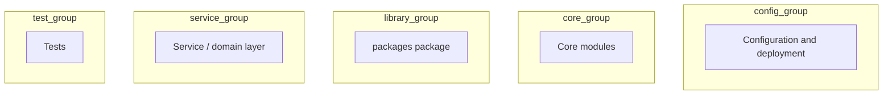

# Architecture report: ianstormtaylor/slate

> Automated static analysis. **Observed** = directly seen in files/imports/AST; **Inferred** = interpretation from that evidence. Repository code was not executed.

## 1. Repository at a glance

| Item | Value |
| --- | --- |
| Repository | ianstormtaylor/slate |
| Description | A completely customizable framework for building rich text editors. (Currently in beta.) |
| Language | TypeScript |
| Stars | 31745 |
| Licence | MIT |
| Analysed commit / branch | 0c2c0b02b7726a7a59ac344b5f7a68608cc2ec44 / main |
| Framework(s) | Next.js, React |
| Files analysed | 800 |
| Components | 5 |

## 2. Architecture in one minute

ianstormtaylor/slate - A completely customizable framework for building rich text editors. (Currently in beta.). This repository was analysed statically from 800 file(s) (0 Python). Detected technologies (observed from imports/manifests): GitHub Actions, Next.js, React, Jest, TypeScript. Files are grouped into 5 component(s): Configuration and deployment, Core modules, packages package, Service / domain layer, Tests. Findings below distinguish observed facts from inferred interpretation.

## 3. High-level block diagram

## 4. Main components

### Configuration and deployment (`config`)

- **Kind:** config
- **Status:** Observed
- **Confidence:** 0.85
- **Responsibility:** Groups 15 file(s) under configuration and deployment (observed from repository paths and static analysis).
- **Paths:** `config/babel/register.cjs`, `config/rollup/rollup.config.js`, `config/typescript/tsconfig.json`, `config/typescript/tsconfig.test.json`, `now.json`, `package.json`, `packages/slate-dom/package.json`, `packages/slate-dom/tsconfig.json`, `packages/slate-history/package.json`, `packages/slate-history/tsconfig.json`, `packages/slate-hyperscript/package.json`, `packages/slate-hyperscript/tsconfig.json`, `packages/slate-react/package.json`, `packages/slate-react/tsconfig.json`, `packages/slate/package.json`
- **Evidence:** [config/babel/register.cjs](https://github.com/ianstormtaylor/slate/blob/0c2c0b02b7726a7a59ac344b5f7a68608cc2ec44/config/babel/register.cjs); [config/rollup/rollup.config.js](https://github.com/ianstormtaylor/slate/blob/0c2c0b02b7726a7a59ac344b5f7a68608cc2ec44/config/rollup/rollup.config.js); [config/typescript/tsconfig.json](https://github.com/ianstormtaylor/slate/blob/0c2c0b02b7726a7a59ac344b5f7a68608cc2ec44/config/typescript/tsconfig.json); [config/typescript/tsconfig.test.json](https://github.com/ianstormtaylor/slate/blob/0c2c0b02b7726a7a59ac344b5f7a68608cc2ec44/config/typescript/tsconfig.test.json); [now.json](https://github.com/ianstormtaylor/slate/blob/0c2c0b02b7726a7a59ac344b5f7a68608cc2ec44/now.json); [package.json](https://github.com/ianstormtaylor/slate/blob/0c2c0b02b7726a7a59ac344b5f7a68608cc2ec44/package.json); [packages/slate-dom/package.json](https://github.com/ianstormtaylor/slate/blob/0c2c0b02b7726a7a59ac344b5f7a68608cc2ec44/packages/slate-dom/package.json); [packages/slate-dom/tsconfig.json](https://github.com/ianstormtaylor/slate/blob/0c2c0b02b7726a7a59ac344b5f7a68608cc2ec44/packages/slate-dom/tsconfig.json)

### Core modules (`core`)

- **Kind:** core
- **Status:** Observed
- **Confidence:** 0.85
- **Responsibility:** Groups 3 file(s) under core modules (observed from repository paths and static analysis).
- **Paths:** `babel.config.js`, `eslint.config.mjs`, `jest.config.js`
- **Evidence:** [babel.config.js](https://github.com/ianstormtaylor/slate/blob/0c2c0b02b7726a7a59ac344b5f7a68608cc2ec44/babel.config.js); [eslint.config.mjs](https://github.com/ianstormtaylor/slate/blob/0c2c0b02b7726a7a59ac344b5f7a68608cc2ec44/eslint.config.mjs); [jest.config.js](https://github.com/ianstormtaylor/slate/blob/0c2c0b02b7726a7a59ac344b5f7a68608cc2ec44/jest.config.js)

### packages package (`packages`)

- **Kind:** library
- **Status:** Observed
- **Confidence:** 0.85
- **Responsibility:** Groups 188 file(s) under packages package (observed from repository paths and static analysis).
- **Paths:** `packages/slate-dom/src/custom-types.ts`, `packages/slate-dom/src/index.ts`, `packages/slate-dom/src/plugin/dom-editor.ts`, `packages/slate-dom/src/plugin/with-dom.ts`, `packages/slate-dom/src/utils/constants.ts`, `packages/slate-dom/src/utils/diff-text.ts`, `packages/slate-dom/src/utils/dom.ts`, `packages/slate-dom/src/utils/environment.ts`, `packages/slate-dom/src/utils/hotkeys.ts`, `packages/slate-dom/src/utils/key.ts`, `packages/slate-dom/src/utils/lines.ts`, `packages/slate-dom/src/utils/node-identity.ts`, `packages/slate-dom/src/utils/range-list.ts`, `packages/slate-dom/src/utils/types.ts`, `packages/slate-dom/src/utils/weak-maps.ts`, `packages/slate-history/src/history-editor.ts`, `packages/slate-history/src/history.ts`, `packages/slate-history/src/index.ts`, `packages/slate-history/src/rebase.ts`, `packages/slate-history/src/with-history.ts`, `packages/slate-hyperscript/src/creators.ts`, `packages/slate-hyperscript/src/hyperscript.ts`, `packages/slate-hyperscript/src/index.ts`, `packages/slate-hyperscript/src/refs.ts`, `packages/slate-hyperscript/src/tokens.ts`, `packages/slate-react/src/@types/direction.d.ts`, `packages/slate-react/src/chunking/children-helper.ts`, `packages/slate-react/src/chunking/chunk-tree-helper.ts`, `packages/slate-react/src/chunking/get-chunk-tree-for-node.ts`, `packages/slate-react/src/chunking/index.ts`, `packages/slate-react/src/chunking/reconcile-children.ts`, `packages/slate-react/src/chunking/types.ts`, `packages/slate-react/src/components/chunk-tree.tsx`, `packages/slate-react/src/components/editable.tsx`, `packages/slate-react/src/components/element.tsx`, `packages/slate-react/src/components/leaf.tsx`, `packages/slate-react/src/components/restore-dom/restore-dom-manager.ts`, `packages/slate-react/src/components/restore-dom/restore-dom.tsx`, `packages/slate-react/src/components/slate.tsx`, `packages/slate-react/src/components/string.tsx`, `packages/slate-react/src/components/text.tsx`, `packages/slate-react/src/custom-types.ts`, `packages/slate-react/src/hooks/android-input-manager/android-input-manager.ts`, `packages/slate-react/src/hooks/android-input-manager/use-android-input-manager.ts`, `packages/slate-react/src/hooks/use-children.tsx`, `packages/slate-react/src/hooks/use-composing.ts`, `packages/slate-react/src/hooks/use-composition-dom.ts`, `packages/slate-react/src/hooks/use-decorations.ts`, `packages/slate-react/src/hooks/use-editor.tsx`, `packages/slate-react/src/hooks/use-element.ts`, `packages/slate-react/src/hooks/use-focused.ts`, `packages/slate-react/src/hooks/use-generic-selector.tsx`, `packages/slate-react/src/hooks/use-is-mounted.tsx`, `packages/slate-react/src/hooks/use-isomorphic-layout-effect.ts`, `packages/slate-react/src/hooks/use-mutation-observer.ts`, `packages/slate-react/src/hooks/use-native-format-dom.ts`, `packages/slate-react/src/hooks/use-read-only.ts`, `packages/slate-react/src/hooks/use-selected.ts`, `packages/slate-react/src/hooks/use-slate-selection.tsx`, `packages/slate-react/src/hooks/use-slate-selector.tsx`, `packages/slate-react/src/hooks/use-slate-static.tsx`, `packages/slate-react/src/hooks/use-slate.tsx`, `packages/slate-react/src/hooks/use-track-user-input.ts`, `packages/slate-react/src/index.ts`, `packages/slate-react/src/plugin/react-editor.ts`, `packages/slate-react/src/plugin/with-react.ts`, `packages/slate-react/src/utils/character-move.ts`, `packages/slate-react/src/utils/environment.ts`, `packages/slate-react/src/utils/misplaced-composition.ts`, `packages/slate-react/src/utils/move-range.ts`, `packages/slate-react/src/utils/text-parent.ts`, `packages/slate-react/src/utils/trailing-newline.ts`, `packages/slate/src/create-editor.ts`, `packages/slate/src/editor/above.ts`, `packages/slate/src/editor/add-mark.ts`, `packages/slate/src/editor/after.ts`, `packages/slate/src/editor/before.ts`, `packages/slate/src/editor/delete-backward.ts`, `packages/slate/src/editor/delete-forward.ts`, `packages/slate/src/editor/delete-fragment.ts`, `packages/slate/src/editor/edges.ts`, `packages/slate/src/editor/element-read-only.ts`, `packages/slate/src/editor/end.ts`, `packages/slate/src/editor/first.ts`, `packages/slate/src/editor/fragment.ts`, `packages/slate/src/editor/get-void.ts`, `packages/slate/src/editor/has-blocks.ts`, `packages/slate/src/editor/has-inlines.ts`, `packages/slate/src/editor/has-path.ts`, `packages/slate/src/editor/has-range.ts`, `packages/slate/src/editor/has-texts.ts`, `packages/slate/src/editor/index.ts`, `packages/slate/src/editor/insert-break.ts`, `packages/slate/src/editor/insert-node.ts`, `packages/slate/src/editor/insert-soft-break.ts`, `packages/slate/src/editor/insert-text.ts`, `packages/slate/src/editor/insertion-point.ts`, `packages/slate/src/editor/is-block.ts`, `packages/slate/src/editor/is-edge.ts`, `packages/slate/src/editor/is-editor.ts`, `packages/slate/src/editor/is-empty.ts`, `packages/slate/src/editor/is-end.ts`, `packages/slate/src/editor/is-normalizing.ts`, `packages/slate/src/editor/is-start.ts`, `packages/slate/src/editor/last.ts`, `packages/slate/src/editor/leaf.ts`, `packages/slate/src/editor/levels.ts`, `packages/slate/src/editor/marks.ts`, `packages/slate/src/editor/next.ts`, `packages/slate/src/editor/node.ts`, `packages/slate/src/editor/nodes.ts`, `packages/slate/src/editor/normalize.ts`, `packages/slate/src/editor/parent.ts`, `packages/slate/src/editor/path-ref.ts`, `packages/slate/src/editor/path-refs.ts`, `packages/slate/src/editor/path.ts`, `packages/slate/src/editor/point-ref.ts`, `packages/slate/src/editor/point-refs.ts`, `packages/slate/src/editor/point.ts`, `packages/slate/src/editor/positions.ts`, `packages/slate/src/editor/previous.ts`, `packages/slate/src/editor/range-ref.ts`, `packages/slate/src/editor/range-refs.ts`, `packages/slate/src/editor/range.ts`, `packages/slate/src/editor/remove-mark.ts`, `packages/slate/src/editor/set-normalizing.ts`, `packages/slate/src/editor/should-merge-nodes-remove-prev-node.ts`, `packages/slate/src/editor/start.ts`, `packages/slate/src/editor/string.ts`, `packages/slate/src/editor/unhang-range.ts`, `packages/slate/src/editor/without-normalizing.ts`, `packages/slate/src/editor/word.ts`, `packages/slate/src/index.ts`, `packages/slate/src/interfaces/editor.ts`, `packages/slate/src/interfaces/element.ts`, `packages/slate/src/interfaces/index.ts`, `packages/slate/src/interfaces/location.ts`, `packages/slate/src/interfaces/node.ts`, `packages/slate/src/interfaces/operation.ts`, `packages/slate/src/interfaces/path-ref.ts`, `packages/slate/src/interfaces/path.ts`, `packages/slate/src/interfaces/point-ref.ts`, `packages/slate/src/interfaces/point.ts`, `packages/slate/src/interfaces/range-ref.ts`, `packages/slate/src/interfaces/range.ts`, `packages/slate/src/interfaces/scrubber.ts`, `packages/slate/src/interfaces/text.ts`, `packages/slate/src/interfaces/transforms/general.ts`, `packages/slate/src/interfaces/transforms/index.ts`, `packages/slate/src/interfaces/transforms/node.ts`, `packages/slate/src/interfaces/transforms/selection.ts`, `packages/slate/src/interfaces/transforms/text.ts`, `packages/slate/src/transforms-node/index.ts`, `packages/slate/src/transforms-node/insert-nodes.ts`, `packages/slate/src/transforms-node/lift-nodes.ts`, `packages/slate/src/transforms-node/merge-nodes.ts`, `packages/slate/src/transforms-node/move-nodes.ts`, `packages/slate/src/transforms-node/remove-nodes.ts`, `packages/slate/src/transforms-node/set-children.ts`, `packages/slate/src/transforms-node/set-nodes.ts`, `packages/slate/src/transforms-node/split-nodes.ts`, `packages/slate/src/transforms-node/unset-nodes.ts`, `packages/slate/src/transforms-node/unwrap-nodes.ts`, `packages/slate/src/transforms-node/wrap-nodes.ts`, `packages/slate/src/transforms-selection/collapse.ts`, `packages/slate/src/transforms-selection/deselect.ts`, `packages/slate/src/transforms-selection/index.ts`, `packages/slate/src/transforms-selection/move.ts`, `packages/slate/src/transforms-selection/select.ts`, `packages/slate/src/transforms-selection/set-point.ts`, `packages/slate/src/transforms-selection/set-selection.ts`, `packages/slate/src/transforms-text/delete-text.ts`, `packages/slate/src/transforms-text/index.ts`, `packages/slate/src/transforms-text/insert-fragment.ts`, `packages/slate/src/types/custom-types.ts`, `packages/slate/src/types/index.ts`, `packages/slate/src/types/types.ts`, `packages/slate/src/utils/deep-equal.ts`, `packages/slate/src/utils/get-default-insert-location.ts`, `packages/slate/src/utils/get-insertion-point.ts`, `packages/slate/src/utils/index.ts`, `packages/slate/src/utils/is-object.ts`, `packages/slate/src/utils/match-path.ts`, `packages/slate/src/utils/modify.ts`, `packages/slate/src/utils/string.ts`, `packages/slate/src/utils/symbol-dispose.ts`, `packages/slate/src/utils/types.ts`, `packages/slate/src/utils/weak-maps.ts`
- **Evidence:** [packages/slate-dom/src/custom-types.ts](https://github.com/ianstormtaylor/slate/blob/0c2c0b02b7726a7a59ac344b5f7a68608cc2ec44/packages/slate-dom/src/custom-types.ts); [packages/slate-dom/src/index.ts](https://github.com/ianstormtaylor/slate/blob/0c2c0b02b7726a7a59ac344b5f7a68608cc2ec44/packages/slate-dom/src/index.ts); [packages/slate-dom/src/plugin/dom-editor.ts](https://github.com/ianstormtaylor/slate/blob/0c2c0b02b7726a7a59ac344b5f7a68608cc2ec44/packages/slate-dom/src/plugin/dom-editor.ts); [packages/slate-dom/src/plugin/with-dom.ts](https://github.com/ianstormtaylor/slate/blob/0c2c0b02b7726a7a59ac344b5f7a68608cc2ec44/packages/slate-dom/src/plugin/with-dom.ts); [packages/slate-dom/src/utils/constants.ts](https://github.com/ianstormtaylor/slate/blob/0c2c0b02b7726a7a59ac344b5f7a68608cc2ec44/packages/slate-dom/src/utils/constants.ts); [packages/slate-dom/src/utils/diff-text.ts](https://github.com/ianstormtaylor/slate/blob/0c2c0b02b7726a7a59ac344b5f7a68608cc2ec44/packages/slate-dom/src/utils/diff-text.ts); [packages/slate-dom/src/utils/dom.ts](https://github.com/ianstormtaylor/slate/blob/0c2c0b02b7726a7a59ac344b5f7a68608cc2ec44/packages/slate-dom/src/utils/dom.ts); [packages/slate-dom/src/utils/environment.ts](https://github.com/ianstormtaylor/slate/blob/0c2c0b02b7726a7a59ac344b5f7a68608cc2ec44/packages/slate-dom/src/utils/environment.ts)

### Service / domain layer (`service_layer`)

- **Kind:** service
- **Status:** Observed
- **Confidence:** 0.85
- **Responsibility:** Groups 9 file(s) under service / domain layer (observed from repository paths and static analysis).
- **Paths:** `packages/slate/src/core/apply.ts`, `packages/slate/src/core/batch-dirty-paths.ts`, `packages/slate/src/core/get-dirty-paths.ts`, `packages/slate/src/core/get-fragment.ts`, `packages/slate/src/core/get-split-properties.ts`, `packages/slate/src/core/index.ts`, `packages/slate/src/core/normalize-node.ts`, `packages/slate/src/core/should-normalize.ts`, `packages/slate/src/core/update-dirty-paths.ts`
- **Evidence:** [packages/slate/src/core/apply.ts](https://github.com/ianstormtaylor/slate/blob/0c2c0b02b7726a7a59ac344b5f7a68608cc2ec44/packages/slate/src/core/apply.ts); [packages/slate/src/core/batch-dirty-paths.ts](https://github.com/ianstormtaylor/slate/blob/0c2c0b02b7726a7a59ac344b5f7a68608cc2ec44/packages/slate/src/core/batch-dirty-paths.ts); [packages/slate/src/core/get-dirty-paths.ts](https://github.com/ianstormtaylor/slate/blob/0c2c0b02b7726a7a59ac344b5f7a68608cc2ec44/packages/slate/src/core/get-dirty-paths.ts); [packages/slate/src/core/get-fragment.ts](https://github.com/ianstormtaylor/slate/blob/0c2c0b02b7726a7a59ac344b5f7a68608cc2ec44/packages/slate/src/core/get-fragment.ts); [packages/slate/src/core/get-split-properties.ts](https://github.com/ianstormtaylor/slate/blob/0c2c0b02b7726a7a59ac344b5f7a68608cc2ec44/packages/slate/src/core/get-split-properties.ts); [packages/slate/src/core/index.ts](https://github.com/ianstormtaylor/slate/blob/0c2c0b02b7726a7a59ac344b5f7a68608cc2ec44/packages/slate/src/core/index.ts); [packages/slate/src/core/normalize-node.ts](https://github.com/ianstormtaylor/slate/blob/0c2c0b02b7726a7a59ac344b5f7a68608cc2ec44/packages/slate/src/core/normalize-node.ts); [packages/slate/src/core/should-normalize.ts](https://github.com/ianstormtaylor/slate/blob/0c2c0b02b7726a7a59ac344b5f7a68608cc2ec44/packages/slate/src/core/should-normalize.ts)

### Tests (`tests`)

- **Kind:** test
- **Status:** Observed
- **Confidence:** 0.85
- **Responsibility:** Groups 472 file(s) under tests (observed from repository paths and static analysis).
- **Paths:** `packages/slate-history/test/history-editor.ts`, `packages/slate-history/test/index.ts`, `packages/slate-history/test/isHistory/after-edit.tsx`, `packages/slate-history/test/isHistory/after-redo.tsx`, `packages/slate-history/test/isHistory/after-undo.tsx`, `packages/slate-history/test/isHistory/before-edit.tsx`, `packages/slate-history/test/split-properties.ts`, `packages/slate-history/test/tsconfig.json`, `packages/slate-history/test/undo/cursor/keep_after_focus_and_remove_text_undo.tsx`, `packages/slate-history/test/undo/delete_backward/block-join-reverse.tsx`, `packages/slate-history/test/undo/delete_backward/block-nested-reverse.tsx`, `packages/slate-history/test/undo/delete_backward/block-text.tsx`, `packages/slate-history/test/undo/delete_backward/custom-prop.tsx`, `packages/slate-history/test/undo/delete_backward/inline-across.tsx`, `packages/slate-history/test/undo/insert_break/basic.tsx`, `packages/slate-history/test/undo/insert_fragment/basic.tsx`, `packages/slate-history/test/undo/insert_text/basic.tsx`, `packages/slate-history/test/undo/insert_text/contiguous.tsx`, `packages/slate-history/test/undo/insert_text/non-contiguous.tsx`, `packages/slate-history/test/undo/with_new_batch/nested-empty.tsx`, `packages/slate-history/test/undo/with_new_batch/nested-throws.tsx`, `packages/slate-history/test/undo/with_new_batch/nested.tsx`, `packages/slate-history/test/undo/with_new_batch/throws.tsx`, `packages/slate-history/test/undo/without_merging/throws.tsx`, `packages/slate-history/test/unsaved-rebase.ts`, `packages/slate-hyperscript/test/custom-shorthands.ts`, `packages/slate-hyperscript/test/development-attributes.ts`, `packages/slate-hyperscript/test/fixtures/components.tsx`, `packages/slate-hyperscript/test/fixtures/cursor-across-element.tsx`, `packages/slate-hyperscript/test/fixtures/cursor-across-elements-empty.tsx`, `packages/slate-hyperscript/test/fixtures/cursor-across-elements-end.tsx`, `packages/slate-hyperscript/test/fixtures/cursor-across-elements-middle.tsx`, `packages/slate-hyperscript/test/fixtures/cursor-across-elements-start.tsx`, `packages/slate-hyperscript/test/fixtures/cursor-element-empty.tsx`, `packages/slate-hyperscript/test/fixtures/cursor-element-end.tsx`, `packages/slate-hyperscript/test/fixtures/cursor-element-middle.tsx`, `packages/slate-hyperscript/test/fixtures/cursor-element-nested-end.tsx`, `packages/slate-hyperscript/test/fixtures/cursor-element-nested-middle.tsx`, `packages/slate-hyperscript/test/fixtures/cursor-element-nested-start.tsx`, `packages/slate-hyperscript/test/fixtures/cursor-element-start.tsx`, `packages/slate-hyperscript/test/fixtures/cursor-text-empty.tsx`, `packages/slate-hyperscript/test/fixtures/element-boolean.tsx`, `packages/slate-hyperscript/test/fixtures/element-custom.tsx`, `packages/slate-hyperscript/test/fixtures/element-empty.tsx`, `packages/slate-hyperscript/test/fixtures/element-nested-empty.tsx`, `packages/slate-hyperscript/test/fixtures/element-nested-string.tsx`, `packages/slate-hyperscript/test/fixtures/element-number.tsx`, `packages/slate-hyperscript/test/fixtures/element-string.tsx`, `packages/slate-hyperscript/test/fixtures/element-text-empty.tsx`, `packages/slate-hyperscript/test/fixtures/element-text-string.tsx`, `packages/slate-hyperscript/test/fixtures/fragment-element.tsx`, `packages/slate-hyperscript/test/fixtures/fragment-empty.tsx`, `packages/slate-hyperscript/test/fixtures/fragment-string.tsx`, `packages/slate-hyperscript/test/fixtures/point-ref.tsx`, `packages/slate-hyperscript/test/fixtures/range-ref.tsx`, `packages/slate-hyperscript/test/fixtures/selection-offset-start.tsx`, `packages/slate-hyperscript/test/fixtures/selection.tsx`, `packages/slate-hyperscript/test/fixtures/text-empty.tsx`, `packages/slate-hyperscript/test/fixtures/text-full.tsx`, `packages/slate-hyperscript/test/fixtures/text-nested.tsx`, `packages/slate-hyperscript/test/fixtures/value-empty.tsx`, `packages/slate-hyperscript/test/index.ts`, `packages/slate-hyperscript/test/tsconfig.json`, `packages/slate-react/test/android-detached-point.spec.tsx`, `packages/slate-react/test/android-firefox-insert-burst.spec.ts`, `packages/slate-react/test/android-input-manager.spec.ts`, `packages/slate-react/test/android-outside-target-range.spec.ts`, `packages/slate-react/test/before-input-support.spec.ts`, `packages/slate-react/test/character-move.spec.ts`, `packages/slate-react/test/chunking.spec.ts`, `packages/slate-react/test/click-after-change.spec.tsx`, `packages/slate-react/test/composition-state.spec.tsx`, `packages/slate-react/test/controlled-value.spec.tsx`, `packages/slate-react/test/copy-inline-html.spec.tsx`, `packages/slate-react/test/copy-inline-void-plain-text.spec.tsx`, `packages/slate-react/test/copy-list-html.spec.tsx`, `packages/slate-react/test/decorations.spec.tsx`, `packages/slate-react/test/delete-line.spec.ts`, `packages/slate-react/test/document-edge-delete.spec.tsx`, `packages/slate-react/test/editable-props.spec.ts`, `packages/slate-react/test/editable-void-delete.spec.tsx`, `packages/slate-react/test/editable.spec.tsx`, `packages/slate-react/test/empty-block-direction.spec.tsx`, `packages/slate-react/test/empty-initial-value.spec.tsx`, `packages/slate-react/test/find-event-range.spec.tsx`, `packages/slate-react/test/find-path-on-change.spec.tsx`, `packages/slate-react/test/focus-selection-order.spec.tsx`, `packages/slate-react/test/get-word.spec.tsx`, `packages/slate-react/test/has-dom-node.spec.tsx`, `packages/slate-react/test/has-range.spec.ts`, `packages/slate-react/test/insert-data-fragment.spec.ts`, `packages/slate-react/test/insert-reused-nodes.spec.tsx`, `packages/slate-react/test/insert-text-data-lines.spec.ts`, `packages/slate-react/test/move-range.spec.ts`, `packages/slate-react/test/native-format-input.spec.tsx`, `packages/slate-react/test/native-insert-text.spec.tsx`, `packages/slate-react/test/optional-initial-value.spec.tsx`, `packages/slate-react/test/placeholder-aria.spec.tsx`, `packages/slate-react/test/placeholder-style.spec.tsx`, `packages/slate-react/test/react-editor.spec.tsx`, `packages/slate-react/test/readonly-events.spec.tsx`, `packages/slate-react/test/report-error.spec.tsx`, `packages/slate-react/test/resolve-lookups.spec.tsx`, `packages/slate-react/test/scroll-selection.spec.tsx`, `packages/slate-react/test/set-fragment-data-empty-block.spec.tsx`, `packages/slate-react/test/shared-initial-value.spec.tsx`, `packages/slate-react/test/sibling-text-rerenders.spec.tsx`, `packages/slate-react/test/slate-initial-value.spec.tsx`, `packages/slate-react/test/soft-break-typing.spec.tsx`, `packages/slate-react/test/to-slate-range-void.spec.tsx`, `packages/slate-react/test/trailing-newline.spec.tsx`, `packages/slate-react/test/tsconfig.json`, `packages/slate-react/test/use-selected.spec.tsx`, `packages/slate-react/test/use-slate-selector.spec.tsx`, `packages/slate-react/test/use-slate.spec.tsx`, `packages/slate/test/create-editor-type.spec.ts`, `packages/slate/test/edge-affinity.spec.ts`, `packages/slate/test/index.ts`, `packages/slate/test/interfaces/CustomTypes/boldText-false.tsx`, `packages/slate/test/interfaces/CustomTypes/boldText-true.tsx`, `packages/slate/test/interfaces/CustomTypes/custom-types.ts`, `packages/slate/test/interfaces/CustomTypes/customOperation-false.tsx`, `packages/slate/test/interfaces/CustomTypes/customOperation-true.tsx`, `packages/slate/test/interfaces/CustomTypes/customText-false.tsx`, `packages/slate/test/interfaces/CustomTypes/customText-true.tsx`, `packages/slate/test/interfaces/CustomTypes/headingElement-false.tsx`, `packages/slate/test/interfaces/CustomTypes/headingElement-true.tsx`, `packages/slate/test/interfaces/CustomTypes/type-guards.ts`, `packages/slate/test/interfaces/Editor/above/block-highest.tsx`, `packages/slate/test/interfaces/Editor/above/block-lowest.tsx`, `packages/slate/test/interfaces/Editor/above/inline.tsx`, `packages/slate/test/interfaces/Editor/above/point.tsx`, `packages/slate/test/interfaces/Editor/above/potential-parent.tsx`, `packages/slate/test/interfaces/Editor/above/range.tsx`, `packages/slate/test/interfaces/Editor/after/custom-word.ts`, `packages/slate/test/interfaces/Editor/after/end.tsx`, `packages/slate/test/interfaces/Editor/after/non-selectable-block-last.tsx`, `packages/slate/test/interfaces/Editor/after/non-selectable-block.tsx`, `packages/slate/test/interfaces/Editor/after/non-selectable-inline-last.tsx`, `packages/slate/test/interfaces/Editor/after/non-selectable-inline-void.tsx`, `packages/slate/test/interfaces/Editor/after/non-selectable-inline.tsx`, `packages/slate/test/interfaces/Editor/after/path-void.tsx`, `packages/slate/test/interfaces/Editor/after/path.tsx`, `packages/slate/test/interfaces/Editor/after/point-void.tsx`, `packages/slate/test/interfaces/Editor/after/point.tsx`, `packages/slate/test/interfaces/Editor/after/range-void.tsx`, `packages/slate/test/interfaces/Editor/after/range.tsx`, `packages/slate/test/interfaces/Editor/before/custom-word.ts`, `packages/slate/test/interfaces/Editor/before/non-selectable-block-first.tsx`, `packages/slate/test/interfaces/Editor/before/non-selectable-block.tsx`, `packages/slate/test/interfaces/Editor/before/non-selectable-inline-first.tsx`, `packages/slate/test/interfaces/Editor/before/non-selectable-inline.tsx`, `packages/slate/test/interfaces/Editor/before/path-void.tsx`, `packages/slate/test/interfaces/Editor/before/path.tsx`, `packages/slate/test/interfaces/Editor/before/point-void.tsx`, `packages/slate/test/interfaces/Editor/before/point.tsx`, `packages/slate/test/interfaces/Editor/before/range-void.tsx`, `packages/slate/test/interfaces/Editor/before/range.tsx`, `packages/slate/test/interfaces/Editor/before/start.tsx`, `packages/slate/test/interfaces/Editor/deleteFragment/hanging.spec.ts`, `packages/slate/test/interfaces/Editor/disposable-refs.spec.ts`, `packages/slate/test/interfaces/Editor/edges/path.tsx`, `packages/slate/test/interfaces/Editor/edges/point.tsx`, `packages/slate/test/interfaces/Editor/edges/range.tsx`, `packages/slate/test/interfaces/Editor/end/path.tsx`, `packages/slate/test/interfaces/Editor/end/point.tsx`, `packages/slate/test/interfaces/Editor/end/range.tsx`, `packages/slate/test/interfaces/Editor/has-range.spec.ts`, `packages/slate/test/interfaces/Editor/hasBlocks/block-nested.tsx`, `packages/slate/test/interfaces/Editor/hasBlocks/block.tsx`, `packages/slate/test/interfaces/Editor/hasBlocks/inline-nested.tsx`, `packages/slate/test/interfaces/Editor/hasBlocks/inline.tsx`, `packages/slate/test/interfaces/Editor/hasInlines/block-nested.tsx`, `packages/slate/test/interfaces/Editor/hasInlines/block.tsx`, `packages/slate/test/interfaces/Editor/hasInlines/inline-nested.tsx`, `packages/slate/test/interfaces/Editor/hasInlines/inline.tsx`, `packages/slate/test/interfaces/Editor/hasTexts/block-nested.tsx`, `packages/slate/test/interfaces/Editor/hasTexts/block.tsx`, `packages/slate/test/interfaces/Editor/hasTexts/inline-nested.tsx`, `packages/slate/test/interfaces/Editor/hasTexts/inline.tsx`, `packages/slate/test/interfaces/Editor/insert-options.spec.ts`, `packages/slate/test/interfaces/Editor/is-isolated.spec.ts`, `packages/slate/test/interfaces/Editor/isBlock/block.tsx`, `packages/slate/test/interfaces/Editor/isBlock/inline.tsx`, `packages/slate/test/interfaces/Editor/isEdge/path-end.tsx`, `packages/slate/test/interfaces/Editor/isEdge/path-middle.tsx`, `packages/slate/test/interfaces/Editor/isEdge/path-start.tsx`, `packages/slate/test/interfaces/Editor/isEmpty/block-blank.tsx`, `packages/slate/test/interfaces/Editor/isEmpty/block-empty.tsx`, `packages/slate/test/interfaces/Editor/isEmpty/block-full.tsx`, `packages/slate/test/interfaces/Editor/isEmpty/block-void.tsx`, `packages/slate/test/interfaces/Editor/isEmpty/inline-blank.tsx`, `packages/slate/test/interfaces/Editor/isEmpty/inline-empty.tsx`, `packages/slate/test/interfaces/Editor/isEmpty/inline-full.tsx`, `packages/slate/test/interfaces/Editor/isEmpty/inline-void.tsx`, `packages/slate/test/interfaces/Editor/isEnd/path-end.tsx`, `packages/slate/test/interfaces/Editor/isEnd/path-middle.tsx`, `packages/slate/test/interfaces/Editor/isEnd/path-start.tsx`, `packages/slate/test/interfaces/Editor/isInline/block.tsx`, `packages/slate/test/interfaces/Editor/isInline/inline.tsx`, `packages/slate/test/interfaces/Editor/isStart/path-end.tsx`, `packages/slate/test/interfaces/Editor/isStart/path-middle.tsx`, `packages/slate/test/interfaces/Editor/isStart/path-start.tsx`, `packages/slate/test/interfaces/Editor/isVoid/block-void.tsx`, `packages/slate/test/interfaces/Editor/isVoid/block.tsx`, `packages/slate/test/interfaces/Editor/isVoid/inline-void.tsx`, `packages/slate/test/interfaces/Editor/isVoid/inline.tsx`, `packages/slate/test/interfaces/Editor/levels/match.tsx`, `packages/slate/test/interfaces/Editor/levels/reverse.tsx`, `packages/slate/test/interfaces/Editor/levels/success.tsx`, `packages/slate/test/interfaces/Editor/levels/voids-false.tsx`, `packages/slate/test/interfaces/Editor/levels/voids-true.tsx`, `packages/slate/test/interfaces/Editor/marks/firefox-double-click.tsx`, `packages/slate/test/interfaces/Editor/marks/focus-block-end.tsx`, `packages/slate/test/interfaces/Editor/marks/markable-void-collapsed.tsx`, `packages/slate/test/interfaces/Editor/marks/markable-voids-mixed.tsx`, `packages/slate/test/interfaces/Editor/marks/mixed-text.tsx`, `packages/slate/test/interfaces/Editor/marks/text-collapsed.tsx`, `packages/slate/test/interfaces/Editor/next/block.tsx`, `packages/slate/test/interfaces/Editor/next/default.tsx`, `packages/slate/test/interfaces/Editor/next/text.tsx`, `packages/slate/test/interfaces/Editor/node/path.tsx`, `packages/slate/test/interfaces/Editor/node/point.tsx`, `packages/slate/test/interfaces/Editor/node/range-end.tsx`, `packages/slate/test/interfaces/Editor/node/range-start.tsx`, `packages/slate/test/interfaces/Editor/node/range.tsx`, `packages/slate/test/interfaces/Editor/nodes/match-function/block.tsx`, `packages/slate/test/interfaces/Editor/nodes/match-function/editor.tsx`, `packages/slate/test/interfaces/Editor/nodes/match-function/inline.tsx`, `packages/slate/test/interfaces/Editor/nodes/mode-all/block.tsx`, `packages/slate/test/interfaces/Editor/nodes/mode-highest/block.tsx`, `packages/slate/test/interfaces/Editor/nodes/mode-lowest/block.tsx`, `packages/slate/test/interfaces/Editor/nodes/mode-universal/all-nested.tsx`, `packages/slate/test/interfaces/Editor/nodes/mode-universal/all.tsx`, `packages/slate/test/interfaces/Editor/nodes/mode-universal/branch-nested.tsx`, `packages/slate/test/interfaces/Editor/nodes/mode-universal/none-nested.tsx`, `packages/slate/test/interfaces/Editor/nodes/mode-universal/none.tsx`, `packages/slate/test/interfaces/Editor/nodes/mode-universal/some-nested.tsx`, `packages/slate/test/interfaces/Editor/nodes/mode-universal/some.tsx`, `packages/slate/test/interfaces/Editor/nodes/no-match/block-multiple.tsx`, `packages/slate/test/interfaces/Editor/nodes/no-match/block-nested.tsx`, `packages/slate/test/interfaces/Editor/nodes/no-match/block-reverse.tsx`, `packages/slate/test/interfaces/Editor/nodes/no-match/block-void.tsx`, `packages/slate/test/interfaces/Editor/nodes/no-match/block.tsx`, `packages/slate/test/interfaces/Editor/nodes/no-match/inline-multiple.tsx`, `packages/slate/test/interfaces/Editor/nodes/no-match/inline-nested.tsx`, `packages/slate/test/interfaces/Editor/nodes/no-match/inline-reverse.tsx`, `packages/slate/test/interfaces/Editor/nodes/no-match/inline-void.tsx`, `packages/slate/test/interfaces/Editor/nodes/no-match/inline.tsx`, `packages/slate/test/interfaces/Editor/nodes/pass/block.tsx`, `packages/slate/test/interfaces/Editor/nodes/voids-true/block.tsx`, `packages/slate/test/interfaces/Editor/nodes/voids-true/inline.tsx`, `packages/slate/test/interfaces/Editor/normalization-loop.spec.ts`, `packages/slate/test/interfaces/Editor/parent/path.tsx`, `packages/slate/test/interfaces/Editor/parent/point.tsx`, `packages/slate/test/interfaces/Editor/parent/range-end.tsx`, `packages/slate/test/interfaces/Editor/parent/range-start.tsx`, `packages/slate/test/interfaces/Editor/parent/range.tsx`, `packages/slate/test/interfaces/Editor/path/path.tsx`, `packages/slate/test/interfaces/Editor/path/point.tsx`, `packages/slate/test/interfaces/Editor/path/range-end.tsx`, `packages/slate/test/interfaces/Editor/path/range-start.tsx`, `packages/slate/test/interfaces/Editor/path/range.tsx`, `packages/slate/test/interfaces/Editor/point/path-end.tsx`, `packages/slate/test/interfaces/Editor/point/path-start.tsx`, `packages/slate/test/interfaces/Editor/point/path.tsx`, `packages/slate/test/interfaces/Editor/point/point.tsx`, `packages/slate/test/interfaces/Editor/point/range-end.tsx`, `packages/slate/test/interfaces/Editor/point/range-start.tsx`, `packages/slate/test/interfaces/Editor/point/range.tsx`, `packages/slate/test/interfaces/Editor/positions/all/block-multiple-reverse.tsx`, `packages/slate/test/interfaces/Editor/positions/all/block-multiple.tsx`, `packages/slate/test/interfaces/Editor/positions/all/block-nested.tsx`, `packages/slate/test/interfaces/Editor/positions/all/block-reverse.tsx`, `packages/slate/test/interfaces/Editor/positions/all/block.tsx`, `packages/slate/test/interfaces/Editor/positions/all/custom-word-reverse.ts`, `packages/slate/test/interfaces/Editor/positions/all/custom-word.ts`, `packages/slate/test/interfaces/Editor/positions/all/inline-fragmentation-empty-text.tsx`, `packages/slate/test/interfaces/Editor/positions/all/inline-fragmentation-reverse.tsx`, `packages/slate/test/interfaces/Editor/positions/all/inline-fragmentation.tsx`, `packages/slate/test/interfaces/Editor/positions/all/inline-multiple.tsx`, `packages/slate/test/interfaces/Editor/positions/all/inline-nested.tsx`, `packages/slate/test/interfaces/Editor/positions/all/inline-normalized.tsx`, `packages/slate/test/interfaces/Editor/positions/all/inline-reverse.tsx`, `packages/slate/test/interfaces/Editor/positions/all/inline.tsx`, `packages/slate/test/interfaces/Editor/positions/all/unit-block-reverse.tsx`, `packages/slate/test/interfaces/Editor/positions/all/unit-block.tsx`, `packages/slate/test/interfaces/Editor/positions/all/unit-character-inline-fragmentation-multibyte.tsx`, `packages/slate/test/interfaces/Editor/positions/all/unit-character-inline-fragmentation-reverse.tsx`, `packages/slate/test/interfaces/Editor/positions/all/unit-character-inline-fragmentation.tsx`, `packages/slate/test/interfaces/Editor/positions/all/unit-character-reverse.tsx`, `packages/slate/test/interfaces/Editor/positions/all/unit-character.tsx`, `packages/slate/test/interfaces/Editor/positions/all/unit-line-inline-fragmentation-reverse.tsx`, `packages/slate/test/interfaces/Editor/positions/all/unit-line-inline-fragmentation.tsx`, `packages/slate/test/interfaces/Editor/positions/all/unit-line-reverse.tsx`, `packages/slate/test/interfaces/Editor/positions/all/unit-line.tsx`, `packages/slate/test/interfaces/Editor/positions/all/unit-word-inline-fragmentation.tsx`, `packages/slate/test/interfaces/Editor/positions/all/unit-word-reverse.tsx`, `packages/slate/test/interfaces/Editor/positions/all/unit-word.tsx`, `packages/slate/test/interfaces/Editor/positions/path/block-nested.tsx`, `packages/slate/test/interfaces/Editor/positions/path/block-reverse.tsx`, `packages/slate/test/interfaces/Editor/positions/path/block.tsx`, `packages/slate/test/interfaces/Editor/positions/path/inline-nested.tsx`, `packages/slate/test/interfaces/Editor/positions/path/inline-reverse.tsx`, `packages/slate/test/interfaces/Editor/positions/path/inline.tsx`, `packages/slate/test/interfaces/Editor/positions/range/block-reverse.tsx`, `packages/slate/test/interfaces/Editor/positions/range/block.tsx`, `packages/slate/test/interfaces/Editor/positions/range/inline.tsx`, `packages/slate/test/interfaces/Editor/positions/voids-true/block-all-reverse.tsx`, `packages/slate/test/interfaces/Editor/positions/voids-true/block-all.tsx`, `packages/slate/test/interfaces/Editor/positions/voids-true/inline-all-reverse.tsx`, `packages/slate/test/interfaces/Editor/positions/voids-true/inline-all.tsx`, `packages/slate/test/interfaces/Editor/previous/block.tsx`, `packages/slate/test/interfaces/Editor/previous/default.tsx`, `packages/slate/test/interfaces/Editor/previous/text.tsx`, `packages/slate/test/interfaces/Editor/range/path.tsx`, `packages/slate/test/interfaces/Editor/range/point.tsx`, `packages/slate/test/interfaces/Editor/range/range-backward.tsx`, `packages/slate/test/interfaces/Editor/range/range.tsx`, `packages/slate/test/interfaces/Editor/refs.spec.ts`, `packages/slate/test/interfaces/Editor/start/path.tsx`, `packages/slate/test/interfaces/Editor/start/point.tsx`, `packages/slate/test/interfaces/Editor/start/range.tsx`, `packages/slate/test/interfaces/Editor/string/block-across.tsx`, `packages/slate/test/interfaces/Editor/string/block-void.tsx`, `packages/slate/test/interfaces/Editor/string/block-voids-true.tsx`, `packages/slate/test/interfaces/Editor/string/block.tsx`, `packages/slate/test/interfaces/Editor/string/inline.tsx`, `packages/slate/test/interfaces/Editor/string/text.tsx`, `packages/slate/test/interfaces/Editor/unhangRange/block-hanging-over-non-empty-void-with-voids-option.tsx`, `packages/slate/test/interfaces/Editor/unhangRange/block-hanging-over-void-with-voids-option.tsx`, `packages/slate/test/interfaces/Editor/unhangRange/block-hanging-over-void.tsx`, `packages/slate/test/interfaces/Editor/unhangRange/block-hanging.tsx`, `packages/slate/test/interfaces/Editor/unhangRange/collapsed.tsx`, `packages/slate/test/interfaces/Editor/unhangRange/inline-at-end.tsx`, `packages/slate/test/interfaces/Editor/unhangRange/inline-range-normal.tsx`, `packages/slate/test/interfaces/Editor/unhangRange/multi-block-inline-at-end.tsx`, `packages/slate/test/interfaces/Editor/unhangRange/not-hanging-inline-at-end.tsx`, `packages/slate/test/interfaces/Editor/unhangRange/not-hanging-multi-block-inline-at-end.tsx`, `packages/slate/test/interfaces/Editor/unhangRange/text-hanging.tsx`, `packages/slate/test/interfaces/Editor/unhangRange/void-hanging-with-voids-option.tsx`, `packages/slate/test/interfaces/Editor/unhangRange/void-hanging.tsx`, `packages/slate/test/interfaces/Editor/word.spec.ts`, `packages/slate/test/interfaces/Element/isElement/boolean.tsx`, `packages/slate/test/interfaces/Element/isElement/custom-property.tsx`, `packages/slate/test/interfaces/Element/isElement/editor.tsx`, `packages/slate/test/interfaces/Element/isElement/element.tsx`, `packages/slate/test/interfaces/Element/isElement/isElementDiscriminant.tsx`, `packages/slate/test/interfaces/Element/isElement/isElementDiscriminantFalse.tsx`, `packages/slate/test/interfaces/Element/isElement/isElementType.tsx`, `packages/slate/test/interfaces/Element/isElement/isElementTypeFalse.tsx`, `packages/slate/test/interfaces/Element/isElement/nodes-full.tsx`, `packages/slate/test/interfaces/Element/isElement/object.tsx`, `packages/slate/test/interfaces/Element/isElement/text.tsx`, `packages/slate/test/interfaces/Element/isElementList/boolean.tsx`, `packages/slate/test/interfaces/Element/isElementList/element.tsx`, `packages/slate/test/interfaces/Element/isElementList/empty.tsx`, `packages/slate/test/interfaces/Element/isElementList/full-editor.tsx`, `packages/slate/test/interfaces/Element/isElementList/full-element.tsx`, `packages/slate/test/interfaces/Element/isElementList/full-text.tsx`, `packages/slate/test/interfaces/Element/isElementList/not-full-element.tsx`, `packages/slate/test/interfaces/Element/matches/custom-prop-match.tsx`, `packages/slate/test/interfaces/Element/matches/custom-prop-not-match.tsx`, `packages/slate/test/interfaces/Element/matches/empty-match.tsx`, `packages/slate/test/interfaces/Location/isPath/customPoint.tsx`, `packages/slate/test/interfaces/Location/isPath/customRange.tsx`, `packages/slate/test/interfaces/Location/isPath/emptyPath.tsx`, `packages/slate/test/interfaces/Location/isPath/path.tsx`, `packages/slate/test/interfaces/Location/isPath/point.tsx`, `packages/slate/test/interfaces/Location/isPath/range.tsx`, `packages/slate/test/interfaces/Location/isPoint/customPoint.tsx`, `packages/slate/test/interfaces/Location/isPoint/customRange.tsx`, `packages/slate/test/interfaces/Location/isPoint/emptyPath.tsx`, `packages/slate/test/interfaces/Location/isPoint/path.tsx`, `packages/slate/test/interfaces/Location/isPoint/point.tsx`, `packages/slate/test/interfaces/Location/isPoint/range.tsx`, `packages/slate/test/interfaces/Location/isRange/customPoint.tsx`, `packages/slate/test/interfaces/Location/isRange/customRange.tsx`, `packages/slate/test/interfaces/Location/isRange/emptyPath.tsx`, `packages/slate/test/interfaces/Location/isRange/path.tsx`, `packages/slate/test/interfaces/Location/isRange/point.tsx`, `packages/slate/test/interfaces/Location/isRange/range.tsx`, `packages/slate/test/interfaces/Location/isSpan/customPoint.tsx`, `packages/slate/test/interfaces/Location/isSpan/customRange.tsx`, `packages/slate/test/interfaces/Location/isSpan/emptyPath.tsx`, `packages/slate/test/interfaces/Location/isSpan/path.tsx`, `packages/slate/test/interfaces/Location/isSpan/point.tsx`, `packages/slate/test/interfaces/Location/isSpan/range.tsx`, `packages/slate/test/interfaces/Location/isSpan/span.tsx`, `packages/slate/test/interfaces/Node/ancestor/success.tsx`, `packages/slate/test/interfaces/Node/ancestors/reverse.tsx`, `packages/slate/test/interfaces/Node/ancestors/success.tsx`, `packages/slate/test/interfaces/Node/child/success.tsx`, `packages/slate/test/interfaces/Node/children/all.tsx`, `packages/slate/test/interfaces/Node/children/reverse.tsx`, `packages/slate/test/interfaces/Node/descendant/success.tsx`, `packages/slate/test/interfaces/Node/descendants/all.tsx`, `packages/slate/test/interfaces/Node/descendants/from.tsx`, `packages/slate/test/interfaces/Node/descendants/reverse.tsx`, `packages/slate/test/interfaces/Node/descendants/to.tsx`, `packages/slate/test/interfaces/Node/elements/all.tsx`, `packages/slate/test/interfaces/Node/elements/from.tsx`, `packages/slate/test/interfaces/Node/elements/reverse.tsx`, `packages/slate/test/interfaces/Node/elements/to.tsx`, `packages/slate/test/interfaces/Node/findPath/element-root.tsx`, `packages/slate/test/interfaces/Node/findPath/missing.tsx`, `packages/slate/test/interfaces/Node/findPath/nested.tsx`, `packages/slate/test/interfaces/Node/findPath/root.tsx`, `packages/slate/test/interfaces/Node/first/success.tsx`, `packages/slate/test/interfaces/Node/fragment/across-blocks.tsx`, `packages/slate/test/interfaces/Node/fragment/nested.tsx`, `packages/slate/test/interfaces/Node/fragment/only-reads-selected-blocks.tsx`, `packages/slate/test/interfaces/Node/fragment/within-text.tsx`, `packages/slate/test/interfaces/Node/get/root.tsx`, `packages/slate/test/interfaces/Node/get/success.tsx`, `packages/slate/test/interfaces/Node/getIf/proto.tsx`, `packages/slate/test/interfaces/Node/getIf/root.tsx`, `packages/slate/test/interfaces/Node/getIf/success.tsx`, `packages/slate/test/interfaces/Node/getIf/undefined.tsx`, `packages/slate/test/interfaces/Node/isNode/boolean.tsx`, `packages/slate/test/interfaces/Node/isNode/custom-property.tsx`, `packages/slate/test/interfaces/Node/isNode/element.tsx`, `packages/slate/test/interfaces/Node/isNode/object.tsx`, `packages/slate/test/interfaces/Node/isNode/text.tsx`, `packages/slate/test/interfaces/Node/isNode/value.tsx`, `packages/slate/test/interfaces/Node/isNodeList/boolean.tsx`, `packages/slate/test/interfaces/Node/isNodeList/element.tsx`, `packages/slate/test/interfaces/Node/isNodeList/empty.tsx`, `packages/slate/test/interfaces/Node/isNodeList/full-element.tsx`, `packages/slate/test/interfaces/Node/isNodeList/full-text.tsx`, `packages/slate/test/interfaces/Node/isNodeList/full-value.tsx`, `packages/slate/test/interfaces/Node/isNodeList/not-full-node.tsx`, `packages/slate/test/interfaces/Node/leaf/success.tsx`, `packages/slate/test/interfaces/Node/levels/reverse.tsx`, `packages/slate/test/interfaces/Node/levels/success.tsx`, `packages/slate/test/interfaces/Node/nodes/all.tsx`, `packages/slate/test/interfaces/Node/nodes/multiple-elements.tsx`, `packages/slate/test/interfaces/Node/nodes/nested-elements.tsx`, `packages/slate/test/interfaces/Node/nodes/pass.tsx`, `packages/slate/test/interfaces/Node/nodes/to.tsx`, `packages/slate/test/interfaces/Node/parent/success.tsx`, `packages/slate/test/interfaces/Node/string/across-elements.tsx`, `packages/slate/test/interfaces/Node/string/element.tsx`, `packages/slate/test/interfaces/Node/string/text.tsx`, `packages/slate/test/interfaces/Node/texts/all.tsx`, `packages/slate/test/interfaces/Node/texts/from.tsx`, `packages/slate/test/interfaces/Node/texts/multiple-elements.tsx`, `packages/slate/test/interfaces/Node/texts/reverse.tsx`, `packages/slate/test/interfaces/Node/texts/to.tsx`, `packages/slate/test/interfaces/Operation/inverse/moveNode/backward-in-parent.tsx`, `packages/slate/test/interfaces/Operation/inverse/moveNode/child-to-ends-after-parent.tsx`, `packages/slate/test/interfaces/Operation/inverse/moveNode/child-to-ends-before-parent.tsx`, `packages/slate/test/interfaces/Operation/inverse/moveNode/child-to-parent.tsx`, `packages/slate/test/interfaces/Operation/inverse/moveNode/ends-after-parent-to-child.tsx`, `packages/slate/test/interfaces/Operation/inverse/moveNode/ends-before-parent-to-child.tsx`, `packages/slate/test/interfaces/Operation/inverse/moveNode/forward-in-parent.tsx`, `packages/slate/test/interfaces/Operation/inverse/moveNode/non-sibling.tsx`, `packages/slate/test/interfaces/Operation/isOperation/boolean.tsx`, `packages/slate/test/interfaces/Operation/isOperation/custom-property.tsx`, `packages/slate/test/interfaces/Operation/isOperation/insert_node.tsx`, `packages/slate/test/interfaces/Operation/isOperation/insert_text.tsx`, `packages/slate/test/interfaces/Operation/isOperation/merge_node.tsx`, `packages/slate/test/interfaces/Operation/isOperation/move_node.tsx`, `packages/slate/test/interfaces/Operation/isOperation/object.tsx`, `packages/slate/test/interfaces/Operation/isOperation/remove_node.tsx`, `packages/slate/test/interfaces/Operation/isOperation/remove_text.tsx`, `packages/slate/test/interfaces/Operation/isOperation/set_node.tsx`, `packages/slate/test/interfaces/Operation/isOperation/set_selection.tsx`, `packages/slate/test/interfaces/Operation/isOperation/split_node.tsx`, `packages/slate/test/interfaces/Operation/isOperation/without-type.tsx`, `packages/slate/test/interfaces/Operation/isOperationList/boolean.tsx`, `packages/slate/test/interfaces/Operation/isOperationList/empty.tsx`
- **Evidence:** [packages/slate-history/test/history-editor.ts](https://github.com/ianstormtaylor/slate/blob/0c2c0b02b7726a7a59ac344b5f7a68608cc2ec44/packages/slate-history/test/history-editor.ts); [packages/slate-history/test/index.ts](https://github.com/ianstormtaylor/slate/blob/0c2c0b02b7726a7a59ac344b5f7a68608cc2ec44/packages/slate-history/test/index.ts); [packages/slate-history/test/isHistory/after-edit.tsx](https://github.com/ianstormtaylor/slate/blob/0c2c0b02b7726a7a59ac344b5f7a68608cc2ec44/packages/slate-history/test/isHistory/after-edit.tsx); [packages/slate-history/test/isHistory/after-redo.tsx](https://github.com/ianstormtaylor/slate/blob/0c2c0b02b7726a7a59ac344b5f7a68608cc2ec44/packages/slate-history/test/isHistory/after-redo.tsx); [packages/slate-history/test/isHistory/after-undo.tsx](https://github.com/ianstormtaylor/slate/blob/0c2c0b02b7726a7a59ac344b5f7a68608cc2ec44/packages/slate-history/test/isHistory/after-undo.tsx); [packages/slate-history/test/isHistory/before-edit.tsx](https://github.com/ianstormtaylor/slate/blob/0c2c0b02b7726a7a59ac344b5f7a68608cc2ec44/packages/slate-history/test/isHistory/before-edit.tsx); [packages/slate-history/test/split-properties.ts](https://github.com/ianstormtaylor/slate/blob/0c2c0b02b7726a7a59ac344b5f7a68608cc2ec44/packages/slate-history/test/split-properties.ts); [packages/slate-history/test/tsconfig.json](https://github.com/ianstormtaylor/slate/blob/0c2c0b02b7726a7a59ac344b5f7a68608cc2ec44/packages/slate-history/test/tsconfig.json)

## 5. Execution flow

**Observed** entry point(s):

- [.yarn/sdks/eslint/bin/eslint.js](https://github.com/ianstormtaylor/slate/blob/0c2c0b02b7726a7a59ac344b5f7a68608cc2ec44/.yarn/sdks/eslint/bin/eslint.js)
- [.yarn/sdks/eslint/lib/api.js](https://github.com/ianstormtaylor/slate/blob/0c2c0b02b7726a7a59ac344b5f7a68608cc2ec44/.yarn/sdks/eslint/lib/api.js)
- [.yarn/sdks/prettier/bin/prettier.cjs](https://github.com/ianstormtaylor/slate/blob/0c2c0b02b7726a7a59ac344b5f7a68608cc2ec44/.yarn/sdks/prettier/bin/prettier.cjs)
- [.yarn/sdks/prettier/index.cjs](https://github.com/ianstormtaylor/slate/blob/0c2c0b02b7726a7a59ac344b5f7a68608cc2ec44/.yarn/sdks/prettier/index.cjs)
- [.yarn/sdks/typescript/bin/tsc](https://github.com/ianstormtaylor/slate/blob/0c2c0b02b7726a7a59ac344b5f7a68608cc2ec44/.yarn/sdks/typescript/bin/tsc)
- [.yarn/sdks/typescript/bin/tsserver](https://github.com/ianstormtaylor/slate/blob/0c2c0b02b7726a7a59ac344b5f7a68608cc2ec44/.yarn/sdks/typescript/bin/tsserver)
- [.yarn/sdks/typescript/lib/typescript.js](https://github.com/ianstormtaylor/slate/blob/0c2c0b02b7726a7a59ac344b5f7a68608cc2ec44/.yarn/sdks/typescript/lib/typescript.js)
- [packages/slate-dom/src/index.ts](https://github.com/ianstormtaylor/slate/blob/0c2c0b02b7726a7a59ac344b5f7a68608cc2ec44/packages/slate-dom/src/index.ts)
- [packages/slate-history/src/index.ts](https://github.com/ianstormtaylor/slate/blob/0c2c0b02b7726a7a59ac344b5f7a68608cc2ec44/packages/slate-history/src/index.ts)
- [packages/slate-hyperscript/src/index.ts](https://github.com/ianstormtaylor/slate/blob/0c2c0b02b7726a7a59ac344b5f7a68608cc2ec44/packages/slate-hyperscript/src/index.ts)
- [packages/slate-react/src/index.ts](https://github.com/ianstormtaylor/slate/blob/0c2c0b02b7726a7a59ac344b5f7a68608cc2ec44/packages/slate-react/src/index.ts)
- [packages/slate/src/index.ts](https://github.com/ianstormtaylor/slate/blob/0c2c0b02b7726a7a59ac344b5f7a68608cc2ec44/packages/slate/src/index.ts)

Representative flow (derived from observed entry points and the import graph; steps beyond the entry point are **Inferred**):

1. Execution starts at an observed entry point listed above, if present.
2. No internal import relationships between components were observed.

## 6. Project structure

### `(root)`

- `.editorconfig` - config (278 bytes)
- `.gitattributes` - other (19 bytes)
- `.gitbook.yaml` - config (72 bytes)
- `.gitignore` - other (423 bytes)
- `.markdownlint.json` - config (39 bytes)
- `.nvmrc` - other (3 bytes)
- `.prettierignore` - other (91 bytes)
- `.prettierrc` - other (95 bytes)
- `.yarnrc.yml` - config (301 bytes)
- `License.md` - docs (1118 bytes)
- `Readme.md` - docs (13295 bytes)
- `babel.config.js` - source, JavaScript (203 bytes)
- `eslint.config.mjs` - source, JavaScript (5123 bytes)
- `jest.config.js` - source, JavaScript (577 bytes)
- `now.json` - config (110 bytes)
- `package.json` - manifest (5389 bytes)

### `.changeset`

- `.changeset/README.md` - docs (510 bytes)
- `.changeset/config.json` - config (551 bytes)

### `.github`

- `.github/ISSUE_TEMPLATE/bug-core.md` - docs (1482 bytes)
- `.github/ISSUE_TEMPLATE/bug-platform.md` - docs (1422 bytes)
- `.github/ISSUE_TEMPLATE/config.yml` - config (232 bytes)
- `.github/ISSUE_TEMPLATE/request-feature.md` - docs (731 bytes)
- `.github/ISSUE_TEMPLATE/request-improvement.md` - docs (739 bytes)
- `.github/PULL_REQUEST_TEMPLATE.md` - docs (1363 bytes)
- `.github/workflows/ci.yml` - ci, YAML (1011 bytes)
- `.github/workflows/codeql.yml` - ci, YAML (2338 bytes)
- `.github/workflows/comment.yml` - ci, YAML (980 bytes)
- `.github/workflows/release.yml` - ci, YAML (3754 bytes)

### `.vscode`

- `.vscode/extensions.json` - config (118 bytes)
- `.vscode/launch.json` - config (2429 bytes)
- `.vscode/settings.json` - config (270 bytes)

### `.yarn`

- `.yarn/sdks/eslint/bin/eslint.js` - source, JavaScript (1087 bytes)
- `.yarn/sdks/eslint/lib/api.js` - source, JavaScript (1045 bytes)
- `.yarn/sdks/eslint/lib/unsupported-api.js` - source, JavaScript (1108 bytes)
- `.yarn/sdks/eslint/package.json` - manifest (288 bytes)
- `.yarn/sdks/integrations.yml` - config (123 bytes)
- `.yarn/sdks/prettier/bin/prettier.cjs` - source, JavaScript (1102 bytes)
- `.yarn/sdks/prettier/index.cjs` - source, JavaScript (1048 bytes)
- `.yarn/sdks/prettier/package.json` - manifest (129 bytes)
- `.yarn/sdks/typescript/bin/tsc` - other (1081 bytes)
- `.yarn/sdks/typescript/bin/tsserver` - other (1096 bytes)
- `.yarn/sdks/typescript/lib/tsc.js` - source, JavaScript (1090 bytes)
- `.yarn/sdks/typescript/lib/tsserver.js` - source, JavaScript (9664 bytes)
- `.yarn/sdks/typescript/lib/tsserverlibrary.js` - source, JavaScript (9685 bytes)
- `.yarn/sdks/typescript/lib/typescript.js` - source, JavaScript (1057 bytes)
- `.yarn/sdks/typescript/package.json` - manifest (181 bytes)

### `config`

- `config/babel/register.cjs` - source, JavaScript (240 bytes)
- `config/docs/check-typescript.cjs` - docs (3455 bytes)
- `config/rollup/rollup.config.js` - source, JavaScript (5906 bytes)
- `config/typescript/tsconfig.json` - config (400 bytes)
- `config/typescript/tsconfig.test.json` - config (159 bytes)

### `docs`

- `docs/Introduction.md` - docs (8478 bytes)
- `docs/Summary.md` - docs (2944 bytes)
- `docs/api/locations/README.md` - docs (531 bytes)
- `docs/api/locations/location.md` - docs (532 bytes)
- `docs/api/locations/path-ref.md` - docs (2032 bytes)
- `docs/api/locations/path.md` - docs (4435 bytes)
- `docs/api/locations/point-entry.md` - docs (177 bytes)
- `docs/api/locations/point-ref.md` - docs (1955 bytes)
- `docs/api/locations/point.md` - docs (1384 bytes)
- `docs/api/locations/range-ref.md` - docs (2425 bytes)
- `docs/api/locations/range.md` - docs (3365 bytes)
- `docs/api/locations/span.md` - docs (431 bytes)
- `docs/api/nodes/README.md` - docs (369 bytes)
- `docs/api/nodes/editor.md` - docs (30744 bytes)
- `docs/api/nodes/element.md` - docs (4115 bytes)
- `docs/api/nodes/node-entry.md` - docs (401 bytes)
- `docs/api/nodes/node.md` - docs (6309 bytes)
- `docs/api/nodes/text.md` - docs (2045 bytes)
- `docs/api/operations/README.md` - docs (2729 bytes)
- `docs/api/operations/operation.md` - docs (1437 bytes)
- `docs/api/scrubber.md` - docs (2079 bytes)
- `docs/api/transforms.md` - docs (12276 bytes)
- `docs/concepts/01-interfaces.md` - docs (3763 bytes)
- `docs/concepts/02-nodes.md` - docs (7636 bytes)
- `docs/concepts/03-locations.md` - docs (5067 bytes)
- `docs/concepts/04-transforms.md` - docs (8507 bytes)
- `docs/concepts/05-operations.md` - docs (1137 bytes)
- `docs/concepts/06-commands.md` - docs (3288 bytes)
- `docs/concepts/07-editor.md` - docs (6217 bytes)
- `docs/concepts/08-plugins.md` - docs (1443 bytes)
- `docs/concepts/09-rendering.md` - docs (9289 bytes)
- `docs/concepts/10-serializing.md` - docs (6869 bytes)
- `docs/concepts/11-normalizing.md` - docs (13455 bytes)
- `docs/concepts/12-typescript.md` - docs (5754 bytes)
- `docs/concepts/xx-migrating.md` - docs (8744 bytes)
- `docs/general/changelog.md` - docs (92168 bytes)
- `docs/general/contributing.md` - docs (7915 bytes)
- `docs/general/faq.md` - docs (2666 bytes)
- `docs/general/resources.md` - docs (5764 bytes)
- `docs/libraries/slate-history/README.md` - docs (227 bytes)
- `docs/libraries/slate-history/history-editor.md` - docs (3443 bytes)
- `docs/libraries/slate-history/history.md` - docs (714 bytes)
- `docs/libraries/slate-history/with-history.md` - docs (763 bytes)
- `docs/libraries/slate-hyperscript.md` - docs (103 bytes)
- `docs/libraries/slate-react/README.md` - docs (276 bytes)
- `docs/libraries/slate-react/editable.md` - docs (8781 bytes)
- `docs/libraries/slate-react/event-handling.md` - docs (2873 bytes)
- `docs/libraries/slate-react/hooks.md` - docs (2227 bytes)
- `docs/libraries/slate-react/react-editor.md` - docs (7380 bytes)
- `docs/libraries/slate-react/slate.md` - docs (4274 bytes)
- `docs/libraries/slate-react/with-react.md` - docs (946 bytes)
- `docs/walkthroughs/01-installing-slate.md` - docs (4606 bytes)
- `docs/walkthroughs/02-adding-event-handlers.md` - docs (2548 bytes)
- `docs/walkthroughs/03-defining-custom-elements.md` - docs (7013 bytes)
- `docs/walkthroughs/04-applying-custom-formatting.md` - docs (6817 bytes)
- `docs/walkthroughs/05-executing-commands.md` - docs (9025 bytes)
- `docs/walkthroughs/06-saving-to-a-database.md` - docs (7775 bytes)
- `docs/walkthroughs/07-enabling-collaborative-editing.md` - docs (11667 bytes)
- `docs/walkthroughs/08-using-the-bundled-source.md` - docs (1941 bytes)
- `docs/walkthroughs/09-performance.md` - docs (8579 bytes)
- `docs/walkthroughs/10-collaboration-with-yjs.md` - docs (5494 bytes)
- `docs/walkthroughs/11-accessibility.md` - docs (3258 bytes)

### `packages`

- `packages/slate-dom/CHANGELOG.md` - docs (21411 bytes)
- `packages/slate-dom/package.json` - manifest (1428 bytes)
- `packages/slate-dom/src/custom-types.ts` - source, TypeScript (1170 bytes)
- `packages/slate-dom/src/index.ts` - source, TypeScript (1820 bytes)
- `packages/slate-dom/src/plugin/dom-editor.ts` - source, TypeScript (42771 bytes)
- `packages/slate-dom/src/plugin/with-dom.ts` - source, TypeScript (15018 bytes)
- `packages/slate-dom/src/utils/constants.ts` - source, TypeScript (30 bytes)
- `packages/slate-dom/src/utils/diff-text.ts` - source, TypeScript (9998 bytes)
- `packages/slate-dom/src/utils/dom.ts` - source, TypeScript (11207 bytes)
- `packages/slate-dom/src/utils/environment.ts` - source, TypeScript (3148 bytes)
- `packages/slate-dom/src/utils/hotkeys.ts` - source, TypeScript (3030 bytes)
- `packages/slate-dom/src/utils/key.ts` - source, TypeScript (296 bytes)
- `packages/slate-dom/src/utils/lines.ts` - source, TypeScript (2128 bytes)
- `packages/slate-dom/src/utils/node-identity.ts` - source, TypeScript (755 bytes)
- `packages/slate-dom/src/utils/range-list.ts` - source, TypeScript (4243 bytes)
- `packages/slate-dom/src/utils/types.ts` - source, TypeScript (110 bytes)
- `packages/slate-dom/src/utils/weak-maps.ts` - source, TypeScript (2874 bytes)
- `packages/slate-dom/tsconfig.json` - config (200 bytes)
- `packages/slate-history/CHANGELOG.md` - docs (7708 bytes)
- `packages/slate-history/Readme.md` - docs (87 bytes)
- `packages/slate-history/package.json` - manifest (905 bytes)
- `packages/slate-history/src/history-editor.ts` - source, TypeScript (3431 bytes)
- `packages/slate-history/src/history.ts` - source, TypeScript (818 bytes)
- `packages/slate-history/src/index.ts` - source, TypeScript (90 bytes)
- `packages/slate-history/src/rebase.ts` - source, TypeScript (8644 bytes)
- `packages/slate-history/src/with-history.ts` - source, TypeScript (4827 bytes)
- `packages/slate-history/test/history-editor.ts` - test, TypeScript (4543 bytes)
- `packages/slate-history/test/index.ts` - test, TypeScript (2027 bytes)
- `packages/slate-history/test/isHistory/after-edit.tsx` - test, TypeScript (294 bytes)
- `packages/slate-history/test/isHistory/after-redo.tsx` - test, TypeScript (327 bytes)
- `packages/slate-history/test/isHistory/after-undo.tsx` - test, TypeScript (311 bytes)
- `packages/slate-history/test/isHistory/before-edit.tsx` - test, TypeScript (202 bytes)
- `packages/slate-history/test/split-properties.ts` - test, TypeScript (2346 bytes)
- `packages/slate-history/test/tsconfig.json` - test (149 bytes)
- `packages/slate-history/test/undo/cursor/keep_after_focus_and_remove_text_undo.tsx` - test, TypeScript (943 bytes)
- `packages/slate-history/test/undo/delete_backward/block-join-reverse.tsx` - test, TypeScript (361 bytes)
- `packages/slate-history/test/undo/delete_backward/block-nested-reverse.tsx` - test, TypeScript (427 bytes)
- `packages/slate-history/test/undo/delete_backward/block-text.tsx` - test, TypeScript (342 bytes)
- `packages/slate-history/test/undo/delete_backward/custom-prop.tsx` - test, TypeScript (370 bytes)
- `packages/slate-history/test/undo/delete_backward/inline-across.tsx` - test, TypeScript (500 bytes)
- `packages/slate-history/test/undo/insert_break/basic.tsx` - test, TypeScript (364 bytes)
- `packages/slate-history/test/undo/insert_fragment/basic.tsx` - test, TypeScript (689 bytes)
- `packages/slate-history/test/undo/insert_text/basic.tsx` - test, TypeScript (280 bytes)
- `packages/slate-history/test/undo/insert_text/contiguous.tsx` - test, TypeScript (327 bytes)
- `packages/slate-history/test/undo/insert_text/non-contiguous.tsx` - test, TypeScript (506 bytes)
- `packages/slate-history/test/undo/with_new_batch/nested-empty.tsx` - test, TypeScript (472 bytes)
- `packages/slate-history/test/undo/with_new_batch/nested-throws.tsx` - test, TypeScript (582 bytes)
- `packages/slate-history/test/undo/with_new_batch/nested.tsx` - test, TypeScript (506 bytes)
- `packages/slate-history/test/undo/with_new_batch/throws.tsx` - test, TypeScript (492 bytes)
- `packages/slate-history/test/undo/without_merging/throws.tsx` - test, TypeScript (494 bytes)
- `packages/slate-history/test/unsaved-rebase.ts` - test, TypeScript (7610 bytes)
- `packages/slate-history/tsconfig.json` - config (201 bytes)
- `packages/slate-hyperscript/CHANGELOG.md` - docs (5959 bytes)
- `packages/slate-hyperscript/Readme.md` - docs (82 bytes)
- `packages/slate-hyperscript/package.json` - manifest (847 bytes)
- `packages/slate-hyperscript/src/creators.ts` - source, TypeScript (6787 bytes)
- `packages/slate-hyperscript/src/hyperscript.ts` - source, TypeScript (3415 bytes)
- `packages/slate-hyperscript/src/index.ts` - source, TypeScript (506 bytes)
- `packages/slate-hyperscript/src/refs.ts` - source, TypeScript (1166 bytes)
- `packages/slate-hyperscript/src/tokens.ts` - source, TypeScript (3116 bytes)
- `packages/slate-hyperscript/test/custom-shorthands.ts` - test, TypeScript (1013 bytes)
- `packages/slate-hyperscript/test/development-attributes.ts` - test, TypeScript (1796 bytes)
- `packages/slate-hyperscript/test/fixtures/components.tsx` - test, TypeScript (536 bytes)
- `packages/slate-hyperscript/test/fixtures/cursor-across-element.tsx` - test, TypeScript (443 bytes)
- `packages/slate-hyperscript/test/fixtures/cursor-across-elements-empty.tsx` - test, TypeScript (596 bytes)
- `packages/slate-hyperscript/test/fixtures/cursor-across-elements-end.tsx` - test, TypeScript (564 bytes)
- `packages/slate-hyperscript/test/fixtures/cursor-across-elements-middle.tsx` - test, TypeScript (564 bytes)
- `packages/slate-hyperscript/test/fixtures/cursor-across-elements-start.tsx` - test, TypeScript (564 bytes)
- `packages/slate-hyperscript/test/fixtures/cursor-element-empty.tsx` - test, TypeScript (412 bytes)
- `packages/slate-hyperscript/test/fixtures/cursor-element-end.tsx` - test, TypeScript (425 bytes)
- `packages/slate-hyperscript/test/fixtures/cursor-element-middle.tsx` - test, TypeScript (425 bytes)
- `packages/slate-hyperscript/test/fixtures/cursor-element-nested-end.tsx` - test, TypeScript (538 bytes)
- `packages/slate-hyperscript/test/fixtures/cursor-element-nested-middle.tsx` - test, TypeScript (547 bytes)
- `packages/slate-hyperscript/test/fixtures/cursor-element-nested-start.tsx` - test, TypeScript (538 bytes)
- `packages/slate-hyperscript/test/fixtures/cursor-element-start.tsx` - test, TypeScript (425 bytes)
- `packages/slate-hyperscript/test/fixtures/cursor-text-empty.tsx` - test, TypeScript (441 bytes)
- `packages/slate-hyperscript/test/fixtures/element-boolean.tsx` - test, TypeScript (249 bytes)
- `packages/slate-hyperscript/test/fixtures/element-custom.tsx` - test, TypeScript (396 bytes)
- `packages/slate-hyperscript/test/fixtures/element-empty.tsx` - test, TypeScript (132 bytes)
- `packages/slate-hyperscript/test/fixtures/element-nested-empty.tsx` - test, TypeScript (201 bytes)
- `packages/slate-hyperscript/test/fixtures/element-nested-string.tsx` - test, TypeScript (265 bytes)
- `packages/slate-hyperscript/test/fixtures/element-number.tsx` - test, TypeScript (176 bytes)
- `packages/slate-hyperscript/test/fixtures/element-string.tsx` - test, TypeScript (180 bytes)
- `packages/slate-hyperscript/test/fixtures/element-text-empty.tsx` - test, TypeScript (194 bytes)
- `packages/slate-hyperscript/test/fixtures/element-text-string.tsx` - test, TypeScript (207 bytes)
- `packages/slate-hyperscript/test/fixtures/fragment-element.tsx` - test, TypeScript (234 bytes)
- `packages/slate-hyperscript/test/fixtures/fragment-empty.tsx` - test, TypeScript (116 bytes)
- `packages/slate-hyperscript/test/fixtures/fragment-string.tsx` - test, TypeScript (157 bytes)
- `packages/slate-hyperscript/test/fixtures/point-ref.tsx` - test, TypeScript (752 bytes)
- `packages/slate-hyperscript/test/fixtures/range-ref.tsx` - test, TypeScript (828 bytes)
- `packages/slate-hyperscript/test/fixtures/selection-offset-start.tsx` - test, TypeScript (514 bytes)
- `packages/slate-hyperscript/test/fixtures/selection.tsx` - test, TypeScript (514 bytes)
- `packages/slate-hyperscript/test/fixtures/text-empty.tsx` - test, TypeScript (138 bytes)
- `packages/slate-hyperscript/test/fixtures/text-full.tsx` - test, TypeScript (151 bytes)
- `packages/slate-hyperscript/test/fixtures/text-nested.tsx` - test, TypeScript (191 bytes)
- `packages/slate-hyperscript/test/fixtures/value-empty.tsx` - test, TypeScript (150 bytes)
- `packages/slate-hyperscript/test/index.ts` - test, TypeScript (738 bytes)
- `packages/slate-hyperscript/test/tsconfig.json` - test (149 bytes)
- `packages/slate-hyperscript/tsconfig.json` - config (223 bytes)
- `packages/slate-react/CHANGELOG.md` - docs (121165 bytes)
- `packages/slate-react/Readme.md` - docs (518 bytes)
- `packages/slate-react/package.json` - manifest (2006 bytes)
- `packages/slate-react/src/@types/direction.d.ts` - source, TypeScript (120 bytes)
- `packages/slate-react/src/chunking/children-helper.ts` - source, TypeScript (3677 bytes)
- `packages/slate-react/src/chunking/chunk-tree-helper.ts` - source, TypeScript (15797 bytes)
- `packages/slate-react/src/chunking/get-chunk-tree-for-node.ts` - source, TypeScript (1209 bytes)
- `packages/slate-react/src/chunking/index.ts` - source, TypeScript (66 bytes)
- `packages/slate-react/src/chunking/reconcile-children.ts` - source, TypeScript (4376 bytes)
- `packages/slate-react/src/chunking/types.ts` - source, TypeScript (1533 bytes)
- `packages/slate-react/src/components/chunk-tree.tsx` - source, TypeScript (2209 bytes)
- `packages/slate-react/src/components/editable.tsx` - source, TypeScript (101258 bytes)
- `packages/slate-react/src/components/element.tsx` - source, TypeScript (6395 bytes)
- `packages/slate-react/src/components/leaf.tsx` - source, TypeScript (5728 bytes)
- `packages/slate-react/src/components/restore-dom/restore-dom-manager.ts` - source, TypeScript (1935 bytes)
- `packages/slate-react/src/components/restore-dom/restore-dom.tsx` - source, TypeScript (2177 bytes)
- `packages/slate-react/src/components/slate.tsx` - source, TypeScript (7331 bytes)
- `packages/slate-react/src/components/string.tsx` - source, TypeScript (6803 bytes)
- `packages/slate-react/src/components/text.tsx` - source, TypeScript (3229 bytes)
- `packages/slate-react/src/custom-types.ts` - source, TypeScript (1176 bytes)
- `packages/slate-react/src/hooks/android-input-manager/android-input-manager.ts` - source, TypeScript (33322 bytes)
- `packages/slate-react/src/hooks/android-input-manager/use-android-input-manager.ts` - source, TypeScript (1531 bytes)
- `packages/slate-react/src/hooks/use-children.tsx` - source, TypeScript (5539 bytes)
- `packages/slate-react/src/hooks/use-composing.ts` - source, TypeScript (453 bytes)
- `packages/slate-react/src/hooks/use-composition-dom.ts` - source, TypeScript (1240 bytes)
- `packages/slate-react/src/hooks/use-decorations.ts` - source, TypeScript (3551 bytes)
- `packages/slate-react/src/hooks/use-editor.tsx` - source, TypeScript (425 bytes)
- `packages/slate-react/src/hooks/use-element.ts` - source, TypeScript (556 bytes)
- `packages/slate-react/src/hooks/use-focused.ts` - source, TypeScript (318 bytes)
- `packages/slate-react/src/hooks/use-generic-selector.tsx` - source, TypeScript (2860 bytes)
- `packages/slate-react/src/hooks/use-is-mounted.tsx` - source, TypeScript (268 bytes)
- `packages/slate-react/src/hooks/use-isomorphic-layout-effect.ts` - source, TypeScript (268 bytes)
- `packages/slate-react/src/hooks/use-mutation-observer.ts` - source, TypeScript (867 bytes)
- `packages/slate-react/src/hooks/use-native-format-dom.ts` - source, TypeScript (1954 bytes)
- `packages/slate-react/src/hooks/use-read-only.ts` - source, TypeScript (323 bytes)
- `packages/slate-react/src/hooks/use-selected.ts` - source, TypeScript (1620 bytes)
- `packages/slate-react/src/hooks/use-slate-selection.tsx` - source, TypeScript (481 bytes)
- `packages/slate-react/src/hooks/use-slate-selector.tsx` - source, TypeScript (3602 bytes)
- `packages/slate-react/src/hooks/use-slate-static.tsx` - source, TypeScript (576 bytes)
- `packages/slate-react/src/hooks/use-slate.tsx` - source, TypeScript (1655 bytes)
- `packages/slate-react/src/hooks/use-track-user-input.ts` - source, TypeScript (853 bytes)
- `packages/slate-react/src/index.ts` - source, TypeScript (1170 bytes)
- `packages/slate-react/src/plugin/react-editor.ts` - source, TypeScript (620 bytes)
- `packages/slate-react/src/plugin/with-react.ts` - source, TypeScript (3004 bytes)
- `packages/slate-react/src/utils/character-move.ts` - source, TypeScript (902 bytes)
- `packages/slate-react/src/utils/environment.ts` - source, TypeScript (104 bytes)
- `packages/slate-react/src/utils/misplaced-composition.ts` - source, TypeScript (1149 bytes)
- `packages/slate-react/src/utils/move-range.ts` - source, TypeScript (1900 bytes)
- `packages/slate-react/src/utils/text-parent.ts` - source, TypeScript (975 bytes)
- `packages/slate-react/src/utils/trailing-newline.ts` - source, TypeScript (1162 bytes)
- `packages/slate-react/test/android-detached-point.spec.tsx` - test, TypeScript (1683 bytes)
- `packages/slate-react/test/android-firefox-insert-burst.spec.ts` - test, TypeScript (4530 bytes)
- `packages/slate-react/test/android-input-manager.spec.ts` - test, TypeScript (8071 bytes)
- `packages/slate-react/test/android-outside-target-range.spec.ts` - test, TypeScript (3809 bytes)
- `packages/slate-react/test/before-input-support.spec.ts` - test, TypeScript (1402 bytes)
- `packages/slate-react/test/character-move.spec.ts` - test, TypeScript (3079 bytes)
- `packages/slate-react/test/chunking.spec.ts` - test, TypeScript (28767 bytes)
- `packages/slate-react/test/click-after-change.spec.tsx` - test, TypeScript (2726 bytes)
- `packages/slate-react/test/composition-state.spec.tsx` - test, TypeScript (3812 bytes)
- `packages/slate-react/test/controlled-value.spec.tsx` - test, TypeScript (10991 bytes)
- `packages/slate-react/test/copy-inline-html.spec.tsx` - test, TypeScript (2196 bytes)
- `packages/slate-react/test/copy-inline-void-plain-text.spec.tsx` - test, TypeScript (1882 bytes)
- `packages/slate-react/test/copy-list-html.spec.tsx` - test, TypeScript (7575 bytes)
- `packages/slate-react/test/decorations.spec.tsx` - test, TypeScript (22349 bytes)
- `packages/slate-react/test/delete-line.spec.ts` - test, TypeScript (695 bytes)
- `packages/slate-react/test/document-edge-delete.spec.tsx` - test, TypeScript (2973 bytes)
- `packages/slate-react/test/editable-props.spec.ts` - test, TypeScript (603 bytes)
- `packages/slate-react/test/editable-void-delete.spec.tsx` - test, TypeScript (2880 bytes)
- `packages/slate-react/test/editable.spec.tsx` - test, TypeScript (13154 bytes)
- `packages/slate-react/test/empty-block-direction.spec.tsx` - test, TypeScript (1963 bytes)
- `packages/slate-react/test/empty-initial-value.spec.tsx` - test, TypeScript (1035 bytes)
- `packages/slate-react/test/find-event-range.spec.tsx` - test, TypeScript (2805 bytes)
- `packages/slate-react/test/find-path-on-change.spec.tsx` - test, TypeScript (2251 bytes)
- `packages/slate-react/test/focus-selection-order.spec.tsx` - test, TypeScript (1253 bytes)
- `packages/slate-react/test/get-word.spec.tsx` - test, TypeScript (1722 bytes)
- `packages/slate-react/test/has-dom-node.spec.tsx` - test, TypeScript (4452 bytes)
- `packages/slate-react/test/has-range.spec.ts` - test, TypeScript (1713 bytes)
- `packages/slate-react/test/insert-data-fragment.spec.ts` - test, TypeScript (1390 bytes)
- `packages/slate-react/test/insert-reused-nodes.spec.tsx` - test, TypeScript (2012 bytes)
- `packages/slate-react/test/insert-text-data-lines.spec.ts` - test, TypeScript (6161 bytes)
- `packages/slate-react/test/move-range.spec.ts` - test, TypeScript (8610 bytes)
- `packages/slate-react/test/native-format-input.spec.tsx` - test, TypeScript (2749 bytes)
- `packages/slate-react/test/native-insert-text.spec.tsx` - test, TypeScript (3980 bytes)
- `packages/slate-react/test/optional-initial-value.spec.tsx` - test, TypeScript (1445 bytes)
- `packages/slate-react/test/placeholder-aria.spec.tsx` - test, TypeScript (2053 bytes)
- `packages/slate-react/test/placeholder-style.spec.tsx` - test, TypeScript (1149 bytes)
- `packages/slate-react/test/react-editor.spec.tsx` - test, TypeScript (6769 bytes)
- `packages/slate-react/test/readonly-events.spec.tsx` - test, TypeScript (2628 bytes)
- `packages/slate-react/test/report-error.spec.tsx` - test, TypeScript (6219 bytes)
- `packages/slate-react/test/resolve-lookups.spec.tsx` - test, TypeScript (3966 bytes)
- `packages/slate-react/test/scroll-selection.spec.tsx` - test, TypeScript (2093 bytes)
- `packages/slate-react/test/set-fragment-data-empty-block.spec.tsx` - test, TypeScript (2066 bytes)
- `packages/slate-react/test/shared-initial-value.spec.tsx` - test, TypeScript (1914 bytes)
- `packages/slate-react/test/sibling-text-rerenders.spec.tsx` - test, TypeScript (2890 bytes)
- `packages/slate-react/test/slate-initial-value.spec.tsx` - test, TypeScript (2109 bytes)
- `packages/slate-react/test/soft-break-typing.spec.tsx` - test, TypeScript (2620 bytes)
- `packages/slate-react/test/to-slate-range-void.spec.tsx` - test, TypeScript (1933 bytes)
- `packages/slate-react/test/trailing-newline.spec.tsx` - test, TypeScript (4044 bytes)
- `packages/slate-react/test/tsconfig.json` - test (214 bytes)
- `packages/slate-react/test/use-selected.spec.tsx` - test, TypeScript (6183 bytes)
- `packages/slate-react/test/use-slate-selector.spec.tsx` - test, TypeScript (1856 bytes)
- `packages/slate-react/test/use-slate.spec.tsx` - test, TypeScript (1711 bytes)
- `packages/slate-react/tsconfig.json` - config (260 bytes)
- `packages/slate/CHANGELOG.md` - docs (72356 bytes)
- `packages/slate/Readme.md` - docs (288 bytes)
- `packages/slate/package.json` - manifest (1028 bytes)
- `packages/slate/src/core/apply.ts` - source, TypeScript (1614 bytes)
- `packages/slate/src/core/batch-dirty-paths.ts` - source, TypeScript (528 bytes)
- `packages/slate/src/core/get-dirty-paths.ts` - source, TypeScript (2024 bytes)
- `packages/slate/src/core/get-fragment.ts` - source, TypeScript (291 bytes)
- `packages/slate/src/core/get-split-properties.ts` - source, TypeScript (228 bytes)
- `packages/slate/src/core/index.ts` - source, TypeScript (196 bytes)
- `packages/slate/src/core/normalize-node.ts` - source, TypeScript (4865 bytes)
- `packages/slate/src/core/should-normalize.ts` - source, TypeScript (721 bytes)
- `packages/slate/src/core/update-dirty-paths.ts` - source, TypeScript (1785 bytes)
- `packages/slate/src/create-editor.ts` - source, TypeScript (6434 bytes)
- `packages/slate/src/editor/above.ts` - source, TypeScript (947 bytes)
- `packages/slate/src/editor/add-mark.ts` - source, TypeScript (1585 bytes)
- `packages/slate/src/editor/after.ts` - source, TypeScript (537 bytes)
- `packages/slate/src/editor/before.ts` - source, TypeScript (562 bytes)
- `packages/slate/src/editor/delete-backward.ts` - source, TypeScript (443 bytes)
- `packages/slate/src/editor/delete-forward.ts` - source, TypeScript (426 bytes)
- `packages/slate/src/editor/delete-fragment.ts` - source, TypeScript (1862 bytes)
- `packages/slate/src/editor/edges.ts` - source, TypeScript (191 bytes)
- `packages/slate/src/editor/element-read-only.ts` - source, TypeScript (336 bytes)
- `packages/slate/src/editor/end.ts` - source, TypeScript (178 bytes)
- `packages/slate/src/editor/first.ts` - source, TypeScript (224 bytes)
- `packages/slate/src/editor/fragment.ts` - source, TypeScript (258 bytes)
- `packages/slate/src/editor/get-void.ts` - source, TypeScript (300 bytes)
- `packages/slate/src/editor/has-blocks.ts` - source, TypeScript (278 bytes)
- `packages/slate/src/editor/has-inlines.ts` - source, TypeScript (278 bytes)
- `packages/slate/src/editor/has-path.ts` - source, TypeScript (203 bytes)
- `packages/slate/src/editor/has-range.ts` - source, TypeScript (267 bytes)
- `packages/slate/src/editor/has-texts.ts` - source, TypeScript (229 bytes)
- `packages/slate/src/editor/index.ts` - source, TypeScript (1629 bytes)
- `packages/slate/src/editor/insert-break.ts` - source, TypeScript (233 bytes)
- `packages/slate/src/editor/insert-node.ts` - source, TypeScript (254 bytes)
- `packages/slate/src/editor/insert-soft-break.ts` - source, TypeScript (241 bytes)
- `packages/slate/src/editor/insert-text.ts` - source, TypeScript (886 bytes)
- `packages/slate/src/editor/insertion-point.ts` - source, TypeScript (250 bytes)
- `packages/slate/src/editor/is-block.ts` - source, TypeScript (163 bytes)
- `packages/slate/src/editor/is-edge.ts` - source, TypeScript (218 bytes)
- `packages/slate/src/editor/is-editor.ts` - source, TypeScript (4514 bytes)
- `packages/slate/src/editor/is-empty.ts` - source, TypeScript (392 bytes)
- `packages/slate/src/editor/is-end.ts` - source, TypeScript (253 bytes)
- `packages/slate/src/editor/is-normalizing.ts` - source, TypeScript (290 bytes)
- `packages/slate/src/editor/is-start.ts` - source, TypeScript (376 bytes)
- `packages/slate/src/editor/last.ts` - source, TypeScript (220 bytes)
- `packages/slate/src/editor/leaf.ts` - source, TypeScript (294 bytes)
- `packages/slate/src/editor/levels.ts` - source, TypeScript (814 bytes)
- `packages/slate/src/editor/marks.ts` - source, TypeScript (2211 bytes)
- `packages/slate/src/editor/next.ts` - source, TypeScript (928 bytes)
- `packages/slate/src/editor/node.ts` - source, TypeScript (293 bytes)
- `packages/slate/src/editor/nodes.ts` - source, TypeScript (2779 bytes)
- `packages/slate/src/editor/normalize.ts` - source, TypeScript (2753 bytes)
- `packages/slate/src/editor/parent.ts` - source, TypeScript (419 bytes)
- `packages/slate/src/editor/path-ref.ts` - source, TypeScript (666 bytes)
- `packages/slate/src/editor/path-refs.ts` - source, TypeScript (293 bytes)
- `packages/slate/src/editor/path.ts` - source, TypeScript (775 bytes)
- `packages/slate/src/editor/point-ref.ts` - source, TypeScript (677 bytes)
- `packages/slate/src/editor/point-refs.ts` - source, TypeScript (298 bytes)
- `packages/slate/src/editor/point.ts` - source, TypeScript (951 bytes)
- `packages/slate/src/editor/positions.ts` - source, TypeScript (9376 bytes)
- `packages/slate/src/editor/previous.ts` - source, TypeScript (1121 bytes)
- `packages/slate/src/editor/range-ref.ts` - source, TypeScript (677 bytes)
- `packages/slate/src/editor/range-refs.ts` - source, TypeScript (298 bytes)
- `packages/slate/src/editor/range.ts` - source, TypeScript (355 bytes)
- `packages/slate/src/editor/remove-mark.ts` - source, TypeScript (1531 bytes)
- `packages/slate/src/editor/set-normalizing.ts` - source, TypeScript (248 bytes)
- `packages/slate/src/editor/should-merge-nodes-remove-prev-node.ts` - source, TypeScript (804 bytes)
- `packages/slate/src/editor/start.ts` - source, TypeScript (184 bytes)
- `packages/slate/src/editor/string.ts` - source, TypeScript (731 bytes)
- `packages/slate/src/editor/unhang-range.ts` - source, TypeScript (1239 bytes)
- `packages/slate/src/editor/without-normalizing.ts` - source, TypeScript (350 bytes)
- `packages/slate/src/editor/word.ts` - source, TypeScript (2102 bytes)
- `packages/slate/src/index.ts` - source, TypeScript (274 bytes)
- `packages/slate/src/interfaces/editor.ts` - source, TypeScript (25931 bytes)
- `packages/slate/src/interfaces/element.ts` - source, TypeScript (3450 bytes)
- `packages/slate/src/interfaces/index.ts` - source, TypeScript (368 bytes)
- `packages/slate/src/interfaces/location.ts` - source, TypeScript (2091 bytes)
- `packages/slate/src/interfaces/node.ts` - source, TypeScript (17581 bytes)
- `packages/slate/src/interfaces/operation.ts` - source, TypeScript (8374 bytes)
- `packages/slate/src/interfaces/path-ref.ts` - source, TypeScript (919 bytes)
- `packages/slate/src/interfaces/path.ts` - source, TypeScript (12730 bytes)
- `packages/slate/src/interfaces/point-ref.ts` - source, TypeScript (974 bytes)
- `packages/slate/src/interfaces/point.ts` - source, TypeScript (4414 bytes)
- `packages/slate/src/interfaces/range-ref.ts` - source, TypeScript (956 bytes)
- `packages/slate/src/interfaces/range.ts` - source, TypeScript (7144 bytes)
- `packages/slate/src/interfaces/scrubber.ts` - source, TypeScript (1011 bytes)
- `packages/slate/src/interfaces/text.ts` - source, TypeScript (6162 bytes)
- `packages/slate/src/interfaces/transforms/general.ts` - source, TypeScript (13108 bytes)
- `packages/slate/src/interfaces/transforms/index.ts` - source, TypeScript (456 bytes)
- `packages/slate/src/interfaces/transforms/node.ts` - source, TypeScript (4905 bytes)
- `packages/slate/src/interfaces/transforms/selection.ts` - source, TypeScript (1637 bytes)
- `packages/slate/src/interfaces/transforms/text.ts` - source, TypeScript (3255 bytes)
- `packages/slate/src/transforms-node/index.ts` - source, TypeScript (329 bytes)
- `packages/slate/src/transforms-node/insert-nodes.ts` - source, TypeScript (5037 bytes)
- `packages/slate/src/transforms-node/lift-nodes.ts` - source, TypeScript (2827 bytes)
- `packages/slate/src/transforms-node/merge-nodes.ts` - source, TypeScript (5347 bytes)
- `packages/slate/src/transforms-node/move-nodes.ts` - source, TypeScript (1866 bytes)
- `packages/slate/src/transforms-node/remove-nodes.ts` - source, TypeScript (1132 bytes)
- `packages/slate/src/transforms-node/set-children.ts` - source, TypeScript (10230 bytes)
- `packages/slate/src/transforms-node/set-nodes.ts` - source, TypeScript (4107 bytes)
- `packages/slate/src/transforms-node/split-nodes.ts` - source, TypeScript (4248 bytes)
- `packages/slate/src/transforms-node/unset-nodes.ts` - source, TypeScript (396 bytes)
- `packages/slate/src/transforms-node/unwrap-nodes.ts` - source, TypeScript (2846 bytes)
- `packages/slate/src/transforms-node/wrap-nodes.ts` - source, TypeScript (6018 bytes)
- `packages/slate/src/transforms-selection/collapse.ts` - source, TypeScript (754 bytes)
- `packages/slate/src/transforms-selection/deselect.ts` - source, TypeScript (311 bytes)
- `packages/slate/src/transforms-selection/index.ts` - source, TypeScript (162 bytes)
- `packages/slate/src/transforms-selection/move.ts` - source, TypeScript (1218 bytes)
- `packages/slate/src/transforms-selection/select.ts` - source, TypeScript (853 bytes)
- `packages/slate/src/transforms-selection/set-point.ts` - source, TypeScript (757 bytes)
- `packages/slate/src/transforms-selection/set-selection.ts` - source, TypeScript (1408 bytes)
- `packages/slate/src/transforms-text/delete-text.ts` - source, TypeScript (10943 bytes)
- `packages/slate/src/transforms-text/index.ts` - source, TypeScript (64 bytes)
- `packages/slate/src/transforms-text/insert-fragment.ts` - source, TypeScript (10589 bytes)
- `packages/slate/src/types/custom-types.ts` - source, TypeScript (568 bytes)
- `packages/slate/src/types/index.ts` - source, TypeScript (55 bytes)
- `packages/slate/src/types/types.ts` - source, TypeScript (557 bytes)
- `packages/slate/src/utils/deep-equal.ts` - source, TypeScript (1212 bytes)
- `packages/slate/src/utils/get-default-insert-location.ts` - source, TypeScript (562 bytes)
- `packages/slate/src/utils/get-insertion-point.ts` - source, TypeScript (4260 bytes)
- `packages/slate/src/utils/index.ts` - source, TypeScript (209 bytes)
- `packages/slate/src/utils/is-object.ts` - source, TypeScript (120 bytes)
- `packages/slate/src/utils/match-path.ts` - source, TypeScript (293 bytes)
- `packages/slate/src/utils/modify.ts` - source, TypeScript (2425 bytes)
- `packages/slate/src/utils/string.ts` - source, TypeScript (39665 bytes)
- `packages/slate/src/utils/symbol-dispose.ts` - source, TypeScript (137 bytes)
- `packages/slate/src/utils/types.ts` - source, TypeScript (435 bytes)
- `packages/slate/src/utils/weak-maps.ts` - source, TypeScript (620 bytes)
- `packages/slate/test/create-editor-type.spec.ts` - test, TypeScript (772 bytes)
- `packages/slate/test/edge-affinity.spec.ts` - test, TypeScript (10286 bytes)
- `packages/slate/test/index.ts` - test, TypeScript (4317 bytes)
- `packages/slate/test/interfaces/CustomTypes/boldText-false.tsx` - test, TypeScript (241 bytes)
- `packages/slate/test/interfaces/CustomTypes/boldText-true.tsx` - test, TypeScript (260 bytes)
- `packages/slate/test/interfaces/CustomTypes/custom-types.ts` - test, TypeScript (873 bytes)
- `packages/slate/test/interfaces/CustomTypes/customOperation-false.tsx` - test, TypeScript (257 bytes)
- `packages/slate/test/interfaces/CustomTypes/customOperation-true.tsx` - test, TypeScript (232 bytes)
- `packages/slate/test/interfaces/CustomTypes/customText-false.tsx` - test, TypeScript (201 bytes)
- `packages/slate/test/interfaces/CustomTypes/customText-true.tsx` - test, TypeScript (213 bytes)
- `packages/slate/test/interfaces/CustomTypes/headingElement-false.tsx` - test, TypeScript (232 bytes)
- `packages/slate/test/interfaces/CustomTypes/headingElement-true.tsx` - test, TypeScript (229 bytes)
- `packages/slate/test/interfaces/CustomTypes/type-guards.ts` - test, TypeScript (555 bytes)
- `packages/slate/test/interfaces/Editor/above/block-highest.tsx` - test, TypeScript (442 bytes)
- `packages/slate/test/interfaces/Editor/above/block-lowest.tsx` - test, TypeScript (419 bytes)
- `packages/slate/test/interfaces/Editor/above/inline.tsx` - test, TypeScript (410 bytes)
- `packages/slate/test/interfaces/Editor/above/point.tsx` - test, TypeScript (335 bytes)
- `packages/slate/test/interfaces/Editor/above/potential-parent.tsx` - test, TypeScript (651 bytes)
- `packages/slate/test/interfaces/Editor/above/range.tsx` - test, TypeScript (627 bytes)
- `packages/slate/test/interfaces/Editor/after/custom-word.ts` - test, TypeScript (419 bytes)
- `packages/slate/test/interfaces/Editor/after/end.tsx` - test, TypeScript (280 bytes)
- `packages/slate/test/interfaces/Editor/after/non-selectable-block-last.tsx` - test, TypeScript (315 bytes)
- `packages/slate/test/interfaces/Editor/after/non-selectable-block.tsx` - test, TypeScript (358 bytes)
- `packages/slate/test/interfaces/Editor/after/non-selectable-inline-last.tsx` - test, TypeScript (476 bytes)
- `packages/slate/test/interfaces/Editor/after/non-selectable-inline-void.tsx` - test, TypeScript (387 bytes)
- `packages/slate/test/interfaces/Editor/after/non-selectable-inline.tsx` - test, TypeScript (347 bytes)
- `packages/slate/test/interfaces/Editor/after/path-void.tsx` - test, TypeScript (345 bytes)
- `packages/slate/test/interfaces/Editor/after/path.tsx` - test, TypeScript (298 bytes)
- `packages/slate/test/interfaces/Editor/after/point-void.tsx` - test, TypeScript (318 bytes)
- `packages/slate/test/interfaces/Editor/after/point.tsx` - test, TypeScript (296 bytes)
- `packages/slate/test/interfaces/Editor/after/range-void.tsx` - test, TypeScript (427 bytes)
- `packages/slate/test/interfaces/Editor/after/range.tsx` - test, TypeScript (378 bytes)
- `packages/slate/test/interfaces/Editor/before/custom-word.ts` - test, TypeScript (420 bytes)
- `packages/slate/test/interfaces/Editor/before/non-selectable-block-first.tsx` - test, TypeScript (318 bytes)
- `packages/slate/test/interfaces/Editor/before/non-selectable-block.tsx` - test, TypeScript (359 bytes)
- `packages/slate/test/interfaces/Editor/before/non-selectable-inline-first.tsx` - test, TypeScript (480 bytes)
- `packages/slate/test/interfaces/Editor/before/non-selectable-inline.tsx` - test, TypeScript (348 bytes)
- `packages/slate/test/interfaces/Editor/before/path-void.tsx` - test, TypeScript (326 bytes)
- `packages/slate/test/interfaces/Editor/before/path.tsx` - test, TypeScript (299 bytes)
- `packages/slate/test/interfaces/Editor/before/point-void.tsx` - test, TypeScript (319 bytes)
- `packages/slate/test/interfaces/Editor/before/point.tsx` - test, TypeScript (297 bytes)
- `packages/slate/test/interfaces/Editor/before/range-void.tsx` - test, TypeScript (428 bytes)
- `packages/slate/test/interfaces/Editor/before/range.tsx` - test, TypeScript (379 bytes)
- `packages/slate/test/interfaces/Editor/before/start.tsx` - test, TypeScript (281 bytes)
- `packages/slate/test/interfaces/Editor/deleteFragment/hanging.spec.ts` - test, TypeScript (1587 bytes)
- `packages/slate/test/interfaces/Editor/disposable-refs.spec.ts` - test, TypeScript (3700 bytes)
- `packages/slate/test/interfaces/Editor/edges/path.tsx` - test, TypeScript (310 bytes)
- `packages/slate/test/interfaces/Editor/edges/point.tsx` - test, TypeScript (334 bytes)
- `packages/slate/test/interfaces/Editor/edges/range.tsx` - test, TypeScript (393 bytes)
- `packages/slate/test/interfaces/Editor/end/path.tsx` - test, TypeScript (267 bytes)
- `packages/slate/test/interfaces/Editor/end/point.tsx` - test, TypeScript (291 bytes)
- `packages/slate/test/interfaces/Editor/end/range.tsx` - test, TypeScript (350 bytes)
- `packages/slate/test/interfaces/Editor/has-range.spec.ts` - test, TypeScript (1851 bytes)
- `packages/slate/test/interfaces/Editor/hasBlocks/block-nested.tsx` - test, TypeScript (314 bytes)
- `packages/slate/test/interfaces/Editor/hasBlocks/block.tsx` - test, TypeScript (288 bytes)
- `packages/slate/test/interfaces/Editor/hasBlocks/inline-nested.tsx` - test, TypeScript (394 bytes)
- `packages/slate/test/interfaces/Editor/hasBlocks/inline.tsx` - test, TypeScript (325 bytes)
- `packages/slate/test/interfaces/Editor/hasInlines/block-nested.tsx` - test, TypeScript (316 bytes)
- `packages/slate/test/interfaces/Editor/hasInlines/block.tsx` - test, TypeScript (288 bytes)
- `packages/slate/test/interfaces/Editor/hasInlines/inline-nested.tsx` - test, TypeScript (394 bytes)
- `packages/slate/test/interfaces/Editor/hasInlines/inline.tsx` - test, TypeScript (325 bytes)
- `packages/slate/test/interfaces/Editor/hasTexts/block-nested.tsx` - test, TypeScript (314 bytes)
- `packages/slate/test/interfaces/Editor/hasTexts/block.tsx` - test, TypeScript (286 bytes)
- `packages/slate/test/interfaces/Editor/hasTexts/inline-nested.tsx` - test, TypeScript (393 bytes)
- `packages/slate/test/interfaces/Editor/hasTexts/inline.tsx` - test, TypeScript (337 bytes)
- `packages/slate/test/interfaces/Editor/insert-options.spec.ts` - test, TypeScript (2735 bytes)
- `packages/slate/test/interfaces/Editor/is-isolated.spec.ts` - test, TypeScript (4773 bytes)
- `packages/slate/test/interfaces/Editor/isBlock/block.tsx` - test, TypeScript (322 bytes)
- `packages/slate/test/interfaces/Editor/isBlock/inline.tsx` - test, TypeScript (375 bytes)
- `packages/slate/test/interfaces/Editor/isEdge/path-end.tsx` - test, TypeScript (322 bytes)
- `packages/slate/test/interfaces/Editor/isEdge/path-middle.tsx` - test, TypeScript (323 bytes)
- `packages/slate/test/interfaces/Editor/isEdge/path-start.tsx` - test, TypeScript (322 bytes)
- `packages/slate/test/interfaces/Editor/isEmpty/block-blank.tsx` - test, TypeScript (302 bytes)
- `packages/slate/test/interfaces/Editor/isEmpty/block-empty.tsx` - test, TypeScript (276 bytes)
- `packages/slate/test/interfaces/Editor/isEmpty/block-full.tsx` - test, TypeScript (286 bytes)
- `packages/slate/test/interfaces/Editor/isEmpty/block-void.tsx` - test, TypeScript (308 bytes)
- `packages/slate/test/interfaces/Editor/isEmpty/inline-blank.tsx` - test, TypeScript (371 bytes)
- `packages/slate/test/interfaces/Editor/isEmpty/inline-empty.tsx` - test, TypeScript (340 bytes)
- `packages/slate/test/interfaces/Editor/isEmpty/inline-full.tsx` - test, TypeScript (337 bytes)
- `packages/slate/test/interfaces/Editor/isEmpty/inline-void.tsx` - test, TypeScript (377 bytes)
- `packages/slate/test/interfaces/Editor/isEnd/path-end.tsx` - test, TypeScript (321 bytes)
- `packages/slate/test/interfaces/Editor/isEnd/path-middle.tsx` - test, TypeScript (322 bytes)
- `packages/slate/test/interfaces/Editor/isEnd/path-start.tsx` - test, TypeScript (322 bytes)
- `packages/slate/test/interfaces/Editor/isInline/block.tsx` - test, TypeScript (287 bytes)
- `packages/slate/test/interfaces/Editor/isInline/inline.tsx` - test, TypeScript (337 bytes)
- `packages/slate/test/interfaces/Editor/isStart/path-end.tsx` - test, TypeScript (324 bytes)
- `packages/slate/test/interfaces/Editor/isStart/path-middle.tsx` - test, TypeScript (324 bytes)
- `packages/slate/test/interfaces/Editor/isStart/path-start.tsx` - test, TypeScript (323 bytes)
- `packages/slate/test/interfaces/Editor/isVoid/block-void.tsx` - test, TypeScript (289 bytes)
- `packages/slate/test/interfaces/Editor/isVoid/block.tsx` - test, TypeScript (285 bytes)
- `packages/slate/test/interfaces/Editor/isVoid/inline-void.tsx` - test, TypeScript (340 bytes)
- `packages/slate/test/interfaces/Editor/isVoid/inline.tsx` - test, TypeScript (336 bytes)
- `packages/slate/test/interfaces/Editor/levels/match.tsx` - test, TypeScript (437 bytes)
- `packages/slate/test/interfaces/Editor/levels/reverse.tsx` - test, TypeScript (431 bytes)
- `packages/slate/test/interfaces/Editor/levels/success.tsx` - test, TypeScript (391 bytes)
- `packages/slate/test/interfaces/Editor/levels/voids-false.tsx` - test, TypeScript (379 bytes)
- `packages/slate/test/interfaces/Editor/levels/voids-true.tsx` - test, TypeScript (439 bytes)
- `packages/slate/test/interfaces/Editor/marks/firefox-double-click.tsx` - test, TypeScript (711 bytes)
- `packages/slate/test/interfaces/Editor/marks/focus-block-end.tsx` - test, TypeScript (781 bytes)
- `packages/slate/test/interfaces/Editor/marks/markable-void-collapsed.tsx` - test, TypeScript (424 bytes)
- `packages/slate/test/interfaces/Editor/marks/markable-voids-mixed.tsx` - test, TypeScript (639 bytes)
- `packages/slate/test/interfaces/Editor/marks/mixed-text.tsx` - test, TypeScript (435 bytes)
- `packages/slate/test/interfaces/Editor/marks/text-collapsed.tsx` - test, TypeScript (438 bytes)
- `packages/slate/test/interfaces/Editor/next/block.tsx` - test, TypeScript (380 bytes)
- `packages/slate/test/interfaces/Editor/next/default.tsx` - test, TypeScript (297 bytes)
- `packages/slate/test/interfaces/Editor/next/text.tsx` - test, TypeScript (324 bytes)
- `packages/slate/test/interfaces/Editor/node/path.tsx` - test, TypeScript (266 bytes)
- `packages/slate/test/interfaces/Editor/node/point.tsx` - test, TypeScript (291 bytes)
- `packages/slate/test/interfaces/Editor/node/range-end.tsx` - test, TypeScript (412 bytes)
- `packages/slate/test/interfaces/Editor/node/range-start.tsx` - test, TypeScript (414 bytes)
- `packages/slate/test/interfaces/Editor/node/range.tsx` - test, TypeScript (358 bytes)
- `packages/slate/test/interfaces/Editor/nodes/match-function/block.tsx` - test, TypeScript (388 bytes)
- `packages/slate/test/interfaces/Editor/nodes/match-function/editor.tsx` - test, TypeScript (392 bytes)
- `packages/slate/test/interfaces/Editor/nodes/match-function/inline.tsx` - test, TypeScript (431 bytes)
- `packages/slate/test/interfaces/Editor/nodes/mode-all/block.tsx` - test, TypeScript (613 bytes)
- `packages/slate/test/interfaces/Editor/nodes/mode-highest/block.tsx` - test, TypeScript (549 bytes)
- `packages/slate/test/interfaces/Editor/nodes/mode-lowest/block.tsx` - test, TypeScript (470 bytes)
- `packages/slate/test/interfaces/Editor/nodes/mode-universal/all-nested.tsx` - test, TypeScript (516 bytes)
- `packages/slate/test/interfaces/Editor/nodes/mode-universal/all.tsx` - test, TypeScript (452 bytes)
- `packages/slate/test/interfaces/Editor/nodes/mode-universal/branch-nested.tsx` - test, TypeScript (555 bytes)
- `packages/slate/test/interfaces/Editor/nodes/mode-universal/none-nested.tsx` - test, TypeScript (447 bytes)
- `packages/slate/test/interfaces/Editor/nodes/mode-universal/none.tsx` - test, TypeScript (389 bytes)
- `packages/slate/test/interfaces/Editor/nodes/mode-universal/some-nested.tsx` - test, TypeScript (447 bytes)
- `packages/slate/test/interfaces/Editor/nodes/mode-universal/some.tsx` - test, TypeScript (389 bytes)
- `packages/slate/test/interfaces/Editor/nodes/no-match/block-multiple.tsx` - test, TypeScript (423 bytes)
- `packages/slate/test/interfaces/Editor/nodes/no-match/block-nested.tsx` - test, TypeScript (627 bytes)
- `packages/slate/test/interfaces/Editor/nodes/no-match/block-reverse.tsx` - test, TypeScript (438 bytes)
- `packages/slate/test/interfaces/Editor/nodes/no-match/block-void.tsx` - test, TypeScript (321 bytes)
- `packages/slate/test/interfaces/Editor/nodes/no-match/block.tsx` - test, TypeScript (341 bytes)
- `packages/slate/test/interfaces/Editor/nodes/no-match/inline-multiple.tsx` - test, TypeScript (677 bytes)
- `packages/slate/test/interfaces/Editor/nodes/no-match/inline-nested.tsx` - test, TypeScript (798 bytes)
- `packages/slate/test/interfaces/Editor/nodes/no-match/inline-reverse.tsx` - test, TypeScript (692 bytes)
- `packages/slate/test/interfaces/Editor/nodes/no-match/inline-void.tsx` - test, TypeScript (509 bytes)
- `packages/slate/test/interfaces/Editor/nodes/no-match/inline.tsx` - test, TypeScript (527 bytes)
- `packages/slate/test/interfaces/Editor/nodes/pass/block.tsx` - test, TypeScript (602 bytes)
- `packages/slate/test/interfaces/Editor/nodes/voids-true/block.tsx` - test, TypeScript (344 bytes)
- `packages/slate/test/interfaces/Editor/nodes/voids-true/inline.tsx` - test, TypeScript (451 bytes)
- `packages/slate/test/interfaces/Editor/normalization-loop.spec.ts` - test, TypeScript (1446 bytes)
- `packages/slate/test/interfaces/Editor/parent/path.tsx` - test, TypeScript (271 bytes)
- `packages/slate/test/interfaces/Editor/parent/point.tsx` - test, TypeScript (292 bytes)
- `packages/slate/test/interfaces/Editor/parent/range-end.tsx` - test, TypeScript (413 bytes)
- `packages/slate/test/interfaces/Editor/parent/range-start.tsx` - test, TypeScript (415 bytes)
- `packages/slate/test/interfaces/Editor/parent/range.tsx` - test, TypeScript (374 bytes)
- `packages/slate/test/interfaces/Editor/path/path.tsx` - test, TypeScript (244 bytes)
- `packages/slate/test/interfaces/Editor/path/point.tsx` - test, TypeScript (271 bytes)
- `packages/slate/test/interfaces/Editor/path/range-end.tsx` - test, TypeScript (392 bytes)
- `packages/slate/test/interfaces/Editor/path/range-start.tsx` - test, TypeScript (394 bytes)
- `packages/slate/test/interfaces/Editor/path/range.tsx` - test, TypeScript (349 bytes)
- `packages/slate/test/interfaces/Editor/point/path-end.tsx` - test, TypeScript (286 bytes)
- `packages/slate/test/interfaces/Editor/point/path-start.tsx` - test, TypeScript (288 bytes)
- `packages/slate/test/interfaces/Editor/point/path.tsx` - test, TypeScript (269 bytes)
- `packages/slate/test/interfaces/Editor/point/point.tsx` - test, TypeScript (293 bytes)
- `packages/slate/test/interfaces/Editor/point/range-end.tsx` - test, TypeScript (414 bytes)
- `packages/slate/test/interfaces/Editor/point/range-start.tsx` - test, TypeScript (416 bytes)
- `packages/slate/test/interfaces/Editor/point/range.tsx` - test, TypeScript (375 bytes)
- `packages/slate/test/interfaces/Editor/positions/all/block-multiple-reverse.tsx` - test, TypeScript (768 bytes)
- `packages/slate/test/interfaces/Editor/positions/all/block-multiple.tsx` - test, TypeScript (753 bytes)
- `packages/slate/test/interfaces/Editor/positions/all/block-nested.tsx` - test, TypeScript (620 bytes)
- `packages/slate/test/interfaces/Editor/positions/all/block-reverse.tsx` - test, TypeScript (410 bytes)
- `packages/slate/test/interfaces/Editor/positions/all/block.tsx` - test, TypeScript (395 bytes)
- `packages/slate/test/interfaces/Editor/positions/all/custom-word-reverse.ts` - test, TypeScript (520 bytes)
- `packages/slate/test/interfaces/Editor/positions/all/custom-word.ts` - test, TypeScript (499 bytes)
- `packages/slate/test/interfaces/Editor/positions/all/inline-fragmentation-empty-text.tsx` - test, TypeScript (589 bytes)
- `packages/slate/test/interfaces/Editor/positions/all/inline-fragmentation-reverse.tsx` - test, TypeScript (508 bytes)
- `packages/slate/test/interfaces/Editor/positions/all/inline-fragmentation.tsx` - test, TypeScript (493 bytes)
- `packages/slate/test/interfaces/Editor/positions/all/inline-multiple.tsx` - test, TypeScript (1104 bytes)
- `packages/slate/test/interfaces/Editor/positions/all/inline-nested.tsx` - test, TypeScript (1170 bytes)
- `packages/slate/test/interfaces/Editor/positions/all/inline-normalized.tsx` - test, TypeScript (582 bytes)
- `packages/slate/test/interfaces/Editor/positions/all/inline-reverse.tsx` - test, TypeScript (769 bytes)
- `packages/slate/test/interfaces/Editor/positions/all/inline.tsx` - test, TypeScript (754 bytes)
- `packages/slate/test/interfaces/Editor/positions/all/unit-block-reverse.tsx` - test, TypeScript (478 bytes)
- `packages/slate/test/interfaces/Editor/positions/all/unit-block.tsx` - test, TypeScript (455 bytes)
- `packages/slate/test/interfaces/Editor/positions/all/unit-character-inline-fragmentation-multibyte.tsx` - test, TypeScript (456 bytes)
- `packages/slate/test/interfaces/Editor/positions/all/unit-character-inline-fragmentation-reverse.tsx` - test, TypeScript (470 bytes)
- `packages/slate/test/interfaces/Editor/positions/all/unit-character-inline-fragmentation.tsx` - test, TypeScript (447 bytes)
- `packages/slate/test/interfaces/Editor/positions/all/unit-character-reverse.tsx` - test, TypeScript (1175 bytes)
- `packages/slate/test/interfaces/Editor/positions/all/unit-character.tsx` - test, TypeScript (1152 bytes)
- `packages/slate/test/interfaces/Editor/positions/all/unit-line-inline-fragmentation-reverse.tsx` - test, TypeScript (425 bytes)
- `packages/slate/test/interfaces/Editor/positions/all/unit-line-inline-fragmentation.tsx` - test, TypeScript (402 bytes)
- `packages/slate/test/interfaces/Editor/positions/all/unit-line-reverse.tsx` - test, TypeScript (477 bytes)
- `packages/slate/test/interfaces/Editor/positions/all/unit-line.tsx` - test, TypeScript (454 bytes)
- `packages/slate/test/interfaces/Editor/positions/all/unit-word-inline-fragmentation.tsx` - test, TypeScript (433 bytes)
- `packages/slate/test/interfaces/Editor/positions/all/unit-word-reverse.tsx` - test, TypeScript (602 bytes)
- `packages/slate/test/interfaces/Editor/positions/all/unit-word.tsx` - test, TypeScript (578 bytes)
- `packages/slate/test/interfaces/Editor/positions/path/block-nested.tsx` - test, TypeScript (596 bytes)
- `packages/slate/test/interfaces/Editor/positions/path/block-reverse.tsx` - test, TypeScript (437 bytes)
- `packages/slate/test/interfaces/Editor/positions/path/block.tsx` - test, TypeScript (422 bytes)
- `packages/slate/test/interfaces/Editor/positions/path/inline-nested.tsx` - test, TypeScript (895 bytes)
- `packages/slate/test/interfaces/Editor/positions/path/inline-reverse.tsx` - test, TypeScript (463 bytes)
- `packages/slate/test/interfaces/Editor/positions/path/inline.tsx` - test, TypeScript (448 bytes)
- `packages/slate/test/interfaces/Editor/positions/range/block-reverse.tsx` - test, TypeScript (765 bytes)
- `packages/slate/test/interfaces/Editor/positions/range/block.tsx` - test, TypeScript (744 bytes)
- `packages/slate/test/interfaces/Editor/positions/range/inline.tsx` - test, TypeScript (1095 bytes)
- `packages/slate/test/interfaces/Editor/positions/voids-true/block-all-reverse.tsx` - test, TypeScript (436 bytes)
- `packages/slate/test/interfaces/Editor/positions/voids-true/block-all.tsx` - test, TypeScript (413 bytes)
- `packages/slate/test/interfaces/Editor/positions/voids-true/inline-all-reverse.tsx` - test, TypeScript (795 bytes)
- `packages/slate/test/interfaces/Editor/positions/voids-true/inline-all.tsx` - test, TypeScript (772 bytes)
- `packages/slate/test/interfaces/Editor/previous/block.tsx` - test, TypeScript (384 bytes)
- `packages/slate/test/interfaces/Editor/previous/default.tsx` - test, TypeScript (301 bytes)
- `packages/slate/test/interfaces/Editor/previous/text.tsx` - test, TypeScript (328 bytes)
- `packages/slate/test/interfaces/Editor/range/path.tsx` - test, TypeScript (322 bytes)
- `packages/slate/test/interfaces/Editor/range/point.tsx` - test, TypeScript (346 bytes)
- `packages/slate/test/interfaces/Editor/range/range-backward.tsx` - test, TypeScript (405 bytes)
- `packages/slate/test/interfaces/Editor/range/range.tsx` - test, TypeScript (405 bytes)
- `packages/slate/test/interfaces/Editor/refs.spec.ts` - test, TypeScript (3760 bytes)
- `packages/slate/test/interfaces/Editor/start/path.tsx` - test, TypeScript (269 bytes)
- `packages/slate/test/interfaces/Editor/start/point.tsx` - test, TypeScript (293 bytes)
- `packages/slate/test/interfaces/Editor/start/range.tsx` - test, TypeScript (352 bytes)
- `packages/slate/test/interfaces/Editor/string/block-across.tsx` - test, TypeScript (382 bytes)
- `packages/slate/test/interfaces/Editor/string/block-void.tsx` - test, TypeScript (299 bytes)
- `packages/slate/test/interfaces/Editor/string/block-voids-true.tsx` - test, TypeScript (322 bytes)
- `packages/slate/test/interfaces/Editor/string/block.tsx` - test, TypeScript (374 bytes)
- `packages/slate/test/interfaces/Editor/string/inline.tsx` - test, TypeScript (289 bytes)
- `packages/slate/test/interfaces/Editor/string/text.tsx` - test, TypeScript (300 bytes)
- `packages/slate/test/interfaces/Editor/unhangRange/block-hanging-over-non-empty-void-with-voids-option.tsx` - test, TypeScript (612 bytes)
- `packages/slate/test/interfaces/Editor/unhangRange/block-hanging-over-void-with-voids-option.tsx` - test, TypeScript (520 bytes)
- `packages/slate/test/interfaces/Editor/unhangRange/block-hanging-over-void.tsx` - test, TypeScript (672 bytes)
- `packages/slate/test/interfaces/Editor/unhangRange/block-hanging.tsx` - test, TypeScript (428 bytes)
- `packages/slate/test/interfaces/Editor/unhangRange/collapsed.tsx` - test, TypeScript (370 bytes)
- `packages/slate/test/interfaces/Editor/unhangRange/inline-at-end.tsx` - test, TypeScript (602 bytes)
- `packages/slate/test/interfaces/Editor/unhangRange/inline-range-normal.tsx` - test, TypeScript (630 bytes)
- `packages/slate/test/interfaces/Editor/unhangRange/multi-block-inline-at-end.tsx` - test, TypeScript (731 bytes)
- `packages/slate/test/interfaces/Editor/unhangRange/not-hanging-inline-at-end.tsx` - test, TypeScript (636 bytes)
- `packages/slate/test/interfaces/Editor/unhangRange/not-hanging-multi-block-inline-at-end.tsx` - test, TypeScript (763 bytes)
- `packages/slate/test/interfaces/Editor/unhangRange/text-hanging.tsx` - test, TypeScript (493 bytes)
- `packages/slate/test/interfaces/Editor/unhangRange/void-hanging-with-voids-option.tsx` - test, TypeScript (506 bytes)
- `packages/slate/test/interfaces/Editor/unhangRange/void-hanging.tsx` - test, TypeScript (489 bytes)
- `packages/slate/test/interfaces/Editor/word.spec.ts` - test, TypeScript (6731 bytes)
- `packages/slate/test/interfaces/Element/isElement/boolean.tsx` - test, TypeScript (155 bytes)
- `packages/slate/test/interfaces/Element/isElement/custom-property.tsx` - test, TypeScript (187 bytes)
- `packages/slate/test/interfaces/Element/isElement/editor.tsx` - test, TypeScript (583 bytes)
- `packages/slate/test/interfaces/Element/isElement/element.tsx` - test, TypeScript (168 bytes)
- `packages/slate/test/interfaces/Element/isElement/isElementDiscriminant.tsx` - test, TypeScript (228 bytes)
- `packages/slate/test/interfaces/Element/isElement/isElementDiscriminantFalse.tsx` - test, TypeScript (221 bytes)
- `packages/slate/test/interfaces/Element/isElement/isElementType.tsx` - test, TypeScript (206 bytes)
- `packages/slate/test/interfaces/Element/isElement/isElementTypeFalse.tsx` - test, TypeScript (211 bytes)
- `packages/slate/test/interfaces/Element/isElement/nodes-full.tsx` - test, TypeScript (204 bytes)
- `packages/slate/test/interfaces/Element/isElement/object.tsx` - test, TypeScript (152 bytes)
- `packages/slate/test/interfaces/Element/isElement/text.tsx` - test, TypeScript (165 bytes)
- `packages/slate/test/interfaces/Element/isElementList/boolean.tsx` - test, TypeScript (158 bytes)
- `packages/slate/test/interfaces/Element/isElementList/element.tsx` - test, TypeScript (173 bytes)
- `packages/slate/test/interfaces/Element/isElementList/empty.tsx` - test, TypeScript (155 bytes)
- `packages/slate/test/interfaces/Element/isElementList/full-editor.tsx` - test, TypeScript (640 bytes)
- `packages/slate/test/interfaces/Element/isElementList/full-element.tsx` - test, TypeScript (183 bytes)
- `packages/slate/test/interfaces/Element/isElementList/full-text.tsx` - test, TypeScript (180 bytes)
- `packages/slate/test/interfaces/Element/isElementList/not-full-element.tsx` - test, TypeScript (273 bytes)
- `packages/slate/test/interfaces/Element/matches/custom-prop-match.tsx` - test, TypeScript (244 bytes)
- `packages/slate/test/interfaces/Element/matches/custom-prop-not-match.tsx` - test, TypeScript (247 bytes)
- `packages/slate/test/interfaces/Element/matches/empty-match.tsx` - test, TypeScript (216 bytes)
- `packages/slate/test/interfaces/Location/isPath/customPoint.tsx` - test, TypeScript (251 bytes)
- `packages/slate/test/interfaces/Location/isPath/customRange.tsx` - test, TypeScript (299 bytes)
- `packages/slate/test/interfaces/Location/isPath/emptyPath.tsx` - test, TypeScript (178 bytes)
- `packages/slate/test/interfaces/Location/isPath/path.tsx` - test, TypeScript (182 bytes)
- `packages/slate/test/interfaces/Location/isPath/point.tsx` - test, TypeScript (206 bytes)
- `packages/slate/test/interfaces/Location/isPath/range.tsx` - test, TypeScript (259 bytes)
- `packages/slate/test/interfaces/Location/isPoint/customPoint.tsx` - test, TypeScript (251 bytes)
- `packages/slate/test/interfaces/Location/isPoint/customRange.tsx` - test, TypeScript (300 bytes)
- `packages/slate/test/interfaces/Location/isPoint/emptyPath.tsx` - test, TypeScript (180 bytes)
- `packages/slate/test/interfaces/Location/isPoint/path.tsx` - test, TypeScript (184 bytes)
- `packages/slate/test/interfaces/Location/isPoint/point.tsx` - test, TypeScript (206 bytes)
- `packages/slate/test/interfaces/Location/isPoint/range.tsx` - test, TypeScript (260 bytes)
- `packages/slate/test/interfaces/Location/isRange/customPoint.tsx` - test, TypeScript (252 bytes)
- `packages/slate/test/interfaces/Location/isRange/customRange.tsx` - test, TypeScript (299 bytes)
- `packages/slate/test/interfaces/Location/isRange/emptyPath.tsx` - test, TypeScript (180 bytes)
- `packages/slate/test/interfaces/Location/isRange/path.tsx` - test, TypeScript (184 bytes)
- `packages/slate/test/interfaces/Location/isRange/point.tsx` - test, TypeScript (207 bytes)
- `packages/slate/test/interfaces/Location/isRange/range.tsx` - test, TypeScript (259 bytes)
- `packages/slate/test/interfaces/Location/isSpan/customPoint.tsx` - test, TypeScript (251 bytes)
- `packages/slate/test/interfaces/Location/isSpan/customRange.tsx` - test, TypeScript (299 bytes)
- `packages/slate/test/interfaces/Location/isSpan/emptyPath.tsx` - test, TypeScript (179 bytes)
- `packages/slate/test/interfaces/Location/isSpan/path.tsx` - test, TypeScript (183 bytes)
- `packages/slate/test/interfaces/Location/isSpan/point.tsx` - test, TypeScript (206 bytes)
- `packages/slate/test/interfaces/Location/isSpan/range.tsx` - test, TypeScript (259 bytes)
- `packages/slate/test/interfaces/Location/isSpan/span.tsx` - test, TypeScript (199 bytes)
- `packages/slate/test/interfaces/Node/ancestor/success.tsx` - test, TypeScript (324 bytes)
- `packages/slate/test/interfaces/Node/ancestors/reverse.tsx` - test, TypeScript (342 bytes)
- `packages/slate/test/interfaces/Node/ancestors/success.tsx` - test, TypeScript (323 bytes)
- `packages/slate/test/interfaces/Node/child/success.tsx` - test, TypeScript (319 bytes)
- `packages/slate/test/interfaces/Node/children/all.tsx` - test, TypeScript (367 bytes)
- `packages/slate/test/interfaces/Node/children/reverse.tsx` - test, TypeScript (386 bytes)
- `packages/slate/test/interfaces/Node/descendant/success.tsx` - test, TypeScript (326 bytes)
- `packages/slate/test/interfaces/Node/descendants/all.tsx` - test, TypeScript (459 bytes)
- `packages/slate/test/interfaces/Node/descendants/from.tsx` - test, TypeScript (447 bytes)
- `packages/slate/test/interfaces/Node/descendants/reverse.tsx` - test, TypeScript (478 bytes)
- `packages/slate/test/interfaces/Node/descendants/to.tsx` - test, TypeScript (606 bytes)
- `packages/slate/test/interfaces/Node/elements/all.tsx` - test, TypeScript (627 bytes)
- `packages/slate/test/interfaces/Node/elements/from.tsx` - test, TypeScript (597 bytes)
- `packages/slate/test/interfaces/Node/elements/reverse.tsx` - test, TypeScript (646 bytes)
- `packages/slate/test/interfaces/Node/elements/to.tsx` - test, TypeScript (595 bytes)
- `packages/slate/test/interfaces/Node/findPath/element-root.tsx` - test, TypeScript (329 bytes)
- `packages/slate/test/interfaces/Node/findPath/missing.tsx` - test, TypeScript (299 bytes)
- `packages/slate/test/interfaces/Node/findPath/nested.tsx` - test, TypeScript (436 bytes)
- `packages/slate/test/interfaces/Node/findPath/root.tsx` - test, TypeScript (274 bytes)
- `packages/slate/test/interfaces/Node/first/success.tsx` - test, TypeScript (315 bytes)
- `packages/slate/test/interfaces/Node/fragment/across-blocks.tsx` - test, TypeScript (434 bytes)
- `packages/slate/test/interfaces/Node/fragment/nested.tsx` - test, TypeScript (548 bytes)
- `packages/slate/test/interfaces/Node/fragment/only-reads-selected-blocks.tsx` - test, TypeScript (699 bytes)
- `packages/slate/test/interfaces/Node/fragment/within-text.tsx` - test, TypeScript (404 bytes)
- `packages/slate/test/interfaces/Node/get/root.tsx` - test, TypeScript (394 bytes)
- `packages/slate/test/interfaces/Node/get/success.tsx` - test, TypeScript (297 bytes)
- `packages/slate/test/interfaces/Node/getIf/proto.tsx` - test, TypeScript (382 bytes)
- `packages/slate/test/interfaces/Node/getIf/root.tsx` - test, TypeScript (396 bytes)
- `packages/slate/test/interfaces/Node/getIf/success.tsx` - test, TypeScript (299 bytes)
- `packages/slate/test/interfaces/Node/getIf/undefined.tsx` - test, TypeScript (273 bytes)
- `packages/slate/test/interfaces/Node/isNode/boolean.tsx` - test, TypeScript (145 bytes)
- `packages/slate/test/interfaces/Node/isNode/custom-property.tsx` - test, TypeScript (175 bytes)
- `packages/slate/test/interfaces/Node/isNode/element.tsx` - test, TypeScript (159 bytes)
- `packages/slate/test/interfaces/Node/isNode/object.tsx` - test, TypeScript (143 bytes)
- `packages/slate/test/interfaces/Node/isNode/text.tsx` - test, TypeScript (155 bytes)
- `packages/slate/test/interfaces/Node/isNode/value.tsx` - test, TypeScript (178 bytes)
- `packages/slate/test/interfaces/Node/isNodeList/boolean.tsx` - test, TypeScript (149 bytes)
- `packages/slate/test/interfaces/Node/isNodeList/element.tsx` - test, TypeScript (164 bytes)
- `packages/slate/test/interfaces/Node/isNodeList/empty.tsx` - test, TypeScript (146 bytes)
- `packages/slate/test/interfaces/Node/isNodeList/full-element.tsx` - test, TypeScript (174 bytes)
- `packages/slate/test/interfaces/Node/isNodeList/full-text.tsx` - test, TypeScript (170 bytes)
- `packages/slate/test/interfaces/Node/isNodeList/full-value.tsx` - test, TypeScript (195 bytes)
- `packages/slate/test/interfaces/Node/isNodeList/not-full-node.tsx` - test, TypeScript (210 bytes)
- `packages/slate/test/interfaces/Node/leaf/success.tsx` - test, TypeScript (268 bytes)
- `packages/slate/test/interfaces/Node/levels/reverse.tsx` - test, TypeScript (382 bytes)
- `packages/slate/test/interfaces/Node/levels/success.tsx` - test, TypeScript (363 bytes)
- `packages/slate/test/interfaces/Node/nodes/all.tsx` - test, TypeScript (468 bytes)
- `packages/slate/test/interfaces/Node/nodes/multiple-elements.tsx` - test, TypeScript (545 bytes)
- `packages/slate/test/interfaces/Node/nodes/nested-elements.tsx` - test, TypeScript (539 bytes)
- `packages/slate/test/interfaces/Node/nodes/pass.tsx` - test, TypeScript (550 bytes)
- `packages/slate/test/interfaces/Node/nodes/to.tsx` - test, TypeScript (615 bytes)
- `packages/slate/test/interfaces/Node/parent/success.tsx` - test, TypeScript (303 bytes)
- `packages/slate/test/interfaces/Node/string/across-elements.tsx` - test, TypeScript (380 bytes)
- `packages/slate/test/interfaces/Node/string/element.tsx` - test, TypeScript (262 bytes)
- `packages/slate/test/interfaces/Node/string/text.tsx` - test, TypeScript (205 bytes)
- `packages/slate/test/interfaces/Node/texts/all.tsx` - test, TypeScript (359 bytes)
- `packages/slate/test/interfaces/Node/texts/from.tsx` - test, TypeScript (342 bytes)
- `packages/slate/test/interfaces/Node/texts/multiple-elements.tsx` - test, TypeScript (388 bytes)
- `packages/slate/test/interfaces/Node/texts/reverse.tsx` - test, TypeScript (378 bytes)
- `packages/slate/test/interfaces/Node/texts/to.tsx` - test, TypeScript (460 bytes)
- `packages/slate/test/interfaces/Operation/inverse/moveNode/backward-in-parent.tsx` - test, TypeScript (251 bytes)
- `packages/slate/test/interfaces/Operation/inverse/moveNode/child-to-ends-after-parent.tsx` - test, TypeScript (257 bytes)
- `packages/slate/test/interfaces/Operation/inverse/moveNode/child-to-ends-before-parent.tsx` - test, TypeScript (257 bytes)
- `packages/slate/test/interfaces/Operation/inverse/moveNode/child-to-parent.tsx` - test, TypeScript (534 bytes)
- `packages/slate/test/interfaces/Operation/inverse/moveNode/ends-after-parent-to-child.tsx` - test, TypeScript (257 bytes)
- `packages/slate/test/interfaces/Operation/inverse/moveNode/ends-before-parent-to-child.tsx` - test, TypeScript (366 bytes)
- `packages/slate/test/interfaces/Operation/inverse/moveNode/forward-in-parent.tsx` - test, TypeScript (251 bytes)
- `packages/slate/test/interfaces/Operation/inverse/moveNode/non-sibling.tsx` - test, TypeScript (257 bytes)
- `packages/slate/test/interfaces/Operation/isOperation/boolean.tsx` - test, TypeScript (160 bytes)
- `packages/slate/test/interfaces/Operation/isOperation/custom-property.tsx` - test, TypeScript (246 bytes)
- `packages/slate/test/interfaces/Operation/isOperation/insert_node.tsx` - test, TypeScript (227 bytes)
- `packages/slate/test/interfaces/Operation/isOperation/insert_text.tsx` - test, TypeScript (225 bytes)
- `packages/slate/test/interfaces/Operation/isOperation/merge_node.tsx` - test, TypeScript (226 bytes)
- `packages/slate/test/interfaces/Operation/isOperation/move_node.tsx` - test, TypeScript (208 bytes)
- `packages/slate/test/interfaces/Operation/isOperation/object.tsx` - test, TypeScript (158 bytes)
- `packages/slate/test/interfaces/Operation/isOperation/remove_node.tsx` - test, TypeScript (227 bytes)
- `packages/slate/test/interfaces/Operation/isOperation/remove_text.tsx` - test, TypeScript (225 bytes)
- `packages/slate/test/interfaces/Operation/isOperation/set_node.tsx` - test, TypeScript (230 bytes)
- `packages/slate/test/interfaces/Operation/isOperation/set_selection.tsx` - test, TypeScript (222 bytes)
- `packages/slate/test/interfaces/Operation/isOperation/split_node.tsx` - test, TypeScript (226 bytes)
- `packages/slate/test/interfaces/Operation/isOperation/without-type.tsx` - test, TypeScript (211 bytes)
- `packages/slate/test/interfaces/Operation/isOperationList/boolean.tsx` - test, TypeScript (164 bytes)
- `packages/slate/test/interfaces/Operation/isOperationList/empty.tsx` - test, TypeScript (161 bytes)

## 7. Key dependencies and integrations

| Name | Category | Status | Confidence | Evidence |
| --- | --- | --- | --- | --- |
| GitHub Actions | ci | Observed | 0.90 | [.github/workflows/ci.yml](https://github.com/ianstormtaylor/slate/blob/0c2c0b02b7726a7a59ac344b5f7a68608cc2ec44/.github/workflows/ci.yml); [.github/workflows/codeql.yml](https://github.com/ianstormtaylor/slate/blob/0c2c0b02b7726a7a59ac344b5f7a68608cc2ec44/.github/workflows/codeql.yml); [.github/workflows/comment.yml](https://github.com/ianstormtaylor/slate/blob/0c2c0b02b7726a7a59ac344b5f7a68608cc2ec44/.github/workflows/comment.yml); [.github/workflows/release.yml](https://github.com/ianstormtaylor/slate/blob/0c2c0b02b7726a7a59ac344b5f7a68608cc2ec44/.github/workflows/release.yml) |
| Next.js | framework | Observed | 0.85 | [package.json:12](https://github.com/ianstormtaylor/slate/blob/0c2c0b02b7726a7a59ac344b5f7a68608cc2ec44/package.json#L12) |
| React | framework | Observed | 0.90 | [package.json:53](https://github.com/ianstormtaylor/slate/blob/0c2c0b02b7726a7a59ac344b5f7a68608cc2ec44/package.json#L53); [package.json:73](https://github.com/ianstormtaylor/slate/blob/0c2c0b02b7726a7a59ac344b5f7a68608cc2ec44/package.json#L73); [packages/slate-react/package.json:2](https://github.com/ianstormtaylor/slate/blob/0c2c0b02b7726a7a59ac344b5f7a68608cc2ec44/packages/slate-react/package.json#L2); [packages/slate-react/package.json:34](https://github.com/ianstormtaylor/slate/blob/0c2c0b02b7726a7a59ac344b5f7a68608cc2ec44/packages/slate-react/package.json#L34) |
| Jest | tooling | Observed | 0.85 | [package.json:29](https://github.com/ianstormtaylor/slate/blob/0c2c0b02b7726a7a59ac344b5f7a68608cc2ec44/package.json#L29) |
| TypeScript | tooling | Observed | 0.85 | [package.json:20](https://github.com/ianstormtaylor/slate/blob/0c2c0b02b7726a7a59ac344b5f7a68608cc2ec44/package.json#L20) |

## 8. Data and state

No database, cache, queue, or persistent-state usage was observed in the analysed files. State handling, if any, may be in-memory or in files that were not analysed.

## 9. Configuration and deployment clues

- `.changeset/config.json` (config)
- `.editorconfig` (config)
- `.gitbook.yaml` (config)
- `.github/ISSUE_TEMPLATE/config.yml` (config)
- `.github/workflows/ci.yml` (ci)
- `.github/workflows/codeql.yml` (ci)
- `.github/workflows/comment.yml` (ci)
- `.github/workflows/release.yml` (ci)
- `.markdownlint.json` (config)
- `.vscode/extensions.json` (config)
- `.vscode/launch.json` (config)
- `.vscode/settings.json` (config)
- `.yarn/sdks/eslint/package.json` (manifest)
- `.yarn/sdks/integrations.yml` (config)
- `.yarn/sdks/prettier/package.json` (manifest)
- `.yarn/sdks/typescript/package.json` (manifest)
- `.yarnrc.yml` (config)
- `config/typescript/tsconfig.json` (config)
- `config/typescript/tsconfig.test.json` (config)
- `now.json` (config)
- `package.json` (manifest)
- `packages/slate-dom/package.json` (manifest)
- `packages/slate-dom/tsconfig.json` (config)
- `packages/slate-history/package.json` (manifest)
- `packages/slate-history/tsconfig.json` (config)
- `packages/slate-hyperscript/package.json` (manifest)
- `packages/slate-hyperscript/tsconfig.json` (config)
- `packages/slate-react/package.json` (manifest)
- `packages/slate-react/tsconfig.json` (config)
- `packages/slate/package.json` (manifest)

## 10. Design observations

- Service/domain code is distinct from entry and data code, suggesting layered separation (Inferred).
- Tests are present alongside source code (Observed from test file paths).

These observations are interpretations (**Inferred**) of the observed structure, not guarantees about runtime design.

## 11. Limitations and unknowns

- Static analysis only: repository code was not executed, installed, or imported at runtime.
- Components and relationships are inferred from file paths, imports, and AST structure; runtime behaviour, dynamic imports, and reflection may not be visible.
- No clear application entry point was observed in the analysed files.
- Repository text was treated as untrusted data; no instructions found in repository files were followed, and likely secret values were redacted/excluded.
- JavaScript and TypeScript files were inventoried from paths and package manifests. They were not parsed with a full language AST, and repository code was not executed.

## 12. Source references

- [.github/workflows/ci.yml](https://github.com/ianstormtaylor/slate/blob/0c2c0b02b7726a7a59ac344b5f7a68608cc2ec44/.github/workflows/ci.yml)
- [.github/workflows/codeql.yml](https://github.com/ianstormtaylor/slate/blob/0c2c0b02b7726a7a59ac344b5f7a68608cc2ec44/.github/workflows/codeql.yml)
- [.github/workflows/comment.yml](https://github.com/ianstormtaylor/slate/blob/0c2c0b02b7726a7a59ac344b5f7a68608cc2ec44/.github/workflows/comment.yml)
- [.github/workflows/release.yml](https://github.com/ianstormtaylor/slate/blob/0c2c0b02b7726a7a59ac344b5f7a68608cc2ec44/.github/workflows/release.yml)
- [.yarn/sdks/eslint/bin/eslint.js](https://github.com/ianstormtaylor/slate/blob/0c2c0b02b7726a7a59ac344b5f7a68608cc2ec44/.yarn/sdks/eslint/bin/eslint.js)
- [.yarn/sdks/eslint/lib/api.js](https://github.com/ianstormtaylor/slate/blob/0c2c0b02b7726a7a59ac344b5f7a68608cc2ec44/.yarn/sdks/eslint/lib/api.js)
- [.yarn/sdks/prettier/bin/prettier.cjs](https://github.com/ianstormtaylor/slate/blob/0c2c0b02b7726a7a59ac344b5f7a68608cc2ec44/.yarn/sdks/prettier/bin/prettier.cjs)
- [.yarn/sdks/prettier/index.cjs](https://github.com/ianstormtaylor/slate/blob/0c2c0b02b7726a7a59ac344b5f7a68608cc2ec44/.yarn/sdks/prettier/index.cjs)
- [.yarn/sdks/typescript/bin/tsc](https://github.com/ianstormtaylor/slate/blob/0c2c0b02b7726a7a59ac344b5f7a68608cc2ec44/.yarn/sdks/typescript/bin/tsc)
- [.yarn/sdks/typescript/bin/tsserver](https://github.com/ianstormtaylor/slate/blob/0c2c0b02b7726a7a59ac344b5f7a68608cc2ec44/.yarn/sdks/typescript/bin/tsserver)
- [.yarn/sdks/typescript/lib/typescript.js](https://github.com/ianstormtaylor/slate/blob/0c2c0b02b7726a7a59ac344b5f7a68608cc2ec44/.yarn/sdks/typescript/lib/typescript.js)
- [babel.config.js](https://github.com/ianstormtaylor/slate/blob/0c2c0b02b7726a7a59ac344b5f7a68608cc2ec44/babel.config.js)
- [config/babel/register.cjs](https://github.com/ianstormtaylor/slate/blob/0c2c0b02b7726a7a59ac344b5f7a68608cc2ec44/config/babel/register.cjs)
- [config/rollup/rollup.config.js](https://github.com/ianstormtaylor/slate/blob/0c2c0b02b7726a7a59ac344b5f7a68608cc2ec44/config/rollup/rollup.config.js)
- [config/typescript/tsconfig.json](https://github.com/ianstormtaylor/slate/blob/0c2c0b02b7726a7a59ac344b5f7a68608cc2ec44/config/typescript/tsconfig.json)
- [config/typescript/tsconfig.test.json](https://github.com/ianstormtaylor/slate/blob/0c2c0b02b7726a7a59ac344b5f7a68608cc2ec44/config/typescript/tsconfig.test.json)
- [eslint.config.mjs](https://github.com/ianstormtaylor/slate/blob/0c2c0b02b7726a7a59ac344b5f7a68608cc2ec44/eslint.config.mjs)
- [jest.config.js](https://github.com/ianstormtaylor/slate/blob/0c2c0b02b7726a7a59ac344b5f7a68608cc2ec44/jest.config.js)
- [now.json](https://github.com/ianstormtaylor/slate/blob/0c2c0b02b7726a7a59ac344b5f7a68608cc2ec44/now.json)
- [package.json](https://github.com/ianstormtaylor/slate/blob/0c2c0b02b7726a7a59ac344b5f7a68608cc2ec44/package.json)
- [package.json:12](https://github.com/ianstormtaylor/slate/blob/0c2c0b02b7726a7a59ac344b5f7a68608cc2ec44/package.json#L12)
- [package.json:20](https://github.com/ianstormtaylor/slate/blob/0c2c0b02b7726a7a59ac344b5f7a68608cc2ec44/package.json#L20)
- [package.json:29](https://github.com/ianstormtaylor/slate/blob/0c2c0b02b7726a7a59ac344b5f7a68608cc2ec44/package.json#L29)
- [package.json:53](https://github.com/ianstormtaylor/slate/blob/0c2c0b02b7726a7a59ac344b5f7a68608cc2ec44/package.json#L53)
- [package.json:73](https://github.com/ianstormtaylor/slate/blob/0c2c0b02b7726a7a59ac344b5f7a68608cc2ec44/package.json#L73)
- [packages/slate-dom/package.json](https://github.com/ianstormtaylor/slate/blob/0c2c0b02b7726a7a59ac344b5f7a68608cc2ec44/packages/slate-dom/package.json)
- [packages/slate-dom/src/custom-types.ts](https://github.com/ianstormtaylor/slate/blob/0c2c0b02b7726a7a59ac344b5f7a68608cc2ec44/packages/slate-dom/src/custom-types.ts)
- [packages/slate-dom/src/index.ts](https://github.com/ianstormtaylor/slate/blob/0c2c0b02b7726a7a59ac344b5f7a68608cc2ec44/packages/slate-dom/src/index.ts)
- [packages/slate-dom/src/plugin/dom-editor.ts](https://github.com/ianstormtaylor/slate/blob/0c2c0b02b7726a7a59ac344b5f7a68608cc2ec44/packages/slate-dom/src/plugin/dom-editor.ts)
- [packages/slate-dom/src/plugin/with-dom.ts](https://github.com/ianstormtaylor/slate/blob/0c2c0b02b7726a7a59ac344b5f7a68608cc2ec44/packages/slate-dom/src/plugin/with-dom.ts)
- [packages/slate-dom/src/utils/constants.ts](https://github.com/ianstormtaylor/slate/blob/0c2c0b02b7726a7a59ac344b5f7a68608cc2ec44/packages/slate-dom/src/utils/constants.ts)
- [packages/slate-dom/src/utils/diff-text.ts](https://github.com/ianstormtaylor/slate/blob/0c2c0b02b7726a7a59ac344b5f7a68608cc2ec44/packages/slate-dom/src/utils/diff-text.ts)
- [packages/slate-dom/src/utils/dom.ts](https://github.com/ianstormtaylor/slate/blob/0c2c0b02b7726a7a59ac344b5f7a68608cc2ec44/packages/slate-dom/src/utils/dom.ts)
- [packages/slate-dom/src/utils/environment.ts](https://github.com/ianstormtaylor/slate/blob/0c2c0b02b7726a7a59ac344b5f7a68608cc2ec44/packages/slate-dom/src/utils/environment.ts)
- [packages/slate-dom/tsconfig.json](https://github.com/ianstormtaylor/slate/blob/0c2c0b02b7726a7a59ac344b5f7a68608cc2ec44/packages/slate-dom/tsconfig.json)
- [packages/slate-history/src/index.ts](https://github.com/ianstormtaylor/slate/blob/0c2c0b02b7726a7a59ac344b5f7a68608cc2ec44/packages/slate-history/src/index.ts)
- [packages/slate-history/test/history-editor.ts](https://github.com/ianstormtaylor/slate/blob/0c2c0b02b7726a7a59ac344b5f7a68608cc2ec44/packages/slate-history/test/history-editor.ts)
- [packages/slate-history/test/index.ts](https://github.com/ianstormtaylor/slate/blob/0c2c0b02b7726a7a59ac344b5f7a68608cc2ec44/packages/slate-history/test/index.ts)
- [packages/slate-history/test/isHistory/after-edit.tsx](https://github.com/ianstormtaylor/slate/blob/0c2c0b02b7726a7a59ac344b5f7a68608cc2ec44/packages/slate-history/test/isHistory/after-edit.tsx)
- [packages/slate-history/test/isHistory/after-redo.tsx](https://github.com/ianstormtaylor/slate/blob/0c2c0b02b7726a7a59ac344b5f7a68608cc2ec44/packages/slate-history/test/isHistory/after-redo.tsx)
- [packages/slate-history/test/isHistory/after-undo.tsx](https://github.com/ianstormtaylor/slate/blob/0c2c0b02b7726a7a59ac344b5f7a68608cc2ec44/packages/slate-history/test/isHistory/after-undo.tsx)
- [packages/slate-history/test/isHistory/before-edit.tsx](https://github.com/ianstormtaylor/slate/blob/0c2c0b02b7726a7a59ac344b5f7a68608cc2ec44/packages/slate-history/test/isHistory/before-edit.tsx)
- [packages/slate-history/test/split-properties.ts](https://github.com/ianstormtaylor/slate/blob/0c2c0b02b7726a7a59ac344b5f7a68608cc2ec44/packages/slate-history/test/split-properties.ts)
- [packages/slate-history/test/tsconfig.json](https://github.com/ianstormtaylor/slate/blob/0c2c0b02b7726a7a59ac344b5f7a68608cc2ec44/packages/slate-history/test/tsconfig.json)
- [packages/slate-hyperscript/src/index.ts](https://github.com/ianstormtaylor/slate/blob/0c2c0b02b7726a7a59ac344b5f7a68608cc2ec44/packages/slate-hyperscript/src/index.ts)
- [packages/slate-react/package.json:2](https://github.com/ianstormtaylor/slate/blob/0c2c0b02b7726a7a59ac344b5f7a68608cc2ec44/packages/slate-react/package.json#L2)
- [packages/slate-react/package.json:34](https://github.com/ianstormtaylor/slate/blob/0c2c0b02b7726a7a59ac344b5f7a68608cc2ec44/packages/slate-react/package.json#L34)
- [packages/slate-react/src/index.ts](https://github.com/ianstormtaylor/slate/blob/0c2c0b02b7726a7a59ac344b5f7a68608cc2ec44/packages/slate-react/src/index.ts)
- [packages/slate/src/core/apply.ts](https://github.com/ianstormtaylor/slate/blob/0c2c0b02b7726a7a59ac344b5f7a68608cc2ec44/packages/slate/src/core/apply.ts)
- [packages/slate/src/core/batch-dirty-paths.ts](https://github.com/ianstormtaylor/slate/blob/0c2c0b02b7726a7a59ac344b5f7a68608cc2ec44/packages/slate/src/core/batch-dirty-paths.ts)
- [packages/slate/src/core/get-dirty-paths.ts](https://github.com/ianstormtaylor/slate/blob/0c2c0b02b7726a7a59ac344b5f7a68608cc2ec44/packages/slate/src/core/get-dirty-paths.ts)
- [packages/slate/src/core/get-fragment.ts](https://github.com/ianstormtaylor/slate/blob/0c2c0b02b7726a7a59ac344b5f7a68608cc2ec44/packages/slate/src/core/get-fragment.ts)
- [packages/slate/src/core/get-split-properties.ts](https://github.com/ianstormtaylor/slate/blob/0c2c0b02b7726a7a59ac344b5f7a68608cc2ec44/packages/slate/src/core/get-split-properties.ts)
- [packages/slate/src/core/index.ts](https://github.com/ianstormtaylor/slate/blob/0c2c0b02b7726a7a59ac344b5f7a68608cc2ec44/packages/slate/src/core/index.ts)
- [packages/slate/src/core/normalize-node.ts](https://github.com/ianstormtaylor/slate/blob/0c2c0b02b7726a7a59ac344b5f7a68608cc2ec44/packages/slate/src/core/normalize-node.ts)
- [packages/slate/src/core/should-normalize.ts](https://github.com/ianstormtaylor/slate/blob/0c2c0b02b7726a7a59ac344b5f7a68608cc2ec44/packages/slate/src/core/should-normalize.ts)
- [packages/slate/src/index.ts](https://github.com/ianstormtaylor/slate/blob/0c2c0b02b7726a7a59ac344b5f7a68608cc2ec44/packages/slate/src/index.ts)
