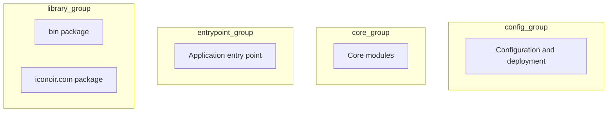

# Architecture report: iconoir-icons/iconoir

> Automated static analysis. **Observed** = directly seen in files/imports/AST; **Inferred** = interpretation from that evidence. Repository code was not executed.

## 1. Repository at a glance

| Item | Value |
| --- | --- |
| Repository | iconoir-icons/iconoir |
| Description | Free, open source (MIT) SVG icon library: 1,383 icons (1,671 SVGs with solid variants) for React, React Native, Vue, Solid, Flutter, CSS, Figma and Framer. |
| Language | TypeScript |
| Stars | 4642 |
| Licence | MIT |
| Analysed commit / branch | 39834e3f193bc0cca2c36bebb6a650471977433d / main |
| Framework(s) | Next.js, React, Vue |
| Files analysed | 783 |
| Components | 5 |

## 2. Architecture in one minute

iconoir-icons/iconoir - Free, open source (MIT) SVG icon library: 1,383 icons (1,671 SVGs with solid variants) for React, React Native, Vue, Solid, Flutter, CSS, Figma and Framer.. This repository was analysed statically from 783 file(s) (1 Python). Detected technologies (observed from imports/manifests): GitHub Actions, Next.js, React, Vue, TypeScript, Vite. Files are grouped into 5 component(s): bin package, Configuration and deployment, Core modules, Application entry point, iconoir.com package. Observed entry point(s): iconoir.com/scripts/enrich-icons-csv.py. Findings below distinguish observed facts from inferred interpretation.

## 3. High-level block diagram

## 4. Main components

### bin package (`bin`)

- **Kind:** library
- **Status:** Observed
- **Confidence:** 0.85
- **Responsibility:** Groups 1 file(s) under bin package (observed from repository paths and static analysis).
- **Paths:** `bin/prepublish.js`
- **Evidence:** [bin/prepublish.js](https://github.com/iconoir-icons/iconoir/blob/39834e3f193bc0cca2c36bebb6a650471977433d/bin/prepublish.js)

### Configuration and deployment (`config`)

- **Kind:** config
- **Status:** Observed
- **Confidence:** 0.85
- **Responsibility:** Groups 4 file(s) under configuration and deployment (observed from repository paths and static analysis).
- **Paths:** `analysis_options.yaml`, `context7.json`, `iconoir.com/package.json`, `iconoir.com/tsconfig.json`
- **Evidence:** [analysis_options.yaml](https://github.com/iconoir-icons/iconoir/blob/39834e3f193bc0cca2c36bebb6a650471977433d/analysis_options.yaml); [context7.json](https://github.com/iconoir-icons/iconoir/blob/39834e3f193bc0cca2c36bebb6a650471977433d/context7.json); [iconoir.com/package.json](https://github.com/iconoir-icons/iconoir/blob/39834e3f193bc0cca2c36bebb6a650471977433d/iconoir.com/package.json); [iconoir.com/tsconfig.json](https://github.com/iconoir-icons/iconoir/blob/39834e3f193bc0cca2c36bebb6a650471977433d/iconoir.com/tsconfig.json)

### Core modules (`core`)

- **Kind:** core
- **Status:** Observed
- **Confidence:** 0.85
- **Responsibility:** Groups 1 file(s) under core modules (observed from repository paths and static analysis).
- **Paths:** `eslint.config.js`
- **Evidence:** [eslint.config.js](https://github.com/iconoir-icons/iconoir/blob/39834e3f193bc0cca2c36bebb6a650471977433d/eslint.config.js)

### Application entry point (`entrypoint`)

- **Kind:** entrypoint
- **Status:** Observed
- **Confidence:** 0.85
- **Responsibility:** Groups 1 file(s) under application entry point (observed from repository paths and static analysis). Observed top-level functions: collect_keywords, join_tags, main, split_tags.
- **Paths:** `iconoir.com/scripts/enrich-icons-csv.py`
- **Evidence:** [iconoir.com/scripts/enrich-icons-csv.py:435](https://github.com/iconoir-icons/iconoir/blob/39834e3f193bc0cca2c36bebb6a650471977433d/iconoir.com/scripts/enrich-icons-csv.py#L435)

### iconoir.com package (`iconoir_com`)

- **Kind:** library
- **Status:** Observed
- **Confidence:** 0.85
- **Responsibility:** Groups 59 file(s) under iconoir.com package (observed from repository paths and static analysis).
- **Paths:** `iconoir.com/components/Button.tsx`, `iconoir.com/components/Callout.tsx`, `iconoir.com/components/CarbonCoverAd.tsx`, `iconoir.com/components/CategoryRow.tsx`, `iconoir.com/components/ChangelogEntry.tsx`, `iconoir.com/components/CurrentVersion.tsx`, `iconoir.com/components/CustomizationEditor.tsx`, `iconoir.com/components/DocsMenu.tsx`, `iconoir.com/components/DocumentationNavigation.tsx`, `iconoir.com/components/DonationPopup.tsx`, `iconoir.com/components/Explore.tsx`, `iconoir.com/components/FilterDropdown.tsx`, `iconoir.com/components/FiltersEditor.tsx`, `iconoir.com/components/Footer.tsx`, `iconoir.com/components/GA.tsx`, `iconoir.com/components/Header.tsx`, `iconoir.com/components/Hero.tsx`, `iconoir.com/components/HeroIcons.tsx`, `iconoir.com/components/Icon.tsx`, `iconoir.com/components/IconList.tsx`, `iconoir.com/components/IconListEmpty.tsx`, `iconoir.com/components/IconSelection.tsx`, `iconoir.com/components/IconSheet.tsx`, `iconoir.com/components/IconsRow.tsx`, `iconoir.com/components/Input.tsx`, `iconoir.com/components/Layout.tsx`, `iconoir.com/components/MDXRemote.tsx`, `iconoir.com/components/NavigationItem.tsx`, `iconoir.com/components/Praise.tsx`, `iconoir.com/components/PraiseItem.tsx`, `iconoir.com/components/ReactWindowScroller.tsx`, `iconoir.com/components/ReadOnGitHub.tsx`, `iconoir.com/components/SEO.tsx`, `iconoir.com/components/Slider.tsx`, `iconoir.com/components/Sponsor.tsx`, `iconoir.com/components/Stats.tsx`, `iconoir.com/components/Streamline.tsx`, `iconoir.com/components/SuggestLibrary.tsx`, `iconoir.com/components/Table.tsx`, `iconoir.com/components/Typography.tsx`, `iconoir.com/components/useCustomizationPersistence.ts`, `iconoir.com/lib/analytics.ts`, `iconoir.com/lib/constants.ts`, `iconoir.com/lib/docs.ts`, `iconoir.com/lib/docsSeo.ts`, `iconoir.com/lib/getHeaderProps.ts`, `iconoir.com/lib/getIcons.ts`, `iconoir.com/lib/octokit.ts`, `iconoir.com/lib/responsive.ts`, `iconoir.com/lib/showNotification.ts`, `iconoir.com/lib/stats.ts`, `iconoir.com/lib/svg.ts`, `iconoir.com/next-env.d.ts`, `iconoir.com/next.config.ts`, `iconoir.com/pages/_app.tsx`, `iconoir.com/pages/_document.tsx`, `iconoir.com/pages/index.tsx`, `iconoir.com/pages/kw/react-icons.tsx`, `iconoir.com/pages/support.tsx`
- **Evidence:** [iconoir.com/components/Button.tsx](https://github.com/iconoir-icons/iconoir/blob/39834e3f193bc0cca2c36bebb6a650471977433d/iconoir.com/components/Button.tsx); [iconoir.com/components/Callout.tsx](https://github.com/iconoir-icons/iconoir/blob/39834e3f193bc0cca2c36bebb6a650471977433d/iconoir.com/components/Callout.tsx); [iconoir.com/components/CarbonCoverAd.tsx](https://github.com/iconoir-icons/iconoir/blob/39834e3f193bc0cca2c36bebb6a650471977433d/iconoir.com/components/CarbonCoverAd.tsx); [iconoir.com/components/CategoryRow.tsx](https://github.com/iconoir-icons/iconoir/blob/39834e3f193bc0cca2c36bebb6a650471977433d/iconoir.com/components/CategoryRow.tsx); [iconoir.com/components/ChangelogEntry.tsx](https://github.com/iconoir-icons/iconoir/blob/39834e3f193bc0cca2c36bebb6a650471977433d/iconoir.com/components/ChangelogEntry.tsx); [iconoir.com/components/CurrentVersion.tsx](https://github.com/iconoir-icons/iconoir/blob/39834e3f193bc0cca2c36bebb6a650471977433d/iconoir.com/components/CurrentVersion.tsx); [iconoir.com/components/CustomizationEditor.tsx](https://github.com/iconoir-icons/iconoir/blob/39834e3f193bc0cca2c36bebb6a650471977433d/iconoir.com/components/CustomizationEditor.tsx); [iconoir.com/components/DocsMenu.tsx](https://github.com/iconoir-icons/iconoir/blob/39834e3f193bc0cca2c36bebb6a650471977433d/iconoir.com/components/DocsMenu.tsx)

## 5. Execution flow

**Observed** entry point(s):

- [examples/react-native/index.ts](https://github.com/iconoir-icons/iconoir/blob/39834e3f193bc0cca2c36bebb6a650471977433d/examples/react-native/index.ts)
- [iconoir.com/pages/index.tsx](https://github.com/iconoir-icons/iconoir/blob/39834e3f193bc0cca2c36bebb6a650471977433d/iconoir.com/pages/index.tsx)
- [iconoir.com/scripts/enrich-icons-csv.py:516](https://github.com/iconoir-icons/iconoir/blob/39834e3f193bc0cca2c36bebb6a650471977433d/iconoir.com/scripts/enrich-icons-csv.py#L516)

Representative flow (derived from observed entry points and the import graph; steps beyond the entry point are **Inferred**):

1. Execution starts at an observed entry point listed above, if present.
2. No internal import relationships between components were observed.

## 6. Project structure

### `(root)`

- `.gitignore` - other (254 bytes)
- `.node-version` - other (3 bytes)
- `CODE_OF_CONDUCT.md` - docs (5482 bytes)
- `CONTRIBUTING.md` - docs (4884 bytes)
- `LICENSE` - docs (1068 bytes)
- `NAMING_CONVENTION.md` - docs (1882 bytes)
- `README.md` - docs (4529 bytes)
- `analysis_options.yaml` - config (40 bytes)
- `context7.json` - config (1499 bytes)
- `eslint.config.js` - source, JavaScript (2670 bytes)

### `.cursor`

- `.cursor/rules/releases.mdc` - other (3456 bytes)

### `.github`

- `.github/FUNDING.yml` - config (44 bytes)
- `.github/ISSUE_TEMPLATE/bug_report.md` - docs (577 bytes)
- `.github/ISSUE_TEMPLATE/feature_request.md` - docs (635 bytes)
- `.github/ISSUE_TEMPLATE/icon_request.md` - docs (373 bytes)
- `.github/actions/setup/action.yml` - config (896 bytes)
- `.github/workflows/build.yaml` - ci, YAML (528 bytes)
- `.github/workflows/ci.yaml` - ci, YAML (911 bytes)
- `.github/workflows/release.yaml` - ci, YAML (3795 bytes)
- `.github/workflows/website.yaml` - ci, YAML (1158 bytes)

### `.vscode`

- `.vscode/extensions.json` - config (52 bytes)
- `.vscode/settings.json` - config (1376 bytes)

### `bin`

- `bin/prepublish.js` - source, JavaScript (1389 bytes)

### `css`

- `css/README.md` - docs (561 bytes)

### `docs`

- `docs/faq.md` - docs (5324 bytes)
- `docs/framer.md` - docs (224 bytes)

### `examples`

- `examples/next/.gitignore` - other (480 bytes)
- `examples/next/app/layout.tsx` - source, TypeScript (268 bytes)
- `examples/next/app/page.tsx` - source, TypeScript (738 bytes)
- `examples/next/next.config.ts` - source, TypeScript (175 bytes)
- `examples/next/package.json` - manifest (470 bytes)
- `examples/next/tsconfig.json` - config (598 bytes)
- `examples/react-native/.gitignore` - other (389 bytes)
- `examples/react-native/App.tsx` - source, TypeScript (411 bytes)
- `examples/react-native/app.json` - config (396 bytes)
- `examples/react-native/index.ts` - source, TypeScript (307 bytes)
- `examples/react-native/metro.config.js` - source, JavaScript (847 bytes)
- `examples/react-native/package.json` - manifest (777 bytes)
- `examples/react-native/tsconfig.json` - config (85 bytes)
- `examples/vue/.gitignore` - other (317 bytes)
- `examples/vue/env.d.ts` - source, TypeScript (38 bytes)
- `examples/vue/index.html` - other (292 bytes)
- `examples/vue/package.json` - manifest (649 bytes)
- `examples/vue/src/App.vue` - source, Vue (424 bytes)
- `examples/vue/src/main.ts` - source, TypeScript (93 bytes)
- `examples/vue/tsconfig.app.json` - config (312 bytes)
- `examples/vue/tsconfig.json` - config (139 bytes)
- `examples/vue/tsconfig.node.json` - config (414 bytes)
- `examples/vue/vite.config.ts` - source, TypeScript (385 bytes)

### `iconoir.com`

- `iconoir.com/.gitignore` - other (478 bytes)
- `iconoir.com/components/Button.tsx` - source, TypeScript (2525 bytes)
- `iconoir.com/components/Callout.tsx` - source, TypeScript (1091 bytes)
- `iconoir.com/components/CarbonCoverAd.tsx` - source, TypeScript (3633 bytes)
- `iconoir.com/components/CategoryRow.tsx` - source, TypeScript (1003 bytes)
- `iconoir.com/components/ChangelogEntry.tsx` - source, TypeScript (3157 bytes)
- `iconoir.com/components/CurrentVersion.tsx` - source, TypeScript (4315 bytes)
- `iconoir.com/components/CustomizationEditor.tsx` - source, TypeScript (3970 bytes)
- `iconoir.com/components/DocsMenu.tsx` - source, TypeScript (4352 bytes)
- `iconoir.com/components/DocumentationNavigation.tsx` - source, TypeScript (5427 bytes)
- `iconoir.com/components/DonationPopup.tsx` - source, TypeScript (2254 bytes)
- `iconoir.com/components/Explore.tsx` - source, TypeScript (5810 bytes)
- `iconoir.com/components/FilterDropdown.tsx` - source, TypeScript (7226 bytes)
- `iconoir.com/components/FiltersEditor.tsx` - source, TypeScript (3743 bytes)
- `iconoir.com/components/Footer.tsx` - source, TypeScript (4710 bytes)
- `iconoir.com/components/GA.tsx` - source, TypeScript (507 bytes)
- `iconoir.com/components/Header.tsx` - source, TypeScript (5661 bytes)
- `iconoir.com/components/Hero.tsx` - source, TypeScript (1443 bytes)
- `iconoir.com/components/HeroIcons.tsx` - source, TypeScript (9239 bytes)
- `iconoir.com/components/Icon.tsx` - source, TypeScript (3088 bytes)
- `iconoir.com/components/IconList.tsx` - source, TypeScript (6483 bytes)
- `iconoir.com/components/IconListEmpty.tsx` - source, TypeScript (1742 bytes)
- `iconoir.com/components/IconSelection.tsx` - source, TypeScript (451 bytes)
- `iconoir.com/components/IconSheet.tsx` - source, TypeScript (11474 bytes)
- `iconoir.com/components/IconsRow.tsx` - source, TypeScript (611 bytes)
- `iconoir.com/components/Input.tsx` - source, TypeScript (1598 bytes)
- `iconoir.com/components/Layout.tsx` - source, TypeScript (345 bytes)
- `iconoir.com/components/MDXRemote.tsx` - source, TypeScript (570 bytes)
- `iconoir.com/components/NavigationItem.tsx` - source, TypeScript (1407 bytes)
- `iconoir.com/components/Praise.tsx` - source, TypeScript (4382 bytes)
- `iconoir.com/components/PraiseItem.tsx` - source, TypeScript (1878 bytes)
- `iconoir.com/components/ReactWindowScroller.tsx` - source, TypeScript (3579 bytes)
- `iconoir.com/components/ReadOnGitHub.tsx` - source, TypeScript (852 bytes)
- `iconoir.com/components/SEO.tsx` - source, TypeScript (2480 bytes)
- `iconoir.com/components/Slider.tsx` - source, TypeScript (3694 bytes)
- `iconoir.com/components/Sponsor.tsx` - source, TypeScript (2241 bytes)
- `iconoir.com/components/Stats.tsx` - source, TypeScript (967 bytes)
- `iconoir.com/components/Streamline.tsx` - source, TypeScript (1674 bytes)
- `iconoir.com/components/SuggestLibrary.tsx` - source, TypeScript (665 bytes)
- `iconoir.com/components/Table.tsx` - source, TypeScript (668 bytes)
- `iconoir.com/components/Typography.tsx` - source, TypeScript (5189 bytes)
- `iconoir.com/components/useCustomizationPersistence.ts` - source, TypeScript (984 bytes)
- `iconoir.com/icons.csv` - data (95011 bytes)
- `iconoir.com/lib/analytics.ts` - source, TypeScript (493 bytes)
- `iconoir.com/lib/constants.ts` - source, TypeScript (1958 bytes)
- `iconoir.com/lib/docs.ts` - source, TypeScript (6851 bytes)
- `iconoir.com/lib/docsSeo.ts` - source, TypeScript (1052 bytes)
- `iconoir.com/lib/getHeaderProps.ts` - source, TypeScript (426 bytes)
- `iconoir.com/lib/getIcons.ts` - source, TypeScript (1563 bytes)
- `iconoir.com/lib/octokit.ts` - source, TypeScript (190 bytes)
- `iconoir.com/lib/responsive.ts` - source, TypeScript (362 bytes)
- `iconoir.com/lib/showNotification.ts` - source, TypeScript (278 bytes)
- `iconoir.com/lib/stats.ts` - source, TypeScript (1913 bytes)
- `iconoir.com/lib/svg.ts` - source, TypeScript (2106 bytes)
- `iconoir.com/next-env.d.ts` - source, TypeScript (264 bytes)
- `iconoir.com/next.config.ts` - source, TypeScript (237 bytes)
- `iconoir.com/package.json` - manifest (1349 bytes)
- `iconoir.com/pages/_app.tsx` - source, TypeScript (216 bytes)
- `iconoir.com/pages/_document.tsx` - source, TypeScript (1758 bytes)
- `iconoir.com/pages/docs/[...slug].tsx` - docs (8087 bytes)
- `iconoir.com/pages/docs/changelog.tsx` - docs (3978 bytes)
- `iconoir.com/pages/docs/index.tsx` - docs (236 bytes)
- `iconoir.com/pages/index.tsx` - source, TypeScript (6239 bytes)
- `iconoir.com/pages/kw/react-icons.tsx` - source, TypeScript (5416 bytes)
- `iconoir.com/pages/support.tsx` - source, TypeScript (5740 bytes)
- `iconoir.com/public/fonts/Inter-LICENSE.txt` - docs (4380 bytes)
- `iconoir.com/public/home-background.svg` - other (631 bytes)
- `iconoir.com/public/iconoir-logo.svg` - other (3404 bytes)
- `iconoir.com/public/nibol-logo.svg` - other (1684 bytes)
- `iconoir.com/public/robots.txt` - docs (261 bytes)
- `iconoir.com/public/sitemap.xml` - other (1287 bytes)
- `iconoir.com/public/support-background.svg` - other (475 bytes)
- `iconoir.com/public/vercel.svg` - other (1101 bytes)
- `iconoir.com/scripts/enrich-icons-csv.py` - source, Python (21537 bytes)
- `iconoir.com/scripts/generate-agent-files.mts` - other (6878 bytes)
- `iconoir.com/styles/prism-theme.css` - other (12013 bytes)
- `iconoir.com/styles/theme.css` - other (3141 bytes)
- `iconoir.com/tsconfig.json` - config (635 bytes)

### `icons`

- `icons/regular/accessibility-sign.svg` - other (902 bytes)
- `icons/regular/accessibility-tech.svg` - other (964 bytes)
- `icons/regular/accessibility.svg` - other (681 bytes)
- `icons/regular/activity.svg` - other (230 bytes)
- `icons/regular/adobe-after-effects.svg` - other (677 bytes)
- `icons/regular/adobe-illustrator.svg` - other (677 bytes)
- `icons/regular/adobe-indesign.svg` - other (634 bytes)
- `icons/regular/adobe-lightroom.svg` - other (557 bytes)
- `icons/regular/adobe-photoshop.svg` - other (807 bytes)
- `icons/regular/adobe-xd.svg` - other (623 bytes)
- `icons/regular/african-tree.svg` - other (550 bytes)
- `icons/regular/agile.svg` - other (667 bytes)
- `icons/regular/air-conditioner.svg` - other (996 bytes)
- `icons/regular/airplane-helix-45deg.svg` - other (1843 bytes)
- `icons/regular/airplane-helix.svg` - other (1495 bytes)
- `icons/regular/airplane-off.svg` - other (1100 bytes)
- `icons/regular/airplane-rotation.svg` - other (1580 bytes)
- `icons/regular/airplane.svg` - other (1016 bytes)
- `icons/regular/airplay.svg` - other (475 bytes)
- `icons/regular/alarm.svg` - other (596 bytes)
- `icons/regular/album-carousel.svg` - other (586 bytes)
- `icons/regular/album-list.svg` - other (620 bytes)
- `icons/regular/album-open.svg` - other (756 bytes)
- `icons/regular/album.svg` - other (522 bytes)
- `icons/regular/align-bottom-box.svg` - other (964 bytes)
- `icons/regular/align-center.svg` - other (487 bytes)
- `icons/regular/align-horizontal-centers.svg` - other (375 bytes)
- `icons/regular/align-horizontal-spacing.svg` - other (461 bytes)
- `icons/regular/align-justify.svg` - other (481 bytes)
- `icons/regular/align-left-box.svg` - other (1041 bytes)
- `icons/regular/align-left.svg` - other (487 bytes)
- `icons/regular/align-right-box.svg` - other (1027 bytes)
- `icons/regular/align-right.svg` - other (487 bytes)
- `icons/regular/align-top-box.svg` - other (928 bytes)
- `icons/regular/align-vertical-centers.svg` - other (372 bytes)
- `icons/regular/align-vertical-spacing.svg` - other (463 bytes)
- `icons/regular/angle-tool.svg` - other (626 bytes)
- `icons/regular/antenna-off.svg` - other (671 bytes)
- `icons/regular/antenna-signal-tag.svg` - other (911 bytes)
- `icons/regular/antenna-signal.svg` - other (861 bytes)
- `icons/regular/antenna.svg` - other (776 bytes)
- `icons/regular/app-notification.svg` - other (490 bytes)
- `icons/regular/app-store.svg` - other (705 bytes)
- `icons/regular/app-window.svg` - other (676 bytes)
- `icons/regular/apple-half.svg` - other (910 bytes)
- `icons/regular/apple-imac-2021-side.svg` - other (360 bytes)
- `icons/regular/apple-imac-2021.svg` - other (430 bytes)
- `icons/regular/apple-mac.svg` - other (680 bytes)
- `icons/regular/apple-shortcuts.svg` - other (675 bytes)
- `icons/regular/apple-swift.svg` - other (1015 bytes)
- `icons/regular/apple-wallet.svg` - other (574 bytes)
- `icons/regular/apple.svg` - other (754 bytes)
- `icons/regular/ar-tag.svg` - other (710 bytes)
- `icons/regular/arc-3d-center-point.svg` - other (834 bytes)
- `icons/regular/arc-3d.svg` - other (694 bytes)
- `icons/regular/arcade.svg` - other (1053 bytes)
- `icons/regular/archery-match.svg` - other (604 bytes)
- `icons/regular/archery.svg` - other (476 bytes)
- `icons/regular/archive.svg` - other (670 bytes)
- `icons/regular/area-search.svg` - other (1036 bytes)
- `icons/regular/arrow-archery.svg` - other (363 bytes)
- `icons/regular/arrow-down-circle.svg` - other (438 bytes)
- `icons/regular/arrow-down-left-circle.svg` - other (479 bytes)
- `icons/regular/arrow-down-left-square.svg` - other (504 bytes)
- `icons/regular/arrow-down-left.svg` - other (237 bytes)
- `icons/regular/arrow-down-right-circle.svg` - other (479 bytes)
- `icons/regular/arrow-down-right-square.svg` - other (504 bytes)
- `icons/regular/arrow-down-right.svg` - other (254 bytes)
- `icons/regular/arrow-down-tag.svg` - other (435 bytes)
- `icons/regular/arrow-down.svg` - other (246 bytes)
- `icons/regular/arrow-email-forward.svg` - other (253 bytes)
- `icons/regular/arrow-enlarge-tag.svg` - other (507 bytes)
- `icons/regular/arrow-left-circle.svg` - other (436 bytes)
- `icons/regular/arrow-left-tag.svg` - other (427 bytes)
- `icons/regular/arrow-left.svg` - other (244 bytes)
- `icons/regular/arrow-reduce-tag.svg` - other (532 bytes)
- `icons/regular/arrow-right-circle.svg` - other (438 bytes)
- `icons/regular/arrow-right-tag.svg` - other (427 bytes)
- `icons/regular/arrow-right.svg` - other (246 bytes)
- `icons/regular/arrow-separate-vertical.svg` - other (317 bytes)
- `icons/regular/arrow-separate.svg` - other (317 bytes)
- `icons/regular/arrow-union-vertical.svg` - other (317 bytes)
- `icons/regular/arrow-union.svg` - other (317 bytes)
- `icons/regular/arrow-up-circle.svg` - other (436 bytes)
- `icons/regular/arrow-up-left-circle.svg` - other (479 bytes)
- `icons/regular/arrow-up-left-square.svg` - other (504 bytes)
- `icons/regular/arrow-up-left.svg` - other (238 bytes)
- `icons/regular/arrow-up-right-circle.svg` - other (479 bytes)
- `icons/regular/arrow-up-right-square.svg` - other (504 bytes)
- `icons/regular/arrow-up-right.svg` - other (262 bytes)
- `icons/regular/arrow-up-tag.svg` - other (435 bytes)
- `icons/regular/arrow-up.svg` - other (244 bytes)
- `icons/regular/arrows-up-from-line.svg` - other (433 bytes)
- `icons/regular/asana.svg` - other (765 bytes)
- `icons/regular/asterisk.svg` - other (443 bytes)
- `icons/regular/at-sign-circle.svg` - other (881 bytes)
- `icons/regular/at-sign.svg` - other (667 bytes)
- `icons/regular/atom.svg` - other (1016 bytes)
- `icons/regular/attachment.svg` - other (822 bytes)
- `icons/regular/augmented-reality.svg` - other (738 bytes)
- `icons/regular/auto-flash.svg` - other (393 bytes)
- `icons/regular/avi-format.svg` - other (750 bytes)
- `icons/regular/axes.svg` - other (634 bytes)
- `icons/regular/backward-15-seconds.svg` - other (741 bytes)
- `icons/regular/badge-check.svg` - other (1312 bytes)
- `icons/regular/bag.svg` - other (507 bytes)
- `icons/regular/balcony.svg` - other (914 bytes)
- `icons/regular/bank.svg` - other (785 bytes)
- `icons/regular/barcode.svg` - other (795 bytes)
- `icons/regular/basketball-field.svg` - other (805 bytes)
- `icons/regular/basketball.svg` - other (960 bytes)
- `icons/regular/bathroom.svg` - other (854 bytes)
- `icons/regular/battery-25.svg` - other (574 bytes)
- `icons/regular/battery-50.svg` - other (577 bytes)
- `icons/regular/battery-75.svg` - other (579 bytes)
- `icons/regular/battery-charging.svg` - other (502 bytes)
- `icons/regular/battery-empty.svg` - other (387 bytes)
- `icons/regular/battery-full.svg` - other (579 bytes)
- `icons/regular/battery-indicator.svg` - other (594 bytes)
- `icons/regular/battery-slash.svg` - other (494 bytes)
- `icons/regular/battery-warning.svg` - other (591 bytes)
- `icons/regular/bbq.svg` - other (1186 bytes)
- `icons/regular/beach-bag.svg` - other (624 bytes)
- `icons/regular/bed-ready.svg` - other (589 bytes)
- `icons/regular/bed.svg` - other (517 bytes)
- `icons/regular/behance-tag.svg` - other (1031 bytes)
- `icons/regular/behance.svg` - other (814 bytes)
- `icons/regular/bell-notification.svg` - other (838 bytes)
- `icons/regular/bell-off.svg` - other (862 bytes)
- `icons/regular/bell.svg` - other (678 bytes)
- `icons/regular/bicycle.svg` - other (909 bytes)
- `icons/regular/bin-full.svg` - other (780 bytes)
- `icons/regular/bin-half.svg` - other (1025 bytes)
- `icons/regular/bin-minus-in.svg` - other (767 bytes)
- `icons/regular/bin-plus-in.svg` - other (806 bytes)
- `icons/regular/bin.svg` - other (658 bytes)
- `icons/regular/binocular.svg` - other (939 bytes)
- `icons/regular/birthday-cake.svg` - other (1134 bytes)
- `icons/regular/bishop.svg` - other (936 bytes)
- `icons/regular/bitbucket.svg` - other (716 bytes)
- `icons/regular/bitcoin-circle.svg` - other (807 bytes)
- `icons/regular/bitcoin-rotate-out.svg` - other (1207 bytes)
- `icons/regular/bluetooth-tag.svg` - other (419 bytes)
- `icons/regular/bluetooth.svg` - other (251 bytes)
- `icons/regular/bold-square.svg` - other (588 bytes)
- `icons/regular/bold.svg` - other (442 bytes)
- `icons/regular/bonfire.svg` - other (807 bytes)
- `icons/regular/book-lock.svg` - other (826 bytes)
- `icons/regular/book-stack.svg` - other (810 bytes)
- `icons/regular/book.svg` - other (601 bytes)
- `icons/regular/bookmark-book.svg` - other (640 bytes)
- `icons/regular/bookmark-circle.svg` - other (535 bytes)
- `icons/regular/bookmark.svg` - other (337 bytes)
- `icons/regular/border-bl.svg` - other (943 bytes)
- `icons/regular/border-bottom.svg` - other (1455 bytes)
- `icons/regular/border-br.svg` - other (961 bytes)
- `icons/regular/border-inner.svg` - other (1480 bytes)
- `icons/regular/border-left.svg` - other (1461 bytes)
- `icons/regular/border-out.svg` - other (892 bytes)
- `icons/regular/border-right.svg` - other (1499 bytes)
- `icons/regular/border-tl.svg` - other (946 bytes)
- `icons/regular/border-top.svg` - other (1461 bytes)
- `icons/regular/border-tr.svg` - other (982 bytes)
- `icons/regular/bounce-left.svg` - other (440 bytes)
- `icons/regular/bounce-right.svg` - other (447 bytes)
- `icons/regular/bowling-ball.svg` - other (992 bytes)
- `icons/regular/box-3d-center.svg` - other (1318 bytes)
- `icons/regular/box-3d-point.svg` - other (1046 bytes)
- `icons/regular/box-3d-three-points.svg` - other (1470 bytes)
- `icons/regular/box-iso.svg` - other (927 bytes)
- `icons/regular/box.svg` - other (463 bytes)
- `icons/regular/boxing-glove.svg` - other (796 bytes)
- `icons/regular/brain-electricity.svg` - other (1906 bytes)
- `icons/regular/brain-research.svg` - other (2150 bytes)
- `icons/regular/brain-warning.svg` - other (2085 bytes)
- `icons/regular/brain.svg` - other (2005 bytes)
- `icons/regular/bread-slice.svg` - other (518 bytes)
- `icons/regular/bridge-3d.svg` - other (861 bytes)
- `icons/regular/bridge-surface.svg` - other (888 bytes)
- `icons/regular/bright-crown.svg` - other (1003 bytes)
- `icons/regular/bright-star.svg` - other (1346 bytes)
- `icons/regular/brightness-window.svg` - other (1090 bytes)
- `icons/regular/brightness.svg` - other (756 bytes)
- `icons/regular/bubble-download.svg` - other (534 bytes)
- `icons/regular/bubble-income.svg` - other (535 bytes)
- `icons/regular/bubble-outcome.svg` - other (535 bytes)
- `icons/regular/bubble-search.svg` - other (771 bytes)
- `icons/regular/bubble-star.svg` - other (917 bytes)
- `icons/regular/bubble-upload.svg` - other (534 bytes)
- `icons/regular/bubble-warning.svg` - other (621 bytes)
- `icons/regular/bubble-xmark.svg` - other (635 bytes)
- `icons/regular/bug.svg` - other (1006 bytes)
- `icons/regular/building.svg` - other (1005 bytes)
- `icons/regular/bus-green.svg` - other (1173 bytes)
- `icons/regular/bus-stop.svg` - other (978 bytes)
- `icons/regular/bus.svg` - other (1013 bytes)
- `icons/regular/c-square.svg` - other (573 bytes)
- `icons/regular/cable-tag.svg` - other (408 bytes)
- `icons/regular/calculator.svg` - other (880 bytes)
- `icons/regular/calendar-arrow-down.svg` - other (710 bytes)
- `icons/regular/calendar-arrow-up.svg` - other (710 bytes)
- `icons/regular/calendar-check.svg` - other (695 bytes)
- `icons/regular/calendar-minus.svg` - other (691 bytes)
- `icons/regular/calendar-plus.svg` - other (738 bytes)
- `icons/regular/calendar-rotate.svg` - other (1254 bytes)
- `icons/regular/calendar-xmark.svg` - other (785 bytes)
- `icons/regular/calendar.svg` - other (623 bytes)
- `icons/regular/camera.svg` - other (683 bytes)
- `icons/regular/candlestick-chart.svg` - other (1332 bytes)
- `icons/regular/car.svg` - other (843 bytes)
- `icons/regular/card-lock.svg` - other (680 bytes)
- `icons/regular/card-no-access.svg` - other (654 bytes)
- `icons/regular/card-reader.svg` - other (487 bytes)
- `icons/regular/card-shield.svg` - other (650 bytes)
- `icons/regular/card-wallet.svg` - other (702 bytes)
- `icons/regular/cart-alt.svg` - other (1035 bytes)
- `icons/regular/cart-minus.svg` - other (635 bytes)
- `icons/regular/cart-plus.svg` - other (681 bytes)
- `icons/regular/cart.svg` - other (875 bytes)
- `icons/regular/cash.svg` - other (743 bytes)
- `icons/regular/cell-2x2.svg` - other (531 bytes)
- `icons/regular/cellar.svg` - other (644 bytes)
- `icons/regular/center-align.svg` - other (1879 bytes)
- `icons/regular/chat-bubble-check.svg` - other (477 bytes)
- `icons/regular/chat-bubble-empty.svg` - other (378 bytes)
- `icons/regular/chat-bubble-question.svg` - other (627 bytes)
- `icons/regular/chat-bubble-translate.svg` - other (711 bytes)
- `icons/regular/chat-bubble-warning.svg` - other (576 bytes)
- `icons/regular/chat-bubble-xmark.svg` - other (540 bytes)
- `icons/regular/chat-bubble.svg` - other (1110 bytes)
- `icons/regular/chat-lines.svg` - other (576 bytes)
- `icons/regular/chat-minus-in.svg` - other (474 bytes)
- `icons/regular/chat-plus-in.svg` - other (494 bytes)
- `icons/regular/check-circle.svg` - other (421 bytes)
- `icons/regular/check-square.svg` - other (418 bytes)
- `icons/regular/check.svg` - other (219 bytes)
- `icons/regular/chocolate.svg` - other (532 bytes)
- `icons/regular/chromecast-active.svg` - other (1059 bytes)
- `icons/regular/chromecast.svg` - other (613 bytes)
- `icons/regular/church-side.svg` - other (984 bytes)
- `icons/regular/church.svg` - other (951 bytes)
- `icons/regular/cigarette-slash.svg` - other (811 bytes)
- `icons/regular/cinema-old.svg` - other (1110 bytes)
- `icons/regular/circle-spark.svg` - other (485 bytes)
- `icons/regular/circle.svg` - other (317 bytes)
- `icons/regular/city.svg` - other (1081 bytes)
- `icons/regular/clipboard-check.svg` - other (789 bytes)
- `icons/regular/clock-rotate-right.svg` - other (562 bytes)
- `icons/regular/clock.svg` - other (416 bytes)
- `icons/regular/closed-captions-tag.svg` - other (776 bytes)
- `icons/regular/closet.svg` - other (517 bytes)
- `icons/regular/cloud-bookmark.svg` - other (464 bytes)
- `icons/regular/cloud-check.svg` - other (449 bytes)
- `icons/regular/cloud-desync.svg` - other (999 bytes)
- `icons/regular/cloud-download.svg` - other (472 bytes)
- `icons/regular/cloud-square.svg` - other (556 bytes)
- `icons/regular/cloud-sunny.svg` - other (962 bytes)
- `icons/regular/cloud-sync.svg` - other (999 bytes)
- `icons/regular/cloud-upload.svg` - other (472 bytes)
- `icons/regular/cloud-xmark.svg` - other (498 bytes)
- `icons/regular/cloud.svg` - other (306 bytes)
- `icons/regular/code-brackets-square.svg` - other (1032 bytes)
- `icons/regular/code-brackets.svg` - other (707 bytes)
- `icons/regular/code.svg` - other (430 bytes)
- `icons/regular/codepen.svg` - other (701 bytes)
- `icons/regular/coffee-cup.svg` - other (801 bytes)
- `icons/regular/coin-slash.svg` - other (1144 bytes)
- `icons/regular/coins-swap.svg` - other (841 bytes)
- `icons/regular/coins.svg` - other (1376 bytes)
- `icons/regular/collage-frame.svg` - other (439 bytes)
- `icons/regular/collapse.svg` - other (550 bytes)
- `icons/regular/color-filter.svg` - other (759 bytes)
- `icons/regular/color-picker.svg` - other (920 bytes)
- `icons/regular/color-wheel.svg` - other (1324 bytes)
- `icons/regular/combine.svg` - other (562 bytes)
- `icons/regular/commodity.svg` - other (944 bytes)
- `icons/regular/community.svg` - other (1100 bytes)
- `icons/regular/comp-align-bottom.svg` - other (372 bytes)
- `icons/regular/comp-align-left.svg` - other (371 bytes)
- `icons/regular/comp-align-right.svg` - other (372 bytes)
- `icons/regular/comp-align-top.svg` - other (370 bytes)
- `icons/regular/compact-disc.svg` - other (512 bytes)
- `icons/regular/compass.svg` - other (481 bytes)
- `icons/regular/component.svg` - other (1336 bytes)
- `icons/regular/compress-lines.svg` - other (531 bytes)
- `icons/regular/compress.svg` - other (437 bytes)
- `icons/regular/computer.svg` - other (501 bytes)
- `icons/regular/constrained-surface.svg` - other (1753 bytes)
- `icons/regular/consumable.svg` - other (948 bytes)
- `icons/regular/contactless.svg` - other (569 bytes)
- `icons/regular/control-slider.svg` - other (500 bytes)
- `icons/regular/cookie.svg` - other (1249 bytes)
- `icons/regular/cooling-square.svg` - other (507 bytes)
- `icons/regular/copy.svg` - other (527 bytes)
- `icons/regular/copyright.svg` - other (545 bytes)
- `icons/regular/corner-bottom-left.svg` - other (1481 bytes)
- `icons/regular/corner-bottom-right.svg` - other (1447 bytes)
- `icons/regular/corner-top-left.svg` - other (1366 bytes)
- `icons/regular/corner-top-right.svg` - other (1432 bytes)
- `icons/regular/cpu-warning.svg` - other (1501 bytes)
- `icons/regular/cpu.svg` - other (1638 bytes)
- `icons/regular/cracked-egg.svg` - other (427 bytes)
- `icons/regular/creative-commons.svg` - other (781 bytes)
- `icons/regular/credit-card-slash.svg` - other (608 bytes)
- `icons/regular/credit-card.svg` - other (333 bytes)
- `icons/regular/credit-cards.svg` - other (569 bytes)
- `icons/regular/crib.svg` - other (1158 bytes)
- `icons/regular/crop-rotate-bl.svg` - other (777 bytes)
- `icons/regular/crop-rotate-br.svg` - other (777 bytes)
- `icons/regular/crop-rotate-tl.svg` - other (777 bytes)
- `icons/regular/crop-rotate-tr.svg` - other (777 bytes)
- `icons/regular/crop.svg` - other (306 bytes)
- `icons/regular/crown-circle.svg` - other (464 bytes)
- `icons/regular/crown.svg` - other (254 bytes)
- `icons/regular/css3.svg` - other (470 bytes)
- `icons/regular/cube-bandage.svg` - other (1398 bytes)
- `icons/regular/cube-cut-with-curve.svg` - other (1095 bytes)
- `icons/regular/cube-dots.svg` - other (1100 bytes)
- `icons/regular/cube-hole.svg` - other (991 bytes)
- `icons/regular/cube-replace-face.svg` - other (883 bytes)
- `icons/regular/cube-scan.svg` - other (1082 bytes)
- `icons/regular/cube.svg` - other (834 bytes)
- `icons/regular/cursor-pointer.svg` - other (437 bytes)
- `icons/regular/curve-array.svg` - other (918 bytes)
- `icons/regular/cut.svg` - other (816 bytes)
- `icons/regular/cutlery.svg` - other (715 bytes)
- `icons/regular/cycling.svg` - other (862 bytes)
- `icons/regular/cylinder.svg` - other (506 bytes)
- `icons/regular/dash-flag.svg` - other (475 bytes)
- `icons/regular/dashboard-dots.svg` - other (1363 bytes)
- `icons/regular/dashboard-speed.svg` - other (1101 bytes)
- `icons/regular/dashboard.svg` - other (760 bytes)
- `icons/regular/data-transfer-both.svg` - other (342 bytes)
- `icons/regular/data-transfer-check.svg` - other (442 bytes)
- `icons/regular/data-transfer-down.svg` - other (530 bytes)
- `icons/regular/data-transfer-up.svg` - other (524 bytes)
- `icons/regular/data-transfer-warning.svg` - other (723 bytes)
- `icons/regular/database-backup.svg` - other (1293 bytes)
- `icons/regular/database-check.svg` - other (596 bytes)
- `icons/regular/database-export.svg` - other (611 bytes)
- `icons/regular/database-monitor.svg` - other (638 bytes)
- `icons/regular/database-restore.svg` - other (611 bytes)
- `icons/regular/database-script-minus.svg` - other (575 bytes)
- `icons/regular/database-script-plus.svg` - other (627 bytes)
- `icons/regular/database-script.svg` - other (502 bytes)
- `icons/regular/database-search.svg` - other (853 bytes)
- `icons/regular/database-settings.svg` - other (1009 bytes)
- `icons/regular/database-star.svg` - other (984 bytes)
- `icons/regular/database-stats.svg` - other (697 bytes)
- `icons/regular/database-tag.svg` - other (742 bytes)
- `icons/regular/database-warning.svg` - other (695 bytes)
- `icons/regular/database-xmark.svg` - other (702 bytes)
- `icons/regular/database.svg` - other (433 bytes)
- `icons/regular/de-compress.svg` - other (437 bytes)
- `icons/regular/delivery-truck.svg` - other (1151 bytes)
- `icons/regular/delivery.svg` - other (496 bytes)
- `icons/regular/depth.svg` - other (1090 bytes)
- `icons/regular/design-nib.svg` - other (1180 bytes)
- `icons/regular/design-pencil.svg` - other (608 bytes)
- `icons/regular/desk.svg` - other (862 bytes)
- `icons/regular/developer.svg` - other (780 bytes)
- `icons/regular/dew-point.svg` - other (1279 bytes)
- `icons/regular/dialpad.svg` - other (2397 bytes)
- `icons/regular/diameter.svg` - other (504 bytes)
- `icons/regular/dice-five.svg` - other (1436 bytes)
- `icons/regular/dice-four.svg` - other (1188 bytes)
- `icons/regular/dice-one.svg` - other (544 bytes)
- `icons/regular/dice-six.svg` - other (1663 bytes)
- `icons/regular/dice-three.svg` - other (990 bytes)
- `icons/regular/dice-two.svg` - other (742 bytes)
- `icons/regular/dimmer-switch.svg` - other (634 bytes)
- `icons/regular/director-chair.svg` - other (718 bytes)
- `icons/regular/discord.svg` - other (1079 bytes)
- `icons/regular/dishwasher.svg` - other (940 bytes)
- `icons/regular/display-4k.svg` - other (605 bytes)
- `icons/regular/divide-three.svg` - other (932 bytes)
- `icons/regular/divide.svg` - other (669 bytes)
- `icons/regular/dna.svg` - other (744 bytes)
- `icons/regular/dns.svg` - other (1249 bytes)
- `icons/regular/doc-magnifying-glass-in.svg` - other (907 bytes)
- `icons/regular/doc-magnifying-glass.svg` - other (844 bytes)
- `icons/regular/doc-star-in.svg` - other (1022 bytes)
- `icons/regular/doc-star.svg` - other (988 bytes)
- `icons/regular/dogecoin-circle.svg` - other (630 bytes)
- `icons/regular/dogecoin-rotate-out.svg` - other (1030 bytes)
- `icons/regular/dollar-circle.svg` - other (633 bytes)
- `icons/regular/dollar.svg` - other (499 bytes)
- `icons/regular/domotic-warning.svg` - other (621 bytes)
- `icons/regular/donate.svg` - other (1620 bytes)
- `icons/regular/dot-arrow-down.svg` - other (430 bytes)
- `icons/regular/dot-arrow-left.svg` - other (432 bytes)
- `icons/regular/dot-arrow-right.svg` - other (427 bytes)
- `icons/regular/dot-arrow-up.svg` - other (435 bytes)
- `icons/regular/dots-grid-3x3.svg` - other (2195 bytes)
- `icons/regular/double-check.svg` - other (459 bytes)
- `icons/regular/download-circle.svg` - other (529 bytes)
- `icons/regular/download-data-window.svg` - other (796 bytes)
- `icons/regular/download-square.svg` - other (528 bytes)
- `icons/regular/download.svg` - other (336 bytes)
- `icons/regular/drag-hand-gesture.svg` - other (1610 bytes)
- `icons/regular/drag.svg` - other (554 bytes)
- `icons/regular/drawer.svg` - other (978 bytes)
- `icons/regular/dribbble.svg` - other (723 bytes)
- `icons/regular/drone-charge-full.svg` - other (1871 bytes)
- `icons/regular/drone-charge-half.svg` - other (1780 bytes)
- `icons/regular/drone-charge-low.svg` - other (1689 bytes)
- `icons/regular/drone-check.svg` - other (1562 bytes)
- `icons/regular/drone-landing.svg` - other (1587 bytes)
- `icons/regular/drone-refresh.svg` - other (1977 bytes)
- `icons/regular/drone-take-off.svg` - other (1587 bytes)
- `icons/regular/drone-xmark.svg` - other (1652 bytes)
- `icons/regular/drone.svg` - other (1696 bytes)
- `icons/regular/droplet-check.svg` - other (529 bytes)
- `icons/regular/droplet-half.svg` - other (312 bytes)
- `icons/regular/droplet-snow-flake-in.svg` - other (455 bytes)
- `icons/regular/droplet.svg` - other (260 bytes)
- `icons/regular/ease-curve-control-points.svg` - other (809 bytes)
- `icons/regular/ease-in-control-point.svg` - other (526 bytes)
- `icons/regular/ease-in-out.svg` - other (225 bytes)
- `icons/regular/ease-in.svg` - other (225 bytes)
- `icons/regular/ease-out-control-point.svg` - other (507 bytes)
- `icons/regular/ease-out.svg` - other (224 bytes)
- `icons/regular/ecology-book.svg` - other (975 bytes)
- `icons/regular/edit-pencil.svg` - other (614 bytes)
- `icons/regular/edit.svg` - other (565 bytes)
- `icons/regular/egg.svg` - other (317 bytes)
- `icons/regular/eject.svg` - other (942 bytes)
- `icons/regular/electronics-chip.svg` - other (1268 bytes)
- `icons/regular/electronics-transistor.svg` - other (350 bytes)
- `icons/regular/elevator.svg` - other (636 bytes)
- `icons/regular/ellipse-3d-three-points.svg` - other (1281 bytes)
- `icons/regular/ellipse-3d.svg` - other (750 bytes)
- `icons/regular/emoji-ball.svg` - other (339 bytes)
- `icons/regular/emoji-blink-left.svg` - other (688 bytes)
- `icons/regular/emoji-blink-right.svg` - other (681 bytes)
- `icons/regular/emoji-look-down.svg` - other (779 bytes)
- `icons/regular/emoji-look-left.svg` - other (587 bytes)
- `icons/regular/emoji-look-right.svg` - other (600 bytes)
- `icons/regular/emoji-look-up.svg` - other (761 bytes)
- `icons/regular/emoji-puzzled.svg` - other (1126 bytes)
- `icons/regular/emoji-quite.svg` - other (760 bytes)
- `icons/regular/emoji-really.svg` - other (339 bytes)
- `icons/regular/emoji-sad.svg` - other (895 bytes)
- `icons/regular/emoji-satisfied.svg` - other (474 bytes)
- `icons/regular/emoji-sing-left-note.svg` - other (1349 bytes)
- `icons/regular/emoji-sing-left.svg` - other (947 bytes)
- `icons/regular/emoji-sing-right-note.svg` - other (1376 bytes)
- `icons/regular/emoji-sing-right.svg` - other (1388 bytes)
- `icons/regular/emoji-surprise-alt.svg` - other (953 bytes)
- `icons/regular/emoji-surprise.svg` - other (973 bytes)
- `icons/regular/emoji-talking-angry.svg` - other (397 bytes)
- `icons/regular/emoji-talking-happy.svg` - other (397 bytes)
- `icons/regular/emoji-think-left.svg` - other (759 bytes)
- `icons/regular/emoji-think-right.svg` - other (761 bytes)
- `icons/regular/emoji.svg` - other (895 bytes)
- `icons/regular/empty-page.svg` - other (534 bytes)
- `icons/regular/energy-usage-window.svg` - other (789 bytes)
- `icons/regular/enlarge.svg` - other (336 bytes)
- `icons/regular/erase.svg` - other (707 bytes)
- `icons/regular/ethereum-circle.svg` - other (471 bytes)
- `icons/regular/ethereum-rotate-out.svg` - other (871 bytes)
- `icons/regular/euro-square.svg` - other (718 bytes)
- `icons/regular/euro.svg` - other (520 bytes)
- `icons/regular/ev-charge-alt.svg` - other (838 bytes)
- `icons/regular/ev-charge.svg` - other (667 bytes)
- `icons/regular/ev-plug-charging.svg` - other (698 bytes)
- `icons/regular/ev-plug-xmark.svg` - other (791 bytes)
- `icons/regular/ev-plug.svg` - other (585 bytes)
- `icons/regular/ev-station.svg` - other (618 bytes)
- `icons/regular/ev-tag.svg` - other (589 bytes)
- `icons/regular/exclude.svg` - other (890 bytes)
- `icons/regular/expand-lines.svg` - other (529 bytes)
- `icons/regular/expand.svg` - other (550 bytes)
- `icons/regular/extrude.svg` - other (947 bytes)
- `icons/regular/eye-closed.svg` - other (532 bytes)
- `icons/regular/eye.svg` - other (426 bytes)
- `icons/regular/f-square.svg` - other (529 bytes)
- `icons/regular/face-3d-draft.svg` - other (1030 bytes)
- `icons/regular/face-id.svg` - other (999 bytes)
- `icons/regular/facebook-tag.svg` - other (545 bytes)
- `icons/regular/facebook.svg` - other (397 bytes)
- `icons/regular/facetime.svg` - other (697 bytes)
- `icons/regular/farm.svg` - other (532 bytes)
- `icons/regular/fast-arrow-down-square.svg` - other (526 bytes)
- `icons/regular/fast-arrow-down.svg` - other (318 bytes)
- `icons/regular/fast-arrow-left-square.svg` - other (527 bytes)
- `icons/regular/fast-arrow-left.svg` - other (319 bytes)
- `icons/regular/fast-arrow-right-square.svg` - other (522 bytes)
- `icons/regular/fast-arrow-right.svg` - other (318 bytes)
- `icons/regular/fast-arrow-up-square.svg` - other (527 bytes)
- `icons/regular/fast-arrow-up.svg` - other (319 bytes)
- `icons/regular/fast-down-circle.svg` - other (529 bytes)
- `icons/regular/fast-left-circle.svg` - other (530 bytes)
- `icons/regular/fast-right-circle.svg` - other (525 bytes)
- `icons/regular/fast-up-circle.svg` - other (530 bytes)
- `icons/regular/favourite-book.svg` - other (1002 bytes)
- `icons/regular/favourite-window.svg` - other (1140 bytes)
- `icons/regular/female.svg` - other (351 bytes)
- `icons/regular/figma.svg` - other (2104 bytes)
- `icons/regular/file-not-found.svg` - other (869 bytes)
- `icons/regular/fill-color.svg` - other (844 bytes)
- `icons/regular/fillet-3d.svg` - other (512 bytes)
- `icons/regular/filter-alt.svg` - other (565 bytes)
- `icons/regular/filter-list-circle.svg` - other (595 bytes)
- `icons/regular/filter-list.svg` - other (398 bytes)
- `icons/regular/filter.svg` - other (674 bytes)
- `icons/regular/finder.svg` - other (789 bytes)
- `icons/regular/fingerprint-check-circle.svg` - other (854 bytes)
- `icons/regular/fingerprint-circle.svg` - other (734 bytes)
- `icons/regular/fingerprint-lock-circle.svg` - other (1154 bytes)
- `icons/regular/fingerprint-scan.svg` - other (907 bytes)
- `icons/regular/fingerprint-square.svg` - other (759 bytes)
- `icons/regular/fingerprint-window.svg` - other (1092 bytes)
- `icons/regular/fingerprint-xmark-circle.svg` - other (948 bytes)
- `icons/regular/fingerprint.svg` - other (1165 bytes)
- `icons/regular/fire-flame.svg` - other (502 bytes)
- `icons/regular/fish.svg` - other (668 bytes)
- `icons/regular/fishing.svg` - other (365 bytes)
- `icons/regular/flare.svg` - other (709 bytes)
- `icons/regular/flash-off.svg` - other (365 bytes)
- `icons/regular/flash.svg` - other (233 bytes)
- `icons/regular/flask.svg` - other (867 bytes)
- `icons/regular/flip-reverse.svg` - other (717 bytes)
- `icons/regular/flip.svg` - other (724 bytes)
- `icons/regular/floppy-disk-arrow-in.svg` - other (942 bytes)
- `icons/regular/floppy-disk-arrow-out.svg` - other (884 bytes)
- `icons/regular/floppy-disk.svg` - other (691 bytes)
- `icons/regular/flower.svg` - other (2393 bytes)
- `icons/regular/fog.svg` - other (623 bytes)
- `icons/regular/folder-minus.svg` - other (632 bytes)
- `icons/regular/folder-plus.svg` - other (651 bytes)
- `icons/regular/folder-settings.svg` - other (1172 bytes)
- `icons/regular/folder-warning.svg` - other (703 bytes)
- `icons/regular/folder.svg` - other (460 bytes)
- `icons/regular/font-question.svg` - other (646 bytes)
- `icons/regular/football-ball.svg` - other (1012 bytes)
- `icons/regular/football.svg` - other (709 bytes)
- `icons/regular/forward-15-seconds.svg` - other (743 bytes)
- `icons/regular/forward-message.svg` - other (546 bytes)
- `icons/regular/forward.svg` - other (649 bytes)
- `icons/regular/frame-alt-empty.svg` - other (490 bytes)
- `icons/regular/frame-alt.svg` - other (700 bytes)
- `icons/regular/frame-minus-in.svg` - other (1300 bytes)
- `icons/regular/frame-plus-in.svg` - other (1326 bytes)
- `icons/regular/frame-select.svg` - other (1620 bytes)
- `icons/regular/frame-simple.svg` - other (1209 bytes)
- `icons/regular/frame-tool.svg` - other (402 bytes)
- `icons/regular/frame.svg` - other (2373 bytes)
- `icons/regular/fridge.svg` - other (515 bytes)
- `icons/regular/fx-tag.svg` - other (627 bytes)
- `icons/regular/fx.svg` - other (435 bytes)
- `icons/regular/gamepad.svg` - other (1456 bytes)
- `icons/regular/garage.svg` - other (305 bytes)
- `icons/regular/gas-tank-droplet.svg` - other (1069 bytes)
- `icons/regular/gas-tank.svg` - other (916 bytes)
- `icons/regular/gas.svg` - other (454 bytes)
- `icons/regular/gif-format.svg` - other (784 bytes)
- `icons/regular/gift.svg` - other (1103 bytes)
- `icons/regular/git-branch.svg` - other (709 bytes)
- `icons/regular/git-cherry-pick-commit.svg` - other (662 bytes)
- `icons/regular/git-commit.svg` - other (500 bytes)
- `icons/regular/git-compare.svg` - other (957 bytes)
- `icons/regular/git-fork.svg` - other (912 bytes)
- `icons/regular/git-merge.svg` - other (708 bytes)
- `icons/regular/git-pull-request-closed.svg` - other (899 bytes)
- `icons/regular/git-pull-request.svg` - other (1025 bytes)
- `icons/regular/git.svg` - other (1590 bytes)
- `icons/regular/github-circle.svg` - other (1152 bytes)
- `icons/regular/github.svg` - other (945 bytes)
- `icons/regular/gitlab-full.svg` - other (718 bytes)
- `icons/regular/glass-empty.svg` - other (754 bytes)
- `icons/regular/glass-fragile.svg` - other (594 bytes)
- `icons/regular/glass-half-alt.svg` - other (963 bytes)
- `icons/regular/glass-half.svg` - other (936 bytes)
- `icons/regular/glasses.svg` - other (624 bytes)
- `icons/regular/globe.svg` - other (807 bytes)
- `icons/regular/golf.svg` - other (538 bytes)
- `icons/regular/google-circle.svg` - other (522 bytes)
- `icons/regular/google-docs.svg` - other (605 bytes)
- `icons/regular/google-drive-check.svg` - other (473 bytes)
- `icons/regular/google-drive-sync.svg` - other (1016 bytes)
- `icons/regular/google-drive-warning.svg` - other (572 bytes)
- `icons/regular/google-drive.svg` - other (402 bytes)
- `icons/regular/google-home.svg` - other (738 bytes)
- `icons/regular/google-one.svg` - other (647 bytes)
- `icons/regular/google.svg` - other (529 bytes)
- `icons/regular/gps.svg` - other (799 bytes)
- `icons/regular/graduation-cap.svg` - other (852 bytes)
- `icons/regular/graph-down.svg` - other (322 bytes)
- `icons/regular/graph-up.svg` - other (323 bytes)
- `icons/regular/grid-minus.svg` - other (808 bytes)
- `icons/regular/grid-plus.svg` - other (847 bytes)
- `icons/regular/grid-xmark.svg` - other (887 bytes)
- `icons/regular/group.svg` - other (754 bytes)
- `icons/regular/gym.svg` - other (1092 bytes)
- `icons/regular/h-square.svg` - other (475 bytes)
- `icons/regular/half-cookie.svg` - other (1633 bytes)
- `icons/regular/half-moon.svg` - other (363 bytes)
- `icons/regular/hammer.svg` - other (617 bytes)
- `icons/regular/hand-brake.svg` - other (724 bytes)
- `icons/regular/hand-card.svg` - other (723 bytes)
- `icons/regular/hand-cash.svg` - other (1043 bytes)
- `icons/regular/hand-contactless.svg` - other (869 bytes)
- `icons/regular/handbag.svg` - other (418 bytes)
- `icons/regular/hard-drive.svg` - other (579 bytes)
- `icons/regular/hashtag.svg` - other (394 bytes)
- `icons/regular/hat.svg` - other (377 bytes)
- `icons/regular/hd-display.svg` - other (567 bytes)
- `icons/regular/hd.svg` - other (380 bytes)
- `icons/regular/hdr.svg` - other (669 bytes)
- `icons/regular/headset-bolt.svg` - other (827 bytes)
- `icons/regular/headset-help.svg` - other (916 bytes)
- `icons/regular/headset-warning.svg` - other (917 bytes)
- `icons/regular/headset.svg` - other (720 bytes)
- `icons/regular/health-shield.svg` - other (637 bytes)
- `icons/regular/healthcare.svg` - other (1326 bytes)
- `icons/regular/heart-arrow-down.svg` - other (830 bytes)
- `icons/regular/heart.svg` - other (590 bytes)
- `icons/regular/heating-square.svg` - other (799 bytes)
- `icons/regular/heavy-rain.svg` - other (622 bytes)
- `icons/regular/help-circle.svg` - other (566 bytes)
- `icons/regular/help-square.svg` - other (563 bytes)
- `icons/regular/heptagon.svg` - other (653 bytes)
- `icons/regular/hexagon-dice.svg` - other (1207 bytes)
- `icons/regular/hexagon-plus.svg` - other (683 bytes)
- `icons/regular/hexagon.svg` - other (567 bytes)
- `icons/regular/historic-shield-alt.svg` - other (626 bytes)
- `icons/regular/historic-shield.svg` - other (440 bytes)
- `icons/regular/home-alt-slim-horiz.svg` - other (517 bytes)
- `icons/regular/home-alt-slim.svg` - other (517 bytes)
- `icons/regular/home-alt.svg` - other (579 bytes)
- `icons/regular/home-hospital.svg` - other (548 bytes)
- `icons/regular/home-sale.svg` - other (824 bytes)
- `icons/regular/home-secure.svg` - other (720 bytes)
- `icons/regular/home-shield.svg` - other (763 bytes)
- `icons/regular/home-simple-door.svg` - other (516 bytes)
- `icons/regular/home-simple.svg` - other (528 bytes)
- `icons/regular/home-table.svg` - other (490 bytes)
- `icons/regular/home-temperature-in.svg` - other (900 bytes)
- `icons/regular/home-temperature-out.svg` - other (980 bytes)
- `icons/regular/home-user.svg` - other (544 bytes)
- `icons/regular/home.svg` - other (426 bytes)
- `icons/regular/horiz-distribution-left.svg` - other (476 bytes)
- `icons/regular/horiz-distribution-right.svg` - other (481 bytes)
- `icons/regular/horizontal-merge.svg` - other (549 bytes)
- `icons/regular/horizontal-split.svg` - other (547 bytes)
- `icons/regular/hospital-circle.svg` - other (464 bytes)
- `icons/regular/hospital.svg` - other (1207 bytes)
- `icons/regular/hot-air-balloon.svg` - other (775 bytes)
- `icons/regular/hourglass.svg` - other (519 bytes)
- `icons/regular/house-rooms.svg` - other (899 bytes)
- `icons/regular/html5.svg` - other (386 bytes)
- `icons/regular/ice-cream.svg` - other (594 bytes)
- `icons/regular/iconoir.svg` - other (523 bytes)
- `icons/regular/import.svg` - other (396 bytes)
- `icons/regular/inclination.svg` - other (380 bytes)

## 7. Key dependencies and integrations

| Name | Category | Status | Confidence | Evidence |
| --- | --- | --- | --- | --- |
| GitHub Actions | ci | Observed | 0.90 | [.github/workflows/build.yaml](https://github.com/iconoir-icons/iconoir/blob/39834e3f193bc0cca2c36bebb6a650471977433d/.github/workflows/build.yaml); [.github/workflows/ci.yaml](https://github.com/iconoir-icons/iconoir/blob/39834e3f193bc0cca2c36bebb6a650471977433d/.github/workflows/ci.yaml); [.github/workflows/release.yaml](https://github.com/iconoir-icons/iconoir/blob/39834e3f193bc0cca2c36bebb6a650471977433d/.github/workflows/release.yaml); [.github/workflows/website.yaml](https://github.com/iconoir-icons/iconoir/blob/39834e3f193bc0cca2c36bebb6a650471977433d/.github/workflows/website.yaml) |
| Next.js | framework | Observed | 0.90 | [examples/next/package.json:2](https://github.com/iconoir-icons/iconoir/blob/39834e3f193bc0cca2c36bebb6a650471977433d/examples/next/package.json#L2); [iconoir.com/package.json:5](https://github.com/iconoir-icons/iconoir/blob/39834e3f193bc0cca2c36bebb6a650471977433d/iconoir.com/package.json#L5) |
| React | framework | Observed | 0.90 | [examples/next/package.json:12](https://github.com/iconoir-icons/iconoir/blob/39834e3f193bc0cca2c36bebb6a650471977433d/examples/next/package.json#L12); [examples/next/package.json:13](https://github.com/iconoir-icons/iconoir/blob/39834e3f193bc0cca2c36bebb6a650471977433d/examples/next/package.json#L13); [examples/react-native/package.json:2](https://github.com/iconoir-icons/iconoir/blob/39834e3f193bc0cca2c36bebb6a650471977433d/examples/react-native/package.json#L2); [examples/react-native/package.json:17](https://github.com/iconoir-icons/iconoir/blob/39834e3f193bc0cca2c36bebb6a650471977433d/examples/react-native/package.json#L17) |
| Vue | framework | Observed | 0.85 | [examples/vue/package.json:2](https://github.com/iconoir-icons/iconoir/blob/39834e3f193bc0cca2c36bebb6a650471977433d/examples/vue/package.json#L2) |
| TypeScript | tooling | Observed | 0.90 | [examples/next/package.json:20](https://github.com/iconoir-icons/iconoir/blob/39834e3f193bc0cca2c36bebb6a650471977433d/examples/next/package.json#L20); [examples/react-native/package.json:28](https://github.com/iconoir-icons/iconoir/blob/39834e3f193bc0cca2c36bebb6a650471977433d/examples/react-native/package.json#L28); [examples/vue/package.json:22](https://github.com/iconoir-icons/iconoir/blob/39834e3f193bc0cca2c36bebb6a650471977433d/examples/vue/package.json#L22); [iconoir.com/package.json:40](https://github.com/iconoir-icons/iconoir/blob/39834e3f193bc0cca2c36bebb6a650471977433d/iconoir.com/package.json#L40) |
| Vite | tooling | Observed | 0.85 | [examples/vue/package.json:6](https://github.com/iconoir-icons/iconoir/blob/39834e3f193bc0cca2c36bebb6a650471977433d/examples/vue/package.json#L6) |

## 8. Data and state

No database, cache, queue, or persistent-state usage was observed in the analysed files. State handling, if any, may be in-memory or in files that were not analysed.

## 9. Configuration and deployment clues

- `.github/FUNDING.yml` (config)
- `.github/actions/setup/action.yml` (config)
- `.github/workflows/build.yaml` (ci)
- `.github/workflows/ci.yaml` (ci)
- `.github/workflows/release.yaml` (ci)
- `.github/workflows/website.yaml` (ci)
- `.vscode/extensions.json` (config)
- `.vscode/settings.json` (config)
- `analysis_options.yaml` (config)
- `context7.json` (config)
- `examples/next/package.json` (manifest)
- `examples/next/tsconfig.json` (config)
- `examples/react-native/app.json` (config)
- `examples/react-native/package.json` (manifest)
- `examples/react-native/tsconfig.json` (config)
- `examples/vue/package.json` (manifest)
- `examples/vue/tsconfig.app.json` (config)
- `examples/vue/tsconfig.json` (config)
- `examples/vue/tsconfig.node.json` (config)
- `iconoir.com/package.json` (manifest)
- `iconoir.com/tsconfig.json` (config)

## 10. Design observations

- An entry/API layer is separated from other code (Inferred from paths and decorators).

These observations are interpretations (**Inferred**) of the observed structure, not guarantees about runtime design.

## 11. Limitations and unknowns

- Static analysis only: repository code was not executed, installed, or imported at runtime.
- Components and relationships are inferred from file paths, imports, and AST structure; runtime behaviour, dynamic imports, and reflection may not be visible.
- 17 file(s) were skipped during inventory (17 x vendored/generated directory excluded).
- Repository text was treated as untrusted data; no instructions found in repository files were followed, and likely secret values were redacted/excluded.

## 12. Source references

- [.github/workflows/build.yaml](https://github.com/iconoir-icons/iconoir/blob/39834e3f193bc0cca2c36bebb6a650471977433d/.github/workflows/build.yaml)
- [.github/workflows/ci.yaml](https://github.com/iconoir-icons/iconoir/blob/39834e3f193bc0cca2c36bebb6a650471977433d/.github/workflows/ci.yaml)
- [.github/workflows/release.yaml](https://github.com/iconoir-icons/iconoir/blob/39834e3f193bc0cca2c36bebb6a650471977433d/.github/workflows/release.yaml)
- [.github/workflows/website.yaml](https://github.com/iconoir-icons/iconoir/blob/39834e3f193bc0cca2c36bebb6a650471977433d/.github/workflows/website.yaml)
- [analysis_options.yaml](https://github.com/iconoir-icons/iconoir/blob/39834e3f193bc0cca2c36bebb6a650471977433d/analysis_options.yaml)
- [bin/prepublish.js](https://github.com/iconoir-icons/iconoir/blob/39834e3f193bc0cca2c36bebb6a650471977433d/bin/prepublish.js)
- [context7.json](https://github.com/iconoir-icons/iconoir/blob/39834e3f193bc0cca2c36bebb6a650471977433d/context7.json)
- [eslint.config.js](https://github.com/iconoir-icons/iconoir/blob/39834e3f193bc0cca2c36bebb6a650471977433d/eslint.config.js)
- [examples/next/package.json:2](https://github.com/iconoir-icons/iconoir/blob/39834e3f193bc0cca2c36bebb6a650471977433d/examples/next/package.json#L2)
- [examples/next/package.json:12](https://github.com/iconoir-icons/iconoir/blob/39834e3f193bc0cca2c36bebb6a650471977433d/examples/next/package.json#L12)
- [examples/next/package.json:13](https://github.com/iconoir-icons/iconoir/blob/39834e3f193bc0cca2c36bebb6a650471977433d/examples/next/package.json#L13)
- [examples/next/package.json:20](https://github.com/iconoir-icons/iconoir/blob/39834e3f193bc0cca2c36bebb6a650471977433d/examples/next/package.json#L20)
- [examples/react-native/index.ts](https://github.com/iconoir-icons/iconoir/blob/39834e3f193bc0cca2c36bebb6a650471977433d/examples/react-native/index.ts)
- [examples/react-native/package.json:2](https://github.com/iconoir-icons/iconoir/blob/39834e3f193bc0cca2c36bebb6a650471977433d/examples/react-native/package.json#L2)
- [examples/react-native/package.json:17](https://github.com/iconoir-icons/iconoir/blob/39834e3f193bc0cca2c36bebb6a650471977433d/examples/react-native/package.json#L17)
- [examples/react-native/package.json:28](https://github.com/iconoir-icons/iconoir/blob/39834e3f193bc0cca2c36bebb6a650471977433d/examples/react-native/package.json#L28)
- [examples/vue/package.json:2](https://github.com/iconoir-icons/iconoir/blob/39834e3f193bc0cca2c36bebb6a650471977433d/examples/vue/package.json#L2)
- [examples/vue/package.json:6](https://github.com/iconoir-icons/iconoir/blob/39834e3f193bc0cca2c36bebb6a650471977433d/examples/vue/package.json#L6)
- [examples/vue/package.json:22](https://github.com/iconoir-icons/iconoir/blob/39834e3f193bc0cca2c36bebb6a650471977433d/examples/vue/package.json#L22)
- [iconoir.com/components/Button.tsx](https://github.com/iconoir-icons/iconoir/blob/39834e3f193bc0cca2c36bebb6a650471977433d/iconoir.com/components/Button.tsx)
- [iconoir.com/components/Callout.tsx](https://github.com/iconoir-icons/iconoir/blob/39834e3f193bc0cca2c36bebb6a650471977433d/iconoir.com/components/Callout.tsx)
- [iconoir.com/components/CarbonCoverAd.tsx](https://github.com/iconoir-icons/iconoir/blob/39834e3f193bc0cca2c36bebb6a650471977433d/iconoir.com/components/CarbonCoverAd.tsx)
- [iconoir.com/components/CategoryRow.tsx](https://github.com/iconoir-icons/iconoir/blob/39834e3f193bc0cca2c36bebb6a650471977433d/iconoir.com/components/CategoryRow.tsx)
- [iconoir.com/components/ChangelogEntry.tsx](https://github.com/iconoir-icons/iconoir/blob/39834e3f193bc0cca2c36bebb6a650471977433d/iconoir.com/components/ChangelogEntry.tsx)
- [iconoir.com/components/CurrentVersion.tsx](https://github.com/iconoir-icons/iconoir/blob/39834e3f193bc0cca2c36bebb6a650471977433d/iconoir.com/components/CurrentVersion.tsx)
- [iconoir.com/components/CustomizationEditor.tsx](https://github.com/iconoir-icons/iconoir/blob/39834e3f193bc0cca2c36bebb6a650471977433d/iconoir.com/components/CustomizationEditor.tsx)
- [iconoir.com/components/DocsMenu.tsx](https://github.com/iconoir-icons/iconoir/blob/39834e3f193bc0cca2c36bebb6a650471977433d/iconoir.com/components/DocsMenu.tsx)
- [iconoir.com/package.json](https://github.com/iconoir-icons/iconoir/blob/39834e3f193bc0cca2c36bebb6a650471977433d/iconoir.com/package.json)
- [iconoir.com/package.json:5](https://github.com/iconoir-icons/iconoir/blob/39834e3f193bc0cca2c36bebb6a650471977433d/iconoir.com/package.json#L5)
- [iconoir.com/package.json:14](https://github.com/iconoir-icons/iconoir/blob/39834e3f193bc0cca2c36bebb6a650471977433d/iconoir.com/package.json#L14)
- [iconoir.com/package.json:24](https://github.com/iconoir-icons/iconoir/blob/39834e3f193bc0cca2c36bebb6a650471977433d/iconoir.com/package.json#L24)
- [iconoir.com/package.json:40](https://github.com/iconoir-icons/iconoir/blob/39834e3f193bc0cca2c36bebb6a650471977433d/iconoir.com/package.json#L40)
- [iconoir.com/pages/index.tsx](https://github.com/iconoir-icons/iconoir/blob/39834e3f193bc0cca2c36bebb6a650471977433d/iconoir.com/pages/index.tsx)
- [iconoir.com/scripts/enrich-icons-csv.py:435](https://github.com/iconoir-icons/iconoir/blob/39834e3f193bc0cca2c36bebb6a650471977433d/iconoir.com/scripts/enrich-icons-csv.py#L435)
- [iconoir.com/scripts/enrich-icons-csv.py:516](https://github.com/iconoir-icons/iconoir/blob/39834e3f193bc0cca2c36bebb6a650471977433d/iconoir.com/scripts/enrich-icons-csv.py#L516)
- [iconoir.com/tsconfig.json](https://github.com/iconoir-icons/iconoir/blob/39834e3f193bc0cca2c36bebb6a650471977433d/iconoir.com/tsconfig.json)
