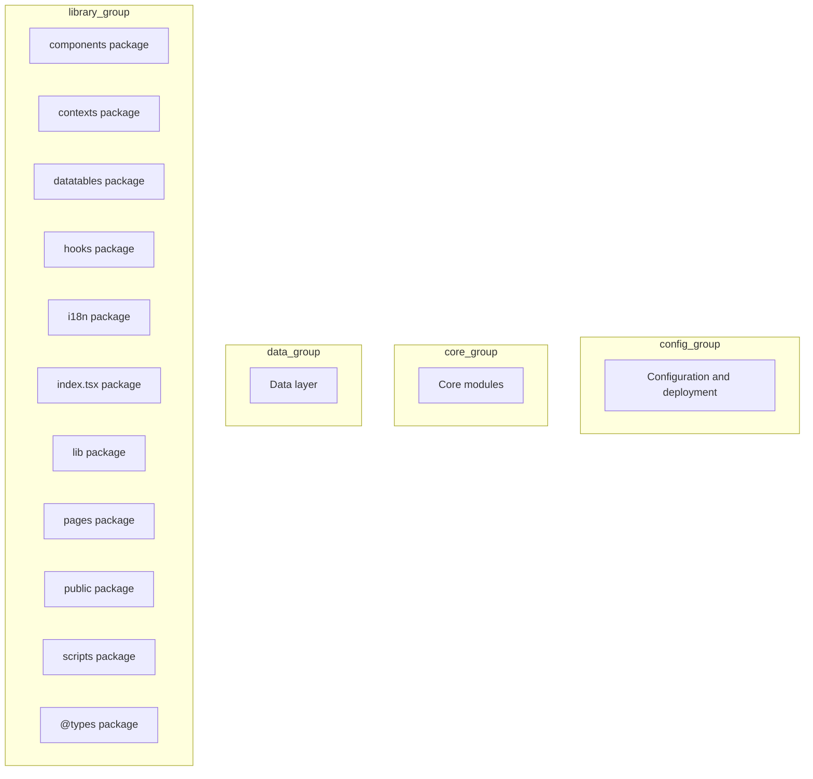

# Architecture report: iib0011/omni-tools

> Automated static analysis. **Observed** = directly seen in files/imports/AST; **Inferred** = interpretation from that evidence. Repository code was not executed.

## 1. Repository at a glance

| Item | Value |
| --- | --- |
| Repository | iib0011/omni-tools |
| Description | Self-hosted collection of powerful web-based tools for everyday tasks. No ads, no tracking, just fast, accessible utilities right from your browser! |
| Language | TypeScript |
| Stars | 10719 |
| Licence | MIT |
| Analysed commit / branch | 9244e02923d99cde143ddd5b8d761d9ed0997da4 / main |
| Framework(s) | React |
| Files analysed | 789 |
| Components | 14 |

## 2. Architecture in one minute

iib0011/omni-tools - Self-hosted collection of powerful web-based tools for everyday tasks. No ads, no tracking, just fast, accessible utilities right from your browser!. This repository was analysed statically from 789 file(s) (0 Python). Detected technologies (observed from imports/manifests): GitHub Actions, React, React Router, Tailwind CSS, Docker, TypeScript. Files are grouped into 14 component(s): components package, Configuration and deployment, contexts package, Core modules, Data layer, datatables package, hooks package, i18n package. Findings below distinguish observed facts from inferred interpretation.

## 3. High-level block diagram

## 4. Main components

### components package (`components`)

- **Kind:** library
- **Status:** Observed
- **Confidence:** 0.85
- **Responsibility:** Groups 48 file(s) under components package (observed from repository paths and static analysis).
- **Paths:** `src/components/App.tsx`, `src/components/BackButton.tsx`, `src/components/Hero.tsx`, `src/components/InputHeader.tsx`, `src/components/Loading.tsx`, `src/components/Navbar/index.tsx`, `src/components/ScrollToTopButton.tsx`, `src/components/Separator.tsx`, `src/components/ToolBreadcrumb.tsx`, `src/components/ToolContent.tsx`, `src/components/ToolHeader.tsx`, `src/components/ToolInfo.tsx`, `src/components/ToolInputAndResult.tsx`, `src/components/ToolLayout.tsx`, `src/components/UserTypeFilter.tsx`, `src/components/allTools/AllTools.tsx`, `src/components/allTools/ToolCard.tsx`, `src/components/examples/ExampleCard.tsx`, `src/components/examples/ExampleOptions.tsx`, `src/components/examples/ToolExamples.tsx`, `src/components/input/BaseFileInput.tsx`, `src/components/input/InputFooter.tsx`, `src/components/input/NumericInputWithUnit.tsx`, `src/components/input/ToolAudioInput.tsx`, `src/components/input/ToolCodeInput.tsx`, `src/components/input/ToolImageInput.tsx`, `src/components/input/ToolMultipleAudioInput.tsx`, `src/components/input/ToolMultipleImageInput.tsx`, `src/components/input/ToolMultiplePdfInput.tsx`, `src/components/input/ToolMultipleVideoInput.tsx`, `src/components/input/ToolPdfInput.tsx`, `src/components/input/ToolTextInput.tsx`, `src/components/input/ToolVideoInput.tsx`, `src/components/input/file-input-utils.ts`, `src/components/options/CheckboxWithDesc.tsx`, `src/components/options/ColorSelector.tsx`, `src/components/options/RadioWithTextField.tsx`, `src/components/options/SelectWithDesc.tsx`, `src/components/options/SimpleRadio.tsx`, `src/components/options/TextFieldWithDesc.tsx`, `src/components/options/ToolOptionGroups.tsx`, `src/components/options/ToolOptions.tsx`, `src/components/result/ResultFooter.tsx`, `src/components/result/ToolCodeResult.tsx`, `src/components/result/ToolDiffResult.tsx`, `src/components/result/ToolFileResult.tsx`, `src/components/result/ToolMultiFileResult.tsx`, `src/components/result/ToolTextResult.tsx`
- **Evidence:** [src/components/App.tsx](https://github.com/iib0011/omni-tools/blob/9244e02923d99cde143ddd5b8d761d9ed0997da4/src/components/App.tsx); [src/components/BackButton.tsx](https://github.com/iib0011/omni-tools/blob/9244e02923d99cde143ddd5b8d761d9ed0997da4/src/components/BackButton.tsx); [src/components/Hero.tsx](https://github.com/iib0011/omni-tools/blob/9244e02923d99cde143ddd5b8d761d9ed0997da4/src/components/Hero.tsx); [src/components/InputHeader.tsx](https://github.com/iib0011/omni-tools/blob/9244e02923d99cde143ddd5b8d761d9ed0997da4/src/components/InputHeader.tsx); [src/components/Loading.tsx](https://github.com/iib0011/omni-tools/blob/9244e02923d99cde143ddd5b8d761d9ed0997da4/src/components/Loading.tsx); [src/components/Navbar/index.tsx](https://github.com/iib0011/omni-tools/blob/9244e02923d99cde143ddd5b8d761d9ed0997da4/src/components/Navbar/index.tsx); [src/components/ScrollToTopButton.tsx](https://github.com/iib0011/omni-tools/blob/9244e02923d99cde143ddd5b8d761d9ed0997da4/src/components/ScrollToTopButton.tsx); [src/components/Separator.tsx](https://github.com/iib0011/omni-tools/blob/9244e02923d99cde143ddd5b8d761d9ed0997da4/src/components/Separator.tsx)

### Configuration and deployment (`config`)

- **Kind:** config
- **Status:** Observed
- **Confidence:** 0.85
- **Responsibility:** Groups 148 file(s) under configuration and deployment (observed from repository paths and static analysis).
- **Paths:** `Dockerfile`, `package.json`, `public/locales/de/audio.json`, `public/locales/de/converters.json`, `public/locales/de/csv.json`, `public/locales/de/image.json`, `public/locales/de/json.json`, `public/locales/de/list.json`, `public/locales/de/number.json`, `public/locales/de/pdf.json`, `public/locales/de/string.json`, `public/locales/de/time.json`, `public/locales/de/translation.json`, `public/locales/de/video.json`, `public/locales/de/xml.json`, `public/locales/en/audio.json`, `public/locales/en/converters.json`, `public/locales/en/csv.json`, `public/locales/en/image.json`, `public/locales/en/json.json`, `public/locales/en/list.json`, `public/locales/en/number.json`, `public/locales/en/pdf.json`, `public/locales/en/string.json`, `public/locales/en/time.json`, `public/locales/en/translation.json`, `public/locales/en/video.json`, `public/locales/en/xml.json`, `public/locales/es/audio.json`, `public/locales/es/converters.json`, `public/locales/es/csv.json`, `public/locales/es/image.json`, `public/locales/es/json.json`, `public/locales/es/list.json`, `public/locales/es/number.json`, `public/locales/es/pdf.json`, `public/locales/es/string.json`, `public/locales/es/time.json`, `public/locales/es/translation.json`, `public/locales/es/video.json`, `public/locales/es/xml.json`, `public/locales/fr/audio.json`, `public/locales/fr/converters.json`, `public/locales/fr/csv.json`, `public/locales/fr/image.json`, `public/locales/fr/json.json`, `public/locales/fr/list.json`, `public/locales/fr/number.json`, `public/locales/fr/pdf.json`, `public/locales/fr/string.json`, `public/locales/fr/time.json`, `public/locales/fr/translation.json`, `public/locales/fr/video.json`, `public/locales/fr/xml.json`, `public/locales/hi/audio.json`, `public/locales/hi/converters.json`, `public/locales/hi/csv.json`, `public/locales/hi/image.json`, `public/locales/hi/json.json`, `public/locales/hi/list.json`, `public/locales/hi/number.json`, `public/locales/hi/pdf.json`, `public/locales/hi/string.json`, `public/locales/hi/time.json`, `public/locales/hi/translation.json`, `public/locales/hi/video.json`, `public/locales/hi/xml.json`, `public/locales/ja/audio.json`, `public/locales/ja/converters.json`, `public/locales/ja/csv.json`, `public/locales/ja/image.json`, `public/locales/ja/json.json`, `public/locales/ja/list.json`, `public/locales/ja/number.json`, `public/locales/ja/pdf.json`, `public/locales/ja/string.json`, `public/locales/ja/time.json`, `public/locales/ja/translation.json`, `public/locales/ja/video.json`, `public/locales/ja/xml.json`, `public/locales/nl/audio.json`, `public/locales/nl/converters.json`, `public/locales/nl/csv.json`, `public/locales/nl/image.json`, `public/locales/nl/json.json`, `public/locales/nl/list.json`, `public/locales/nl/number.json`, `public/locales/nl/pdf.json`, `public/locales/nl/string.json`, `public/locales/nl/time.json`, `public/locales/nl/translation.json`, `public/locales/nl/video.json`, `public/locales/nl/xml.json`, `public/locales/pt/audio.json`, `public/locales/pt/converters.json`, `public/locales/pt/csv.json`, `public/locales/pt/image.json`, `public/locales/pt/json.json`, `public/locales/pt/list.json`, `public/locales/pt/number.json`, `public/locales/pt/pdf.json`, `public/locales/pt/string.json`, `public/locales/pt/time.json`, `public/locales/pt/translation.json`, `public/locales/pt/video.json`, `public/locales/pt/xml.json`, `public/locales/ru/audio.json`, `public/locales/ru/converters.json`, `public/locales/ru/csv.json`, `public/locales/ru/image.json`, `public/locales/ru/json.json`, `public/locales/ru/list.json`, `public/locales/ru/number.json`, `public/locales/ru/pdf.json`, `public/locales/ru/string.json`, `public/locales/ru/time.json`, `public/locales/ru/translation.json`, `public/locales/ru/video.json`, `public/locales/ru/xml.json`, `public/locales/uk/audio.json`, `public/locales/uk/converters.json`, `public/locales/uk/csv.json`, `public/locales/uk/image.json`, `public/locales/uk/json.json`, `public/locales/uk/list.json`, `public/locales/uk/number.json`, `public/locales/uk/pdf.json`, `public/locales/uk/string.json`, `public/locales/uk/time.json`, `public/locales/uk/translation.json`, `public/locales/uk/video.json`, `public/locales/uk/xml.json`, `public/locales/zh/audio.json`, `public/locales/zh/converters.json`, `public/locales/zh/csv.json`, `public/locales/zh/image.json`, `public/locales/zh/json.json`, `public/locales/zh/list.json`, `public/locales/zh/number.json`, `public/locales/zh/pdf.json`, `public/locales/zh/string.json`, `public/locales/zh/time.json`, `public/locales/zh/translation.json`, `public/locales/zh/video.json`, `public/locales/zh/xml.json`, `src/config/muiConfig.ts`, `src/config/routesConfig.tsx`, `src/config/uiConfig.ts`
- **Evidence:** [Dockerfile](https://github.com/iib0011/omni-tools/blob/9244e02923d99cde143ddd5b8d761d9ed0997da4/Dockerfile); [package.json](https://github.com/iib0011/omni-tools/blob/9244e02923d99cde143ddd5b8d761d9ed0997da4/package.json); [public/locales/de/audio.json](https://github.com/iib0011/omni-tools/blob/9244e02923d99cde143ddd5b8d761d9ed0997da4/public/locales/de/audio.json); [public/locales/de/converters.json](https://github.com/iib0011/omni-tools/blob/9244e02923d99cde143ddd5b8d761d9ed0997da4/public/locales/de/converters.json); [public/locales/de/csv.json](https://github.com/iib0011/omni-tools/blob/9244e02923d99cde143ddd5b8d761d9ed0997da4/public/locales/de/csv.json); [public/locales/de/image.json](https://github.com/iib0011/omni-tools/blob/9244e02923d99cde143ddd5b8d761d9ed0997da4/public/locales/de/image.json); [public/locales/de/json.json](https://github.com/iib0011/omni-tools/blob/9244e02923d99cde143ddd5b8d761d9ed0997da4/public/locales/de/json.json); [public/locales/de/list.json](https://github.com/iib0011/omni-tools/blob/9244e02923d99cde143ddd5b8d761d9ed0997da4/public/locales/de/list.json)

### contexts package (`contexts`)

- **Kind:** library
- **Status:** Observed
- **Confidence:** 0.85
- **Responsibility:** Groups 1 file(s) under contexts package (observed from repository paths and static analysis).
- **Paths:** `src/contexts/CustomSnackBarContext.tsx`
- **Evidence:** [src/contexts/CustomSnackBarContext.tsx](https://github.com/iib0011/omni-tools/blob/9244e02923d99cde143ddd5b8d761d9ed0997da4/src/contexts/CustomSnackBarContext.tsx)

### Core modules (`core`)

- **Kind:** core
- **Status:** Observed
- **Confidence:** 0.85
- **Responsibility:** Groups 3 file(s) under core modules (observed from repository paths and static analysis).
- **Paths:** `commitlint.config.js`, `playwright.config.ts`, `postcss.config.mjs`
- **Evidence:** [commitlint.config.js](https://github.com/iib0011/omni-tools/blob/9244e02923d99cde143ddd5b8d761d9ed0997da4/commitlint.config.js); [playwright.config.ts](https://github.com/iib0011/omni-tools/blob/9244e02923d99cde143ddd5b8d761d9ed0997da4/playwright.config.ts); [postcss.config.mjs](https://github.com/iib0011/omni-tools/blob/9244e02923d99cde143ddd5b8d761d9ed0997da4/postcss.config.mjs)

### Data layer (`data_layer`)

- **Kind:** data
- **Status:** Observed
- **Confidence:** 0.85
- **Responsibility:** Groups 9 file(s) under data layer (observed from repository paths and static analysis).
- **Paths:** `src/datatables/data/material_electrical_properties.ts`, `src/datatables/data/wire_gauge.ts`, `src/pages/tools/number/generic-calc/data/index.ts`, `src/pages/tools/number/generic-calc/data/ohmsLaw.ts`, `src/pages/tools/number/generic-calc/data/slackline.ts`, `src/pages/tools/number/generic-calc/data/sphereArea.ts`, `src/pages/tools/number/generic-calc/data/sphereVolume.ts`, `src/pages/tools/number/generic-calc/data/types.ts`, `src/pages/tools/number/generic-calc/data/voltageDropInWire.ts`
- **Evidence:** [src/datatables/data/material_electrical_properties.ts](https://github.com/iib0011/omni-tools/blob/9244e02923d99cde143ddd5b8d761d9ed0997da4/src/datatables/data/material_electrical_properties.ts); [src/datatables/data/wire_gauge.ts](https://github.com/iib0011/omni-tools/blob/9244e02923d99cde143ddd5b8d761d9ed0997da4/src/datatables/data/wire_gauge.ts); [src/pages/tools/number/generic-calc/data/index.ts](https://github.com/iib0011/omni-tools/blob/9244e02923d99cde143ddd5b8d761d9ed0997da4/src/pages/tools/number/generic-calc/data/index.ts); [src/pages/tools/number/generic-calc/data/ohmsLaw.ts](https://github.com/iib0011/omni-tools/blob/9244e02923d99cde143ddd5b8d761d9ed0997da4/src/pages/tools/number/generic-calc/data/ohmsLaw.ts); [src/pages/tools/number/generic-calc/data/slackline.ts](https://github.com/iib0011/omni-tools/blob/9244e02923d99cde143ddd5b8d761d9ed0997da4/src/pages/tools/number/generic-calc/data/slackline.ts); [src/pages/tools/number/generic-calc/data/sphereArea.ts](https://github.com/iib0011/omni-tools/blob/9244e02923d99cde143ddd5b8d761d9ed0997da4/src/pages/tools/number/generic-calc/data/sphereArea.ts); [src/pages/tools/number/generic-calc/data/sphereVolume.ts](https://github.com/iib0011/omni-tools/blob/9244e02923d99cde143ddd5b8d761d9ed0997da4/src/pages/tools/number/generic-calc/data/sphereVolume.ts); [src/pages/tools/number/generic-calc/data/types.ts](https://github.com/iib0011/omni-tools/blob/9244e02923d99cde143ddd5b8d761d9ed0997da4/src/pages/tools/number/generic-calc/data/types.ts)

### datatables package (`datatables`)

- **Kind:** library
- **Status:** Observed
- **Confidence:** 0.85
- **Responsibility:** Groups 2 file(s) under datatables package (observed from repository paths and static analysis).
- **Paths:** `src/datatables/index.ts`, `src/datatables/types.ts`
- **Evidence:** [src/datatables/index.ts](https://github.com/iib0011/omni-tools/blob/9244e02923d99cde143ddd5b8d761d9ed0997da4/src/datatables/index.ts); [src/datatables/types.ts](https://github.com/iib0011/omni-tools/blob/9244e02923d99cde143ddd5b8d761d9ed0997da4/src/datatables/types.ts)

### hooks package (`hooks`)

- **Kind:** library
- **Status:** Observed
- **Confidence:** 0.85
- **Responsibility:** Groups 6 file(s) under hooks package (observed from repository paths and static analysis).
- **Paths:** `src/hooks/index.ts`, `src/hooks/useDebounce.ts`, `src/hooks/useFileDrop.ts`, `src/hooks/usePrevious.ts`, `src/hooks/useTimeout.ts`, `src/hooks/useUpdateEffect.ts`
- **Evidence:** [src/hooks/index.ts](https://github.com/iib0011/omni-tools/blob/9244e02923d99cde143ddd5b8d761d9ed0997da4/src/hooks/index.ts); [src/hooks/useDebounce.ts](https://github.com/iib0011/omni-tools/blob/9244e02923d99cde143ddd5b8d761d9ed0997da4/src/hooks/useDebounce.ts); [src/hooks/useFileDrop.ts](https://github.com/iib0011/omni-tools/blob/9244e02923d99cde143ddd5b8d761d9ed0997da4/src/hooks/useFileDrop.ts); [src/hooks/usePrevious.ts](https://github.com/iib0011/omni-tools/blob/9244e02923d99cde143ddd5b8d761d9ed0997da4/src/hooks/usePrevious.ts); [src/hooks/useTimeout.ts](https://github.com/iib0011/omni-tools/blob/9244e02923d99cde143ddd5b8d761d9ed0997da4/src/hooks/useTimeout.ts); [src/hooks/useUpdateEffect.ts](https://github.com/iib0011/omni-tools/blob/9244e02923d99cde143ddd5b8d761d9ed0997da4/src/hooks/useUpdateEffect.ts)

### i18n package (`i18n`)

- **Kind:** library
- **Status:** Observed
- **Confidence:** 0.85
- **Responsibility:** Groups 1 file(s) under i18n package (observed from repository paths and static analysis).
- **Paths:** `src/i18n/index.ts`
- **Evidence:** [src/i18n/index.ts](https://github.com/iib0011/omni-tools/blob/9244e02923d99cde143ddd5b8d761d9ed0997da4/src/i18n/index.ts)

### index.tsx package (`index_tsx`)

- **Kind:** library
- **Status:** Observed
- **Confidence:** 0.85
- **Responsibility:** Groups 1 file(s) under index.tsx package (observed from repository paths and static analysis).
- **Paths:** `src/index.tsx`
- **Evidence:** [src/index.tsx](https://github.com/iib0011/omni-tools/blob/9244e02923d99cde143ddd5b8d761d9ed0997da4/src/index.tsx)

### lib package (`lib`)

- **Kind:** library
- **Status:** Observed
- **Confidence:** 0.85
- **Responsibility:** Groups 4 file(s) under lib package (observed from repository paths and static analysis).
- **Paths:** `src/lib/ffmpeg.ts`, `src/lib/ghostscript/background-worker.js`, `src/lib/ghostscript/gs-worker.js`, `src/lib/ghostscript/worker-init.ts`
- **Evidence:** [src/lib/ffmpeg.ts](https://github.com/iib0011/omni-tools/blob/9244e02923d99cde143ddd5b8d761d9ed0997da4/src/lib/ffmpeg.ts); [src/lib/ghostscript/background-worker.js](https://github.com/iib0011/omni-tools/blob/9244e02923d99cde143ddd5b8d761d9ed0997da4/src/lib/ghostscript/background-worker.js); [src/lib/ghostscript/gs-worker.js](https://github.com/iib0011/omni-tools/blob/9244e02923d99cde143ddd5b8d761d9ed0997da4/src/lib/ghostscript/gs-worker.js); [src/lib/ghostscript/worker-init.ts](https://github.com/iib0011/omni-tools/blob/9244e02923d99cde143ddd5b8d761d9ed0997da4/src/lib/ghostscript/worker-init.ts)

### pages package (`pages`)

- **Kind:** library
- **Status:** Observed
- **Confidence:** 0.85
- **Responsibility:** Groups 530 file(s) under pages package (observed from repository paths and static analysis).
- **Paths:** `src/pages/home/Categories.tsx`, `src/pages/home/index.tsx`, `src/pages/tools-by-category/index.tsx`, `src/pages/tools/audio/change-speed/index.tsx`, `src/pages/tools/audio/change-speed/meta.ts`, `src/pages/tools/audio/change-speed/service.ts`, `src/pages/tools/audio/change-speed/types.ts`, `src/pages/tools/audio/extract-audio/extract-audio.service.test.ts`, `src/pages/tools/audio/extract-audio/index.tsx`, `src/pages/tools/audio/extract-audio/meta.ts`, `src/pages/tools/audio/extract-audio/service.ts`, `src/pages/tools/audio/extract-audio/types.ts`, `src/pages/tools/audio/index.ts`, `src/pages/tools/audio/loop-audio/index.tsx`, `src/pages/tools/audio/loop-audio/meta.tsx`, `src/pages/tools/audio/loop-audio/service.ts`, `src/pages/tools/audio/loop-audio/types.ts`, `src/pages/tools/audio/merge-audio/index.tsx`, `src/pages/tools/audio/merge-audio/meta.ts`, `src/pages/tools/audio/merge-audio/service.ts`, `src/pages/tools/audio/merge-audio/types.ts`, `src/pages/tools/audio/trim/index.tsx`, `src/pages/tools/audio/trim/meta.ts`, `src/pages/tools/audio/trim/service.ts`, `src/pages/tools/audio/trim/types.ts`, `src/pages/tools/converters/audio-converter/index.tsx`, `src/pages/tools/converters/audio-converter/meta.ts`, `src/pages/tools/converters/audio-converter/service.ts`, `src/pages/tools/converters/audio-converter/types.ts`, `src/pages/tools/converters/convert-to-jpg/index.tsx`, `src/pages/tools/converters/convert-to-jpg/meta.ts`, `src/pages/tools/converters/convert-to-jpg/service.ts`, `src/pages/tools/converters/convert-to-jpg/types.ts`, `src/pages/tools/converters/convert-to-webp/index.tsx`, `src/pages/tools/converters/convert-to-webp/meta.ts`, `src/pages/tools/converters/convert-to-webp/service.ts`, `src/pages/tools/converters/convert-to-webp/types.ts`, `src/pages/tools/converters/index.ts`, `src/pages/tools/converters/video-to-gif/index.tsx`, `src/pages/tools/converters/video-to-gif/meta.ts`, `src/pages/tools/converters/video-to-gif/service.ts`, `src/pages/tools/converters/video-to-gif/types.ts`, `src/pages/tools/csv/change-csv-separator/change-csv-separator.service.test.ts`, `src/pages/tools/csv/change-csv-separator/index.tsx`, `src/pages/tools/csv/change-csv-separator/meta.ts`, `src/pages/tools/csv/change-csv-separator/service.ts`, `src/pages/tools/csv/change-csv-separator/types.ts`, `src/pages/tools/csv/csv-rows-to-columns/csv-rows-to-columns.service.test.ts`, `src/pages/tools/csv/csv-rows-to-columns/index.tsx`, `src/pages/tools/csv/csv-rows-to-columns/meta.ts`, `src/pages/tools/csv/csv-rows-to-columns/service.ts`, `src/pages/tools/csv/csv-to-json/index.tsx`, `src/pages/tools/csv/csv-to-json/meta.ts`, `src/pages/tools/csv/csv-to-json/service.ts`, `src/pages/tools/csv/csv-to-tsv/csv-to-tsv.service.test.ts`, `src/pages/tools/csv/csv-to-tsv/index.tsx`, `src/pages/tools/csv/csv-to-tsv/meta.ts`, `src/pages/tools/csv/csv-to-tsv/service.ts`, `src/pages/tools/csv/csv-to-xml/csv-to-xml.service.test.ts`, `src/pages/tools/csv/csv-to-xml/index.tsx`, `src/pages/tools/csv/csv-to-xml/meta.ts`, `src/pages/tools/csv/csv-to-xml/service.ts`, `src/pages/tools/csv/csv-to-xml/types.ts`, `src/pages/tools/csv/csv-to-yaml/csv-to-yaml.service.test.ts`, `src/pages/tools/csv/csv-to-yaml/index.tsx`, `src/pages/tools/csv/csv-to-yaml/meta.ts`, `src/pages/tools/csv/csv-to-yaml/service.ts`, `src/pages/tools/csv/csv-to-yaml/types.ts`, `src/pages/tools/csv/find-incomplete-csv-records/index.tsx`, `src/pages/tools/csv/find-incomplete-csv-records/meta.ts`, `src/pages/tools/csv/find-incomplete-csv-records/service.ts`, `src/pages/tools/csv/find-incomplete-csv-records/types.ts`, `src/pages/tools/csv/index.ts`, `src/pages/tools/csv/insert-csv-columns/index.tsx`, `src/pages/tools/csv/insert-csv-columns/insert-csv-columns.service.test.ts`, `src/pages/tools/csv/insert-csv-columns/meta.ts`, `src/pages/tools/csv/insert-csv-columns/service.ts`, `src/pages/tools/csv/insert-csv-columns/types.ts`, `src/pages/tools/csv/swap-csv-columns/index.tsx`, `src/pages/tools/csv/swap-csv-columns/meta.ts`, `src/pages/tools/csv/swap-csv-columns/service.ts`, `src/pages/tools/csv/swap-csv-columns/swap-csv-columns.service.test.ts`, `src/pages/tools/csv/swap-csv-columns/types.ts`, `src/pages/tools/csv/transpose-csv/index.tsx`, `src/pages/tools/csv/transpose-csv/meta.ts`, `src/pages/tools/csv/transpose-csv/service.ts`, `src/pages/tools/csv/transpose-csv/transpose-csv.service.test.ts`, `src/pages/tools/csv/transpose-csv/types.ts`, `src/pages/tools/csv/tsv-to-json/index.tsx`, `src/pages/tools/csv/tsv-to-json/meta.ts`, `src/pages/tools/csv/tsv-to-json/service.ts`, `src/pages/tools/csv/tsv-to-json/types.ts`, `src/pages/tools/image/generic/change-colors/index.tsx`, `src/pages/tools/image/generic/change-colors/meta.ts`, `src/pages/tools/image/generic/change-colors/service.ts`, `src/pages/tools/image/generic/change-colors/types.ts`, `src/pages/tools/image/generic/change-opacity/index.tsx`, `src/pages/tools/image/generic/change-opacity/meta.ts`, `src/pages/tools/image/generic/change-opacity/service.ts`, `src/pages/tools/image/generic/change-opacity/types.ts`, `src/pages/tools/image/generic/compress/compress.service.test.ts`, `src/pages/tools/image/generic/compress/index.tsx`, `src/pages/tools/image/generic/compress/meta.ts`, `src/pages/tools/image/generic/compress/service.ts`, `src/pages/tools/image/generic/compress/types.ts`, `src/pages/tools/image/generic/create-transparent/create-transparent.e2e.spec.ts`, `src/pages/tools/image/generic/create-transparent/index.tsx`, `src/pages/tools/image/generic/create-transparent/meta.ts`, `src/pages/tools/image/generic/crop/index.tsx`, `src/pages/tools/image/generic/crop/meta.ts`, `src/pages/tools/image/generic/editor/index.tsx`, `src/pages/tools/image/generic/editor/meta.ts`, `src/pages/tools/image/generic/image-to-text/index.tsx`, `src/pages/tools/image/generic/image-to-text/meta.ts`, `src/pages/tools/image/generic/image-to-text/service.ts`, `src/pages/tools/image/generic/image-to-text/types.ts`, `src/pages/tools/image/generic/index.ts`, `src/pages/tools/image/generic/qr-code/index.tsx`, `src/pages/tools/image/generic/qr-code/meta.ts`, `src/pages/tools/image/generic/qr-code/service.ts`, `src/pages/tools/image/generic/qr-code/types.ts`, `src/pages/tools/image/generic/remove-background/index.tsx`, `src/pages/tools/image/generic/remove-background/meta.ts`, `src/pages/tools/image/generic/resize/index.tsx`, `src/pages/tools/image/generic/resize/meta.ts`, `src/pages/tools/image/generic/resize/service.ts`, `src/pages/tools/image/generic/resize/types.ts`, `src/pages/tools/image/generic/rotate/index.tsx`, `src/pages/tools/image/generic/rotate/meta.ts`, `src/pages/tools/image/generic/rotate/service.ts`, `src/pages/tools/image/generic/rotate/type.ts`, `src/pages/tools/image/generic/split/index.tsx`, `src/pages/tools/image/generic/split/meta.ts`, `src/pages/tools/image/generic/split/service.test.ts`, `src/pages/tools/image/generic/split/service.ts`, `src/pages/tools/image/generic/split/types.ts`, `src/pages/tools/image/generic/watermark/index.tsx`, `src/pages/tools/image/generic/watermark/meta.ts`, `src/pages/tools/image/generic/watermark/service.ts`, `src/pages/tools/image/generic/watermark/types.ts`, `src/pages/tools/image/index.ts`, `src/pages/tools/image/png/compress-png/compress-png.e2e.spec.ts`, `src/pages/tools/image/png/compress-png/compress-png.service.test.ts`, `src/pages/tools/image/png/compress-png/index.tsx`, `src/pages/tools/image/png/compress-png/meta.ts`, `src/pages/tools/image/png/compress-png/service.ts`, `src/pages/tools/image/png/compress-png/types.ts`, `src/pages/tools/image/png/convert-jgp-to-png/convert-jgp-to-png.e2e.spec.ts`, `src/pages/tools/image/png/convert-jgp-to-png/index.tsx`, `src/pages/tools/image/png/convert-jgp-to-png/meta.ts`, `src/pages/tools/image/png/index.ts`, `src/pages/tools/json/escape-json/index.tsx`, `src/pages/tools/json/escape-json/meta.ts`, `src/pages/tools/json/escape-json/service.ts`, `src/pages/tools/json/index.ts`, `src/pages/tools/json/json-comparison/index.tsx`, `src/pages/tools/json/json-comparison/meta.ts`, `src/pages/tools/json/json-comparison/service.test.ts`, `src/pages/tools/json/json-comparison/service.ts`, `src/pages/tools/json/json-to-csv/index.tsx`, `src/pages/tools/json/json-to-csv/meta.ts`, `src/pages/tools/json/json-to-csv/service.test.ts`, `src/pages/tools/json/json-to-csv/service.ts`, `src/pages/tools/json/json-to-csv/types.ts`, `src/pages/tools/json/json-to-xml/index.tsx`, `src/pages/tools/json/json-to-xml/meta.ts`, `src/pages/tools/json/json-to-xml/service.test.ts`, `src/pages/tools/json/json-to-xml/service.ts`, `src/pages/tools/json/json-to-xml/types.ts`, `src/pages/tools/json/minify/index.tsx`, `src/pages/tools/json/minify/meta.ts`, `src/pages/tools/json/minify/service.ts`, `src/pages/tools/json/prettify/index.tsx`, `src/pages/tools/json/prettify/meta.ts`, `src/pages/tools/json/prettify/service.ts`, `src/pages/tools/json/prettify/types.ts`, `src/pages/tools/json/sort/index.tsx`, `src/pages/tools/json/sort/meta.ts`, `src/pages/tools/json/sort/service.ts`, `src/pages/tools/json/sort/types.ts`, `src/pages/tools/json/stringify/index.tsx`, `src/pages/tools/json/stringify/meta.ts`, `src/pages/tools/json/stringify/service.ts`, `src/pages/tools/json/stringify/types.ts`, `src/pages/tools/json/validateJson/index.tsx`, `src/pages/tools/json/validateJson/meta.ts`, `src/pages/tools/json/validateJson/service.ts`, `src/pages/tools/list/duplicate/duplicate.service.test.ts`, `src/pages/tools/list/duplicate/index.tsx`, `src/pages/tools/list/duplicate/meta.ts`, `src/pages/tools/list/duplicate/service.ts`, `src/pages/tools/list/find-most-popular/find-most-popular.service.test.ts`, `src/pages/tools/list/find-most-popular/index.tsx`, `src/pages/tools/list/find-most-popular/meta.ts`, `src/pages/tools/list/find-most-popular/service.ts`, `src/pages/tools/list/find-unique/find-unique.service.test.ts`, `src/pages/tools/list/find-unique/index.tsx`, `src/pages/tools/list/find-unique/meta.ts`, `src/pages/tools/list/find-unique/service.ts`, `src/pages/tools/list/group/group.service.test.ts`, `src/pages/tools/list/group/index.tsx`, `src/pages/tools/list/group/meta.ts`, `src/pages/tools/list/group/service.ts`, `src/pages/tools/list/index.ts`, `src/pages/tools/list/reverse/index.tsx`, `src/pages/tools/list/reverse/meta.ts`, `src/pages/tools/list/reverse/reverse.service.test.ts`, `src/pages/tools/list/reverse/service.ts`, `src/pages/tools/list/rotate/index.tsx`, `src/pages/tools/list/rotate/meta.ts`, `src/pages/tools/list/rotate/rotate.service.test.ts`, `src/pages/tools/list/rotate/service.ts`, `src/pages/tools/list/shuffle/index.tsx`, `src/pages/tools/list/shuffle/meta.ts`, `src/pages/tools/list/shuffle/service.ts`, `src/pages/tools/list/shuffle/shuffle.service.test.ts`, `src/pages/tools/list/sort/index.tsx`, `src/pages/tools/list/sort/meta.ts`, `src/pages/tools/list/sort/service.ts`, `src/pages/tools/list/sort/sort.service.test.ts`, `src/pages/tools/list/truncate/index.tsx`, `src/pages/tools/list/truncate/meta.ts`, `src/pages/tools/list/truncate/service.ts`, `src/pages/tools/list/truncate/truncate.service.test.ts`, `src/pages/tools/list/unwrap/index.tsx`, `src/pages/tools/list/unwrap/meta.ts`, `src/pages/tools/list/unwrap/service.ts`, `src/pages/tools/list/unwrap/unwrap.service.test.ts`, `src/pages/tools/list/wrap/index.tsx`, `src/pages/tools/list/wrap/meta.ts`, `src/pages/tools/list/wrap/service.ts`, `src/pages/tools/list/wrap/wrap.service.test.ts`, `src/pages/tools/number/arithmetic-sequence/arithmetic-sequence.service.test.ts`, `src/pages/tools/number/arithmetic-sequence/index.tsx`, `src/pages/tools/number/arithmetic-sequence/meta.ts`, `src/pages/tools/number/arithmetic-sequence/service.ts`, `src/pages/tools/number/byte-converter/byte-converter.test.ts`, `src/pages/tools/number/byte-converter/index.tsx`, `src/pages/tools/number/byte-converter/meta.ts`, `src/pages/tools/number/byte-converter/service.ts`, `src/pages/tools/number/byte-converter/types.ts`, `src/pages/tools/number/generate/generate.service.test.ts`, `src/pages/tools/number/generate/index.tsx`, `src/pages/tools/number/generate/meta.ts`, `src/pages/tools/number/generate/service.ts`, `src/pages/tools/number/generic-calc/index.tsx`, `src/pages/tools/number/generic-calc/meta.ts`, `src/pages/tools/number/generic-calc/types.ts`, `src/pages/tools/number/index.ts`, `src/pages/tools/number/number-to-words/index.tsx`, `src/pages/tools/number/number-to-words/meta.ts`, `src/pages/tools/number/number-to-words/number-to-words.service.test.ts`, `src/pages/tools/number/number-to-words/service.ts`, `src/pages/tools/number/number-to-words/types.ts`, `src/pages/tools/number/random-number-generator/index.tsx`, `src/pages/tools/number/random-number-generator/meta.ts`, `src/pages/tools/number/random-number-generator/random-number-generator.service.test.ts`, `src/pages/tools/number/random-number-generator/service.ts`, `src/pages/tools/number/random-number-generator/types.ts`, `src/pages/tools/number/random-port-generator/index.tsx`, `src/pages/tools/number/random-port-generator/meta.ts`, `src/pages/tools/number/random-port-generator/random-port-generator.service.test.ts`, `src/pages/tools/number/random-port-generator/service.ts`, `src/pages/tools/number/random-port-generator/types.ts`, `src/pages/tools/number/sum/index.tsx`, `src/pages/tools/number/sum/meta.ts`, `src/pages/tools/number/sum/service.ts`, `src/pages/tools/number/sum/sum.service.test.ts`, `src/pages/tools/pdf/compress-pdf/index.tsx`, `src/pages/tools/pdf/compress-pdf/meta.ts`, `src/pages/tools/pdf/compress-pdf/service.ts`, `src/pages/tools/pdf/compress-pdf/types.ts`, `src/pages/tools/pdf/convert-to-pdf/index.tsx`, `src/pages/tools/pdf/convert-to-pdf/meta.ts`, `src/pages/tools/pdf/convert-to-pdf/service.ts`, `src/pages/tools/pdf/convert-to-pdf/types.ts`, `src/pages/tools/pdf/editor/index.tsx`, `src/pages/tools/pdf/editor/meta.ts`, `src/pages/tools/pdf/extract-images-from-pdf/index.tsx`, `src/pages/tools/pdf/extract-images-from-pdf/meta.ts`, `src/pages/tools/pdf/extract-images-from-pdf/service.ts`, `src/pages/tools/pdf/extract-images-from-pdf/types.ts`, `src/pages/tools/pdf/form-pdf/index.tsx`, `src/pages/tools/pdf/form-pdf/meta.ts`, `src/pages/tools/pdf/index.ts`, `src/pages/tools/pdf/merge-pdf/index.tsx`, `src/pages/tools/pdf/merge-pdf/meta.ts`, `src/pages/tools/pdf/merge-pdf/service.test.ts`, `src/pages/tools/pdf/merge-pdf/service.ts`, `src/pages/tools/pdf/pdf-to-epub/index.tsx`, `src/pages/tools/pdf/pdf-to-epub/meta.ts`, `src/pages/tools/pdf/pdf-to-epub/service.ts`, `src/pages/tools/pdf/pdf-to-png/index.tsx`, `src/pages/tools/pdf/pdf-to-png/meta.ts`, `src/pages/tools/pdf/pdf-to-png/service.ts`, `src/pages/tools/pdf/protect-pdf/index.tsx`, `src/pages/tools/pdf/protect-pdf/meta.ts`, `src/pages/tools/pdf/protect-pdf/service.ts`, `src/pages/tools/pdf/protect-pdf/types.ts`, `src/pages/tools/pdf/rotate-pdf/index.tsx`, `src/pages/tools/pdf/rotate-pdf/meta.ts`, `src/pages/tools/pdf/rotate-pdf/rotate-pdf.service.test.ts`, `src/pages/tools/pdf/rotate-pdf/service.ts`, `src/pages/tools/pdf/rotate-pdf/types.ts`, `src/pages/tools/pdf/split-pdf/index.tsx`, `src/pages/tools/pdf/split-pdf/meta.ts`, `src/pages/tools/pdf/split-pdf/service.test.ts`, `src/pages/tools/pdf/split-pdf/service.ts`, `src/pages/tools/pdf/utils.ts`, `src/pages/tools/string/base64/base64.service.test.ts`, `src/pages/tools/string/base64/index.tsx`, `src/pages/tools/string/base64/meta.ts`, `src/pages/tools/string/base64/service.ts`, `src/pages/tools/string/base64/types.ts`, `src/pages/tools/string/bcrypt/index.tsx`, `src/pages/tools/string/bcrypt/meta.tsx`, `src/pages/tools/string/bcrypt/service.ts`, `src/pages/tools/string/bcrypt/types.ts`, `src/pages/tools/string/censor/index.tsx`, `src/pages/tools/string/censor/meta.ts`, `src/pages/tools/string/censor/service.ts`, `src/pages/tools/string/censor/types.ts`, `src/pages/tools/string/create-palindrome/create-palindrome.service.test.ts`, `src/pages/tools/string/create-palindrome/index.tsx`, `src/pages/tools/string/create-palindrome/meta.ts`, `src/pages/tools/string/create-palindrome/service.ts`, `src/pages/tools/string/email-extractor/email-extractor.service.test.ts`, `src/pages/tools/string/email-extractor/index.tsx`, `src/pages/tools/string/email-extractor/meta.ts`, `src/pages/tools/string/email-extractor/service.ts`, `src/pages/tools/string/extract-substring/extract-substring.service.test.ts`, `src/pages/tools/string/extract-substring/index.tsx`, `src/pages/tools/string/extract-substring/meta.ts`, `src/pages/tools/string/extract-substring/service.ts`, `src/pages/tools/string/hidden-character-detector/hidden-character-detector.service.test.ts`, `src/pages/tools/string/hidden-character-detector/index.tsx`, `src/pages/tools/string/hidden-character-detector/meta.ts`, `src/pages/tools/string/hidden-character-detector/service.ts`, `src/pages/tools/string/hidden-character-detector/types.ts`, `src/pages/tools/string/index.ts`, `src/pages/tools/string/join/index.tsx`, `src/pages/tools/string/join/meta.ts`, `src/pages/tools/string/join/service.ts`, `src/pages/tools/string/join/string-join.e2e.spec.ts`, `src/pages/tools/string/join/string-join.service.test.ts`, `src/pages/tools/string/palindrome/index.tsx`, `src/pages/tools/string/palindrome/meta.ts`, `src/pages/tools/string/palindrome/palindrome.service.test.ts`, `src/pages/tools/string/palindrome/service.ts`, `src/pages/tools/string/password-generator/index.tsx`, `src/pages/tools/string/password-generator/initialValues.ts`, `src/pages/tools/string/password-generator/meta.ts`, `src/pages/tools/string/password-generator/password-generator.service.test.ts`, `src/pages/tools/string/password-generator/service.ts`, `src/pages/tools/string/quote/index.tsx`, `src/pages/tools/string/quote/meta.ts`, `src/pages/tools/string/quote/quote.service.test.ts`, `src/pages/tools/string/quote/service.ts`, `src/pages/tools/string/randomize-case/index.tsx`, `src/pages/tools/string/randomize-case/meta.ts`, `src/pages/tools/string/randomize-case/randomize-case.service.test.ts`, `src/pages/tools/string/randomize-case/service.ts`, `src/pages/tools/string/remove-duplicate-lines/index.tsx`, `src/pages/tools/string/remove-duplicate-lines/meta.ts`, `src/pages/tools/string/remove-duplicate-lines/remove-duplicate-lines.service.test.ts`, `src/pages/tools/string/remove-duplicate-lines/service.ts`, `src/pages/tools/string/repeat/index.tsx`, `src/pages/tools/string/repeat/initialValues.ts`, `src/pages/tools/string/repeat/meta.ts`, `src/pages/tools/string/repeat/repeatText.service.test.ts`, `src/pages/tools/string/repeat/service.ts`, `src/pages/tools/string/reverse/index.tsx`, `src/pages/tools/string/reverse/meta.ts`, `src/pages/tools/string/reverse/reverse.service.test.ts`, `src/pages/tools/string/reverse/service.ts`, `src/pages/tools/string/rot13/index.tsx`, `src/pages/tools/string/rot13/meta.ts`, `src/pages/tools/string/rot13/rot13.service.test.ts`, `src/pages/tools/string/rot13/service.ts`, `src/pages/tools/string/rotate/index.tsx`, `src/pages/tools/string/rotate/meta.ts`, `src/pages/tools/string/rotate/rotate.service.test.ts`, `src/pages/tools/string/rotate/service.ts`, `src/pages/tools/string/slug-generator/index.tsx`, `src/pages/tools/string/slug-generator/meta.ts`, `src/pages/tools/string/slug-generator/service.ts`, `src/pages/tools/string/slug-generator/slug-generator.service.test.ts`, `src/pages/tools/string/slug-generator/types.ts`, `src/pages/tools/string/split/index.tsx`, `src/pages/tools/string/split/meta.ts`, `src/pages/tools/string/split/service.ts`, `src/pages/tools/string/split/string-split.service.test.ts`, `src/pages/tools/string/statistic/index.tsx`, `src/pages/tools/string/statistic/meta.ts`, `src/pages/tools/string/statistic/service.ts`, `src/pages/tools/string/statistic/types.ts`, `src/pages/tools/string/table-text-converter/index.tsx`, `src/pages/tools/string/table-text-converter/meta.ts`, `src/pages/tools/string/table-text-converter/service.ts`, `src/pages/tools/string/table-text-converter/table-text-converter.service.test.ts`, `src/pages/tools/string/table-text-converter/types.ts`, `src/pages/tools/string/text-compare/index.tsx`, `src/pages/tools/string/text-compare/meta.ts`, `src/pages/tools/string/text-compare/service.ts`, `src/pages/tools/string/text-compare/text-compare.service.test.ts`, `src/pages/tools/string/text-compare/types.ts`, `src/pages/tools/string/text-replacer/index.tsx`, `src/pages/tools/string/text-replacer/initialValues.ts`, `src/pages/tools/string/text-replacer/meta.ts`, `src/pages/tools/string/text-replacer/replaceText.service.test.ts`, `src/pages/tools/string/text-replacer/service.ts`, `src/pages/tools/string/to-morse/index.tsx`, `src/pages/tools/string/to-morse/meta.ts`, `src/pages/tools/string/to-morse/service.ts`, `src/pages/tools/string/to-morse/to-morse.service.test.ts`, `src/pages/tools/string/truncate/index.tsx`, `src/pages/tools/string/truncate/initialValues.ts`, `src/pages/tools/string/truncate/meta.ts`, `src/pages/tools/string/truncate/service.ts`, `src/pages/tools/string/truncate/truncateText.service.test.ts`, `src/pages/tools/string/unicode/index.tsx`, `src/pages/tools/string/unicode/meta.ts`, `src/pages/tools/string/unicode/service.ts`, `src/pages/tools/string/unicode/types.ts`, `src/pages/tools/string/unicode/unicode.service.test.ts`, `src/pages/tools/string/uppercase/index.tsx`, `src/pages/tools/string/uppercase/meta.ts`, `src/pages/tools/string/uppercase/service.ts`, `src/pages/tools/string/uppercase/uppercase.service.test.ts`, `src/pages/tools/string/url-decode/index.tsx`, `src/pages/tools/string/url-decode/meta.ts`, `src/pages/tools/string/url-decode/service.ts`, `src/pages/tools/string/url-editor/UrlDetailsEditor.tsx`, `src/pages/tools/string/url-editor/index.tsx`, `src/pages/tools/string/url-editor/meta.ts`, `src/pages/tools/string/url-editor/service.ts`, `src/pages/tools/string/url-editor/types.ts`, `src/pages/tools/string/url-editor/url-editor.service.test.ts`, `src/pages/tools/string/url-encode/index.tsx`, `src/pages/tools/string/url-encode/meta.ts`, `src/pages/tools/string/url-encode/service.ts`, `src/pages/tools/string/url-encode/types.ts`, `src/pages/tools/time/check-leap-years/index.tsx`, `src/pages/tools/time/check-leap-years/meta.ts`, `src/pages/tools/time/check-leap-years/service.ts`, `src/pages/tools/time/convert-days-to-hours/convert-days-to-hours.service.test.ts`, `src/pages/tools/time/convert-days-to-hours/index.tsx`, `src/pages/tools/time/convert-days-to-hours/meta.ts`, `src/pages/tools/time/convert-days-to-hours/service.ts`, `src/pages/tools/time/convert-hours-to-days/convert-hours-to-days.service.test.ts`, `src/pages/tools/time/convert-hours-to-days/index.tsx`, `src/pages/tools/time/convert-hours-to-days/meta.ts`, `src/pages/tools/time/convert-hours-to-days/service.ts`, `src/pages/tools/time/convert-seconds-to-time/convert-seconds-to-time.service.test.ts`, `src/pages/tools/time/convert-seconds-to-time/index.tsx`, `src/pages/tools/time/convert-seconds-to-time/meta.ts`, `src/pages/tools/time/convert-seconds-to-time/service.ts`, `src/pages/tools/time/convert-time-to-decimal/convert-time-to-decimal.service.test.ts`, `src/pages/tools/time/convert-time-to-decimal/index.tsx`, `src/pages/tools/time/convert-time-to-decimal/meta.ts`, `src/pages/tools/time/convert-time-to-decimal/service.ts`, `src/pages/tools/time/convert-time-to-decimal/types.ts`, `src/pages/tools/time/convert-time-to-seconds/convert-time-to-seconds.service.test.ts`, `src/pages/tools/time/convert-time-to-seconds/index.tsx`, `src/pages/tools/time/convert-time-to-seconds/meta.ts`, `src/pages/tools/time/convert-time-to-seconds/service.ts`, `src/pages/tools/time/convert-unix-to-date/convert-unix-to-date.service.test.ts`, `src/pages/tools/time/convert-unix-to-date/index.tsx`, `src/pages/tools/time/convert-unix-to-date/meta.ts`, `src/pages/tools/time/convert-unix-to-date/service.ts`, `src/pages/tools/time/convert-unix-to-date/types.ts`, `src/pages/tools/time/crontab-guru/crontab-guru.service.test.ts`, `src/pages/tools/time/crontab-guru/index.tsx`, `src/pages/tools/time/crontab-guru/meta.ts`, `src/pages/tools/time/crontab-guru/service.ts`, `src/pages/tools/time/date-weekday-calculator/date-weekday-calculator.service.test.ts`, `src/pages/tools/time/date-weekday-calculator/index.tsx`, `src/pages/tools/time/date-weekday-calculator/meta.ts`, `src/pages/tools/time/date-weekday-calculator/service.ts`, `src/pages/tools/time/date-weekday-calculator/types.ts`, `src/pages/tools/time/discord-timestamp/index.tsx`, `src/pages/tools/time/discord-timestamp/meta.ts`, `src/pages/tools/time/discord-timestamp/service.ts`, `src/pages/tools/time/discord-timestamp/types.ts`, `src/pages/tools/time/index.ts`, `src/pages/tools/time/time-between-dates/index.tsx`, `src/pages/tools/time/time-between-dates/meta.ts`, `src/pages/tools/time/time-between-dates/service.ts`, `src/pages/tools/time/time-between-dates/time-between-dates.service.test.ts`, `src/pages/tools/time/truncate-clock-time/index.tsx`, `src/pages/tools/time/truncate-clock-time/meta.ts`, `src/pages/tools/time/truncate-clock-time/service.ts`, `src/pages/tools/time/truncate-clock-time/truncate-clock-time.service.test.ts`, `src/pages/tools/video/add-audio/index.tsx`, `src/pages/tools/video/add-audio/meta.ts`, `src/pages/tools/video/add-audio/service.ts`, `src/pages/tools/video/add-audio/types.ts`, `src/pages/tools/video/change-speed/index.tsx`, `src/pages/tools/video/change-speed/meta.ts`, `src/pages/tools/video/change-speed/service.ts`, `src/pages/tools/video/change-speed/types.ts`, `src/pages/tools/video/compress/index.tsx`, `src/pages/tools/video/compress/meta.ts`, `src/pages/tools/video/compress/service.ts`, `src/pages/tools/video/compress/types.ts`, `src/pages/tools/video/crop-video/index.tsx`, `src/pages/tools/video/crop-video/meta.ts`, `src/pages/tools/video/crop-video/service.ts`, `src/pages/tools/video/crop-video/types.ts`, `src/pages/tools/video/flip/index.tsx`, `src/pages/tools/video/flip/meta.ts`, `src/pages/tools/video/flip/service.ts`, `src/pages/tools/video/flip/types.ts`, `src/pages/tools/video/gif/change-speed/index.tsx`, `src/pages/tools/video/gif/change-speed/meta.ts`, `src/pages/tools/video/gif/change-speed/service.ts`, `src/pages/tools/video/gif/change-speed/types.ts`, `src/pages/tools/video/gif/images-to-gif/index.tsx`, `src/pages/tools/video/gif/images-to-gif/meta.ts`, `src/pages/tools/video/gif/images-to-gif/service.ts`, `src/pages/tools/video/gif/images-to-gif/types.ts`, `src/pages/tools/video/gif/index.ts`, `src/pages/tools/video/index.ts`, `src/pages/tools/video/loop/index.tsx`, `src/pages/tools/video/loop/meta.ts`, `src/pages/tools/video/loop/service.ts`, `src/pages/tools/video/loop/types.ts`, `src/pages/tools/video/merge-video/index.tsx`, `src/pages/tools/video/merge-video/meta.ts`, `src/pages/tools/video/merge-video/service.ts`
- **Evidence:** [src/pages/home/Categories.tsx](https://github.com/iib0011/omni-tools/blob/9244e02923d99cde143ddd5b8d761d9ed0997da4/src/pages/home/Categories.tsx); [src/pages/home/index.tsx](https://github.com/iib0011/omni-tools/blob/9244e02923d99cde143ddd5b8d761d9ed0997da4/src/pages/home/index.tsx); [src/pages/tools-by-category/index.tsx](https://github.com/iib0011/omni-tools/blob/9244e02923d99cde143ddd5b8d761d9ed0997da4/src/pages/tools-by-category/index.tsx); [src/pages/tools/audio/change-speed/index.tsx](https://github.com/iib0011/omni-tools/blob/9244e02923d99cde143ddd5b8d761d9ed0997da4/src/pages/tools/audio/change-speed/index.tsx); [src/pages/tools/audio/change-speed/meta.ts](https://github.com/iib0011/omni-tools/blob/9244e02923d99cde143ddd5b8d761d9ed0997da4/src/pages/tools/audio/change-speed/meta.ts); [src/pages/tools/audio/change-speed/service.ts](https://github.com/iib0011/omni-tools/blob/9244e02923d99cde143ddd5b8d761d9ed0997da4/src/pages/tools/audio/change-speed/service.ts); [src/pages/tools/audio/change-speed/types.ts](https://github.com/iib0011/omni-tools/blob/9244e02923d99cde143ddd5b8d761d9ed0997da4/src/pages/tools/audio/change-speed/types.ts); [src/pages/tools/audio/extract-audio/extract-audio.service.test.ts](https://github.com/iib0011/omni-tools/blob/9244e02923d99cde143ddd5b8d761d9ed0997da4/src/pages/tools/audio/extract-audio/extract-audio.service.test.ts)

### public package (`public`)

- **Kind:** library
- **Status:** Observed
- **Confidence:** 0.85
- **Responsibility:** Groups 1 file(s) under public package (observed from repository paths and static analysis).
- **Paths:** `public/gs.js`
- **Evidence:** [public/gs.js](https://github.com/iib0011/omni-tools/blob/9244e02923d99cde143ddd5b8d761d9ed0997da4/public/gs.js)

### scripts package (`scripts`)

- **Kind:** library
- **Status:** Observed
- **Confidence:** 0.85
- **Responsibility:** Groups 7 file(s) under scripts package (observed from repository paths and static analysis).
- **Paths:** `scripts/add-i18n-to-meta.js`, `scripts/cleanup-empty-directories.js`, `scripts/create-tool.mjs`, `scripts/i18n-coverage.js`, `scripts/locize-upload.js`, `scripts/tools-diff-since-tag.mjs`, `scripts/update-i18n-from-meta.js`
- **Evidence:** [scripts/add-i18n-to-meta.js](https://github.com/iib0011/omni-tools/blob/9244e02923d99cde143ddd5b8d761d9ed0997da4/scripts/add-i18n-to-meta.js); [scripts/cleanup-empty-directories.js](https://github.com/iib0011/omni-tools/blob/9244e02923d99cde143ddd5b8d761d9ed0997da4/scripts/cleanup-empty-directories.js); [scripts/create-tool.mjs](https://github.com/iib0011/omni-tools/blob/9244e02923d99cde143ddd5b8d761d9ed0997da4/scripts/create-tool.mjs); [scripts/i18n-coverage.js](https://github.com/iib0011/omni-tools/blob/9244e02923d99cde143ddd5b8d761d9ed0997da4/scripts/i18n-coverage.js); [scripts/locize-upload.js](https://github.com/iib0011/omni-tools/blob/9244e02923d99cde143ddd5b8d761d9ed0997da4/scripts/locize-upload.js); [scripts/tools-diff-since-tag.mjs](https://github.com/iib0011/omni-tools/blob/9244e02923d99cde143ddd5b8d761d9ed0997da4/scripts/tools-diff-since-tag.mjs); [scripts/update-i18n-from-meta.js](https://github.com/iib0011/omni-tools/blob/9244e02923d99cde143ddd5b8d761d9ed0997da4/scripts/update-i18n-from-meta.js)

### @types package (`types`)

- **Kind:** library
- **Status:** Observed
- **Confidence:** 0.85
- **Responsibility:** Groups 4 file(s) under @types package (observed from repository paths and static analysis).
- **Paths:** `@types/i18n.d.ts`, `@types/theme.d.ts`, `src/@types/env.d.ts`, `src/@types/i18n.d.ts`
- **Evidence:** [@types/i18n.d.ts](https://github.com/iib0011/omni-tools/blob/9244e02923d99cde143ddd5b8d761d9ed0997da4/%40types/i18n.d.ts); [@types/theme.d.ts](https://github.com/iib0011/omni-tools/blob/9244e02923d99cde143ddd5b8d761d9ed0997da4/%40types/theme.d.ts); [src/@types/env.d.ts](https://github.com/iib0011/omni-tools/blob/9244e02923d99cde143ddd5b8d761d9ed0997da4/src/%40types/env.d.ts); [src/@types/i18n.d.ts](https://github.com/iib0011/omni-tools/blob/9244e02923d99cde143ddd5b8d761d9ed0997da4/src/%40types/i18n.d.ts)

## 5. Execution flow

**Observed** entry point(s):

- [src/components/App.tsx](https://github.com/iib0011/omni-tools/blob/9244e02923d99cde143ddd5b8d761d9ed0997da4/src/components/App.tsx)
- [src/components/Navbar/index.tsx](https://github.com/iib0011/omni-tools/blob/9244e02923d99cde143ddd5b8d761d9ed0997da4/src/components/Navbar/index.tsx)
- [src/datatables/index.ts](https://github.com/iib0011/omni-tools/blob/9244e02923d99cde143ddd5b8d761d9ed0997da4/src/datatables/index.ts)
- [src/hooks/index.ts](https://github.com/iib0011/omni-tools/blob/9244e02923d99cde143ddd5b8d761d9ed0997da4/src/hooks/index.ts)
- [src/i18n/index.ts](https://github.com/iib0011/omni-tools/blob/9244e02923d99cde143ddd5b8d761d9ed0997da4/src/i18n/index.ts)
- [src/index.tsx](https://github.com/iib0011/omni-tools/blob/9244e02923d99cde143ddd5b8d761d9ed0997da4/src/index.tsx)
- [src/pages/home/index.tsx](https://github.com/iib0011/omni-tools/blob/9244e02923d99cde143ddd5b8d761d9ed0997da4/src/pages/home/index.tsx)
- [src/pages/tools-by-category/index.tsx](https://github.com/iib0011/omni-tools/blob/9244e02923d99cde143ddd5b8d761d9ed0997da4/src/pages/tools-by-category/index.tsx)

Representative flow (derived from observed entry points and the import graph; steps beyond the entry point are **Inferred**):

1. Execution starts at an observed entry point listed above, if present.
2. No internal import relationships between components were observed.

## 6. Project structure

### `(root)`

- `.dockerignore` - container (58 bytes)
- `.editorconfig` - config (147 bytes)
- `.env.example` - config (16 bytes)
- `.eslintrc` - other (1248 bytes)
- `.gitignore` - other (404 bytes)
- `.prettierrc` - other (76 bytes)
- `CODEOWNERS` - other (24 bytes)
- `Dockerfile` - container (501 bytes)
- `LICENSE` - docs (1079 bytes)
- `README.md` - docs (6844 bytes)
- `commitlint.config.js` - source, JavaScript (67 bytes)
- `index.html` - other (737 bytes)
- `package.json` - manifest (4700 bytes)
- `playwright.config.ts` - source, TypeScript (668 bytes)
- `postcss.config.mjs` - source, JavaScript (79 bytes)

### `.github`

- `.github/FUNDING.yml` - config (42 bytes)
- `.github/workflows/ci.yml` - ci, YAML (4672 bytes)

### `.husky`

- `.husky/pre-commit` - other (15 bytes)

### `.vitest`

- `.vitest/setup.ts` - source, TypeScript (43 bytes)

### `.vscode`

- `.vscode/settings.json` - config (137 bytes)

### `@types`

- `@types/i18n.d.ts` - source, TypeScript (188 bytes)
- `@types/theme.d.ts` - source, TypeScript (184 bytes)

### `docs-images`

- `docs-images/locizeSponsor.svg` - other (60143 bytes)

### `public`

- `public/_redirects` - other (24 bytes)
- `public/assets/background.svg` - other (2023 bytes)
- `public/assets/fonts/quicksand/quick-sand.css` - other (373 bytes)
- `public/favicon.svg` - other (12486 bytes)
- `public/gs.js` - source, JavaScript (1396 bytes)
- `public/locales/de/audio.json` - config (3232 bytes)
- `public/locales/de/converters.json` - config (1408 bytes)
- `public/locales/de/csv.json` - config (14858 bytes)
- `public/locales/de/image.json` - config (5796 bytes)
- `public/locales/de/json.json` - config (3658 bytes)
- `public/locales/de/list.json` - config (14741 bytes)
- `public/locales/de/number.json` - config (12570 bytes)
- `public/locales/de/pdf.json` - config (7450 bytes)
- `public/locales/de/string.json` - config (22115 bytes)
- `public/locales/de/time.json` - config (8128 bytes)
- `public/locales/de/translation.json` - config (14074 bytes)
- `public/locales/de/video.json` - config (6183 bytes)
- `public/locales/de/xml.json` - config (1760 bytes)
- `public/locales/en/audio.json` - config (3930 bytes)
- `public/locales/en/converters.json` - config (2411 bytes)
- `public/locales/en/csv.json` - config (12995 bytes)
- `public/locales/en/image.json` - config (16876 bytes)
- `public/locales/en/json.json` - config (8440 bytes)
- `public/locales/en/list.json` - config (14192 bytes)
- `public/locales/en/number.json` - config (13230 bytes)
- `public/locales/en/pdf.json` - config (8134 bytes)
- `public/locales/en/string.json` - config (25636 bytes)
- `public/locales/en/time.json` - config (13045 bytes)
- `public/locales/en/translation.json` - config (13152 bytes)
- `public/locales/en/video.json` - config (9215 bytes)
- `public/locales/en/xml.json` - config (1719 bytes)
- `public/locales/es/audio.json` - config (3254 bytes)
- `public/locales/es/converters.json` - config (1373 bytes)
- `public/locales/es/csv.json` - config (14614 bytes)
- `public/locales/es/image.json` - config (5735 bytes)
- `public/locales/es/json.json` - config (3516 bytes)
- `public/locales/es/list.json` - config (14600 bytes)
- `public/locales/es/number.json` - config (12636 bytes)
- `public/locales/es/pdf.json` - config (7260 bytes)
- `public/locales/es/string.json` - config (21932 bytes)
- `public/locales/es/time.json` - config (8163 bytes)
- `public/locales/es/translation.json` - config (13849 bytes)
- `public/locales/es/video.json` - config (5898 bytes)
- `public/locales/es/xml.json` - config (1669 bytes)
- `public/locales/fr/audio.json` - config (3289 bytes)
- `public/locales/fr/converters.json` - config (1388 bytes)
- `public/locales/fr/csv.json` - config (15624 bytes)
- `public/locales/fr/image.json` - config (5853 bytes)
- `public/locales/fr/json.json` - config (3622 bytes)
- `public/locales/fr/list.json` - config (15183 bytes)
- `public/locales/fr/number.json` - config (13147 bytes)
- `public/locales/fr/pdf.json` - config (7683 bytes)
- `public/locales/fr/string.json` - config (22898 bytes)
- `public/locales/fr/time.json` - config (8516 bytes)
- `public/locales/fr/translation.json` - config (14710 bytes)
- `public/locales/fr/video.json` - config (6258 bytes)
- `public/locales/fr/xml.json` - config (1751 bytes)
- `public/locales/hi/audio.json` - config (6811 bytes)
- `public/locales/hi/converters.json` - config (2582 bytes)
- `public/locales/hi/csv.json` - config (32365 bytes)
- `public/locales/hi/image.json` - config (15998 bytes)
- `public/locales/hi/json.json` - config (8711 bytes)
- `public/locales/hi/list.json` - config (26486 bytes)
- `public/locales/hi/number.json` - config (25137 bytes)
- `public/locales/hi/pdf.json` - config (16138 bytes)
- `public/locales/hi/string.json` - config (40539 bytes)
- `public/locales/hi/time.json` - config (17450 bytes)
- `public/locales/hi/translation.json` - config (26727 bytes)
- `public/locales/hi/video.json` - config (12235 bytes)
- `public/locales/hi/xml.json` - config (4494 bytes)
- `public/locales/ja/audio.json` - config (3836 bytes)
- `public/locales/ja/converters.json` - config (1557 bytes)
- `public/locales/ja/csv.json` - config (15622 bytes)
- `public/locales/ja/image.json` - config (6257 bytes)
- `public/locales/ja/json.json` - config (3984 bytes)
- `public/locales/ja/list.json` - config (15931 bytes)
- `public/locales/ja/number.json` - config (13037 bytes)
- `public/locales/ja/pdf.json` - config (7811 bytes)
- `public/locales/ja/string.json` - config (24532 bytes)
- `public/locales/ja/time.json` - config (8703 bytes)
- `public/locales/ja/translation.json` - config (16207 bytes)
- `public/locales/ja/video.json` - config (6737 bytes)
- `public/locales/ja/xml.json` - config (1940 bytes)
- `public/locales/nl/audio.json` - config (3098 bytes)
- `public/locales/nl/converters.json` - config (1379 bytes)
- `public/locales/nl/csv.json` - config (14149 bytes)
- `public/locales/nl/image.json` - config (5822 bytes)
- `public/locales/nl/json.json` - config (3513 bytes)
- `public/locales/nl/list.json` - config (13928 bytes)
- `public/locales/nl/number.json` - config (12378 bytes)
- `public/locales/nl/pdf.json` - config (7181 bytes)
- `public/locales/nl/string.json` - config (21244 bytes)
- `public/locales/nl/time.json` - config (7978 bytes)
- `public/locales/nl/translation.json` - config (13866 bytes)
- `public/locales/nl/video.json` - config (5747 bytes)
- `public/locales/nl/xml.json` - config (1636 bytes)
- `public/locales/pt/audio.json` - config (3259 bytes)
- `public/locales/pt/converters.json` - config (1374 bytes)
- `public/locales/pt/csv.json` - config (14439 bytes)
- `public/locales/pt/image.json` - config (5480 bytes)
- `public/locales/pt/json.json` - config (3439 bytes)
- `public/locales/pt/list.json` - config (14163 bytes)
- `public/locales/pt/number.json` - config (12536 bytes)
- `public/locales/pt/pdf.json` - config (7304 bytes)
- `public/locales/pt/string.json` - config (21939 bytes)
- `public/locales/pt/time.json` - config (8192 bytes)
- `public/locales/pt/translation.json` - config (13965 bytes)
- `public/locales/pt/video.json` - config (5814 bytes)
- `public/locales/pt/xml.json` - config (1647 bytes)
- `public/locales/ru/audio.json` - config (4707 bytes)
- `public/locales/ru/converters.json` - config (2051 bytes)
- `public/locales/ru/csv.json` - config (22810 bytes)
- `public/locales/ru/image.json` - config (10783 bytes)
- `public/locales/ru/json.json` - config (5159 bytes)
- `public/locales/ru/list.json` - config (21715 bytes)
- `public/locales/ru/number.json` - config (19178 bytes)
- `public/locales/ru/pdf.json` - config (10677 bytes)
- `public/locales/ru/string.json` - config (33111 bytes)
- `public/locales/ru/time.json` - config (12409 bytes)
- `public/locales/ru/translation.json` - config (21182 bytes)
- `public/locales/ru/video.json` - config (8516 bytes)
- `public/locales/ru/xml.json` - config (2377 bytes)
- `public/locales/uk/audio.json` - config (6290 bytes)
- `public/locales/uk/converters.json` - config (3705 bytes)
- `public/locales/uk/csv.json` - config (19481 bytes)
- `public/locales/uk/image.json` - config (21579 bytes)
- `public/locales/uk/json.json` - config (13732 bytes)
- `public/locales/uk/list.json` - config (22318 bytes)
- `public/locales/uk/number.json` - config (20134 bytes)
- `public/locales/uk/pdf.json` - config (11670 bytes)
- `public/locales/uk/string.json` - config (40261 bytes)
- `public/locales/uk/time.json` - config (21506 bytes)
- `public/locales/uk/translation.json` - config (21257 bytes)
- `public/locales/uk/video.json` - config (15582 bytes)
- `public/locales/uk/xml.json` - config (2437 bytes)
- `public/locales/zh/audio.json` - config (2807 bytes)
- `public/locales/zh/converters.json` - config (1149 bytes)
- `public/locales/zh/csv.json` - config (11686 bytes)
- `public/locales/zh/image.json` - config (4812 bytes)
- `public/locales/zh/json.json` - config (3084 bytes)
- `public/locales/zh/list.json` - config (11865 bytes)
- `public/locales/zh/number.json` - config (10217 bytes)
- `public/locales/zh/pdf.json` - config (6270 bytes)
- `public/locales/zh/string.json` - config (19053 bytes)
- `public/locales/zh/time.json` - config (9603 bytes)
- `public/locales/zh/translation.json` - config (11973 bytes)
- `public/locales/zh/video.json` - config (5052 bytes)
- `public/locales/zh/xml.json` - config (1476 bytes)
- `public/robots.txt` - docs (24 bytes)
- `public/site.webmanifest` - other (439 bytes)

### `scripts`

- `scripts/add-i18n-to-meta.js` - source, JavaScript (7707 bytes)
- `scripts/cleanup-empty-directories.js` - source, JavaScript (2553 bytes)
- `scripts/create-tool.mjs` - source, JavaScript (7238 bytes)
- `scripts/i18n-coverage.js` - source, JavaScript (2999 bytes)
- `scripts/locize-upload.js` - source, JavaScript (5704 bytes)
- `scripts/tools-diff-since-tag.mjs` - source, JavaScript (1866 bytes)
- `scripts/update-i18n-from-meta.js` - source, JavaScript (5562 bytes)

### `src`

- `src/@types/env.d.ts` - source, TypeScript (78 bytes)
- `src/@types/i18n.d.ts` - source, TypeScript (1204 bytes)
- `src/components/App.tsx` - source, TypeScript (3109 bytes)
- `src/components/BackButton.tsx` - source, TypeScript (600 bytes)
- `src/components/Hero.tsx` - source, TypeScript (8747 bytes)
- `src/components/InputHeader.tsx` - source, TypeScript (253 bytes)
- `src/components/Loading.css` - other (880 bytes)
- `src/components/Loading.tsx` - source, TypeScript (740 bytes)
- `src/components/Navbar/index.tsx` - source, TypeScript (7190 bytes)
- `src/components/ScrollToTopButton.tsx` - source, TypeScript (1143 bytes)
- `src/components/Separator.tsx` - source, TypeScript (483 bytes)
- `src/components/ToolBreadcrumb.tsx` - source, TypeScript (901 bytes)
- `src/components/ToolContent.tsx` - source, TypeScript (3816 bytes)
- `src/components/ToolHeader.tsx` - source, TypeScript (4617 bytes)
- `src/components/ToolInfo.tsx` - source, TypeScript (486 bytes)
- `src/components/ToolInputAndResult.tsx` - source, TypeScript (511 bytes)
- `src/components/ToolLayout.tsx` - source, TypeScript (2398 bytes)
- `src/components/UserTypeFilter.tsx` - source, TypeScript (1346 bytes)
- `src/components/allTools/AllTools.tsx` - source, TypeScript (1219 bytes)
- `src/components/allTools/ToolCard.tsx` - source, TypeScript (1706 bytes)
- `src/components/examples/ExampleCard.tsx` - source, TypeScript (3532 bytes)
- `src/components/examples/ExampleOptions.tsx` - source, TypeScript (427 bytes)
- `src/components/examples/ToolExamples.tsx` - source, TypeScript (2145 bytes)
- `src/components/index.css` - other (109 bytes)
- `src/components/input/BaseFileInput.tsx` - source, TypeScript (6778 bytes)
- `src/components/input/InputFooter.tsx` - source, TypeScript (1033 bytes)
- `src/components/input/NumericInputWithUnit.tsx` - source, TypeScript (5144 bytes)
- `src/components/input/ToolAudioInput.tsx` - source, TypeScript (1414 bytes)
- `src/components/input/ToolCodeInput.tsx` - source, TypeScript (4061 bytes)
- `src/components/input/ToolImageInput.tsx` - source, TypeScript (3994 bytes)
- `src/components/input/ToolMultipleAudioInput.tsx` - source, TypeScript (6174 bytes)
- `src/components/input/ToolMultipleImageInput.tsx` - source, TypeScript (6362 bytes)
- `src/components/input/ToolMultiplePdfInput.tsx` - source, TypeScript (6168 bytes)
- `src/components/input/ToolMultipleVideoInput.tsx` - source, TypeScript (6136 bytes)
- `src/components/input/ToolPdfInput.tsx` - source, TypeScript (603 bytes)
- `src/components/input/ToolTextInput.tsx` - source, TypeScript (2140 bytes)
- `src/components/input/ToolVideoInput.tsx` - source, TypeScript (3720 bytes)
- `src/components/input/file-input-utils.ts` - source, TypeScript (593 bytes)
- `src/components/options/CheckboxWithDesc.tsx` - source, TypeScript (856 bytes)
- `src/components/options/ColorSelector.tsx` - source, TypeScript (1577 bytes)
- `src/components/options/RadioWithTextField.tsx` - source, TypeScript (846 bytes)
- `src/components/options/SelectWithDesc.tsx` - source, TypeScript (1047 bytes)
- `src/components/options/SimpleRadio.tsx` - source, TypeScript (942 bytes)
- `src/components/options/TextFieldWithDesc.tsx` - source, TypeScript (826 bytes)
- `src/components/options/ToolOptionGroups.tsx` - source, TypeScript (648 bytes)
- `src/components/options/ToolOptions.tsx` - source, TypeScript (1811 bytes)
- `src/components/result/ResultFooter.tsx` - source, TypeScript (1046 bytes)
- `src/components/result/ToolCodeResult.tsx` - source, TypeScript (4561 bytes)
- `src/components/result/ToolDiffResult.tsx` - source, TypeScript (3342 bytes)
- `src/components/result/ToolFileResult.tsx` - source, TypeScript (5648 bytes)
- `src/components/result/ToolMultiFileResult.tsx` - source, TypeScript (4945 bytes)
- `src/components/result/ToolTextResult.tsx` - source, TypeScript (2567 bytes)
- `src/config/muiConfig.ts` - source, TypeScript (1018 bytes)
- `src/config/routesConfig.tsx` - source, TypeScript (458 bytes)
- `src/config/uiConfig.ts` - source, TypeScript (295 bytes)
- `src/contexts/CustomSnackBarContext.tsx` - source, TypeScript (956 bytes)
- `src/datatables/data/material_electrical_properties.ts` - source, TypeScript (307 bytes)
- `src/datatables/data/wire_gauge.ts` - source, TypeScript (2115 bytes)
- `src/datatables/index.ts` - source, TypeScript (232 bytes)
- `src/datatables/types.ts` - source, TypeScript (313 bytes)
- `src/hooks/index.ts` - source, TypeScript (286 bytes)
- `src/hooks/useDebounce.ts` - source, TypeScript (813 bytes)
- `src/hooks/useFileDrop.ts` - source, TypeScript (2834 bytes)
- `src/hooks/usePrevious.ts` - source, TypeScript (521 bytes)
- `src/hooks/useTimeout.ts` - source, TypeScript (762 bytes)
- `src/hooks/useUpdateEffect.ts` - source, TypeScript (601 bytes)
- `src/i18n/index.ts` - source, TypeScript (1249 bytes)
- `src/index.tsx` - source, TypeScript (245 bytes)
- `src/lib/ffmpeg.ts` - source, TypeScript (2146 bytes)
- `src/lib/ghostscript/background-worker.js` - source, JavaScript (4847 bytes)
- `src/lib/ghostscript/gs-worker.js` - source, JavaScript (179317 bytes)
- `src/lib/ghostscript/worker-init.ts` - source, TypeScript (1090 bytes)
- `src/pages/home/Categories.tsx` - source, TypeScript (4243 bytes)
- `src/pages/home/index.tsx` - source, TypeScript (1136 bytes)
- `src/pages/tools-by-category/index.tsx` - source, TypeScript (5697 bytes)
- `src/pages/tools/audio/change-speed/index.tsx` - source, TypeScript (3209 bytes)
- `src/pages/tools/audio/change-speed/meta.ts` - source, TypeScript (570 bytes)
- `src/pages/tools/audio/change-speed/service.ts` - source, TypeScript (2038 bytes)
- `src/pages/tools/audio/change-speed/types.ts` - source, TypeScript (93 bytes)
- `src/pages/tools/audio/extract-audio/extract-audio.service.test.ts` - source, TypeScript (1721 bytes)
- `src/pages/tools/audio/extract-audio/index.tsx` - source, TypeScript (2777 bytes)
- `src/pages/tools/audio/extract-audio/meta.ts` - source, TypeScript (576 bytes)
- `src/pages/tools/audio/extract-audio/service.ts` - source, TypeScript (1437 bytes)
- `src/pages/tools/audio/extract-audio/types.ts` - source, TypeScript (109 bytes)
- `src/pages/tools/audio/index.ts` - source, TypeScript (423 bytes)
- `src/pages/tools/audio/loop-audio/index.tsx` - source, TypeScript (2888 bytes)
- `src/pages/tools/audio/loop-audio/meta.tsx` - source, TypeScript (453 bytes)
- `src/pages/tools/audio/loop-audio/service.ts` - source, TypeScript (991 bytes)
- `src/pages/tools/audio/loop-audio/types.ts` - source, TypeScript (54 bytes)
- `src/pages/tools/audio/merge-audio/index.tsx` - source, TypeScript (3123 bytes)
- `src/pages/tools/audio/merge-audio/meta.ts` - source, TypeScript (656 bytes)
- `src/pages/tools/audio/merge-audio/service.ts` - source, TypeScript (2137 bytes)
- `src/pages/tools/audio/merge-audio/types.ts` - source, TypeScript (76 bytes)
- `src/pages/tools/audio/trim/index.tsx` - source, TypeScript (3683 bytes)
- `src/pages/tools/audio/trim/meta.ts` - source, TypeScript (606 bytes)
- `src/pages/tools/audio/trim/service.ts` - source, TypeScript (2045 bytes)
- `src/pages/tools/audio/trim/types.ts` - source, TypeScript (116 bytes)
- `src/pages/tools/converters/audio-converter/index.tsx` - source, TypeScript (2714 bytes)
- `src/pages/tools/converters/audio-converter/meta.ts` - source, TypeScript (557 bytes)
- `src/pages/tools/converters/audio-converter/service.ts` - source, TypeScript (1436 bytes)
- `src/pages/tools/converters/audio-converter/types.ts` - source, TypeScript (550 bytes)
- `src/pages/tools/converters/convert-to-jpg/index.tsx` - source, TypeScript (4628 bytes)
- `src/pages/tools/converters/convert-to-jpg/meta.ts` - source, TypeScript (520 bytes)
- `src/pages/tools/converters/convert-to-jpg/service.ts` - source, TypeScript (2740 bytes)
- `src/pages/tools/converters/convert-to-jpg/types.ts` - source, TypeScript (93 bytes)
- `src/pages/tools/converters/convert-to-webp/index.tsx` - source, TypeScript (4826 bytes)
- `src/pages/tools/converters/convert-to-webp/meta.ts` - source, TypeScript (529 bytes)
- `src/pages/tools/converters/convert-to-webp/service.ts` - source, TypeScript (2821 bytes)
- `src/pages/tools/converters/convert-to-webp/types.ts` - source, TypeScript (93 bytes)
- `src/pages/tools/converters/index.ts` - source, TypeScript (434 bytes)
- `src/pages/tools/converters/video-to-gif/index.tsx` - source, TypeScript (3635 bytes)
- `src/pages/tools/converters/video-to-gif/meta.ts` - source, TypeScript (540 bytes)
- `src/pages/tools/converters/video-to-gif/service.ts` - source, TypeScript (1325 bytes)
- `src/pages/tools/converters/video-to-gif/types.ts` - source, TypeScript (499 bytes)
- `src/pages/tools/csv/change-csv-separator/change-csv-separator.service.test.ts` - source, TypeScript (4024 bytes)
- `src/pages/tools/csv/change-csv-separator/index.tsx` - source, TypeScript (8082 bytes)
- `src/pages/tools/csv/change-csv-separator/meta.ts` - source, TypeScript (465 bytes)
- `src/pages/tools/csv/change-csv-separator/service.ts` - source, TypeScript (691 bytes)
- `src/pages/tools/csv/change-csv-separator/types.ts` - source, TypeScript (231 bytes)
- `src/pages/tools/csv/csv-rows-to-columns/csv-rows-to-columns.service.test.ts` - source, TypeScript (2502 bytes)
- `src/pages/tools/csv/csv-rows-to-columns/index.tsx` - source, TypeScript (5650 bytes)
- `src/pages/tools/csv/csv-rows-to-columns/meta.ts` - source, TypeScript (538 bytes)
- `src/pages/tools/csv/csv-rows-to-columns/service.ts` - source, TypeScript (1054 bytes)
- `src/pages/tools/csv/csv-to-json/index.tsx` - source, TypeScript (5932 bytes)
- `src/pages/tools/csv/csv-to-json/meta.ts` - source, TypeScript (435 bytes)
- `src/pages/tools/csv/csv-to-json/service.ts` - source, TypeScript (2527 bytes)
- `src/pages/tools/csv/csv-to-tsv/csv-to-tsv.service.test.ts` - source, TypeScript (3002 bytes)
- `src/pages/tools/csv/csv-to-tsv/index.tsx` - source, TypeScript (6679 bytes)
- `src/pages/tools/csv/csv-to-tsv/meta.ts` - source, TypeScript (481 bytes)
- `src/pages/tools/csv/csv-to-tsv/service.ts` - source, TypeScript (962 bytes)
- `src/pages/tools/csv/csv-to-xml/csv-to-xml.service.test.ts` - source, TypeScript (2887 bytes)
- `src/pages/tools/csv/csv-to-xml/index.tsx` - source, TypeScript (3686 bytes)
- `src/pages/tools/csv/csv-to-xml/meta.ts` - source, TypeScript (408 bytes)
- `src/pages/tools/csv/csv-to-xml/service.ts` - source, TypeScript (2675 bytes)
- `src/pages/tools/csv/csv-to-xml/types.ts` - source, TypeScript (144 bytes)
- `src/pages/tools/csv/csv-to-yaml/csv-to-yaml.service.test.ts` - source, TypeScript (1680 bytes)
- `src/pages/tools/csv/csv-to-yaml/index.tsx` - source, TypeScript (6806 bytes)
- `src/pages/tools/csv/csv-to-yaml/meta.ts` - source, TypeScript (501 bytes)
- `src/pages/tools/csv/csv-to-yaml/service.ts` - source, TypeScript (2166 bytes)
- `src/pages/tools/csv/csv-to-yaml/types.ts` - source, TypeScript (178 bytes)
- `src/pages/tools/csv/find-incomplete-csv-records/index.tsx` - source, TypeScript (7685 bytes)
- `src/pages/tools/csv/find-incomplete-csv-records/meta.ts` - source, TypeScript (487 bytes)
- `src/pages/tools/csv/find-incomplete-csv-records/service.ts` - source, TypeScript (2211 bytes)
- `src/pages/tools/csv/find-incomplete-csv-records/types.ts` - source, TypeScript (212 bytes)
- `src/pages/tools/csv/index.ts` - source, TypeScript (921 bytes)
- `src/pages/tools/csv/insert-csv-columns/index.tsx` - source, TypeScript (10049 bytes)
- `src/pages/tools/csv/insert-csv-columns/insert-csv-columns.service.test.ts` - source, TypeScript (2668 bytes)
- `src/pages/tools/csv/insert-csv-columns/meta.ts` - source, TypeScript (466 bytes)
- `src/pages/tools/csv/insert-csv-columns/service.ts` - source, TypeScript (2287 bytes)
- `src/pages/tools/csv/insert-csv-columns/types.ts` - source, TypeScript (424 bytes)
- `src/pages/tools/csv/swap-csv-columns/index.tsx` - source, TypeScript (10693 bytes)
- `src/pages/tools/csv/swap-csv-columns/meta.ts` - source, TypeScript (486 bytes)
- `src/pages/tools/csv/swap-csv-columns/service.ts` - source, TypeScript (1819 bytes)
- `src/pages/tools/csv/swap-csv-columns/swap-csv-columns.service.test.ts` - source, TypeScript (5219 bytes)
- `src/pages/tools/csv/swap-csv-columns/types.ts` - source, TypeScript (347 bytes)
- `src/pages/tools/csv/transpose-csv/index.tsx` - source, TypeScript (6136 bytes)
- `src/pages/tools/csv/transpose-csv/meta.ts` - source, TypeScript (470 bytes)
- `src/pages/tools/csv/transpose-csv/service.ts` - source, TypeScript (642 bytes)
- `src/pages/tools/csv/transpose-csv/transpose-csv.service.test.ts` - source, TypeScript (2515 bytes)
- `src/pages/tools/csv/transpose-csv/types.ts` - source, TypeScript (157 bytes)
- `src/pages/tools/csv/tsv-to-json/index.tsx` - source, TypeScript (5983 bytes)
- `src/pages/tools/csv/tsv-to-json/meta.ts` - source, TypeScript (423 bytes)
- `src/pages/tools/csv/tsv-to-json/service.ts` - source, TypeScript (2460 bytes)
- `src/pages/tools/csv/tsv-to-json/types.ts` - source, TypeScript (237 bytes)
- `src/pages/tools/image/generic/change-colors/index.tsx` - source, TypeScript (4978 bytes)
- `src/pages/tools/image/generic/change-colors/meta.ts` - source, TypeScript (440 bytes)
- `src/pages/tools/image/generic/change-colors/service.ts` - source, TypeScript (5600 bytes)
- `src/pages/tools/image/generic/change-colors/types.ts` - source, TypeScript (99 bytes)
- `src/pages/tools/image/generic/change-opacity/index.tsx` - source, TypeScript (8838 bytes)
- `src/pages/tools/image/generic/change-opacity/meta.ts` - source, TypeScript (488 bytes)
- `src/pages/tools/image/generic/change-opacity/service.ts` - source, TypeScript (3814 bytes)
- `src/pages/tools/image/generic/change-opacity/types.ts` - source, TypeScript (343 bytes)
- `src/pages/tools/image/generic/compress/compress.service.test.ts` - source, TypeScript (793 bytes)
- `src/pages/tools/image/generic/compress/index.tsx` - source, TypeScript (4921 bytes)
- `src/pages/tools/image/generic/compress/meta.ts` - source, TypeScript (490 bytes)
- `src/pages/tools/image/generic/compress/service.ts` - source, TypeScript (1718 bytes)
- `src/pages/tools/image/generic/compress/types.ts` - source, TypeScript (85 bytes)
- `src/pages/tools/image/generic/create-transparent/create-transparent.e2e.spec.ts` - source, TypeScript (1374 bytes)
- `src/pages/tools/image/generic/create-transparent/index.tsx` - source, TypeScript (4738 bytes)
- `src/pages/tools/image/generic/create-transparent/meta.ts` - source, TypeScript (460 bytes)
- `src/pages/tools/image/generic/crop/index.tsx` - source, TypeScript (7659 bytes)
- `src/pages/tools/image/generic/crop/meta.ts` - source, TypeScript (439 bytes)
- `src/pages/tools/image/generic/editor/index.tsx` - source, TypeScript (3943 bytes)
- `src/pages/tools/image/generic/editor/meta.ts` - source, TypeScript (592 bytes)
- `src/pages/tools/image/generic/image-to-text/index.tsx` - source, TypeScript (3499 bytes)
- `src/pages/tools/image/generic/image-to-text/meta.ts` - source, TypeScript (545 bytes)
- `src/pages/tools/image/generic/image-to-text/service.ts` - source, TypeScript (1686 bytes)
- `src/pages/tools/image/generic/image-to-text/types.ts` - source, TypeScript (86 bytes)
- `src/pages/tools/image/generic/index.ts` - source, TypeScript (1000 bytes)
- `src/pages/tools/image/generic/qr-code/index.tsx` - source, TypeScript (15351 bytes)
- `src/pages/tools/image/generic/qr-code/meta.ts` - source, TypeScript (581 bytes)
- `src/pages/tools/image/generic/qr-code/service.ts` - source, TypeScript (3032 bytes)
- `src/pages/tools/image/generic/qr-code/types.ts` - source, TypeScript (893 bytes)
- `src/pages/tools/image/generic/remove-background/index.tsx` - source, TypeScript (3378 bytes)
- `src/pages/tools/image/generic/remove-background/meta.ts` - source, TypeScript (492 bytes)
- `src/pages/tools/image/generic/resize/index.tsx` - source, TypeScript (7569 bytes)
- `src/pages/tools/image/generic/resize/meta.ts` - source, TypeScript (545 bytes)
- `src/pages/tools/image/generic/resize/service.ts` - source, TypeScript (6776 bytes)
- `src/pages/tools/image/generic/resize/types.ts` - source, TypeScript (204 bytes)
- `src/pages/tools/image/generic/rotate/index.tsx` - source, TypeScript (4405 bytes)
- `src/pages/tools/image/generic/rotate/meta.ts` - source, TypeScript (430 bytes)
- `src/pages/tools/image/generic/rotate/service.ts` - source, TypeScript (2362 bytes)
- `src/pages/tools/image/generic/rotate/type.ts` - source, TypeScript (130 bytes)
- `src/pages/tools/image/generic/split/index.tsx` - source, TypeScript (5641 bytes)
- `src/pages/tools/image/generic/split/meta.ts` - source, TypeScript (427 bytes)
- `src/pages/tools/image/generic/split/service.test.ts` - source, TypeScript (3307 bytes)
- `src/pages/tools/image/generic/split/service.ts` - source, TypeScript (3698 bytes)
- `src/pages/tools/image/generic/split/types.ts` - source, TypeScript (378 bytes)
- `src/pages/tools/image/generic/watermark/index.tsx` - source, TypeScript (7375 bytes)
- `src/pages/tools/image/generic/watermark/meta.ts` - source, TypeScript (533 bytes)
- `src/pages/tools/image/generic/watermark/service.ts` - source, TypeScript (4986 bytes)
- `src/pages/tools/image/generic/watermark/types.ts` - source, TypeScript (272 bytes)
- `src/pages/tools/image/index.ts` - source, TypeScript (145 bytes)
- `src/pages/tools/image/png/compress-png/compress-png.e2e.spec.ts` - source, TypeScript (3290 bytes)
- `src/pages/tools/image/png/compress-png/compress-png.service.test.ts` - source, TypeScript (3492 bytes)
- `src/pages/tools/image/png/compress-png/index.tsx` - source, TypeScript (8080 bytes)
- `src/pages/tools/image/png/compress-png/meta.ts` - source, TypeScript (512 bytes)
- `src/pages/tools/image/png/compress-png/service.ts` - source, TypeScript (20600 bytes)
- `src/pages/tools/image/png/compress-png/types.ts` - source, TypeScript (585 bytes)
- `src/pages/tools/image/png/convert-jgp-to-png/convert-jgp-to-png.e2e.spec.ts` - source, TypeScript (2286 bytes)
- `src/pages/tools/image/png/convert-jgp-to-png/index.tsx` - source, TypeScript (4290 bytes)
- `src/pages/tools/image/png/convert-jgp-to-png/meta.ts` - source, TypeScript (438 bytes)
- `src/pages/tools/image/png/index.ts` - source, TypeScript (191 bytes)
- `src/pages/tools/json/escape-json/index.tsx` - source, TypeScript (3804 bytes)
- `src/pages/tools/json/escape-json/meta.ts` - source, TypeScript (435 bytes)
- `src/pages/tools/json/escape-json/service.ts` - source, TypeScript (212 bytes)
- `src/pages/tools/json/index.ts` - source, TypeScript (671 bytes)
- `src/pages/tools/json/json-comparison/index.tsx` - source, TypeScript (2412 bytes)
- `src/pages/tools/json/json-comparison/meta.ts` - source, TypeScript (473 bytes)
- `src/pages/tools/json/json-comparison/service.test.ts` - source, TypeScript (1885 bytes)
- `src/pages/tools/json/json-comparison/service.ts` - source, TypeScript (3822 bytes)
- `src/pages/tools/json/json-to-csv/index.tsx` - source, TypeScript (5262 bytes)
- `src/pages/tools/json/json-to-csv/meta.ts` - source, TypeScript (438 bytes)
- `src/pages/tools/json/json-to-csv/service.test.ts` - source, TypeScript (6705 bytes)
- `src/pages/tools/json/json-to-csv/service.ts` - source, TypeScript (2762 bytes)
- `src/pages/tools/json/json-to-csv/types.ts` - source, TypeScript (120 bytes)
- `src/pages/tools/json/json-to-xml/index.tsx` - source, TypeScript (4163 bytes)
- `src/pages/tools/json/json-to-xml/meta.ts` - source, TypeScript (429 bytes)
- `src/pages/tools/json/json-to-xml/service.test.ts` - source, TypeScript (1404 bytes)
- `src/pages/tools/json/json-to-xml/service.ts` - source, TypeScript (3431 bytes)
- `src/pages/tools/json/json-to-xml/types.ts` - source, TypeScript (105 bytes)
- `src/pages/tools/json/minify/index.tsx` - source, TypeScript (2854 bytes)
- `src/pages/tools/json/minify/meta.ts` - source, TypeScript (420 bytes)
- `src/pages/tools/json/minify/service.ts` - source, TypeScript (462 bytes)
- `src/pages/tools/json/prettify/index.tsx` - source, TypeScript (5478 bytes)
- `src/pages/tools/json/prettify/meta.ts` - source, TypeScript (426 bytes)
- `src/pages/tools/json/prettify/service.ts` - source, TypeScript (420 bytes)
- `src/pages/tools/json/prettify/types.ts` - source, TypeScript (105 bytes)
- `src/pages/tools/json/sort/index.tsx` - source, TypeScript (4779 bytes)
- `src/pages/tools/json/sort/meta.ts` - source, TypeScript (473 bytes)
- `src/pages/tools/json/sort/service.ts` - source, TypeScript (2545 bytes)
- `src/pages/tools/json/sort/types.ts` - source, TypeScript (275 bytes)
- `src/pages/tools/json/stringify/index.tsx` - source, TypeScript (4784 bytes)
- `src/pages/tools/json/stringify/meta.ts` - source, TypeScript (433 bytes)
- `src/pages/tools/json/stringify/service.ts` - source, TypeScript (753 bytes)
- `src/pages/tools/json/stringify/types.ts` - source, TypeScript (119 bytes)
- `src/pages/tools/json/validateJson/index.tsx` - source, TypeScript (3236 bytes)
- `src/pages/tools/json/validateJson/meta.ts` - source, TypeScript (457 bytes)
- `src/pages/tools/json/validateJson/service.ts` - source, TypeScript (449 bytes)
- `src/pages/tools/list/duplicate/duplicate.service.test.ts` - source, TypeScript (2503 bytes)
- `src/pages/tools/list/duplicate/index.tsx` - source, TypeScript (6624 bytes)
- `src/pages/tools/list/duplicate/meta.ts` - source, TypeScript (503 bytes)
- `src/pages/tools/list/duplicate/service.ts` - source, TypeScript (2281 bytes)
- `src/pages/tools/list/find-most-popular/find-most-popular.service.test.ts` - source, TypeScript (2359 bytes)
- `src/pages/tools/list/find-most-popular/index.tsx` - source, TypeScript (6017 bytes)
- `src/pages/tools/list/find-most-popular/meta.ts` - source, TypeScript (542 bytes)
- `src/pages/tools/list/find-most-popular/service.ts` - source, TypeScript (3013 bytes)
- `src/pages/tools/list/find-unique/find-unique.service.test.ts` - source, TypeScript (2388 bytes)
- `src/pages/tools/list/find-unique/index.tsx` - source, TypeScript (4833 bytes)
- `src/pages/tools/list/find-unique/meta.ts` - source, TypeScript (466 bytes)
- `src/pages/tools/list/find-unique/service.ts` - source, TypeScript (1573 bytes)
- `src/pages/tools/list/group/group.service.test.ts` - source, TypeScript (2538 bytes)
- `src/pages/tools/list/group/index.tsx` - source, TypeScript (8583 bytes)
- `src/pages/tools/list/group/meta.ts` - source, TypeScript (454 bytes)
- `src/pages/tools/list/group/service.ts` - source, TypeScript (2556 bytes)
- `src/pages/tools/list/index.ts` - source, TypeScript (804 bytes)
- `src/pages/tools/list/reverse/index.tsx` - source, TypeScript (5871 bytes)
- `src/pages/tools/list/reverse/meta.ts` - source, TypeScript (459 bytes)
- `src/pages/tools/list/reverse/reverse.service.test.ts` - source, TypeScript (923 bytes)
- `src/pages/tools/list/reverse/service.ts` - source, TypeScript (566 bytes)
- `src/pages/tools/list/rotate/index.tsx` - source, TypeScript (4338 bytes)
- `src/pages/tools/list/rotate/meta.ts` - source, TypeScript (474 bytes)
- `src/pages/tools/list/rotate/rotate.service.test.ts` - source, TypeScript (2725 bytes)
- `src/pages/tools/list/rotate/service.ts` - source, TypeScript (1294 bytes)
- `src/pages/tools/list/shuffle/index.tsx` - source, TypeScript (3597 bytes)
- `src/pages/tools/list/shuffle/meta.ts` - source, TypeScript (474 bytes)
- `src/pages/tools/list/shuffle/service.ts` - source, TypeScript (1181 bytes)
- `src/pages/tools/list/shuffle/shuffle.service.test.ts` - source, TypeScript (2376 bytes)
- `src/pages/tools/list/sort/index.tsx` - source, TypeScript (5593 bytes)
- `src/pages/tools/list/sort/meta.ts` - source, TypeScript (470 bytes)
- `src/pages/tools/list/sort/service.ts` - source, TypeScript (4103 bytes)
- `src/pages/tools/list/sort/sort.service.test.ts` - source, TypeScript (10577 bytes)
- `src/pages/tools/list/truncate/index.tsx` - source, TypeScript (5972 bytes)
- `src/pages/tools/list/truncate/meta.ts` - source, TypeScript (442 bytes)
- `src/pages/tools/list/truncate/service.ts` - source, TypeScript (836 bytes)
- `src/pages/tools/list/truncate/truncate.service.test.ts` - source, TypeScript (4768 bytes)
- `src/pages/tools/list/unwrap/index.tsx` - source, TypeScript (6758 bytes)
- `src/pages/tools/list/unwrap/meta.ts` - source, TypeScript (487 bytes)
- `src/pages/tools/list/unwrap/service.ts` - source, TypeScript (1681 bytes)
- `src/pages/tools/list/unwrap/unwrap.service.test.ts` - source, TypeScript (3280 bytes)
- `src/pages/tools/list/wrap/index.tsx` - source, TypeScript (5914 bytes)
- `src/pages/tools/list/wrap/meta.ts` - source, TypeScript (475 bytes)
- `src/pages/tools/list/wrap/service.ts` - source, TypeScript (804 bytes)
- `src/pages/tools/list/wrap/wrap.service.test.ts` - source, TypeScript (3588 bytes)
- `src/pages/tools/number/arithmetic-sequence/arithmetic-sequence.service.test.ts` - source, TypeScript (956 bytes)
- `src/pages/tools/number/arithmetic-sequence/index.tsx` - source, TypeScript (4453 bytes)
- `src/pages/tools/number/arithmetic-sequence/meta.ts` - source, TypeScript (520 bytes)
- `src/pages/tools/number/arithmetic-sequence/service.ts` - source, TypeScript (344 bytes)
- `src/pages/tools/number/byte-converter/byte-converter.test.ts` - source, TypeScript (2721 bytes)
- `src/pages/tools/number/byte-converter/index.tsx` - source, TypeScript (4711 bytes)
- `src/pages/tools/number/byte-converter/meta.ts` - source, TypeScript (504 bytes)
- `src/pages/tools/number/byte-converter/service.ts` - source, TypeScript (851 bytes)
- `src/pages/tools/number/byte-converter/types.ts` - source, TypeScript (835 bytes)
- `src/pages/tools/number/generate/generate.service.test.ts` - source, TypeScript (2233 bytes)
- `src/pages/tools/number/generate/index.tsx` - source, TypeScript (2511 bytes)
- `src/pages/tools/number/generate/meta.ts` - source, TypeScript (472 bytes)
- `src/pages/tools/number/generate/service.ts` - source, TypeScript (324 bytes)
- `src/pages/tools/number/generic-calc/data/index.ts` - source, TypeScript (300 bytes)
- `src/pages/tools/number/generic-calc/data/ohmsLaw.ts` - source, TypeScript (836 bytes)
- `src/pages/tools/number/generic-calc/data/slackline.ts` - source, TypeScript (959 bytes)
- `src/pages/tools/number/generic-calc/data/sphereArea.ts` - source, TypeScript (690 bytes)
- `src/pages/tools/number/generic-calc/data/sphereVolume.ts` - source, TypeScript (828 bytes)
- `src/pages/tools/number/generic-calc/data/types.ts` - source, TypeScript (1313 bytes)
- `src/pages/tools/number/generic-calc/data/voltageDropInWire.ts` - source, TypeScript (1765 bytes)
- `src/pages/tools/number/generic-calc/index.tsx` - source, TypeScript (21467 bytes)
- `src/pages/tools/number/generic-calc/meta.ts` - source, TypeScript (676 bytes)
- `src/pages/tools/number/generic-calc/types.ts` - source, TypeScript (222 bytes)
- `src/pages/tools/number/index.ts` - source, TypeScript (777 bytes)
- `src/pages/tools/number/number-to-words/index.tsx` - source, TypeScript (3796 bytes)
- `src/pages/tools/number/number-to-words/meta.ts` - source, TypeScript (519 bytes)
- `src/pages/tools/number/number-to-words/number-to-words.service.test.ts` - source, TypeScript (3291 bytes)
- `src/pages/tools/number/number-to-words/service.ts` - source, TypeScript (1471 bytes)
- `src/pages/tools/number/number-to-words/types.ts` - source, TypeScript (78 bytes)
- `src/pages/tools/number/random-number-generator/index.tsx` - source, TypeScript (6813 bytes)
- `src/pages/tools/number/random-number-generator/meta.ts` - source, TypeScript (670 bytes)
- `src/pages/tools/number/random-number-generator/random-number-generator.service.test.ts` - source, TypeScript (8126 bytes)
- `src/pages/tools/number/random-number-generator/service.ts` - source, TypeScript (5836 bytes)
- `src/pages/tools/number/random-number-generator/types.ts` - source, TypeScript (347 bytes)
- `src/pages/tools/number/random-port-generator/index.tsx` - source, TypeScript (6922 bytes)
- `src/pages/tools/number/random-port-generator/meta.ts` - source, TypeScript (656 bytes)
- `src/pages/tools/number/random-port-generator/random-port-generator.service.test.ts` - source, TypeScript (9163 bytes)
- `src/pages/tools/number/random-port-generator/service.ts` - source, TypeScript (5098 bytes)
- `src/pages/tools/number/random-port-generator/types.ts` - source, TypeScript (469 bytes)
- `src/pages/tools/number/sum/index.tsx` - source, TypeScript (6690 bytes)
- `src/pages/tools/number/sum/meta.ts` - source, TypeScript (481 bytes)
- `src/pages/tools/number/sum/service.ts` - source, TypeScript (1136 bytes)
- `src/pages/tools/number/sum/sum.service.test.ts` - source, TypeScript (2518 bytes)
- `src/pages/tools/pdf/compress-pdf/index.tsx` - source, TypeScript (6794 bytes)
- `src/pages/tools/pdf/compress-pdf/meta.ts` - source, TypeScript (584 bytes)
- `src/pages/tools/pdf/compress-pdf/service.ts` - source, TypeScript (957 bytes)
- `src/pages/tools/pdf/compress-pdf/types.ts` - source, TypeScript (134 bytes)
- `src/pages/tools/pdf/convert-to-pdf/index.tsx` - source, TypeScript (5922 bytes)
- `src/pages/tools/pdf/convert-to-pdf/meta.ts` - source, TypeScript (533 bytes)
- `src/pages/tools/pdf/convert-to-pdf/service.ts` - source, TypeScript (4490 bytes)
- `src/pages/tools/pdf/convert-to-pdf/types.ts` - source, TypeScript (435 bytes)
- `src/pages/tools/pdf/editor/index.tsx` - source, TypeScript (1624 bytes)
- `src/pages/tools/pdf/editor/meta.ts` - source, TypeScript (595 bytes)
- `src/pages/tools/pdf/extract-images-from-pdf/index.tsx` - source, TypeScript (2277 bytes)
- `src/pages/tools/pdf/extract-images-from-pdf/meta.ts` - source, TypeScript (537 bytes)
- `src/pages/tools/pdf/extract-images-from-pdf/service.ts` - source, TypeScript (3799 bytes)
- `src/pages/tools/pdf/extract-images-from-pdf/types.ts` - source, TypeScript (140 bytes)
- `src/pages/tools/pdf/form-pdf/index.tsx` - source, TypeScript (17809 bytes)
- `src/pages/tools/pdf/form-pdf/meta.ts` - source, TypeScript (558 bytes)
- `src/pages/tools/pdf/index.ts` - source, TypeScript (924 bytes)
- `src/pages/tools/pdf/merge-pdf/index.tsx` - source, TypeScript (1909 bytes)
- `src/pages/tools/pdf/merge-pdf/meta.ts` - source, TypeScript (470 bytes)
- `src/pages/tools/pdf/merge-pdf/service.test.ts` - source, TypeScript (1285 bytes)
- `src/pages/tools/pdf/merge-pdf/service.ts` - source, TypeScript (3118 bytes)
- `src/pages/tools/pdf/pdf-to-epub/index.tsx` - source, TypeScript (1756 bytes)
- `src/pages/tools/pdf/pdf-to-epub/meta.ts` - source, TypeScript (464 bytes)
- `src/pages/tools/pdf/pdf-to-epub/service.ts` - source, TypeScript (4224 bytes)
- `src/pages/tools/pdf/pdf-to-png/index.tsx` - source, TypeScript (2045 bytes)
- `src/pages/tools/pdf/pdf-to-png/meta.ts` - source, TypeScript (573 bytes)
- `src/pages/tools/pdf/pdf-to-png/service.ts` - source, TypeScript (1468 bytes)
- `src/pages/tools/pdf/protect-pdf/index.tsx` - source, TypeScript (3322 bytes)
- `src/pages/tools/pdf/protect-pdf/meta.ts` - source, TypeScript (567 bytes)
- `src/pages/tools/pdf/protect-pdf/service.ts` - source, TypeScript (1246 bytes)
- `src/pages/tools/pdf/protect-pdf/types.ts` - source, TypeScript (132 bytes)
- `src/pages/tools/pdf/rotate-pdf/index.tsx` - source, TypeScript (7131 bytes)
- `src/pages/tools/pdf/rotate-pdf/meta.ts` - source, TypeScript (572 bytes)
- `src/pages/tools/pdf/rotate-pdf/rotate-pdf.service.test.ts` - source, TypeScript (1096 bytes)
- `src/pages/tools/pdf/rotate-pdf/service.ts` - source, TypeScript (2550 bytes)
- `src/pages/tools/pdf/rotate-pdf/types.ts` - source, TypeScript (164 bytes)
- `src/pages/tools/pdf/split-pdf/index.tsx` - source, TypeScript (5145 bytes)
- `src/pages/tools/pdf/split-pdf/meta.ts` - source, TypeScript (484 bytes)
- `src/pages/tools/pdf/split-pdf/service.test.ts` - source, TypeScript (1285 bytes)
- `src/pages/tools/pdf/split-pdf/service.ts` - source, TypeScript (2354 bytes)
- `src/pages/tools/pdf/utils.ts` - source, TypeScript (506 bytes)
- `src/pages/tools/string/base64/base64.service.test.ts` - source, TypeScript (1946 bytes)
- `src/pages/tools/string/base64/index.tsx` - source, TypeScript (2820 bytes)
- `src/pages/tools/string/base64/meta.ts` - source, TypeScript (439 bytes)
- `src/pages/tools/string/base64/service.ts` - source, TypeScript (224 bytes)
- `src/pages/tools/string/base64/types.ts` - source, TypeScript (66 bytes)
- `src/pages/tools/string/bcrypt/index.tsx` - source, TypeScript (2171 bytes)
- `src/pages/tools/string/bcrypt/meta.tsx` - source, TypeScript (490 bytes)
- `src/pages/tools/string/bcrypt/service.ts` - source, TypeScript (233 bytes)
- `src/pages/tools/string/bcrypt/types.ts` - source, TypeScript (59 bytes)
- `src/pages/tools/string/censor/index.tsx` - source, TypeScript (6835 bytes)
- `src/pages/tools/string/censor/meta.ts` - source, TypeScript (461 bytes)
- `src/pages/tools/string/censor/service.ts` - source, TypeScript (1392 bytes)
- `src/pages/tools/string/censor/types.ts` - source, TypeScript (160 bytes)
- `src/pages/tools/string/create-palindrome/create-palindrome.service.test.ts` - source, TypeScript (2327 bytes)
- `src/pages/tools/string/create-palindrome/index.tsx` - source, TypeScript (3263 bytes)
- `src/pages/tools/string/create-palindrome/meta.ts` - source, TypeScript (531 bytes)
- `src/pages/tools/string/create-palindrome/service.ts` - source, TypeScript (892 bytes)
- `src/pages/tools/string/email-extractor/email-extractor.service.test.ts` - source, TypeScript (1774 bytes)
- `src/pages/tools/string/email-extractor/index.tsx` - source, TypeScript (2672 bytes)
- `src/pages/tools/string/email-extractor/meta.ts` - source, TypeScript (519 bytes)
- `src/pages/tools/string/email-extractor/service.ts` - source, TypeScript (343 bytes)
- `src/pages/tools/string/extract-substring/extract-substring.service.test.ts` - source, TypeScript (2033 bytes)
- `src/pages/tools/string/extract-substring/index.tsx` - source, TypeScript (4082 bytes)
- `src/pages/tools/string/extract-substring/meta.ts` - source, TypeScript (550 bytes)
- `src/pages/tools/string/extract-substring/service.ts` - source, TypeScript (1013 bytes)
- `src/pages/tools/string/hidden-character-detector/hidden-character-detector.service.test.ts` - source, TypeScript (6899 bytes)
- `src/pages/tools/string/hidden-character-detector/index.tsx` - source, TypeScript (4307 bytes)
- `src/pages/tools/string/hidden-character-detector/meta.ts` - source, TypeScript (620 bytes)
- `src/pages/tools/string/hidden-character-detector/service.ts` - source, TypeScript (5228 bytes)
- `src/pages/tools/string/hidden-character-detector/types.ts` - source, TypeScript (566 bytes)
- `src/pages/tools/string/index.ts` - source, TypeScript (2510 bytes)
- `src/pages/tools/string/join/index.tsx` - source, TypeScript (5270 bytes)
- `src/pages/tools/string/join/meta.ts` - source, TypeScript (432 bytes)
- `src/pages/tools/string/join/service.ts` - source, TypeScript (458 bytes)
- `src/pages/tools/string/join/string-join.e2e.spec.ts` - source, TypeScript (469 bytes)
- `src/pages/tools/string/join/string-join.service.test.ts` - source, TypeScript (2440 bytes)
- `src/pages/tools/string/palindrome/index.tsx` - source, TypeScript (3854 bytes)
- `src/pages/tools/string/palindrome/meta.ts` - source, TypeScript (496 bytes)
- `src/pages/tools/string/palindrome/palindrome.service.test.ts` - source, TypeScript (1994 bytes)
- `src/pages/tools/string/palindrome/service.ts` - source, TypeScript (1294 bytes)
- `src/pages/tools/string/password-generator/index.tsx` - source, TypeScript (5470 bytes)
- `src/pages/tools/string/password-generator/initialValues.ts` - source, TypeScript (417 bytes)
- `src/pages/tools/string/password-generator/meta.ts` - source, TypeScript (472 bytes)
- `src/pages/tools/string/password-generator/password-generator.service.test.ts` - source, TypeScript (4119 bytes)
- `src/pages/tools/string/password-generator/service.ts` - source, TypeScript (1880 bytes)
- `src/pages/tools/string/quote/index.tsx` - source, TypeScript (4527 bytes)
- `src/pages/tools/string/quote/meta.ts` - source, TypeScript (491 bytes)
- `src/pages/tools/string/quote/quote.service.test.ts` - source, TypeScript (2048 bytes)
- `src/pages/tools/string/quote/service.ts` - source, TypeScript (1322 bytes)
- `src/pages/tools/string/randomize-case/index.tsx` - source, TypeScript (2142 bytes)
- `src/pages/tools/string/randomize-case/meta.ts` - source, TypeScript (517 bytes)
- `src/pages/tools/string/randomize-case/randomize-case.service.test.ts` - source, TypeScript (1441 bytes)
- `src/pages/tools/string/randomize-case/service.ts` - source, TypeScript (195 bytes)
- `src/pages/tools/string/remove-duplicate-lines/index.tsx` - source, TypeScript (6632 bytes)
- `src/pages/tools/string/remove-duplicate-lines/meta.ts` - source, TypeScript (528 bytes)
- `src/pages/tools/string/remove-duplicate-lines/remove-duplicate-lines.service.test.ts` - source, TypeScript (6435 bytes)
- `src/pages/tools/string/remove-duplicate-lines/service.ts` - source, TypeScript (2586 bytes)
- `src/pages/tools/string/repeat/index.tsx` - source, TypeScript (3500 bytes)
- `src/pages/tools/string/repeat/initialValues.ts` - source, TypeScript (217 bytes)
- `src/pages/tools/string/repeat/meta.ts` - source, TypeScript (458 bytes)
- `src/pages/tools/string/repeat/repeatText.service.test.ts` - source, TypeScript (1723 bytes)
- `src/pages/tools/string/repeat/service.ts` - source, TypeScript (285 bytes)
- `src/pages/tools/string/reverse/index.tsx` - source, TypeScript (3792 bytes)
- `src/pages/tools/string/reverse/meta.ts` - source, TypeScript (458 bytes)
- `src/pages/tools/string/reverse/reverse.service.test.ts` - source, TypeScript (1776 bytes)
- `src/pages/tools/string/reverse/service.ts` - source, TypeScript (601 bytes)
- `src/pages/tools/string/rot13/index.tsx` - source, TypeScript (1982 bytes)
- `src/pages/tools/string/rot13/meta.ts` - source, TypeScript (474 bytes)
- `src/pages/tools/string/rot13/rot13.service.test.ts` - source, TypeScript (1612 bytes)
- `src/pages/tools/string/rot13/service.ts` - source, TypeScript (283 bytes)
- `src/pages/tools/string/rotate/index.tsx` - source, TypeScript (4007 bytes)
- `src/pages/tools/string/rotate/meta.ts` - source, TypeScript (475 bytes)
- `src/pages/tools/string/rotate/rotate.service.test.ts` - source, TypeScript (2318 bytes)
- `src/pages/tools/string/rotate/service.ts` - source, TypeScript (1071 bytes)
- `src/pages/tools/string/slug-generator/index.tsx` - source, TypeScript (3037 bytes)
- `src/pages/tools/string/slug-generator/meta.ts` - source, TypeScript (557 bytes)
- `src/pages/tools/string/slug-generator/service.ts` - source, TypeScript (555 bytes)
- `src/pages/tools/string/slug-generator/slug-generator.service.test.ts` - source, TypeScript (2040 bytes)
- `src/pages/tools/string/slug-generator/types.ts` - source, TypeScript (63 bytes)
- `src/pages/tools/string/split/index.tsx` - source, TypeScript (5992 bytes)
- `src/pages/tools/string/split/meta.ts` - source, TypeScript (449 bytes)
- `src/pages/tools/string/split/service.ts` - source, TypeScript (1789 bytes)
- `src/pages/tools/string/split/string-split.service.test.ts` - source, TypeScript (2066 bytes)
- `src/pages/tools/string/statistic/index.tsx` - source, TypeScript (8314 bytes)
- `src/pages/tools/string/statistic/meta.ts` - source, TypeScript (527 bytes)
- `src/pages/tools/string/statistic/service.ts` - source, TypeScript (2852 bytes)
- `src/pages/tools/string/statistic/types.ts` - source, TypeScript (165 bytes)
- `src/pages/tools/string/table-text-converter/index.tsx` - source, TypeScript (5209 bytes)
- `src/pages/tools/string/table-text-converter/meta.ts` - source, TypeScript (687 bytes)
- `src/pages/tools/string/table-text-converter/service.ts` - source, TypeScript (9139 bytes)
- `src/pages/tools/string/table-text-converter/table-text-converter.service.test.ts` - source, TypeScript (5416 bytes)
- `src/pages/tools/string/table-text-converter/types.ts` - source, TypeScript (214 bytes)
- `src/pages/tools/string/text-compare/index.tsx` - source, TypeScript (2740 bytes)
- `src/pages/tools/string/text-compare/meta.ts` - source, TypeScript (482 bytes)
- `src/pages/tools/string/text-compare/service.ts` - source, TypeScript (735 bytes)
- `src/pages/tools/string/text-compare/text-compare.service.test.ts` - source, TypeScript (2857 bytes)
- `src/pages/tools/string/text-compare/types.ts` - source, TypeScript (91 bytes)
- `src/pages/tools/string/text-replacer/index.tsx` - source, TypeScript (4965 bytes)
- `src/pages/tools/string/text-replacer/initialValues.ts` - source, TypeScript (309 bytes)
- `src/pages/tools/string/text-replacer/meta.ts` - source, TypeScript (486 bytes)
- `src/pages/tools/string/text-replacer/replaceText.service.test.ts` - source, TypeScript (5861 bytes)
- `src/pages/tools/string/text-replacer/service.ts` - source, TypeScript (1196 bytes)
- `src/pages/tools/string/to-morse/index.tsx` - source, TypeScript (1865 bytes)
- `src/pages/tools/string/to-morse/meta.ts` - source, TypeScript (472 bytes)
- `src/pages/tools/string/to-morse/service.ts` - source, TypeScript (215 bytes)
- `src/pages/tools/string/to-morse/to-morse.service.test.ts` - source, TypeScript (1667 bytes)
- `src/pages/tools/string/truncate/index.tsx` - source, TypeScript (6056 bytes)
- `src/pages/tools/string/truncate/initialValues.ts` - source, TypeScript (425 bytes)
- `src/pages/tools/string/truncate/meta.ts` - source, TypeScript (464 bytes)
- `src/pages/tools/string/truncate/service.ts` - source, TypeScript (2005 bytes)
- `src/pages/tools/string/truncate/truncateText.service.test.ts` - source, TypeScript (4870 bytes)
- `src/pages/tools/string/unicode/index.tsx` - source, TypeScript (3714 bytes)
- `src/pages/tools/string/unicode/meta.ts` - source, TypeScript (426 bytes)
- `src/pages/tools/string/unicode/service.ts` - source, TypeScript (607 bytes)
- `src/pages/tools/string/unicode/types.ts` - source, TypeScript (88 bytes)
- `src/pages/tools/string/unicode/unicode.service.test.ts` - source, TypeScript (7410 bytes)
- `src/pages/tools/string/uppercase/index.tsx` - source, TypeScript (2248 bytes)
- `src/pages/tools/string/uppercase/meta.ts` - source, TypeScript (485 bytes)
- `src/pages/tools/string/uppercase/service.ts` - source, TypeScript (88 bytes)
- `src/pages/tools/string/uppercase/uppercase.service.test.ts` - source, TypeScript (1015 bytes)
- `src/pages/tools/string/url-decode/index.tsx` - source, TypeScript (2151 bytes)
- `src/pages/tools/string/url-decode/meta.ts` - source, TypeScript (554 bytes)
- `src/pages/tools/string/url-decode/service.ts` - source, TypeScript (117 bytes)
- `src/pages/tools/string/url-editor/UrlDetailsEditor.tsx` - source, TypeScript (3742 bytes)
- `src/pages/tools/string/url-editor/index.tsx` - source, TypeScript (8379 bytes)
- `src/pages/tools/string/url-editor/meta.ts` - source, TypeScript (600 bytes)
- `src/pages/tools/string/url-editor/service.ts` - source, TypeScript (2954 bytes)
- `src/pages/tools/string/url-editor/types.ts` - source, TypeScript (414 bytes)
- `src/pages/tools/string/url-editor/url-editor.service.test.ts` - source, TypeScript (5482 bytes)
- `src/pages/tools/string/url-encode/index.tsx` - source, TypeScript (3210 bytes)
- `src/pages/tools/string/url-encode/meta.ts` - source, TypeScript (541 bytes)
- `src/pages/tools/string/url-encode/service.ts` - source, TypeScript (414 bytes)
- `src/pages/tools/string/url-encode/types.ts` - source, TypeScript (64 bytes)
- `src/pages/tools/time/check-leap-years/index.tsx` - source, TypeScript (2668 bytes)
- `src/pages/tools/time/check-leap-years/meta.ts` - source, TypeScript (489 bytes)
- `src/pages/tools/time/check-leap-years/service.ts` - source, TypeScript (603 bytes)
- `src/pages/tools/time/convert-days-to-hours/convert-days-to-hours.service.test.ts` - source, TypeScript (430 bytes)
- `src/pages/tools/time/convert-days-to-hours/index.tsx` - source, TypeScript (3748 bytes)
- `src/pages/tools/time/convert-days-to-hours/meta.ts` - source, TypeScript (500 bytes)
- `src/pages/tools/time/convert-days-to-hours/service.ts` - source, TypeScript (654 bytes)
- `src/pages/tools/time/convert-hours-to-days/convert-hours-to-days.service.test.ts` - source, TypeScript (1238 bytes)
- `src/pages/tools/time/convert-hours-to-days/index.tsx` - source, TypeScript (4235 bytes)
- `src/pages/tools/time/convert-hours-to-days/meta.ts` - source, TypeScript (500 bytes)
- `src/pages/tools/time/convert-hours-to-days/service.ts` - source, TypeScript (817 bytes)
- `src/pages/tools/time/convert-seconds-to-time/convert-seconds-to-time.service.test.ts` - source, TypeScript (1836 bytes)
- `src/pages/tools/time/convert-seconds-to-time/index.tsx` - source, TypeScript (3577 bytes)
- `src/pages/tools/time/convert-seconds-to-time/meta.ts` - source, TypeScript (512 bytes)
- `src/pages/tools/time/convert-seconds-to-time/service.ts` - source, TypeScript (847 bytes)
- `src/pages/tools/time/convert-time-to-decimal/convert-time-to-decimal.service.test.ts` - source, TypeScript (1493 bytes)
- `src/pages/tools/time/convert-time-to-decimal/index.tsx` - source, TypeScript (2242 bytes)
- `src/pages/tools/time/convert-time-to-decimal/meta.ts` - source, TypeScript (562 bytes)
- `src/pages/tools/time/convert-time-to-decimal/service.ts` - source, TypeScript (897 bytes)
- `src/pages/tools/time/convert-time-to-decimal/types.ts` - source, TypeScript (62 bytes)
- `src/pages/tools/time/convert-time-to-seconds/convert-time-to-seconds.service.test.ts` - source, TypeScript (1845 bytes)
- `src/pages/tools/time/convert-time-to-seconds/index.tsx` - source, TypeScript (2525 bytes)
- `src/pages/tools/time/convert-time-to-seconds/meta.ts` - source, TypeScript (538 bytes)
- `src/pages/tools/time/convert-time-to-seconds/service.ts` - source, TypeScript (1257 bytes)
- `src/pages/tools/time/convert-unix-to-date/convert-unix-to-date.service.test.ts` - source, TypeScript (2379 bytes)
- `src/pages/tools/time/convert-unix-to-date/index.tsx` - source, TypeScript (5057 bytes)
- `src/pages/tools/time/convert-unix-to-date/meta.ts` - source, TypeScript (459 bytes)
- `src/pages/tools/time/convert-unix-to-date/service.ts` - source, TypeScript (2808 bytes)
- `src/pages/tools/time/convert-unix-to-date/types.ts` - source, TypeScript (161 bytes)
- `src/pages/tools/time/crontab-guru/crontab-guru.service.test.ts` - source, TypeScript (942 bytes)
- `src/pages/tools/time/crontab-guru/index.tsx` - source, TypeScript (2188 bytes)
- `src/pages/tools/time/crontab-guru/meta.ts` - source, TypeScript (606 bytes)
- `src/pages/tools/time/crontab-guru/service.ts` - source, TypeScript (973 bytes)
- `src/pages/tools/time/date-weekday-calculator/date-weekday-calculator.service.test.ts` - source, TypeScript (4910 bytes)
- `src/pages/tools/time/date-weekday-calculator/index.tsx` - source, TypeScript (7402 bytes)
- `src/pages/tools/time/date-weekday-calculator/meta.ts` - source, TypeScript (680 bytes)
- `src/pages/tools/time/date-weekday-calculator/service.ts` - source, TypeScript (4626 bytes)
- `src/pages/tools/time/date-weekday-calculator/types.ts` - source, TypeScript (565 bytes)
- `src/pages/tools/time/discord-timestamp/index.tsx` - source, TypeScript (4988 bytes)
- `src/pages/tools/time/discord-timestamp/meta.ts` - source, TypeScript (614 bytes)
- `src/pages/tools/time/discord-timestamp/service.ts` - source, TypeScript (1896 bytes)
- `src/pages/tools/time/discord-timestamp/types.ts` - source, TypeScript (173 bytes)
- `src/pages/tools/time/index.ts` - source, TypeScript (1156 bytes)
- `src/pages/tools/time/time-between-dates/index.tsx` - source, TypeScript (7403 bytes)
- `src/pages/tools/time/time-between-dates/meta.ts` - source, TypeScript (525 bytes)
- `src/pages/tools/time/time-between-dates/service.ts` - source, TypeScript (6622 bytes)
- `src/pages/tools/time/time-between-dates/time-between-dates.service.test.ts` - source, TypeScript (4482 bytes)
- `src/pages/tools/time/truncate-clock-time/index.tsx` - source, TypeScript (5021 bytes)
- `src/pages/tools/time/truncate-clock-time/meta.ts` - source, TypeScript (524 bytes)
- `src/pages/tools/time/truncate-clock-time/service.ts` - source, TypeScript (1445 bytes)
- `src/pages/tools/time/truncate-clock-time/truncate-clock-time.service.test.ts` - source, TypeScript (2127 bytes)
- `src/pages/tools/video/add-audio/index.tsx` - source, TypeScript (8085 bytes)
- `src/pages/tools/video/add-audio/meta.ts` - source, TypeScript (570 bytes)
- `src/pages/tools/video/add-audio/service.ts` - source, TypeScript (3495 bytes)
- `src/pages/tools/video/add-audio/types.ts` - source, TypeScript (271 bytes)
- `src/pages/tools/video/change-speed/index.tsx` - source, TypeScript (2867 bytes)
- `src/pages/tools/video/change-speed/meta.ts` - source, TypeScript (481 bytes)
- `src/pages/tools/video/change-speed/service.ts` - source, TypeScript (1717 bytes)
- `src/pages/tools/video/change-speed/types.ts` - source, TypeScript (54 bytes)
- `src/pages/tools/video/compress/index.tsx` - source, TypeScript (3871 bytes)
- `src/pages/tools/video/compress/meta.ts` - source, TypeScript (572 bytes)
- `src/pages/tools/video/compress/service.ts` - source, TypeScript (1140 bytes)
- `src/pages/tools/video/compress/types.ts` - source, TypeScript (139 bytes)
- `src/pages/tools/video/crop-video/index.tsx` - source, TypeScript (8129 bytes)
- `src/pages/tools/video/crop-video/meta.ts` - source, TypeScript (554 bytes)
- `src/pages/tools/video/crop-video/service.ts` - source, TypeScript (1693 bytes)
- `src/pages/tools/video/crop-video/types.ts` - source, TypeScript (98 bytes)
- `src/pages/tools/video/flip/index.tsx` - source, TypeScript (3091 bytes)
- `src/pages/tools/video/flip/meta.ts` - source, TypeScript (458 bytes)
- `src/pages/tools/video/flip/service.ts` - source, TypeScript (1079 bytes)
- `src/pages/tools/video/flip/types.ts` - source, TypeScript (127 bytes)
- `src/pages/tools/video/gif/change-speed/index.tsx` - source, TypeScript (2804 bytes)
- `src/pages/tools/video/gif/change-speed/meta.ts` - source, TypeScript (498 bytes)
- `src/pages/tools/video/gif/change-speed/service.ts` - source, TypeScript (969 bytes)
- `src/pages/tools/video/gif/change-speed/types.ts` - source, TypeScript (54 bytes)
- `src/pages/tools/video/gif/images-to-gif/index.tsx` - source, TypeScript (4080 bytes)
- `src/pages/tools/video/gif/images-to-gif/meta.ts` - source, TypeScript (519 bytes)
- `src/pages/tools/video/gif/images-to-gif/service.ts` - source, TypeScript (1516 bytes)
- `src/pages/tools/video/gif/images-to-gif/types.ts` - source, TypeScript (99 bytes)
- `src/pages/tools/video/gif/index.ts` - source, TypeScript (178 bytes)
- `src/pages/tools/video/index.ts` - source, TypeScript (764 bytes)
- `src/pages/tools/video/loop/index.tsx` - source, TypeScript (2799 bytes)
- `src/pages/tools/video/loop/meta.ts` - source, TypeScript (440 bytes)
- `src/pages/tools/video/loop/service.ts` - source, TypeScript (1032 bytes)
- `src/pages/tools/video/loop/types.ts` - source, TypeScript (54 bytes)
- `src/pages/tools/video/merge-video/index.tsx` - source, TypeScript (1901 bytes)
- `src/pages/tools/video/merge-video/meta.ts` - source, TypeScript (494 bytes)
- `src/pages/tools/video/merge-video/service.ts` - source, TypeScript (1330 bytes)

## 7. Key dependencies and integrations

| Name | Category | Status | Confidence | Evidence |
| --- | --- | --- | --- | --- |
| GitHub Actions | ci | Observed | 0.85 | [.github/workflows/ci.yml](https://github.com/iib0011/omni-tools/blob/9244e02923d99cde143ddd5b8d761d9ed0997da4/.github/workflows/ci.yml) |
| React | framework | Observed | 0.90 | [package.json:30](https://github.com/iib0011/omni-tools/blob/9244e02923d99cde143ddd5b8d761d9ed0997da4/package.json#L30); [package.json:84](https://github.com/iib0011/omni-tools/blob/9244e02923d99cde143ddd5b8d761d9ed0997da4/package.json#L84) |
| React Router | library | Observed | 0.85 | [package.json:92](https://github.com/iib0011/omni-tools/blob/9244e02923d99cde143ddd5b8d761d9ed0997da4/package.json#L92) |
| Tailwind CSS | library | Observed | 0.85 | [package.json:125](https://github.com/iib0011/omni-tools/blob/9244e02923d99cde143ddd5b8d761d9ed0997da4/package.json#L125) |
| Docker | tooling | Observed | 0.90 | [.github/workflows/ci.yml:49](https://github.com/iib0011/omni-tools/blob/9244e02923d99cde143ddd5b8d761d9ed0997da4/.github/workflows/ci.yml#L49); [Dockerfile](https://github.com/iib0011/omni-tools/blob/9244e02923d99cde143ddd5b8d761d9ed0997da4/Dockerfile) |
| TypeScript | tooling | Observed | 0.85 | [package.json:115](https://github.com/iib0011/omni-tools/blob/9244e02923d99cde143ddd5b8d761d9ed0997da4/package.json#L115) |
| Vite | tooling | Observed | 0.85 | [package.json:16](https://github.com/iib0011/omni-tools/blob/9244e02923d99cde143ddd5b8d761d9ed0997da4/package.json#L16) |
| Vitest | tooling | Observed | 0.85 | [package.json:19](https://github.com/iib0011/omni-tools/blob/9244e02923d99cde143ddd5b8d761d9ed0997da4/package.json#L19) |

## 8. Data and state

- Data component `data_layer` (Observed): Groups 9 file(s) under data layer (observed from repository paths and static analysis).

## 9. Configuration and deployment clues

- `.dockerignore` (container)
- `.editorconfig` (config)
- `.env.example` (config)
- `.github/FUNDING.yml` (config)
- `.github/workflows/ci.yml` (ci)
- `.vscode/settings.json` (config)
- `Dockerfile` (container)
- `package.json` (manifest)
- `public/locales/de/audio.json` (config)
- `public/locales/de/converters.json` (config)
- `public/locales/de/csv.json` (config)
- `public/locales/de/image.json` (config)
- `public/locales/de/json.json` (config)
- `public/locales/de/list.json` (config)
- `public/locales/de/number.json` (config)
- `public/locales/de/pdf.json` (config)
- `public/locales/de/string.json` (config)
- `public/locales/de/time.json` (config)
- `public/locales/de/translation.json` (config)
- `public/locales/de/video.json` (config)
- `public/locales/de/xml.json` (config)
- `public/locales/en/audio.json` (config)
- `public/locales/en/converters.json` (config)
- `public/locales/en/csv.json` (config)
- `public/locales/en/image.json` (config)
- `public/locales/en/json.json` (config)
- `public/locales/en/list.json` (config)
- `public/locales/en/number.json` (config)
- `public/locales/en/pdf.json` (config)
- `public/locales/en/string.json` (config)
- `public/locales/en/time.json` (config)
- `public/locales/en/translation.json` (config)
- `public/locales/en/video.json` (config)
- `public/locales/en/xml.json` (config)
- `public/locales/es/audio.json` (config)
- `public/locales/es/converters.json` (config)
- `public/locales/es/csv.json` (config)
- `public/locales/es/image.json` (config)
- `public/locales/es/json.json` (config)
- `public/locales/es/list.json` (config)
- `public/locales/es/number.json` (config)
- `public/locales/es/pdf.json` (config)
- `public/locales/es/string.json` (config)
- `public/locales/es/time.json` (config)
- `public/locales/es/translation.json` (config)
- `public/locales/es/video.json` (config)
- `public/locales/es/xml.json` (config)
- `public/locales/fr/audio.json` (config)
- `public/locales/fr/converters.json` (config)
- `public/locales/fr/csv.json` (config)
- `public/locales/fr/image.json` (config)
- `public/locales/fr/json.json` (config)
- `public/locales/fr/list.json` (config)
- `public/locales/fr/number.json` (config)
- `public/locales/fr/pdf.json` (config)
- `public/locales/fr/string.json` (config)
- `public/locales/fr/time.json` (config)
- `public/locales/fr/translation.json` (config)
- `public/locales/fr/video.json` (config)
- `public/locales/fr/xml.json` (config)
- `public/locales/hi/audio.json` (config)
- `public/locales/hi/converters.json` (config)
- `public/locales/hi/csv.json` (config)
- `public/locales/hi/image.json` (config)
- `public/locales/hi/json.json` (config)
- `public/locales/hi/list.json` (config)
- `public/locales/hi/number.json` (config)
- `public/locales/hi/pdf.json` (config)
- `public/locales/hi/string.json` (config)
- `public/locales/hi/time.json` (config)
- `public/locales/hi/translation.json` (config)
- `public/locales/hi/video.json` (config)
- `public/locales/hi/xml.json` (config)
- `public/locales/ja/audio.json` (config)
- `public/locales/ja/converters.json` (config)
- `public/locales/ja/csv.json` (config)
- `public/locales/ja/image.json` (config)
- `public/locales/ja/json.json` (config)
- `public/locales/ja/list.json` (config)
- `public/locales/ja/number.json` (config)
- `public/locales/ja/pdf.json` (config)
- `public/locales/ja/string.json` (config)
- `public/locales/ja/time.json` (config)
- `public/locales/ja/translation.json` (config)
- `public/locales/ja/video.json` (config)
- `public/locales/ja/xml.json` (config)
- `public/locales/nl/audio.json` (config)
- `public/locales/nl/converters.json` (config)
- `public/locales/nl/csv.json` (config)
- `public/locales/nl/image.json` (config)
- `public/locales/nl/json.json` (config)
- `public/locales/nl/list.json` (config)
- `public/locales/nl/number.json` (config)
- `public/locales/nl/pdf.json` (config)
- `public/locales/nl/string.json` (config)
- `public/locales/nl/time.json` (config)
- `public/locales/nl/translation.json` (config)
- `public/locales/nl/video.json` (config)
- `public/locales/nl/xml.json` (config)
- `public/locales/pt/audio.json` (config)
- `public/locales/pt/converters.json` (config)
- `public/locales/pt/csv.json` (config)
- `public/locales/pt/image.json` (config)
- `public/locales/pt/json.json` (config)
- `public/locales/pt/list.json` (config)
- `public/locales/pt/number.json` (config)
- `public/locales/pt/pdf.json` (config)
- `public/locales/pt/string.json` (config)
- `public/locales/pt/time.json` (config)
- `public/locales/pt/translation.json` (config)
- `public/locales/pt/video.json` (config)
- `public/locales/pt/xml.json` (config)
- `public/locales/ru/audio.json` (config)
- `public/locales/ru/converters.json` (config)
- `public/locales/ru/csv.json` (config)
- `public/locales/ru/image.json` (config)
- `public/locales/ru/json.json` (config)
- `public/locales/ru/list.json` (config)
- `public/locales/ru/number.json` (config)
- `public/locales/ru/pdf.json` (config)
- `public/locales/ru/string.json` (config)
- `public/locales/ru/time.json` (config)
- `public/locales/ru/translation.json` (config)
- `public/locales/ru/video.json` (config)
- `public/locales/ru/xml.json` (config)
- `public/locales/uk/audio.json` (config)
- `public/locales/uk/converters.json` (config)
- `public/locales/uk/csv.json` (config)
- `public/locales/uk/image.json` (config)
- `public/locales/uk/json.json` (config)
- `public/locales/uk/list.json` (config)
- `public/locales/uk/number.json` (config)
- `public/locales/uk/pdf.json` (config)
- `public/locales/uk/string.json` (config)
- `public/locales/uk/time.json` (config)
- `public/locales/uk/translation.json` (config)
- `public/locales/uk/video.json` (config)
- `public/locales/uk/xml.json` (config)
- `public/locales/zh/audio.json` (config)
- `public/locales/zh/converters.json` (config)
- `public/locales/zh/csv.json` (config)
- `public/locales/zh/image.json` (config)
- `public/locales/zh/json.json` (config)
- `public/locales/zh/list.json` (config)
- `public/locales/zh/number.json` (config)
- `public/locales/zh/pdf.json` (config)
- `public/locales/zh/string.json` (config)
- `public/locales/zh/time.json` (config)
- `public/locales/zh/translation.json` (config)
- `public/locales/zh/video.json` (config)
- `public/locales/zh/xml.json` (config)

Environment variable *names* seen in example env files (values never recorded):

- `.env.example`: `LOCIZE_API_KEY`

## 10. Design observations

- Data-related code is grouped separately, suggesting a data-layer boundary (Inferred).

These observations are interpretations (**Inferred**) of the observed structure, not guarantees about runtime design.

## 11. Limitations and unknowns

- Static analysis only: repository code was not executed, installed, or imported at runtime.
- Components and relationships are inferred from file paths, imports, and AST structure; runtime behaviour, dynamic imports, and reflection may not be visible.
- 11 file(s) were skipped during inventory (11 x vendored/generated directory excluded).
- No clear application entry point was observed in the analysed files.
- Repository text was treated as untrusted data; no instructions found in repository files were followed, and likely secret values were redacted/excluded.
- JavaScript and TypeScript files were inventoried from paths and package manifests. They were not parsed with a full language AST, and repository code was not executed.

## 12. Source references

- [.github/workflows/ci.yml](https://github.com/iib0011/omni-tools/blob/9244e02923d99cde143ddd5b8d761d9ed0997da4/.github/workflows/ci.yml)
- [.github/workflows/ci.yml:49](https://github.com/iib0011/omni-tools/blob/9244e02923d99cde143ddd5b8d761d9ed0997da4/.github/workflows/ci.yml#L49)
- [@types/i18n.d.ts](https://github.com/iib0011/omni-tools/blob/9244e02923d99cde143ddd5b8d761d9ed0997da4/%40types/i18n.d.ts)
- [@types/theme.d.ts](https://github.com/iib0011/omni-tools/blob/9244e02923d99cde143ddd5b8d761d9ed0997da4/%40types/theme.d.ts)
- [Dockerfile](https://github.com/iib0011/omni-tools/blob/9244e02923d99cde143ddd5b8d761d9ed0997da4/Dockerfile)
- [commitlint.config.js](https://github.com/iib0011/omni-tools/blob/9244e02923d99cde143ddd5b8d761d9ed0997da4/commitlint.config.js)
- [package.json](https://github.com/iib0011/omni-tools/blob/9244e02923d99cde143ddd5b8d761d9ed0997da4/package.json)
- [package.json:16](https://github.com/iib0011/omni-tools/blob/9244e02923d99cde143ddd5b8d761d9ed0997da4/package.json#L16)
- [package.json:19](https://github.com/iib0011/omni-tools/blob/9244e02923d99cde143ddd5b8d761d9ed0997da4/package.json#L19)
- [package.json:30](https://github.com/iib0011/omni-tools/blob/9244e02923d99cde143ddd5b8d761d9ed0997da4/package.json#L30)
- [package.json:84](https://github.com/iib0011/omni-tools/blob/9244e02923d99cde143ddd5b8d761d9ed0997da4/package.json#L84)
- [package.json:92](https://github.com/iib0011/omni-tools/blob/9244e02923d99cde143ddd5b8d761d9ed0997da4/package.json#L92)
- [package.json:115](https://github.com/iib0011/omni-tools/blob/9244e02923d99cde143ddd5b8d761d9ed0997da4/package.json#L115)
- [package.json:125](https://github.com/iib0011/omni-tools/blob/9244e02923d99cde143ddd5b8d761d9ed0997da4/package.json#L125)
- [playwright.config.ts](https://github.com/iib0011/omni-tools/blob/9244e02923d99cde143ddd5b8d761d9ed0997da4/playwright.config.ts)
- [postcss.config.mjs](https://github.com/iib0011/omni-tools/blob/9244e02923d99cde143ddd5b8d761d9ed0997da4/postcss.config.mjs)
- [public/gs.js](https://github.com/iib0011/omni-tools/blob/9244e02923d99cde143ddd5b8d761d9ed0997da4/public/gs.js)
- [public/locales/de/audio.json](https://github.com/iib0011/omni-tools/blob/9244e02923d99cde143ddd5b8d761d9ed0997da4/public/locales/de/audio.json)
- [public/locales/de/converters.json](https://github.com/iib0011/omni-tools/blob/9244e02923d99cde143ddd5b8d761d9ed0997da4/public/locales/de/converters.json)
- [public/locales/de/csv.json](https://github.com/iib0011/omni-tools/blob/9244e02923d99cde143ddd5b8d761d9ed0997da4/public/locales/de/csv.json)
- [public/locales/de/image.json](https://github.com/iib0011/omni-tools/blob/9244e02923d99cde143ddd5b8d761d9ed0997da4/public/locales/de/image.json)
- [public/locales/de/json.json](https://github.com/iib0011/omni-tools/blob/9244e02923d99cde143ddd5b8d761d9ed0997da4/public/locales/de/json.json)
- [public/locales/de/list.json](https://github.com/iib0011/omni-tools/blob/9244e02923d99cde143ddd5b8d761d9ed0997da4/public/locales/de/list.json)
- [scripts/add-i18n-to-meta.js](https://github.com/iib0011/omni-tools/blob/9244e02923d99cde143ddd5b8d761d9ed0997da4/scripts/add-i18n-to-meta.js)
- [scripts/cleanup-empty-directories.js](https://github.com/iib0011/omni-tools/blob/9244e02923d99cde143ddd5b8d761d9ed0997da4/scripts/cleanup-empty-directories.js)
- [scripts/create-tool.mjs](https://github.com/iib0011/omni-tools/blob/9244e02923d99cde143ddd5b8d761d9ed0997da4/scripts/create-tool.mjs)
- [scripts/i18n-coverage.js](https://github.com/iib0011/omni-tools/blob/9244e02923d99cde143ddd5b8d761d9ed0997da4/scripts/i18n-coverage.js)
- [scripts/locize-upload.js](https://github.com/iib0011/omni-tools/blob/9244e02923d99cde143ddd5b8d761d9ed0997da4/scripts/locize-upload.js)
- [scripts/tools-diff-since-tag.mjs](https://github.com/iib0011/omni-tools/blob/9244e02923d99cde143ddd5b8d761d9ed0997da4/scripts/tools-diff-since-tag.mjs)
- [scripts/update-i18n-from-meta.js](https://github.com/iib0011/omni-tools/blob/9244e02923d99cde143ddd5b8d761d9ed0997da4/scripts/update-i18n-from-meta.js)
- [src/@types/env.d.ts](https://github.com/iib0011/omni-tools/blob/9244e02923d99cde143ddd5b8d761d9ed0997da4/src/%40types/env.d.ts)
- [src/@types/i18n.d.ts](https://github.com/iib0011/omni-tools/blob/9244e02923d99cde143ddd5b8d761d9ed0997da4/src/%40types/i18n.d.ts)
- [src/components/App.tsx](https://github.com/iib0011/omni-tools/blob/9244e02923d99cde143ddd5b8d761d9ed0997da4/src/components/App.tsx)
- [src/components/BackButton.tsx](https://github.com/iib0011/omni-tools/blob/9244e02923d99cde143ddd5b8d761d9ed0997da4/src/components/BackButton.tsx)
- [src/components/Hero.tsx](https://github.com/iib0011/omni-tools/blob/9244e02923d99cde143ddd5b8d761d9ed0997da4/src/components/Hero.tsx)
- [src/components/InputHeader.tsx](https://github.com/iib0011/omni-tools/blob/9244e02923d99cde143ddd5b8d761d9ed0997da4/src/components/InputHeader.tsx)
- [src/components/Loading.tsx](https://github.com/iib0011/omni-tools/blob/9244e02923d99cde143ddd5b8d761d9ed0997da4/src/components/Loading.tsx)
- [src/components/Navbar/index.tsx](https://github.com/iib0011/omni-tools/blob/9244e02923d99cde143ddd5b8d761d9ed0997da4/src/components/Navbar/index.tsx)
- [src/components/ScrollToTopButton.tsx](https://github.com/iib0011/omni-tools/blob/9244e02923d99cde143ddd5b8d761d9ed0997da4/src/components/ScrollToTopButton.tsx)
- [src/components/Separator.tsx](https://github.com/iib0011/omni-tools/blob/9244e02923d99cde143ddd5b8d761d9ed0997da4/src/components/Separator.tsx)
- [src/contexts/CustomSnackBarContext.tsx](https://github.com/iib0011/omni-tools/blob/9244e02923d99cde143ddd5b8d761d9ed0997da4/src/contexts/CustomSnackBarContext.tsx)
- [src/datatables/data/material_electrical_properties.ts](https://github.com/iib0011/omni-tools/blob/9244e02923d99cde143ddd5b8d761d9ed0997da4/src/datatables/data/material_electrical_properties.ts)
- [src/datatables/data/wire_gauge.ts](https://github.com/iib0011/omni-tools/blob/9244e02923d99cde143ddd5b8d761d9ed0997da4/src/datatables/data/wire_gauge.ts)
- [src/datatables/index.ts](https://github.com/iib0011/omni-tools/blob/9244e02923d99cde143ddd5b8d761d9ed0997da4/src/datatables/index.ts)
- [src/datatables/types.ts](https://github.com/iib0011/omni-tools/blob/9244e02923d99cde143ddd5b8d761d9ed0997da4/src/datatables/types.ts)
- [src/hooks/index.ts](https://github.com/iib0011/omni-tools/blob/9244e02923d99cde143ddd5b8d761d9ed0997da4/src/hooks/index.ts)
- [src/hooks/useDebounce.ts](https://github.com/iib0011/omni-tools/blob/9244e02923d99cde143ddd5b8d761d9ed0997da4/src/hooks/useDebounce.ts)
- [src/hooks/useFileDrop.ts](https://github.com/iib0011/omni-tools/blob/9244e02923d99cde143ddd5b8d761d9ed0997da4/src/hooks/useFileDrop.ts)
- [src/hooks/usePrevious.ts](https://github.com/iib0011/omni-tools/blob/9244e02923d99cde143ddd5b8d761d9ed0997da4/src/hooks/usePrevious.ts)
- [src/hooks/useTimeout.ts](https://github.com/iib0011/omni-tools/blob/9244e02923d99cde143ddd5b8d761d9ed0997da4/src/hooks/useTimeout.ts)
- [src/hooks/useUpdateEffect.ts](https://github.com/iib0011/omni-tools/blob/9244e02923d99cde143ddd5b8d761d9ed0997da4/src/hooks/useUpdateEffect.ts)
- [src/i18n/index.ts](https://github.com/iib0011/omni-tools/blob/9244e02923d99cde143ddd5b8d761d9ed0997da4/src/i18n/index.ts)
- [src/index.tsx](https://github.com/iib0011/omni-tools/blob/9244e02923d99cde143ddd5b8d761d9ed0997da4/src/index.tsx)
- [src/lib/ffmpeg.ts](https://github.com/iib0011/omni-tools/blob/9244e02923d99cde143ddd5b8d761d9ed0997da4/src/lib/ffmpeg.ts)
- [src/lib/ghostscript/background-worker.js](https://github.com/iib0011/omni-tools/blob/9244e02923d99cde143ddd5b8d761d9ed0997da4/src/lib/ghostscript/background-worker.js)
- [src/lib/ghostscript/gs-worker.js](https://github.com/iib0011/omni-tools/blob/9244e02923d99cde143ddd5b8d761d9ed0997da4/src/lib/ghostscript/gs-worker.js)
- [src/lib/ghostscript/worker-init.ts](https://github.com/iib0011/omni-tools/blob/9244e02923d99cde143ddd5b8d761d9ed0997da4/src/lib/ghostscript/worker-init.ts)
- [src/pages/home/Categories.tsx](https://github.com/iib0011/omni-tools/blob/9244e02923d99cde143ddd5b8d761d9ed0997da4/src/pages/home/Categories.tsx)
- [src/pages/home/index.tsx](https://github.com/iib0011/omni-tools/blob/9244e02923d99cde143ddd5b8d761d9ed0997da4/src/pages/home/index.tsx)
- [src/pages/tools-by-category/index.tsx](https://github.com/iib0011/omni-tools/blob/9244e02923d99cde143ddd5b8d761d9ed0997da4/src/pages/tools-by-category/index.tsx)
- [src/pages/tools/audio/change-speed/index.tsx](https://github.com/iib0011/omni-tools/blob/9244e02923d99cde143ddd5b8d761d9ed0997da4/src/pages/tools/audio/change-speed/index.tsx)
- [src/pages/tools/audio/change-speed/meta.ts](https://github.com/iib0011/omni-tools/blob/9244e02923d99cde143ddd5b8d761d9ed0997da4/src/pages/tools/audio/change-speed/meta.ts)
- [src/pages/tools/audio/change-speed/service.ts](https://github.com/iib0011/omni-tools/blob/9244e02923d99cde143ddd5b8d761d9ed0997da4/src/pages/tools/audio/change-speed/service.ts)
- [src/pages/tools/audio/change-speed/types.ts](https://github.com/iib0011/omni-tools/blob/9244e02923d99cde143ddd5b8d761d9ed0997da4/src/pages/tools/audio/change-speed/types.ts)
- [src/pages/tools/audio/extract-audio/extract-audio.service.test.ts](https://github.com/iib0011/omni-tools/blob/9244e02923d99cde143ddd5b8d761d9ed0997da4/src/pages/tools/audio/extract-audio/extract-audio.service.test.ts)
- [src/pages/tools/number/generic-calc/data/index.ts](https://github.com/iib0011/omni-tools/blob/9244e02923d99cde143ddd5b8d761d9ed0997da4/src/pages/tools/number/generic-calc/data/index.ts)
- [src/pages/tools/number/generic-calc/data/ohmsLaw.ts](https://github.com/iib0011/omni-tools/blob/9244e02923d99cde143ddd5b8d761d9ed0997da4/src/pages/tools/number/generic-calc/data/ohmsLaw.ts)
- [src/pages/tools/number/generic-calc/data/slackline.ts](https://github.com/iib0011/omni-tools/blob/9244e02923d99cde143ddd5b8d761d9ed0997da4/src/pages/tools/number/generic-calc/data/slackline.ts)
- [src/pages/tools/number/generic-calc/data/sphereArea.ts](https://github.com/iib0011/omni-tools/blob/9244e02923d99cde143ddd5b8d761d9ed0997da4/src/pages/tools/number/generic-calc/data/sphereArea.ts)
- [src/pages/tools/number/generic-calc/data/sphereVolume.ts](https://github.com/iib0011/omni-tools/blob/9244e02923d99cde143ddd5b8d761d9ed0997da4/src/pages/tools/number/generic-calc/data/sphereVolume.ts)
- [src/pages/tools/number/generic-calc/data/types.ts](https://github.com/iib0011/omni-tools/blob/9244e02923d99cde143ddd5b8d761d9ed0997da4/src/pages/tools/number/generic-calc/data/types.ts)
