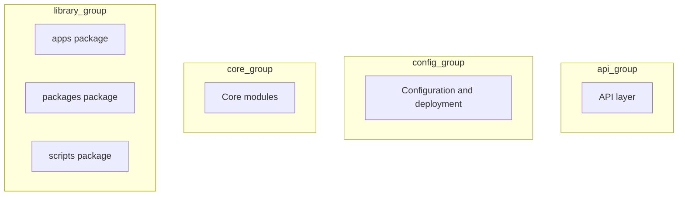

# Architecture report: imbhargav5/rooks

> Automated static analysis. **Observed** = directly seen in files/imports/AST; **Inferred** = interpretation from that evidence. Repository code was not executed.

## 1. Repository at a glance

| Item | Value |
| --- | --- |
| Repository | imbhargav5/rooks |
| Description | Over 800 k monthly downloads. Collection of awesome react hooks |
| Language | TypeScript |
| Stars | 3452 |
| Licence | MIT |
| Analysed commit / branch | b14419d1507882a683a273901d987033e6d9b4b3 / main |
| Framework(s) | Next.js, React |
| Files analysed | 632 |
| Components | 6 |

## 2. Architecture in one minute

imbhargav5/rooks - Over 800 k monthly downloads. Collection of awesome react hooks. This repository was analysed statically from 632 file(s) (0 Python). Detected technologies (observed from imports/manifests): GitHub Actions, Next.js, React, Tailwind CSS, TypeScript, Vite. Files are grouped into 6 component(s): API layer, apps package, Configuration and deployment, Core modules, packages package, scripts package. Findings below distinguish observed facts from inferred interpretation.

## 3. High-level block diagram

## 4. Main components

### API layer (`api_layer`)

- **Kind:** api
- **Status:** Observed
- **Confidence:** 0.85
- **Responsibility:** Groups 1 file(s) under api layer (observed from repository paths and static analysis).
- **Paths:** `apps/website/src/app/api/search/route.tsx`
- **Evidence:** [apps/website/src/app/api/search/route.tsx](https://github.com/imbhargav5/rooks/blob/b14419d1507882a683a273901d987033e6d9b4b3/apps/website/src/app/api/search/route.tsx)

### apps package (`apps`)

- **Kind:** library
- **Status:** Observed
- **Confidence:** 0.85
- **Responsibility:** Groups 13 file(s) under apps package (observed from repository paths and static analysis).
- **Paths:** `apps/website/content-collections.ts`, `apps/website/eslint.config.js`, `apps/website/next.config.ts`, `apps/website/postcss.config.mjs`, `apps/website/source.ts`, `apps/website/src/app/layout.config.tsx`, `apps/website/src/app/layout.tsx`, `apps/website/src/app/page.tsx`, `apps/website/src/components/Contributors.tsx`, `apps/website/src/components/HookIndex.tsx`, `apps/website/src/components/HookReferenceMeta.tsx`, `apps/website/src/components/PublicTypeReference.tsx`, `apps/website/src/components/contributors-list-data.ts`
- **Evidence:** [apps/website/content-collections.ts](https://github.com/imbhargav5/rooks/blob/b14419d1507882a683a273901d987033e6d9b4b3/apps/website/content-collections.ts); [apps/website/eslint.config.js](https://github.com/imbhargav5/rooks/blob/b14419d1507882a683a273901d987033e6d9b4b3/apps/website/eslint.config.js); [apps/website/next.config.ts](https://github.com/imbhargav5/rooks/blob/b14419d1507882a683a273901d987033e6d9b4b3/apps/website/next.config.ts); [apps/website/postcss.config.mjs](https://github.com/imbhargav5/rooks/blob/b14419d1507882a683a273901d987033e6d9b4b3/apps/website/postcss.config.mjs); [apps/website/source.ts](https://github.com/imbhargav5/rooks/blob/b14419d1507882a683a273901d987033e6d9b4b3/apps/website/source.ts); [apps/website/src/app/layout.config.tsx](https://github.com/imbhargav5/rooks/blob/b14419d1507882a683a273901d987033e6d9b4b3/apps/website/src/app/layout.config.tsx); [apps/website/src/app/layout.tsx](https://github.com/imbhargav5/rooks/blob/b14419d1507882a683a273901d987033e6d9b4b3/apps/website/src/app/layout.tsx); [apps/website/src/app/page.tsx](https://github.com/imbhargav5/rooks/blob/b14419d1507882a683a273901d987033e6d9b4b3/apps/website/src/app/page.tsx)

### Configuration and deployment (`config`)

- **Kind:** config
- **Status:** Observed
- **Confidence:** 0.85
- **Responsibility:** Groups 38 file(s) under configuration and deployment (observed from repository paths and static analysis).
- **Paths:** `apps/website/content/docs/explanation/meta.json`, `apps/website/content/docs/guides/meta.json`, `apps/website/content/docs/hooks/(animation)/meta.json`, `apps/website/content/docs/hooks/(browser)/meta.json`, `apps/website/content/docs/hooks/(dev)/meta.json`, `apps/website/content/docs/hooks/(events)/meta.json`, `apps/website/content/docs/hooks/(experimental)/meta.json`, `apps/website/content/docs/hooks/(form)/meta.json`, `apps/website/content/docs/hooks/(keyboard)/meta.json`, `apps/website/content/docs/hooks/(lifecycle)/meta.json`, `apps/website/content/docs/hooks/(mouse)/meta.json`, `apps/website/content/docs/hooks/(performance)/meta.json`, `apps/website/content/docs/hooks/(state)/meta.json`, `apps/website/content/docs/hooks/(state-history)/meta.json`, `apps/website/content/docs/hooks/(temporal)/meta.json`, `apps/website/content/docs/hooks/(ui)/meta.json`, `apps/website/content/docs/hooks/(utilities)/meta.json`, `apps/website/content/docs/hooks/(viewport)/meta.json`, `apps/website/content/docs/hooks/meta.json`, `apps/website/content/docs/meta.json`, `apps/website/content/docs/reference/meta.json`, `apps/website/package.json`, `apps/website/redirects.json`, `apps/website/tsconfig.json`, `package.json`, `packages/eslint-config/package.json`, `packages/rooks/package.json`, `packages/rooks/tsconfig.build.json`, `packages/rooks/tsconfig.e2e.json`, `packages/rooks/tsconfig.json`, `packages/rooks/tsconfig.test.json`, `packages/typescript-config/base.json`, `packages/typescript-config/nextjs.json`, `packages/typescript-config/package.json`, `packages/typescript-config/react-library.json`, `pnpm-workspace.yaml`, `scripts/docs/external-links-allowlist.json`, `turbo.json`
- **Evidence:** [apps/website/content/docs/explanation/meta.json](https://github.com/imbhargav5/rooks/blob/b14419d1507882a683a273901d987033e6d9b4b3/apps/website/content/docs/explanation/meta.json); [apps/website/content/docs/guides/meta.json](https://github.com/imbhargav5/rooks/blob/b14419d1507882a683a273901d987033e6d9b4b3/apps/website/content/docs/guides/meta.json); [apps/website/content/docs/hooks/(animation)/meta.json](https://github.com/imbhargav5/rooks/blob/b14419d1507882a683a273901d987033e6d9b4b3/apps/website/content/docs/hooks/%28animation%29/meta.json); [apps/website/content/docs/hooks/(browser)/meta.json](https://github.com/imbhargav5/rooks/blob/b14419d1507882a683a273901d987033e6d9b4b3/apps/website/content/docs/hooks/%28browser%29/meta.json); [apps/website/content/docs/hooks/(dev)/meta.json](https://github.com/imbhargav5/rooks/blob/b14419d1507882a683a273901d987033e6d9b4b3/apps/website/content/docs/hooks/%28dev%29/meta.json); [apps/website/content/docs/hooks/(events)/meta.json](https://github.com/imbhargav5/rooks/blob/b14419d1507882a683a273901d987033e6d9b4b3/apps/website/content/docs/hooks/%28events%29/meta.json); [apps/website/content/docs/hooks/(experimental)/meta.json](https://github.com/imbhargav5/rooks/blob/b14419d1507882a683a273901d987033e6d9b4b3/apps/website/content/docs/hooks/%28experimental%29/meta.json); [apps/website/content/docs/hooks/(form)/meta.json](https://github.com/imbhargav5/rooks/blob/b14419d1507882a683a273901d987033e6d9b4b3/apps/website/content/docs/hooks/%28form%29/meta.json)

### Core modules (`core`)

- **Kind:** core
- **Status:** Observed
- **Confidence:** 0.85
- **Responsibility:** Groups 1 file(s) under core modules (observed from repository paths and static analysis).
- **Paths:** `prettier.config.cjs`
- **Evidence:** [prettier.config.cjs](https://github.com/imbhargav5/rooks/blob/b14419d1507882a683a273901d987033e6d9b4b3/prettier.config.cjs)

### packages package (`packages`)

- **Kind:** library
- **Status:** Observed
- **Confidence:** 0.85
- **Responsibility:** Groups 337 file(s) under packages package (observed from repository paths and static analysis).
- **Paths:** `packages/eslint-config/base.js`, `packages/eslint-config/next.js`, `packages/eslint-config/react-internal.js`, `packages/rooks/.eslintrc.dist.js`, `packages/rooks/.size-limit.js`, `packages/rooks/build.js`, `packages/rooks/esbuild.mjs`, `packages/rooks/eslint.config.mjs`, `packages/rooks/scripts/sanity-check-all.ts`, `packages/rooks/scripts/sanity-check-eslint.ts`, `packages/rooks/scripts/sanity-check-imports.ts`, `packages/rooks/scripts/sanity-check-types.ts`, `packages/rooks/src/__tests__/ErrorBoundary.tsx`, `packages/rooks/src/__tests__/experimentalHookRegressions.spec.tsx`, `packages/rooks/src/__tests__/explicitResourceManagement.spec.ts`, `packages/rooks/src/__tests__/exports.experimental.spec.ts`, `packages/rooks/src/__tests__/shared.spec.ts`, `packages/rooks/src/__tests__/ssr.spec.ts`, `packages/rooks/src/__tests__/testUtils/flushUntil.ts`, `packages/rooks/src/__tests__/useAnimation.spec.ts`, `packages/rooks/src/__tests__/useArrayState.spec.ts`, `packages/rooks/src/__tests__/useAsyncDisposable.spec.ts`, `packages/rooks/src/__tests__/useAsyncEffect.spec.ts`, `packages/rooks/src/__tests__/useAudio.spec.tsx`, `packages/rooks/src/__tests__/useBoundingclientrect.spec.tsx`, `packages/rooks/src/__tests__/useBoundingclientrectRef.spec.tsx`, `packages/rooks/src/__tests__/useBroadcastChannel.spec.tsx`, `packages/rooks/src/__tests__/useBrowserCookieState.matrix.spec.tsx`, `packages/rooks/src/__tests__/useCheckboxInputState.spec.tsx`, `packages/rooks/src/__tests__/useClipboard.spec.tsx`, `packages/rooks/src/__tests__/useCountdown.spec.tsx`, `packages/rooks/src/__tests__/useCounter.spec.ts`, `packages/rooks/src/__tests__/useCounter.spec.tsx`, `packages/rooks/src/__tests__/useDebounce.spec.tsx`, `packages/rooks/src/__tests__/useDebounceFn.spec.ts`, `packages/rooks/src/__tests__/useDebouncedAsyncEffect.spec.ts`, `packages/rooks/src/__tests__/useDebouncedEffect.spec.ts`, `packages/rooks/src/__tests__/useDebouncedValue.spec.ts`, `packages/rooks/src/__tests__/useDeepCompareEffect.spec.ts`, `packages/rooks/src/__tests__/useDidMount.spec.ts`, `packages/rooks/src/__tests__/useDidUpdate.spec.tsx`, `packages/rooks/src/__tests__/useDimensionsRef.spec.tsx`, `packages/rooks/src/__tests__/useDisposable.spec.ts`, `packages/rooks/src/__tests__/useDocumentEventListener.spec.tsx`, `packages/rooks/src/__tests__/useDocumentTitle.spec.ts`, `packages/rooks/src/__tests__/useDocumentVisibilityState.spec.ts`, `packages/rooks/src/__tests__/useEasing.spec.ts`, `packages/rooks/src/__tests__/useEffectOnceWhen.spec.tsx`, `packages/rooks/src/__tests__/useEventListener.experimental.spec.tsx`, `packages/rooks/src/__tests__/useEventListenerRef.spec.tsx`, `packages/rooks/src/__tests__/useExperimentalBrowserHooks.spec.tsx`, `packages/rooks/src/__tests__/useExperimentalStateHooks.spec.tsx`, `packages/rooks/src/__tests__/useFetch.spec.tsx`, `packages/rooks/src/__tests__/useFileDropRef.spec.tsx`, `packages/rooks/src/__tests__/useFocus.spec.tsx`, `packages/rooks/src/__tests__/useFocusWithin.spec.tsx`, `packages/rooks/src/__tests__/useForkRef.spec.tsx`, `packages/rooks/src/__tests__/useFormState.spec.tsx`, `packages/rooks/src/__tests__/useFreshCallback.spec.ts`, `packages/rooks/src/__tests__/useFreshRef.spec.tsx`, `packages/rooks/src/__tests__/useFreshTick.spec.tsx`, `packages/rooks/src/__tests__/useFullscreen.spec.tsx`, `packages/rooks/src/__tests__/useGeolocation.spec.tsx`, `packages/rooks/src/__tests__/useGetIsMounted.spec.ts`, `packages/rooks/src/__tests__/useGlobalObjectEventListener.spec.ts`, `packages/rooks/src/__tests__/useIdleDetectionApi.spec.ts`, `packages/rooks/src/__tests__/useInViewRef.spec.tsx`, `packages/rooks/src/__tests__/useInput.spec.ts`, `packages/rooks/src/__tests__/useInput.spec.tsx`, `packages/rooks/src/__tests__/useIntersectionObserverRef.spec.tsx`, `packages/rooks/src/__tests__/useIntervalWhen.spec.tsx`, `packages/rooks/src/__tests__/useIsDroppingFiles.spec.tsx`, `packages/rooks/src/__tests__/useIsomorphicEffect.spec.tsx`, `packages/rooks/src/__tests__/useKey.spec.tsx`, `packages/rooks/src/__tests__/useKeyBindings.spec.tsx`, `packages/rooks/src/__tests__/useKeyPress.matrix.spec.tsx`, `packages/rooks/src/__tests__/useKeyRef.spec.tsx`, `packages/rooks/src/__tests__/useKeys.spec.tsx`, `packages/rooks/src/__tests__/useLifecycleLogger.spec.ts`, `packages/rooks/src/__tests__/useLocalstorageState.spec.tsx`, `packages/rooks/src/__tests__/useLockBodyScroll.spec.tsx`, `packages/rooks/src/__tests__/useMapState.spec.tsx`, `packages/rooks/src/__tests__/useMeasure.spec.tsx`, `packages/rooks/src/__tests__/useMediaMatch.spec.tsx`, `packages/rooks/src/__tests__/useMediaRecorder.spec.tsx`, `packages/rooks/src/__tests__/useMouse.spec.tsx`, `packages/rooks/src/__tests__/useMouseMoveDelta.spec.tsx`, `packages/rooks/src/__tests__/useMouseWheelDelta.spec.tsx`, `packages/rooks/src/__tests__/useMultiSelectableList.spec.tsx`, `packages/rooks/src/__tests__/useMutationObserver.spec.tsx`, `packages/rooks/src/__tests__/useMutationObserverRef.spec.tsx`, `packages/rooks/src/__tests__/useMutilSelectableList.spec.ts`, `packages/rooks/src/__tests__/useNativeMapState.spec.ts`, `packages/rooks/src/__tests__/useNavigatorLanguage.spec.tsx`, `packages/rooks/src/__tests__/useNetworkInformation.spec.tsx`, `packages/rooks/src/__tests__/useNotification.spec.tsx`, `packages/rooks/src/__tests__/useOnClickRef.spec.tsx`, `packages/rooks/src/__tests__/useOnHoverRef.spec.tsx`, `packages/rooks/src/__tests__/useOnLongHover.spec.tsx`, `packages/rooks/src/__tests__/useOnLongPress.spec.tsx`, `packages/rooks/src/__tests__/useOnStartTyping.spec.tsx`, `packages/rooks/src/__tests__/useOnWindowResize.spec.ts`, `packages/rooks/src/__tests__/useOnWindowScroll.spec.ts`, `packages/rooks/src/__tests__/useOnline.spec.tsx`, `packages/rooks/src/__tests__/useOnline.ssr.spec.tsx`, `packages/rooks/src/__tests__/useOrientation.spec.tsx`, `packages/rooks/src/__tests__/useOutsideClick.spec.tsx`, `packages/rooks/src/__tests__/useOutsideClickRef.spec.tsx`, `packages/rooks/src/__tests__/usePageLeave.spec.tsx`, `packages/rooks/src/__tests__/usePermission.matrix.spec.tsx`, `packages/rooks/src/__tests__/usePictureInPictureApi.spec.tsx`, `packages/rooks/src/__tests__/usePreferredColorScheme.spec.tsx`, `packages/rooks/src/__tests__/usePrefersReducedMotion.spec.ts`, `packages/rooks/src/__tests__/usePreviousDifferent.spec.ts`, `packages/rooks/src/__tests__/usePreviousImmediate.spec.ts`, `packages/rooks/src/__tests__/usePromise.spec.ts`, `packages/rooks/src/__tests__/useQueueState.spec.ts`, `packages/rooks/src/__tests__/useRaf.spec.tsx`, `packages/rooks/src/__tests__/useRafState.spec.tsx`, `packages/rooks/src/__tests__/useRefElement.spec.tsx`, `packages/rooks/src/__tests__/useRenderCount.spec.ts`, `packages/rooks/src/__tests__/useRequest.experimental.spec.tsx`, `packages/rooks/src/__tests__/useRequest.matrix.spec.tsx`, `packages/rooks/src/__tests__/useResizeObserver.spec.tsx`, `packages/rooks/src/__tests__/useResizeObserverRef.spec.tsx`, `packages/rooks/src/__tests__/useSafeSetState.spec.ts`, `packages/rooks/src/__tests__/useScreenDetailsApi.spec.ts`, `packages/rooks/src/__tests__/useSelect.spec.ts`, `packages/rooks/src/__tests__/useSelectableList.spec.tsx`, `packages/rooks/src/__tests__/useSelectableListWarnings.spec.ts`, `packages/rooks/src/__tests__/useSessionstorageState.spec.tsx`, `packages/rooks/src/__tests__/useSetState.spec.ts`, `packages/rooks/src/__tests__/useShare.spec.tsx`, `packages/rooks/src/__tests__/useSpeech.spec.ts`, `packages/rooks/src/__tests__/useSpring.spec.ts`, `packages/rooks/src/__tests__/useStackState.spec.ts`, `packages/rooks/src/__tests__/useSuspenseFavicon.spec.tsx`, `packages/rooks/src/__tests__/useSuspenseIndexedDBState.spec.tsx`, `packages/rooks/src/__tests__/useSuspenseLocalStorageState.spec.tsx`, `packages/rooks/src/__tests__/useSuspenseNavigatorBattery.spec.tsx`, `packages/rooks/src/__tests__/useSuspenseNavigatorUserAgentData.spec.tsx`, `packages/rooks/src/__tests__/useSuspenseSessionStorageState.spec.tsx`, `packages/rooks/src/__tests__/useTemporalAge.spec.tsx`, `packages/rooks/src/__tests__/useTemporalCountdown.spec.tsx`, `packages/rooks/src/__tests__/useTemporalElapsed.spec.tsx`, `packages/rooks/src/__tests__/useTemporalNow.spec.tsx`, `packages/rooks/src/__tests__/useTextSelection.spec.tsx`, `packages/rooks/src/__tests__/useThrottle.spec.tsx`, `packages/rooks/src/__tests__/useTimeTravelState.spec.ts`, `packages/rooks/src/__tests__/useTimeoutWhen.spec.ts`, `packages/rooks/src/__tests__/useToggle.spec.ts`, `packages/rooks/src/__tests__/useToggle.spec.tsx`, `packages/rooks/src/__tests__/useTween.spec.ts`, `packages/rooks/src/__tests__/useUndoRedoState.spec.ts`, `packages/rooks/src/__tests__/useUndoState.spec.tsx`, `packages/rooks/src/__tests__/useVibrate.spec.ts`, `packages/rooks/src/__tests__/useVideo.spec.tsx`, `packages/rooks/src/__tests__/useVirtualList.experimental.spec.tsx`, `packages/rooks/src/__tests__/useWarningOnMountInDevelopment.spec.ts`, `packages/rooks/src/__tests__/useWebLocksApi.spec.tsx`, `packages/rooks/src/__tests__/useWebSocket.experimental.spec.tsx`, `packages/rooks/src/__tests__/useWebSocket.matrix.spec.tsx`, `packages/rooks/src/__tests__/useWebWorker.spec.tsx`, `packages/rooks/src/__tests__/useWhyDidYouUpdate.spec.tsx`, `packages/rooks/src/__tests__/useWillUnmount.spec.tsx`, `packages/rooks/src/__tests__/useWindowEventListener.spec.tsx`, `packages/rooks/src/__tests__/useWindowScrollPosition.spec.ts`, `packages/rooks/src/__tests__/useWindowSize.spec.tsx`, `packages/rooks/src/experimental.ts`, `packages/rooks/src/hooks/useAnimation.ts`, `packages/rooks/src/hooks/useArrayState.ts`, `packages/rooks/src/hooks/useAsyncDisposable.ts`, `packages/rooks/src/hooks/useAsyncEffect.ts`, `packages/rooks/src/hooks/useAudio.ts`, `packages/rooks/src/hooks/useBeforeUnload.ts`, `packages/rooks/src/hooks/useBoundingclientrect.ts`, `packages/rooks/src/hooks/useBoundingclientrectRef.ts`, `packages/rooks/src/hooks/useBroadcastChannel.ts`, `packages/rooks/src/hooks/useBrowserCookieState.ts`, `packages/rooks/src/hooks/useCheckboxInputState.ts`, `packages/rooks/src/hooks/useClipboard.ts`, `packages/rooks/src/hooks/useCountdown.ts`, `packages/rooks/src/hooks/useCounter.ts`, `packages/rooks/src/hooks/useDebounce.ts`, `packages/rooks/src/hooks/useDebounceFn.ts`, `packages/rooks/src/hooks/useDebouncedAsyncEffect.ts`, `packages/rooks/src/hooks/useDebouncedEffect.ts`, `packages/rooks/src/hooks/useDebouncedValue.ts`, `packages/rooks/src/hooks/useDeepCompareEffect.ts`, `packages/rooks/src/hooks/useDidMount.ts`, `packages/rooks/src/hooks/useDidUpdate.ts`, `packages/rooks/src/hooks/useDimensionsRef.ts`, `packages/rooks/src/hooks/useDisposable.ts`, `packages/rooks/src/hooks/useDocumentEventListener.ts`, `packages/rooks/src/hooks/useDocumentTitle.ts`, `packages/rooks/src/hooks/useDocumentVisibilityState.ts`, `packages/rooks/src/hooks/useEasing.ts`, `packages/rooks/src/hooks/useEffectOnceWhen.ts`, `packages/rooks/src/hooks/useEventListener.ts`, `packages/rooks/src/hooks/useEventListenerRef.ts`, `packages/rooks/src/hooks/useFetch.ts`, `packages/rooks/src/hooks/useFileDropRef.ts`, `packages/rooks/src/hooks/useFocus.ts`, `packages/rooks/src/hooks/useFocusWithin.ts`, `packages/rooks/src/hooks/useForkRef.ts`, `packages/rooks/src/hooks/useFormState.ts`, `packages/rooks/src/hooks/useFreshCallback.ts`, `packages/rooks/src/hooks/useFreshRef.ts`, `packages/rooks/src/hooks/useFreshTick.ts`, `packages/rooks/src/hooks/useFullscreen.ts`, `packages/rooks/src/hooks/useGeolocation.ts`, `packages/rooks/src/hooks/useGetIsMounted.ts`, `packages/rooks/src/hooks/useGlobalObjectEventListener.ts`, `packages/rooks/src/hooks/useIdleDetectionApi.ts`, `packages/rooks/src/hooks/useInViewRef.ts`, `packages/rooks/src/hooks/useInput.ts`, `packages/rooks/src/hooks/useIntersectionObserverRef.ts`, `packages/rooks/src/hooks/useIntervalWhen.ts`, `packages/rooks/src/hooks/useIsClient.ts`, `packages/rooks/src/hooks/useIsDroppingFiles.ts`, `packages/rooks/src/hooks/useIsomorphicEffect.ts`, `packages/rooks/src/hooks/useKey.ts`, `packages/rooks/src/hooks/useKeyBindings.ts`, `packages/rooks/src/hooks/useKeyPress.ts`, `packages/rooks/src/hooks/useKeyRef.ts`, `packages/rooks/src/hooks/useKeys.ts`, `packages/rooks/src/hooks/useLifecycleLogger.ts`, `packages/rooks/src/hooks/useLoadTemporal.ts`, `packages/rooks/src/hooks/useLocalstorageState.ts`, `packages/rooks/src/hooks/useLocationHash.ts`, `packages/rooks/src/hooks/useLocationSearchParam.ts`, `packages/rooks/src/hooks/useLocationSnapshot.ts`, `packages/rooks/src/hooks/useLockBodyScroll.ts`, `packages/rooks/src/hooks/useMapState.ts`, `packages/rooks/src/hooks/useMeasure.ts`, `packages/rooks/src/hooks/useMediaDevices.ts`, `packages/rooks/src/hooks/useMediaMatch.ts`, `packages/rooks/src/hooks/useMediaRecorder.ts`, `packages/rooks/src/hooks/useMergeRefs.ts`, `packages/rooks/src/hooks/useMouse.ts`, `packages/rooks/src/hooks/useMouseMoveDelta.ts`, `packages/rooks/src/hooks/useMouseWheelDelta.ts`, `packages/rooks/src/hooks/useMultiSelectableList.ts`, `packages/rooks/src/hooks/useMutationObserver.ts`, `packages/rooks/src/hooks/useMutationObserverRef.ts`, `packages/rooks/src/hooks/useNativeMapState.ts`, `packages/rooks/src/hooks/useNavigatorLanguage.ts`, `packages/rooks/src/hooks/useNetworkInformation.ts`, `packages/rooks/src/hooks/useNotification.ts`, `packages/rooks/src/hooks/useOnClickRef.ts`, `packages/rooks/src/hooks/useOnHoverRef.ts`, `packages/rooks/src/hooks/useOnLongHover.ts`, `packages/rooks/src/hooks/useOnLongPress.ts`, `packages/rooks/src/hooks/useOnStartTyping.ts`, `packages/rooks/src/hooks/useOnWindowResize.ts`, `packages/rooks/src/hooks/useOnWindowScroll.ts`, `packages/rooks/src/hooks/useOnline.ts`, `packages/rooks/src/hooks/useOrientation.ts`, `packages/rooks/src/hooks/useOutsideClick.ts`, `packages/rooks/src/hooks/useOutsideClickRef.ts`, `packages/rooks/src/hooks/usePageLeave.ts`, `packages/rooks/src/hooks/usePermission.ts`, `packages/rooks/src/hooks/usePictureInPictureApi.ts`, `packages/rooks/src/hooks/usePreferredColorScheme.ts`, `packages/rooks/src/hooks/usePrefersReducedMotion.ts`, `packages/rooks/src/hooks/usePreviousDifferent.ts`, `packages/rooks/src/hooks/usePreviousImmediate.ts`, `packages/rooks/src/hooks/usePromise.ts`, `packages/rooks/src/hooks/useQueueState.ts`, `packages/rooks/src/hooks/useRaf.ts`, `packages/rooks/src/hooks/useRafState.ts`, `packages/rooks/src/hooks/useRefElement.ts`, `packages/rooks/src/hooks/useRenderCount.ts`, `packages/rooks/src/hooks/useRequest.ts`, `packages/rooks/src/hooks/useResizeObserverRef.ts`, `packages/rooks/src/hooks/useResponsive.ts`, `packages/rooks/src/hooks/useSafeSetState.ts`, `packages/rooks/src/hooks/useScreenDetailsApi.ts`, `packages/rooks/src/hooks/useScript.ts`, `packages/rooks/src/hooks/useScroll.ts`, `packages/rooks/src/hooks/useSelect.ts`, `packages/rooks/src/hooks/useSelectableList.ts`, `packages/rooks/src/hooks/useSessionstorageState.ts`, `packages/rooks/src/hooks/useSetState.ts`, `packages/rooks/src/hooks/useShare.ts`, `packages/rooks/src/hooks/useSize.ts`, `packages/rooks/src/hooks/useSpeech.ts`, `packages/rooks/src/hooks/useSpring.ts`, `packages/rooks/src/hooks/useStackState.ts`, `packages/rooks/src/hooks/useSuspenseFavicon.ts`, `packages/rooks/src/hooks/useSuspenseIndexedDBState.ts`, `packages/rooks/src/hooks/useSuspenseLocalStorageState.ts`, `packages/rooks/src/hooks/useSuspenseNavigatorBattery.ts`, `packages/rooks/src/hooks/useSuspenseNavigatorUserAgentData.ts`, `packages/rooks/src/hooks/useSuspenseSessionStorageState.ts`, `packages/rooks/src/hooks/useTemporalAge.ts`, `packages/rooks/src/hooks/useTemporalCountdown.ts`, `packages/rooks/src/hooks/useTemporalElapsed.ts`, `packages/rooks/src/hooks/useTemporalNow.ts`, `packages/rooks/src/hooks/useTextSelection.ts`, `packages/rooks/src/hooks/useThrottle.ts`, `packages/rooks/src/hooks/useTimeTravelState.ts`, `packages/rooks/src/hooks/useTimeoutWhen.ts`, `packages/rooks/src/hooks/useToggle.ts`, `packages/rooks/src/hooks/useTween.ts`, `packages/rooks/src/hooks/useUndoRedoState.ts`, `packages/rooks/src/hooks/useUndoState.ts`, `packages/rooks/src/hooks/useVibrate.ts`, `packages/rooks/src/hooks/useVideo.ts`, `packages/rooks/src/hooks/useVirtualList.ts`, `packages/rooks/src/hooks/useWarningOnMountInDevelopment.ts`, `packages/rooks/src/hooks/useWebLocksApi.ts`, `packages/rooks/src/hooks/useWebSocket.ts`, `packages/rooks/src/hooks/useWebWorker.ts`, `packages/rooks/src/hooks/useWhyDidYouUpdate.ts`, `packages/rooks/src/hooks/useWillUnmount.ts`, `packages/rooks/src/hooks/useWindowEventListener.ts`, `packages/rooks/src/hooks/useWindowScrollPosition.ts`, `packages/rooks/src/hooks/useWindowSize.ts`, `packages/rooks/src/hooks/warning.ts`, `packages/rooks/src/index-standalone.ts`, `packages/rooks/src/index.ts`, `packages/rooks/src/temporal.ts`, `packages/rooks/src/types/index-value.ts`, `packages/rooks/src/types/types.ts`, `packages/rooks/src/types/utils.ts`, `packages/rooks/src/utils/cookies.ts`, `packages/rooks/src/utils/doesIdentifierMatchKeyboardEvent.ts`, `packages/rooks/src/utils/domrect-polyfill.ts`, `packages/rooks/src/utils/eventTarget.ts`, `packages/rooks/src/utils/explicitResourceManagement.ts`, `packages/rooks/src/utils/locationStore.ts`, `packages/rooks/src/utils/noop.ts`, `packages/rooks/src/utils/stableSerialize.ts`, `packages/rooks/src/utils/utils.ts`, `packages/rooks/src/vitest.setup.ts`, `packages/rooks/vitest.config.ts`
- **Evidence:** [packages/eslint-config/base.js](https://github.com/imbhargav5/rooks/blob/b14419d1507882a683a273901d987033e6d9b4b3/packages/eslint-config/base.js); [packages/eslint-config/next.js](https://github.com/imbhargav5/rooks/blob/b14419d1507882a683a273901d987033e6d9b4b3/packages/eslint-config/next.js); [packages/eslint-config/react-internal.js](https://github.com/imbhargav5/rooks/blob/b14419d1507882a683a273901d987033e6d9b4b3/packages/eslint-config/react-internal.js); [packages/rooks/.eslintrc.dist.js](https://github.com/imbhargav5/rooks/blob/b14419d1507882a683a273901d987033e6d9b4b3/packages/rooks/.eslintrc.dist.js); [packages/rooks/.size-limit.js](https://github.com/imbhargav5/rooks/blob/b14419d1507882a683a273901d987033e6d9b4b3/packages/rooks/.size-limit.js); [packages/rooks/build.js](https://github.com/imbhargav5/rooks/blob/b14419d1507882a683a273901d987033e6d9b4b3/packages/rooks/build.js); [packages/rooks/esbuild.mjs](https://github.com/imbhargav5/rooks/blob/b14419d1507882a683a273901d987033e6d9b4b3/packages/rooks/esbuild.mjs); [packages/rooks/eslint.config.mjs](https://github.com/imbhargav5/rooks/blob/b14419d1507882a683a273901d987033e6d9b4b3/packages/rooks/eslint.config.mjs)

### scripts package (`scripts`)

- **Kind:** library
- **Status:** Observed
- **Confidence:** 0.85
- **Responsibility:** Groups 7 file(s) under scripts package (observed from repository paths and static analysis).
- **Paths:** `scripts/bump-peer-dep-ranges.js`, `scripts/create/cli.mjs`, `scripts/create/generator.mjs`, `scripts/create/generator.test.mjs`, `scripts/create/index.mjs`, `scripts/ralph.sh`, `scripts/update-all-contributors/index.mjs`
- **Evidence:** [scripts/bump-peer-dep-ranges.js](https://github.com/imbhargav5/rooks/blob/b14419d1507882a683a273901d987033e6d9b4b3/scripts/bump-peer-dep-ranges.js); [scripts/create/cli.mjs](https://github.com/imbhargav5/rooks/blob/b14419d1507882a683a273901d987033e6d9b4b3/scripts/create/cli.mjs); [scripts/create/generator.mjs](https://github.com/imbhargav5/rooks/blob/b14419d1507882a683a273901d987033e6d9b4b3/scripts/create/generator.mjs); [scripts/create/generator.test.mjs](https://github.com/imbhargav5/rooks/blob/b14419d1507882a683a273901d987033e6d9b4b3/scripts/create/generator.test.mjs); [scripts/create/index.mjs](https://github.com/imbhargav5/rooks/blob/b14419d1507882a683a273901d987033e6d9b4b3/scripts/create/index.mjs); [scripts/ralph.sh](https://github.com/imbhargav5/rooks/blob/b14419d1507882a683a273901d987033e6d9b4b3/scripts/ralph.sh); [scripts/update-all-contributors/index.mjs](https://github.com/imbhargav5/rooks/blob/b14419d1507882a683a273901d987033e6d9b4b3/scripts/update-all-contributors/index.mjs)

## 5. Execution flow

**Observed** entry point(s):

- [packages/rooks/src/index.ts](https://github.com/imbhargav5/rooks/blob/b14419d1507882a683a273901d987033e6d9b4b3/packages/rooks/src/index.ts)

Representative flow (derived from observed entry points and the import graph; steps beyond the entry point are **Inferred**):

1. Execution starts at an observed entry point listed above, if present.
2. No internal import relationships between components were observed.

## 6. Project structure

### `(root)`

- `.all-contributorsrc` - other (19196 bytes)
- `.cspell.json` - config (385 bytes)
- `.eslintignore` - other (6 bytes)
- `.eslintrc.js` - source, JavaScript (207 bytes)
- `.gitignore` - other (579 bytes)
- `.mergify.yml` - config (1281 bytes)
- `.nvmrc` - other (3 bytes)
- `.oneignore` - other (579 bytes)
- `.prettierignore` - other (27 bytes)
- `.prettierrc.json` - config (62 bytes)
- `CHANGELOG.md` - docs (48 bytes)
- `CODE_OF_CONDUCT.md` - docs (3355 bytes)
- `CONTRIBUTING.md` - docs (7248 bytes)
- `GEMINI.md` - docs (645 bytes)
- `LICENSE` - docs (1075 bytes)
- `MAINTENANCE.md` - docs (6954 bytes)
- `SECURITY.md` - docs (2129 bytes)
- `SUPPORT.md` - docs (1727 bytes)
- `code-style-guide.md` - docs (6231 bytes)
- `ideas.md` - docs (33563 bytes)
- `package.json` - manifest (3049 bytes)
- `pnpm-workspace.yaml` - config (40 bytes)
- `prettier.config.cjs` - source, JavaScript (129 bytes)
- `turbo.json` - config (1266 bytes)

### `.changeset`

- `.changeset/README.md` - docs (510 bytes)
- `.changeset/config.json` - config (320 bytes)

### `.claude`

- `.claude/agents/react-hook-creator.md` - docs (697 bytes)

### `.codesandbox`

- `.codesandbox/tasks.json` - config (995 bytes)

### `.cursor`

- `.cursor/rules/create-documentation.mdc` - other (552 bytes)
- `.cursor/rules/react-hook.mdc` - other (601 bytes)

### `.github`

- `.github/FUNDING.yml` - config (711 bytes)
- `.github/ISSUE_TEMPLATE/bug_report.yml` - config (4777 bytes)
- `.github/ISSUE_TEMPLATE/config.yml` - config (601 bytes)
- `.github/ISSUE_TEMPLATE/contribution_proposal.yml` - config (4907 bytes)
- `.github/ISSUE_TEMPLATE/feature_request.yml` - config (4627 bytes)
- `.github/actions/ci-setup/action.yml` - config (833 bytes)
- `.github/assets/Final_Icon.svg` - other (3434 bytes)
- `.github/assets/favicon-24x24.svg` - other (3891 bytes)
- `.github/assets/favicon-32x32.svg` - other (3885 bytes)
- `.github/assets/favicon-48x48.svg` - other (3890 bytes)
- `.github/assets/icon.svg` - other (3434 bytes)
- `.github/assets/rooks.svg` - other (744 bytes)
- `.github/powered-by-vercel.svg` - other (5379 bytes)
- `.github/pull_request_template.md` - docs (2139 bytes)
- `.github/stale.yml` - config (684 bytes)
- `.github/workflows/ci-release.yml` - ci, YAML (1646 bytes)
- `.github/workflows/contributors.yml` - ci, YAML (1333 bytes)
- `.github/workflows/docs-external-links.yml` - ci, YAML (711 bytes)
- `.github/workflows/pr.yml` - ci, YAML (911 bytes)
- `.github/workflows/publish.yml` - ci, YAML (3416 bytes)

### `.vscode`

- `.vscode/settings.json` - config (696 bytes)

### `apps`

- `apps/website/CHANGELOG.md` - docs (13321 bytes)
- `apps/website/content-collections.ts` - source, TypeScript (1741 bytes)
- `apps/website/content/docs/explanation/design-and-stability.mdx` - docs (2786 bytes)
- `apps/website/content/docs/explanation/meta.json` - config (66 bytes)
- `apps/website/content/docs/getting-started.mdx` - docs (1551 bytes)
- `apps/website/content/docs/guides/experimental-hooks.mdx` - docs (1765 bytes)
- `apps/website/content/docs/guides/meta.json` - config (101 bytes)
- `apps/website/content/docs/guides/ssr-and-browser-apis.mdx` - docs (4495 bytes)
- `apps/website/content/docs/guides/temporal-hooks.mdx` - docs (3400 bytes)
- `apps/website/content/docs/hooks/(animation)/meta.json` - config (79 bytes)
- `apps/website/content/docs/hooks/(animation)/useAnimation.mdx` - docs (2652 bytes)
- `apps/website/content/docs/hooks/(animation)/useEasing.mdx` - docs (3828 bytes)
- `apps/website/content/docs/hooks/(animation)/useIntervalWhen.mdx` - docs (2391 bytes)
- `apps/website/content/docs/hooks/(animation)/useLockBodyScroll.mdx` - docs (1927 bytes)
- `apps/website/content/docs/hooks/(animation)/usePrefersReducedMotion.mdx` - docs (1570 bytes)
- `apps/website/content/docs/hooks/(animation)/useRaf.mdx` - docs (2493 bytes)
- `apps/website/content/docs/hooks/(animation)/useResizeObserverRef.mdx` - docs (2310 bytes)
- `apps/website/content/docs/hooks/(animation)/useSpring.mdx` - docs (2773 bytes)
- `apps/website/content/docs/hooks/(animation)/useTimeoutWhen.mdx` - docs (2394 bytes)
- `apps/website/content/docs/hooks/(animation)/useTween.mdx` - docs (2315 bytes)
- `apps/website/content/docs/hooks/(browser)/meta.json` - config (73 bytes)
- `apps/website/content/docs/hooks/(browser)/useBroadcastChannel.mdx` - docs (14511 bytes)
- `apps/website/content/docs/hooks/(browser)/useClipboard.mdx` - docs (4732 bytes)
- `apps/website/content/docs/hooks/(browser)/useFetch.mdx` - docs (9486 bytes)
- `apps/website/content/docs/hooks/(browser)/useGeolocation.mdx` - docs (3376 bytes)
- `apps/website/content/docs/hooks/(browser)/useIdleDetectionApi.mdx` - docs (8328 bytes)
- `apps/website/content/docs/hooks/(browser)/useMediaRecorder.mdx` - docs (9570 bytes)
- `apps/website/content/docs/hooks/(browser)/useNavigatorLanguage.mdx` - docs (1325 bytes)
- `apps/website/content/docs/hooks/(browser)/useNetworkInformation.mdx` - docs (5929 bytes)
- `apps/website/content/docs/hooks/(browser)/useNotification.mdx` - docs (6949 bytes)
- `apps/website/content/docs/hooks/(browser)/useOnline.mdx` - docs (1927 bytes)
- `apps/website/content/docs/hooks/(browser)/useOrientation.mdx` - docs (3486 bytes)
- `apps/website/content/docs/hooks/(browser)/useScreenDetailsApi.mdx` - docs (14000 bytes)
- `apps/website/content/docs/hooks/(browser)/useShare.mdx` - docs (5405 bytes)
- `apps/website/content/docs/hooks/(browser)/useSpeech.mdx` - docs (8756 bytes)
- `apps/website/content/docs/hooks/(browser)/useVibrate.mdx` - docs (1988 bytes)
- `apps/website/content/docs/hooks/(browser)/useWebLocksApi.mdx` - docs (12210 bytes)
- `apps/website/content/docs/hooks/(dev)/meta.json` - config (83 bytes)
- `apps/website/content/docs/hooks/(dev)/useRenderCount.mdx` - docs (1598 bytes)
- `apps/website/content/docs/hooks/(dev)/useWhyDidYouUpdate.mdx` - docs (2698 bytes)
- `apps/website/content/docs/hooks/(events)/meta.json` - config (78 bytes)
- `apps/website/content/docs/hooks/(events)/useDocumentEventListener.mdx` - docs (2356 bytes)
- `apps/website/content/docs/hooks/(events)/useDocumentVisibilityState.mdx` - docs (1804 bytes)
- `apps/website/content/docs/hooks/(events)/useFocus.mdx` - docs (2004 bytes)
- `apps/website/content/docs/hooks/(events)/useFocusWithin.mdx` - docs (2093 bytes)
- `apps/website/content/docs/hooks/(events)/useIsDroppingFiles.mdx` - docs (1935 bytes)
- `apps/website/content/docs/hooks/(events)/useOnClickRef.mdx` - docs (1999 bytes)
- `apps/website/content/docs/hooks/(events)/useOnHoverRef.mdx` - docs (1728 bytes)
- `apps/website/content/docs/hooks/(events)/useOnLongHover.mdx` - docs (1960 bytes)
- `apps/website/content/docs/hooks/(events)/useOnLongPress.mdx` - docs (2082 bytes)
- `apps/website/content/docs/hooks/(events)/useOnStartTyping.mdx` - docs (2141 bytes)
- `apps/website/content/docs/hooks/(events)/useOnWindowResize.mdx` - docs (1704 bytes)
- `apps/website/content/docs/hooks/(events)/useOnWindowScroll.mdx` - docs (1730 bytes)
- `apps/website/content/docs/hooks/(events)/useOutsideClick.mdx` - docs (1973 bytes)
- `apps/website/content/docs/hooks/(events)/useOutsideClickRef.mdx` - docs (1806 bytes)
- `apps/website/content/docs/hooks/(events)/usePageLeave.mdx` - docs (2158 bytes)
- `apps/website/content/docs/hooks/(events)/useTextSelection.mdx` - docs (2609 bytes)
- `apps/website/content/docs/hooks/(events)/useWindowEventListener.mdx` - docs (2142 bytes)
- `apps/website/content/docs/hooks/(experimental)/meta.json` - config (80 bytes)
- `apps/website/content/docs/hooks/(experimental)/useAsyncDisposable.mdx` - docs (3752 bytes)
- `apps/website/content/docs/hooks/(experimental)/useBeforeUnload.mdx` - docs (2486 bytes)
- `apps/website/content/docs/hooks/(experimental)/useBrowserCookieState.mdx` - docs (3418 bytes)
- `apps/website/content/docs/hooks/(experimental)/useDisposable.mdx` - docs (3505 bytes)
- `apps/website/content/docs/hooks/(experimental)/useEventListener.mdx` - docs (2724 bytes)
- `apps/website/content/docs/hooks/(experimental)/useIsClient.mdx` - docs (1163 bytes)
- `apps/website/content/docs/hooks/(experimental)/useKeyPress.mdx` - docs (2044 bytes)
- `apps/website/content/docs/hooks/(experimental)/useLocationHash.mdx` - docs (1366 bytes)
- `apps/website/content/docs/hooks/(experimental)/useLocationSearchParam.mdx` - docs (1531 bytes)
- `apps/website/content/docs/hooks/(experimental)/useLocationSnapshot.mdx` - docs (1439 bytes)
- `apps/website/content/docs/hooks/(experimental)/useMediaDevices.mdx` - docs (2886 bytes)
- `apps/website/content/docs/hooks/(experimental)/usePermission.mdx` - docs (2858 bytes)
- `apps/website/content/docs/hooks/(experimental)/useRequest.mdx` - docs (6733 bytes)
- `apps/website/content/docs/hooks/(experimental)/useResponsive.mdx` - docs (2178 bytes)
- `apps/website/content/docs/hooks/(experimental)/useScript.mdx` - docs (2888 bytes)
- `apps/website/content/docs/hooks/(experimental)/useScroll.mdx` - docs (2440 bytes)
- `apps/website/content/docs/hooks/(experimental)/useSize.mdx` - docs (2383 bytes)
- `apps/website/content/docs/hooks/(experimental)/useSuspenseFavicon.mdx` - docs (6772 bytes)
- `apps/website/content/docs/hooks/(experimental)/useSuspenseIndexedDBState.mdx` - docs (12028 bytes)
- `apps/website/content/docs/hooks/(experimental)/useSuspenseLocalStorageState.mdx` - docs (13599 bytes)
- `apps/website/content/docs/hooks/(experimental)/useSuspenseNavigatorBattery.mdx` - docs (7392 bytes)
- `apps/website/content/docs/hooks/(experimental)/useSuspenseNavigatorUserAgentData.mdx` - docs (7160 bytes)
- `apps/website/content/docs/hooks/(experimental)/useSuspenseSessionStorageState.mdx` - docs (23320 bytes)
- `apps/website/content/docs/hooks/(experimental)/useVirtualList.mdx` - docs (4355 bytes)
- `apps/website/content/docs/hooks/(experimental)/useWebSocket.mdx` - docs (5143 bytes)
- `apps/website/content/docs/hooks/(form)/meta.json` - config (84 bytes)
- `apps/website/content/docs/hooks/(form)/useCheckboxInputState.mdx` - docs (1932 bytes)
- `apps/website/content/docs/hooks/(form)/useFileDropRef.mdx` - docs (2742 bytes)
- `apps/website/content/docs/hooks/(form)/useFormState.mdx` - docs (3729 bytes)
- `apps/website/content/docs/hooks/(keyboard)/meta.json` - config (80 bytes)
- `apps/website/content/docs/hooks/(keyboard)/useInput.mdx` - docs (2020 bytes)
- `apps/website/content/docs/hooks/(keyboard)/useKey.mdx` - docs (2231 bytes)
- `apps/website/content/docs/hooks/(keyboard)/useKeyBindings.mdx` - docs (2056 bytes)
- `apps/website/content/docs/hooks/(keyboard)/useKeyRef.mdx` - docs (1971 bytes)
- `apps/website/content/docs/hooks/(keyboard)/useKeys.mdx` - docs (2458 bytes)
- `apps/website/content/docs/hooks/(lifecycle)/meta.json` - config (84 bytes)
- `apps/website/content/docs/hooks/(lifecycle)/useAsyncEffect.mdx` - docs (2958 bytes)
- `apps/website/content/docs/hooks/(lifecycle)/useDebouncedAsyncEffect.mdx` - docs (3323 bytes)
- `apps/website/content/docs/hooks/(lifecycle)/useDebouncedEffect.mdx` - docs (2948 bytes)
- `apps/website/content/docs/hooks/(lifecycle)/useDeepCompareEffect.mdx` - docs (2419 bytes)
- `apps/website/content/docs/hooks/(lifecycle)/useDidMount.mdx` - docs (1523 bytes)
- `apps/website/content/docs/hooks/(lifecycle)/useDidUpdate.mdx` - docs (2373 bytes)
- `apps/website/content/docs/hooks/(lifecycle)/useDocumentTitle.mdx` - docs (2342 bytes)
- `apps/website/content/docs/hooks/(lifecycle)/useEffectOnceWhen.mdx` - docs (2010 bytes)
- `apps/website/content/docs/hooks/(lifecycle)/useIsomorphicEffect.mdx` - docs (2012 bytes)
- `apps/website/content/docs/hooks/(lifecycle)/useLifecycleLogger.mdx` - docs (1954 bytes)
- `apps/website/content/docs/hooks/(lifecycle)/useWillUnmount.mdx` - docs (1840 bytes)
- `apps/website/content/docs/hooks/(mouse)/meta.json` - config (74 bytes)
- `apps/website/content/docs/hooks/(mouse)/useMouse.mdx` - docs (1808 bytes)
- `apps/website/content/docs/hooks/(mouse)/useMouseMoveDelta.mdx` - docs (1725 bytes)
- `apps/website/content/docs/hooks/(mouse)/useMouseWheelDelta.mdx` - docs (1604 bytes)
- `apps/website/content/docs/hooks/(performance)/meta.json` - config (85 bytes)
- `apps/website/content/docs/hooks/(performance)/useDebounce.mdx` - docs (3061 bytes)
- `apps/website/content/docs/hooks/(performance)/useDebounceFn.mdx` - docs (3353 bytes)
- `apps/website/content/docs/hooks/(performance)/useDebouncedValue.mdx` - docs (2871 bytes)
- `apps/website/content/docs/hooks/(performance)/useThrottle.mdx` - docs (2199 bytes)
- `apps/website/content/docs/hooks/(performance)/useWebWorker.mdx` - docs (4074 bytes)
- `apps/website/content/docs/hooks/(state)/meta.json` - config (80 bytes)
- `apps/website/content/docs/hooks/(state)/useArrayState.mdx` - docs (18802 bytes)
- `apps/website/content/docs/hooks/(state)/useCountdown.mdx` - docs (3515 bytes)
- `apps/website/content/docs/hooks/(state)/useCounter.mdx` - docs (2903 bytes)
- `apps/website/content/docs/hooks/(state)/useGetIsMounted.mdx` - docs (7402 bytes)
- `apps/website/content/docs/hooks/(state)/useLocalstorageState.mdx` - docs (3784 bytes)
- `apps/website/content/docs/hooks/(state)/useMapState.mdx` - docs (3495 bytes)
- `apps/website/content/docs/hooks/(state)/useMultiSelectableList.mdx` - docs (6302 bytes)
- `apps/website/content/docs/hooks/(state)/useNativeMapState.mdx` - docs (8166 bytes)
- `apps/website/content/docs/hooks/(state)/usePreviousDifferent.mdx` - docs (2476 bytes)
- `apps/website/content/docs/hooks/(state)/usePreviousImmediate.mdx` - docs (2352 bytes)
- `apps/website/content/docs/hooks/(state)/usePromise.mdx` - docs (4159 bytes)
- `apps/website/content/docs/hooks/(state)/useQueueState.mdx` - docs (5754 bytes)
- `apps/website/content/docs/hooks/(state)/useRafState.mdx` - docs (4308 bytes)
- `apps/website/content/docs/hooks/(state)/useSafeSetState.mdx` - docs (4774 bytes)
- `apps/website/content/docs/hooks/(state)/useSelect.mdx` - docs (3539 bytes)
- `apps/website/content/docs/hooks/(state)/useSelectableList.mdx` - docs (6742 bytes)
- `apps/website/content/docs/hooks/(state)/useSessionstorageState.mdx` - docs (3000 bytes)
- `apps/website/content/docs/hooks/(state)/useSetState.mdx` - docs (4581 bytes)
- `apps/website/content/docs/hooks/(state)/useStackState.mdx` - docs (6723 bytes)
- `apps/website/content/docs/hooks/(state-history)/meta.json` - config (90 bytes)
- `apps/website/content/docs/hooks/(state-history)/useTimeTravelState.mdx` - docs (3642 bytes)
- `apps/website/content/docs/hooks/(state-history)/useToggle.mdx` - docs (2760 bytes)
- `apps/website/content/docs/hooks/(state-history)/useUndoRedoState.mdx` - docs (3267 bytes)
- `apps/website/content/docs/hooks/(state-history)/useUndoState.mdx` - docs (2574 bytes)
- `apps/website/content/docs/hooks/(temporal)/meta.json` - config (69 bytes)
- `apps/website/content/docs/hooks/(temporal)/useTemporalAge.mdx` - docs (2437 bytes)
- `apps/website/content/docs/hooks/(temporal)/useTemporalCountdown.mdx` - docs (2690 bytes)
- `apps/website/content/docs/hooks/(temporal)/useTemporalElapsed.mdx` - docs (2452 bytes)
- `apps/website/content/docs/hooks/(temporal)/useTemporalNow.mdx` - docs (3059 bytes)
- `apps/website/content/docs/hooks/(ui)/meta.json` - config (73 bytes)
- `apps/website/content/docs/hooks/(ui)/useAudio.mdx` - docs (5600 bytes)
- `apps/website/content/docs/hooks/(ui)/useBoundingclientrect.mdx` - docs (3131 bytes)
- `apps/website/content/docs/hooks/(ui)/useBoundingclientrectRef.mdx` - docs (2710 bytes)
- `apps/website/content/docs/hooks/(ui)/useDimensionsRef.mdx` - docs (3210 bytes)
- `apps/website/content/docs/hooks/(ui)/useFullscreen.mdx` - docs (4393 bytes)
- `apps/website/content/docs/hooks/(ui)/useInViewRef.mdx` - docs (3026 bytes)
- `apps/website/content/docs/hooks/(ui)/useIntersectionObserverRef.mdx` - docs (3675 bytes)
- `apps/website/content/docs/hooks/(ui)/useMeasure.mdx` - docs (4201 bytes)
- `apps/website/content/docs/hooks/(ui)/useMediaMatch.mdx` - docs (2883 bytes)
- `apps/website/content/docs/hooks/(ui)/useMutationObserver.mdx` - docs (3641 bytes)
- `apps/website/content/docs/hooks/(ui)/useMutationObserverRef.mdx` - docs (3200 bytes)
- `apps/website/content/docs/hooks/(ui)/usePictureInPictureApi.mdx` - docs (4335 bytes)
- `apps/website/content/docs/hooks/(ui)/usePreferredColorScheme.mdx` - docs (3137 bytes)
- `apps/website/content/docs/hooks/(ui)/useVideo.mdx` - docs (4066 bytes)
- `apps/website/content/docs/hooks/(utilities)/meta.json` - config (78 bytes)
- `apps/website/content/docs/hooks/(utilities)/useEventListenerRef.mdx` - docs (2530 bytes)
- `apps/website/content/docs/hooks/(utilities)/useForkRef.mdx` - docs (1819 bytes)
- `apps/website/content/docs/hooks/(utilities)/useFreshCallback.mdx` - docs (2120 bytes)
- `apps/website/content/docs/hooks/(utilities)/useFreshRef.mdx` - docs (2040 bytes)
- `apps/website/content/docs/hooks/(utilities)/useFreshTick.mdx` - docs (1965 bytes)
- `apps/website/content/docs/hooks/(utilities)/useMergeRefs.mdx` - docs (1896 bytes)
- `apps/website/content/docs/hooks/(utilities)/useRefElement.mdx` - docs (1606 bytes)
- `apps/website/content/docs/hooks/(viewport)/meta.json` - config (80 bytes)
- `apps/website/content/docs/hooks/(viewport)/useWindowScrollPosition.mdx` - docs (1793 bytes)
- `apps/website/content/docs/hooks/(viewport)/useWindowSize.mdx` - docs (1859 bytes)
- `apps/website/content/docs/hooks/index.mdx` - docs (1681 bytes)
- `apps/website/content/docs/hooks/meta.json` - config (376 bytes)
- `apps/website/content/docs/index.mdx` - docs (2623 bytes)
- `apps/website/content/docs/meta.json` - config (139 bytes)
- `apps/website/content/docs/reference/entrypoints-and-compatibility.mdx` - docs (2650 bytes)
- `apps/website/content/docs/reference/meta.json` - config (73 bytes)
- `apps/website/eslint.config.js` - source, JavaScript (136 bytes)
- `apps/website/next.config.ts` - source, TypeScript (522 bytes)
- `apps/website/package.json` - manifest (1321 bytes)
- `apps/website/postcss.config.mjs` - source, JavaScript (70 bytes)
- `apps/website/public/images/powered-by-vercel.svg` - other (5379 bytes)
- `apps/website/redirects.json` - config (643 bytes)
- `apps/website/source.ts` - source, TypeScript (813 bytes)
- `apps/website/src/app/api/search/route.tsx` - source, TypeScript (575 bytes)
- `apps/website/src/app/docs/[[...slug]]/page.tsx` - docs (3830 bytes)
- `apps/website/src/app/docs/docs.css` - docs (212 bytes)
- `apps/website/src/app/docs/layout.tsx` - docs (453 bytes)
- `apps/website/src/app/globals.css` - other (23 bytes)
- `apps/website/src/app/layout.config.tsx` - source, TypeScript (1478 bytes)
- `apps/website/src/app/layout.tsx` - source, TypeScript (688 bytes)
- `apps/website/src/app/og/docs/[...slug]/route.tsx` - docs (1370 bytes)
- `apps/website/src/app/page.tsx` - source, TypeScript (247 bytes)
- `apps/website/src/components/CONTRIBUTORS.md` - docs (29225 bytes)
- `apps/website/src/components/Contributors.tsx` - source, TypeScript (1902 bytes)
- `apps/website/src/components/HookIndex.tsx` - source, TypeScript (6403 bytes)
- `apps/website/src/components/HookReferenceMeta.tsx` - source, TypeScript (2848 bytes)
- `apps/website/src/components/PublicTypeReference.tsx` - source, TypeScript (1274 bytes)
- `apps/website/src/components/contributors-list-data.ts` - source, TypeScript (18476 bytes)
- `apps/website/tsconfig.json` - config (404 bytes)

### `docs`

- `docs/adding-a-hook.md` - docs (5816 bytes)
- `docs/authoring-documentation.md` - docs (5260 bytes)
- `docs/local-development.md` - docs (3950 bytes)

### `packages`

- `packages/eslint-config/CHANGELOG.md` - docs (281 bytes)
- `packages/eslint-config/README.md` - docs (72 bytes)
- `packages/eslint-config/base.js` - source, JavaScript (651 bytes)
- `packages/eslint-config/next.js` - source, JavaScript (1311 bytes)
- `packages/eslint-config/package.json` - manifest (634 bytes)
- `packages/eslint-config/react-internal.js` - source, JavaScript (1088 bytes)
- `packages/rooks/.escheckrc` - other (80 bytes)
- `packages/rooks/.eslintrc.dist.js` - source, JavaScript (594 bytes)
- `packages/rooks/.gitignore` - other (132 bytes)
- `packages/rooks/.npmignore` - other (102 bytes)
- `packages/rooks/.size-limit.js` - source, JavaScript (1085 bytes)
- `packages/rooks/CHANGELOG.md` - docs (25105 bytes)
- `packages/rooks/LICENSE` - docs (1075 bytes)
- `packages/rooks/README.md` - docs (64326 bytes)
- `packages/rooks/build.js` - source, JavaScript (2543 bytes)
- `packages/rooks/esbuild.mjs` - source, JavaScript (700 bytes)
- `packages/rooks/eslint.config.mjs` - source, JavaScript (131 bytes)
- `packages/rooks/package.json` - manifest (6405 bytes)
- `packages/rooks/scripts/README.md` - docs (1617 bytes)
- `packages/rooks/scripts/sanity-check-all.ts` - source, TypeScript (2325 bytes)
- `packages/rooks/scripts/sanity-check-eslint.ts` - source, TypeScript (1979 bytes)
- `packages/rooks/scripts/sanity-check-imports.ts` - source, TypeScript (3056 bytes)
- `packages/rooks/scripts/sanity-check-types.ts` - source, TypeScript (5460 bytes)
- `packages/rooks/src/__tests__/ErrorBoundary.tsx` - source, TypeScript (703 bytes)
- `packages/rooks/src/__tests__/experimentalHookRegressions.spec.tsx` - source, TypeScript (19581 bytes)
- `packages/rooks/src/__tests__/explicitResourceManagement.spec.ts` - source, TypeScript (2087 bytes)
- `packages/rooks/src/__tests__/exports.experimental.spec.ts` - source, TypeScript (869 bytes)
- `packages/rooks/src/__tests__/shared.spec.ts` - source, TypeScript (5219 bytes)
- `packages/rooks/src/__tests__/ssr.spec.ts` - source, TypeScript (50530 bytes)
- `packages/rooks/src/__tests__/testUtils/flushUntil.ts` - source, TypeScript (815 bytes)
- `packages/rooks/src/__tests__/useAnimation.spec.ts` - source, TypeScript (1742 bytes)
- `packages/rooks/src/__tests__/useArrayState.spec.ts` - source, TypeScript (5688 bytes)
- `packages/rooks/src/__tests__/useAsyncDisposable.spec.ts` - source, TypeScript (12686 bytes)
- `packages/rooks/src/__tests__/useAsyncEffect.spec.ts` - source, TypeScript (8232 bytes)
- `packages/rooks/src/__tests__/useAudio.spec.tsx` - source, TypeScript (23549 bytes)
- `packages/rooks/src/__tests__/useBoundingclientrect.spec.tsx` - source, TypeScript (2242 bytes)
- `packages/rooks/src/__tests__/useBoundingclientrectRef.spec.tsx` - source, TypeScript (8857 bytes)
- `packages/rooks/src/__tests__/useBroadcastChannel.spec.tsx` - source, TypeScript (13265 bytes)
- `packages/rooks/src/__tests__/useBrowserCookieState.matrix.spec.tsx` - source, TypeScript (12965 bytes)
- `packages/rooks/src/__tests__/useCheckboxInputState.spec.tsx` - source, TypeScript (3476 bytes)
- `packages/rooks/src/__tests__/useClipboard.spec.tsx` - source, TypeScript (7576 bytes)
- `packages/rooks/src/__tests__/useCountdown.spec.tsx` - source, TypeScript (3819 bytes)
- `packages/rooks/src/__tests__/useCounter.spec.ts` - source, TypeScript (13077 bytes)
- `packages/rooks/src/__tests__/useCounter.spec.tsx` - source, TypeScript (2785 bytes)
- `packages/rooks/src/__tests__/useDebounce.spec.tsx` - source, TypeScript (8696 bytes)
- `packages/rooks/src/__tests__/useDebounceFn.spec.ts` - source, TypeScript (7810 bytes)
- `packages/rooks/src/__tests__/useDebouncedAsyncEffect.spec.ts` - source, TypeScript (12943 bytes)
- `packages/rooks/src/__tests__/useDebouncedEffect.spec.ts` - source, TypeScript (5452 bytes)
- `packages/rooks/src/__tests__/useDebouncedValue.spec.ts` - source, TypeScript (4730 bytes)
- `packages/rooks/src/__tests__/useDeepCompareEffect.spec.ts` - source, TypeScript (1879 bytes)
- `packages/rooks/src/__tests__/useDidMount.spec.ts` - source, TypeScript (1165 bytes)
- `packages/rooks/src/__tests__/useDidUpdate.spec.tsx` - source, TypeScript (3799 bytes)
- `packages/rooks/src/__tests__/useDimensionsRef.spec.tsx` - source, TypeScript (1995 bytes)
- `packages/rooks/src/__tests__/useDisposable.spec.ts` - source, TypeScript (8392 bytes)
- `packages/rooks/src/__tests__/useDocumentEventListener.spec.tsx` - source, TypeScript (2663 bytes)
- `packages/rooks/src/__tests__/useDocumentTitle.spec.ts` - source, TypeScript (1719 bytes)
- `packages/rooks/src/__tests__/useDocumentVisibilityState.spec.ts` - source, TypeScript (4819 bytes)
- `packages/rooks/src/__tests__/useEasing.spec.ts` - source, TypeScript (10247 bytes)
- `packages/rooks/src/__tests__/useEffectOnceWhen.spec.tsx` - source, TypeScript (1661 bytes)
- `packages/rooks/src/__tests__/useEventListener.experimental.spec.tsx` - source, TypeScript (13913 bytes)
- `packages/rooks/src/__tests__/useEventListenerRef.spec.tsx` - source, TypeScript (3886 bytes)
- `packages/rooks/src/__tests__/useExperimentalBrowserHooks.spec.tsx` - source, TypeScript (8509 bytes)
- `packages/rooks/src/__tests__/useExperimentalStateHooks.spec.tsx` - source, TypeScript (6745 bytes)
- `packages/rooks/src/__tests__/useFetch.spec.tsx` - source, TypeScript (17102 bytes)
- `packages/rooks/src/__tests__/useFileDropRef.spec.tsx` - source, TypeScript (6574 bytes)
- `packages/rooks/src/__tests__/useFocus.spec.tsx` - source, TypeScript (2121 bytes)
- `packages/rooks/src/__tests__/useFocusWithin.spec.tsx` - source, TypeScript (2814 bytes)
- `packages/rooks/src/__tests__/useForkRef.spec.tsx` - source, TypeScript (1296 bytes)
- `packages/rooks/src/__tests__/useFormState.spec.tsx` - source, TypeScript (10786 bytes)
- `packages/rooks/src/__tests__/useFreshCallback.spec.ts` - source, TypeScript (1572 bytes)
- `packages/rooks/src/__tests__/useFreshRef.spec.tsx` - source, TypeScript (6250 bytes)
- `packages/rooks/src/__tests__/useFreshTick.spec.tsx` - source, TypeScript (4682 bytes)
- `packages/rooks/src/__tests__/useFullscreen.spec.tsx` - source, TypeScript (9085 bytes)
- `packages/rooks/src/__tests__/useGeolocation.spec.tsx` - source, TypeScript (4426 bytes)
- `packages/rooks/src/__tests__/useGetIsMounted.spec.ts` - source, TypeScript (867 bytes)
- `packages/rooks/src/__tests__/useGlobalObjectEventListener.spec.ts` - source, TypeScript (1256 bytes)
- `packages/rooks/src/__tests__/useIdleDetectionApi.spec.ts` - source, TypeScript (8729 bytes)
- `packages/rooks/src/__tests__/useInViewRef.spec.tsx` - source, TypeScript (4829 bytes)
- `packages/rooks/src/__tests__/useInput.spec.ts` - source, TypeScript (16745 bytes)
- `packages/rooks/src/__tests__/useInput.spec.tsx` - source, TypeScript (6336 bytes)
- `packages/rooks/src/__tests__/useIntersectionObserverRef.spec.tsx` - source, TypeScript (14159 bytes)
- `packages/rooks/src/__tests__/useIntervalWhen.spec.tsx` - source, TypeScript (8604 bytes)
- `packages/rooks/src/__tests__/useIsDroppingFiles.spec.tsx` - source, TypeScript (2551 bytes)
- `packages/rooks/src/__tests__/useIsomorphicEffect.spec.tsx` - source, TypeScript (8744 bytes)
- `packages/rooks/src/__tests__/useKey.spec.tsx` - source, TypeScript (6227 bytes)
- `packages/rooks/src/__tests__/useKeyBindings.spec.tsx` - source, TypeScript (2026 bytes)
- `packages/rooks/src/__tests__/useKeyPress.matrix.spec.tsx` - source, TypeScript (9890 bytes)
- `packages/rooks/src/__tests__/useKeyRef.spec.tsx` - source, TypeScript (5035 bytes)
- `packages/rooks/src/__tests__/useKeys.spec.tsx` - source, TypeScript (5950 bytes)
- `packages/rooks/src/__tests__/useLifecycleLogger.spec.ts` - source, TypeScript (2020 bytes)
- `packages/rooks/src/__tests__/useLocalstorageState.spec.tsx` - source, TypeScript (13703 bytes)
- `packages/rooks/src/__tests__/useLockBodyScroll.spec.tsx` - source, TypeScript (1218 bytes)
- `packages/rooks/src/__tests__/useMapState.spec.tsx` - source, TypeScript (7074 bytes)
- `packages/rooks/src/__tests__/useMeasure.spec.tsx` - source, TypeScript (13227 bytes)
- `packages/rooks/src/__tests__/useMediaMatch.spec.tsx` - source, TypeScript (4617 bytes)
- `packages/rooks/src/__tests__/useMediaRecorder.spec.tsx` - source, TypeScript (10961 bytes)
- `packages/rooks/src/__tests__/useMouse.spec.tsx` - source, TypeScript (6970 bytes)
- `packages/rooks/src/__tests__/useMouseMoveDelta.spec.tsx` - source, TypeScript (2247 bytes)
- `packages/rooks/src/__tests__/useMouseWheelDelta.spec.tsx` - source, TypeScript (2949 bytes)
- `packages/rooks/src/__tests__/useMultiSelectableList.spec.tsx` - source, TypeScript (11939 bytes)
- `packages/rooks/src/__tests__/useMutationObserver.spec.tsx` - source, TypeScript (4311 bytes)
- `packages/rooks/src/__tests__/useMutationObserverRef.spec.tsx` - source, TypeScript (14189 bytes)
- `packages/rooks/src/__tests__/useMutilSelectableList.spec.ts` - source, TypeScript (6118 bytes)
- `packages/rooks/src/__tests__/useNativeMapState.spec.ts` - source, TypeScript (4261 bytes)
- `packages/rooks/src/__tests__/useNavigatorLanguage.spec.tsx` - source, TypeScript (719 bytes)
- `packages/rooks/src/__tests__/useNetworkInformation.spec.tsx` - source, TypeScript (5790 bytes)
- `packages/rooks/src/__tests__/useNotification.spec.tsx` - source, TypeScript (9461 bytes)
- `packages/rooks/src/__tests__/useOnClickRef.spec.tsx` - source, TypeScript (2232 bytes)
- `packages/rooks/src/__tests__/useOnHoverRef.spec.tsx` - source, TypeScript (2312 bytes)
- `packages/rooks/src/__tests__/useOnLongHover.spec.tsx` - source, TypeScript (3298 bytes)
- `packages/rooks/src/__tests__/useOnLongPress.spec.tsx` - source, TypeScript (5957 bytes)
- `packages/rooks/src/__tests__/useOnStartTyping.spec.tsx` - source, TypeScript (7589 bytes)
- `packages/rooks/src/__tests__/useOnWindowResize.spec.ts` - source, TypeScript (1140 bytes)
- `packages/rooks/src/__tests__/useOnWindowScroll.spec.ts` - source, TypeScript (1140 bytes)
- `packages/rooks/src/__tests__/useOnline.spec.tsx` - source, TypeScript (5256 bytes)
- `packages/rooks/src/__tests__/useOnline.ssr.spec.tsx` - source, TypeScript (575 bytes)
- `packages/rooks/src/__tests__/useOrientation.spec.tsx` - source, TypeScript (2486 bytes)
- `packages/rooks/src/__tests__/useOutsideClick.spec.tsx` - source, TypeScript (3510 bytes)
- `packages/rooks/src/__tests__/useOutsideClickRef.spec.tsx` - source, TypeScript (3494 bytes)
- `packages/rooks/src/__tests__/usePageLeave.spec.tsx` - source, TypeScript (7726 bytes)
- `packages/rooks/src/__tests__/usePermission.matrix.spec.tsx` - source, TypeScript (10036 bytes)
- `packages/rooks/src/__tests__/usePictureInPictureApi.spec.tsx` - source, TypeScript (24363 bytes)
- `packages/rooks/src/__tests__/usePreferredColorScheme.spec.tsx` - source, TypeScript (5969 bytes)
- `packages/rooks/src/__tests__/usePrefersReducedMotion.spec.ts` - source, TypeScript (1539 bytes)
- `packages/rooks/src/__tests__/usePreviousDifferent.spec.ts` - source, TypeScript (4371 bytes)
- `packages/rooks/src/__tests__/usePreviousImmediate.spec.ts` - source, TypeScript (3125 bytes)
- `packages/rooks/src/__tests__/usePromise.spec.ts` - source, TypeScript (2634 bytes)
- `packages/rooks/src/__tests__/useQueueState.spec.ts` - source, TypeScript (3373 bytes)
- `packages/rooks/src/__tests__/useRaf.spec.tsx` - source, TypeScript (2479 bytes)
- `packages/rooks/src/__tests__/useRafState.spec.tsx` - source, TypeScript (3837 bytes)
- `packages/rooks/src/__tests__/useRefElement.spec.tsx` - source, TypeScript (1233 bytes)
- `packages/rooks/src/__tests__/useRenderCount.spec.ts` - source, TypeScript (1271 bytes)
- `packages/rooks/src/__tests__/useRequest.experimental.spec.tsx` - source, TypeScript (3524 bytes)
- `packages/rooks/src/__tests__/useRequest.matrix.spec.tsx` - source, TypeScript (13415 bytes)
- `packages/rooks/src/__tests__/useResizeObserver.spec.tsx` - source, TypeScript (1557 bytes)
- `packages/rooks/src/__tests__/useResizeObserverRef.spec.tsx` - source, TypeScript (2030 bytes)
- `packages/rooks/src/__tests__/useSafeSetState.spec.ts` - source, TypeScript (1470 bytes)
- `packages/rooks/src/__tests__/useScreenDetailsApi.spec.ts` - source, TypeScript (16609 bytes)
- `packages/rooks/src/__tests__/useSelect.spec.ts` - source, TypeScript (1251 bytes)
- `packages/rooks/src/__tests__/useSelectableList.spec.tsx` - source, TypeScript (10956 bytes)
- `packages/rooks/src/__tests__/useSelectableListWarnings.spec.ts` - source, TypeScript (6657 bytes)
- `packages/rooks/src/__tests__/useSessionstorageState.spec.tsx` - source, TypeScript (10478 bytes)
- `packages/rooks/src/__tests__/useSetState.spec.ts` - source, TypeScript (7283 bytes)
- `packages/rooks/src/__tests__/useShare.spec.tsx` - source, TypeScript (6550 bytes)
- `packages/rooks/src/__tests__/useSpeech.spec.ts` - source, TypeScript (3223 bytes)
- `packages/rooks/src/__tests__/useSpring.spec.ts` - source, TypeScript (1693 bytes)
- `packages/rooks/src/__tests__/useStackState.spec.ts` - source, TypeScript (3746 bytes)
- `packages/rooks/src/__tests__/useSuspenseFavicon.spec.tsx` - source, TypeScript (12646 bytes)
- `packages/rooks/src/__tests__/useSuspenseIndexedDBState.spec.tsx` - source, TypeScript (30994 bytes)
- `packages/rooks/src/__tests__/useSuspenseLocalStorageState.spec.tsx` - source, TypeScript (21184 bytes)
- `packages/rooks/src/__tests__/useSuspenseNavigatorBattery.spec.tsx` - source, TypeScript (19160 bytes)
- `packages/rooks/src/__tests__/useSuspenseNavigatorUserAgentData.spec.tsx` - source, TypeScript (10048 bytes)
- `packages/rooks/src/__tests__/useSuspenseSessionStorageState.spec.tsx` - source, TypeScript (21256 bytes)
- `packages/rooks/src/__tests__/useTemporalAge.spec.tsx` - source, TypeScript (10625 bytes)
- `packages/rooks/src/__tests__/useTemporalCountdown.spec.tsx` - source, TypeScript (12019 bytes)
- `packages/rooks/src/__tests__/useTemporalElapsed.spec.tsx` - source, TypeScript (10953 bytes)
- `packages/rooks/src/__tests__/useTemporalNow.spec.tsx` - source, TypeScript (11605 bytes)
- `packages/rooks/src/__tests__/useTextSelection.spec.tsx` - source, TypeScript (13599 bytes)
- `packages/rooks/src/__tests__/useThrottle.spec.tsx` - source, TypeScript (6318 bytes)
- `packages/rooks/src/__tests__/useTimeTravelState.spec.ts` - source, TypeScript (4527 bytes)
- `packages/rooks/src/__tests__/useTimeoutWhen.spec.ts` - source, TypeScript (5353 bytes)
- `packages/rooks/src/__tests__/useToggle.spec.ts` - source, TypeScript (12338 bytes)
- `packages/rooks/src/__tests__/useToggle.spec.tsx` - source, TypeScript (7120 bytes)
- `packages/rooks/src/__tests__/useTween.spec.ts` - source, TypeScript (1158 bytes)
- `packages/rooks/src/__tests__/useUndoRedoState.spec.ts` - source, TypeScript (5913 bytes)
- `packages/rooks/src/__tests__/useUndoState.spec.tsx` - source, TypeScript (2856 bytes)
- `packages/rooks/src/__tests__/useVibrate.spec.ts` - source, TypeScript (3038 bytes)
- `packages/rooks/src/__tests__/useVideo.spec.tsx` - source, TypeScript (9378 bytes)
- `packages/rooks/src/__tests__/useVirtualList.experimental.spec.tsx` - source, TypeScript (1307 bytes)
- `packages/rooks/src/__tests__/useWarningOnMountInDevelopment.spec.ts` - source, TypeScript (626 bytes)
- `packages/rooks/src/__tests__/useWebLocksApi.spec.tsx` - source, TypeScript (16449 bytes)
- `packages/rooks/src/__tests__/useWebSocket.experimental.spec.tsx` - source, TypeScript (4836 bytes)
- `packages/rooks/src/__tests__/useWebSocket.matrix.spec.tsx` - source, TypeScript (8180 bytes)
- `packages/rooks/src/__tests__/useWebWorker.spec.tsx` - source, TypeScript (9332 bytes)
- `packages/rooks/src/__tests__/useWhyDidYouUpdate.spec.tsx` - source, TypeScript (1948 bytes)
- `packages/rooks/src/__tests__/useWillUnmount.spec.tsx` - source, TypeScript (2131 bytes)
- `packages/rooks/src/__tests__/useWindowEventListener.spec.tsx` - source, TypeScript (2662 bytes)
- `packages/rooks/src/__tests__/useWindowScrollPosition.spec.ts` - source, TypeScript (1565 bytes)
- `packages/rooks/src/__tests__/useWindowSize.spec.tsx` - source, TypeScript (3034 bytes)
- `packages/rooks/src/experimental.ts` - source, TypeScript (3483 bytes)
- `packages/rooks/src/hooks/useAnimation.ts` - source, TypeScript (2379 bytes)
- `packages/rooks/src/hooks/useArrayState.ts` - source, TypeScript (5558 bytes)
- `packages/rooks/src/hooks/useAsyncDisposable.ts` - source, TypeScript (2095 bytes)
- `packages/rooks/src/hooks/useAsyncEffect.ts` - source, TypeScript (2243 bytes)
- `packages/rooks/src/hooks/useAudio.ts` - source, TypeScript (10444 bytes)
- `packages/rooks/src/hooks/useBeforeUnload.ts` - source, TypeScript (1519 bytes)
- `packages/rooks/src/hooks/useBoundingclientrect.ts` - source, TypeScript (1019 bytes)
- `packages/rooks/src/hooks/useBoundingclientrectRef.ts` - source, TypeScript (1411 bytes)
- `packages/rooks/src/hooks/useBroadcastChannel.ts` - source, TypeScript (4178 bytes)
- `packages/rooks/src/hooks/useBrowserCookieState.ts` - source, TypeScript (6146 bytes)
- `packages/rooks/src/hooks/useCheckboxInputState.ts` - source, TypeScript (2411 bytes)
- `packages/rooks/src/hooks/useClipboard.ts` - source, TypeScript (3462 bytes)
- `packages/rooks/src/hooks/useCountdown.ts` - source, TypeScript (1698 bytes)
- `packages/rooks/src/hooks/useCounter.ts` - source, TypeScript (2009 bytes)
- `packages/rooks/src/hooks/useDebounce.ts` - source, TypeScript (1846 bytes)
- `packages/rooks/src/hooks/useDebounceFn.ts` - source, TypeScript (4063 bytes)
- `packages/rooks/src/hooks/useDebouncedAsyncEffect.ts` - source, TypeScript (3209 bytes)
- `packages/rooks/src/hooks/useDebouncedEffect.ts` - source, TypeScript (1942 bytes)
- `packages/rooks/src/hooks/useDebouncedValue.ts` - source, TypeScript (2032 bytes)
- `packages/rooks/src/hooks/useDeepCompareEffect.ts` - source, TypeScript (1342 bytes)
- `packages/rooks/src/hooks/useDidMount.ts` - source, TypeScript (544 bytes)
- `packages/rooks/src/hooks/useDidUpdate.ts` - source, TypeScript (1435 bytes)
- `packages/rooks/src/hooks/useDimensionsRef.ts` - source, TypeScript (2319 bytes)
- `packages/rooks/src/hooks/useDisposable.ts` - source, TypeScript (1892 bytes)
- `packages/rooks/src/hooks/useDocumentEventListener.ts` - source, TypeScript (1025 bytes)
- `packages/rooks/src/hooks/useDocumentTitle.ts` - source, TypeScript (1363 bytes)
- `packages/rooks/src/hooks/useDocumentVisibilityState.ts` - source, TypeScript (1369 bytes)
- `packages/rooks/src/hooks/useEasing.ts` - source, TypeScript (8234 bytes)
- `packages/rooks/src/hooks/useEffectOnceWhen.ts` - source, TypeScript (751 bytes)
- `packages/rooks/src/hooks/useEventListener.ts` - source, TypeScript (3811 bytes)
- `packages/rooks/src/hooks/useEventListenerRef.ts` - source, TypeScript (1191 bytes)
- `packages/rooks/src/hooks/useFetch.ts` - source, TypeScript (6304 bytes)
- `packages/rooks/src/hooks/useFileDropRef.ts` - source, TypeScript (3868 bytes)
- `packages/rooks/src/hooks/useFocus.ts` - source, TypeScript (1716 bytes)
- `packages/rooks/src/hooks/useFocusWithin.ts` - source, TypeScript (1936 bytes)
- `packages/rooks/src/hooks/useForkRef.ts` - source, TypeScript (1206 bytes)
- `packages/rooks/src/hooks/useFormState.ts` - source, TypeScript (7130 bytes)
- `packages/rooks/src/hooks/useFreshCallback.ts` - source, TypeScript (1059 bytes)
- `packages/rooks/src/hooks/useFreshRef.ts` - source, TypeScript (799 bytes)
- `packages/rooks/src/hooks/useFreshTick.ts` - source, TypeScript (544 bytes)
- `packages/rooks/src/hooks/useFullscreen.ts` - source, TypeScript (9069 bytes)
- `packages/rooks/src/hooks/useGeolocation.ts` - source, TypeScript (2539 bytes)
- `packages/rooks/src/hooks/useGetIsMounted.ts` - source, TypeScript (721 bytes)
- `packages/rooks/src/hooks/useGlobalObjectEventListener.ts` - source, TypeScript (1987 bytes)
- `packages/rooks/src/hooks/useIdleDetectionApi.ts` - source, TypeScript (8455 bytes)
- `packages/rooks/src/hooks/useInViewRef.ts` - source, TypeScript (1663 bytes)
- `packages/rooks/src/hooks/useInput.ts` - source, TypeScript (1937 bytes)
- `packages/rooks/src/hooks/useIntersectionObserverRef.ts` - source, TypeScript (1841 bytes)
- `packages/rooks/src/hooks/useIntervalWhen.ts` - source, TypeScript (1224 bytes)
- `packages/rooks/src/hooks/useIsClient.ts` - source, TypeScript (391 bytes)
- `packages/rooks/src/hooks/useIsDroppingFiles.ts` - source, TypeScript (3125 bytes)
- `packages/rooks/src/hooks/useIsomorphicEffect.ts` - source, TypeScript (436 bytes)
- `packages/rooks/src/hooks/useKey.ts` - source, TypeScript (3131 bytes)
- `packages/rooks/src/hooks/useKeyBindings.ts` - source, TypeScript (1193 bytes)
- `packages/rooks/src/hooks/useKeyPress.ts` - source, TypeScript (4890 bytes)
- `packages/rooks/src/hooks/useKeyRef.ts` - source, TypeScript (2517 bytes)
- `packages/rooks/src/hooks/useKeys.ts` - source, TypeScript (5399 bytes)
- `packages/rooks/src/hooks/useLifecycleLogger.ts` - source, TypeScript (848 bytes)
- `packages/rooks/src/hooks/useLoadTemporal.ts` - source, TypeScript (1164 bytes)
- `packages/rooks/src/hooks/useLocalstorageState.ts` - source, TypeScript (7157 bytes)
- `packages/rooks/src/hooks/useLocationHash.ts` - source, TypeScript (345 bytes)
- `packages/rooks/src/hooks/useLocationSearchParam.ts` - source, TypeScript (572 bytes)
- `packages/rooks/src/hooks/useLocationSnapshot.ts` - source, TypeScript (406 bytes)
- `packages/rooks/src/hooks/useLockBodyScroll.ts` - source, TypeScript (894 bytes)
- `packages/rooks/src/hooks/useMapState.ts` - source, TypeScript (1954 bytes)
- `packages/rooks/src/hooks/useMeasure.ts` - source, TypeScript (6382 bytes)
- `packages/rooks/src/hooks/useMediaDevices.ts` - source, TypeScript (5607 bytes)
- `packages/rooks/src/hooks/useMediaMatch.ts` - source, TypeScript (1274 bytes)
- `packages/rooks/src/hooks/useMediaRecorder.ts` - source, TypeScript (7319 bytes)
- `packages/rooks/src/hooks/useMergeRefs.ts` - source, TypeScript (897 bytes)
- `packages/rooks/src/hooks/useMouse.ts` - source, TypeScript (1949 bytes)
- `packages/rooks/src/hooks/useMouseMoveDelta.ts` - source, TypeScript (2681 bytes)
- `packages/rooks/src/hooks/useMouseWheelDelta.ts` - source, TypeScript (1899 bytes)
- `packages/rooks/src/hooks/useMultiSelectableList.ts` - source, TypeScript (4798 bytes)
- `packages/rooks/src/hooks/useMutationObserver.ts` - source, TypeScript (1230 bytes)
- `packages/rooks/src/hooks/useMutationObserverRef.ts` - source, TypeScript (1331 bytes)
- `packages/rooks/src/hooks/useNativeMapState.ts` - source, TypeScript (2315 bytes)
- `packages/rooks/src/hooks/useNavigatorLanguage.ts` - source, TypeScript (971 bytes)
- `packages/rooks/src/hooks/useNetworkInformation.ts` - source, TypeScript (5271 bytes)
- `packages/rooks/src/hooks/useNotification.ts` - source, TypeScript (4396 bytes)
- `packages/rooks/src/hooks/useOnClickRef.ts` - source, TypeScript (1254 bytes)
- `packages/rooks/src/hooks/useOnHoverRef.ts` - source, TypeScript (1319 bytes)
- `packages/rooks/src/hooks/useOnLongHover.ts` - source, TypeScript (1534 bytes)
- `packages/rooks/src/hooks/useOnLongPress.ts` - source, TypeScript (2223 bytes)
- `packages/rooks/src/hooks/useOnStartTyping.ts` - source, TypeScript (2548 bytes)
- `packages/rooks/src/hooks/useOnWindowResize.ts` - source, TypeScript (754 bytes)
- `packages/rooks/src/hooks/useOnWindowScroll.ts` - source, TypeScript (753 bytes)
- `packages/rooks/src/hooks/useOnline.ts` - source, TypeScript (1095 bytes)
- `packages/rooks/src/hooks/useOrientation.ts` - source, TypeScript (778 bytes)
- `packages/rooks/src/hooks/useOutsideClick.ts` - source, TypeScript (2153 bytes)
- `packages/rooks/src/hooks/useOutsideClickRef.ts` - source, TypeScript (1734 bytes)
- `packages/rooks/src/hooks/usePageLeave.ts` - source, TypeScript (3305 bytes)
- `packages/rooks/src/hooks/usePermission.ts` - source, TypeScript (4994 bytes)
- `packages/rooks/src/hooks/usePictureInPictureApi.ts` - source, TypeScript (4630 bytes)
- `packages/rooks/src/hooks/usePreferredColorScheme.ts` - source, TypeScript (3606 bytes)
- `packages/rooks/src/hooks/usePrefersReducedMotion.ts` - source, TypeScript (498 bytes)
- `packages/rooks/src/hooks/usePreviousDifferent.ts` - source, TypeScript (767 bytes)
- `packages/rooks/src/hooks/usePreviousImmediate.ts` - source, TypeScript (503 bytes)
- `packages/rooks/src/hooks/usePromise.ts` - source, TypeScript (1401 bytes)
- `packages/rooks/src/hooks/useQueueState.ts` - source, TypeScript (1156 bytes)
- `packages/rooks/src/hooks/useRaf.ts` - source, TypeScript (1236 bytes)
- `packages/rooks/src/hooks/useRafState.ts` - source, TypeScript (2438 bytes)
- `packages/rooks/src/hooks/useRefElement.ts` - source, TypeScript (791 bytes)
- `packages/rooks/src/hooks/useRenderCount.ts` - source, TypeScript (282 bytes)
- `packages/rooks/src/hooks/useRequest.ts` - source, TypeScript (18776 bytes)
- `packages/rooks/src/hooks/useResizeObserverRef.ts` - source, TypeScript (1737 bytes)
- `packages/rooks/src/hooks/useResponsive.ts` - source, TypeScript (4469 bytes)
- `packages/rooks/src/hooks/useSafeSetState.ts` - source, TypeScript (708 bytes)
- `packages/rooks/src/hooks/useScreenDetailsApi.ts` - source, TypeScript (8206 bytes)
- `packages/rooks/src/hooks/useScript.ts` - source, TypeScript (10614 bytes)
- `packages/rooks/src/hooks/useScroll.ts` - source, TypeScript (5322 bytes)
- `packages/rooks/src/hooks/useSelect.ts` - source, TypeScript (858 bytes)
- `packages/rooks/src/hooks/useSelectableList.ts` - source, TypeScript (4009 bytes)
- `packages/rooks/src/hooks/useSessionstorageState.ts` - source, TypeScript (7192 bytes)
- `packages/rooks/src/hooks/useSetState.ts` - source, TypeScript (1872 bytes)
- `packages/rooks/src/hooks/useShare.ts` - source, TypeScript (3057 bytes)
- `packages/rooks/src/hooks/useSize.ts` - source, TypeScript (5719 bytes)
- `packages/rooks/src/hooks/useSpeech.ts` - source, TypeScript (3099 bytes)
- `packages/rooks/src/hooks/useSpring.ts` - source, TypeScript (1961 bytes)
- `packages/rooks/src/hooks/useStackState.ts` - source, TypeScript (1562 bytes)
- `packages/rooks/src/hooks/useSuspenseFavicon.ts` - source, TypeScript (12150 bytes)
- `packages/rooks/src/hooks/useSuspenseIndexedDBState.ts` - source, TypeScript (15725 bytes)
- `packages/rooks/src/hooks/useSuspenseLocalStorageState.ts` - source, TypeScript (10958 bytes)
- `packages/rooks/src/hooks/useSuspenseNavigatorBattery.ts` - source, TypeScript (6413 bytes)
- `packages/rooks/src/hooks/useSuspenseNavigatorUserAgentData.ts` - source, TypeScript (4403 bytes)
- `packages/rooks/src/hooks/useSuspenseSessionStorageState.ts` - source, TypeScript (11210 bytes)
- `packages/rooks/src/hooks/useTemporalAge.ts` - source, TypeScript (5238 bytes)
- `packages/rooks/src/hooks/useTemporalCountdown.ts` - source, TypeScript (5536 bytes)
- `packages/rooks/src/hooks/useTemporalElapsed.ts` - source, TypeScript (4871 bytes)
- `packages/rooks/src/hooks/useTemporalNow.ts` - source, TypeScript (5965 bytes)
- `packages/rooks/src/hooks/useTextSelection.ts` - source, TypeScript (5353 bytes)
- `packages/rooks/src/hooks/useThrottle.ts` - source, TypeScript (1411 bytes)
- `packages/rooks/src/hooks/useTimeTravelState.ts` - source, TypeScript (5733 bytes)
- `packages/rooks/src/hooks/useTimeoutWhen.ts` - source, TypeScript (1158 bytes)
- `packages/rooks/src/hooks/useToggle.ts` - source, TypeScript (2236 bytes)
- `packages/rooks/src/hooks/useTween.ts` - source, TypeScript (1951 bytes)
- `packages/rooks/src/hooks/useUndoRedoState.ts` - source, TypeScript (3864 bytes)
- `packages/rooks/src/hooks/useUndoState.ts` - source, TypeScript (2248 bytes)
- `packages/rooks/src/hooks/useVibrate.ts` - source, TypeScript (726 bytes)
- `packages/rooks/src/hooks/useVideo.ts` - source, TypeScript (3672 bytes)
- `packages/rooks/src/hooks/useVirtualList.ts` - source, TypeScript (5783 bytes)
- `packages/rooks/src/hooks/useWarningOnMountInDevelopment.ts` - source, TypeScript (419 bytes)
- `packages/rooks/src/hooks/useWebLocksApi.ts` - source, TypeScript (7334 bytes)
- `packages/rooks/src/hooks/useWebSocket.ts` - source, TypeScript (10549 bytes)
- `packages/rooks/src/hooks/useWebWorker.ts` - source, TypeScript (4236 bytes)
- `packages/rooks/src/hooks/useWhyDidYouUpdate.ts` - source, TypeScript (1227 bytes)
- `packages/rooks/src/hooks/useWillUnmount.ts` - source, TypeScript (488 bytes)
- `packages/rooks/src/hooks/useWindowEventListener.ts` - source, TypeScript (1019 bytes)
- `packages/rooks/src/hooks/useWindowScrollPosition.ts` - source, TypeScript (1285 bytes)
- `packages/rooks/src/hooks/useWindowSize.ts` - source, TypeScript (1790 bytes)
- `packages/rooks/src/hooks/warning.ts` - source, TypeScript (949 bytes)
- `packages/rooks/src/index-standalone.ts` - source, TypeScript (304 bytes)
- `packages/rooks/src/index.ts` - source, TypeScript (7349 bytes)
- `packages/rooks/src/temporal.ts` - source, TypeScript (1113 bytes)
- `packages/rooks/src/types/index-value.ts` - source, TypeScript (149 bytes)
- `packages/rooks/src/types/types.ts` - source, TypeScript (629 bytes)
- `packages/rooks/src/types/utils.ts` - source, TypeScript (409 bytes)
- `packages/rooks/src/utils/cookies.ts` - source, TypeScript (2119 bytes)
- `packages/rooks/src/utils/doesIdentifierMatchKeyboardEvent.ts` - source, TypeScript (382 bytes)
- `packages/rooks/src/utils/domrect-polyfill.ts` - source, TypeScript (1191 bytes)
- `packages/rooks/src/utils/eventTarget.ts` - source, TypeScript (2068 bytes)
- `packages/rooks/src/utils/explicitResourceManagement.ts` - source, TypeScript (2794 bytes)
- `packages/rooks/src/utils/locationStore.ts` - source, TypeScript (4282 bytes)
- `packages/rooks/src/utils/noop.ts` - source, TypeScript (30 bytes)
- `packages/rooks/src/utils/stableSerialize.ts` - source, TypeScript (1060 bytes)
- `packages/rooks/src/utils/utils.ts` - source, TypeScript (1097 bytes)
- `packages/rooks/src/vitest.setup.ts` - source, TypeScript (667 bytes)
- `packages/rooks/tsconfig.build.json` - config (490 bytes)
- `packages/rooks/tsconfig.e2e.json` - config (555 bytes)
- `packages/rooks/tsconfig.json` - config (349 bytes)
- `packages/rooks/tsconfig.test.json` - config (403 bytes)
- `packages/rooks/vitest.config.ts` - source, TypeScript (739 bytes)
- `packages/typescript-config/CHANGELOG.md` - docs (285 bytes)
- `packages/typescript-config/base.json` - config (500 bytes)
- `packages/typescript-config/nextjs.json` - config (272 bytes)
- `packages/typescript-config/package.json` - manifest (149 bytes)
- `packages/typescript-config/react-library.json` - config (136 bytes)

### `scripts`

- `scripts/.eslintrc` - other (41 bytes)
- `scripts/bump-peer-dep-ranges.js` - source, JavaScript (2018 bytes)
- `scripts/create/cli.mjs` - source, JavaScript (1456 bytes)
- `scripts/create/generator.mjs` - source, JavaScript (6094 bytes)
- `scripts/create/generator.test.mjs` - source, JavaScript (8116 bytes)
- `scripts/create/index.mjs` - source, JavaScript (1407 bytes)
- `scripts/docs/build.ts` - docs (1295 bytes)
- `scripts/docs/check-external-links.ts` - docs (4449 bytes)
- `scripts/docs/check.ts` - docs (1846 bytes)
- `scripts/docs/external-links-allowlist.json` - config (127 bytes)
- `scripts/docs/generate.test.ts` - docs (870 bytes)
- `scripts/docs/generate.ts` - docs (6728 bytes)
- `scripts/docs/manifest.test.ts` - docs (4978 bytes)
- `scripts/docs/manifest.ts` - docs (18575 bytes)
- `scripts/docs/validate-github.ts` - docs (2460 bytes)
- `scripts/docs/validate.test.ts` - docs (14146 bytes)
- `scripts/docs/validate.ts` - docs (27152 bytes)
- `scripts/ralph-prompt.md` - docs (3506 bytes)
- `scripts/ralph.sh` - source, Shell (5153 bytes)
- `scripts/update-all-contributors/index.mjs` - source, JavaScript (1314 bytes)

## 7. Key dependencies and integrations

| Name | Category | Status | Confidence | Evidence |
| --- | --- | --- | --- | --- |
| GitHub Actions | ci | Observed | 0.90 | [.github/workflows/ci-release.yml](https://github.com/imbhargav5/rooks/blob/b14419d1507882a683a273901d987033e6d9b4b3/.github/workflows/ci-release.yml); [.github/workflows/contributors.yml](https://github.com/imbhargav5/rooks/blob/b14419d1507882a683a273901d987033e6d9b4b3/.github/workflows/contributors.yml); [.github/workflows/docs-external-links.yml](https://github.com/imbhargav5/rooks/blob/b14419d1507882a683a273901d987033e6d9b4b3/.github/workflows/docs-external-links.yml); [.github/workflows/pr.yml](https://github.com/imbhargav5/rooks/blob/b14419d1507882a683a273901d987033e6d9b4b3/.github/workflows/pr.yml) |
| Next.js | framework | Observed | 0.85 | [apps/website/package.json:14](https://github.com/imbhargav5/rooks/blob/b14419d1507882a683a273901d987033e6d9b4b3/apps/website/package.json#L14) |
| React | framework | Observed | 0.90 | [apps/website/package.json:13](https://github.com/imbhargav5/rooks/blob/b14419d1507882a683a273901d987033e6d9b4b3/apps/website/package.json#L13); [apps/website/package.json:17](https://github.com/imbhargav5/rooks/blob/b14419d1507882a683a273901d987033e6d9b4b3/apps/website/package.json#L17); [packages/rooks/package.json:4](https://github.com/imbhargav5/rooks/blob/b14419d1507882a683a273901d987033e6d9b4b3/packages/rooks/package.json#L4); [packages/rooks/package.json:92](https://github.com/imbhargav5/rooks/blob/b14419d1507882a683a273901d987033e6d9b4b3/packages/rooks/package.json#L92) |
| Tailwind CSS | library | Observed | 0.85 | [apps/website/package.json:10](https://github.com/imbhargav5/rooks/blob/b14419d1507882a683a273901d987033e6d9b4b3/apps/website/package.json#L10) |
| TypeScript | tooling | Observed | 0.90 | [apps/website/package.json:27](https://github.com/imbhargav5/rooks/blob/b14419d1507882a683a273901d987033e6d9b4b3/apps/website/package.json#L27); [package.json:74](https://github.com/imbhargav5/rooks/blob/b14419d1507882a683a273901d987033e6d9b4b3/package.json#L74); [packages/eslint-config/package.json:21](https://github.com/imbhargav5/rooks/blob/b14419d1507882a683a273901d987033e6d9b4b3/packages/eslint-config/package.json#L21); [packages/rooks/package.json:81](https://github.com/imbhargav5/rooks/blob/b14419d1507882a683a273901d987033e6d9b4b3/packages/rooks/package.json#L81) |
| Vite | tooling | Observed | 0.85 | [packages/rooks/package.json:44](https://github.com/imbhargav5/rooks/blob/b14419d1507882a683a273901d987033e6d9b4b3/packages/rooks/package.json#L44) |
| Vitest | tooling | Observed | 0.85 | [packages/rooks/package.json:44](https://github.com/imbhargav5/rooks/blob/b14419d1507882a683a273901d987033e6d9b4b3/packages/rooks/package.json#L44) |
| webpack | tooling | Observed | 0.85 | [packages/rooks/package.json:83](https://github.com/imbhargav5/rooks/blob/b14419d1507882a683a273901d987033e6d9b4b3/packages/rooks/package.json#L83) |

## 8. Data and state

No database, cache, queue, or persistent-state usage was observed in the analysed files. State handling, if any, may be in-memory or in files that were not analysed.

## 9. Configuration and deployment clues

- `.changeset/config.json` (config)
- `.codesandbox/tasks.json` (config)
- `.cspell.json` (config)
- `.github/FUNDING.yml` (config)
- `.github/ISSUE_TEMPLATE/bug_report.yml` (config)
- `.github/ISSUE_TEMPLATE/config.yml` (config)
- `.github/ISSUE_TEMPLATE/contribution_proposal.yml` (config)
- `.github/ISSUE_TEMPLATE/feature_request.yml` (config)
- `.github/actions/ci-setup/action.yml` (config)
- `.github/stale.yml` (config)
- `.github/workflows/ci-release.yml` (ci)
- `.github/workflows/contributors.yml` (ci)
- `.github/workflows/docs-external-links.yml` (ci)
- `.github/workflows/pr.yml` (ci)
- `.github/workflows/publish.yml` (ci)
- `.mergify.yml` (config)
- `.prettierrc.json` (config)
- `.vscode/settings.json` (config)
- `apps/website/content/docs/explanation/meta.json` (config)
- `apps/website/content/docs/guides/meta.json` (config)
- `apps/website/content/docs/hooks/(animation)/meta.json` (config)
- `apps/website/content/docs/hooks/(browser)/meta.json` (config)
- `apps/website/content/docs/hooks/(dev)/meta.json` (config)
- `apps/website/content/docs/hooks/(events)/meta.json` (config)
- `apps/website/content/docs/hooks/(experimental)/meta.json` (config)
- `apps/website/content/docs/hooks/(form)/meta.json` (config)
- `apps/website/content/docs/hooks/(keyboard)/meta.json` (config)
- `apps/website/content/docs/hooks/(lifecycle)/meta.json` (config)
- `apps/website/content/docs/hooks/(mouse)/meta.json` (config)
- `apps/website/content/docs/hooks/(performance)/meta.json` (config)
- `apps/website/content/docs/hooks/(state)/meta.json` (config)
- `apps/website/content/docs/hooks/(state-history)/meta.json` (config)
- `apps/website/content/docs/hooks/(temporal)/meta.json` (config)
- `apps/website/content/docs/hooks/(ui)/meta.json` (config)
- `apps/website/content/docs/hooks/(utilities)/meta.json` (config)
- `apps/website/content/docs/hooks/(viewport)/meta.json` (config)
- `apps/website/content/docs/hooks/meta.json` (config)
- `apps/website/content/docs/meta.json` (config)
- `apps/website/content/docs/reference/meta.json` (config)
- `apps/website/package.json` (manifest)
- `apps/website/redirects.json` (config)
- `apps/website/tsconfig.json` (config)
- `package.json` (manifest)
- `packages/eslint-config/package.json` (manifest)
- `packages/rooks/package.json` (manifest)
- `packages/rooks/tsconfig.build.json` (config)
- `packages/rooks/tsconfig.e2e.json` (config)
- `packages/rooks/tsconfig.json` (config)
- `packages/rooks/tsconfig.test.json` (config)
- `packages/typescript-config/base.json` (config)
- `packages/typescript-config/nextjs.json` (config)
- `packages/typescript-config/package.json` (manifest)
- `packages/typescript-config/react-library.json` (config)
- `pnpm-workspace.yaml` (config)
- `scripts/docs/external-links-allowlist.json` (config)
- `turbo.json` (config)

## 10. Design observations

- An entry/API layer is separated from other code (Inferred from paths and decorators).

These observations are interpretations (**Inferred**) of the observed structure, not guarantees about runtime design.

## 11. Limitations and unknowns

- Static analysis only: repository code was not executed, installed, or imported at runtime.
- Components and relationships are inferred from file paths, imports, and AST structure; runtime behaviour, dynamic imports, and reflection may not be visible.
- No clear application entry point was observed in the analysed files.
- Repository text was treated as untrusted data; no instructions found in repository files were followed, and likely secret values were redacted/excluded.
- JavaScript and TypeScript files were inventoried from paths and package manifests. They were not parsed with a full language AST, and repository code was not executed.

## 12. Source references

- [.github/workflows/ci-release.yml](https://github.com/imbhargav5/rooks/blob/b14419d1507882a683a273901d987033e6d9b4b3/.github/workflows/ci-release.yml)
- [.github/workflows/contributors.yml](https://github.com/imbhargav5/rooks/blob/b14419d1507882a683a273901d987033e6d9b4b3/.github/workflows/contributors.yml)
- [.github/workflows/docs-external-links.yml](https://github.com/imbhargav5/rooks/blob/b14419d1507882a683a273901d987033e6d9b4b3/.github/workflows/docs-external-links.yml)
- [.github/workflows/pr.yml](https://github.com/imbhargav5/rooks/blob/b14419d1507882a683a273901d987033e6d9b4b3/.github/workflows/pr.yml)
- [.github/workflows/publish.yml](https://github.com/imbhargav5/rooks/blob/b14419d1507882a683a273901d987033e6d9b4b3/.github/workflows/publish.yml)
- [apps/website/content-collections.ts](https://github.com/imbhargav5/rooks/blob/b14419d1507882a683a273901d987033e6d9b4b3/apps/website/content-collections.ts)
- [apps/website/content/docs/explanation/meta.json](https://github.com/imbhargav5/rooks/blob/b14419d1507882a683a273901d987033e6d9b4b3/apps/website/content/docs/explanation/meta.json)
- [apps/website/content/docs/guides/meta.json](https://github.com/imbhargav5/rooks/blob/b14419d1507882a683a273901d987033e6d9b4b3/apps/website/content/docs/guides/meta.json)
- [apps/website/content/docs/hooks/(animation)/meta.json](https://github.com/imbhargav5/rooks/blob/b14419d1507882a683a273901d987033e6d9b4b3/apps/website/content/docs/hooks/%28animation%29/meta.json)
- [apps/website/content/docs/hooks/(browser)/meta.json](https://github.com/imbhargav5/rooks/blob/b14419d1507882a683a273901d987033e6d9b4b3/apps/website/content/docs/hooks/%28browser%29/meta.json)
- [apps/website/content/docs/hooks/(dev)/meta.json](https://github.com/imbhargav5/rooks/blob/b14419d1507882a683a273901d987033e6d9b4b3/apps/website/content/docs/hooks/%28dev%29/meta.json)
- [apps/website/content/docs/hooks/(events)/meta.json](https://github.com/imbhargav5/rooks/blob/b14419d1507882a683a273901d987033e6d9b4b3/apps/website/content/docs/hooks/%28events%29/meta.json)
- [apps/website/content/docs/hooks/(experimental)/meta.json](https://github.com/imbhargav5/rooks/blob/b14419d1507882a683a273901d987033e6d9b4b3/apps/website/content/docs/hooks/%28experimental%29/meta.json)
- [apps/website/content/docs/hooks/(form)/meta.json](https://github.com/imbhargav5/rooks/blob/b14419d1507882a683a273901d987033e6d9b4b3/apps/website/content/docs/hooks/%28form%29/meta.json)
- [apps/website/eslint.config.js](https://github.com/imbhargav5/rooks/blob/b14419d1507882a683a273901d987033e6d9b4b3/apps/website/eslint.config.js)
- [apps/website/next.config.ts](https://github.com/imbhargav5/rooks/blob/b14419d1507882a683a273901d987033e6d9b4b3/apps/website/next.config.ts)
- [apps/website/package.json:10](https://github.com/imbhargav5/rooks/blob/b14419d1507882a683a273901d987033e6d9b4b3/apps/website/package.json#L10)
- [apps/website/package.json:13](https://github.com/imbhargav5/rooks/blob/b14419d1507882a683a273901d987033e6d9b4b3/apps/website/package.json#L13)
- [apps/website/package.json:14](https://github.com/imbhargav5/rooks/blob/b14419d1507882a683a273901d987033e6d9b4b3/apps/website/package.json#L14)
- [apps/website/package.json:17](https://github.com/imbhargav5/rooks/blob/b14419d1507882a683a273901d987033e6d9b4b3/apps/website/package.json#L17)
- [apps/website/package.json:27](https://github.com/imbhargav5/rooks/blob/b14419d1507882a683a273901d987033e6d9b4b3/apps/website/package.json#L27)
- [apps/website/postcss.config.mjs](https://github.com/imbhargav5/rooks/blob/b14419d1507882a683a273901d987033e6d9b4b3/apps/website/postcss.config.mjs)
- [apps/website/source.ts](https://github.com/imbhargav5/rooks/blob/b14419d1507882a683a273901d987033e6d9b4b3/apps/website/source.ts)
- [apps/website/src/app/api/search/route.tsx](https://github.com/imbhargav5/rooks/blob/b14419d1507882a683a273901d987033e6d9b4b3/apps/website/src/app/api/search/route.tsx)
- [apps/website/src/app/layout.config.tsx](https://github.com/imbhargav5/rooks/blob/b14419d1507882a683a273901d987033e6d9b4b3/apps/website/src/app/layout.config.tsx)
- [apps/website/src/app/layout.tsx](https://github.com/imbhargav5/rooks/blob/b14419d1507882a683a273901d987033e6d9b4b3/apps/website/src/app/layout.tsx)
- [apps/website/src/app/page.tsx](https://github.com/imbhargav5/rooks/blob/b14419d1507882a683a273901d987033e6d9b4b3/apps/website/src/app/page.tsx)
- [package.json:74](https://github.com/imbhargav5/rooks/blob/b14419d1507882a683a273901d987033e6d9b4b3/package.json#L74)
- [packages/eslint-config/base.js](https://github.com/imbhargav5/rooks/blob/b14419d1507882a683a273901d987033e6d9b4b3/packages/eslint-config/base.js)
- [packages/eslint-config/next.js](https://github.com/imbhargav5/rooks/blob/b14419d1507882a683a273901d987033e6d9b4b3/packages/eslint-config/next.js)
- [packages/eslint-config/package.json:21](https://github.com/imbhargav5/rooks/blob/b14419d1507882a683a273901d987033e6d9b4b3/packages/eslint-config/package.json#L21)
- [packages/eslint-config/react-internal.js](https://github.com/imbhargav5/rooks/blob/b14419d1507882a683a273901d987033e6d9b4b3/packages/eslint-config/react-internal.js)
- [packages/rooks/.eslintrc.dist.js](https://github.com/imbhargav5/rooks/blob/b14419d1507882a683a273901d987033e6d9b4b3/packages/rooks/.eslintrc.dist.js)
- [packages/rooks/.size-limit.js](https://github.com/imbhargav5/rooks/blob/b14419d1507882a683a273901d987033e6d9b4b3/packages/rooks/.size-limit.js)
- [packages/rooks/build.js](https://github.com/imbhargav5/rooks/blob/b14419d1507882a683a273901d987033e6d9b4b3/packages/rooks/build.js)
- [packages/rooks/esbuild.mjs](https://github.com/imbhargav5/rooks/blob/b14419d1507882a683a273901d987033e6d9b4b3/packages/rooks/esbuild.mjs)
- [packages/rooks/eslint.config.mjs](https://github.com/imbhargav5/rooks/blob/b14419d1507882a683a273901d987033e6d9b4b3/packages/rooks/eslint.config.mjs)
- [packages/rooks/package.json:4](https://github.com/imbhargav5/rooks/blob/b14419d1507882a683a273901d987033e6d9b4b3/packages/rooks/package.json#L4)
- [packages/rooks/package.json:44](https://github.com/imbhargav5/rooks/blob/b14419d1507882a683a273901d987033e6d9b4b3/packages/rooks/package.json#L44)
- [packages/rooks/package.json:81](https://github.com/imbhargav5/rooks/blob/b14419d1507882a683a273901d987033e6d9b4b3/packages/rooks/package.json#L81)
- [packages/rooks/package.json:83](https://github.com/imbhargav5/rooks/blob/b14419d1507882a683a273901d987033e6d9b4b3/packages/rooks/package.json#L83)
- [packages/rooks/package.json:92](https://github.com/imbhargav5/rooks/blob/b14419d1507882a683a273901d987033e6d9b4b3/packages/rooks/package.json#L92)
- [packages/rooks/src/index.ts](https://github.com/imbhargav5/rooks/blob/b14419d1507882a683a273901d987033e6d9b4b3/packages/rooks/src/index.ts)
- [prettier.config.cjs](https://github.com/imbhargav5/rooks/blob/b14419d1507882a683a273901d987033e6d9b4b3/prettier.config.cjs)
- [scripts/bump-peer-dep-ranges.js](https://github.com/imbhargav5/rooks/blob/b14419d1507882a683a273901d987033e6d9b4b3/scripts/bump-peer-dep-ranges.js)
- [scripts/create/cli.mjs](https://github.com/imbhargav5/rooks/blob/b14419d1507882a683a273901d987033e6d9b4b3/scripts/create/cli.mjs)
- [scripts/create/generator.mjs](https://github.com/imbhargav5/rooks/blob/b14419d1507882a683a273901d987033e6d9b4b3/scripts/create/generator.mjs)
- [scripts/create/generator.test.mjs](https://github.com/imbhargav5/rooks/blob/b14419d1507882a683a273901d987033e6d9b4b3/scripts/create/generator.test.mjs)
- [scripts/create/index.mjs](https://github.com/imbhargav5/rooks/blob/b14419d1507882a683a273901d987033e6d9b4b3/scripts/create/index.mjs)
- [scripts/ralph.sh](https://github.com/imbhargav5/rooks/blob/b14419d1507882a683a273901d987033e6d9b4b3/scripts/ralph.sh)
- [scripts/update-all-contributors/index.mjs](https://github.com/imbhargav5/rooks/blob/b14419d1507882a683a273901d987033e6d9b4b3/scripts/update-all-contributors/index.mjs)
