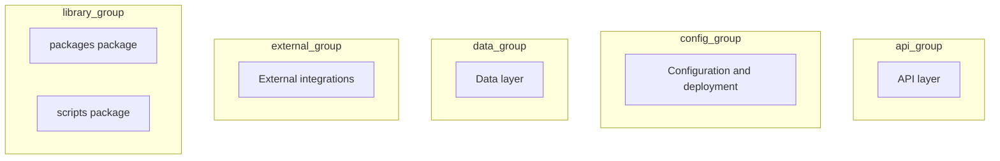

# Architecture report: imcuttle/mometa

> Automated static analysis. **Observed** = directly seen in files/imports/AST; **Inferred** = interpretation from that evidence. Repository code was not executed.

## 1. Repository at a glance

| Item | Value |
| --- | --- |
| Repository | imcuttle/mometa |
| Description | 🛠 [Beta] 面向研发的低代码元编程，代码可视编辑，辅助编码工具 The coding tools which is visual code editing, auxiliary and Low-code metaprogramming for R&D |
| Language | TypeScript |
| Stars | 4085 |
| Licence | MIT |
| Analysed commit / branch | ddc44915377df7c9fdaeeefeaa460a36ece49734 / master |
| Framework(s) | React |
| Files analysed | 484 |
| Components | 6 |

## 2. Architecture in one minute

imcuttle/mometa - 🛠 [Beta] 面向研发的低代码元编程，代码可视编辑，辅助编码工具 The coding tools which is visual code editing, auxiliary and Low-code metaprogramming for R&D. This repository was analysed statically from 484 file(s) (0 Python). Detected technologies (observed from imports/manifests): GitHub Actions, React, axios, React Router, Tailwind CSS, Jest. Files are grouped into 6 component(s): API layer, Configuration and deployment, Data layer, External integrations, packages package, scripts package. Findings below distinguish observed facts from inferred interpretation.

## 3. High-level block diagram

## 4. Main components

### API layer (`api_layer`)

- **Kind:** api
- **Status:** Observed
- **Confidence:** 0.85
- **Responsibility:** Groups 1 file(s) under api layer (observed from repository paths and static analysis).
- **Paths:** `packages/app/src/api/index.ts`
- **Evidence:** [packages/app/src/api/index.ts](https://github.com/imcuttle/mometa/blob/ddc44915377df7c9fdaeeefeaa460a36ece49734/packages/app/src/api/index.ts)

### Configuration and deployment (`config`)

- **Kind:** config
- **Status:** Observed
- **Confidence:** 0.85
- **Responsibility:** Groups 71 file(s) under configuration and deployment (observed from repository paths and static analysis).
- **Paths:** `lerna.json`, `package.json`, `packages/app-webpack4/config/config.js`, `packages/app-webpack4/config/env.js`, `packages/app-webpack4/config/getHttpsConfig.js`, `packages/app-webpack4/config/getPublicUrlOrPath.js`, `packages/app-webpack4/config/jest/babelTransform.js`, `packages/app-webpack4/config/jest/cssTransform.js`, `packages/app-webpack4/config/jest/fileTransform.js`, `packages/app-webpack4/config/modules.js`, `packages/app-webpack4/config/paths.js`, `packages/app-webpack4/config/pnpTs.js`, `packages/app-webpack4/config/utils.js`, `packages/app-webpack4/config/webpack.config.js`, `packages/app-webpack4/config/webpackDevServer.config.js`, `packages/app-webpack4/package.json`, `packages/app-webpack4/public/manifest.json`, `packages/app-webpack4/saber.yml`, `packages/app-webpack4/tsconfig.json`, `packages/app/config/env.js`, `packages/app/config/getHttpsConfig.js`, `packages/app/config/jest/babelTransform.js`, `packages/app/config/jest/cssTransform.js`, `packages/app/config/jest/fileTransform.js`, `packages/app/config/modules.js`, `packages/app/config/paths.js`, `packages/app/config/webpack.config.js`, `packages/app/config/webpack/persistentCache/createEnvironmentHash.js`, `packages/app/config/webpackDevServer.config.js`, `packages/app/package.json`, `packages/app/public/manifest.json`, `packages/app/tsconfig.json`, `packages/editor/example/config/entry/__mometa_outer_vendor__.js`, `packages/editor/example/config/env.js`, `packages/editor/example/config/getHttpsConfig.js`, `packages/editor/example/config/jest/babelTransform.js`, `packages/editor/example/config/jest/cssTransform.js`, `packages/editor/example/config/jest/fileTransform.js`, `packages/editor/example/config/modules.js`, `packages/editor/example/config/paths.js`, `packages/editor/example/config/post-buildruntime.js`, `packages/editor/example/config/webpack.config.js`, `packages/editor/example/config/webpack/persistentCache/createEnvironmentHash.js`, `packages/editor/example/config/webpackDevServer.config.js`, `packages/editor/example/package.json`, `packages/editor/example/tsconfig.json`, `packages/editor/package.json`, `packages/editor/src/module/config/const.ts`, `packages/editor/src/mometa/config/const.ts`, `packages/editor/tsconfig.build.json`, `packages/editor/tsconfig.json`, `packages/fs-handler/package.json`, `packages/fs-handler/tsconfig.json`, `packages/materials-generator/package.json`, `packages/materials-generator/tsconfig.json`, `packages/materials-resolver/__tests__/fixture/invalid-mat-lib/package.json`, `packages/materials-resolver/__tests__/fixture/mat-lib/package.json`, `packages/materials-resolver/package.json`, `packages/materials-resolver/tsconfig.json`, `packages/react-docgen-typescript/package.json`, `packages/react-docgen-typescript/src/__tests__/data/tsconfig.json`, `packages/react-docgen-typescript/tsconfig.json`, `packages/react-refresh-webpack-plugin/client/package.json`, `packages/react-refresh-webpack-plugin/lib/options.json`, `packages/react-refresh-webpack-plugin/loader/options.json`, `packages/react-refresh-webpack-plugin/overlay/package.json`, `packages/react-refresh-webpack-plugin/package.json`, `packages/react-refresh-webpack-plugin/sockets/package.json`, `packages/react-refresh-webpack-plugin/tsconfig.json`, `pnpm-workspace.yaml`, `tsconfig.json`
- **Evidence:** [lerna.json](https://github.com/imcuttle/mometa/blob/ddc44915377df7c9fdaeeefeaa460a36ece49734/lerna.json); [package.json](https://github.com/imcuttle/mometa/blob/ddc44915377df7c9fdaeeefeaa460a36ece49734/package.json); [packages/app-webpack4/config/config.js](https://github.com/imcuttle/mometa/blob/ddc44915377df7c9fdaeeefeaa460a36ece49734/packages/app-webpack4/config/config.js); [packages/app-webpack4/config/env.js](https://github.com/imcuttle/mometa/blob/ddc44915377df7c9fdaeeefeaa460a36ece49734/packages/app-webpack4/config/env.js); [packages/app-webpack4/config/getHttpsConfig.js](https://github.com/imcuttle/mometa/blob/ddc44915377df7c9fdaeeefeaa460a36ece49734/packages/app-webpack4/config/getHttpsConfig.js); [packages/app-webpack4/config/getPublicUrlOrPath.js](https://github.com/imcuttle/mometa/blob/ddc44915377df7c9fdaeeefeaa460a36ece49734/packages/app-webpack4/config/getPublicUrlOrPath.js); [packages/app-webpack4/config/jest/babelTransform.js](https://github.com/imcuttle/mometa/blob/ddc44915377df7c9fdaeeefeaa460a36ece49734/packages/app-webpack4/config/jest/babelTransform.js); [packages/app-webpack4/config/jest/cssTransform.js](https://github.com/imcuttle/mometa/blob/ddc44915377df7c9fdaeeefeaa460a36ece49734/packages/app-webpack4/config/jest/cssTransform.js)

### Data layer (`data_layer`)

- **Kind:** data
- **Status:** Observed
- **Confidence:** 0.85
- **Responsibility:** Groups 102 file(s) under data layer (observed from repository paths and static analysis).
- **Paths:** `packages/react-docgen-typescript/src/__tests__/data/AppMenu.tsx`, `packages/react-docgen-typescript/src/__tests__/data/ButtonWithOnClickComponent.tsx`, `packages/react-docgen-typescript/src/__tests__/data/Column.tsx`, `packages/react-docgen-typescript/src/__tests__/data/ColumnHigherOrderComponent.tsx`, `packages/react-docgen-typescript/src/__tests__/data/ColumnHigherOrderComponentHoc.tsx`, `packages/react-docgen-typescript/src/__tests__/data/ColumnWithAnnotatedChildren.tsx`, `packages/react-docgen-typescript/src/__tests__/data/ColumnWithDefaultAnonymousExportOnly.tsx`, `packages/react-docgen-typescript/src/__tests__/data/ColumnWithDefaultExport.tsx`, `packages/react-docgen-typescript/src/__tests__/data/ColumnWithDefaultExportOnly.tsx`, `packages/react-docgen-typescript/src/__tests__/data/ColumnWithHtmlAttributes.tsx`, `packages/react-docgen-typescript/src/__tests__/data/ColumnWithLog.tsx`, `packages/react-docgen-typescript/src/__tests__/data/ColumnWithMethods.tsx`, `packages/react-docgen-typescript/src/__tests__/data/ColumnWithPick.tsx`, `packages/react-docgen-typescript/src/__tests__/data/ColumnWithPropsWithExternalType.MyExternalType.tsx`, `packages/react-docgen-typescript/src/__tests__/data/ColumnWithPropsWithExternalType.tsx`, `packages/react-docgen-typescript/src/__tests__/data/ColumnWithStaticComponents.tsx`, `packages/react-docgen-typescript/src/__tests__/data/ColumnWithStaticMethods.tsx`, `packages/react-docgen-typescript/src/__tests__/data/ColumnWithUndocumentedProps.tsx`, `packages/react-docgen-typescript/src/__tests__/data/ColumnWithoutExportedProps.tsx`, `packages/react-docgen-typescript/src/__tests__/data/ComplexGenericUnionIntersection.tsx`, `packages/react-docgen-typescript/src/__tests__/data/ComplexGenericUnionIntersectionWithOmit.tsx`, `packages/react-docgen-typescript/src/__tests__/data/ComponentWithDefaultProps.tsx`, `packages/react-docgen-typescript/src/__tests__/data/ComponentWithImportedDefaultProps.tsx`, `packages/react-docgen-typescript/src/__tests__/data/ComponentWithReferencedDefaultProps.tsx`, `packages/react-docgen-typescript/src/__tests__/data/ComponentWithTypeJsDocTag.tsx`, `packages/react-docgen-typescript/src/__tests__/data/ConstExport.tsx`, `packages/react-docgen-typescript/src/__tests__/data/ExportObject.tsx`, `packages/react-docgen-typescript/src/__tests__/data/ExportsDefaultInterface.tsx`, `packages/react-docgen-typescript/src/__tests__/data/ExportsPropTypeImport.tsx`, `packages/react-docgen-typescript/src/__tests__/data/ExportsPropTypeShape.tsx`, `packages/react-docgen-typescript/src/__tests__/data/ExtendsExternalPropsComponent.tsx`, `packages/react-docgen-typescript/src/__tests__/data/ExtendsExternalPropsComponentParentProps.tsx`, `packages/react-docgen-typescript/src/__tests__/data/ExternalPropsComponent.tsx`, `packages/react-docgen-typescript/src/__tests__/data/ExternalPropsComponentProps.ts`, `packages/react-docgen-typescript/src/__tests__/data/ExtractLiteralValuesFromEnum.tsx`, `packages/react-docgen-typescript/src/__tests__/data/ExtractLiteralValuesFromUnion.tsx`, `packages/react-docgen-typescript/src/__tests__/data/ExtractPropTags.tsx`, `packages/react-docgen-typescript/src/__tests__/data/FilePathCheck.tsx`, `packages/react-docgen-typescript/src/__tests__/data/FlippableImage.tsx`, `packages/react-docgen-typescript/src/__tests__/data/ForwardRefDefaultExport.tsx`, `packages/react-docgen-typescript/src/__tests__/data/ForwardRefDefaultExportAtExport.tsx`, `packages/react-docgen-typescript/src/__tests__/data/ForwardRefDefaultValues.tsx`, `packages/react-docgen-typescript/src/__tests__/data/FunctionDeclaration.tsx`, `packages/react-docgen-typescript/src/__tests__/data/FunctionDeclarationAsDefaultExport.tsx`, `packages/react-docgen-typescript/src/__tests__/data/FunctionDeclarationAsDefaultExportWithMemo.tsx`, `packages/react-docgen-typescript/src/__tests__/data/FunctionDeclarationDefaultProps.tsx`, `packages/react-docgen-typescript/src/__tests__/data/FunctionDeclarationVisibleName.tsx`, `packages/react-docgen-typescript/src/__tests__/data/FunctionalComponentAsConst.tsx`, `packages/react-docgen-typescript/src/__tests__/data/FunctionalComponentAsConstAsDefaultExport.tsx`, `packages/react-docgen-typescript/src/__tests__/data/FunctionalComponentAsConstAsNamedExport.tsx`, `packages/react-docgen-typescript/src/__tests__/data/FunctionalComponentWithDesctructuredProps.constants.ts`, `packages/react-docgen-typescript/src/__tests__/data/FunctionalComponentWithDesctructuredProps.tsx`, `packages/react-docgen-typescript/src/__tests__/data/FunctionalComponentWithDesctructuredPropsAndImportedConstants.tsx`, `packages/react-docgen-typescript/src/__tests__/data/GenericWithExtends.tsx`, `packages/react-docgen-typescript/src/__tests__/data/HOCIntersectionProps.tsx`, `packages/react-docgen-typescript/src/__tests__/data/InlineConst.tsx`, `packages/react-docgen-typescript/src/__tests__/data/Issue188.tsx`, `packages/react-docgen-typescript/src/__tests__/data/Issue320.tsx`, `packages/react-docgen-typescript/src/__tests__/data/JSDocWithParam.tsx`, `packages/react-docgen-typescript/src/__tests__/data/OnlyDefaultExportUnion.tsx`, `packages/react-docgen-typescript/src/__tests__/data/OnlyDefaultExportUnionAsExport.tsx`, `packages/react-docgen-typescript/src/__tests__/data/PureRow.tsx`, `packages/react-docgen-typescript/src/__tests__/data/ReactSFCAsConst.tsx`, `packages/react-docgen-typescript/src/__tests__/data/ReactSFCAsConstAsDefaultExport.tsx`, `packages/react-docgen-typescript/src/__tests__/data/ReactSFCAsConstAsNamedExport.tsx`, `packages/react-docgen-typescript/src/__tests__/data/Regression_v0_0_12.tsx`, `packages/react-docgen-typescript/src/__tests__/data/RemoveOptionalValuesFromEnum.tsx`, `packages/react-docgen-typescript/src/__tests__/data/RemoveOptionalValuesFromUnion.tsx`, `packages/react-docgen-typescript/src/__tests__/data/Row.tsx`, `packages/react-docgen-typescript/src/__tests__/data/SeparateDefaultProps.tsx`, `packages/react-docgen-typescript/src/__tests__/data/SeparateDefaultPropsIndividual.tsx`, `packages/react-docgen-typescript/src/__tests__/data/SimpleDiscriminatedUnionIntersection.tsx`, `packages/react-docgen-typescript/src/__tests__/data/SimpleGenericUnionIntersection.tsx`, `packages/react-docgen-typescript/src/__tests__/data/SimpleUnionIntersection.tsx`, `packages/react-docgen-typescript/src/__tests__/data/StatefulDisplayName.tsx`, `packages/react-docgen-typescript/src/__tests__/data/StatefulDisplayNameDefaultExport.tsx`, `packages/react-docgen-typescript/src/__tests__/data/StatefulDisplayNameFolder/index.tsx`, `packages/react-docgen-typescript/src/__tests__/data/StatefulDisplayNameHOC.tsx`, `packages/react-docgen-typescript/src/__tests__/data/StatefulIntersectionExternalProps.tsx`, `packages/react-docgen-typescript/src/__tests__/data/StatefulIntersectionProps.tsx`, `packages/react-docgen-typescript/src/__tests__/data/Stateless.tsx`, `packages/react-docgen-typescript/src/__tests__/data/StatelessDisplayName.tsx`, `packages/react-docgen-typescript/src/__tests__/data/StatelessDisplayNameDefaultExport.tsx`, `packages/react-docgen-typescript/src/__tests__/data/StatelessDisplayNameDefaultExportDifferentFilename.tsx`, `packages/react-docgen-typescript/src/__tests__/data/StatelessDisplayNameFolder/index.tsx`, `packages/react-docgen-typescript/src/__tests__/data/StatelessDisplayNameHOC.tsx`, `packages/react-docgen-typescript/src/__tests__/data/StatelessDisplayNameStyledComponent.tsx`, `packages/react-docgen-typescript/src/__tests__/data/StatelessIntersectionExternalProps.tsx`, `packages/react-docgen-typescript/src/__tests__/data/StatelessIntersectionGenericProps.tsx`, `packages/react-docgen-typescript/src/__tests__/data/StatelessIntersectionProps.tsx`, `packages/react-docgen-typescript/src/__tests__/data/StatelessShorthandDefaultProps.tsx`, `packages/react-docgen-typescript/src/__tests__/data/StatelessStaticComponents.tsx`, `packages/react-docgen-typescript/src/__tests__/data/StatelessWithDefaultOnlyJsDoc.tsx`, `packages/react-docgen-typescript/src/__tests__/data/StatelessWithDefaultProps.tsx`, `packages/react-docgen-typescript/src/__tests__/data/StatelessWithDefaultPropsAsString.tsx`, `packages/react-docgen-typescript/src/__tests__/data/StatelessWithDefaultPropsTypescript3.tsx`, `packages/react-docgen-typescript/src/__tests__/data/StatelessWithDestructuredProps.tsx`, `packages/react-docgen-typescript/src/__tests__/data/StatelessWithDestructuredPropsArrow.tsx`, `packages/react-docgen-typescript/src/__tests__/data/UnassignedLet.tsx`, `packages/react-docgen-typescript/src/__tests__/data/const.ts`, `packages/react-docgen-typescript/src/__tests__/data/shapes.ts`, `packages/react-docgen-typescript/src/__tests__/data/withHOC.tsx`
- **Evidence:** [packages/react-docgen-typescript/src/__tests__/data/AppMenu.tsx](https://github.com/imcuttle/mometa/blob/ddc44915377df7c9fdaeeefeaa460a36ece49734/packages/react-docgen-typescript/src/__tests__/data/AppMenu.tsx); [packages/react-docgen-typescript/src/__tests__/data/ButtonWithOnClickComponent.tsx](https://github.com/imcuttle/mometa/blob/ddc44915377df7c9fdaeeefeaa460a36ece49734/packages/react-docgen-typescript/src/__tests__/data/ButtonWithOnClickComponent.tsx); [packages/react-docgen-typescript/src/__tests__/data/Column.tsx](https://github.com/imcuttle/mometa/blob/ddc44915377df7c9fdaeeefeaa460a36ece49734/packages/react-docgen-typescript/src/__tests__/data/Column.tsx); [packages/react-docgen-typescript/src/__tests__/data/ColumnHigherOrderComponent.tsx](https://github.com/imcuttle/mometa/blob/ddc44915377df7c9fdaeeefeaa460a36ece49734/packages/react-docgen-typescript/src/__tests__/data/ColumnHigherOrderComponent.tsx); [packages/react-docgen-typescript/src/__tests__/data/ColumnHigherOrderComponentHoc.tsx](https://github.com/imcuttle/mometa/blob/ddc44915377df7c9fdaeeefeaa460a36ece49734/packages/react-docgen-typescript/src/__tests__/data/ColumnHigherOrderComponentHoc.tsx); [packages/react-docgen-typescript/src/__tests__/data/ColumnWithAnnotatedChildren.tsx](https://github.com/imcuttle/mometa/blob/ddc44915377df7c9fdaeeefeaa460a36ece49734/packages/react-docgen-typescript/src/__tests__/data/ColumnWithAnnotatedChildren.tsx); [packages/react-docgen-typescript/src/__tests__/data/ColumnWithDefaultAnonymousExportOnly.tsx](https://github.com/imcuttle/mometa/blob/ddc44915377df7c9fdaeeefeaa460a36ece49734/packages/react-docgen-typescript/src/__tests__/data/ColumnWithDefaultAnonymousExportOnly.tsx); [packages/react-docgen-typescript/src/__tests__/data/ColumnWithDefaultExport.tsx](https://github.com/imcuttle/mometa/blob/ddc44915377df7c9fdaeeefeaa460a36ece49734/packages/react-docgen-typescript/src/__tests__/data/ColumnWithDefaultExport.tsx)

### External integrations (`external_integrations`)

- **Kind:** external
- **Status:** Observed
- **Confidence:** 0.85
- **Responsibility:** Groups 6 file(s) under external integrations (observed from repository paths and static analysis).
- **Paths:** `packages/react-refresh-webpack-plugin/client/ErrorOverlayEntry.js`, `packages/react-refresh-webpack-plugin/client/ReactRefreshEntry.js`, `packages/react-refresh-webpack-plugin/client/utils/errorEventHandlers.js`, `packages/react-refresh-webpack-plugin/client/utils/formatWebpackErrors.js`, `packages/react-refresh-webpack-plugin/client/utils/patchUrl.js`, `packages/react-refresh-webpack-plugin/client/utils/retry.js`
- **Evidence:** [packages/react-refresh-webpack-plugin/client/ErrorOverlayEntry.js](https://github.com/imcuttle/mometa/blob/ddc44915377df7c9fdaeeefeaa460a36ece49734/packages/react-refresh-webpack-plugin/client/ErrorOverlayEntry.js); [packages/react-refresh-webpack-plugin/client/ReactRefreshEntry.js](https://github.com/imcuttle/mometa/blob/ddc44915377df7c9fdaeeefeaa460a36ece49734/packages/react-refresh-webpack-plugin/client/ReactRefreshEntry.js); [packages/react-refresh-webpack-plugin/client/utils/errorEventHandlers.js](https://github.com/imcuttle/mometa/blob/ddc44915377df7c9fdaeeefeaa460a36ece49734/packages/react-refresh-webpack-plugin/client/utils/errorEventHandlers.js); [packages/react-refresh-webpack-plugin/client/utils/formatWebpackErrors.js](https://github.com/imcuttle/mometa/blob/ddc44915377df7c9fdaeeefeaa460a36ece49734/packages/react-refresh-webpack-plugin/client/utils/formatWebpackErrors.js); [packages/react-refresh-webpack-plugin/client/utils/patchUrl.js](https://github.com/imcuttle/mometa/blob/ddc44915377df7c9fdaeeefeaa460a36ece49734/packages/react-refresh-webpack-plugin/client/utils/patchUrl.js); [packages/react-refresh-webpack-plugin/client/utils/retry.js](https://github.com/imcuttle/mometa/blob/ddc44915377df7c9fdaeeefeaa460a36ece49734/packages/react-refresh-webpack-plugin/client/utils/retry.js)

### packages package (`packages`)

- **Kind:** library
- **Status:** Observed
- **Confidence:** 0.85
- **Responsibility:** Groups 219 file(s) under packages package (observed from repository paths and static analysis).
- **Paths:** `packages/__template/index.js`, `packages/__template/template/jest.config.js`, `packages/__template/template/package.json.js`, `packages/app-webpack4/.commitlintrc.js`, `packages/app-webpack4/.prettierrc.js`, `packages/app-webpack4/.stylelintrc.js`, `packages/app-webpack4/mometa-material.config.js`, `packages/app-webpack4/scripts/build.js`, `packages/app-webpack4/scripts/start.js`, `packages/app-webpack4/scripts/test.js`, `packages/app-webpack4/src/app.tsx`, `packages/app-webpack4/src/index.tsx`, `packages/app-webpack4/src/page-loading.tsx`, `packages/app-webpack4/src/react-app-env.d.ts`, `packages/app-webpack4/src/reportWebVitals.ts`, `packages/app-webpack4/src/setupTests.ts`, `packages/app/mometa-material.config.js`, `packages/app/scripts/build.js`, `packages/app/scripts/start.js`, `packages/app/scripts/test.js`, `packages/app/src/component/detail/index.tsx`, `packages/app/src/index.tsx`, `packages/app/src/layout/index.tsx`, `packages/app/src/materials/button/index.tsx`, `packages/app/src/pages/app/App.tsx`, `packages/app/src/pages/app/index.tsx`, `packages/app/src/pages/detail/index.tsx`, `packages/app/src/pages/edit/index.tsx`, `packages/app/src/pages/home/index.tsx`, `packages/app/src/react-app-env.d.ts`, `packages/app/src/render-router.tsx`, `packages/app/src/reportWebVitals.ts`, `packages/app/src/routes.tsx`, `packages/app/src/setupTests.ts`, `packages/editor/__template/component/index.js`, `packages/editor/__tests__/fixture/webpack/src/index.js`, `packages/editor/__tests__/helper.ts`, `packages/editor/__tests__/main.test.ts`, `packages/editor/__tests__/webpack-plugin.test.ts`, `packages/editor/babel/plugin-react.js`, `packages/editor/example/mometa-material.config.js`, `packages/editor/example/scripts/build.js`, `packages/editor/example/scripts/start.js`, `packages/editor/example/scripts/test.js`, `packages/editor/example/src/app/App.tsx`, `packages/editor/example/src/app/ListPage.tsx`, `packages/editor/example/src/app/Panel.tsx`, `packages/editor/example/src/app/elements.tsx`, `packages/editor/example/src/app/index.tsx`, `packages/editor/example/src/editor.tsx`, `packages/editor/example/src/index.tsx`, `packages/editor/example/src/materials/button/index.tsx`, `packages/editor/example/src/mock/noop-webpack-plugin.js`, `packages/editor/example/src/mock/terser-webpack-plugin.js`, `packages/editor/example/src/react-app-env.d.ts`, `packages/editor/example/src/setupProxy.js`, `packages/editor/example/src/setupTests.ts`, `packages/editor/jest.config.js`, `packages/editor/src/babel/react/index.test.ts`, `packages/editor/src/babel/react/index.ts`, `packages/editor/src/editor.ts`, `packages/editor/src/entry.tsx`, `packages/editor/src/module/render-floating.tsx`, `packages/editor/src/module/render/components/error-boundary/index.tsx`, `packages/editor/src/module/render/components/header/index.tsx`, `packages/editor/src/module/render/components/left-panel/index.tsx`, `packages/editor/src/module/render/components/location-widget/index.tsx`, `packages/editor/src/module/render/components/material-panel/index.tsx`, `packages/editor/src/module/render/components/resize-handler/index.tsx`, `packages/editor/src/module/render/components/resize-widget/index.tsx`, `packages/editor/src/module/render/components/right-panel/index.tsx`, `packages/editor/src/module/render/components/stage/api-core.tsx`, `packages/editor/src/module/render/components/stage/create-api.tsx`, `packages/editor/src/module/render/components/stage/index.tsx`, `packages/editor/src/module/render/editor/index.tsx`, `packages/editor/src/module/render/editor/sse.ts`, `packages/editor/src/module/render/utils/error-overlay/formatWebpackMessages.ts`, `packages/editor/src/module/render/utils/error-overlay/index.ts`, `packages/editor/src/module/render/utils/externals-modules.ts`, `packages/editor/src/module/render/utils/fetch-preload.ts`, `packages/editor/src/module/render/utils/use-persist-ref.ts`, `packages/editor/src/module/render/utils/utils.ts`, `packages/editor/src/mometa/define.d.ts`, `packages/editor/src/mometa/entry.ts`, `packages/editor/src/mometa/location-register.ts`, `packages/editor/src/mometa/render-register.ts`, `packages/editor/src/mometa/runtime/components/more-button/index.tsx`, `packages/editor/src/mometa/runtime/dnd.tsx`, `packages/editor/src/mometa/runtime/dom-api.ts`, `packages/editor/src/mometa/runtime/empty-placeholder.tsx`, `packages/editor/src/mometa/runtime/floating-ui.tsx`, `packages/editor/src/mometa/runtime/provider.tsx`, `packages/editor/src/mometa/shared-register.ts`, `packages/editor/src/mometa/utils/debuglog.ts`, `packages/editor/src/mometa/utils/dom-utils.ts`, `packages/editor/src/mometa/utils/emotion-css.ts`, `packages/editor/src/mometa/utils/get-from-main.ts`, `packages/editor/src/mometa/utils/use-hooks.ts`, `packages/editor/src/shared/code-editor/index.tsx`, `packages/editor/src/shared/hot.ts`, `packages/editor/src/shared/locate-material-parents.ts`, `packages/editor/src/shared/open-react-element.tsx`, `packages/editor/src/shared/pipe.ts`, `packages/editor/src/shared/utils.ts`, `packages/editor/webpack/common-plugin.js`, `packages/editor/webpack/create-server.js`, `packages/editor/webpack/event-stream/createEventStream.js`, `packages/editor/webpack/index.js`, `packages/editor/webpack/inject-entry.js`, `packages/editor/webpack/launchEditor.js`, `packages/editor/webpack/materials-compiler/client-render-compile.js`, `packages/editor/webpack/materials-compiler/client-render-loader/bye.js`, `packages/editor/webpack/materials-compiler/client-render-loader/index.js`, `packages/editor/webpack/materials-compiler/client-render-loader/preview-code-gen.js`, `packages/editor/webpack/materials-compiler/client-render-loader/preview-loader.js`, `packages/editor/webpack/materials-compiler/client-render-loader/write-runtime-preview-render.js`, `packages/editor/webpack/materials-compiler/index.js`, `packages/editor/webpack/options-json.js`, `packages/editor/webpack/paths.js`, `packages/editor/webpack/runtime/client-render-main.js`, `packages/editor/webpack/runtime/handle.js`, `packages/editor/webpack/runtime/runtime-entry.js`, `packages/fs-handler/__tests__/fixture/nested.tsx`, `packages/fs-handler/__tests__/fixture/react-comp.tsx`, `packages/fs-handler/__tests__/fixture/simple.d.ts`, `packages/fs-handler/__tests__/fixture/simple.js`, `packages/fs-handler/__tests__/fixture/simple.tsx`, `packages/fs-handler/__tests__/helper.ts`, `packages/fs-handler/__tests__/main.test.ts`, `packages/fs-handler/const.js`, `packages/fs-handler/jest.config.js`, `packages/fs-handler/src/common/add-material/index.ts`, `packages/fs-handler/src/common/del.ts`, `packages/fs-handler/src/common/index.ts`, `packages/fs-handler/src/common/insert-node.ts`, `packages/fs-handler/src/common/move-node.ts`, `packages/fs-handler/src/common/replace-node.ts`, `packages/fs-handler/src/const.ts`, `packages/fs-handler/src/index.ts`, `packages/fs-handler/src/utils/compare.ts`, `packages/fs-handler/src/utils/line-contents.test.ts`, `packages/fs-handler/src/utils/line-contents.ts`, `packages/materials-generator/jest.config.js`, `packages/materials-generator/src/index.ts`, `packages/materials-generator/src/plugins/create.ts`, `packages/materials-generator/src/plugins/helper.ts`, `packages/materials-generator/src/types.ts`, `packages/materials-generator/types.js`, `packages/materials-resolver/__tests__/fixture/invalid-mat-lib/index.js`, `packages/materials-resolver/__tests__/fixture/mat-lib/index.js`, `packages/materials-resolver/__tests__/fixture/mat-lib/mometa.js`, `packages/materials-resolver/__tests__/helper.ts`, `packages/materials-resolver/__tests__/main.test.ts`, `packages/materials-resolver/jest.config.js`, `packages/materials-resolver/src/index.ts`, `packages/materials-resolver/src/plugins/materials.ts`, `packages/materials-resolver/src/plugins/react-component-asset.ts`, `packages/materials-resolver/src/utils/react-api-parse.ts`, `packages/materials-resolver/src/utils/resolve-async-config.ts`, `packages/materials-resolver/src/utils/search-core.ts`, `packages/materials-resolver/src/utils/sorted-globby.ts`, `packages/materials-resolver/src/utils/to-array.ts`, `packages/react-docgen-typescript/__tests__/helper.ts`, `packages/react-docgen-typescript/__tests__/main.test.ts`, `packages/react-docgen-typescript/jest.config.js`, `packages/react-docgen-typescript/src/__tests__/__sourceMapInit.ts`, `packages/react-docgen-typescript/src/__tests__/buildFilter.ts`, `packages/react-docgen-typescript/src/__tests__/parser.ts`, `packages/react-docgen-typescript/src/__tests__/testUtils.ts`, `packages/react-docgen-typescript/src/__tests__/trimFileName.ts`, `packages/react-docgen-typescript/src/buildFilter.ts`, `packages/react-docgen-typescript/src/index.ts`, `packages/react-docgen-typescript/src/parser.ts`, `packages/react-docgen-typescript/src/propTypesParser.ts`, `packages/react-docgen-typescript/src/trimFileName.ts`, `packages/react-refresh-webpack-plugin/lib/globals.js`, `packages/react-refresh-webpack-plugin/lib/index.js`, `packages/react-refresh-webpack-plugin/lib/runtime/RefreshUtils.development.js`, `packages/react-refresh-webpack-plugin/lib/runtime/RefreshUtils.js`, `packages/react-refresh-webpack-plugin/lib/runtime/RefreshUtils.production.js`, `packages/react-refresh-webpack-plugin/lib/types.js`, `packages/react-refresh-webpack-plugin/lib/utils/getAdditionalEntries.js`, `packages/react-refresh-webpack-plugin/lib/utils/getIntegrationEntry.js`, `packages/react-refresh-webpack-plugin/lib/utils/getRefreshGlobal.js`, `packages/react-refresh-webpack-plugin/lib/utils/getSocketIntegration.js`, `packages/react-refresh-webpack-plugin/lib/utils/index.js`, `packages/react-refresh-webpack-plugin/lib/utils/injectRefreshEntry.js`, `packages/react-refresh-webpack-plugin/lib/utils/injectRefreshLoader.js`, `packages/react-refresh-webpack-plugin/lib/utils/makeRefreshRuntimeModule.js`, `packages/react-refresh-webpack-plugin/lib/utils/normalizeOptions.js`, `packages/react-refresh-webpack-plugin/loader/index.js`, `packages/react-refresh-webpack-plugin/loader/types.js`, `packages/react-refresh-webpack-plugin/loader/utils/getIdentitySourceMap.js`, `packages/react-refresh-webpack-plugin/loader/utils/getModuleSystem.js`, `packages/react-refresh-webpack-plugin/loader/utils/getRefreshModuleRuntime.js`, `packages/react-refresh-webpack-plugin/loader/utils/index.js`, `packages/react-refresh-webpack-plugin/loader/utils/normalizeOptions.js`, `packages/react-refresh-webpack-plugin/options/index.js`, `packages/react-refresh-webpack-plugin/overlay/components/CompileErrorTrace.js`, `packages/react-refresh-webpack-plugin/overlay/components/PageHeader.js`, `packages/react-refresh-webpack-plugin/overlay/components/RuntimeErrorFooter.js`, `packages/react-refresh-webpack-plugin/overlay/components/RuntimeErrorHeader.js`, `packages/react-refresh-webpack-plugin/overlay/components/RuntimeErrorStack.js`, `packages/react-refresh-webpack-plugin/overlay/components/Spacer.js`, `packages/react-refresh-webpack-plugin/overlay/containers/CompileErrorContainer.js`, `packages/react-refresh-webpack-plugin/overlay/containers/RuntimeErrorContainer.js`, `packages/react-refresh-webpack-plugin/overlay/index.js`, `packages/react-refresh-webpack-plugin/overlay/theme.js`, `packages/react-refresh-webpack-plugin/overlay/utils.js`, `packages/react-refresh-webpack-plugin/sockets/WDSSocket.js`, `packages/react-refresh-webpack-plugin/sockets/WHMEventSource.js`, `packages/react-refresh-webpack-plugin/sockets/WPSSocket.js`, `packages/react-refresh-webpack-plugin/sockets/utils/getCurrentScriptSource.js`, `packages/react-refresh-webpack-plugin/sockets/utils/getSocketUrlParts.js`, `packages/react-refresh-webpack-plugin/sockets/utils/getUrlFromParts.js`, `packages/react-refresh-webpack-plugin/sockets/utils/getWDSMetadata.js`, `packages/react-refresh-webpack-plugin/types/loader/index.d.ts`, `packages/react-refresh-webpack-plugin/types/loader/types.d.ts`, `packages/react-refresh-webpack-plugin/types/options/index.d.ts`
- **Evidence:** [packages/__template/index.js](https://github.com/imcuttle/mometa/blob/ddc44915377df7c9fdaeeefeaa460a36ece49734/packages/__template/index.js); [packages/__template/template/jest.config.js](https://github.com/imcuttle/mometa/blob/ddc44915377df7c9fdaeeefeaa460a36ece49734/packages/__template/template/jest.config.js); [packages/__template/template/package.json.js](https://github.com/imcuttle/mometa/blob/ddc44915377df7c9fdaeeefeaa460a36ece49734/packages/__template/template/package.json.js); [packages/app-webpack4/.commitlintrc.js](https://github.com/imcuttle/mometa/blob/ddc44915377df7c9fdaeeefeaa460a36ece49734/packages/app-webpack4/.commitlintrc.js); [packages/app-webpack4/.prettierrc.js](https://github.com/imcuttle/mometa/blob/ddc44915377df7c9fdaeeefeaa460a36ece49734/packages/app-webpack4/.prettierrc.js); [packages/app-webpack4/.stylelintrc.js](https://github.com/imcuttle/mometa/blob/ddc44915377df7c9fdaeeefeaa460a36ece49734/packages/app-webpack4/.stylelintrc.js); [packages/app-webpack4/mometa-material.config.js](https://github.com/imcuttle/mometa/blob/ddc44915377df7c9fdaeeefeaa460a36ece49734/packages/app-webpack4/mometa-material.config.js); [packages/app-webpack4/scripts/build.js](https://github.com/imcuttle/mometa/blob/ddc44915377df7c9fdaeeefeaa460a36ece49734/packages/app-webpack4/scripts/build.js)

### scripts package (`scripts`)

- **Kind:** library
- **Status:** Observed
- **Confidence:** 0.85
- **Responsibility:** Groups 2 file(s) under scripts package (observed from repository paths and static analysis).
- **Paths:** `scripts/run-build.js`, `scripts/run.js`
- **Evidence:** [scripts/run-build.js](https://github.com/imcuttle/mometa/blob/ddc44915377df7c9fdaeeefeaa460a36ece49734/scripts/run-build.js); [scripts/run.js](https://github.com/imcuttle/mometa/blob/ddc44915377df7c9fdaeeefeaa460a36ece49734/scripts/run.js)

## 5. Execution flow

**Observed** entry point(s):

- [packages/__template/index.js](https://github.com/imcuttle/mometa/blob/ddc44915377df7c9fdaeeefeaa460a36ece49734/packages/__template/index.js)
- [packages/app-webpack4/src/app.tsx](https://github.com/imcuttle/mometa/blob/ddc44915377df7c9fdaeeefeaa460a36ece49734/packages/app-webpack4/src/app.tsx)
- [packages/app-webpack4/src/index.tsx](https://github.com/imcuttle/mometa/blob/ddc44915377df7c9fdaeeefeaa460a36ece49734/packages/app-webpack4/src/index.tsx)
- [packages/app/src/index.tsx](https://github.com/imcuttle/mometa/blob/ddc44915377df7c9fdaeeefeaa460a36ece49734/packages/app/src/index.tsx)
- [packages/editor/webpack/index.js](https://github.com/imcuttle/mometa/blob/ddc44915377df7c9fdaeeefeaa460a36ece49734/packages/editor/webpack/index.js)
- [packages/fs-handler/src/index.ts](https://github.com/imcuttle/mometa/blob/ddc44915377df7c9fdaeeefeaa460a36ece49734/packages/fs-handler/src/index.ts)
- [packages/materials-generator/src/index.ts](https://github.com/imcuttle/mometa/blob/ddc44915377df7c9fdaeeefeaa460a36ece49734/packages/materials-generator/src/index.ts)
- [packages/materials-resolver/src/index.ts](https://github.com/imcuttle/mometa/blob/ddc44915377df7c9fdaeeefeaa460a36ece49734/packages/materials-resolver/src/index.ts)
- [packages/react-docgen-typescript/src/index.ts](https://github.com/imcuttle/mometa/blob/ddc44915377df7c9fdaeeefeaa460a36ece49734/packages/react-docgen-typescript/src/index.ts)
- [packages/react-refresh-webpack-plugin/lib/index.js](https://github.com/imcuttle/mometa/blob/ddc44915377df7c9fdaeeefeaa460a36ece49734/packages/react-refresh-webpack-plugin/lib/index.js)
- [packages/react-refresh-webpack-plugin/loader/index.js](https://github.com/imcuttle/mometa/blob/ddc44915377df7c9fdaeeefeaa460a36ece49734/packages/react-refresh-webpack-plugin/loader/index.js)
- [packages/react-refresh-webpack-plugin/options/index.js](https://github.com/imcuttle/mometa/blob/ddc44915377df7c9fdaeeefeaa460a36ece49734/packages/react-refresh-webpack-plugin/options/index.js)

Representative flow (derived from observed entry points and the import graph; steps beyond the entry point are **Inferred**):

1. Execution starts at an observed entry point listed above, if present.
2. No internal import relationships between components were observed.

## 6. Project structure

### `(root)`

- `.editorconfig` - config (207 bytes)
- `.gitattributes` - other (19 bytes)
- `.gitignore` - other (108 bytes)
- `.prettierignore` - other (40 bytes)
- `.prettierrc.js` - source, JavaScript (341 bytes)
- `CHANGELOG.md` - docs (5100 bytes)
- `License` - docs (1079 bytes)
- `README.md` - docs (7512 bytes)
- `README_zh_CN.md` - docs (7731 bytes)
- `lerna.json` - config (635 bytes)
- `package.json` - manifest (3881 bytes)
- `pnpm-workspace.yaml` - config (57 bytes)
- `tsconfig.json` - config (362 bytes)

### `.github`

- `.github/ISSUE_TEMPLATE/bug-report.md` - docs (683 bytes)
- `.github/ISSUE_TEMPLATE/feature_request.md` - docs (612 bytes)
- `.github/workflows/test.yml` - ci, YAML (1604 bytes)

### `docs`

- `docs/client-render.svg` - docs (12650 bytes)
- `docs/how-to-work.md` - docs (6870 bytes)

### `packages`

- `packages/__template/index.js` - source, JavaScript (1563 bytes)
- `packages/__template/template/README.md` - docs (1492 bytes)
- `packages/__template/template/__tests__/fixture/.keep` - other (0 bytes)
- `packages/__template/template/__tests__/helper.ts.hbs` - other (303 bytes)
- `packages/__template/template/__tests__/main.test.ts.hbs` - other (210 bytes)
- `packages/__template/template/jest.config.js` - source, JavaScript (61 bytes)
- `packages/__template/template/package.json.js` - source, JavaScript (1290 bytes)
- `packages/__template/template/src/index.ts.hbs` - other (147 bytes)
- `packages/__template/template/tsconfig.json.hbs` - other (135 bytes)
- `packages/app-webpack4/.commitlintrc.js` - source, JavaScript (777 bytes)
- `packages/app-webpack4/.gitignore` - other (310 bytes)
- `packages/app-webpack4/.prettierrc.js` - source, JavaScript (125 bytes)
- `packages/app-webpack4/.stylelintrc.js` - source, JavaScript (559 bytes)
- `packages/app-webpack4/CHANGELOG.md` - docs (3877 bytes)
- `packages/app-webpack4/README.md` - docs (22 bytes)
- `packages/app-webpack4/config/config.js` - source, JavaScript (164 bytes)
- `packages/app-webpack4/config/env.js` - source, JavaScript (4376 bytes)
- `packages/app-webpack4/config/getHttpsConfig.js` - source, JavaScript (1805 bytes)
- `packages/app-webpack4/config/getPublicUrlOrPath.js` - source, JavaScript (2056 bytes)
- `packages/app-webpack4/config/jest/babelTransform.js` - source, JavaScript (526 bytes)
- `packages/app-webpack4/config/jest/cssTransform.js` - source, JavaScript (314 bytes)
- `packages/app-webpack4/config/jest/fileTransform.js` - source, JavaScript (1261 bytes)
- `packages/app-webpack4/config/modules.js` - source, JavaScript (3340 bytes)
- `packages/app-webpack4/config/paths.js` - source, JavaScript (2335 bytes)
- `packages/app-webpack4/config/pnpTs.js` - source, JavaScript (572 bytes)
- `packages/app-webpack4/config/utils.js` - source, JavaScript (345 bytes)
- `packages/app-webpack4/config/webpack.config.js` - source, JavaScript (34353 bytes)
- `packages/app-webpack4/config/webpackDevServer.config.js` - source, JavaScript (6729 bytes)
- `packages/app-webpack4/mometa-material.config.js` - source, JavaScript (114 bytes)
- `packages/app-webpack4/package.json` - manifest (5463 bytes)
- `packages/app-webpack4/public/index.html` - other (1705 bytes)
- `packages/app-webpack4/public/manifest.json` - config (492 bytes)
- `packages/app-webpack4/public/robots.txt` - docs (67 bytes)
- `packages/app-webpack4/saber.yml` - config (1342 bytes)
- `packages/app-webpack4/scripts/build.js` - source, JavaScript (6507 bytes)
- `packages/app-webpack4/scripts/start.js` - source, JavaScript (4950 bytes)
- `packages/app-webpack4/scripts/test.js` - source, JavaScript (1342 bytes)
- `packages/app-webpack4/src/app.scss` - other (0 bytes)
- `packages/app-webpack4/src/app.tsx` - source, TypeScript (701 bytes)
- `packages/app-webpack4/src/index.tsx` - source, TypeScript (483 bytes)
- `packages/app-webpack4/src/page-loading.tsx` - source, TypeScript (194 bytes)
- `packages/app-webpack4/src/react-app-env.d.ts` - source, TypeScript (1312 bytes)
- `packages/app-webpack4/src/reportWebVitals.ts` - source, TypeScript (425 bytes)
- `packages/app-webpack4/src/setupTests.ts` - source, TypeScript (241 bytes)
- `packages/app-webpack4/tsconfig.json` - config (606 bytes)
- `packages/app/.gitignore` - other (310 bytes)
- `packages/app/CHANGELOG.md` - docs (4420 bytes)
- `packages/app/README.md` - docs (2117 bytes)
- `packages/app/config/env.js` - source, JavaScript (4182 bytes)
- `packages/app/config/getHttpsConfig.js` - source, JavaScript (1782 bytes)
- `packages/app/config/jest/babelTransform.js` - source, JavaScript (522 bytes)
- `packages/app/config/jest/cssTransform.js` - source, JavaScript (309 bytes)
- `packages/app/config/jest/fileTransform.js` - source, JavaScript (1250 bytes)
- `packages/app/config/modules.js` - source, JavaScript (3524 bytes)
- `packages/app/config/paths.js` - source, JavaScript (2425 bytes)
- `packages/app/config/webpack.config.js` - source, JavaScript (30245 bytes)
- `packages/app/config/webpack/persistentCache/createEnvironmentHash.js` - source, JavaScript (182 bytes)
- `packages/app/config/webpackDevServer.config.js` - source, JavaScript (6347 bytes)
- `packages/app/mometa-material.config.js` - source, JavaScript (758 bytes)
- `packages/app/package.json` - manifest (4553 bytes)
- `packages/app/public/index.html` - other (1705 bytes)
- `packages/app/public/manifest.json` - config (492 bytes)
- `packages/app/public/robots.txt` - docs (67 bytes)
- `packages/app/scripts/build.js` - source, JavaScript (6699 bytes)
- `packages/app/scripts/start.js` - source, JavaScript (4529 bytes)
- `packages/app/scripts/test.js` - source, JavaScript (1325 bytes)
- `packages/app/src/api/index.ts` - source, TypeScript (726 bytes)
- `packages/app/src/component/detail/index.tsx` - source, TypeScript (2043 bytes)
- `packages/app/src/index.css` - other (358 bytes)
- `packages/app/src/index.tsx` - source, TypeScript (672 bytes)
- `packages/app/src/layout/index.tsx` - source, TypeScript (1325 bytes)
- `packages/app/src/materials/button/index.tsx` - source, TypeScript (218 bytes)
- `packages/app/src/materials/button/style.css` - other (41 bytes)
- `packages/app/src/pages/app/App.css` - other (564 bytes)
- `packages/app/src/pages/app/App.tsx` - source, TypeScript (502 bytes)
- `packages/app/src/pages/app/index.tsx` - source, TypeScript (44 bytes)
- `packages/app/src/pages/app/logo.svg` - other (2632 bytes)
- `packages/app/src/pages/detail/index.tsx` - source, TypeScript (145 bytes)
- `packages/app/src/pages/edit/index.tsx` - source, TypeScript (152 bytes)
- `packages/app/src/pages/home/index.tsx` - source, TypeScript (3395 bytes)
- `packages/app/src/react-app-env.d.ts` - source, TypeScript (1286 bytes)
- `packages/app/src/render-router.tsx` - source, TypeScript (1618 bytes)
- `packages/app/src/reportWebVitals.ts` - source, TypeScript (416 bytes)
- `packages/app/src/routes.tsx` - source, TypeScript (789 bytes)
- `packages/app/src/setupTests.ts` - source, TypeScript (240 bytes)
- `packages/app/tsconfig.json` - config (570 bytes)
- `packages/editor/.gitignore` - other (8 bytes)
- `packages/editor/CHANGELOG.md` - docs (5276 bytes)
- `packages/editor/README.md` - docs (1253 bytes)
- `packages/editor/__template/component/index.js` - source, JavaScript (644 bytes)
- `packages/editor/__template/component/template/index.tsx.hbs` - other (511 bytes)
- `packages/editor/__template/component/template/style.scss.hbs` - other (57 bytes)
- `packages/editor/__tests__/fixture/.keep` - other (0 bytes)
- `packages/editor/__tests__/fixture/webpack/src/index.js` - source, JavaScript (27 bytes)
- `packages/editor/__tests__/helper.ts` - source, TypeScript (167 bytes)
- `packages/editor/__tests__/main.test.ts` - source, TypeScript (114 bytes)
- `packages/editor/__tests__/webpack-plugin.test.ts` - source, TypeScript (993 bytes)
- `packages/editor/babel/plugin-react.js` - source, JavaScript (189 bytes)
- `packages/editor/example/.gitignore` - other (310 bytes)
- `packages/editor/example/CHANGELOG.md` - docs (4877 bytes)
- `packages/editor/example/README.md` - docs (2117 bytes)
- `packages/editor/example/config/entry/__mometa_outer_vendor__.js` - source, JavaScript (288 bytes)
- `packages/editor/example/config/env.js` - source, JavaScript (4182 bytes)
- `packages/editor/example/config/getHttpsConfig.js` - source, JavaScript (1782 bytes)
- `packages/editor/example/config/jest/babelTransform.js` - source, JavaScript (522 bytes)
- `packages/editor/example/config/jest/cssTransform.js` - source, JavaScript (309 bytes)
- `packages/editor/example/config/jest/fileTransform.js` - source, JavaScript (1250 bytes)
- `packages/editor/example/config/modules.js` - source, JavaScript (3543 bytes)
- `packages/editor/example/config/paths.js` - source, JavaScript (2376 bytes)
- `packages/editor/example/config/post-buildruntime.js` - source, JavaScript (655 bytes)
- `packages/editor/example/config/webpack.config.js` - source, JavaScript (36756 bytes)
- `packages/editor/example/config/webpack/persistentCache/createEnvironmentHash.js` - source, JavaScript (182 bytes)
- `packages/editor/example/config/webpackDevServer.config.js` - source, JavaScript (6278 bytes)
- `packages/editor/example/mometa-material.config.js` - source, JavaScript (122 bytes)
- `packages/editor/example/package.json` - manifest (4661 bytes)
- `packages/editor/example/public/editor-runtime.html` - other (369 bytes)
- `packages/editor/example/public/index.html` - other (482 bytes)
- `packages/editor/example/scripts/build.js` - source, JavaScript (7195 bytes)
- `packages/editor/example/scripts/start.js` - source, JavaScript (4540 bytes)
- `packages/editor/example/scripts/test.js` - source, JavaScript (1325 bytes)
- `packages/editor/example/src/.prettierignore` - other (6 bytes)
- `packages/editor/example/src/app/App.tsx` - source, TypeScript (3198 bytes)
- `packages/editor/example/src/app/ListPage.tsx` - source, TypeScript (360 bytes)
- `packages/editor/example/src/app/Panel.tsx` - source, TypeScript (275 bytes)
- `packages/editor/example/src/app/elements.tsx` - source, TypeScript (307 bytes)
- `packages/editor/example/src/app/index.tsx` - source, TypeScript (776 bytes)
- `packages/editor/example/src/app/styles.css` - other (324 bytes)
- `packages/editor/example/src/editor.tsx` - source, TypeScript (282 bytes)
- `packages/editor/example/src/index.tsx` - source, TypeScript (18 bytes)
- `packages/editor/example/src/materials/button/index.tsx` - source, TypeScript (201 bytes)
- `packages/editor/example/src/materials/button/style.css` - other (33 bytes)
- `packages/editor/example/src/mock/noop-webpack-plugin.js` - source, JavaScript (40 bytes)
- `packages/editor/example/src/mock/terser-webpack-plugin.js` - source, JavaScript (40 bytes)
- `packages/editor/example/src/react-app-env.d.ts` - source, TypeScript (1286 bytes)
- `packages/editor/example/src/setupProxy.js` - source, JavaScript (532 bytes)
- `packages/editor/example/src/setupTests.ts` - source, TypeScript (240 bytes)
- `packages/editor/example/tsconfig.json` - config (916 bytes)
- `packages/editor/jest.config.js` - source, JavaScript (147 bytes)
- `packages/editor/package.json` - manifest (3322 bytes)
- `packages/editor/src/babel/react/__snapshots__/index.test.ts.snap` - other (12425 bytes)
- `packages/editor/src/babel/react/index.test.ts` - source, TypeScript (920 bytes)
- `packages/editor/src/babel/react/index.ts` - source, TypeScript (7448 bytes)
- `packages/editor/src/editor.ts` - source, TypeScript (98 bytes)
- `packages/editor/src/entry.tsx` - source, TypeScript (206 bytes)
- `packages/editor/src/module/config/const.ts` - source, TypeScript (880 bytes)
- `packages/editor/src/module/render-floating.tsx` - source, TypeScript (733 bytes)
- `packages/editor/src/module/render/.keep` - other (0 bytes)
- `packages/editor/src/module/render/components/error-boundary/index.tsx` - source, TypeScript (818 bytes)
- `packages/editor/src/module/render/components/header/index.tsx` - source, TypeScript (3072 bytes)
- `packages/editor/src/module/render/components/header/style.scss` - other (448 bytes)
- `packages/editor/src/module/render/components/left-panel/index.tsx` - source, TypeScript (716 bytes)
- `packages/editor/src/module/render/components/left-panel/style.scss` - other (75 bytes)
- `packages/editor/src/module/render/components/location-widget/index.tsx` - source, TypeScript (4345 bytes)
- `packages/editor/src/module/render/components/location-widget/style.scss` - other (417 bytes)
- `packages/editor/src/module/render/components/material-panel/index.tsx` - source, TypeScript (5675 bytes)
- `packages/editor/src/module/render/components/material-panel/style.scss` - other (2262 bytes)
- `packages/editor/src/module/render/components/resize-handler/index.tsx` - source, TypeScript (756 bytes)
- `packages/editor/src/module/render/components/resize-handler/style.scss` - other (1475 bytes)
- `packages/editor/src/module/render/components/resize-widget/index.tsx` - source, TypeScript (5545 bytes)
- `packages/editor/src/module/render/components/resize-widget/style.scss` - other (234 bytes)
- `packages/editor/src/module/render/components/right-panel/index.tsx` - source, TypeScript (4822 bytes)
- `packages/editor/src/module/render/components/right-panel/style.scss` - other (445 bytes)
- `packages/editor/src/module/render/components/stage/api-core.tsx` - source, TypeScript (3809 bytes)
- `packages/editor/src/module/render/components/stage/create-api.tsx` - source, TypeScript (7856 bytes)
- `packages/editor/src/module/render/components/stage/index.tsx` - source, TypeScript (7092 bytes)
- `packages/editor/src/module/render/components/stage/style.scss` - other (773 bytes)
- `packages/editor/src/module/render/editor/index.tsx` - source, TypeScript (6208 bytes)
- `packages/editor/src/module/render/editor/sse.ts` - source, TypeScript (888 bytes)
- `packages/editor/src/module/render/editor/style.scss` - other (1349 bytes)
- `packages/editor/src/module/render/style/_var.scss` - other (24 bytes)
- `packages/editor/src/module/render/utils/error-overlay/formatWebpackMessages.ts` - source, TypeScript (4160 bytes)
- `packages/editor/src/module/render/utils/error-overlay/index.ts` - source, TypeScript (2055 bytes)
- `packages/editor/src/module/render/utils/externals-modules.ts` - source, TypeScript (659 bytes)
- `packages/editor/src/module/render/utils/fetch-preload.ts` - source, TypeScript (1465 bytes)
- `packages/editor/src/module/render/utils/use-persist-ref.ts` - source, TypeScript (211 bytes)
- `packages/editor/src/module/render/utils/utils.ts` - source, TypeScript (348 bytes)
- `packages/editor/src/mometa/config/const.ts` - source, TypeScript (94 bytes)
- `packages/editor/src/mometa/define.d.ts` - source, TypeScript (791 bytes)
- `packages/editor/src/mometa/entry.ts` - source, TypeScript (1026 bytes)
- `packages/editor/src/mometa/location-register.ts` - source, TypeScript (1121 bytes)
- `packages/editor/src/mometa/render-register.ts` - source, TypeScript (1388 bytes)
- `packages/editor/src/mometa/runtime/components/more-button/index.tsx` - source, TypeScript (3333 bytes)
- `packages/editor/src/mometa/runtime/components/more-button/style.scss` - other (57 bytes)
- `packages/editor/src/mometa/runtime/dnd.tsx` - source, TypeScript (9034 bytes)
- `packages/editor/src/mometa/runtime/dom-api.ts` - source, TypeScript (3977 bytes)
- `packages/editor/src/mometa/runtime/empty-placeholder.tsx` - source, TypeScript (658 bytes)
- `packages/editor/src/mometa/runtime/floating-ui.tsx` - source, TypeScript (11563 bytes)
- `packages/editor/src/mometa/runtime/provider.tsx` - source, TypeScript (899 bytes)
- `packages/editor/src/mometa/runtime/style/_var.scss` - other (25 bytes)
- `packages/editor/src/mometa/shared-register.ts` - source, TypeScript (311 bytes)
- `packages/editor/src/mometa/utils/debuglog.ts` - source, TypeScript (156 bytes)
- `packages/editor/src/mometa/utils/dom-utils.ts` - source, TypeScript (3460 bytes)
- `packages/editor/src/mometa/utils/emotion-css.ts` - source, TypeScript (473 bytes)
- `packages/editor/src/mometa/utils/get-from-main.ts` - source, TypeScript (973 bytes)
- `packages/editor/src/mometa/utils/use-hooks.ts` - source, TypeScript (422 bytes)
- `packages/editor/src/shared/code-editor/index.tsx` - source, TypeScript (2095 bytes)
- `packages/editor/src/shared/hot.ts` - source, TypeScript (868 bytes)
- `packages/editor/src/shared/locate-material-parents.ts` - source, TypeScript (583 bytes)
- `packages/editor/src/shared/open-react-element.tsx` - source, TypeScript (350 bytes)
- `packages/editor/src/shared/pipe.ts` - source, TypeScript (1316 bytes)
- `packages/editor/src/shared/utils.ts` - source, TypeScript (287 bytes)
- `packages/editor/tsconfig.build.json` - config (192 bytes)
- `packages/editor/tsconfig.json` - config (160 bytes)
- `packages/editor/webpack/common-plugin.js` - source, JavaScript (506 bytes)
- `packages/editor/webpack/create-server.js` - source, JavaScript (5075 bytes)
- `packages/editor/webpack/event-stream/createEventStream.js` - source, JavaScript (2081 bytes)
- `packages/editor/webpack/index.js` - source, JavaScript (8301 bytes)
- `packages/editor/webpack/inject-entry.js` - source, JavaScript (3062 bytes)
- `packages/editor/webpack/launchEditor.js` - source, JavaScript (19697 bytes)
- `packages/editor/webpack/materials-compiler/client-render-compile.js` - source, JavaScript (6677 bytes)
- `packages/editor/webpack/materials-compiler/client-render-loader/bye.js` - source, JavaScript (1213 bytes)
- `packages/editor/webpack/materials-compiler/client-render-loader/index.js` - source, JavaScript (3088 bytes)
- `packages/editor/webpack/materials-compiler/client-render-loader/preview-code-gen.js` - source, JavaScript (918 bytes)
- `packages/editor/webpack/materials-compiler/client-render-loader/preview-loader.js` - source, JavaScript (1142 bytes)
- `packages/editor/webpack/materials-compiler/client-render-loader/write-runtime-preview-render.js` - source, JavaScript (1701 bytes)
- `packages/editor/webpack/materials-compiler/index.js` - source, JavaScript (5002 bytes)
- `packages/editor/webpack/options-json.js` - source, JavaScript (1463 bytes)
- `packages/editor/webpack/paths.js` - source, JavaScript (217 bytes)
- `packages/editor/webpack/runtime/.gitignore` - other (43 bytes)
- `packages/editor/webpack/runtime/client-render-main.js` - source, JavaScript (20 bytes)
- `packages/editor/webpack/runtime/handle.js` - source, JavaScript (993 bytes)
- `packages/editor/webpack/runtime/preview-render/.gitkeep` - other (0 bytes)
- `packages/editor/webpack/runtime/runtime-entry.js` - source, JavaScript (151 bytes)
- `packages/fs-handler/CHANGELOG.md` - docs (4391 bytes)
- `packages/fs-handler/README.md` - docs (2590 bytes)
- `packages/fs-handler/__tests__/__snapshots__/main.test.ts.snap` - other (12132 bytes)
- `packages/fs-handler/__tests__/fixture/.keep` - other (0 bytes)
- `packages/fs-handler/__tests__/fixture/nested.tsx` - source, TypeScript (710 bytes)
- `packages/fs-handler/__tests__/fixture/react-comp.tsx` - source, TypeScript (620 bytes)
- `packages/fs-handler/__tests__/fixture/simple.d.ts` - source, TypeScript (51 bytes)
- `packages/fs-handler/__tests__/fixture/simple.js` - source, JavaScript (355 bytes)
- `packages/fs-handler/__tests__/fixture/simple.tsx` - source, TypeScript (110 bytes)
- `packages/fs-handler/__tests__/helper.ts` - source, TypeScript (282 bytes)
- `packages/fs-handler/__tests__/main.test.ts` - source, TypeScript (8819 bytes)
- `packages/fs-handler/const.js` - source, JavaScript (40 bytes)
- `packages/fs-handler/jest.config.js` - source, JavaScript (61 bytes)
- `packages/fs-handler/package.json` - manifest (1230 bytes)
- `packages/fs-handler/src/common/add-material/index.ts` - source, TypeScript (15656 bytes)
- `packages/fs-handler/src/common/del.ts` - source, TypeScript (533 bytes)
- `packages/fs-handler/src/common/index.ts` - source, TypeScript (402 bytes)
- `packages/fs-handler/src/common/insert-node.ts` - source, TypeScript (1931 bytes)
- `packages/fs-handler/src/common/move-node.ts` - source, TypeScript (942 bytes)
- `packages/fs-handler/src/common/replace-node.ts` - source, TypeScript (1447 bytes)
- `packages/fs-handler/src/const.ts` - source, TypeScript (73 bytes)
- `packages/fs-handler/src/index.ts` - source, TypeScript (4158 bytes)
- `packages/fs-handler/src/utils/compare.ts` - source, TypeScript (306 bytes)
- `packages/fs-handler/src/utils/line-contents.test.ts` - source, TypeScript (1115 bytes)
- `packages/fs-handler/src/utils/line-contents.ts` - source, TypeScript (3346 bytes)
- `packages/fs-handler/tsconfig.json` - config (111 bytes)
- `packages/materials-generator/CHANGELOG.md` - docs (4652 bytes)
- `packages/materials-generator/README.md` - docs (1375 bytes)
- `packages/materials-generator/jest.config.js` - source, JavaScript (61 bytes)
- `packages/materials-generator/package.json` - manifest (912 bytes)
- `packages/materials-generator/src/index.ts` - source, TypeScript (90 bytes)
- `packages/materials-generator/src/plugins/create.ts` - source, TypeScript (627 bytes)
- `packages/materials-generator/src/plugins/helper.ts` - source, TypeScript (97 bytes)
- `packages/materials-generator/src/types.ts` - source, TypeScript (821 bytes)
- `packages/materials-generator/tsconfig.json` - config (141 bytes)
- `packages/materials-generator/types.js` - source, JavaScript (40 bytes)
- `packages/materials-resolver/CHANGELOG.md` - docs (2361 bytes)
- `packages/materials-resolver/README.md` - docs (1379 bytes)
- `packages/materials-resolver/__tests__/fixture/invalid-mat-lib/index.js` - source, JavaScript (106 bytes)
- `packages/materials-resolver/__tests__/fixture/invalid-mat-lib/package.json` - manifest (112 bytes)
- `packages/materials-resolver/__tests__/fixture/mat-lib/index.js` - source, JavaScript (106 bytes)
- `packages/materials-resolver/__tests__/fixture/mat-lib/mometa.js` - source, JavaScript (106 bytes)
- `packages/materials-resolver/__tests__/fixture/mat-lib/package.json` - manifest (112 bytes)
- `packages/materials-resolver/__tests__/helper.ts` - source, TypeScript (167 bytes)
- `packages/materials-resolver/__tests__/main.test.ts` - source, TypeScript (831 bytes)
- `packages/materials-resolver/jest.config.js` - source, JavaScript (61 bytes)
- `packages/materials-resolver/package.json` - manifest (1112 bytes)
- `packages/materials-resolver/src/index.ts` - source, TypeScript (172 bytes)
- `packages/materials-resolver/src/plugins/materials.ts` - source, TypeScript (742 bytes)
- `packages/materials-resolver/src/plugins/react-component-asset.ts` - source, TypeScript (857 bytes)
- `packages/materials-resolver/src/utils/react-api-parse.ts` - source, TypeScript (4799 bytes)
- `packages/materials-resolver/src/utils/resolve-async-config.ts` - source, TypeScript (3636 bytes)
- `packages/materials-resolver/src/utils/search-core.ts` - source, TypeScript (766 bytes)
- `packages/materials-resolver/src/utils/sorted-globby.ts` - source, TypeScript (706 bytes)
- `packages/materials-resolver/src/utils/to-array.ts` - source, TypeScript (339 bytes)
- `packages/materials-resolver/tsconfig.json` - config (119 bytes)
- `packages/react-docgen-typescript/CHANGELOG.md` - docs (4768 bytes)
- `packages/react-docgen-typescript/README.md` - docs (1462 bytes)
- `packages/react-docgen-typescript/__tests__/fixture/.keep` - other (0 bytes)
- `packages/react-docgen-typescript/__tests__/helper.ts` - source, TypeScript (167 bytes)
- `packages/react-docgen-typescript/__tests__/main.test.ts` - source, TypeScript (137 bytes)
- `packages/react-docgen-typescript/jest.config.js` - source, JavaScript (61 bytes)
- `packages/react-docgen-typescript/package.json` - manifest (1022 bytes)
- `packages/react-docgen-typescript/src/__tests__/__sourceMapInit.ts` - source, TypeScript (82 bytes)
- `packages/react-docgen-typescript/src/__tests__/buildFilter.ts` - source, TypeScript (5589 bytes)
- `packages/react-docgen-typescript/src/__tests__/data/AppMenu.tsx` - source, TypeScript (667 bytes)
- `packages/react-docgen-typescript/src/__tests__/data/ButtonWithOnClickComponent.tsx` - source, TypeScript (339 bytes)
- `packages/react-docgen-typescript/src/__tests__/data/Column.tsx` - source, TypeScript (595 bytes)
- `packages/react-docgen-typescript/src/__tests__/data/ColumnHigherOrderComponent.tsx` - source, TypeScript (1535 bytes)
- `packages/react-docgen-typescript/src/__tests__/data/ColumnHigherOrderComponentHoc.tsx` - source, TypeScript (125 bytes)
- `packages/react-docgen-typescript/src/__tests__/data/ColumnWithAnnotatedChildren.tsx` - source, TypeScript (655 bytes)
- `packages/react-docgen-typescript/src/__tests__/data/ColumnWithDefaultAnonymousExportOnly.tsx` - source, TypeScript (603 bytes)
- `packages/react-docgen-typescript/src/__tests__/data/ColumnWithDefaultExport.tsx` - source, TypeScript (588 bytes)
- `packages/react-docgen-typescript/src/__tests__/data/ColumnWithDefaultExportOnly.tsx` - source, TypeScript (601 bytes)
- `packages/react-docgen-typescript/src/__tests__/data/ColumnWithHtmlAttributes.tsx` - source, TypeScript (481 bytes)
- `packages/react-docgen-typescript/src/__tests__/data/ColumnWithLog.tsx` - source, TypeScript (656 bytes)
- `packages/react-docgen-typescript/src/__tests__/data/ColumnWithMethods.tsx` - source, TypeScript (986 bytes)
- `packages/react-docgen-typescript/src/__tests__/data/ColumnWithPick.tsx` - source, TypeScript (608 bytes)
- `packages/react-docgen-typescript/src/__tests__/data/ColumnWithPropsWithExternalType.MyExternalType.tsx` - source, TypeScript (59 bytes)
- `packages/react-docgen-typescript/src/__tests__/data/ColumnWithPropsWithExternalType.tsx` - source, TypeScript (677 bytes)
- `packages/react-docgen-typescript/src/__tests__/data/ColumnWithStaticComponents.tsx` - source, TypeScript (666 bytes)
- `packages/react-docgen-typescript/src/__tests__/data/ColumnWithStaticMethods.tsx` - source, TypeScript (837 bytes)
- `packages/react-docgen-typescript/src/__tests__/data/ColumnWithUndocumentedProps.tsx` - source, TypeScript (470 bytes)
- `packages/react-docgen-typescript/src/__tests__/data/ColumnWithoutExportedProps.tsx` - source, TypeScript (439 bytes)
- `packages/react-docgen-typescript/src/__tests__/data/ComplexGenericUnionIntersection.tsx` - source, TypeScript (1374 bytes)
- `packages/react-docgen-typescript/src/__tests__/data/ComplexGenericUnionIntersectionWithOmit.tsx` - source, TypeScript (1405 bytes)
- `packages/react-docgen-typescript/src/__tests__/data/ComponentWithDefaultProps.tsx` - source, TypeScript (1192 bytes)
- `packages/react-docgen-typescript/src/__tests__/data/ComponentWithImportedDefaultProps.tsx` - source, TypeScript (456 bytes)
- `packages/react-docgen-typescript/src/__tests__/data/ComponentWithReferencedDefaultProps.tsx` - source, TypeScript (1304 bytes)
- `packages/react-docgen-typescript/src/__tests__/data/ComponentWithTypeJsDocTag.tsx` - source, TypeScript (405 bytes)
- `packages/react-docgen-typescript/src/__tests__/data/ConstExport.tsx` - source, TypeScript (661 bytes)
- `packages/react-docgen-typescript/src/__tests__/data/ExportObject.tsx` - source, TypeScript (309 bytes)
- `packages/react-docgen-typescript/src/__tests__/data/ExportsDefaultInterface.tsx` - source, TypeScript (199 bytes)
- `packages/react-docgen-typescript/src/__tests__/data/ExportsPropTypeImport.tsx` - source, TypeScript (367 bytes)
- `packages/react-docgen-typescript/src/__tests__/data/ExportsPropTypeShape.tsx` - source, TypeScript (394 bytes)
- `packages/react-docgen-typescript/src/__tests__/data/ExtendsExternalPropsComponent.tsx` - source, TypeScript (447 bytes)
- `packages/react-docgen-typescript/src/__tests__/data/ExtendsExternalPropsComponentParentProps.tsx` - source, TypeScript (65 bytes)
- `packages/react-docgen-typescript/src/__tests__/data/ExternalPropsComponent.tsx` - source, TypeScript (320 bytes)
- `packages/react-docgen-typescript/src/__tests__/data/ExternalPropsComponentProps.ts` - source, TypeScript (276 bytes)
- `packages/react-docgen-typescript/src/__tests__/data/ExtractLiteralValuesFromEnum.tsx` - source, TypeScript (437 bytes)
- `packages/react-docgen-typescript/src/__tests__/data/ExtractLiteralValuesFromUnion.tsx` - source, TypeScript (529 bytes)
- `packages/react-docgen-typescript/src/__tests__/data/ExtractPropTags.tsx` - source, TypeScript (548 bytes)
- `packages/react-docgen-typescript/src/__tests__/data/FilePathCheck.tsx` - source, TypeScript (86 bytes)
- `packages/react-docgen-typescript/src/__tests__/data/FlippableImage.tsx` - source, TypeScript (614 bytes)
- `packages/react-docgen-typescript/src/__tests__/data/ForwardRefDefaultExport.tsx` - source, TypeScript (398 bytes)
- `packages/react-docgen-typescript/src/__tests__/data/ForwardRefDefaultExportAtExport.tsx` - source, TypeScript (390 bytes)
- `packages/react-docgen-typescript/src/__tests__/data/ForwardRefDefaultValues.tsx` - source, TypeScript (386 bytes)
- `packages/react-docgen-typescript/src/__tests__/data/FunctionDeclaration.tsx` - source, TypeScript (251 bytes)
- `packages/react-docgen-typescript/src/__tests__/data/FunctionDeclarationAsDefaultExport.tsx` - source, TypeScript (270 bytes)
- `packages/react-docgen-typescript/src/__tests__/data/FunctionDeclarationAsDefaultExportWithMemo.tsx` - source, TypeScript (275 bytes)
- `packages/react-docgen-typescript/src/__tests__/data/FunctionDeclarationDefaultProps.tsx` - source, TypeScript (341 bytes)
- `packages/react-docgen-typescript/src/__tests__/data/FunctionDeclarationVisibleName.tsx` - source, TypeScript (296 bytes)
- `packages/react-docgen-typescript/src/__tests__/data/FunctionalComponentAsConst.tsx` - source, TypeScript (254 bytes)
- `packages/react-docgen-typescript/src/__tests__/data/FunctionalComponentAsConstAsDefaultExport.tsx` - source, TypeScript (273 bytes)
- `packages/react-docgen-typescript/src/__tests__/data/FunctionalComponentAsConstAsNamedExport.tsx` - source, TypeScript (269 bytes)
- `packages/react-docgen-typescript/src/__tests__/data/FunctionalComponentWithDesctructuredProps.constants.ts` - source, TypeScript (281 bytes)
- `packages/react-docgen-typescript/src/__tests__/data/FunctionalComponentWithDesctructuredProps.tsx` - source, TypeScript (857 bytes)
- `packages/react-docgen-typescript/src/__tests__/data/FunctionalComponentWithDesctructuredPropsAndImportedConstants.tsx` - source, TypeScript (918 bytes)
- `packages/react-docgen-typescript/src/__tests__/data/GenericWithExtends.tsx` - source, TypeScript (1092 bytes)
- `packages/react-docgen-typescript/src/__tests__/data/HOCIntersectionProps.tsx` - source, TypeScript (347 bytes)
- `packages/react-docgen-typescript/src/__tests__/data/InlineConst.tsx` - source, TypeScript (345 bytes)
- `packages/react-docgen-typescript/src/__tests__/data/Issue188.tsx` - source, TypeScript (149 bytes)
- `packages/react-docgen-typescript/src/__tests__/data/Issue320.tsx` - source, TypeScript (632 bytes)
- `packages/react-docgen-typescript/src/__tests__/data/JSDocWithParam.tsx` - source, TypeScript (474 bytes)
- `packages/react-docgen-typescript/src/__tests__/data/OnlyDefaultExportUnion.tsx` - source, TypeScript (405 bytes)
- `packages/react-docgen-typescript/src/__tests__/data/OnlyDefaultExportUnionAsExport.tsx` - source, TypeScript (77 bytes)
- `packages/react-docgen-typescript/src/__tests__/data/PureRow.tsx` - source, TypeScript (320 bytes)
- `packages/react-docgen-typescript/src/__tests__/data/ReactSFCAsConst.tsx` - source, TypeScript (265 bytes)
- `packages/react-docgen-typescript/src/__tests__/data/ReactSFCAsConstAsDefaultExport.tsx` - source, TypeScript (284 bytes)
- `packages/react-docgen-typescript/src/__tests__/data/ReactSFCAsConstAsNamedExport.tsx` - source, TypeScript (280 bytes)
- `packages/react-docgen-typescript/src/__tests__/data/Regression_v0_0_12.tsx` - source, TypeScript (1269 bytes)
- `packages/react-docgen-typescript/src/__tests__/data/RemoveOptionalValuesFromEnum.tsx` - source, TypeScript (581 bytes)
- `packages/react-docgen-typescript/src/__tests__/data/RemoveOptionalValuesFromUnion.tsx` - source, TypeScript (518 bytes)
- `packages/react-docgen-typescript/src/__tests__/data/Row.tsx` - source, TypeScript (539 bytes)
- `packages/react-docgen-typescript/src/__tests__/data/SeparateDefaultProps.tsx` - source, TypeScript (341 bytes)
- `packages/react-docgen-typescript/src/__tests__/data/SeparateDefaultPropsIndividual.tsx` - source, TypeScript (489 bytes)
- `packages/react-docgen-typescript/src/__tests__/data/SimpleDiscriminatedUnionIntersection.tsx` - source, TypeScript (239 bytes)
- `packages/react-docgen-typescript/src/__tests__/data/SimpleGenericUnionIntersection.tsx` - source, TypeScript (618 bytes)
- `packages/react-docgen-typescript/src/__tests__/data/SimpleUnionIntersection.tsx` - source, TypeScript (186 bytes)
- `packages/react-docgen-typescript/src/__tests__/data/StatefulDisplayName.tsx` - source, TypeScript (326 bytes)
- `packages/react-docgen-typescript/src/__tests__/data/StatefulDisplayNameDefaultExport.tsx` - source, TypeScript (347 bytes)
- `packages/react-docgen-typescript/src/__tests__/data/StatefulDisplayNameFolder/index.tsx` - source, TypeScript (117 bytes)
- `packages/react-docgen-typescript/src/__tests__/data/StatefulDisplayNameHOC.tsx` - source, TypeScript (612 bytes)
- `packages/react-docgen-typescript/src/__tests__/data/StatefulIntersectionExternalProps.tsx` - source, TypeScript (404 bytes)
- `packages/react-docgen-typescript/src/__tests__/data/StatefulIntersectionProps.tsx` - source, TypeScript (385 bytes)
- `packages/react-docgen-typescript/src/__tests__/data/Stateless.tsx` - source, TypeScript (260 bytes)
- `packages/react-docgen-typescript/src/__tests__/data/StatelessDisplayName.tsx` - source, TypeScript (309 bytes)
- `packages/react-docgen-typescript/src/__tests__/data/StatelessDisplayNameDefaultExport.tsx` - source, TypeScript (326 bytes)
- `packages/react-docgen-typescript/src/__tests__/data/StatelessDisplayNameDefaultExportDifferentFilename.tsx` - source, TypeScript (327 bytes)
- `packages/react-docgen-typescript/src/__tests__/data/StatelessDisplayNameFolder/index.tsx` - source, TypeScript (167 bytes)
- `packages/react-docgen-typescript/src/__tests__/data/StatelessDisplayNameHOC.tsx` - source, TypeScript (553 bytes)
- `packages/react-docgen-typescript/src/__tests__/data/StatelessDisplayNameStyledComponent.tsx` - source, TypeScript (392 bytes)
- `packages/react-docgen-typescript/src/__tests__/data/StatelessIntersectionExternalProps.tsx` - source, TypeScript (380 bytes)
- `packages/react-docgen-typescript/src/__tests__/data/StatelessIntersectionGenericProps.tsx` - source, TypeScript (369 bytes)
- `packages/react-docgen-typescript/src/__tests__/data/StatelessIntersectionProps.tsx` - source, TypeScript (359 bytes)
- `packages/react-docgen-typescript/src/__tests__/data/StatelessShorthandDefaultProps.tsx` - source, TypeScript (580 bytes)
- `packages/react-docgen-typescript/src/__tests__/data/StatelessStaticComponents.tsx` - source, TypeScript (550 bytes)
- `packages/react-docgen-typescript/src/__tests__/data/StatelessWithDefaultOnlyJsDoc.tsx` - source, TypeScript (342 bytes)
- `packages/react-docgen-typescript/src/__tests__/data/StatelessWithDefaultProps.tsx` - source, TypeScript (1267 bytes)
- `packages/react-docgen-typescript/src/__tests__/data/StatelessWithDefaultPropsAsString.tsx` - source, TypeScript (839 bytes)
- `packages/react-docgen-typescript/src/__tests__/data/StatelessWithDefaultPropsTypescript3.tsx` - source, TypeScript (1259 bytes)
- `packages/react-docgen-typescript/src/__tests__/data/StatelessWithDestructuredProps.tsx` - source, TypeScript (1193 bytes)
- `packages/react-docgen-typescript/src/__tests__/data/StatelessWithDestructuredPropsArrow.tsx` - source, TypeScript (1209 bytes)
- `packages/react-docgen-typescript/src/__tests__/data/UnassignedLet.tsx` - source, TypeScript (356 bytes)
- `packages/react-docgen-typescript/src/__tests__/data/const.ts` - source, TypeScript (47 bytes)
- `packages/react-docgen-typescript/src/__tests__/data/shapes.ts` - source, TypeScript (86 bytes)
- `packages/react-docgen-typescript/src/__tests__/data/tsconfig.json` - config (4713 bytes)
- `packages/react-docgen-typescript/src/__tests__/data/withHOC.tsx` - source, TypeScript (545 bytes)
- `packages/react-docgen-typescript/src/__tests__/parser.ts` - source, TypeScript (51972 bytes)
- `packages/react-docgen-typescript/src/__tests__/testUtils.ts` - source, TypeScript (6759 bytes)
- `packages/react-docgen-typescript/src/__tests__/trimFileName.ts` - source, TypeScript (4272 bytes)
- `packages/react-docgen-typescript/src/buildFilter.ts` - source, TypeScript (1082 bytes)
- `packages/react-docgen-typescript/src/index.ts` - source, TypeScript (425 bytes)
- `packages/react-docgen-typescript/src/parser.ts` - source, TypeScript (39624 bytes)
- `packages/react-docgen-typescript/src/propTypesParser.ts` - source, TypeScript (258 bytes)
- `packages/react-docgen-typescript/src/trimFileName.ts` - source, TypeScript (1431 bytes)
- `packages/react-docgen-typescript/tsconfig.json` - config (149 bytes)
- `packages/react-refresh-webpack-plugin/.gitignore` - other (14 bytes)
- `packages/react-refresh-webpack-plugin/CHANGELOG.md` - docs (5455 bytes)
- `packages/react-refresh-webpack-plugin/LICENSE` - docs (1068 bytes)
- `packages/react-refresh-webpack-plugin/README.md` - docs (9635 bytes)
- `packages/react-refresh-webpack-plugin/client/ErrorOverlayEntry.js` - source, JavaScript (2986 bytes)
- `packages/react-refresh-webpack-plugin/client/ReactRefreshEntry.js` - source, JavaScript (853 bytes)
- `packages/react-refresh-webpack-plugin/client/package.json` - manifest (25 bytes)
- `packages/react-refresh-webpack-plugin/client/utils/errorEventHandlers.js` - source, JavaScript (3063 bytes)
- `packages/react-refresh-webpack-plugin/client/utils/formatWebpackErrors.js` - source, JavaScript (3384 bytes)
- `packages/react-refresh-webpack-plugin/client/utils/patchUrl.js` - source, JavaScript (1187 bytes)
- `packages/react-refresh-webpack-plugin/client/utils/retry.js` - source, JavaScript (488 bytes)
- `packages/react-refresh-webpack-plugin/lib/globals.js` - source, JavaScript (838 bytes)
- `packages/react-refresh-webpack-plugin/lib/index.js` - source, JavaScript (14162 bytes)
- `packages/react-refresh-webpack-plugin/lib/options.json` - config (2092 bytes)
- `packages/react-refresh-webpack-plugin/lib/runtime/RefreshUtils.development.js` - source, JavaScript (8528 bytes)
- `packages/react-refresh-webpack-plugin/lib/runtime/RefreshUtils.js` - source, JavaScript (169 bytes)
- `packages/react-refresh-webpack-plugin/lib/runtime/RefreshUtils.production.js` - source, JavaScript (106 bytes)
- `packages/react-refresh-webpack-plugin/lib/types.js` - source, JavaScript (1956 bytes)
- `packages/react-refresh-webpack-plugin/lib/utils/getAdditionalEntries.js` - source, JavaScript (3189 bytes)
- `packages/react-refresh-webpack-plugin/lib/utils/getIntegrationEntry.js` - source, JavaScript (599 bytes)
- `packages/react-refresh-webpack-plugin/lib/utils/getRefreshGlobal.js` - source, JavaScript (4070 bytes)
- `packages/react-refresh-webpack-plugin/lib/utils/getSocketIntegration.js` - source, JavaScript (886 bytes)
- `packages/react-refresh-webpack-plugin/lib/utils/index.js` - source, JavaScript (693 bytes)
- `packages/react-refresh-webpack-plugin/lib/utils/injectRefreshEntry.js` - source, JavaScript (3107 bytes)
- `packages/react-refresh-webpack-plugin/lib/utils/injectRefreshLoader.js` - source, JavaScript (1795 bytes)
- `packages/react-refresh-webpack-plugin/lib/utils/makeRefreshRuntimeModule.js` - source, JavaScript (3121 bytes)
- `packages/react-refresh-webpack-plugin/lib/utils/normalizeOptions.js` - source, JavaScript (1250 bytes)
- `packages/react-refresh-webpack-plugin/loader/index.js` - source, JavaScript (3418 bytes)
- `packages/react-refresh-webpack-plugin/loader/options.json` - config (937 bytes)
- `packages/react-refresh-webpack-plugin/loader/types.js` - source, JavaScript (675 bytes)
- `packages/react-refresh-webpack-plugin/loader/utils/getIdentitySourceMap.js` - source, JavaScript (786 bytes)
- `packages/react-refresh-webpack-plugin/loader/utils/getModuleSystem.js` - source, JavaScript (2390 bytes)
- `packages/react-refresh-webpack-plugin/loader/utils/getRefreshModuleRuntime.js` - source, JavaScript (2520 bytes)
- `packages/react-refresh-webpack-plugin/loader/utils/index.js` - source, JavaScript (351 bytes)
- `packages/react-refresh-webpack-plugin/loader/utils/normalizeOptions.js` - source, JavaScript (624 bytes)
- `packages/react-refresh-webpack-plugin/options/index.js` - source, JavaScript (1064 bytes)
- `packages/react-refresh-webpack-plugin/overlay/components/CompileErrorTrace.js` - source, JavaScript (1570 bytes)
- `packages/react-refresh-webpack-plugin/overlay/components/PageHeader.js` - source, JavaScript (1713 bytes)
- `packages/react-refresh-webpack-plugin/overlay/components/RuntimeErrorFooter.js` - source, JavaScript (2554 bytes)
- `packages/react-refresh-webpack-plugin/overlay/components/RuntimeErrorHeader.js` - source, JavaScript (1071 bytes)
- `packages/react-refresh-webpack-plugin/overlay/components/RuntimeErrorStack.js` - source, JavaScript (2322 bytes)
- `packages/react-refresh-webpack-plugin/overlay/components/Spacer.js` - source, JavaScript (416 bytes)
- `packages/react-refresh-webpack-plugin/overlay/containers/CompileErrorContainer.js` - source, JavaScript (767 bytes)
- `packages/react-refresh-webpack-plugin/overlay/containers/RuntimeErrorContainer.js` - source, JavaScript (821 bytes)
- `packages/react-refresh-webpack-plugin/overlay/index.js` - source, JavaScript (8886 bytes)
- `packages/react-refresh-webpack-plugin/overlay/package.json` - manifest (25 bytes)
- `packages/react-refresh-webpack-plugin/overlay/theme.js` - source, JavaScript (859 bytes)
- `packages/react-refresh-webpack-plugin/overlay/utils.js` - source, JavaScript (1920 bytes)
- `packages/react-refresh-webpack-plugin/package.json` - manifest (4473 bytes)
- `packages/react-refresh-webpack-plugin/sockets/WDSSocket.js` - source, JavaScript (1165 bytes)
- `packages/react-refresh-webpack-plugin/sockets/WHMEventSource.js` - source, JavaScript (867 bytes)
- `packages/react-refresh-webpack-plugin/sockets/WPSSocket.js` - source, JavaScript (1531 bytes)
- `packages/react-refresh-webpack-plugin/sockets/package.json` - manifest (25 bytes)
- `packages/react-refresh-webpack-plugin/sockets/utils/getCurrentScriptSource.js` - source, JavaScript (829 bytes)
- `packages/react-refresh-webpack-plugin/sockets/utils/getSocketUrlParts.js` - source, JavaScript (4267 bytes)
- `packages/react-refresh-webpack-plugin/sockets/utils/getUrlFromParts.js` - source, JavaScript (1002 bytes)
- `packages/react-refresh-webpack-plugin/sockets/utils/getWDSMetadata.js` - source, JavaScript (952 bytes)
- `packages/react-refresh-webpack-plugin/tsconfig.json` - config (402 bytes)
- `packages/react-refresh-webpack-plugin/types/loader/index.d.ts` - source, TypeScript (595 bytes)
- `packages/react-refresh-webpack-plugin/types/loader/types.d.ts` - source, TypeScript (680 bytes)
- `packages/react-refresh-webpack-plugin/types/options/index.d.ts` - source, TypeScript (1002 bytes)

### `scripts`

- `scripts/run-build.js` - source, JavaScript (1603 bytes)
- `scripts/run-packlimit` - other (2110 bytes)
- `scripts/run-pkgxo` - other (355 bytes)
- `scripts/run-test` - other (467 bytes)
- `scripts/run.js` - source, JavaScript (329 bytes)

## 7. Key dependencies and integrations

| Name | Category | Status | Confidence | Evidence |
| --- | --- | --- | --- | --- |
| GitHub Actions | ci | Observed | 0.85 | [.github/workflows/test.yml](https://github.com/imcuttle/mometa/blob/ddc44915377df7c9fdaeeefeaa460a36ece49734/.github/workflows/test.yml) |
| React | framework | Observed | 0.90 | [packages/app-webpack4/package.json:11](https://github.com/imcuttle/mometa/blob/ddc44915377df7c9fdaeeefeaa460a36ece49734/packages/app-webpack4/package.json#L11); [packages/app-webpack4/package.json:19](https://github.com/imcuttle/mometa/blob/ddc44915377df7c9fdaeeefeaa460a36ece49734/packages/app-webpack4/package.json#L19); [packages/app/package.json:11](https://github.com/imcuttle/mometa/blob/ddc44915377df7c9fdaeeefeaa460a36ece49734/packages/app/package.json#L11); [packages/app/package.json:21](https://github.com/imcuttle/mometa/blob/ddc44915377df7c9fdaeeefeaa460a36ece49734/packages/app/package.json#L21) |
| axios | library | Observed | 0.90 | [packages/app-webpack4/package.json:23](https://github.com/imcuttle/mometa/blob/ddc44915377df7c9fdaeeefeaa460a36ece49734/packages/app-webpack4/package.json#L23); [packages/app/package.json:25](https://github.com/imcuttle/mometa/blob/ddc44915377df7c9fdaeeefeaa460a36ece49734/packages/app/package.json#L25); [packages/editor/package.json:88](https://github.com/imcuttle/mometa/blob/ddc44915377df7c9fdaeeefeaa460a36ece49734/packages/editor/package.json#L88) |
| React Router | library | Observed | 0.90 | [packages/app-webpack4/package.json:57](https://github.com/imcuttle/mometa/blob/ddc44915377df7c9fdaeeefeaa460a36ece49734/packages/app-webpack4/package.json#L57); [packages/app-webpack4/package.json:59](https://github.com/imcuttle/mometa/blob/ddc44915377df7c9fdaeeefeaa460a36ece49734/packages/app-webpack4/package.json#L59); [packages/app/package.json:22](https://github.com/imcuttle/mometa/blob/ddc44915377df7c9fdaeeefeaa460a36ece49734/packages/app/package.json#L22); [packages/app/package.json:23](https://github.com/imcuttle/mometa/blob/ddc44915377df7c9fdaeeefeaa460a36ece49734/packages/app/package.json#L23) |
| Tailwind CSS | library | Observed | 0.85 | [packages/app/package.json:69](https://github.com/imcuttle/mometa/blob/ddc44915377df7c9fdaeeefeaa460a36ece49734/packages/app/package.json#L69) |
| Jest | tooling | Observed | 0.90 | [package.json:13](https://github.com/imcuttle/mometa/blob/ddc44915377df7c9fdaeeefeaa460a36ece49734/package.json#L13); [packages/editor/example/package.json:10](https://github.com/imcuttle/mometa/blob/ddc44915377df7c9fdaeeefeaa460a36ece49734/packages/editor/example/package.json#L10); [packages/react-refresh-webpack-plugin/package.json:67](https://github.com/imcuttle/mometa/blob/ddc44915377df7c9fdaeeefeaa460a36ece49734/packages/react-refresh-webpack-plugin/package.json#L67) |
| TypeScript | tooling | Observed | 0.90 | [package.json:105](https://github.com/imcuttle/mometa/blob/ddc44915377df7c9fdaeeefeaa460a36ece49734/package.json#L105); [packages/app-webpack4/package.json:20](https://github.com/imcuttle/mometa/blob/ddc44915377df7c9fdaeeefeaa460a36ece49734/packages/app-webpack4/package.json#L20); [packages/app/package.json:71](https://github.com/imcuttle/mometa/blob/ddc44915377df7c9fdaeeefeaa460a36ece49734/packages/app/package.json#L71); [packages/editor/example/package.json:62](https://github.com/imcuttle/mometa/blob/ddc44915377df7c9fdaeeefeaa460a36ece49734/packages/editor/example/package.json#L62) |
| webpack | tooling | Observed | 0.90 | [packages/app-webpack4/package.json:2](https://github.com/imcuttle/mometa/blob/ddc44915377df7c9fdaeeefeaa460a36ece49734/packages/app-webpack4/package.json#L2); [packages/app/package.json:11](https://github.com/imcuttle/mometa/blob/ddc44915377df7c9fdaeeefeaa460a36ece49734/packages/app/package.json#L11); [packages/editor/example/package.json:8](https://github.com/imcuttle/mometa/blob/ddc44915377df7c9fdaeeefeaa460a36ece49734/packages/editor/example/package.json#L8); [packages/editor/package.json:13](https://github.com/imcuttle/mometa/blob/ddc44915377df7c9fdaeeefeaa460a36ece49734/packages/editor/package.json#L13) |

## 8. Data and state

- Data component `data_layer` (Observed): Groups 102 file(s) under data layer (observed from repository paths and static analysis).

## 9. Configuration and deployment clues

- `.editorconfig` (config)
- `.github/workflows/test.yml` (ci)
- `lerna.json` (config)
- `package.json` (manifest)
- `packages/app-webpack4/package.json` (manifest)
- `packages/app-webpack4/public/manifest.json` (config)
- `packages/app-webpack4/saber.yml` (config)
- `packages/app-webpack4/tsconfig.json` (config)
- `packages/app/package.json` (manifest)
- `packages/app/public/manifest.json` (config)
- `packages/app/tsconfig.json` (config)
- `packages/editor/example/package.json` (manifest)
- `packages/editor/example/tsconfig.json` (config)
- `packages/editor/package.json` (manifest)
- `packages/editor/tsconfig.build.json` (config)
- `packages/editor/tsconfig.json` (config)
- `packages/fs-handler/package.json` (manifest)
- `packages/fs-handler/tsconfig.json` (config)
- `packages/materials-generator/package.json` (manifest)
- `packages/materials-generator/tsconfig.json` (config)
- `packages/materials-resolver/__tests__/fixture/invalid-mat-lib/package.json` (manifest)
- `packages/materials-resolver/__tests__/fixture/mat-lib/package.json` (manifest)
- `packages/materials-resolver/package.json` (manifest)
- `packages/materials-resolver/tsconfig.json` (config)
- `packages/react-docgen-typescript/package.json` (manifest)
- `packages/react-docgen-typescript/src/__tests__/data/tsconfig.json` (config)
- `packages/react-docgen-typescript/tsconfig.json` (config)
- `packages/react-refresh-webpack-plugin/client/package.json` (manifest)
- `packages/react-refresh-webpack-plugin/lib/options.json` (config)
- `packages/react-refresh-webpack-plugin/loader/options.json` (config)
- `packages/react-refresh-webpack-plugin/overlay/package.json` (manifest)
- `packages/react-refresh-webpack-plugin/package.json` (manifest)
- `packages/react-refresh-webpack-plugin/sockets/package.json` (manifest)
- `packages/react-refresh-webpack-plugin/tsconfig.json` (config)
- `pnpm-workspace.yaml` (config)
- `tsconfig.json` (config)

## 10. Design observations

- An entry/API layer is separated from other code (Inferred from paths and decorators).
- Data-related code is grouped separately, suggesting a data-layer boundary (Inferred).
- External integrations appear isolated behind a boundary component (Inferred from imports/paths).

These observations are interpretations (**Inferred**) of the observed structure, not guarantees about runtime design.

## 11. Limitations and unknowns

- Static analysis only: repository code was not executed, installed, or imported at runtime.
- Components and relationships are inferred from file paths, imports, and AST structure; runtime behaviour, dynamic imports, and reflection may not be visible.
- 3 file(s) were skipped during inventory (3 x likely secret file excluded).
- No clear application entry point was observed in the analysed files.
- Repository text was treated as untrusted data; no instructions found in repository files were followed, and likely secret values were redacted/excluded.
- JavaScript and TypeScript files were inventoried from paths and package manifests. They were not parsed with a full language AST, and repository code was not executed.

## 12. Source references

- [.github/workflows/test.yml](https://github.com/imcuttle/mometa/blob/ddc44915377df7c9fdaeeefeaa460a36ece49734/.github/workflows/test.yml)
- [lerna.json](https://github.com/imcuttle/mometa/blob/ddc44915377df7c9fdaeeefeaa460a36ece49734/lerna.json)
- [package.json](https://github.com/imcuttle/mometa/blob/ddc44915377df7c9fdaeeefeaa460a36ece49734/package.json)
- [package.json:13](https://github.com/imcuttle/mometa/blob/ddc44915377df7c9fdaeeefeaa460a36ece49734/package.json#L13)
- [package.json:105](https://github.com/imcuttle/mometa/blob/ddc44915377df7c9fdaeeefeaa460a36ece49734/package.json#L105)
- [packages/__template/index.js](https://github.com/imcuttle/mometa/blob/ddc44915377df7c9fdaeeefeaa460a36ece49734/packages/__template/index.js)
- [packages/__template/template/jest.config.js](https://github.com/imcuttle/mometa/blob/ddc44915377df7c9fdaeeefeaa460a36ece49734/packages/__template/template/jest.config.js)
- [packages/__template/template/package.json.js](https://github.com/imcuttle/mometa/blob/ddc44915377df7c9fdaeeefeaa460a36ece49734/packages/__template/template/package.json.js)
- [packages/app-webpack4/.commitlintrc.js](https://github.com/imcuttle/mometa/blob/ddc44915377df7c9fdaeeefeaa460a36ece49734/packages/app-webpack4/.commitlintrc.js)
- [packages/app-webpack4/.prettierrc.js](https://github.com/imcuttle/mometa/blob/ddc44915377df7c9fdaeeefeaa460a36ece49734/packages/app-webpack4/.prettierrc.js)
- [packages/app-webpack4/.stylelintrc.js](https://github.com/imcuttle/mometa/blob/ddc44915377df7c9fdaeeefeaa460a36ece49734/packages/app-webpack4/.stylelintrc.js)
- [packages/app-webpack4/config/config.js](https://github.com/imcuttle/mometa/blob/ddc44915377df7c9fdaeeefeaa460a36ece49734/packages/app-webpack4/config/config.js)
- [packages/app-webpack4/config/env.js](https://github.com/imcuttle/mometa/blob/ddc44915377df7c9fdaeeefeaa460a36ece49734/packages/app-webpack4/config/env.js)
- [packages/app-webpack4/config/getHttpsConfig.js](https://github.com/imcuttle/mometa/blob/ddc44915377df7c9fdaeeefeaa460a36ece49734/packages/app-webpack4/config/getHttpsConfig.js)
- [packages/app-webpack4/config/getPublicUrlOrPath.js](https://github.com/imcuttle/mometa/blob/ddc44915377df7c9fdaeeefeaa460a36ece49734/packages/app-webpack4/config/getPublicUrlOrPath.js)
- [packages/app-webpack4/config/jest/babelTransform.js](https://github.com/imcuttle/mometa/blob/ddc44915377df7c9fdaeeefeaa460a36ece49734/packages/app-webpack4/config/jest/babelTransform.js)
- [packages/app-webpack4/config/jest/cssTransform.js](https://github.com/imcuttle/mometa/blob/ddc44915377df7c9fdaeeefeaa460a36ece49734/packages/app-webpack4/config/jest/cssTransform.js)
- [packages/app-webpack4/mometa-material.config.js](https://github.com/imcuttle/mometa/blob/ddc44915377df7c9fdaeeefeaa460a36ece49734/packages/app-webpack4/mometa-material.config.js)
- [packages/app-webpack4/package.json:2](https://github.com/imcuttle/mometa/blob/ddc44915377df7c9fdaeeefeaa460a36ece49734/packages/app-webpack4/package.json#L2)
- [packages/app-webpack4/package.json:11](https://github.com/imcuttle/mometa/blob/ddc44915377df7c9fdaeeefeaa460a36ece49734/packages/app-webpack4/package.json#L11)
- [packages/app-webpack4/package.json:19](https://github.com/imcuttle/mometa/blob/ddc44915377df7c9fdaeeefeaa460a36ece49734/packages/app-webpack4/package.json#L19)
- [packages/app-webpack4/package.json:20](https://github.com/imcuttle/mometa/blob/ddc44915377df7c9fdaeeefeaa460a36ece49734/packages/app-webpack4/package.json#L20)
- [packages/app-webpack4/package.json:23](https://github.com/imcuttle/mometa/blob/ddc44915377df7c9fdaeeefeaa460a36ece49734/packages/app-webpack4/package.json#L23)
- [packages/app-webpack4/package.json:57](https://github.com/imcuttle/mometa/blob/ddc44915377df7c9fdaeeefeaa460a36ece49734/packages/app-webpack4/package.json#L57)
- [packages/app-webpack4/package.json:59](https://github.com/imcuttle/mometa/blob/ddc44915377df7c9fdaeeefeaa460a36ece49734/packages/app-webpack4/package.json#L59)
- [packages/app-webpack4/scripts/build.js](https://github.com/imcuttle/mometa/blob/ddc44915377df7c9fdaeeefeaa460a36ece49734/packages/app-webpack4/scripts/build.js)
- [packages/app-webpack4/src/app.tsx](https://github.com/imcuttle/mometa/blob/ddc44915377df7c9fdaeeefeaa460a36ece49734/packages/app-webpack4/src/app.tsx)
- [packages/app-webpack4/src/index.tsx](https://github.com/imcuttle/mometa/blob/ddc44915377df7c9fdaeeefeaa460a36ece49734/packages/app-webpack4/src/index.tsx)
- [packages/app/package.json:11](https://github.com/imcuttle/mometa/blob/ddc44915377df7c9fdaeeefeaa460a36ece49734/packages/app/package.json#L11)
- [packages/app/package.json:21](https://github.com/imcuttle/mometa/blob/ddc44915377df7c9fdaeeefeaa460a36ece49734/packages/app/package.json#L21)
- [packages/app/package.json:22](https://github.com/imcuttle/mometa/blob/ddc44915377df7c9fdaeeefeaa460a36ece49734/packages/app/package.json#L22)
- [packages/app/package.json:23](https://github.com/imcuttle/mometa/blob/ddc44915377df7c9fdaeeefeaa460a36ece49734/packages/app/package.json#L23)
- [packages/app/package.json:25](https://github.com/imcuttle/mometa/blob/ddc44915377df7c9fdaeeefeaa460a36ece49734/packages/app/package.json#L25)
- [packages/app/package.json:69](https://github.com/imcuttle/mometa/blob/ddc44915377df7c9fdaeeefeaa460a36ece49734/packages/app/package.json#L69)
- [packages/app/package.json:71](https://github.com/imcuttle/mometa/blob/ddc44915377df7c9fdaeeefeaa460a36ece49734/packages/app/package.json#L71)
- [packages/app/src/api/index.ts](https://github.com/imcuttle/mometa/blob/ddc44915377df7c9fdaeeefeaa460a36ece49734/packages/app/src/api/index.ts)
- [packages/app/src/index.tsx](https://github.com/imcuttle/mometa/blob/ddc44915377df7c9fdaeeefeaa460a36ece49734/packages/app/src/index.tsx)
- [packages/editor/example/package.json:8](https://github.com/imcuttle/mometa/blob/ddc44915377df7c9fdaeeefeaa460a36ece49734/packages/editor/example/package.json#L8)
- [packages/editor/example/package.json:10](https://github.com/imcuttle/mometa/blob/ddc44915377df7c9fdaeeefeaa460a36ece49734/packages/editor/example/package.json#L10)
- [packages/editor/example/package.json:52](https://github.com/imcuttle/mometa/blob/ddc44915377df7c9fdaeeefeaa460a36ece49734/packages/editor/example/package.json#L52)
- [packages/editor/example/package.json:53](https://github.com/imcuttle/mometa/blob/ddc44915377df7c9fdaeeefeaa460a36ece49734/packages/editor/example/package.json#L53)
- [packages/editor/example/package.json:62](https://github.com/imcuttle/mometa/blob/ddc44915377df7c9fdaeeefeaa460a36ece49734/packages/editor/example/package.json#L62)
- [packages/editor/package.json:13](https://github.com/imcuttle/mometa/blob/ddc44915377df7c9fdaeeefeaa460a36ece49734/packages/editor/package.json#L13)
- [packages/editor/package.json:44](https://github.com/imcuttle/mometa/blob/ddc44915377df7c9fdaeeefeaa460a36ece49734/packages/editor/package.json#L44)
- [packages/editor/package.json:88](https://github.com/imcuttle/mometa/blob/ddc44915377df7c9fdaeeefeaa460a36ece49734/packages/editor/package.json#L88)
- [packages/editor/package.json:106](https://github.com/imcuttle/mometa/blob/ddc44915377df7c9fdaeeefeaa460a36ece49734/packages/editor/package.json#L106)
- [packages/editor/webpack/index.js](https://github.com/imcuttle/mometa/blob/ddc44915377df7c9fdaeeefeaa460a36ece49734/packages/editor/webpack/index.js)
- [packages/fs-handler/src/index.ts](https://github.com/imcuttle/mometa/blob/ddc44915377df7c9fdaeeefeaa460a36ece49734/packages/fs-handler/src/index.ts)
- [packages/materials-generator/src/index.ts](https://github.com/imcuttle/mometa/blob/ddc44915377df7c9fdaeeefeaa460a36ece49734/packages/materials-generator/src/index.ts)
- [packages/materials-resolver/src/index.ts](https://github.com/imcuttle/mometa/blob/ddc44915377df7c9fdaeeefeaa460a36ece49734/packages/materials-resolver/src/index.ts)
- [packages/react-docgen-typescript/package.json:2](https://github.com/imcuttle/mometa/blob/ddc44915377df7c9fdaeeefeaa460a36ece49734/packages/react-docgen-typescript/package.json#L2)
- [packages/react-docgen-typescript/src/__tests__/data/AppMenu.tsx](https://github.com/imcuttle/mometa/blob/ddc44915377df7c9fdaeeefeaa460a36ece49734/packages/react-docgen-typescript/src/__tests__/data/AppMenu.tsx)
- [packages/react-docgen-typescript/src/__tests__/data/ButtonWithOnClickComponent.tsx](https://github.com/imcuttle/mometa/blob/ddc44915377df7c9fdaeeefeaa460a36ece49734/packages/react-docgen-typescript/src/__tests__/data/ButtonWithOnClickComponent.tsx)
- [packages/react-docgen-typescript/src/__tests__/data/Column.tsx](https://github.com/imcuttle/mometa/blob/ddc44915377df7c9fdaeeefeaa460a36ece49734/packages/react-docgen-typescript/src/__tests__/data/Column.tsx)
- [packages/react-docgen-typescript/src/__tests__/data/ColumnHigherOrderComponent.tsx](https://github.com/imcuttle/mometa/blob/ddc44915377df7c9fdaeeefeaa460a36ece49734/packages/react-docgen-typescript/src/__tests__/data/ColumnHigherOrderComponent.tsx)
- [packages/react-docgen-typescript/src/__tests__/data/ColumnHigherOrderComponentHoc.tsx](https://github.com/imcuttle/mometa/blob/ddc44915377df7c9fdaeeefeaa460a36ece49734/packages/react-docgen-typescript/src/__tests__/data/ColumnHigherOrderComponentHoc.tsx)
- [packages/react-docgen-typescript/src/__tests__/data/ColumnWithAnnotatedChildren.tsx](https://github.com/imcuttle/mometa/blob/ddc44915377df7c9fdaeeefeaa460a36ece49734/packages/react-docgen-typescript/src/__tests__/data/ColumnWithAnnotatedChildren.tsx)
- [packages/react-docgen-typescript/src/__tests__/data/ColumnWithDefaultAnonymousExportOnly.tsx](https://github.com/imcuttle/mometa/blob/ddc44915377df7c9fdaeeefeaa460a36ece49734/packages/react-docgen-typescript/src/__tests__/data/ColumnWithDefaultAnonymousExportOnly.tsx)
- [packages/react-docgen-typescript/src/__tests__/data/ColumnWithDefaultExport.tsx](https://github.com/imcuttle/mometa/blob/ddc44915377df7c9fdaeeefeaa460a36ece49734/packages/react-docgen-typescript/src/__tests__/data/ColumnWithDefaultExport.tsx)
- [packages/react-docgen-typescript/src/index.ts](https://github.com/imcuttle/mometa/blob/ddc44915377df7c9fdaeeefeaa460a36ece49734/packages/react-docgen-typescript/src/index.ts)
- [packages/react-refresh-webpack-plugin/client/ErrorOverlayEntry.js](https://github.com/imcuttle/mometa/blob/ddc44915377df7c9fdaeeefeaa460a36ece49734/packages/react-refresh-webpack-plugin/client/ErrorOverlayEntry.js)
- [packages/react-refresh-webpack-plugin/client/ReactRefreshEntry.js](https://github.com/imcuttle/mometa/blob/ddc44915377df7c9fdaeeefeaa460a36ece49734/packages/react-refresh-webpack-plugin/client/ReactRefreshEntry.js)
- [packages/react-refresh-webpack-plugin/client/utils/errorEventHandlers.js](https://github.com/imcuttle/mometa/blob/ddc44915377df7c9fdaeeefeaa460a36ece49734/packages/react-refresh-webpack-plugin/client/utils/errorEventHandlers.js)
- [packages/react-refresh-webpack-plugin/client/utils/formatWebpackErrors.js](https://github.com/imcuttle/mometa/blob/ddc44915377df7c9fdaeeefeaa460a36ece49734/packages/react-refresh-webpack-plugin/client/utils/formatWebpackErrors.js)
- [packages/react-refresh-webpack-plugin/client/utils/patchUrl.js](https://github.com/imcuttle/mometa/blob/ddc44915377df7c9fdaeeefeaa460a36ece49734/packages/react-refresh-webpack-plugin/client/utils/patchUrl.js)
- [packages/react-refresh-webpack-plugin/client/utils/retry.js](https://github.com/imcuttle/mometa/blob/ddc44915377df7c9fdaeeefeaa460a36ece49734/packages/react-refresh-webpack-plugin/client/utils/retry.js)
- [packages/react-refresh-webpack-plugin/lib/index.js](https://github.com/imcuttle/mometa/blob/ddc44915377df7c9fdaeeefeaa460a36ece49734/packages/react-refresh-webpack-plugin/lib/index.js)
- [packages/react-refresh-webpack-plugin/loader/index.js](https://github.com/imcuttle/mometa/blob/ddc44915377df7c9fdaeeefeaa460a36ece49734/packages/react-refresh-webpack-plugin/loader/index.js)
- [packages/react-refresh-webpack-plugin/options/index.js](https://github.com/imcuttle/mometa/blob/ddc44915377df7c9fdaeeefeaa460a36ece49734/packages/react-refresh-webpack-plugin/options/index.js)
- [packages/react-refresh-webpack-plugin/package.json:6](https://github.com/imcuttle/mometa/blob/ddc44915377df7c9fdaeeefeaa460a36ece49734/packages/react-refresh-webpack-plugin/package.json#L6)
- [packages/react-refresh-webpack-plugin/package.json:67](https://github.com/imcuttle/mometa/blob/ddc44915377df7c9fdaeeefeaa460a36ece49734/packages/react-refresh-webpack-plugin/package.json#L67)
- [packages/react-refresh-webpack-plugin/package.json:95](https://github.com/imcuttle/mometa/blob/ddc44915377df7c9fdaeeefeaa460a36ece49734/packages/react-refresh-webpack-plugin/package.json#L95)
- [scripts/run-build.js](https://github.com/imcuttle/mometa/blob/ddc44915377df7c9fdaeeefeaa460a36ece49734/scripts/run-build.js)
- [scripts/run.js](https://github.com/imcuttle/mometa/blob/ddc44915377df7c9fdaeeefeaa460a36ece49734/scripts/run.js)
