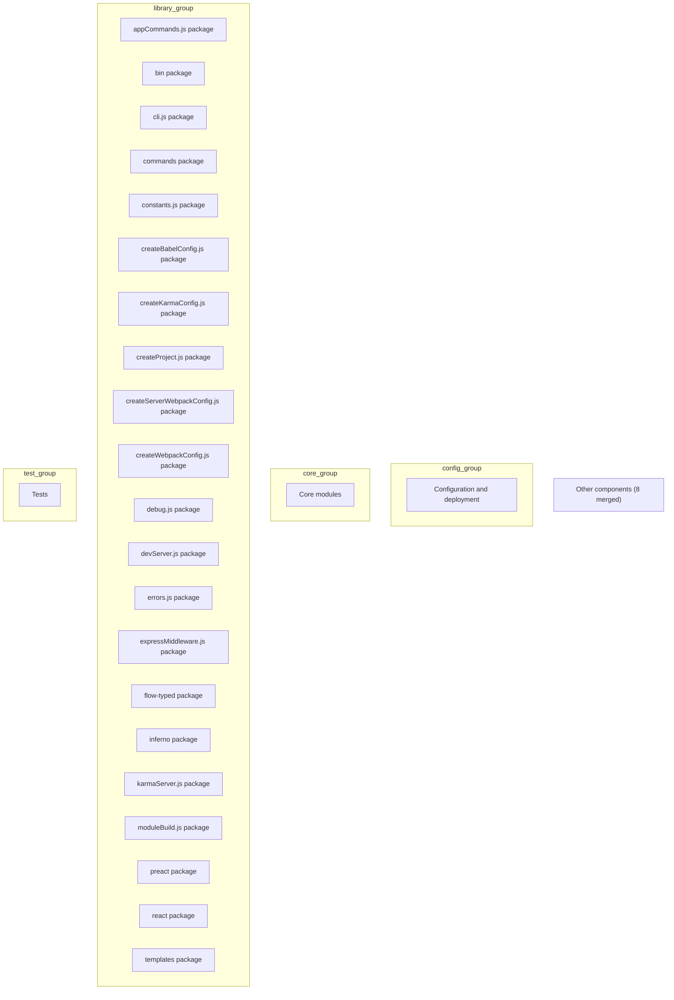

# Architecture report: insin/nwb

> Automated static analysis. **Observed** = directly seen in files/imports/AST; **Inferred** = interpretation from that evidence. Repository code was not executed.

## 1. Repository at a glance

| Item | Value |
| --- | --- |
| Repository | insin/nwb |
| Description | A toolkit for React, Preact, Inferno & vanilla JS apps, React libraries and other npm modules for the web, with no configuration (until you need it) |
| Language | JavaScript |
| Stars | 5524 |
| Licence | Other |
| Analysed commit / branch | d95ab83f05d09c40dd2b7c65f4c6b15776c8526d / master |
| Framework(s) | None detected |
| Files analysed | 255 |
| Components | 32 |

## 2. Architecture in one minute

insin/nwb - A toolkit for React, Preact, Inferno & vanilla JS apps, React libraries and other npm modules for the web, with no configuration (until you need it). This repository was analysed statically from 255 file(s) (0 Python). Detected technologies (observed from imports/manifests): webpack. Files are grouped into 32 component(s): appCommands.js package, bin package, cli.js package, commands package, Configuration and deployment, constants.js package, Core modules, createBabelConfig.js package. Findings below distinguish observed facts from inferred interpretation.

## 3. High-level block diagram

## 4. Main components

### appCommands.js package (`appcommands_js`)

- **Kind:** library
- **Status:** Observed
- **Confidence:** 0.85
- **Responsibility:** Groups 1 file(s) under appcommands.js package (observed from repository paths and static analysis).
- **Paths:** `src/appCommands.js`
- **Evidence:** [src/appCommands.js](https://github.com/insin/nwb/blob/d95ab83f05d09c40dd2b7c65f4c6b15776c8526d/src/appCommands.js)

### bin package (`bin`)

- **Kind:** library
- **Status:** Observed
- **Confidence:** 0.85
- **Responsibility:** Groups 1 file(s) under bin package (observed from repository paths and static analysis).
- **Paths:** `src/bin/nwb.js`
- **Evidence:** [src/bin/nwb.js](https://github.com/insin/nwb/blob/d95ab83f05d09c40dd2b7c65f4c6b15776c8526d/src/bin/nwb.js)

### cli.js package (`cli_js`)

- **Kind:** library
- **Status:** Observed
- **Confidence:** 0.85
- **Responsibility:** Groups 1 file(s) under cli.js package (observed from repository paths and static analysis).
- **Paths:** `src/cli.js`
- **Evidence:** [src/cli.js](https://github.com/insin/nwb/blob/d95ab83f05d09c40dd2b7c65f4c6b15776c8526d/src/cli.js)

### commands package (`commands`)

- **Kind:** library
- **Status:** Observed
- **Confidence:** 0.85
- **Responsibility:** Groups 39 file(s) under commands package (observed from repository paths and static analysis).
- **Paths:** `src/commands/build-demo.js`, `src/commands/build-inferno-app.js`, `src/commands/build-inferno.js`, `src/commands/build-preact-app.js`, `src/commands/build-preact.js`, `src/commands/build-react-app.js`, `src/commands/build-react-component.js`, `src/commands/build-react.js`, `src/commands/build-web-app.js`, `src/commands/build-web-module.js`, `src/commands/build-web.js`, `src/commands/build.js`, `src/commands/check-config.js`, `src/commands/clean-app.js`, `src/commands/clean-demo.js`, `src/commands/clean-module.js`, `src/commands/clean.js`, `src/commands/inferno.js`, `src/commands/init.js`, `src/commands/new.js`, `src/commands/preact.js`, `src/commands/react.js`, `src/commands/serve-inferno-app.js`, `src/commands/serve-inferno.js`, `src/commands/serve-preact-app.js`, `src/commands/serve-preact.js`, `src/commands/serve-react-app.js`, `src/commands/serve-react-demo.js`, `src/commands/serve-react.js`, `src/commands/serve-web-app.js`, `src/commands/serve-web.js`, `src/commands/serve.js`, `src/commands/test-inferno.js`, `src/commands/test-preact.js`, `src/commands/test-react-component.js`, `src/commands/test-react.js`, `src/commands/test-web-module.js`, `src/commands/test.js`, `src/commands/web.js`
- **Evidence:** [src/commands/build-demo.js](https://github.com/insin/nwb/blob/d95ab83f05d09c40dd2b7c65f4c6b15776c8526d/src/commands/build-demo.js); [src/commands/build-inferno-app.js](https://github.com/insin/nwb/blob/d95ab83f05d09c40dd2b7c65f4c6b15776c8526d/src/commands/build-inferno-app.js); [src/commands/build-inferno.js](https://github.com/insin/nwb/blob/d95ab83f05d09c40dd2b7c65f4c6b15776c8526d/src/commands/build-inferno.js); [src/commands/build-preact-app.js](https://github.com/insin/nwb/blob/d95ab83f05d09c40dd2b7c65f4c6b15776c8526d/src/commands/build-preact-app.js); [src/commands/build-preact.js](https://github.com/insin/nwb/blob/d95ab83f05d09c40dd2b7c65f4c6b15776c8526d/src/commands/build-preact.js); [src/commands/build-react-app.js](https://github.com/insin/nwb/blob/d95ab83f05d09c40dd2b7c65f4c6b15776c8526d/src/commands/build-react-app.js); [src/commands/build-react-component.js](https://github.com/insin/nwb/blob/d95ab83f05d09c40dd2b7c65f4c6b15776c8526d/src/commands/build-react-component.js); [src/commands/build-react.js](https://github.com/insin/nwb/blob/d95ab83f05d09c40dd2b7c65f4c6b15776c8526d/src/commands/build-react.js)

### Configuration and deployment (`config`)

- **Kind:** config
- **Status:** Observed
- **Confidence:** 0.85
- **Responsibility:** Groups 22 file(s) under configuration and deployment (observed from repository paths and static analysis).
- **Paths:** `appveyor.yml`, `package.json`, `src/config/UserConfigReport.js`, `src/config/babel.js`, `src/config/index.js`, `src/config/karma.js`, `src/config/npm.js`, `src/config/plugin.js`, `src/config/user.js`, `src/config/webpack.js`, `templates/inferno-app/_.travis.yml`, `templates/inferno-app/_package.json`, `templates/preact-app/_.travis.yml`, `templates/preact-app/_package.json`, `templates/react-app/_.travis.yml`, `templates/react-app/_package.json`, `templates/react-component/_.travis.yml`, `templates/react-component/_package.json`, `templates/web-app/_.travis.yml`, `templates/web-app/_package.json`, `templates/web-module/_.travis.yml`, `templates/web-module/_package.json`
- **Evidence:** [appveyor.yml](https://github.com/insin/nwb/blob/d95ab83f05d09c40dd2b7c65f4c6b15776c8526d/appveyor.yml); [package.json](https://github.com/insin/nwb/blob/d95ab83f05d09c40dd2b7c65f4c6b15776c8526d/package.json); [src/config/UserConfigReport.js](https://github.com/insin/nwb/blob/d95ab83f05d09c40dd2b7c65f4c6b15776c8526d/src/config/UserConfigReport.js); [src/config/babel.js](https://github.com/insin/nwb/blob/d95ab83f05d09c40dd2b7c65f4c6b15776c8526d/src/config/babel.js); [src/config/index.js](https://github.com/insin/nwb/blob/d95ab83f05d09c40dd2b7c65f4c6b15776c8526d/src/config/index.js); [src/config/karma.js](https://github.com/insin/nwb/blob/d95ab83f05d09c40dd2b7c65f4c6b15776c8526d/src/config/karma.js); [src/config/npm.js](https://github.com/insin/nwb/blob/d95ab83f05d09c40dd2b7c65f4c6b15776c8526d/src/config/npm.js); [src/config/plugin.js](https://github.com/insin/nwb/blob/d95ab83f05d09c40dd2b7c65f4c6b15776c8526d/src/config/plugin.js)

### constants.js package (`constants_js`)

- **Kind:** library
- **Status:** Observed
- **Confidence:** 0.85
- **Responsibility:** Groups 1 file(s) under constants.js package (observed from repository paths and static analysis).
- **Paths:** `src/constants.js`
- **Evidence:** [src/constants.js](https://github.com/insin/nwb/blob/d95ab83f05d09c40dd2b7c65f4c6b15776c8526d/src/constants.js)

### Core modules (`core`)

- **Kind:** core
- **Status:** Observed
- **Confidence:** 0.85
- **Responsibility:** Groups 2 file(s) under core modules (observed from repository paths and static analysis).
- **Paths:** `express.js`, `package-changelog.js`
- **Evidence:** [express.js](https://github.com/insin/nwb/blob/d95ab83f05d09c40dd2b7c65f4c6b15776c8526d/express.js); [package-changelog.js](https://github.com/insin/nwb/blob/d95ab83f05d09c40dd2b7c65f4c6b15776c8526d/package-changelog.js)

### createBabelConfig.js package (`createbabelconfig_js`)

- **Kind:** library
- **Status:** Observed
- **Confidence:** 0.85
- **Responsibility:** Groups 1 file(s) under createbabelconfig.js package (observed from repository paths and static analysis).
- **Paths:** `src/createBabelConfig.js`
- **Evidence:** [src/createBabelConfig.js](https://github.com/insin/nwb/blob/d95ab83f05d09c40dd2b7c65f4c6b15776c8526d/src/createBabelConfig.js)

### createKarmaConfig.js package (`createkarmaconfig_js`)

- **Kind:** library
- **Status:** Observed
- **Confidence:** 0.85
- **Responsibility:** Groups 1 file(s) under createkarmaconfig.js package (observed from repository paths and static analysis).
- **Paths:** `src/createKarmaConfig.js`
- **Evidence:** [src/createKarmaConfig.js](https://github.com/insin/nwb/blob/d95ab83f05d09c40dd2b7c65f4c6b15776c8526d/src/createKarmaConfig.js)

### createProject.js package (`createproject_js`)

- **Kind:** library
- **Status:** Observed
- **Confidence:** 0.85
- **Responsibility:** Groups 1 file(s) under createproject.js package (observed from repository paths and static analysis).
- **Paths:** `src/createProject.js`
- **Evidence:** [src/createProject.js](https://github.com/insin/nwb/blob/d95ab83f05d09c40dd2b7c65f4c6b15776c8526d/src/createProject.js)

### createServerWebpackConfig.js package (`createserverwebpackconfig_js`)

- **Kind:** library
- **Status:** Observed
- **Confidence:** 0.85
- **Responsibility:** Groups 1 file(s) under createserverwebpackconfig.js package (observed from repository paths and static analysis).
- **Paths:** `src/createServerWebpackConfig.js`
- **Evidence:** [src/createServerWebpackConfig.js](https://github.com/insin/nwb/blob/d95ab83f05d09c40dd2b7c65f4c6b15776c8526d/src/createServerWebpackConfig.js)

### createWebpackConfig.js package (`createwebpackconfig_js`)

- **Kind:** library
- **Status:** Observed
- **Confidence:** 0.85
- **Responsibility:** Groups 1 file(s) under createwebpackconfig.js package (observed from repository paths and static analysis).
- **Paths:** `src/createWebpackConfig.js`
- **Evidence:** [src/createWebpackConfig.js](https://github.com/insin/nwb/blob/d95ab83f05d09c40dd2b7c65f4c6b15776c8526d/src/createWebpackConfig.js)

### debug.js package (`debug_js`)

- **Kind:** library
- **Status:** Observed
- **Confidence:** 0.85
- **Responsibility:** Groups 1 file(s) under debug.js package (observed from repository paths and static analysis).
- **Paths:** `src/debug.js`
- **Evidence:** [src/debug.js](https://github.com/insin/nwb/blob/d95ab83f05d09c40dd2b7c65f4c6b15776c8526d/src/debug.js)

### devServer.js package (`devserver_js`)

- **Kind:** library
- **Status:** Observed
- **Confidence:** 0.85
- **Responsibility:** Groups 1 file(s) under devserver.js package (observed from repository paths and static analysis).
- **Paths:** `src/devServer.js`
- **Evidence:** [src/devServer.js](https://github.com/insin/nwb/blob/d95ab83f05d09c40dd2b7c65f4c6b15776c8526d/src/devServer.js)

### errors.js package (`errors_js`)

- **Kind:** library
- **Status:** Observed
- **Confidence:** 0.85
- **Responsibility:** Groups 1 file(s) under errors.js package (observed from repository paths and static analysis).
- **Paths:** `src/errors.js`
- **Evidence:** [src/errors.js](https://github.com/insin/nwb/blob/d95ab83f05d09c40dd2b7c65f4c6b15776c8526d/src/errors.js)

### expressMiddleware.js package (`expressmiddleware_js`)

- **Kind:** library
- **Status:** Observed
- **Confidence:** 0.85
- **Responsibility:** Groups 1 file(s) under expressmiddleware.js package (observed from repository paths and static analysis).
- **Paths:** `src/expressMiddleware.js`
- **Evidence:** [src/expressMiddleware.js](https://github.com/insin/nwb/blob/d95ab83f05d09c40dd2b7c65f4c6b15776c8526d/src/expressMiddleware.js)

### flow-typed package (`flow_typed`)

- **Kind:** library
- **Status:** Observed
- **Confidence:** 0.85
- **Responsibility:** Groups 7 file(s) under flow-typed package (observed from repository paths and static analysis).
- **Paths:** `flow-typed/libdefs.js`, `flow-typed/npm/debug_v2.x.x.js`, `flow-typed/npm/expect_v1.x.x.js`, `flow-typed/npm/minimist_v1.x.x.js`, `flow-typed/npm/mocha_v3.1.x.js`, `flow-typed/npm/run-series_v1.x.x.js`, `flow-typed/npm/semver_v5.1.x.js`
- **Evidence:** [flow-typed/libdefs.js](https://github.com/insin/nwb/blob/d95ab83f05d09c40dd2b7c65f4c6b15776c8526d/flow-typed/libdefs.js); [flow-typed/npm/debug_v2.x.x.js](https://github.com/insin/nwb/blob/d95ab83f05d09c40dd2b7c65f4c6b15776c8526d/flow-typed/npm/debug_v2.x.x.js); [flow-typed/npm/expect_v1.x.x.js](https://github.com/insin/nwb/blob/d95ab83f05d09c40dd2b7c65f4c6b15776c8526d/flow-typed/npm/expect_v1.x.x.js); [flow-typed/npm/minimist_v1.x.x.js](https://github.com/insin/nwb/blob/d95ab83f05d09c40dd2b7c65f4c6b15776c8526d/flow-typed/npm/minimist_v1.x.x.js); [flow-typed/npm/mocha_v3.1.x.js](https://github.com/insin/nwb/blob/d95ab83f05d09c40dd2b7c65f4c6b15776c8526d/flow-typed/npm/mocha_v3.1.x.js); [flow-typed/npm/run-series_v1.x.x.js](https://github.com/insin/nwb/blob/d95ab83f05d09c40dd2b7c65f4c6b15776c8526d/flow-typed/npm/run-series_v1.x.x.js); [flow-typed/npm/semver_v5.1.x.js](https://github.com/insin/nwb/blob/d95ab83f05d09c40dd2b7c65f4c6b15776c8526d/flow-typed/npm/semver_v5.1.x.js)

### inferno package (`inferno`)

- **Kind:** library
- **Status:** Observed
- **Confidence:** 0.85
- **Responsibility:** Groups 3 file(s) under inferno package (observed from repository paths and static analysis).
- **Paths:** `src/inferno/index.js`, `src/inferno/inferno-preset.js`, `src/inferno/renderShim.js`
- **Evidence:** [src/inferno/index.js](https://github.com/insin/nwb/blob/d95ab83f05d09c40dd2b7c65f4c6b15776c8526d/src/inferno/index.js); [src/inferno/inferno-preset.js](https://github.com/insin/nwb/blob/d95ab83f05d09c40dd2b7c65f4c6b15776c8526d/src/inferno/inferno-preset.js); [src/inferno/renderShim.js](https://github.com/insin/nwb/blob/d95ab83f05d09c40dd2b7c65f4c6b15776c8526d/src/inferno/renderShim.js)

### karmaServer.js package (`karmaserver_js`)

- **Kind:** library
- **Status:** Observed
- **Confidence:** 0.85
- **Responsibility:** Groups 1 file(s) under karmaserver.js package (observed from repository paths and static analysis).
- **Paths:** `src/karmaServer.js`
- **Evidence:** [src/karmaServer.js](https://github.com/insin/nwb/blob/d95ab83f05d09c40dd2b7c65f4c6b15776c8526d/src/karmaServer.js)

### moduleBuild.js package (`modulebuild_js`)

- **Kind:** library
- **Status:** Observed
- **Confidence:** 0.85
- **Responsibility:** Groups 1 file(s) under modulebuild.js package (observed from repository paths and static analysis).
- **Paths:** `src/moduleBuild.js`
- **Evidence:** [src/moduleBuild.js](https://github.com/insin/nwb/blob/d95ab83f05d09c40dd2b7c65f4c6b15776c8526d/src/moduleBuild.js)

### preact package (`preact`)

- **Kind:** library
- **Status:** Observed
- **Confidence:** 0.85
- **Responsibility:** Groups 3 file(s) under preact package (observed from repository paths and static analysis).
- **Paths:** `src/preact/index.js`, `src/preact/preact-preset.js`, `src/preact/renderShim.js`
- **Evidence:** [src/preact/index.js](https://github.com/insin/nwb/blob/d95ab83f05d09c40dd2b7c65f4c6b15776c8526d/src/preact/index.js); [src/preact/preact-preset.js](https://github.com/insin/nwb/blob/d95ab83f05d09c40dd2b7c65f4c6b15776c8526d/src/preact/preact-preset.js); [src/preact/renderShim.js](https://github.com/insin/nwb/blob/d95ab83f05d09c40dd2b7c65f4c6b15776c8526d/src/preact/renderShim.js)

### quickCommands.js package (`quickcommands_js`)

- **Kind:** library
- **Status:** Observed
- **Confidence:** 0.85
- **Responsibility:** Groups 1 file(s) under quickcommands.js package (observed from repository paths and static analysis).
- **Paths:** `src/quickCommands.js`
- **Evidence:** [src/quickCommands.js](https://github.com/insin/nwb/blob/d95ab83f05d09c40dd2b7c65f4c6b15776c8526d/src/quickCommands.js)

### react package (`react`)

- **Kind:** library
- **Status:** Observed
- **Confidence:** 0.85
- **Responsibility:** Groups 2 file(s) under react package (observed from repository paths and static analysis).
- **Paths:** `src/react/index.js`, `src/react/renderShim.js`
- **Evidence:** [src/react/index.js](https://github.com/insin/nwb/blob/d95ab83f05d09c40dd2b7c65f4c6b15776c8526d/src/react/index.js); [src/react/renderShim.js](https://github.com/insin/nwb/blob/d95ab83f05d09c40dd2b7c65f4c6b15776c8526d/src/react/renderShim.js)

### templates package (`templates`)

- **Kind:** library
- **Status:** Observed
- **Confidence:** 0.85
- **Responsibility:** Groups 16 file(s) under templates package (observed from repository paths and static analysis).
- **Paths:** `templates/inferno-app/nwb.config.js`, `templates/inferno-app/src/App.js`, `templates/inferno-app/src/index.js`, `templates/preact-app/nwb.config.js`, `templates/preact-app/src/App.js`, `templates/preact-app/src/index.js`, `templates/react-app/nwb.config.js`, `templates/react-app/src/App.js`, `templates/react-app/src/index.js`, `templates/react-component/demo/src/index.js`, `templates/react-component/nwb.config.js`, `templates/react-component/src/index.js`, `templates/web-app/nwb.config.js`, `templates/web-app/src/index.js`, `templates/web-module/nwb.config.js`, `templates/web-module/src/index.js`
- **Evidence:** [templates/inferno-app/nwb.config.js](https://github.com/insin/nwb/blob/d95ab83f05d09c40dd2b7c65f4c6b15776c8526d/templates/inferno-app/nwb.config.js); [templates/inferno-app/src/App.js](https://github.com/insin/nwb/blob/d95ab83f05d09c40dd2b7c65f4c6b15776c8526d/templates/inferno-app/src/App.js); [templates/inferno-app/src/index.js](https://github.com/insin/nwb/blob/d95ab83f05d09c40dd2b7c65f4c6b15776c8526d/templates/inferno-app/src/index.js); [templates/preact-app/nwb.config.js](https://github.com/insin/nwb/blob/d95ab83f05d09c40dd2b7c65f4c6b15776c8526d/templates/preact-app/nwb.config.js); [templates/preact-app/src/App.js](https://github.com/insin/nwb/blob/d95ab83f05d09c40dd2b7c65f4c6b15776c8526d/templates/preact-app/src/App.js); [templates/preact-app/src/index.js](https://github.com/insin/nwb/blob/d95ab83f05d09c40dd2b7c65f4c6b15776c8526d/templates/preact-app/src/index.js); [templates/react-app/nwb.config.js](https://github.com/insin/nwb/blob/d95ab83f05d09c40dd2b7c65f4c6b15776c8526d/templates/react-app/nwb.config.js); [templates/react-app/src/App.js](https://github.com/insin/nwb/blob/d95ab83f05d09c40dd2b7c65f4c6b15776c8526d/templates/react-app/src/App.js)

### Tests (`tests`)

- **Kind:** test
- **Status:** Observed
- **Confidence:** 0.85
- **Responsibility:** Groups 67 file(s) under tests (observed from repository paths and static analysis).
- **Paths:** `templates/inferno-app/tests/App.test.js`, `templates/inferno-app/tests/_.eslintrc`, `templates/preact-app/tests/App.test.js`, `templates/preact-app/tests/_.eslintrc`, `templates/react-app/tests/App.test.js`, `templates/react-app/tests/_.eslintrc`, `templates/react-component/tests/_.eslintrc`, `templates/react-component/tests/index.test.js`, `templates/web-app/tests/_.eslintrc`, `templates/web-app/tests/index.test.js`, `templates/web-module/tests/_.eslintrc`, `templates/web-module/tests/index.test.js`, `tests/.eslintrc`, `tests/commands/build-test.js`, `tests/commands/new-init-test.js`, `tests/commands/projects-test.js`, `tests/commands/serve-test.js`, `tests/commands/test-test.js`, `tests/config-test.js`, `tests/createBabelConfig-test.js`, `tests/createKarmaConfig-test.js`, `tests/createProject-test.js`, `tests/createWebpackConfig-test.js`, `tests/fixtures/bad-config.js`, `tests/fixtures/invalid-config.js`, `tests/fixtures/plugins/package.json`, `tests/fixtures/projects/async-await/_package.json`, `tests/fixtures/projects/async-await/nwb.config.js`, `tests/fixtures/projects/async-await/src/App.js`, `tests/fixtures/projects/async-await/src/index.html`, `tests/fixtures/projects/async-await/src/index.js`, `tests/fixtures/projects/async-await/tests/_.eslintrc`, `tests/fixtures/projects/async-await/tests/index.test.js`, `tests/fixtures/projects/cherry-pick/_package.json`, `tests/fixtures/projects/cherry-pick/nwb.config.js`, `tests/fixtures/projects/cherry-pick/src/__tests__/helper.js`, `tests/fixtures/projects/cherry-pick/src/index.js`, `tests/fixtures/projects/cherry-pick/src/index.spec.js`, `tests/fixtures/projects/cherry-pick/src/index.test.js`, `tests/fixtures/projects/express-middleware/_package.json`, `tests/fixtures/projects/express-middleware/nwb.config.js`, `tests/fixtures/projects/express-middleware/server.js`, `tests/fixtures/projects/express-middleware/src/App.js`, `tests/fixtures/projects/express-middleware/src/index.html`, `tests/fixtures/projects/express-middleware/src/index.js`, `tests/fixtures/projects/failing-build/_package.json`, `tests/fixtures/projects/failing-build/nwb.config.js`, `tests/fixtures/projects/failing-build/src/index.js`, `tests/fixtures/projects/react-component-with-css/_package.json`, `tests/fixtures/projects/react-component-with-css/nwb.config.js`, `tests/fixtures/projects/react-component-with-css/src/components/Thing.css`, `tests/fixtures/projects/react-component-with-css/src/components/Thing.js`, `tests/fixtures/projects/react-component-with-css/src/components/Thing.spec.js`, `tests/fixtures/projects/react-component-with-css/src/index.js`, `tests/fixtures/projects/router-app/_package.json`, `tests/fixtures/projects/router-app/nwb.config.js`, `tests/fixtures/projects/router-app/src/components/Thing.js`, `tests/fixtures/projects/router-app/src/index.html`, `tests/fixtures/projects/router-app/src/index.js`, `tests/fixtures/projects/router-app/src/routes/App.css`, `tests/fixtures/projects/router-app/src/routes/App.js`, `tests/fixtures/projects/router-app/src/routes/child1/Child1.js`, `tests/fixtures/projects/router-app/src/routes/child2/Child2.css`, `tests/fixtures/projects/router-app/src/routes/child2/Child2.js`, `tests/fixtures/projects/router-app/src/routes/root.js`, `tests/fixtures/worst-config.js`, `tests/utils-test.js`
- **Evidence:** [templates/inferno-app/tests/App.test.js](https://github.com/insin/nwb/blob/d95ab83f05d09c40dd2b7c65f4c6b15776c8526d/templates/inferno-app/tests/App.test.js); [templates/inferno-app/tests/_.eslintrc](https://github.com/insin/nwb/blob/d95ab83f05d09c40dd2b7c65f4c6b15776c8526d/templates/inferno-app/tests/_.eslintrc); [templates/preact-app/tests/App.test.js](https://github.com/insin/nwb/blob/d95ab83f05d09c40dd2b7c65f4c6b15776c8526d/templates/preact-app/tests/App.test.js); [templates/preact-app/tests/_.eslintrc](https://github.com/insin/nwb/blob/d95ab83f05d09c40dd2b7c65f4c6b15776c8526d/templates/preact-app/tests/_.eslintrc); [templates/react-app/tests/App.test.js](https://github.com/insin/nwb/blob/d95ab83f05d09c40dd2b7c65f4c6b15776c8526d/templates/react-app/tests/App.test.js); [templates/react-app/tests/_.eslintrc](https://github.com/insin/nwb/blob/d95ab83f05d09c40dd2b7c65f4c6b15776c8526d/templates/react-app/tests/_.eslintrc); [templates/react-component/tests/_.eslintrc](https://github.com/insin/nwb/blob/d95ab83f05d09c40dd2b7c65f4c6b15776c8526d/templates/react-component/tests/_.eslintrc); [templates/react-component/tests/index.test.js](https://github.com/insin/nwb/blob/d95ab83f05d09c40dd2b7c65f4c6b15776c8526d/templates/react-component/tests/index.test.js)

### types.js package (`types_js`)

- **Kind:** library
- **Status:** Observed
- **Confidence:** 0.85
- **Responsibility:** Groups 1 file(s) under types.js package (observed from repository paths and static analysis).
- **Paths:** `src/types.js`
- **Evidence:** [src/types.js](https://github.com/insin/nwb/blob/d95ab83f05d09c40dd2b7c65f4c6b15776c8526d/src/types.js)

### utils.js package (`utils_js`)

- **Kind:** library
- **Status:** Observed
- **Confidence:** 0.85
- **Responsibility:** Groups 1 file(s) under utils.js package (observed from repository paths and static analysis).
- **Paths:** `src/utils.js`
- **Evidence:** [src/utils.js](https://github.com/insin/nwb/blob/d95ab83f05d09c40dd2b7c65f4c6b15776c8526d/src/utils.js)

### web package (`web`)

- **Kind:** library
- **Status:** Observed
- **Confidence:** 0.85
- **Responsibility:** Groups 1 file(s) under web package (observed from repository paths and static analysis).
- **Paths:** `src/web/index.js`
- **Evidence:** [src/web/index.js](https://github.com/insin/nwb/blob/d95ab83f05d09c40dd2b7c65f4c6b15776c8526d/src/web/index.js)

### webpackBuild.js package (`webpackbuild_js`)

- **Kind:** library
- **Status:** Observed
- **Confidence:** 0.85
- **Responsibility:** Groups 1 file(s) under webpackbuild.js package (observed from repository paths and static analysis).
- **Paths:** `src/webpackBuild.js`
- **Evidence:** [src/webpackBuild.js](https://github.com/insin/nwb/blob/d95ab83f05d09c40dd2b7c65f4c6b15776c8526d/src/webpackBuild.js)

### webpackServer.js package (`webpackserver_js`)

- **Kind:** library
- **Status:** Observed
- **Confidence:** 0.85
- **Responsibility:** Groups 1 file(s) under webpackserver.js package (observed from repository paths and static analysis).
- **Paths:** `src/webpackServer.js`
- **Evidence:** [src/webpackServer.js](https://github.com/insin/nwb/blob/d95ab83f05d09c40dd2b7c65f4c6b15776c8526d/src/webpackServer.js)

### WebpackStatusPlugin.js package (`webpackstatusplugin_js`)

- **Kind:** library
- **Status:** Observed
- **Confidence:** 0.85
- **Responsibility:** Groups 1 file(s) under webpackstatusplugin.js package (observed from repository paths and static analysis).
- **Paths:** `src/WebpackStatusPlugin.js`
- **Evidence:** [src/WebpackStatusPlugin.js](https://github.com/insin/nwb/blob/d95ab83f05d09c40dd2b7c65f4c6b15776c8526d/src/WebpackStatusPlugin.js)

### webpackUtils.js package (`webpackutils_js`)

- **Kind:** library
- **Status:** Observed
- **Confidence:** 0.85
- **Responsibility:** Groups 1 file(s) under webpackutils.js package (observed from repository paths and static analysis).
- **Paths:** `src/webpackUtils.js`
- **Evidence:** [src/webpackUtils.js](https://github.com/insin/nwb/blob/d95ab83f05d09c40dd2b7c65f4c6b15776c8526d/src/webpackUtils.js)

## 5. Execution flow

**Observed** entry point(s):

- [src/config/index.js](https://github.com/insin/nwb/blob/d95ab83f05d09c40dd2b7c65f4c6b15776c8526d/src/config/index.js)
- [src/inferno/index.js](https://github.com/insin/nwb/blob/d95ab83f05d09c40dd2b7c65f4c6b15776c8526d/src/inferno/index.js)
- [src/preact/index.js](https://github.com/insin/nwb/blob/d95ab83f05d09c40dd2b7c65f4c6b15776c8526d/src/preact/index.js)
- [src/react/index.js](https://github.com/insin/nwb/blob/d95ab83f05d09c40dd2b7c65f4c6b15776c8526d/src/react/index.js)
- [src/web/index.js](https://github.com/insin/nwb/blob/d95ab83f05d09c40dd2b7c65f4c6b15776c8526d/src/web/index.js)
- [templates/inferno-app/src/App.js](https://github.com/insin/nwb/blob/d95ab83f05d09c40dd2b7c65f4c6b15776c8526d/templates/inferno-app/src/App.js)
- [templates/inferno-app/src/index.js](https://github.com/insin/nwb/blob/d95ab83f05d09c40dd2b7c65f4c6b15776c8526d/templates/inferno-app/src/index.js)
- [templates/preact-app/src/App.js](https://github.com/insin/nwb/blob/d95ab83f05d09c40dd2b7c65f4c6b15776c8526d/templates/preact-app/src/App.js)
- [templates/preact-app/src/index.js](https://github.com/insin/nwb/blob/d95ab83f05d09c40dd2b7c65f4c6b15776c8526d/templates/preact-app/src/index.js)
- [templates/react-app/src/App.js](https://github.com/insin/nwb/blob/d95ab83f05d09c40dd2b7c65f4c6b15776c8526d/templates/react-app/src/App.js)
- [templates/react-app/src/index.js](https://github.com/insin/nwb/blob/d95ab83f05d09c40dd2b7c65f4c6b15776c8526d/templates/react-app/src/index.js)
- [templates/react-component/src/index.js](https://github.com/insin/nwb/blob/d95ab83f05d09c40dd2b7c65f4c6b15776c8526d/templates/react-component/src/index.js)

Representative flow (derived from observed entry points and the import graph; steps beyond the entry point are **Inferred**):

1. Execution starts at an observed entry point listed above, if present.
2. No internal import relationships between components were observed.

## 6. Project structure

### `(root)`

- `.editorconfig` - config (197 bytes)
- `.eslintignore` - other (42 bytes)
- `.flowconfig` - other (254 bytes)
- `.gitattributes` - other (11 bytes)
- `.gitignore` - other (75 bytes)
- `.travis.yml` - ci, YAML (425 bytes)
- `CHANGES.md` - docs (22262 bytes)
- `CHANGES.old.md` - docs (135769 bytes)
- `LICENSE` - docs (2636 bytes)
- `README.md` - docs (9896 bytes)
- `TODO` - other (447 bytes)
- `appveyor.yml` - config (371 bytes)
- `express.js` - source, JavaScript (52 bytes)
- `package-changelog.js` - source, JavaScript (804 bytes)
- `package.json` - manifest (4511 bytes)

### `.github`

- `.github/CONTRIBUTING.md` - docs (5843 bytes)
- `.github/ISSUE_TEMPLATE.md` - docs (1080 bytes)
- `.github/PULL_REQUEST_TEMPLATE.md` - docs (377 bytes)

### `.vscode`

- `.vscode/extensions.json` - config (164 bytes)
- `.vscode/settings.json` - config (214 bytes)

### `docs`

- `docs/BrowserSupport.md` - docs (4595 bytes)
- `docs/Commands.md` - docs (15474 bytes)
- `docs/Configuration.md` - docs (43503 bytes)
- `docs/Examples.md` - docs (5429 bytes)
- `docs/FAQ.md` - docs (4358 bytes)
- `docs/Features.md` - docs (3902 bytes)
- `docs/ImplementingPlugins.md` - docs (1103 bytes)
- `docs/Middleware.md` - docs (1947 bytes)
- `docs/Plugins.md` - docs (1611 bytes)
- `docs/README.md` - docs (1369 bytes)
- `docs/Stylesheets.md` - docs (9100 bytes)
- `docs/Testing.md` - docs (8113 bytes)
- `docs/Versioning.md` - docs (1484 bytes)
- `docs/guides/QuickDevelopment.md` - docs (13488 bytes)
- `docs/guides/README.md` - docs (346 bytes)
- `docs/guides/ReactApps.md` - docs (19812 bytes)
- `docs/guides/ReactComponents.md` - docs (21003 bytes)

### `flow-typed`

- `flow-typed/libdefs.js` - source, JavaScript (1277 bytes)
- `flow-typed/npm/debug_v2.x.x.js` - source, JavaScript (871 bytes)
- `flow-typed/npm/expect_v1.x.x.js` - source, JavaScript (3813 bytes)
- `flow-typed/npm/minimist_v1.x.x.js` - source, JavaScript (694 bytes)
- `flow-typed/npm/mocha_v3.1.x.js` - source, JavaScript (862 bytes)
- `flow-typed/npm/run-series_v1.x.x.js` - source, JavaScript (182 bytes)
- `flow-typed/npm/semver_v5.1.x.js` - source, JavaScript (2660 bytes)

### `resources`

- `resources/config.dot` - other (1848 bytes)

### `src`

- `src/WebpackStatusPlugin.js` - source, JavaScript (1943 bytes)
- `src/appCommands.js` - source, JavaScript (3979 bytes)
- `src/bin/nwb.js` - source, JavaScript (753 bytes)
- `src/cli.js` - source, JavaScript (9009 bytes)
- `src/commands/build-demo.js` - source, JavaScript (1540 bytes)
- `src/commands/build-inferno-app.js` - source, JavaScript (267 bytes)
- `src/commands/build-inferno.js` - source, JavaScript (310 bytes)
- `src/commands/build-preact-app.js` - source, JavaScript (262 bytes)
- `src/commands/build-preact.js` - source, JavaScript (303 bytes)
- `src/commands/build-react-app.js` - source, JavaScript (257 bytes)
- `src/commands/build-react-component.js` - source, JavaScript (1193 bytes)
- `src/commands/build-react.js` - source, JavaScript (302 bytes)
- `src/commands/build-web-app.js` - source, JavaScript (252 bytes)
- `src/commands/build-web-module.js` - source, JavaScript (255 bytes)
- `src/commands/build-web.js` - source, JavaScript (260 bytes)
- `src/commands/build.js` - source, JavaScript (938 bytes)
- `src/commands/check-config.js` - source, JavaScript (633 bytes)
- `src/commands/clean-app.js` - source, JavaScript (151 bytes)
- `src/commands/clean-demo.js` - source, JavaScript (115 bytes)
- `src/commands/clean-module.js` - source, JavaScript (138 bytes)
- `src/commands/clean.js` - source, JavaScript (690 bytes)
- `src/commands/inferno.js` - source, JavaScript (2957 bytes)
- `src/commands/init.js` - source, JavaScript (739 bytes)
- `src/commands/new.js` - source, JavaScript (935 bytes)
- `src/commands/preact.js` - source, JavaScript (2945 bytes)
- `src/commands/react.js` - source, JavaScript (3219 bytes)
- `src/commands/serve-inferno-app.js` - source, JavaScript (265 bytes)
- `src/commands/serve-inferno.js` - source, JavaScript (310 bytes)
- `src/commands/serve-preact-app.js` - source, JavaScript (259 bytes)
- `src/commands/serve-preact.js` - source, JavaScript (307 bytes)
- `src/commands/serve-react-app.js` - source, JavaScript (254 bytes)
- `src/commands/serve-react-demo.js` - source, JavaScript (1156 bytes)
- `src/commands/serve-react.js` - source, JavaScript (302 bytes)
- `src/commands/serve-web-app.js` - source, JavaScript (252 bytes)
- `src/commands/serve-web.js` - source, JavaScript (272 bytes)
- `src/commands/serve.js` - source, JavaScript (1062 bytes)
- `src/commands/test-inferno.js` - source, JavaScript (262 bytes)
- `src/commands/test-preact.js` - source, JavaScript (258 bytes)
- `src/commands/test-react-component.js` - source, JavaScript (309 bytes)
- `src/commands/test-react.js` - source, JavaScript (254 bytes)
- `src/commands/test-web-module.js` - source, JavaScript (187 bytes)
- `src/commands/test.js` - source, JavaScript (1054 bytes)
- `src/commands/web.js` - source, JavaScript (2707 bytes)
- `src/config/UserConfigReport.js` - source, JavaScript (2916 bytes)
- `src/config/babel.js` - source, JavaScript (4408 bytes)
- `src/config/index.js` - source, JavaScript (157 bytes)
- `src/config/karma.js` - source, JavaScript (3383 bytes)
- `src/config/npm.js` - source, JavaScript (2675 bytes)
- `src/config/plugin.js` - source, JavaScript (1454 bytes)
- `src/config/user.js` - source, JavaScript (7500 bytes)
- `src/config/webpack.js` - source, JavaScript (13798 bytes)
- `src/constants.js` - source, JavaScript (650 bytes)
- `src/createBabelConfig.js` - source, JavaScript (6487 bytes)
- `src/createKarmaConfig.js` - source, JavaScript (6873 bytes)
- `src/createProject.js` - source, JavaScript (7550 bytes)
- `src/createServerWebpackConfig.js` - source, JavaScript (1975 bytes)
- `src/createWebpackConfig.js` - source, JavaScript (23777 bytes)
- `src/debug.js` - source, JavaScript (55 bytes)
- `src/devServer.js` - source, JavaScript (1483 bytes)
- `src/errors.js` - source, JavaScript (414 bytes)
- `src/expressMiddleware.js` - source, JavaScript (2220 bytes)
- `src/inferno/index.js` - source, JavaScript (2037 bytes)
- `src/inferno/inferno-preset.js` - source, JavaScript (166 bytes)
- `src/inferno/renderShim.js` - source, JavaScript (898 bytes)
- `src/karmaServer.js` - source, JavaScript (662 bytes)
- `src/moduleBuild.js` - source, JavaScript (5757 bytes)
- `src/preact/index.js` - source, JavaScript (1173 bytes)
- `src/preact/preact-preset.js` - source, JavaScript (193 bytes)
- `src/preact/renderShim.js` - source, JavaScript (990 bytes)
- `src/quickCommands.js` - source, JavaScript (5561 bytes)
- `src/react/index.js` - source, JavaScript (3515 bytes)
- `src/react/renderShim.js` - source, JavaScript (909 bytes)
- `src/types.js` - source, JavaScript (163 bytes)
- `src/utils.js` - source, JavaScript (6301 bytes)
- `src/web/index.js` - source, JavaScript (876 bytes)
- `src/webpackBuild.js` - source, JavaScript (1474 bytes)
- `src/webpackServer.js` - source, JavaScript (3466 bytes)
- `src/webpackUtils.js` - source, JavaScript (4358 bytes)

### `templates`

- `templates/inferno-app/CONTRIBUTING.md` - docs (794 bytes)
- `templates/inferno-app/README.md` - docs (36 bytes)
- `templates/inferno-app/_.gitignore` - other (45 bytes)
- `templates/inferno-app/_.travis.yml` - config (297 bytes)
- `templates/inferno-app/_package.json` - config (502 bytes)
- `templates/inferno-app/nwb.config.js` - source, JavaScript (43 bytes)
- `templates/inferno-app/public/_.gitkeep` - other (0 bytes)
- `templates/inferno-app/src/App.css` - other (640 bytes)
- `templates/inferno-app/src/App.js` - source, JavaScript (510 bytes)
- `templates/inferno-app/src/index.css` - other (100 bytes)
- `templates/inferno-app/src/index.html` - other (349 bytes)
- `templates/inferno-app/src/index.js` - source, JavaScript (169 bytes)
- `templates/inferno-app/src/inferno.svg` - other (1738 bytes)
- `templates/inferno-app/tests/App.test.js` - test, JavaScript (387 bytes)
- `templates/inferno-app/tests/_.eslintrc` - test (37 bytes)
- `templates/preact-app/CONTRIBUTING.md` - docs (794 bytes)
- `templates/preact-app/README.md` - docs (36 bytes)
- `templates/preact-app/_.gitignore` - other (45 bytes)
- `templates/preact-app/_.travis.yml` - config (297 bytes)
- `templates/preact-app/_package.json` - config (497 bytes)
- `templates/preact-app/nwb.config.js` - source, JavaScript (42 bytes)
- `templates/preact-app/public/_.gitkeep` - other (0 bytes)
- `templates/preact-app/src/App.css` - other (623 bytes)
- `templates/preact-app/src/App.js` - source, JavaScript (588 bytes)
- `templates/preact-app/src/index.css` - other (100 bytes)
- `templates/preact-app/src/index.html` - other (349 bytes)
- `templates/preact-app/src/index.js` - source, JavaScript (336 bytes)
- `templates/preact-app/src/preact-logo.svg` - other (758 bytes)
- `templates/preact-app/src/preact-name.svg` - other (3221 bytes)
- `templates/preact-app/tests/App.test.js` - test, JavaScript (381 bytes)
- `templates/preact-app/tests/_.eslintrc` - test (37 bytes)
- `templates/react-app/CONTRIBUTING.md` - docs (794 bytes)
- `templates/react-app/README.md` - docs (36 bytes)
- `templates/react-app/_.gitignore` - other (45 bytes)
- `templates/react-app/_.travis.yml` - config (297 bytes)
- `templates/react-app/_package.json` - config (492 bytes)
- `templates/react-app/nwb.config.js` - source, JavaScript (41 bytes)
- `templates/react-app/public/_.gitkeep` - other (0 bytes)
- `templates/react-app/src/App.css` - other (743 bytes)
- `templates/react-app/src/App.js` - source, JavaScript (509 bytes)
- `templates/react-app/src/index.css` - other (100 bytes)
- `templates/react-app/src/index.html` - other (349 bytes)
- `templates/react-app/src/index.js` - source, JavaScript (154 bytes)
- `templates/react-app/src/react.svg` - other (3419 bytes)
- `templates/react-app/tests/App.test.js` - test, JavaScript (464 bytes)
- `templates/react-app/tests/_.eslintrc` - test (37 bytes)
- `templates/react-component/CONTRIBUTING.md` - docs (745 bytes)
- `templates/react-component/README.md` - docs (540 bytes)
- `templates/react-component/_.gitignore` - other (64 bytes)
- `templates/react-component/_.travis.yml` - config (297 bytes)
- `templates/react-component/_package.json` - config (780 bytes)
- `templates/react-component/demo/src/index.js` - source, JavaScript (295 bytes)
- `templates/react-component/nwb.config.js` - source, JavaScript (47 bytes)
- `templates/react-component/src/index.js` - source, JavaScript (171 bytes)
- `templates/react-component/tests/_.eslintrc` - test (37 bytes)
- `templates/react-component/tests/index.test.js` - test, JavaScript (478 bytes)
- `templates/web-app/CONTRIBUTING.md` - docs (818 bytes)
- `templates/web-app/README.md` - docs (36 bytes)
- `templates/web-app/_.gitignore` - other (45 bytes)
- `templates/web-app/_.travis.yml` - config (297 bytes)
- `templates/web-app/_package.json` - config (479 bytes)
- `templates/web-app/nwb.config.js` - source, JavaScript (39 bytes)
- `templates/web-app/public/_.gitkeep` - other (0 bytes)
- `templates/web-app/src/index.html` - other (349 bytes)
- `templates/web-app/src/index.js` - source, JavaScript (89 bytes)
- `templates/web-app/tests/_.eslintrc` - test (37 bytes)
- `templates/web-app/tests/index.test.js` - test, JavaScript (382 bytes)
- `templates/web-module/CONTRIBUTING.md` - docs (530 bytes)
- `templates/web-module/README.md` - docs (540 bytes)
- `templates/web-module/_.gitignore` - other (64 bytes)
- `templates/web-module/_.travis.yml` - config (297 bytes)
- `templates/web-module/_package.json` - config (581 bytes)
- `templates/web-module/nwb.config.js` - source, JavaScript (42 bytes)
- `templates/web-module/src/index.js` - source, JavaScript (37 bytes)
- `templates/web-module/tests/_.eslintrc` - test (37 bytes)
- `templates/web-module/tests/index.test.js` - test, JavaScript (202 bytes)
- `templates/webpack-template.html` - other (410 bytes)

### `tests`

- `tests/.eslintrc` - test (37 bytes)
- `tests/commands/build-test.js` - test, JavaScript (4112 bytes)
- `tests/commands/new-init-test.js` - test, JavaScript (8224 bytes)
- `tests/commands/projects-test.js` - test, JavaScript (10929 bytes)
- `tests/commands/serve-test.js` - test, JavaScript (3624 bytes)
- `tests/commands/test-test.js` - test, JavaScript (3985 bytes)
- `tests/config-test.js` - test, JavaScript (11915 bytes)
- `tests/createBabelConfig-test.js` - test, JavaScript (8977 bytes)
- `tests/createKarmaConfig-test.js` - test, JavaScript (6159 bytes)
- `tests/createProject-test.js` - test, JavaScript (475 bytes)
- `tests/createWebpackConfig-test.js` - test, JavaScript (13882 bytes)
- `tests/fixtures/bad-config.js` - test, JavaScript (135 bytes)
- `tests/fixtures/invalid-config.js` - test, JavaScript (73 bytes)
- `tests/fixtures/plugins/package.json` - test (57 bytes)
- `tests/fixtures/projects/async-await/_package.json` - test (161 bytes)
- `tests/fixtures/projects/async-await/nwb.config.js` - test, JavaScript (41 bytes)
- `tests/fixtures/projects/async-await/src/App.js` - test, JavaScript (437 bytes)
- `tests/fixtures/projects/async-await/src/index.html` - test (309 bytes)
- `tests/fixtures/projects/async-await/src/index.js` - test, JavaScript (132 bytes)
- `tests/fixtures/projects/async-await/tests/_.eslintrc` - test (37 bytes)
- `tests/fixtures/projects/async-await/tests/index.test.js` - test, JavaScript (462 bytes)
- `tests/fixtures/projects/cherry-pick/_package.json` - test (220 bytes)
- `tests/fixtures/projects/cherry-pick/nwb.config.js` - test, JavaScript (97 bytes)
- `tests/fixtures/projects/cherry-pick/src/__tests__/helper.js` - test, JavaScript (27 bytes)
- `tests/fixtures/projects/cherry-pick/src/index.js` - test, JavaScript (363 bytes)
- `tests/fixtures/projects/cherry-pick/src/index.spec.js` - test, JavaScript (27 bytes)
- `tests/fixtures/projects/cherry-pick/src/index.test.js` - test, JavaScript (27 bytes)
- `tests/fixtures/projects/express-middleware/_package.json` - test (190 bytes)
- `tests/fixtures/projects/express-middleware/nwb.config.js` - test, JavaScript (69 bytes)
- `tests/fixtures/projects/express-middleware/server.js` - test, JavaScript (334 bytes)
- `tests/fixtures/projects/express-middleware/src/App.js` - test, JavaScript (160 bytes)
- `tests/fixtures/projects/express-middleware/src/index.html` - test (316 bytes)
- `tests/fixtures/projects/express-middleware/src/index.js` - test, JavaScript (132 bytes)
- `tests/fixtures/projects/failing-build/_package.json` - test (85 bytes)
- `tests/fixtures/projects/failing-build/nwb.config.js` - test, JavaScript (39 bytes)
- `tests/fixtures/projects/failing-build/src/index.js` - test, JavaScript (13 bytes)
- `tests/fixtures/projects/react-component-with-css/_package.json` - test (141 bytes)
- `tests/fixtures/projects/react-component-with-css/nwb.config.js` - test, JavaScript (47 bytes)
- `tests/fixtures/projects/react-component-with-css/src/components/Thing.css` - test (10 bytes)
- `tests/fixtures/projects/react-component-with-css/src/components/Thing.js` - test, JavaScript (164 bytes)
- `tests/fixtures/projects/react-component-with-css/src/components/Thing.spec.js` - test, JavaScript (333 bytes)
- `tests/fixtures/projects/react-component-with-css/src/index.js` - test, JavaScript (52 bytes)
- `tests/fixtures/projects/router-app/_package.json` - test (229 bytes)
- `tests/fixtures/projects/router-app/nwb.config.js` - test, JavaScript (188 bytes)
- `tests/fixtures/projects/router-app/src/components/Thing.js` - test, JavaScript (171 bytes)
- `tests/fixtures/projects/router-app/src/index.html` - test (353 bytes)
- `tests/fixtures/projects/router-app/src/index.js` - test, JavaScript (288 bytes)
- `tests/fixtures/projects/router-app/src/routes/App.css` - test (26 bytes)
- `tests/fixtures/projects/router-app/src/routes/App.js` - test, JavaScript (633 bytes)
- `tests/fixtures/projects/router-app/src/routes/child1/Child1.js` - test, JavaScript (143 bytes)
- `tests/fixtures/projects/router-app/src/routes/child2/Child2.css` - test (45 bytes)
- `tests/fixtures/projects/router-app/src/routes/child2/Child2.js` - test, JavaScript (331 bytes)
- `tests/fixtures/projects/router-app/src/routes/root.js` - test, JavaScript (665 bytes)
- `tests/fixtures/worst-config.js` - test, JavaScript (1250 bytes)
- `tests/utils-test.js` - test, JavaScript (2264 bytes)

## 7. Key dependencies and integrations

| Name | Category | Status | Confidence | Evidence |
| --- | --- | --- | --- | --- |
| webpack | tooling | Observed | 0.85 | [package.json:45](https://github.com/insin/nwb/blob/d95ab83f05d09c40dd2b7c65f4c6b15776c8526d/package.json#L45) |

## 8. Data and state

No database, cache, queue, or persistent-state usage was observed in the analysed files. State handling, if any, may be in-memory or in files that were not analysed.

## 9. Configuration and deployment clues

- `.editorconfig` (config)
- `.travis.yml` (ci)
- `.vscode/extensions.json` (config)
- `.vscode/settings.json` (config)
- `appveyor.yml` (config)
- `package.json` (manifest)
- `templates/inferno-app/_.travis.yml` (config)
- `templates/inferno-app/_package.json` (config)
- `templates/preact-app/_.travis.yml` (config)
- `templates/preact-app/_package.json` (config)
- `templates/react-app/_.travis.yml` (config)
- `templates/react-app/_package.json` (config)
- `templates/react-component/_.travis.yml` (config)
- `templates/react-component/_package.json` (config)
- `templates/web-app/_.travis.yml` (config)
- `templates/web-app/_package.json` (config)
- `templates/web-module/_.travis.yml` (config)
- `templates/web-module/_package.json` (config)

## 10. Design observations

- Tests are present alongside source code (Observed from test file paths).

These observations are interpretations (**Inferred**) of the observed structure, not guarantees about runtime design.

## 11. Limitations and unknowns

- Static analysis only: repository code was not executed, installed, or imported at runtime.
- Components and relationships are inferred from file paths, imports, and AST structure; runtime behaviour, dynamic imports, and reflection may not be visible.
- 3 file(s) were skipped during inventory (1 x likely secret file excluded; 2 x vendored/generated directory excluded).
- No clear application entry point was observed in the analysed files.
- Repository text was treated as untrusted data; no instructions found in repository files were followed, and likely secret values were redacted/excluded.
- JavaScript and TypeScript files were inventoried from paths and package manifests. They were not parsed with a full language AST, and repository code was not executed.
- The GitHub repository was marked archived at selection time.

## 12. Source references

- [appveyor.yml](https://github.com/insin/nwb/blob/d95ab83f05d09c40dd2b7c65f4c6b15776c8526d/appveyor.yml)
- [express.js](https://github.com/insin/nwb/blob/d95ab83f05d09c40dd2b7c65f4c6b15776c8526d/express.js)
- [flow-typed/libdefs.js](https://github.com/insin/nwb/blob/d95ab83f05d09c40dd2b7c65f4c6b15776c8526d/flow-typed/libdefs.js)
- [flow-typed/npm/debug_v2.x.x.js](https://github.com/insin/nwb/blob/d95ab83f05d09c40dd2b7c65f4c6b15776c8526d/flow-typed/npm/debug_v2.x.x.js)
- [flow-typed/npm/expect_v1.x.x.js](https://github.com/insin/nwb/blob/d95ab83f05d09c40dd2b7c65f4c6b15776c8526d/flow-typed/npm/expect_v1.x.x.js)
- [flow-typed/npm/minimist_v1.x.x.js](https://github.com/insin/nwb/blob/d95ab83f05d09c40dd2b7c65f4c6b15776c8526d/flow-typed/npm/minimist_v1.x.x.js)
- [flow-typed/npm/mocha_v3.1.x.js](https://github.com/insin/nwb/blob/d95ab83f05d09c40dd2b7c65f4c6b15776c8526d/flow-typed/npm/mocha_v3.1.x.js)
- [flow-typed/npm/run-series_v1.x.x.js](https://github.com/insin/nwb/blob/d95ab83f05d09c40dd2b7c65f4c6b15776c8526d/flow-typed/npm/run-series_v1.x.x.js)
- [flow-typed/npm/semver_v5.1.x.js](https://github.com/insin/nwb/blob/d95ab83f05d09c40dd2b7c65f4c6b15776c8526d/flow-typed/npm/semver_v5.1.x.js)
- [package-changelog.js](https://github.com/insin/nwb/blob/d95ab83f05d09c40dd2b7c65f4c6b15776c8526d/package-changelog.js)
- [package.json](https://github.com/insin/nwb/blob/d95ab83f05d09c40dd2b7c65f4c6b15776c8526d/package.json)
- [package.json:45](https://github.com/insin/nwb/blob/d95ab83f05d09c40dd2b7c65f4c6b15776c8526d/package.json#L45)
- [src/WebpackStatusPlugin.js](https://github.com/insin/nwb/blob/d95ab83f05d09c40dd2b7c65f4c6b15776c8526d/src/WebpackStatusPlugin.js)
- [src/appCommands.js](https://github.com/insin/nwb/blob/d95ab83f05d09c40dd2b7c65f4c6b15776c8526d/src/appCommands.js)
- [src/bin/nwb.js](https://github.com/insin/nwb/blob/d95ab83f05d09c40dd2b7c65f4c6b15776c8526d/src/bin/nwb.js)
- [src/cli.js](https://github.com/insin/nwb/blob/d95ab83f05d09c40dd2b7c65f4c6b15776c8526d/src/cli.js)
- [src/commands/build-demo.js](https://github.com/insin/nwb/blob/d95ab83f05d09c40dd2b7c65f4c6b15776c8526d/src/commands/build-demo.js)
- [src/commands/build-inferno-app.js](https://github.com/insin/nwb/blob/d95ab83f05d09c40dd2b7c65f4c6b15776c8526d/src/commands/build-inferno-app.js)
- [src/commands/build-inferno.js](https://github.com/insin/nwb/blob/d95ab83f05d09c40dd2b7c65f4c6b15776c8526d/src/commands/build-inferno.js)
- [src/commands/build-preact-app.js](https://github.com/insin/nwb/blob/d95ab83f05d09c40dd2b7c65f4c6b15776c8526d/src/commands/build-preact-app.js)
- [src/commands/build-preact.js](https://github.com/insin/nwb/blob/d95ab83f05d09c40dd2b7c65f4c6b15776c8526d/src/commands/build-preact.js)
- [src/commands/build-react-app.js](https://github.com/insin/nwb/blob/d95ab83f05d09c40dd2b7c65f4c6b15776c8526d/src/commands/build-react-app.js)
- [src/commands/build-react-component.js](https://github.com/insin/nwb/blob/d95ab83f05d09c40dd2b7c65f4c6b15776c8526d/src/commands/build-react-component.js)
- [src/commands/build-react.js](https://github.com/insin/nwb/blob/d95ab83f05d09c40dd2b7c65f4c6b15776c8526d/src/commands/build-react.js)
- [src/config/UserConfigReport.js](https://github.com/insin/nwb/blob/d95ab83f05d09c40dd2b7c65f4c6b15776c8526d/src/config/UserConfigReport.js)
- [src/config/babel.js](https://github.com/insin/nwb/blob/d95ab83f05d09c40dd2b7c65f4c6b15776c8526d/src/config/babel.js)
- [src/config/index.js](https://github.com/insin/nwb/blob/d95ab83f05d09c40dd2b7c65f4c6b15776c8526d/src/config/index.js)
- [src/config/karma.js](https://github.com/insin/nwb/blob/d95ab83f05d09c40dd2b7c65f4c6b15776c8526d/src/config/karma.js)
- [src/config/npm.js](https://github.com/insin/nwb/blob/d95ab83f05d09c40dd2b7c65f4c6b15776c8526d/src/config/npm.js)
- [src/config/plugin.js](https://github.com/insin/nwb/blob/d95ab83f05d09c40dd2b7c65f4c6b15776c8526d/src/config/plugin.js)
- [src/constants.js](https://github.com/insin/nwb/blob/d95ab83f05d09c40dd2b7c65f4c6b15776c8526d/src/constants.js)
- [src/createBabelConfig.js](https://github.com/insin/nwb/blob/d95ab83f05d09c40dd2b7c65f4c6b15776c8526d/src/createBabelConfig.js)
- [src/createKarmaConfig.js](https://github.com/insin/nwb/blob/d95ab83f05d09c40dd2b7c65f4c6b15776c8526d/src/createKarmaConfig.js)
- [src/createProject.js](https://github.com/insin/nwb/blob/d95ab83f05d09c40dd2b7c65f4c6b15776c8526d/src/createProject.js)
- [src/createServerWebpackConfig.js](https://github.com/insin/nwb/blob/d95ab83f05d09c40dd2b7c65f4c6b15776c8526d/src/createServerWebpackConfig.js)
- [src/createWebpackConfig.js](https://github.com/insin/nwb/blob/d95ab83f05d09c40dd2b7c65f4c6b15776c8526d/src/createWebpackConfig.js)
- [src/debug.js](https://github.com/insin/nwb/blob/d95ab83f05d09c40dd2b7c65f4c6b15776c8526d/src/debug.js)
- [src/devServer.js](https://github.com/insin/nwb/blob/d95ab83f05d09c40dd2b7c65f4c6b15776c8526d/src/devServer.js)
- [src/errors.js](https://github.com/insin/nwb/blob/d95ab83f05d09c40dd2b7c65f4c6b15776c8526d/src/errors.js)
- [src/expressMiddleware.js](https://github.com/insin/nwb/blob/d95ab83f05d09c40dd2b7c65f4c6b15776c8526d/src/expressMiddleware.js)
- [src/inferno/index.js](https://github.com/insin/nwb/blob/d95ab83f05d09c40dd2b7c65f4c6b15776c8526d/src/inferno/index.js)
- [src/inferno/inferno-preset.js](https://github.com/insin/nwb/blob/d95ab83f05d09c40dd2b7c65f4c6b15776c8526d/src/inferno/inferno-preset.js)
- [src/inferno/renderShim.js](https://github.com/insin/nwb/blob/d95ab83f05d09c40dd2b7c65f4c6b15776c8526d/src/inferno/renderShim.js)
- [src/karmaServer.js](https://github.com/insin/nwb/blob/d95ab83f05d09c40dd2b7c65f4c6b15776c8526d/src/karmaServer.js)
- [src/moduleBuild.js](https://github.com/insin/nwb/blob/d95ab83f05d09c40dd2b7c65f4c6b15776c8526d/src/moduleBuild.js)
- [src/preact/index.js](https://github.com/insin/nwb/blob/d95ab83f05d09c40dd2b7c65f4c6b15776c8526d/src/preact/index.js)
- [src/preact/preact-preset.js](https://github.com/insin/nwb/blob/d95ab83f05d09c40dd2b7c65f4c6b15776c8526d/src/preact/preact-preset.js)
- [src/preact/renderShim.js](https://github.com/insin/nwb/blob/d95ab83f05d09c40dd2b7c65f4c6b15776c8526d/src/preact/renderShim.js)
- [src/quickCommands.js](https://github.com/insin/nwb/blob/d95ab83f05d09c40dd2b7c65f4c6b15776c8526d/src/quickCommands.js)
- [src/react/index.js](https://github.com/insin/nwb/blob/d95ab83f05d09c40dd2b7c65f4c6b15776c8526d/src/react/index.js)
- [src/react/renderShim.js](https://github.com/insin/nwb/blob/d95ab83f05d09c40dd2b7c65f4c6b15776c8526d/src/react/renderShim.js)
- [src/types.js](https://github.com/insin/nwb/blob/d95ab83f05d09c40dd2b7c65f4c6b15776c8526d/src/types.js)
- [src/utils.js](https://github.com/insin/nwb/blob/d95ab83f05d09c40dd2b7c65f4c6b15776c8526d/src/utils.js)
- [src/web/index.js](https://github.com/insin/nwb/blob/d95ab83f05d09c40dd2b7c65f4c6b15776c8526d/src/web/index.js)
- [src/webpackBuild.js](https://github.com/insin/nwb/blob/d95ab83f05d09c40dd2b7c65f4c6b15776c8526d/src/webpackBuild.js)
- [src/webpackServer.js](https://github.com/insin/nwb/blob/d95ab83f05d09c40dd2b7c65f4c6b15776c8526d/src/webpackServer.js)
- [src/webpackUtils.js](https://github.com/insin/nwb/blob/d95ab83f05d09c40dd2b7c65f4c6b15776c8526d/src/webpackUtils.js)
- [templates/inferno-app/nwb.config.js](https://github.com/insin/nwb/blob/d95ab83f05d09c40dd2b7c65f4c6b15776c8526d/templates/inferno-app/nwb.config.js)
- [templates/inferno-app/src/App.js](https://github.com/insin/nwb/blob/d95ab83f05d09c40dd2b7c65f4c6b15776c8526d/templates/inferno-app/src/App.js)
- [templates/inferno-app/src/index.js](https://github.com/insin/nwb/blob/d95ab83f05d09c40dd2b7c65f4c6b15776c8526d/templates/inferno-app/src/index.js)
- [templates/inferno-app/tests/App.test.js](https://github.com/insin/nwb/blob/d95ab83f05d09c40dd2b7c65f4c6b15776c8526d/templates/inferno-app/tests/App.test.js)
- [templates/inferno-app/tests/_.eslintrc](https://github.com/insin/nwb/blob/d95ab83f05d09c40dd2b7c65f4c6b15776c8526d/templates/inferno-app/tests/_.eslintrc)
- [templates/preact-app/nwb.config.js](https://github.com/insin/nwb/blob/d95ab83f05d09c40dd2b7c65f4c6b15776c8526d/templates/preact-app/nwb.config.js)
- [templates/preact-app/src/App.js](https://github.com/insin/nwb/blob/d95ab83f05d09c40dd2b7c65f4c6b15776c8526d/templates/preact-app/src/App.js)
- [templates/preact-app/src/index.js](https://github.com/insin/nwb/blob/d95ab83f05d09c40dd2b7c65f4c6b15776c8526d/templates/preact-app/src/index.js)
- [templates/preact-app/tests/App.test.js](https://github.com/insin/nwb/blob/d95ab83f05d09c40dd2b7c65f4c6b15776c8526d/templates/preact-app/tests/App.test.js)
- [templates/preact-app/tests/_.eslintrc](https://github.com/insin/nwb/blob/d95ab83f05d09c40dd2b7c65f4c6b15776c8526d/templates/preact-app/tests/_.eslintrc)
- [templates/react-app/nwb.config.js](https://github.com/insin/nwb/blob/d95ab83f05d09c40dd2b7c65f4c6b15776c8526d/templates/react-app/nwb.config.js)
- [templates/react-app/src/App.js](https://github.com/insin/nwb/blob/d95ab83f05d09c40dd2b7c65f4c6b15776c8526d/templates/react-app/src/App.js)
- [templates/react-app/src/index.js](https://github.com/insin/nwb/blob/d95ab83f05d09c40dd2b7c65f4c6b15776c8526d/templates/react-app/src/index.js)
- [templates/react-app/tests/App.test.js](https://github.com/insin/nwb/blob/d95ab83f05d09c40dd2b7c65f4c6b15776c8526d/templates/react-app/tests/App.test.js)
- [templates/react-app/tests/_.eslintrc](https://github.com/insin/nwb/blob/d95ab83f05d09c40dd2b7c65f4c6b15776c8526d/templates/react-app/tests/_.eslintrc)
- [templates/react-component/src/index.js](https://github.com/insin/nwb/blob/d95ab83f05d09c40dd2b7c65f4c6b15776c8526d/templates/react-component/src/index.js)
- [templates/react-component/tests/_.eslintrc](https://github.com/insin/nwb/blob/d95ab83f05d09c40dd2b7c65f4c6b15776c8526d/templates/react-component/tests/_.eslintrc)
- [templates/react-component/tests/index.test.js](https://github.com/insin/nwb/blob/d95ab83f05d09c40dd2b7c65f4c6b15776c8526d/templates/react-component/tests/index.test.js)
