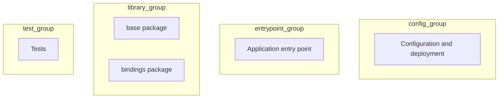

# Architecture report: ironcalc/IronCalc

> Automated static analysis. **Observed** = directly seen in files/imports/AST; **Inferred** = interpretation from that evidence. Repository code was not executed.

## 1. Repository at a glance

| Item | Value |
| --- | --- |
| Repository | ironcalc/IronCalc |
| Description | Main engine of the IronCalc ecosystem |
| Language | Rust |
| Stars | 4273 |
| Licence | Apache-2.0 |
| Analysed commit / branch | 53c00566515e3d67bf9b7bd2205db16771ea66e8 / main |
| Framework(s) | Vue |
| Files analysed | 796 |
| Components | 5 |

## 2. Architecture in one minute

ironcalc/IronCalc - Main engine of the IronCalc ecosystem. This repository was analysed statically from 796 file(s) (28 Python). Detected technologies (observed from imports/manifests): GitHub Actions, Vue, Poetry, Docker, Docker Compose, pytest. Files are grouped into 5 component(s): base package, bindings package, Configuration and deployment, Application entry point, Tests. Observed entry point(s): bindings/wasm/fix_types.py, bindings/wasm/third_party_notices.py. Findings below distinguish observed facts from inferred interpretation.

## 3. High-level block diagram

## 4. Main components

### base package (`base`)

- **Kind:** library
- **Status:** Observed
- **Confidence:** 0.85
- **Responsibility:** Groups 184 file(s) under base package (observed from repository paths and static analysis).
- **Paths:** `base/build.rs`, `base/examples/formulas_and_errors.rs`, `base/examples/hello_world.rs`, `base/src/actions.rs`, `base/src/arithmetic.rs`, `base/src/builtin_styles.rs`, `base/src/calc_result.rs`, `base/src/cast.rs`, `base/src/cell.rs`, `base/src/cf_types.rs`, `base/src/colors.rs`, `base/src/conditional_formatting.rs`, `base/src/constants.rs`, `base/src/cut_paste.rs`, `base/src/evaluation.rs`, `base/src/expressions/lexer/mod.rs`, `base/src/expressions/lexer/ranges.rs`, `base/src/expressions/lexer/structured_references.rs`, `base/src/expressions/lexer/util.rs`, `base/src/expressions/mod.rs`, `base/src/expressions/parser/displace.rs`, `base/src/expressions/parser/lambda.rs`, `base/src/expressions/parser/mod.rs`, `base/src/expressions/parser/move_formula.rs`, `base/src/expressions/parser/static_analysis.rs`, `base/src/expressions/parser/stringify.rs`, `base/src/expressions/test.rs`, `base/src/expressions/token.rs`, `base/src/expressions/types.rs`, `base/src/expressions/utils/mod.rs`, `base/src/expressions/utils/test.rs`, `base/src/formatter/dates.rs`, `base/src/formatter/format.rs`, `base/src/formatter/lexer.rs`, `base/src/formatter/mod.rs`, `base/src/formatter/parser.rs`, `base/src/functions/binary_search.rs`, `base/src/functions/database.rs`, `base/src/functions/date_and_time.rs`, `base/src/functions/engineering/bessel.rs`, `base/src/functions/engineering/bit_operations.rs`, `base/src/functions/engineering/complex.rs`, `base/src/functions/engineering/convert.rs`, `base/src/functions/engineering/misc.rs`, `base/src/functions/engineering/mod.rs`, `base/src/functions/engineering/number_basis.rs`, `base/src/functions/engineering/transcendental/bessel_i.rs`, `base/src/functions/engineering/transcendental/bessel_j0_y0.rs`, `base/src/functions/engineering/transcendental/bessel_j1_y1.rs`, `base/src/functions/engineering/transcendental/bessel_jn_yn.rs`, `base/src/functions/engineering/transcendental/bessel_k.rs`, `base/src/functions/engineering/transcendental/bessel_util.rs`, `base/src/functions/engineering/transcendental/mod.rs`, `base/src/functions/financial/accrint.rs`, `base/src/functions/financial/financial_bonds.rs`, `base/src/functions/financial/financial_depreciation.rs`, `base/src/functions/financial/financial_util.rs`, `base/src/functions/financial/mod.rs`, `base/src/functions/information/isomitted.rs`, `base/src/functions/information/mod.rs`, `base/src/functions/logical/and_or_xor_not.rs`, `base/src/functions/logical/bycol_byrow.rs`, `base/src/functions/logical/lambda.rs`, `base/src/functions/logical/let.rs`, `base/src/functions/logical/map_reduce.rs`, `base/src/functions/logical/mod.rs`, `base/src/functions/logical/scan.rs`, `base/src/functions/logical/switch.rs`, `base/src/functions/lookup_and_reference/address_areas.rs`, `base/src/functions/lookup_and_reference/choosecols_chooserows.rs`, `base/src/functions/lookup_and_reference/drop_take.rs`, `base/src/functions/lookup_and_reference/expand.rs`, `base/src/functions/lookup_and_reference/hstack_vstack.rs`, `base/src/functions/lookup_and_reference/mod.rs`, `base/src/functions/lookup_and_reference/tocol_torow.rs`, `base/src/functions/lookup_and_reference/transpose.rs`, `base/src/functions/lookup_and_reference/trimrange.rs`, `base/src/functions/lookup_and_reference/wrapcols_wraprows.rs`, `base/src/functions/lookup_and_reference/xmatch.rs`, `base/src/functions/macros.rs`, `base/src/functions/math_and_trigonometry/arabic_roman.rs`, `base/src/functions/math_and_trigonometry/array_size.rs`, `base/src/functions/math_and_trigonometry/gcd_lcm.rs`, `base/src/functions/math_and_trigonometry/mathematical.rs`, `base/src/functions/math_and_trigonometry/matrix.rs`, `base/src/functions/math_and_trigonometry/mmult.rs`, `base/src/functions/math_and_trigonometry/mod.rs`, `base/src/functions/math_and_trigonometry/multinomial.rs`, `base/src/functions/math_and_trigonometry/random.rs`, `base/src/functions/math_and_trigonometry/sequence.rs`, `base/src/functions/math_and_trigonometry/seriessum.rs`, `base/src/functions/math_and_trigonometry/sum.rs`, `base/src/functions/math_and_trigonometry/sumproduct.rs`, `base/src/functions/mod.rs`, `base/src/functions/spill_functions.rs`, `base/src/functions/statistical/beta.rs`, `base/src/functions/statistical/binom.rs`, `base/src/functions/statistical/chisq.rs`, `base/src/functions/statistical/correl.rs`, `base/src/functions/statistical/count_and_average.rs`, `base/src/functions/statistical/covariance.rs`, `base/src/functions/statistical/devsq.rs`, `base/src/functions/statistical/exponential.rs`, `base/src/functions/statistical/fisher.rs`, `base/src/functions/statistical/forecast.rs`, `base/src/functions/statistical/frequency.rs`, `base/src/functions/statistical/gamma.rs`, `base/src/functions/statistical/gauss.rs`, `base/src/functions/statistical/geomean.rs`, `base/src/functions/statistical/hypegeom.rs`, `base/src/functions/statistical/if_ifs.rs`, `base/src/functions/statistical/linest.rs`, `base/src/functions/statistical/log_normal.rs`, `base/src/functions/statistical/mod.rs`, `base/src/functions/statistical/mode_functions.rs`, `base/src/functions/statistical/normal.rs`, `base/src/functions/statistical/pearson.rs`, `base/src/functions/statistical/percentile.rs`, `base/src/functions/statistical/permut.rs`, `base/src/functions/statistical/phi.rs`, `base/src/functions/statistical/poisson.rs`, `base/src/functions/statistical/prob.rs`, `base/src/functions/statistical/quartile.rs`, `base/src/functions/statistical/rank_eq_avg.rs`, `base/src/functions/statistical/standard_dev.rs`, `base/src/functions/statistical/standardize.rs`, `base/src/functions/statistical/t_dist.rs`, `base/src/functions/statistical/trimmean.rs`, `base/src/functions/statistical/variance.rs`, `base/src/functions/statistical/weibull.rs`, `base/src/functions/statistical/z_test.rs`, `base/src/functions/subtotal.rs`, `base/src/functions/text/arraytotext.rs`, `base/src/functions/text/byte_functions.rs`, `base/src/functions/text/char_code.rs`, `base/src/functions/text/common.rs`, `base/src/functions/text/encodeurl.rs`, `base/src/functions/text/mod.rs`, `base/src/functions/text/regex_functions.rs`, `base/src/functions/text/string_format.rs`, `base/src/functions/text/textsplit.rs`, `base/src/functions/text/util.rs`, `base/src/functions/util.rs`, `base/src/functions/xlookup.rs`, `base/src/implicit_intersection.rs`, `base/src/language/mod.rs`, `base/src/lib.rs`, `base/src/links.rs`, `base/src/locale/mod.rs`, `base/src/merged_cells.rs`, `base/src/mock_time.rs`, `base/src/model.rs`, `base/src/new_empty.rs`, `base/src/number_format.rs`, `base/src/sheet_data/chunks.rs`, `base/src/sheet_data/mod.rs`, `base/src/sheet_data/row.rs`, `base/src/sheet_data/saved.rs`, `base/src/sheet_data/test.rs`, `base/src/styles.rs`, `base/src/themes.rs`, `base/src/types.rs`, `base/src/tz/browser_tz.rs`, `base/src/tz/mod.rs`, `base/src/tz/os_tz.rs`, `base/src/units.rs`, `base/src/user_model/autofill.rs`, `base/src/user_model/border.rs`, `base/src/user_model/border_utils.rs`, `base/src/user_model/cells_block.rs`, `base/src/user_model/clipboard.rs`, `base/src/user_model/common.rs`, `base/src/user_model/conditional_formatting.rs`, `base/src/user_model/history.rs`, `base/src/user_model/links.rs`, `base/src/user_model/merged_cells.rs`, `base/src/user_model/mod.rs`, `base/src/user_model/named_cell_styles.rs`, `base/src/user_model/sequence_detector.rs`, `base/src/user_model/ui.rs`, `base/src/user_model/undo_redo.rs`, `base/src/utils.rs`, `base/src/workbook.rs`, `base/src/worksheet.rs`
- **Evidence:** [base/build.rs](https://github.com/ironcalc/IronCalc/blob/53c00566515e3d67bf9b7bd2205db16771ea66e8/base/build.rs); [base/examples/formulas_and_errors.rs](https://github.com/ironcalc/IronCalc/blob/53c00566515e3d67bf9b7bd2205db16771ea66e8/base/examples/formulas_and_errors.rs); [base/examples/hello_world.rs](https://github.com/ironcalc/IronCalc/blob/53c00566515e3d67bf9b7bd2205db16771ea66e8/base/examples/hello_world.rs); [base/src/actions.rs](https://github.com/ironcalc/IronCalc/blob/53c00566515e3d67bf9b7bd2205db16771ea66e8/base/src/actions.rs); [base/src/arithmetic.rs](https://github.com/ironcalc/IronCalc/blob/53c00566515e3d67bf9b7bd2205db16771ea66e8/base/src/arithmetic.rs); [base/src/builtin_styles.rs](https://github.com/ironcalc/IronCalc/blob/53c00566515e3d67bf9b7bd2205db16771ea66e8/base/src/builtin_styles.rs); [base/src/calc_result.rs](https://github.com/ironcalc/IronCalc/blob/53c00566515e3d67bf9b7bd2205db16771ea66e8/base/src/calc_result.rs); [base/src/cast.rs](https://github.com/ironcalc/IronCalc/blob/53c00566515e3d67bf9b7bd2205db16771ea66e8/base/src/cast.rs)

### bindings package (`bindings`)

- **Kind:** library
- **Status:** Observed
- **Confidence:** 0.85
- **Responsibility:** Groups 28 file(s) under bindings package (observed from repository paths and static analysis).
- **Paths:** `bindings/nodejs/__test__/index.spec.mjs`, `bindings/nodejs/build.rs`, `bindings/nodejs/index.d.ts`, `bindings/nodejs/index.js`, `bindings/nodejs/main.mjs`, `bindings/nodejs/src/lib.rs`, `bindings/nodejs/src/model.rs`, `bindings/nodejs/src/user_model.rs`, `bindings/nodejs/types.d.ts`, `bindings/python/build.rs`, `bindings/python/build_docs.sh`, `bindings/python/docs/conf.py`, `bindings/python/docs/examples/collaboration.py`, `bindings/python/docs/examples/conditional_formatting.py`, `bindings/python/docs/examples/csv_import.py`, `bindings/python/docs/examples/read_xlsx.py`, `bindings/python/docs/examples/simple.py`, `bindings/python/docs/examples/styled_report.py`, `bindings/python/python/ironcalc/__init__.py`, `bindings/python/run_examples.sh`, `bindings/python/run_tests.sh`, `bindings/python/src/lib.rs`, `bindings/python/src/raw_model.rs`, `bindings/python/src/types.rs`, `bindings/python/src/user_model.rs`, `bindings/wasm/fix_package.py`, `bindings/wasm/src/lib.rs`, `bindings/wasm/types.ts`
- **Evidence:** [bindings/nodejs/__test__/index.spec.mjs](https://github.com/ironcalc/IronCalc/blob/53c00566515e3d67bf9b7bd2205db16771ea66e8/bindings/nodejs/__test__/index.spec.mjs); [bindings/nodejs/build.rs](https://github.com/ironcalc/IronCalc/blob/53c00566515e3d67bf9b7bd2205db16771ea66e8/bindings/nodejs/build.rs); [bindings/nodejs/index.d.ts](https://github.com/ironcalc/IronCalc/blob/53c00566515e3d67bf9b7bd2205db16771ea66e8/bindings/nodejs/index.d.ts); [bindings/nodejs/index.js](https://github.com/ironcalc/IronCalc/blob/53c00566515e3d67bf9b7bd2205db16771ea66e8/bindings/nodejs/index.js); [bindings/nodejs/main.mjs](https://github.com/ironcalc/IronCalc/blob/53c00566515e3d67bf9b7bd2205db16771ea66e8/bindings/nodejs/main.mjs); [bindings/nodejs/src/lib.rs](https://github.com/ironcalc/IronCalc/blob/53c00566515e3d67bf9b7bd2205db16771ea66e8/bindings/nodejs/src/lib.rs); [bindings/nodejs/src/model.rs](https://github.com/ironcalc/IronCalc/blob/53c00566515e3d67bf9b7bd2205db16771ea66e8/bindings/nodejs/src/model.rs); [bindings/nodejs/src/user_model.rs](https://github.com/ironcalc/IronCalc/blob/53c00566515e3d67bf9b7bd2205db16771ea66e8/bindings/nodejs/src/user_model.rs)

### Configuration and deployment (`config`)

- **Kind:** config
- **Status:** Observed
- **Confidence:** 0.85
- **Responsibility:** Groups 33 file(s) under configuration and deployment (observed from repository paths and static analysis).
- **Paths:** `Cargo.toml`, `Dockerfile`, `base/Cargo.toml`, `bindings/nodejs/.cargo/config.toml`, `bindings/nodejs/.yarnrc.yml`, `bindings/nodejs/Cargo.toml`, `bindings/nodejs/npm/android-arm-eabi/package.json`, `bindings/nodejs/npm/android-arm64/package.json`, `bindings/nodejs/npm/darwin-arm64/package.json`, `bindings/nodejs/npm/darwin-universal/package.json`, `bindings/nodejs/npm/darwin-x64/package.json`, `bindings/nodejs/npm/linux-arm-gnueabihf/package.json`, `bindings/nodejs/npm/linux-arm-musleabihf/package.json`, `bindings/nodejs/npm/linux-arm64-gnu/package.json`, `bindings/nodejs/npm/linux-arm64-musl/package.json`, `bindings/nodejs/npm/linux-riscv64-gnu/package.json`, `bindings/nodejs/npm/linux-x64-gnu/package.json`, `bindings/nodejs/npm/linux-x64-musl/package.json`, `bindings/nodejs/npm/win32-arm64-msvc/package.json`, `bindings/nodejs/npm/win32-x64-msvc/package.json`, `bindings/nodejs/package.json`, `bindings/nodejs/rustfmt.toml`, `bindings/nodejs/tsconfig.doc.json`, `bindings/nodejs/typedoc.json`, `bindings/python/Cargo.toml`, `bindings/python/pyproject.toml`, `bindings/wasm/.cargo/config.toml`, `bindings/wasm/Cargo.toml`, `bindings/wasm/package.json`, `bindings/wasm/tsconfig.doc.json`, `bindings/wasm/typedoc.json`, `codecov.yml`, `docker-compose.yml`
- **Evidence:** [Cargo.toml](https://github.com/ironcalc/IronCalc/blob/53c00566515e3d67bf9b7bd2205db16771ea66e8/Cargo.toml); [Dockerfile](https://github.com/ironcalc/IronCalc/blob/53c00566515e3d67bf9b7bd2205db16771ea66e8/Dockerfile); [base/Cargo.toml](https://github.com/ironcalc/IronCalc/blob/53c00566515e3d67bf9b7bd2205db16771ea66e8/base/Cargo.toml); [bindings/nodejs/.cargo/config.toml](https://github.com/ironcalc/IronCalc/blob/53c00566515e3d67bf9b7bd2205db16771ea66e8/bindings/nodejs/.cargo/config.toml); [bindings/nodejs/.yarnrc.yml](https://github.com/ironcalc/IronCalc/blob/53c00566515e3d67bf9b7bd2205db16771ea66e8/bindings/nodejs/.yarnrc.yml); [bindings/nodejs/Cargo.toml](https://github.com/ironcalc/IronCalc/blob/53c00566515e3d67bf9b7bd2205db16771ea66e8/bindings/nodejs/Cargo.toml); [bindings/nodejs/npm/android-arm-eabi/package.json](https://github.com/ironcalc/IronCalc/blob/53c00566515e3d67bf9b7bd2205db16771ea66e8/bindings/nodejs/npm/android-arm-eabi/package.json); [bindings/nodejs/npm/android-arm64/package.json](https://github.com/ironcalc/IronCalc/blob/53c00566515e3d67bf9b7bd2205db16771ea66e8/bindings/nodejs/npm/android-arm64/package.json)

### Application entry point (`entrypoint`)

- **Kind:** entrypoint
- **Status:** Observed
- **Confidence:** 0.85
- **Responsibility:** Groups 2 file(s) under application entry point (observed from repository paths and static analysis). Observed top-level functions: fix_types, license_files, linked_packages, main, normalize, package_metadata.
- **Paths:** `bindings/wasm/fix_types.py`, `bindings/wasm/third_party_notices.py`
- **Evidence:** [bindings/wasm/fix_types.py:8](https://github.com/ironcalc/IronCalc/blob/53c00566515e3d67bf9b7bd2205db16771ea66e8/bindings/wasm/fix_types.py#L8); [bindings/wasm/third_party_notices.py:45](https://github.com/ironcalc/IronCalc/blob/53c00566515e3d67bf9b7bd2205db16771ea66e8/bindings/wasm/third_party_notices.py#L45)

### Tests (`tests`)

- **Kind:** test
- **Status:** Observed
- **Confidence:** 0.85
- **Responsibility:** Groups 368 file(s) under tests (observed from repository paths and static analysis). Observed top-level functions: rm, sheet_names, test_add_and_retrieve, test_add_update_delete, test_apply_builtin_named_style, test_apply_named_style_to_selection.
- **Paths:** `base/src/expressions/lexer/test/mod.rs`, `base/src/expressions/lexer/test/test_common.rs`, `base/src/expressions/lexer/test/test_implicit_intersection.rs`, `base/src/expressions/lexer/test/test_language.rs`, `base/src/expressions/lexer/test/test_locale.rs`, `base/src/expressions/lexer/test/test_qualified_names.rs`, `base/src/expressions/lexer/test/test_ranges.rs`, `base/src/expressions/lexer/test/test_spill_operator.rs`, `base/src/expressions/lexer/test/test_tables.rs`, `base/src/expressions/lexer/test/test_util.rs`, `base/src/expressions/parser/tests/mod.rs`, `base/src/expressions/parser/tests/test_add_implicit_intersection.rs`, `base/src/expressions/parser/tests/test_arrays.rs`, `base/src/expressions/parser/tests/test_complex_precedence.rs`, `base/src/expressions/parser/tests/test_defined_names.rs`, `base/src/expressions/parser/tests/test_displace.rs`, `base/src/expressions/parser/tests/test_excel_export_lambda_let.rs`, `base/src/expressions/parser/tests/test_general.rs`, `base/src/expressions/parser/tests/test_implicit_intersection.rs`, `base/src/expressions/parser/tests/test_implicit_intersection_export.rs`, `base/src/expressions/parser/tests/test_issue_155.rs`, `base/src/expressions/parser/tests/test_issue_483.rs`, `base/src/expressions/parser/tests/test_lambda.rs`, `base/src/expressions/parser/tests/test_languages.rs`, `base/src/expressions/parser/tests/test_let.rs`, `base/src/expressions/parser/tests/test_locales.rs`, `base/src/expressions/parser/tests/test_move_formula.rs`, `base/src/expressions/parser/tests/test_partial_parsing.rs`, `base/src/expressions/parser/tests/test_ranges.rs`, `base/src/expressions/parser/tests/test_stringify.rs`, `base/src/expressions/parser/tests/test_tables.rs`, `base/src/expressions/parser/tests/utils.rs`, `base/src/formatter/test/mod.rs`, `base/src/formatter/test/test_condition.rs`, `base/src/formatter/test/test_dates.rs`, `base/src/formatter/test/test_de_examples.rs`, `base/src/formatter/test/test_en_examples.rs`, `base/src/formatter/test/test_fr_examples.rs`, `base/src/formatter/test/test_general.rs`, `base/src/formatter/test/test_parse_formatted_number.rs`, `base/src/formatter/test/test_scientific.rs`, `base/src/formatter/test/test_special_dollar.rs`, `base/src/formatter/test/test_time.rs`, `base/src/functions/engineering/transcendental/test_bessel.rs`, `base/src/test/array_formulas/mod.rs`, `base/src/test/array_formulas/test_array_insert_delete.rs`, `base/src/test/array_formulas/test_arrays_formulas.rs`, `base/src/test/array_formulas/test_copy_paste.rs`, `base/src/test/array_formulas/test_dynamic_arrays.rs`, `base/src/test/array_formulas/test_whole_column_row_reference.rs`, `base/src/test/compatibility/mod.rs`, `base/src/test/conditional_formatting/average.rs`, `base/src/test/conditional_formatting/cell_is.rs`, `base/src/test/conditional_formatting/duplicates.rs`, `base/src/test/conditional_formatting/formula.rs`, `base/src/test/conditional_formatting/mod.rs`, `base/src/test/conditional_formatting/priority.rs`, `base/src/test/conditional_formatting/stop_if_true.rs`, `base/src/test/conditional_formatting/text.rs`, `base/src/test/conditional_formatting/time_period.rs`, `base/src/test/conditional_formatting/top_bottom.rs`, `base/src/test/dynamic_evaluation/mod.rs`, `base/src/test/dynamic_evaluation/oracle.rs`, `base/src/test/dynamic_evaluation/test_bug_hunt.rs`, `base/src/test/dynamic_evaluation/test_evaluation_order.rs`, `base/src/test/dynamic_evaluation/test_history_independence.rs`, `base/src/test/dynamic_evaluation/test_known_gaps.rs`, `base/src/test/dynamic_evaluation/test_order_independence.rs`, `base/src/test/dynamic_evaluation/test_ordered_restart.rs`, `base/src/test/dynamic_evaluation/test_randarray.rs`, `base/src/test/dynamic_evaluation/test_range_reads.rs`, `base/src/test/dynamic_evaluation/test_unwind_replay.rs`, `base/src/test/dynamic_evaluation/test_wrong_order.rs`, `base/src/test/engineering/mod.rs`, `base/src/test/engineering/test_bessel.rs`, `base/src/test/engineering/test_bit_operations.rs`, `base/src/test/engineering/test_complex.rs`, `base/src/test/engineering/test_convert.rs`, `base/src/test/engineering/test_misc.rs`, `base/src/test/engineering/test_number_basis.rs`, `base/src/test/logical/mod.rs`, `base/src/test/logical/test_fn_if_array.rs`, `base/src/test/logical/test_fn_iferror_array.rs`, `base/src/test/logical/test_fn_not_array.rs`, `base/src/test/lookup_and_reference/mod.rs`, `base/src/test/lookup_and_reference/test_fn_address_areas.rs`, `base/src/test/lookup_and_reference/test_fn_choosecols_chooserows.rs`, `base/src/test/lookup_and_reference/test_fn_expand.rs`, `base/src/test/lookup_and_reference/test_fn_hlookup.rs`, `base/src/test/lookup_and_reference/test_fn_hstack_vstack.rs`, `base/src/test/lookup_and_reference/test_fn_index.rs`, `base/src/test/lookup_and_reference/test_fn_lookup.rs`, `base/src/test/lookup_and_reference/test_fn_match.rs`, `base/src/test/lookup_and_reference/test_fn_rows_columns.rs`, `base/src/test/lookup_and_reference/test_fn_trimrange.rs`, `base/src/test/lookup_and_reference/test_fn_vlookup.rs`, `base/src/test/lookup_and_reference/test_fn_wrapcols_wraprows.rs`, `base/src/test/lookup_and_reference/test_fn_xmatch.rs`, `base/src/test/mathematical/mod.rs`, `base/src/test/mathematical/test_mdeterm.rs`, `base/src/test/mathematical/test_minverse.rs`, `base/src/test/mathematical/test_multinomial.rs`, `base/src/test/mathematical/test_munit.rs`, `base/src/test/mathematical/test_seriessum.rs`, `base/src/test/mathematical/test_sumproduct.rs`, `base/src/test/mod.rs`, `base/src/test/statistical/mod.rs`, `base/src/test/statistical/test_fn_avedev.rs`, `base/src/test/statistical/test_fn_beta_dist.rs`, `base/src/test/statistical/test_fn_binom.rs`, `base/src/test/statistical/test_fn_chisq.rs`, `base/src/test/statistical/test_fn_chisq_test.rs`, `base/src/test/statistical/test_fn_confidence.rs`, `base/src/test/statistical/test_fn_covariance.rs`, `base/src/test/statistical/test_fn_devsq.rs`, `base/src/test/statistical/test_fn_expon_dist.rs`, `base/src/test/statistical/test_fn_f.rs`, `base/src/test/statistical/test_fn_f_test.rs`, `base/src/test/statistical/test_fn_fisher.rs`, `base/src/test/statistical/test_fn_gamma.rs`, `base/src/test/statistical/test_fn_gauss.rs`, `base/src/test/statistical/test_fn_hyp_geom_dist.rs`, `base/src/test/statistical/test_fn_log_norm.rs`, `base/src/test/statistical/test_fn_norm_dist.rs`, `base/src/test/statistical/test_fn_pearson.rs`, `base/src/test/statistical/test_fn_phi.rs`, `base/src/test/statistical/test_fn_poisson.rs`, `base/src/test/statistical/test_fn_stdev.rs`, `base/src/test/statistical/test_fn_t_dist.rs`, `base/src/test/statistical/test_fn_t_test.rs`, `base/src/test/statistical/test_fn_var.rs`, `base/src/test/statistical/test_fn_weibull.rs`, `base/src/test/statistical/test_fn_z_test.rs`, `base/src/test/test_actions.rs`, `base/src/test/test_arabic_roman.rs`, `base/src/test/test_arrays.rs`, `base/src/test/test_arrays_and_errors.rs`, `base/src/test/test_base_decimal.rs`, `base/src/test/test_binary_search.rs`, `base/src/test/test_ceiling_floor.rs`, `base/src/test/test_cell.rs`, `base/src/test/test_cell_clear_contents.rs`, `base/src/test/test_cell_info_n_sheets.rs`, `base/src/test/test_circular_references.rs`, `base/src/test/test_column_width.rs`, `base/src/test/test_combin_combina.rs`, `base/src/test/test_criteria.rs`, `base/src/test/test_cycle_reference.rs`, `base/src/test/test_database.rs`, `base/src/test/test_date_and_time.rs`, `base/src/test/test_datedif_leap_month_end.rs`, `base/src/test/test_datetime_format.rs`, `base/src/test/test_datevalue_rollover.rs`, `base/src/test/test_datevalue_timevalue_spaces.rs`, `base/src/test/test_days360_month_end.rs`, `base/src/test/test_days_days360.rs`, `base/src/test/test_defined_names_formulas.rs`, `base/src/test/test_degrees_radians.rs`, `base/src/test/test_ecma_ceiling.rs`, `base/src/test/test_error_propagation.rs`, `base/src/test/test_escape_quotes.rs`, `base/src/test/test_even_odd.rs`, `base/src/test/test_exp_sign.rs`, `base/src/test/test_extend.rs`, `base/src/test/test_fact_factdouble.rs`, `base/src/test/test_floor.rs`, `base/src/test/test_fn_accrint.rs`, `base/src/test/test_fn_accrintm.rs`, `base/src/test/test_fn_average.rs`, `base/src/test/test_fn_averageifs.rs`, `base/src/test/test_fn_bond_functions.rs`, `base/src/test/test_fn_bycol_byrow.rs`, `base/src/test/test_fn_choose.rs`, `base/src/test/test_fn_concatenate.rs`, `base/src/test/test_fn_count.rs`, `base/src/test/test_fn_countif_single_cell.rs`, `base/src/test/test_fn_coupon_dates.rs`, `base/src/test/test_fn_datevalue_datedif.rs`, `base/src/test/test_fn_datevalue_timevalue.rs`, `base/src/test/test_fn_day.rs`, `base/src/test/test_fn_depreciation.rs`, `base/src/test/test_fn_drop_take.rs`, `base/src/test/test_fn_encodeurl.rs`, `base/src/test/test_fn_exact.rs`, `base/src/test/test_fn_financial.rs`, `base/src/test/test_fn_financial_simple.rs`, `base/src/test/test_fn_formulatext.rs`, `base/src/test/test_fn_fv.rs`, `base/src/test/test_fn_hyperlink.rs`, `base/src/test/test_fn_if.rs`, `base/src/test/test_fn_indirect.rs`, `base/src/test/test_fn_isomitted.rs`, `base/src/test/test_fn_isref.rs`, `base/src/test/test_fn_lambda.rs`, `base/src/test/test_fn_let.rs`, `base/src/test/test_fn_map_reduce.rs`, `base/src/test/test_fn_max_min.rs`, `base/src/test/test_fn_maxifs.rs`, `base/src/test/test_fn_minifs.rs`, `base/src/test/test_fn_minute_second_rounding.rs`, `base/src/test/test_fn_mmult.rs`, `base/src/test/test_fn_oddfprice.rs`, `base/src/test/test_fn_offset.rs`, `base/src/test/test_fn_or_xor.rs`, `base/src/test/test_fn_power.rs`, `base/src/test/test_fn_product.rs`, `base/src/test/test_fn_randarray.rs`, `base/src/test/test_fn_rept.rs`, `base/src/test/test_fn_round.rs`, `base/src/test/test_fn_row_column.rs`, `base/src/test/test_fn_scan.rs`, `base/src/test/test_fn_sequence.rs`, `base/src/test/test_fn_sum.rs`, `base/src/test/test_fn_sumif_array.rs`, `base/src/test/test_fn_sumifs.rs`, `base/src/test/test_fn_time.rs`, `base/src/test/test_fn_tocol_torow.rs`, `base/src/test/test_fn_transpose.rs`, `base/src/test/test_fn_type.rs`, `base/src/test/test_fn_type_array.rs`, `base/src/test/test_forecast.rs`, `base/src/test/test_format_case.rs`, `base/src/test/test_frozen_rows_and_columns.rs`, `base/src/test/test_frozen_rows_columns.rs`, `base/src/test/test_gcd_lcm.rs`, `base/src/test/test_general.rs`, `base/src/test/test_geomean.rs`, `base/src/test/test_get_cell_content.rs`, `base/src/test/test_implicit_intersection.rs`, `base/src/test/test_indirect_r1c1.rs`, `base/src/test/test_inverted_ranges.rs`, `base/src/test/test_issue_155.rs`, `base/src/test/test_issue_483.rs`, `base/src/test/test_issue_623.rs`, `base/src/test/test_language.rs`, `base/src/test/test_language_switch.rs`, `base/src/test/test_ln.rs`, `base/src/test/test_locale.rs`, `base/src/test/test_log.rs`, `base/src/test/test_log10.rs`, `base/src/test/test_math.rs`, `base/src/test/test_merged_cells.rs`, `base/src/test/test_metadata.rs`, `base/src/test/test_mod_quotient.rs`, `base/src/test/test_model_cell_clear_all.rs`, `base/src/test/test_model_is_empty_cell.rs`, `base/src/test/test_move_formula.rs`, `base/src/test/test_mround_trunc_int.rs`, `base/src/test/test_nan_inf.rs`, `base/src/test/test_networkdays.rs`, `base/src/test/test_networkdays_networkdaysintl.rs`, `base/src/test/test_now.rs`, `base/src/test/test_number_format.rs`, `base/src/test/test_percentage.rs`, `base/src/test/test_quote_prefix.rs`, `base/src/test/test_range_evaluation.rs`, `base/src/test/test_row_column_styles.rs`, `base/src/test/test_set_functions_error_handling.rs`, `base/src/test/test_set_user_input.rs`, `base/src/test/test_shared_formulas.rs`, `base/src/test/test_sheet_markup.rs`, `base/src/test/test_sheet_names.rs`, `base/src/test/test_sheets.rs`, `base/src/test/test_spill_functions.rs`, `base/src/test/test_statistical_functions.rs`, `base/src/test/test_styles.rs`, `base/src/test/test_sumsq.rs`, `base/src/test/test_today.rs`, `base/src/test/test_trigonometric.rs`, `base/src/test/test_trigonometric_reciprocals.rs`, `base/src/test/test_true_false.rs`, `base/src/test/test_types.rs`, `base/src/test/test_unary_operators.rs`, `base/src/test/test_weekday_arg_order.rs`, `base/src/test/test_weekday_return_types.rs`, `base/src/test/test_weekday_weeknum_isoweeknum.rs`, `base/src/test/test_weeknum_return_types.rs`, `base/src/test/test_workbook.rs`, `base/src/test/test_workday_workdayintl.rs`, `base/src/test/test_worksheet.rs`, `base/src/test/test_yearfrac_basis.rs`, `base/src/test/test_yearfrac_datedif.rs`, `base/src/test/text_functions/byte_variants.rs`, `base/src/test/text_functions/fn_arraytotext.rs`, `base/src/test/text_functions/fn_char_code.rs`, `base/src/test/text_functions/fn_clean.rs`, `base/src/test/text_functions/fn_left_right_mid_arrays.rs`, `base/src/test/text_functions/fn_regex.rs`, `base/src/test/text_functions/fn_text_arrays.rs`, `base/src/test/text_functions/fn_textbefore.rs`, `base/src/test/text_functions/fn_textjoin.rs`, `base/src/test/text_functions/fn_textsplit.rs`, `base/src/test/text_functions/fn_unicode.rs`, `base/src/test/text_functions/mod.rs`, `base/src/test/user_model/mod.rs`, `base/src/test/user_model/test_add_delete_sheets.rs`, `base/src/test/user_model/test_array_formulas.rs`, `base/src/test/user_model/test_auto_link.rs`, `base/src/test/user_model/test_autofill_columns.rs`, `base/src/test/user_model/test_autofill_merged_cells.rs`, `base/src/test/user_model/test_autofill_rows.rs`, `base/src/test/user_model/test_batch_row_column_diff.rs`, `base/src/test/user_model/test_border.rs`, `base/src/test/user_model/test_cells_block.rs`, `base/src/test/user_model/test_clear_cells.rs`, `base/src/test/user_model/test_column_style.rs`, `base/src/test/user_model/test_conditional_formatting.rs`, `base/src/test/user_model/test_cut_n_paste.rs`, `base/src/test/user_model/test_defined_names.rs`, `base/src/test/user_model/test_delete_row_column_formatting.rs`, `base/src/test/user_model/test_diff_queue.rs`, `base/src/test/user_model/test_duplicate_sheet.rs`, `base/src/test/user_model/test_dynamic_arrays.rs`, `base/src/test/user_model/test_evaluation.rs`, `base/src/test/user_model/test_fn_formulatext.rs`, `base/src/test/user_model/test_focus_on_open.rs`, `base/src/test/user_model/test_general.rs`, `base/src/test/user_model/test_grid_lines.rs`, `base/src/test/user_model/test_hidden_columns.rs`, `base/src/test/user_model/test_keyboard_navigation.rs`, `base/src/test/user_model/test_language_switch.rs`, `base/src/test/user_model/test_last_empty_cell.rs`, `base/src/test/user_model/test_links.rs`, `base/src/test/user_model/test_merged_cells.rs`, `base/src/test/user_model/test_move_sheet.rs`, `base/src/test/user_model/test_multi_row_column.rs`, `base/src/test/user_model/test_named_styles.rs`, `base/src/test/user_model/test_on_area_selection.rs`, `base/src/test/user_model/test_on_expand_selected_range.rs`, `base/src/test/user_model/test_on_paste_styles.rs`, `base/src/test/user_model/test_paste_csv.rs`, `base/src/test/user_model/test_paste_merged_cells.rs`, `base/src/test/user_model/test_recursive.rs`, `base/src/test/user_model/test_rename_sheet.rs`, `base/src/test/user_model/test_row_column.rs`, `base/src/test/user_model/test_sheet_state.rs`, `base/src/test/user_model/test_sheets_undo_redo.rs`, `base/src/test/user_model/test_styles.rs`, `base/src/test/user_model/test_to_from_bytes.rs`, `base/src/test/user_model/test_undo_redo.rs`, `base/src/test/user_model/test_user_input_dates_quote.rs`, `base/src/test/user_model/test_view.rs`, `base/src/test/user_model/test_window_size.rs`, `base/src/test/user_model/themes/mod.rs`, `base/src/test/user_model/themes/test_themes_and_names.rs`, `base/src/test/user_model/util.rs`, `base/src/test/util.rs`, `bindings/python/tests/conftest.py`, `bindings/python/tests/test_clipboard_csv.py`, `bindings/python/tests/test_conditional_formatting.py`, `bindings/python/tests/test_defined_names.py`, `bindings/python/tests/test_diffs.py`, `bindings/python/tests/test_errors.py`, `bindings/python/tests/test_io.py`, `bindings/python/tests/test_links.py`, `bindings/python/tests/test_merged_cells.py`, `bindings/python/tests/test_misc_api.py`, `bindings/python/tests/test_named_styles.py`, `bindings/python/tests/test_rows_columns.py`, `bindings/python/tests/test_sheets.py`, `bindings/python/tests/test_styles.py`, `bindings/python/tests/test_undo_redo.py`, `bindings/python/tests/test_utils.py`, `bindings/python/tests/test_values.py`, `bindings/wasm/tests/test.mjs`, `bindings/wasm/tests/test_cf.mjs`, `bindings/wasm/tests/test_package.mjs`, `bindings/wasm/tests/test_xlsx.mjs`
- **Evidence:** [base/src/expressions/lexer/test/mod.rs](https://github.com/ironcalc/IronCalc/blob/53c00566515e3d67bf9b7bd2205db16771ea66e8/base/src/expressions/lexer/test/mod.rs); [base/src/expressions/lexer/test/test_common.rs](https://github.com/ironcalc/IronCalc/blob/53c00566515e3d67bf9b7bd2205db16771ea66e8/base/src/expressions/lexer/test/test_common.rs); [base/src/expressions/lexer/test/test_implicit_intersection.rs](https://github.com/ironcalc/IronCalc/blob/53c00566515e3d67bf9b7bd2205db16771ea66e8/base/src/expressions/lexer/test/test_implicit_intersection.rs); [base/src/expressions/lexer/test/test_language.rs](https://github.com/ironcalc/IronCalc/blob/53c00566515e3d67bf9b7bd2205db16771ea66e8/base/src/expressions/lexer/test/test_language.rs); [base/src/expressions/lexer/test/test_locale.rs](https://github.com/ironcalc/IronCalc/blob/53c00566515e3d67bf9b7bd2205db16771ea66e8/base/src/expressions/lexer/test/test_locale.rs); [base/src/expressions/lexer/test/test_qualified_names.rs](https://github.com/ironcalc/IronCalc/blob/53c00566515e3d67bf9b7bd2205db16771ea66e8/base/src/expressions/lexer/test/test_qualified_names.rs); [base/src/expressions/lexer/test/test_ranges.rs](https://github.com/ironcalc/IronCalc/blob/53c00566515e3d67bf9b7bd2205db16771ea66e8/base/src/expressions/lexer/test/test_ranges.rs); [base/src/expressions/lexer/test/test_spill_operator.rs](https://github.com/ironcalc/IronCalc/blob/53c00566515e3d67bf9b7bd2205db16771ea66e8/base/src/expressions/lexer/test/test_spill_operator.rs)

## 5. Execution flow

**Observed** entry point(s):

- [bindings/nodejs/index.js](https://github.com/ironcalc/IronCalc/blob/53c00566515e3d67bf9b7bd2205db16771ea66e8/bindings/nodejs/index.js)
- [bindings/wasm/fix_types.py:31](https://github.com/ironcalc/IronCalc/blob/53c00566515e3d67bf9b7bd2205db16771ea66e8/bindings/wasm/fix_types.py#L31)
- [bindings/wasm/third_party_notices.py:212](https://github.com/ironcalc/IronCalc/blob/53c00566515e3d67bf9b7bd2205db16771ea66e8/bindings/wasm/third_party_notices.py#L212)

Representative flow (derived from observed entry points and the import graph; steps beyond the entry point are **Inferred**):

1. Execution starts at an observed entry point listed above, if present.
2. No internal import relationships between components were observed.

## 6. Project structure

### `(root)`

- `.dockerignore` - container (52 bytes)
- `.gitattributes` - other (315 bytes)
- `.gitignore` - other (182 bytes)
- `.readthedocs.yaml` - config (839 bytes)
- `CODE_OF_CONDUCT.md` - docs (5220 bytes)
- `CONTRIBUTING.md` - docs (2594 bytes)
- `Cargo.toml` - manifest (248 bytes)
- `Dockerfile` - container (3482 bytes)
- `LICENSE-Apache-2.0` - other (10849 bytes)
- `LICENSE-MIT` - other (1150 bytes)
- `Makefile` - other (2321 bytes)
- `README.md` - docs (5612 bytes)
- `codecov.yml` - config (69 bytes)
- `docker-compose.yml` - container (273 bytes)

### `.github`

- `.github/FUNDING.yml` - config (18 bytes)
- `.github/workflows/build-test.yaml` - ci, YAML (2419 bytes)
- `.github/workflows/docker.yml` - ci, YAML (3648 bytes)
- `.github/workflows/npm.yml` - ci, YAML (25353 bytes)
- `.github/workflows/publish-crates.yaml` - ci, YAML (1602 bytes)
- `.github/workflows/pypi.yml` - ci, YAML (4529 bytes)
- `.github/workflows/test-coverage.yaml` - ci, YAML (728 bytes)

### `assets`

- `assets/docs/ironcalc-docs-logo-dark.svg` - docs (12456 bytes)
- `assets/docs/ironcalc-docs-logo.svg` - docs (12443 bytes)
- `assets/docs/ironcalc-logo-dark.svg` - docs (8082 bytes)
- `assets/docs/ironcalc-logo.svg` - docs (8105 bytes)
- `assets/icon/ironcalc_icon.svg` - other (1451 bytes)
- `assets/logo/svg/black.svg` - other (8053 bytes)
- `assets/logo/svg/orange+black.svg` - other (8052 bytes)
- `assets/logo/svg/orange+white.svg` - other (8082 bytes)
- `assets/logo/svg/white.svg` - other (8084 bytes)

### `base`

- `base/.gitignore` - other (8 bytes)
- `base/Cargo.toml` - manifest (1165 bytes)
- `base/LICENSE-Apache-2.0` - other (10849 bytes)
- `base/LICENSE-MIT` - other (1150 bytes)
- `base/README.md` - docs (544 bytes)
- `base/THIRD-PARTY-NOTICES.md` - docs (2663 bytes)
- `base/build.rs` - source, Rust (749 bytes)
- `base/examples/formulas_and_errors.rs` - source, Rust (1197 bytes)
- `base/examples/hello_world.rs` - source, Rust (573 bytes)
- `base/src/actions.rs` - source, Rust (70074 bytes)
- `base/src/arithmetic.rs` - source, Rust (18551 bytes)
- `base/src/builtin_styles.rs` - source, Rust (12261 bytes)
- `base/src/calc_result.rs` - source, Rust (3687 bytes)
- `base/src/cast.rs` - source, Rust (20343 bytes)
- `base/src/cell.rs` - source, Rust (7024 bytes)
- `base/src/cf_types.rs` - source, Rust (14682 bytes)
- `base/src/colors.rs` - source, Rust (9690 bytes)
- `base/src/conditional_formatting.rs` - source, Rust (63277 bytes)
- `base/src/constants.rs` - source, Rust (1593 bytes)
- `base/src/cut_paste.rs` - source, Rust (17769 bytes)
- `base/src/evaluation.rs` - source, Rust (50843 bytes)
- `base/src/expressions/lexer/mod.rs` - source, Rust (36335 bytes)
- `base/src/expressions/lexer/ranges.rs` - source, Rust (12853 bytes)
- `base/src/expressions/lexer/structured_references.rs` - source, Rust (7219 bytes)
- `base/src/expressions/lexer/test/mod.rs` - test, Rust (185 bytes)
- `base/src/expressions/lexer/test/test_common.rs` - test, Rust (18634 bytes)
- `base/src/expressions/lexer/test/test_implicit_intersection.rs` - test, Rust (754 bytes)
- `base/src/expressions/lexer/test/test_language.rs` - test, Rust (3689 bytes)
- `base/src/expressions/lexer/test/test_locale.rs` - test, Rust (1490 bytes)
- `base/src/expressions/lexer/test/test_qualified_names.rs` - test, Rust (3615 bytes)
- `base/src/expressions/lexer/test/test_ranges.rs` - test, Rust (13181 bytes)
- `base/src/expressions/lexer/test/test_spill_operator.rs` - test, Rust (751 bytes)
- `base/src/expressions/lexer/test/test_tables.rs` - test, Rust (2012 bytes)
- `base/src/expressions/lexer/test/test_util.rs` - test, Rust (4417 bytes)
- `base/src/expressions/lexer/util.rs` - source, Rust (8778 bytes)
- `base/src/expressions/mod.rs` - source, Rust (94 bytes)
- `base/src/expressions/parser/displace.rs` - source, Rust (19290 bytes)
- `base/src/expressions/parser/lambda.rs` - source, Rust (5185 bytes)
- `base/src/expressions/parser/mod.rs` - source, Rust (54920 bytes)
- `base/src/expressions/parser/move_formula.rs` - source, Rust (19142 bytes)
- `base/src/expressions/parser/static_analysis.rs` - source, Rust (101588 bytes)
- `base/src/expressions/parser/stringify.rs` - source, Rust (48170 bytes)
- `base/src/expressions/parser/tests/mod.rs` - test, Rust (471 bytes)
- `base/src/expressions/parser/tests/test_add_implicit_intersection.rs` - test, Rust (4162 bytes)
- `base/src/expressions/parser/tests/test_arrays.rs` - test, Rust (2873 bytes)
- `base/src/expressions/parser/tests/test_complex_precedence.rs` - test, Rust (2399 bytes)
- `base/src/expressions/parser/tests/test_defined_names.rs` - test, Rust (3895 bytes)
- `base/src/expressions/parser/tests/test_displace.rs` - test, Rust (10743 bytes)
- `base/src/expressions/parser/tests/test_excel_export_lambda_let.rs` - test, Rust (2873 bytes)
- `base/src/expressions/parser/tests/test_general.rs` - test, Rust (15002 bytes)
- `base/src/expressions/parser/tests/test_implicit_intersection.rs` - test, Rust (1975 bytes)
- `base/src/expressions/parser/tests/test_implicit_intersection_export.rs` - test, Rust (7332 bytes)
- `base/src/expressions/parser/tests/test_issue_155.rs` - test, Rust (2115 bytes)
- `base/src/expressions/parser/tests/test_issue_483.rs` - test, Rust (939 bytes)
- `base/src/expressions/parser/tests/test_lambda.rs` - test, Rust (10622 bytes)
- `base/src/expressions/parser/tests/test_languages.rs` - test, Rust (2013 bytes)
- `base/src/expressions/parser/tests/test_let.rs` - test, Rust (1449 bytes)
- `base/src/expressions/parser/tests/test_locales.rs` - test, Rust (1646 bytes)
- `base/src/expressions/parser/tests/test_move_formula.rs` - test, Rust (16656 bytes)
- `base/src/expressions/parser/tests/test_partial_parsing.rs` - test, Rust (14117 bytes)
- `base/src/expressions/parser/tests/test_ranges.rs` - test, Rust (3091 bytes)
- `base/src/expressions/parser/tests/test_stringify.rs` - test, Rust (2564 bytes)
- `base/src/expressions/parser/tests/test_tables.rs` - test, Rust (3252 bytes)
- `base/src/expressions/parser/tests/utils.rs` - test, Rust (838 bytes)
- `base/src/expressions/test.rs` - source, Rust (592 bytes)
- `base/src/expressions/token.rs` - source, Rust (7773 bytes)
- `base/src/expressions/types.rs` - source, Rust (1322 bytes)
- `base/src/expressions/utils/mod.rs` - source, Rust (9751 bytes)
- `base/src/expressions/utils/test.rs` - source, Rust (5918 bytes)
- `base/src/formatter/dates.rs` - source, Rust (5551 bytes)
- `base/src/formatter/format.rs` - source, Rust (41167 bytes)
- `base/src/formatter/lexer.rs` - source, Rust (20835 bytes)
- `base/src/formatter/mod.rs` - source, Rust (3781 bytes)
- `base/src/formatter/parser.rs` - source, Rust (13261 bytes)
- `base/src/formatter/test/mod.rs` - test, Rust (214 bytes)
- `base/src/formatter/test/test_condition.rs` - test, Rust (4385 bytes)
- `base/src/formatter/test/test_dates.rs` - test, Rust (388 bytes)
- `base/src/formatter/test/test_de_examples.rs` - test, Rust (5392 bytes)
- `base/src/formatter/test/test_en_examples.rs` - test, Rust (7436 bytes)
- `base/src/formatter/test/test_fr_examples.rs` - test, Rust (2334 bytes)
- `base/src/formatter/test/test_general.rs` - test, Rust (9718 bytes)
- `base/src/formatter/test/test_parse_formatted_number.rs` - test, Rust (8710 bytes)
- `base/src/formatter/test/test_scientific.rs` - test, Rust (926 bytes)
- `base/src/formatter/test/test_special_dollar.rs` - test, Rust (485 bytes)
- `base/src/formatter/test/test_time.rs` - test, Rust (1963 bytes)
- `base/src/functions/binary_search.rs` - source, Rust (5922 bytes)
- `base/src/functions/database.rs` - source, Rust (33359 bytes)
- `base/src/functions/date_and_time.rs` - source, Rust (80163 bytes)
- `base/src/functions/engineering/bessel.rs` - source, Rust (6069 bytes)
- `base/src/functions/engineering/bit_operations.rs` - source, Rust (7484 bytes)
- `base/src/functions/engineering/complex.rs` - source, Rust (26374 bytes)
- `base/src/functions/engineering/convert.rs` - source, Rust (16208 bytes)
- `base/src/functions/engineering/misc.rs` - source, Rust (1828 bytes)
- `base/src/functions/engineering/mod.rs` - source, Rust (106 bytes)
- `base/src/functions/engineering/number_basis.rs` - source, Rust (19389 bytes)
- `base/src/functions/engineering/transcendental/README.md` - docs (1083 bytes)
- `base/src/functions/engineering/transcendental/bessel_i.rs` - source, Rust (3343 bytes)
- `base/src/functions/engineering/transcendental/bessel_j0_y0.rs` - source, Rust (15289 bytes)
- `base/src/functions/engineering/transcendental/bessel_j1_y1.rs` - source, Rust (14807 bytes)
- `base/src/functions/engineering/transcendental/bessel_jn_yn.rs` - source, Rust (9695 bytes)
- `base/src/functions/engineering/transcendental/bessel_k.rs` - source, Rust (2187 bytes)
- `base/src/functions/engineering/transcendental/bessel_util.rs` - source, Rust (669 bytes)
- `base/src/functions/engineering/transcendental/create_test.jl` - other (309 bytes)
- `base/src/functions/engineering/transcendental/mod.rs` - source, Rust (291 bytes)
- `base/src/functions/engineering/transcendental/test_bessel.rs` - test, Rust (5004 bytes)
- `base/src/functions/financial/accrint.rs` - source, Rust (14119 bytes)
- `base/src/functions/financial/financial_bonds.rs` - source, Rust (48611 bytes)
- `base/src/functions/financial/financial_depreciation.rs` - source, Rust (18350 bytes)
- `base/src/functions/financial/financial_util.rs` - source, Rust (9264 bytes)
- `base/src/functions/financial/mod.rs` - source, Rust (83371 bytes)
- `base/src/functions/information/isomitted.rs` - source, Rust (531 bytes)
- `base/src/functions/information/mod.rs` - source, Rust (21810 bytes)
- `base/src/functions/logical/and_or_xor_not.rs` - source, Rust (8837 bytes)
- `base/src/functions/logical/bycol_byrow.rs` - source, Rust (5298 bytes)
- `base/src/functions/logical/lambda.rs` - source, Rust (6180 bytes)
- `base/src/functions/logical/let.rs` - source, Rust (6543 bytes)
- `base/src/functions/logical/map_reduce.rs` - source, Rust (5128 bytes)
- `base/src/functions/logical/mod.rs` - source, Rust (13006 bytes)
- `base/src/functions/logical/scan.rs` - source, Rust (3697 bytes)
- `base/src/functions/logical/switch.rs` - source, Rust (1582 bytes)
- `base/src/functions/lookup_and_reference/address_areas.rs` - source, Rust (5003 bytes)
- `base/src/functions/lookup_and_reference/choosecols_chooserows.rs` - source, Rust (3506 bytes)
- `base/src/functions/lookup_and_reference/drop_take.rs` - source, Rust (5057 bytes)
- `base/src/functions/lookup_and_reference/expand.rs` - source, Rust (3214 bytes)
- `base/src/functions/lookup_and_reference/hstack_vstack.rs` - source, Rust (3467 bytes)
- `base/src/functions/lookup_and_reference/mod.rs` - source, Rust (43547 bytes)
- `base/src/functions/lookup_and_reference/tocol_torow.rs` - source, Rust (3922 bytes)
- `base/src/functions/lookup_and_reference/transpose.rs` - source, Rust (905 bytes)
- `base/src/functions/lookup_and_reference/trimrange.rs` - source, Rust (4111 bytes)
- `base/src/functions/lookup_and_reference/wrapcols_wraprows.rs` - source, Rust (5958 bytes)
- `base/src/functions/lookup_and_reference/xmatch.rs` - source, Rust (12027 bytes)
- `base/src/functions/macros.rs` - source, Rust (5692 bytes)
- `base/src/functions/math_and_trigonometry/arabic_roman.rs` - source, Rust (8681 bytes)
- `base/src/functions/math_and_trigonometry/array_size.rs` - source, Rust (1075 bytes)
- `base/src/functions/math_and_trigonometry/gcd_lcm.rs` - source, Rust (10812 bytes)
- `base/src/functions/math_and_trigonometry/mathematical.rs` - source, Rust (50897 bytes)
- `base/src/functions/math_and_trigonometry/matrix.rs` - source, Rust (7762 bytes)
- `base/src/functions/math_and_trigonometry/mmult.rs` - source, Rust (15327 bytes)
- `base/src/functions/math_and_trigonometry/mod.rs` - source, Rust (182 bytes)
- `base/src/functions/math_and_trigonometry/multinomial.rs` - source, Rust (6103 bytes)
- `base/src/functions/math_and_trigonometry/random.rs` - source, Rust (6422 bytes)
- `base/src/functions/math_and_trigonometry/sequence.rs` - source, Rust (4392 bytes)
- `base/src/functions/math_and_trigonometry/seriessum.rs` - source, Rust (2920 bytes)
- `base/src/functions/math_and_trigonometry/sum.rs` - source, Rust (8793 bytes)
- `base/src/functions/math_and_trigonometry/sumproduct.rs` - source, Rust (3148 bytes)
- `base/src/functions/mod.rs` - source, Rust (112620 bytes)
- `base/src/functions/spill_functions.rs` - source, Rust (24086 bytes)
- `base/src/functions/statistical/beta.rs` - source, Rust (7061 bytes)
- `base/src/functions/statistical/binom.rs` - source, Rust (9644 bytes)
- `base/src/functions/statistical/chisq.rs` - source, Rust (12050 bytes)
- `base/src/functions/statistical/correl.rs` - source, Rust (7088 bytes)
- `base/src/functions/statistical/count_and_average.rs` - source, Rust (38461 bytes)
- `base/src/functions/statistical/covariance.rs` - source, Rust (8521 bytes)
- `base/src/functions/statistical/devsq.rs` - source, Rust (4472 bytes)
- `base/src/functions/statistical/exponential.rs` - source, Rust (1539 bytes)
- `base/src/functions/statistical/fisher.rs` - source, Rust (13151 bytes)
- `base/src/functions/statistical/forecast.rs` - source, Rust (3918 bytes)
- `base/src/functions/statistical/frequency.rs` - source, Rust (3530 bytes)
- `base/src/functions/statistical/gamma.rs` - source, Rust (5933 bytes)
- `base/src/functions/statistical/gauss.rs` - source, Rust (1223 bytes)
- `base/src/functions/statistical/geomean.rs` - source, Rust (1226 bytes)
- `base/src/functions/statistical/hypegeom.rs` - source, Rust (3964 bytes)
- `base/src/functions/statistical/if_ifs.rs` - source, Rust (18123 bytes)
- `base/src/functions/statistical/linest.rs` - source, Rust (23619 bytes)
- `base/src/functions/statistical/log_normal.rs` - source, Rust (4060 bytes)
- `base/src/functions/statistical/mod.rs` - source, Rust (477 bytes)
- `base/src/functions/statistical/mode_functions.rs` - source, Rust (4368 bytes)
- `base/src/functions/statistical/normal.rs` - source, Rust (10233 bytes)
- `base/src/functions/statistical/pearson.rs` - source, Rust (3693 bytes)
- `base/src/functions/statistical/percentile.rs` - source, Rust (9257 bytes)
- `base/src/functions/statistical/permut.rs` - source, Rust (2006 bytes)
- `base/src/functions/statistical/phi.rs` - source, Rust (710 bytes)
- `base/src/functions/statistical/poisson.rs` - source, Rust (2636 bytes)
- `base/src/functions/statistical/prob.rs` - source, Rust (3631 bytes)
- `base/src/functions/statistical/quartile.rs` - source, Rust (3082 bytes)
- `base/src/functions/statistical/rank_eq_avg.rs` - source, Rust (6117 bytes)
- `base/src/functions/statistical/standard_dev.rs` - source, Rust (17250 bytes)
- `base/src/functions/statistical/standardize.rs` - source, Rust (1154 bytes)
- `base/src/functions/statistical/t_dist.rs` - source, Rust (19141 bytes)
- `base/src/functions/statistical/trimmean.rs` - source, Rust (1767 bytes)
- `base/src/functions/statistical/variance.rs` - source, Rust (17230 bytes)
- `base/src/functions/statistical/weibull.rs` - source, Rust (2092 bytes)
- `base/src/functions/statistical/z_test.rs` - source, Rust (5537 bytes)
- `base/src/functions/subtotal.rs` - source, Rust (22767 bytes)
- `base/src/functions/text/arraytotext.rs` - source, Rust (3861 bytes)
- `base/src/functions/text/byte_functions.rs` - source, Rust (1346 bytes)
- `base/src/functions/text/char_code.rs` - source, Rust (5856 bytes)
- `base/src/functions/text/common.rs` - source, Rust (51731 bytes)
- `base/src/functions/text/encodeurl.rs` - source, Rust (1441 bytes)
- `base/src/functions/text/mod.rs` - source, Rust (144 bytes)
- `base/src/functions/text/regex_functions.rs` - source, Rust (5170 bytes)
- `base/src/functions/text/string_format.rs` - source, Rust (11474 bytes)
- `base/src/functions/text/textsplit.rs` - source, Rust (10529 bytes)
- `base/src/functions/text/util.rs` - source, Rust (5813 bytes)
- `base/src/functions/util.rs` - source, Rust (18071 bytes)
- `base/src/functions/xlookup.rs` - source, Rust (16640 bytes)
- `base/src/implicit_intersection.rs` - source, Rust (1966 bytes)
- `base/src/language/mod.rs` - source, Rust (14026 bytes)
- `base/src/lib.rs` - source, Rust (1992 bytes)
- `base/src/links.rs` - source, Rust (9042 bytes)
- `base/src/locale/mod.rs` - source, Rust (2701 bytes)
- `base/src/merged_cells.rs` - source, Rust (15402 bytes)
- `base/src/mock_time.rs` - source, Rust (918 bytes)
- `base/src/model.rs` - source, Rust (167952 bytes)
- `base/src/new_empty.rs` - source, Rust (38868 bytes)
- `base/src/number_format.rs` - source, Rust (14851 bytes)
- `base/src/sheet_data/chunks.rs` - source, Rust (12266 bytes)
- `base/src/sheet_data/mod.rs` - source, Rust (2022 bytes)
- `base/src/sheet_data/row.rs` - source, Rust (13216 bytes)
- `base/src/sheet_data/saved.rs` - source, Rust (1604 bytes)
- `base/src/sheet_data/test.rs` - source, Rust (18339 bytes)
- `base/src/styles.rs` - source, Rust (28025 bytes)
- `base/src/test/array_formulas/mod.rs` - test, Rust (139 bytes)
- `base/src/test/array_formulas/test_array_insert_delete.rs` - test, Rust (24124 bytes)
- `base/src/test/array_formulas/test_arrays_formulas.rs` - test, Rust (2865 bytes)
- `base/src/test/array_formulas/test_copy_paste.rs` - test, Rust (6743 bytes)
- `base/src/test/array_formulas/test_dynamic_arrays.rs` - test, Rust (12868 bytes)
- `base/src/test/array_formulas/test_whole_column_row_reference.rs` - test, Rust (6064 bytes)
- `base/src/test/compatibility/mod.rs` - test, Rust (29661 bytes)
- `base/src/test/conditional_formatting/average.rs` - test, Rust (5319 bytes)
- `base/src/test/conditional_formatting/cell_is.rs` - test, Rust (6921 bytes)
- `base/src/test/conditional_formatting/duplicates.rs` - test, Rust (7653 bytes)
- `base/src/test/conditional_formatting/formula.rs` - test, Rust (8548 bytes)
- `base/src/test/conditional_formatting/mod.rs` - test, Rust (28658 bytes)
- `base/src/test/conditional_formatting/priority.rs` - test, Rust (15436 bytes)
- `base/src/test/conditional_formatting/stop_if_true.rs` - test, Rust (6817 bytes)
- `base/src/test/conditional_formatting/text.rs` - test, Rust (6406 bytes)
- `base/src/test/conditional_formatting/time_period.rs` - test, Rust (15829 bytes)
- `base/src/test/conditional_formatting/top_bottom.rs` - test, Rust (8274 bytes)
- `base/src/test/dynamic_evaluation/mod.rs` - test, Rust (264 bytes)
- `base/src/test/dynamic_evaluation/oracle.rs` - test, Rust (17338 bytes)
- `base/src/test/dynamic_evaluation/test_bug_hunt.rs` - test, Rust (34924 bytes)
- `base/src/test/dynamic_evaluation/test_evaluation_order.rs` - test, Rust (4491 bytes)
- `base/src/test/dynamic_evaluation/test_history_independence.rs` - test, Rust (10704 bytes)
- `base/src/test/dynamic_evaluation/test_known_gaps.rs` - test, Rust (17070 bytes)
- `base/src/test/dynamic_evaluation/test_order_independence.rs` - test, Rust (6979 bytes)
- `base/src/test/dynamic_evaluation/test_ordered_restart.rs` - test, Rust (20196 bytes)
- `base/src/test/dynamic_evaluation/test_randarray.rs` - test, Rust (1126 bytes)
- `base/src/test/dynamic_evaluation/test_range_reads.rs` - test, Rust (6026 bytes)
- `base/src/test/dynamic_evaluation/test_unwind_replay.rs` - test, Rust (9905 bytes)
- `base/src/test/dynamic_evaluation/test_wrong_order.rs` - test, Rust (2388 bytes)
- `base/src/test/engineering/mod.rs` - test, Rust (116 bytes)
- `base/src/test/engineering/test_bessel.rs` - test, Rust (1132 bytes)
- `base/src/test/engineering/test_bit_operations.rs` - test, Rust (2690 bytes)
- `base/src/test/engineering/test_complex.rs` - test, Rust (3952 bytes)
- `base/src/test/engineering/test_convert.rs` - test, Rust (2823 bytes)
- `base/src/test/engineering/test_misc.rs` - test, Rust (1795 bytes)
- `base/src/test/engineering/test_number_basis.rs` - test, Rust (9690 bytes)
- `base/src/test/logical/mod.rs` - test, Rust (72 bytes)
- `base/src/test/logical/test_fn_if_array.rs` - test, Rust (9109 bytes)
- `base/src/test/logical/test_fn_iferror_array.rs` - test, Rust (11527 bytes)
- `base/src/test/logical/test_fn_not_array.rs` - test, Rust (2613 bytes)
- `base/src/test/lookup_and_reference/mod.rs` - test, Rust (309 bytes)
- `base/src/test/lookup_and_reference/test_fn_address_areas.rs` - test, Rust (3318 bytes)
- `base/src/test/lookup_and_reference/test_fn_choosecols_chooserows.rs` - test, Rust (2540 bytes)
- `base/src/test/lookup_and_reference/test_fn_expand.rs` - test, Rust (1501 bytes)
- `base/src/test/lookup_and_reference/test_fn_hlookup.rs` - test, Rust (2414 bytes)
- `base/src/test/lookup_and_reference/test_fn_hstack_vstack.rs` - test, Rust (2357 bytes)
- `base/src/test/lookup_and_reference/test_fn_index.rs` - test, Rust (4957 bytes)
- `base/src/test/lookup_and_reference/test_fn_lookup.rs` - test, Rust (3908 bytes)
- `base/src/test/lookup_and_reference/test_fn_match.rs` - test, Rust (2055 bytes)
- `base/src/test/lookup_and_reference/test_fn_rows_columns.rs` - test, Rust (3933 bytes)
- `base/src/test/lookup_and_reference/test_fn_trimrange.rs` - test, Rust (4404 bytes)
- `base/src/test/lookup_and_reference/test_fn_vlookup.rs` - test, Rust (2426 bytes)
- `base/src/test/lookup_and_reference/test_fn_wrapcols_wraprows.rs` - test, Rust (3313 bytes)
- `base/src/test/lookup_and_reference/test_fn_xmatch.rs` - test, Rust (9261 bytes)
- `base/src/test/mathematical/mod.rs` - test, Rust (116 bytes)
- `base/src/test/mathematical/test_mdeterm.rs` - test, Rust (1879 bytes)
- `base/src/test/mathematical/test_minverse.rs` - test, Rust (1769 bytes)
- `base/src/test/mathematical/test_multinomial.rs` - test, Rust (1835 bytes)
- `base/src/test/mathematical/test_munit.rs` - test, Rust (1943 bytes)
- `base/src/test/mathematical/test_seriessum.rs` - test, Rust (2337 bytes)
- `base/src/test/mathematical/test_sumproduct.rs` - test, Rust (2459 bytes)
- `base/src/test/mod.rs` - test, Rust (3721 bytes)
- `base/src/test/statistical/mod.rs` - test, Rust (537 bytes)
- `base/src/test/statistical/test_fn_avedev.rs` - test, Rust (2255 bytes)
- `base/src/test/statistical/test_fn_beta_dist.rs` - test, Rust (2507 bytes)
- `base/src/test/statistical/test_fn_binom.rs` - test, Rust (6992 bytes)
- `base/src/test/statistical/test_fn_chisq.rs` - test, Rust (7441 bytes)
- `base/src/test/statistical/test_fn_chisq_test.rs` - test, Rust (3996 bytes)
- `base/src/test/statistical/test_fn_confidence.rs` - test, Rust (2901 bytes)
- `base/src/test/statistical/test_fn_covariance.rs` - test, Rust (2250 bytes)
- `base/src/test/statistical/test_fn_devsq.rs` - test, Rust (2253 bytes)
- `base/src/test/statistical/test_fn_expon_dist.rs` - test, Rust (1153 bytes)
- `base/src/test/statistical/test_fn_f.rs` - test, Rust (2003 bytes)
- `base/src/test/statistical/test_fn_f_test.rs` - test, Rust (870 bytes)
- `base/src/test/statistical/test_fn_fisher.rs` - test, Rust (1650 bytes)
- `base/src/test/statistical/test_fn_gamma.rs` - test, Rust (4757 bytes)
- `base/src/test/statistical/test_fn_gauss.rs` - test, Rust (1443 bytes)
- `base/src/test/statistical/test_fn_hyp_geom_dist.rs` - test, Rust (1264 bytes)
- `base/src/test/statistical/test_fn_log_norm.rs` - test, Rust (3094 bytes)
- `base/src/test/statistical/test_fn_norm_dist.rs` - test, Rust (5411 bytes)
- `base/src/test/statistical/test_fn_pearson.rs` - test, Rust (794 bytes)
- `base/src/test/statistical/test_fn_phi.rs` - test, Rust (675 bytes)
- `base/src/test/statistical/test_fn_poisson.rs` - test, Rust (1895 bytes)
- `base/src/test/statistical/test_fn_stdev.rs` - test, Rust (2373 bytes)
- `base/src/test/statistical/test_fn_t_dist.rs` - test, Rust (5591 bytes)
- `base/src/test/statistical/test_fn_t_test.rs` - test, Rust (1326 bytes)
- `base/src/test/statistical/test_fn_var.rs` - test, Rust (2322 bytes)
- `base/src/test/statistical/test_fn_weibull.rs` - test, Rust (1363 bytes)
- `base/src/test/statistical/test_fn_z_test.rs` - test, Rust (940 bytes)
- `base/src/test/test_actions.rs` - test, Rust (22641 bytes)
- `base/src/test/test_arabic_roman.rs` - test, Rust (770 bytes)
- `base/src/test/test_arrays.rs` - test, Rust (4645 bytes)
- `base/src/test/test_arrays_and_errors.rs` - test, Rust (16413 bytes)
- `base/src/test/test_base_decimal.rs` - test, Rust (5534 bytes)
- `base/src/test/test_binary_search.rs` - test, Rust (1071 bytes)
- `base/src/test/test_ceiling_floor.rs` - test, Rust (2599 bytes)
- `base/src/test/test_cell.rs` - test, Rust (4291 bytes)
- `base/src/test/test_cell_clear_contents.rs` - test, Rust (1682 bytes)
- `base/src/test/test_cell_info_n_sheets.rs` - test, Rust (2013 bytes)
- `base/src/test/test_circular_references.rs` - test, Rust (752 bytes)
- `base/src/test/test_column_width.rs` - test, Rust (3409 bytes)
- `base/src/test/test_combin_combina.rs` - test, Rust (867 bytes)
- `base/src/test/test_criteria.rs` - test, Rust (11203 bytes)
- `base/src/test/test_cycle_reference.rs` - test, Rust (9934 bytes)
- `base/src/test/test_database.rs` - test, Rust (18035 bytes)
- `base/src/test/test_date_and_time.rs` - test, Rust (34943 bytes)
- `base/src/test/test_datedif_leap_month_end.rs` - test, Rust (962 bytes)
- `base/src/test/test_datetime_format.rs` - test, Rust (1851 bytes)
- `base/src/test/test_datevalue_rollover.rs` - test, Rust (845 bytes)
- `base/src/test/test_datevalue_timevalue_spaces.rs` - test, Rust (1799 bytes)
- `base/src/test/test_days360_month_end.rs` - test, Rust (1624 bytes)
- `base/src/test/test_days_days360.rs` - test, Rust (1166 bytes)
- `base/src/test/test_defined_names_formulas.rs` - test, Rust (6796 bytes)
- `base/src/test/test_degrees_radians.rs` - test, Rust (728 bytes)
- `base/src/test/test_ecma_ceiling.rs` - test, Rust (364 bytes)
- `base/src/test/test_error_propagation.rs` - test, Rust (1175 bytes)
- `base/src/test/test_escape_quotes.rs` - test, Rust (262 bytes)
- `base/src/test/test_even_odd.rs` - test, Rust (662 bytes)
- `base/src/test/test_exp_sign.rs` - test, Rust (671 bytes)
- `base/src/test/test_extend.rs` - test, Rust (2948 bytes)
- `base/src/test/test_fact_factdouble.rs` - test, Rust (683 bytes)
- `base/src/test/test_floor.rs` - test, Rust (3577 bytes)
- `base/src/test/test_fn_accrint.rs` - test, Rust (23975 bytes)
- `base/src/test/test_fn_accrintm.rs` - test, Rust (7042 bytes)
- `base/src/test/test_fn_average.rs` - test, Rust (790 bytes)
- `base/src/test/test_fn_averageifs.rs` - test, Rust (2210 bytes)
- `base/src/test/test_fn_bond_functions.rs` - test, Rust (24661 bytes)
- `base/src/test/test_fn_bycol_byrow.rs` - test, Rust (7030 bytes)
- `base/src/test/test_fn_choose.rs` - test, Rust (4296 bytes)
- `base/src/test/test_fn_concatenate.rs` - test, Rust (3405 bytes)
- `base/src/test/test_fn_count.rs` - test, Rust (3347 bytes)
- `base/src/test/test_fn_countif_single_cell.rs` - test, Rust (9601 bytes)
- `base/src/test/test_fn_coupon_dates.rs` - test, Rust (9190 bytes)
- `base/src/test/test_fn_datevalue_datedif.rs` - test, Rust (5249 bytes)
- `base/src/test/test_fn_datevalue_timevalue.rs` - test, Rust (742 bytes)
- `base/src/test/test_fn_day.rs` - test, Rust (350 bytes)
- `base/src/test/test_fn_depreciation.rs` - test, Rust (4884 bytes)
- `base/src/test/test_fn_drop_take.rs` - test, Rust (4148 bytes)
- `base/src/test/test_fn_encodeurl.rs` - test, Rust (4812 bytes)
- `base/src/test/test_fn_exact.rs` - test, Rust (5471 bytes)
- `base/src/test/test_fn_financial.rs` - test, Rust (15877 bytes)
- `base/src/test/test_fn_financial_simple.rs` - test, Rust (7628 bytes)
- `base/src/test/test_fn_formulatext.rs` - test, Rust (2919 bytes)
- `base/src/test/test_fn_fv.rs` - test, Rust (758 bytes)
- `base/src/test/test_fn_hyperlink.rs` - test, Rust (6049 bytes)
- `base/src/test/test_fn_if.rs` - test, Rust (889 bytes)
- `base/src/test/test_fn_indirect.rs` - test, Rust (10737 bytes)
- `base/src/test/test_fn_isomitted.rs` - test, Rust (1869 bytes)
- `base/src/test/test_fn_isref.rs` - test, Rust (3722 bytes)
- `base/src/test/test_fn_lambda.rs` - test, Rust (7826 bytes)
- `base/src/test/test_fn_let.rs` - test, Rust (2191 bytes)
- `base/src/test/test_fn_map_reduce.rs` - test, Rust (4385 bytes)
- `base/src/test/test_fn_max_min.rs` - test, Rust (9399 bytes)
- `base/src/test/test_fn_maxifs.rs` - test, Rust (2103 bytes)
- `base/src/test/test_fn_minifs.rs` - test, Rust (2102 bytes)
- `base/src/test/test_fn_minute_second_rounding.rs` - test, Rust (895 bytes)
- `base/src/test/test_fn_mmult.rs` - test, Rust (9527 bytes)
- `base/src/test/test_fn_oddfprice.rs` - test, Rust (4159 bytes)
- `base/src/test/test_fn_offset.rs` - test, Rust (1542 bytes)
- `base/src/test/test_fn_or_xor.rs` - test, Rust (10043 bytes)
- `base/src/test/test_fn_power.rs` - test, Rust (9780 bytes)
- `base/src/test/test_fn_product.rs` - test, Rust (3602 bytes)
- `base/src/test/test_fn_randarray.rs` - test, Rust (7224 bytes)
- `base/src/test/test_fn_rept.rs` - test, Rust (605 bytes)
- `base/src/test/test_fn_round.rs` - test, Rust (3080 bytes)
- `base/src/test/test_fn_row_column.rs` - test, Rust (5554 bytes)
- `base/src/test/test_fn_scan.rs` - test, Rust (3382 bytes)
- `base/src/test/test_fn_sequence.rs` - test, Rust (4159 bytes)
- `base/src/test/test_fn_sum.rs` - test, Rust (4117 bytes)
- `base/src/test/test_fn_sumif_array.rs` - test, Rust (4433 bytes)
- `base/src/test/test_fn_sumifs.rs` - test, Rust (6136 bytes)
- `base/src/test/test_fn_time.rs` - test, Rust (27154 bytes)
- `base/src/test/test_fn_tocol_torow.rs` - test, Rust (3152 bytes)
- `base/src/test/test_fn_transpose.rs` - test, Rust (1789 bytes)
- `base/src/test/test_fn_type.rs` - test, Rust (336 bytes)
- `base/src/test/test_fn_type_array.rs` - test, Rust (566 bytes)
- `base/src/test/test_forecast.rs` - test, Rust (2549 bytes)
- `base/src/test/test_format_case.rs` - test, Rust (2098 bytes)
- `base/src/test/test_frozen_rows_and_columns.rs` - test, Rust (1994 bytes)
- `base/src/test/test_frozen_rows_columns.rs` - test, Rust (1527 bytes)
- `base/src/test/test_gcd_lcm.rs` - test, Rust (3738 bytes)
- `base/src/test/test_general.rs` - test, Rust (16351 bytes)
- `base/src/test/test_geomean.rs` - test, Rust (1983 bytes)
- `base/src/test/test_get_cell_content.rs` - test, Rust (690 bytes)
- `base/src/test/test_implicit_intersection.rs` - test, Rust (7949 bytes)
- `base/src/test/test_indirect_r1c1.rs` - test, Rust (695 bytes)
- `base/src/test/test_inverted_ranges.rs` - test, Rust (9240 bytes)
- `base/src/test/test_issue_155.rs` - test, Rust (314 bytes)
- `base/src/test/test_issue_483.rs` - test, Rust (297 bytes)
- `base/src/test/test_issue_623.rs` - test, Rust (418 bytes)
- `base/src/test/test_language.rs` - test, Rust (1447 bytes)
- `base/src/test/test_language_switch.rs` - test, Rust (8008 bytes)
- `base/src/test/test_ln.rs` - test, Rust (423 bytes)
- `base/src/test/test_locale.rs` - test, Rust (628 bytes)
- `base/src/test/test_log.rs` - test, Rust (505 bytes)
- `base/src/test/test_log10.rs` - test, Rust (817 bytes)
- `base/src/test/test_math.rs` - test, Rust (709 bytes)
- `base/src/test/test_merged_cells.rs` - test, Rust (29206 bytes)
- `base/src/test/test_metadata.rs` - test, Rust (519 bytes)
- `base/src/test/test_mod_quotient.rs` - test, Rust (684 bytes)
- `base/src/test/test_model_cell_clear_all.rs` - test, Rust (1523 bytes)
- `base/src/test/test_model_is_empty_cell.rs` - test, Rust (1533 bytes)
- `base/src/test/test_move_formula.rs` - test, Rust (6118 bytes)
- `base/src/test/test_mround_trunc_int.rs` - test, Rust (1227 bytes)
- `base/src/test/test_nan_inf.rs` - test, Rust (12136 bytes)
- `base/src/test/test_networkdays.rs` - test, Rust (8613 bytes)
- `base/src/test/test_networkdays_networkdaysintl.rs` - test, Rust (1388 bytes)
- `base/src/test/test_now.rs` - test, Rust (970 bytes)
- `base/src/test/test_number_format.rs` - test, Rust (1391 bytes)
- `base/src/test/test_percentage.rs` - test, Rust (477 bytes)
- `base/src/test/test_quote_prefix.rs` - test, Rust (5325 bytes)
- `base/src/test/test_range_evaluation.rs` - test, Rust (2980 bytes)
- `base/src/test/test_row_column_styles.rs` - test, Rust (971 bytes)
- `base/src/test/test_set_functions_error_handling.rs` - test, Rust (13602 bytes)
- `base/src/test/test_set_user_input.rs` - test, Rust (15193 bytes)
- `base/src/test/test_shared_formulas.rs` - test, Rust (7002 bytes)
- `base/src/test/test_sheet_markup.rs` - test, Rust (803 bytes)
- `base/src/test/test_sheet_names.rs` - test, Rust (446 bytes)
- `base/src/test/test_sheets.rs` - test, Rust (7847 bytes)
- `base/src/test/test_spill_functions.rs` - test, Rust (15124 bytes)
- `base/src/test/test_statistical_functions.rs` - test, Rust (12648 bytes)
- `base/src/test/test_styles.rs` - test, Rust (24869 bytes)
- `base/src/test/test_sumsq.rs` - test, Rust (1334 bytes)
- `base/src/test/test_today.rs` - test, Rust (2773 bytes)
- `base/src/test/test_trigonometric.rs` - test, Rust (3047 bytes)
- `base/src/test/test_trigonometric_reciprocals.rs` - test, Rust (1548 bytes)
- `base/src/test/test_true_false.rs` - test, Rust (737 bytes)
- `base/src/test/test_types.rs` - test, Rust (605 bytes)
- `base/src/test/test_unary_operators.rs` - test, Rust (7567 bytes)
- `base/src/test/test_weekday_arg_order.rs` - test, Rust (1314 bytes)
- `base/src/test/test_weekday_return_types.rs` - test, Rust (1221 bytes)
- `base/src/test/test_weekday_weeknum_isoweeknum.rs` - test, Rust (2697 bytes)
- `base/src/test/test_weeknum_return_types.rs` - test, Rust (1060 bytes)
- `base/src/test/test_workbook.rs` - test, Rust (902 bytes)
- `base/src/test/test_workday_workdayintl.rs` - test, Rust (1760 bytes)
- `base/src/test/test_worksheet.rs` - test, Rust (8937 bytes)
- `base/src/test/test_yearfrac_basis.rs` - test, Rust (1673 bytes)
- `base/src/test/test_yearfrac_datedif.rs` - test, Rust (1203 bytes)
- `base/src/test/text_functions/byte_variants.rs` - test, Rust (2080 bytes)
- `base/src/test/text_functions/fn_arraytotext.rs` - test, Rust (663 bytes)
- `base/src/test/text_functions/fn_char_code.rs` - test, Rust (8072 bytes)
- `base/src/test/text_functions/fn_clean.rs` - test, Rust (422 bytes)
- `base/src/test/text_functions/fn_left_right_mid_arrays.rs` - test, Rust (4551 bytes)
- `base/src/test/text_functions/fn_regex.rs` - test, Rust (5578 bytes)
- `base/src/test/text_functions/fn_text_arrays.rs` - test, Rust (13095 bytes)
- `base/src/test/text_functions/fn_textbefore.rs` - test, Rust (2540 bytes)
- `base/src/test/text_functions/fn_textjoin.rs` - test, Rust (3877 bytes)
- `base/src/test/text_functions/fn_textsplit.rs` - test, Rust (4987 bytes)
- `base/src/test/text_functions/fn_unicode.rs` - test, Rust (3244 bytes)
- `base/src/test/text_functions/mod.rs` - test, Rust (9637 bytes)
- `base/src/test/user_model/mod.rs` - test, Rust (1192 bytes)
- `base/src/test/user_model/test_add_delete_sheets.rs` - test, Rust (3189 bytes)
- `base/src/test/user_model/test_array_formulas.rs` - test, Rust (1429 bytes)
- `base/src/test/user_model/test_auto_link.rs` - test, Rust (8834 bytes)
- `base/src/test/user_model/test_autofill_columns.rs` - test, Rust (28171 bytes)
- `base/src/test/user_model/test_autofill_merged_cells.rs` - test, Rust (20620 bytes)
- `base/src/test/user_model/test_autofill_rows.rs` - test, Rust (28599 bytes)
- `base/src/test/user_model/test_batch_row_column_diff.rs` - test, Rust (22752 bytes)
- `base/src/test/user_model/test_border.rs` - test, Rust (32269 bytes)
- `base/src/test/user_model/test_cells_block.rs` - test, Rust (9508 bytes)
- `base/src/test/user_model/test_clear_cells.rs` - test, Rust (4016 bytes)
- `base/src/test/user_model/test_column_style.rs` - test, Rust (12320 bytes)
- `base/src/test/user_model/test_conditional_formatting.rs` - test, Rust (39121 bytes)
- `base/src/test/user_model/test_cut_n_paste.rs` - test, Rust (29504 bytes)
- `base/src/test/user_model/test_defined_names.rs` - test, Rust (30064 bytes)
- `base/src/test/user_model/test_delete_row_column_formatting.rs` - test, Rust (10059 bytes)
- `base/src/test/user_model/test_diff_queue.rs` - test, Rust (4896 bytes)
- `base/src/test/user_model/test_duplicate_sheet.rs` - test, Rust (7965 bytes)
- `base/src/test/user_model/test_dynamic_arrays.rs` - test, Rust (7639 bytes)
- `base/src/test/user_model/test_evaluation.rs` - test, Rust (2226 bytes)
- `base/src/test/user_model/test_fn_formulatext.rs` - test, Rust (447 bytes)
- `base/src/test/user_model/test_focus_on_open.rs` - test, Rust (4843 bytes)
- `base/src/test/user_model/test_general.rs` - test, Rust (5637 bytes)
- `base/src/test/user_model/test_grid_lines.rs` - test, Rust (1226 bytes)
- `base/src/test/user_model/test_hidden_columns.rs` - test, Rust (4119 bytes)
- `base/src/test/user_model/test_keyboard_navigation.rs` - test, Rust (3952 bytes)
- `base/src/test/user_model/test_language_switch.rs` - test, Rust (12646 bytes)
- `base/src/test/user_model/test_last_empty_cell.rs` - test, Rust (1271 bytes)
- `base/src/test/user_model/test_links.rs` - test, Rust (21140 bytes)
- `base/src/test/user_model/test_merged_cells.rs` - test, Rust (40314 bytes)
- `base/src/test/user_model/test_move_sheet.rs` - test, Rust (5777 bytes)
- `base/src/test/user_model/test_multi_row_column.rs` - test, Rust (5455 bytes)
- `base/src/test/user_model/test_named_styles.rs` - test, Rust (15181 bytes)
- `base/src/test/user_model/test_on_area_selection.rs` - test, Rust (4034 bytes)
- `base/src/test/user_model/test_on_expand_selected_range.rs` - test, Rust (11006 bytes)
- `base/src/test/user_model/test_on_paste_styles.rs` - test, Rust (1278 bytes)
- `base/src/test/user_model/test_paste_csv.rs` - test, Rust (6029 bytes)
- `base/src/test/user_model/test_paste_merged_cells.rs` - test, Rust (15949 bytes)
- `base/src/test/user_model/test_recursive.rs` - test, Rust (1066 bytes)
- `base/src/test/user_model/test_rename_sheet.rs` - test, Rust (1310 bytes)
- `base/src/test/user_model/test_row_column.rs` - test, Rust (11615 bytes)
- `base/src/test/user_model/test_sheet_state.rs` - test, Rust (1753 bytes)
- `base/src/test/user_model/test_sheets_undo_redo.rs` - test, Rust (1436 bytes)
- `base/src/test/user_model/test_styles.rs` - test, Rust (14588 bytes)
- `base/src/test/user_model/test_to_from_bytes.rs` - test, Rust (1969 bytes)
- `base/src/test/user_model/test_undo_redo.rs` - test, Rust (2254 bytes)
- `base/src/test/user_model/test_user_input_dates_quote.rs` - test, Rust (1165 bytes)
- `base/src/test/user_model/test_view.rs` - test, Rust (7302 bytes)
- `base/src/test/user_model/test_window_size.rs` - test, Rust (1028 bytes)
- `base/src/test/user_model/themes/mod.rs` - test, Rust (27 bytes)
- `base/src/test/user_model/themes/test_themes_and_names.rs` - test, Rust (970 bytes)
- `base/src/test/user_model/util.rs` - test, Rust (2480 bytes)
- `base/src/test/util.rs` - test, Rust (2713 bytes)
- `base/src/themes.rs` - source, Rust (7035 bytes)
- `base/src/types.rs` - source, Rust (29636 bytes)
- `base/src/tz/browser_tz.rs` - source, Rust (3200 bytes)
- `base/src/tz/mod.rs` - source, Rust (329 bytes)
- `base/src/tz/os_tz.rs` - source, Rust (907 bytes)
- `base/src/units.rs` - source, Rust (16097 bytes)
- `base/src/user_model/autofill.rs` - source, Rust (29339 bytes)
- `base/src/user_model/border.rs` - source, Rust (19632 bytes)
- `base/src/user_model/border_utils.rs` - source, Rust (4286 bytes)
- `base/src/user_model/cells_block.rs` - source, Rust (10335 bytes)
- `base/src/user_model/clipboard.rs` - source, Rust (33160 bytes)
- `base/src/user_model/common.rs` - source, Rust (82394 bytes)
- `base/src/user_model/conditional_formatting.rs` - source, Rust (6568 bytes)
- `base/src/user_model/history.rs` - source, Rust (8956 bytes)
- `base/src/user_model/links.rs` - source, Rust (4854 bytes)
- `base/src/user_model/merged_cells.rs` - source, Rust (11256 bytes)
- `base/src/user_model/mod.rs` - source, Rust (447 bytes)
- `base/src/user_model/named_cell_styles.rs` - source, Rust (5812 bytes)
- `base/src/user_model/sequence_detector.rs` - source, Rust (28762 bytes)
- `base/src/user_model/ui.rs` - source, Rust (37854 bytes)
- `base/src/user_model/undo_redo.rs` - source, Rust (45565 bytes)
- `base/src/utils.rs` - source, Rust (26655 bytes)
- `base/src/workbook.rs` - source, Rust (1749 bytes)
- `base/src/worksheet.rs` - source, Rust (31304 bytes)

### `bindings`

- `bindings/nodejs/.cargo/config.toml` - config (199 bytes)
- `bindings/nodejs/.gitignore` - other (3215 bytes)
- `bindings/nodejs/.npmignore` - other (122 bytes)
- `bindings/nodejs/.yarnrc.yml` - config (24 bytes)
- `bindings/nodejs/Cargo.toml` - manifest (469 bytes)
- `bindings/nodejs/LICENSE-Apache-2.0` - other (10849 bytes)
- `bindings/nodejs/LICENSE-MIT` - other (1140 bytes)
- `bindings/nodejs/README.md` - docs (524 bytes)
- `bindings/nodejs/__test__/index.spec.mjs` - source, JavaScript (8408 bytes)
- `bindings/nodejs/build.rs` - source, Rust (63 bytes)
- `bindings/nodejs/index.d.ts` - source, TypeScript (35738 bytes)
- `bindings/nodejs/index.js` - source, JavaScript (24525 bytes)
- `bindings/nodejs/main.mjs` - source, JavaScript (625 bytes)
- `bindings/nodejs/npm/android-arm-eabi/README.md` - docs (109 bytes)
- `bindings/nodejs/npm/android-arm-eabi/package.json` - manifest (439 bytes)
- `bindings/nodejs/npm/android-arm64/README.md` - docs (104 bytes)
- `bindings/nodejs/npm/android-arm64/package.json` - manifest (429 bytes)
- `bindings/nodejs/npm/darwin-arm64/README.md` - docs (102 bytes)
- `bindings/nodejs/npm/darwin-arm64/package.json` - manifest (424 bytes)
- `bindings/nodejs/npm/darwin-universal/README.md` - docs (108 bytes)
- `bindings/nodejs/npm/darwin-universal/package.json` - manifest (412 bytes)
- `bindings/nodejs/npm/darwin-x64/README.md` - docs (99 bytes)
- `bindings/nodejs/npm/darwin-x64/package.json` - manifest (414 bytes)
- `bindings/nodejs/npm/linux-arm-gnueabihf/README.md` - docs (118 bytes)
- `bindings/nodejs/npm/linux-arm-gnueabihf/package.json` - manifest (449 bytes)
- `bindings/nodejs/npm/linux-arm-musleabihf/README.md` - docs (120 bytes)
- `bindings/nodejs/npm/linux-arm-musleabihf/package.json` - manifest (453 bytes)
- `bindings/nodejs/npm/linux-arm64-gnu/README.md` - docs (110 bytes)
- `bindings/nodejs/npm/linux-arm64-gnu/package.json` - manifest (464 bytes)
- `bindings/nodejs/npm/linux-arm64-musl/README.md` - docs (112 bytes)
- `bindings/nodejs/npm/linux-arm64-musl/package.json` - manifest (467 bytes)
- `bindings/nodejs/npm/linux-riscv64-gnu/README.md` - docs (114 bytes)
- `bindings/nodejs/npm/linux-riscv64-gnu/package.json` - manifest (474 bytes)
- `bindings/nodejs/npm/linux-x64-gnu/README.md` - docs (107 bytes)
- `bindings/nodejs/npm/linux-x64-gnu/package.json` - manifest (454 bytes)
- `bindings/nodejs/npm/linux-x64-musl/README.md` - docs (109 bytes)
- `bindings/nodejs/npm/linux-x64-musl/package.json` - manifest (457 bytes)
- `bindings/nodejs/npm/win32-arm64-msvc/README.md` - docs (109 bytes)
- `bindings/nodejs/npm/win32-arm64-msvc/package.json` - manifest (439 bytes)
- `bindings/nodejs/npm/win32-x64-msvc/README.md` - docs (106 bytes)
- `bindings/nodejs/npm/win32-x64-msvc/package.json` - manifest (429 bytes)
- `bindings/nodejs/package.json` - manifest (1590 bytes)
- `bindings/nodejs/rustfmt.toml` - config (32 bytes)
- `bindings/nodejs/src/lib.rs` - source, Rust (4379 bytes)
- `bindings/nodejs/src/model.rs` - source, Rust (23603 bytes)
- `bindings/nodejs/src/user_model.rs` - source, Rust (33249 bytes)
- `bindings/nodejs/tsconfig.doc.json` - config (163 bytes)
- `bindings/nodejs/typedoc.json` - config (378 bytes)
- `bindings/nodejs/types.d.ts` - source, TypeScript (12273 bytes)
- `bindings/python/.gitignore` - other (94 bytes)
- `bindings/python/Cargo.toml` - manifest (515 bytes)
- `bindings/python/LICENSE-Apache-2.0.md` - docs (10848 bytes)
- `bindings/python/LICENSE-MIT.md` - docs (1151 bytes)
- `bindings/python/README.md` - docs (1756 bytes)
- `bindings/python/build.rs` - source, Rust (71 bytes)
- `bindings/python/build_docs.sh` - source, Shell (365 bytes)
- `bindings/python/docs/_static/custom.css` - docs (294 bytes)
- `bindings/python/docs/conf.py` - docs (936 bytes)
- `bindings/python/docs/examples/collaboration.py` - docs (755 bytes)
- `bindings/python/docs/examples/conditional_formatting.py` - docs (1231 bytes)
- `bindings/python/docs/examples/csv_import.py` - docs (620 bytes)
- `bindings/python/docs/examples/read_xlsx.py` - docs (1138 bytes)
- `bindings/python/docs/examples/simple.py` - docs (379 bytes)
- `bindings/python/docs/examples/styled_report.py` - docs (1851 bytes)
- `bindings/python/docs/index.rst` - docs (429 bytes)
- `bindings/python/docs/installation.rst` - docs (94 bytes)
- `bindings/python/docs/objects.rst` - docs (3175 bytes)
- `bindings/python/docs/raw_api_reference.rst` - docs (8205 bytes)
- `bindings/python/docs/top_level_methods.rst` - docs (2649 bytes)
- `bindings/python/docs/usage_examples.rst` - docs (1720 bytes)
- `bindings/python/docs/user_api_reference.rst` - docs (15270 bytes)
- `bindings/python/pyproject.toml` - manifest (1052 bytes)
- `bindings/python/python/ironcalc/__init__.py` - source, Python (1755 bytes)
- `bindings/python/python/ironcalc/_ironcalc.pyi` - other (23098 bytes)
- `bindings/python/python/ironcalc/py.typed` - other (0 bytes)
- `bindings/python/run_examples.sh` - source, Shell (825 bytes)
- `bindings/python/run_tests.sh` - source, Shell (264 bytes)
- `bindings/python/src/lib.rs` - source, Rust (10468 bytes)
- `bindings/python/src/raw_model.rs` - source, Rust (25198 bytes)
- `bindings/python/src/types.rs` - source, Rust (823 bytes)
- `bindings/python/src/user_model.rs` - source, Rust (39482 bytes)
- `bindings/python/tests/conftest.py` - test, Python (280 bytes)
- `bindings/python/tests/test_clipboard_csv.py` - test, Python (1458 bytes)
- `bindings/python/tests/test_conditional_formatting.py` - test, Python (2622 bytes)
- `bindings/python/tests/test_defined_names.py` - test, Python (3426 bytes)
- `bindings/python/tests/test_diffs.py` - test, Python (1329 bytes)
- `bindings/python/tests/test_errors.py` - test, Python (1302 bytes)
- `bindings/python/tests/test_io.py` - test, Python (1799 bytes)
- `bindings/python/tests/test_links.py` - test, Python (3336 bytes)
- `bindings/python/tests/test_merged_cells.py` - test, Python (3416 bytes)
- `bindings/python/tests/test_misc_api.py` - test, Python (1905 bytes)
- `bindings/python/tests/test_named_styles.py` - test, Python (2081 bytes)
- `bindings/python/tests/test_rows_columns.py` - test, Python (3245 bytes)
- `bindings/python/tests/test_sheets.py` - test, Python (2342 bytes)
- `bindings/python/tests/test_styles.py` - test, Python (3413 bytes)
- `bindings/python/tests/test_undo_redo.py` - test, Python (1394 bytes)
- `bindings/python/tests/test_utils.py` - test, Python (954 bytes)
- `bindings/python/tests/test_values.py` - test, Python (4692 bytes)
- `bindings/wasm/.cargo/config.toml` - config (112 bytes)
- `bindings/wasm/.gitignore` - other (57 bytes)
- `bindings/wasm/Cargo.toml` - manifest (1082 bytes)
- `bindings/wasm/Makefile` - other (3692 bytes)
- `bindings/wasm/README.md` - docs (1198 bytes)
- `bindings/wasm/README.pkg-xlsx.md` - docs (708 bytes)
- `bindings/wasm/README.pkg.md` - docs (700 bytes)
- `bindings/wasm/fix_package.py` - source, Python (1356 bytes)
- `bindings/wasm/fix_types.py` - source, Python (1463 bytes)
- `bindings/wasm/package.json` - manifest (299 bytes)
- `bindings/wasm/src/lib.rs` - source, Rust (53001 bytes)
- `bindings/wasm/test.html` - other (760 bytes)
- `bindings/wasm/tests/test.mjs` - test, JavaScript (15368 bytes)
- `bindings/wasm/tests/test_cf.mjs` - test, JavaScript (12233 bytes)
- `bindings/wasm/tests/test_package.mjs` - test, JavaScript (2696 bytes)
- `bindings/wasm/tests/test_xlsx.mjs` - test, JavaScript (1790 bytes)
- `bindings/wasm/third_party_notices.py` - source, Python (7578 bytes)
- `bindings/wasm/tsconfig.doc.json` - config (173 bytes)
- `bindings/wasm/typedoc.json` - config (382 bytes)
- `bindings/wasm/types.ts` - source, TypeScript (16673 bytes)

### `docs`

- `docs/docs.ironcalc.com/.gitignore` - docs (59 bytes)
- `docs/docs.ironcalc.com/README.md` - docs (1011 bytes)
- `docs/docs.ironcalc.com/package.json` - manifest (250 bytes)
- `docs/docs.ironcalc.com/src/.vitepress/config.mts` - docs (63589 bytes)
- `docs/docs.ironcalc.com/src/.vitepress/theme/components/IronCalcEmbed.vue` - docs (1868 bytes)
- `docs/docs.ironcalc.com/src/.vitepress/theme/index.ts` - docs (563 bytes)
- `docs/docs.ironcalc.com/src/.vitepress/theme/style.css` - docs (5430 bytes)
- `docs/docs.ironcalc.com/src/.vitepress/theme/vars.css` - docs (18004 bytes)
- `docs/docs.ironcalc.com/src/contributing/function-documentation-guide.md` - docs (13229 bytes)
- `docs/docs.ironcalc.com/src/contributing/how-to-contribute.md` - docs (1038 bytes)
- `docs/docs.ironcalc.com/src/contributing/translation-guide.md` - docs (7886 bytes)
- `docs/docs.ironcalc.com/src/desktop/about.md` - docs (389 bytes)
- `docs/docs.ironcalc.com/src/features/cell-styles.md` - docs (1560 bytes)
- `docs/docs.ironcalc.com/src/features/conditional-formatting.md` - docs (3252 bytes)
- `docs/docs.ironcalc.com/src/features/error-types.md` - docs (5316 bytes)
- `docs/docs.ironcalc.com/src/features/formatting-values.md` - docs (1275 bytes)
- `docs/docs.ironcalc.com/src/features/keyboard-shortcuts.md` - docs (2778 bytes)
- `docs/docs.ironcalc.com/src/features/name-manager.md` - docs (1578 bytes)
- `docs/docs.ironcalc.com/src/features/optional-arguments.md` - docs (2964 bytes)
- `docs/docs.ironcalc.com/src/features/regional-settings.md` - docs (1473 bytes)
- `docs/docs.ironcalc.com/src/features/serial-numbers.md` - docs (1678 bytes)
- `docs/docs.ironcalc.com/src/features/themes.md` - docs (2888 bytes)
- `docs/docs.ironcalc.com/src/features/units.md` - docs (211 bytes)
- `docs/docs.ironcalc.com/src/features/unsupported-features.md` - docs (1350 bytes)
- `docs/docs.ironcalc.com/src/features/using-styles.md` - docs (1801 bytes)
- `docs/docs.ironcalc.com/src/features/value-types.md` - docs (1954 bytes)
- `docs/docs.ironcalc.com/src/functions/database.md` - docs (307 bytes)
- `docs/docs.ironcalc.com/src/functions/database/daverage.md` - docs (357 bytes)
- `docs/docs.ironcalc.com/src/functions/database/dcount.md` - docs (355 bytes)
- `docs/docs.ironcalc.com/src/functions/database/dcounta.md` - docs (356 bytes)
- `docs/docs.ironcalc.com/src/functions/database/dget.md` - docs (353 bytes)
- `docs/docs.ironcalc.com/src/functions/database/dmax.md` - docs (353 bytes)
- `docs/docs.ironcalc.com/src/functions/database/dmin.md` - docs (353 bytes)
- `docs/docs.ironcalc.com/src/functions/database/dproduct.md` - docs (357 bytes)
- `docs/docs.ironcalc.com/src/functions/database/dstdev.md` - docs (355 bytes)
- `docs/docs.ironcalc.com/src/functions/database/dstdevp.md` - docs (356 bytes)
- `docs/docs.ironcalc.com/src/functions/database/dsum.md` - docs (353 bytes)
- `docs/docs.ironcalc.com/src/functions/database/dvar.md` - docs (353 bytes)
- `docs/docs.ironcalc.com/src/functions/database/dvarp.md` - docs (354 bytes)
- `docs/docs.ironcalc.com/src/functions/date-and-time.md` - docs (367 bytes)
- `docs/docs.ironcalc.com/src/functions/date_and_time/date.md` - docs (353 bytes)
- `docs/docs.ironcalc.com/src/functions/date_and_time/datedif.md` - docs (356 bytes)
- `docs/docs.ironcalc.com/src/functions/date_and_time/datevalue.md` - docs (2505 bytes)
- `docs/docs.ironcalc.com/src/functions/date_and_time/day.md` - docs (2754 bytes)
- `docs/docs.ironcalc.com/src/functions/date_and_time/days.md` - docs (353 bytes)
- `docs/docs.ironcalc.com/src/functions/date_and_time/days360.md` - docs (356 bytes)
- `docs/docs.ironcalc.com/src/functions/date_and_time/edate.md` - docs (354 bytes)
- `docs/docs.ironcalc.com/src/functions/date_and_time/eomonth.md` - docs (356 bytes)
- `docs/docs.ironcalc.com/src/functions/date_and_time/hour.md` - docs (183 bytes)
- `docs/docs.ironcalc.com/src/functions/date_and_time/isoweeknum.md` - docs (359 bytes)
- `docs/docs.ironcalc.com/src/functions/date_and_time/minute.md` - docs (187 bytes)
- `docs/docs.ironcalc.com/src/functions/date_and_time/month.md` - docs (2839 bytes)
- `docs/docs.ironcalc.com/src/functions/date_and_time/networkdays.intl.md` - docs (4486 bytes)
- `docs/docs.ironcalc.com/src/functions/date_and_time/networkdays.md` - docs (3403 bytes)
- `docs/docs.ironcalc.com/src/functions/date_and_time/now.md` - docs (3094 bytes)
- `docs/docs.ironcalc.com/src/functions/date_and_time/second.md` - docs (187 bytes)
- `docs/docs.ironcalc.com/src/functions/date_and_time/time.md` - docs (183 bytes)
- `docs/docs.ironcalc.com/src/functions/date_and_time/timevalue.md` - docs (2697 bytes)
- `docs/docs.ironcalc.com/src/functions/date_and_time/today.md` - docs (354 bytes)
- `docs/docs.ironcalc.com/src/functions/date_and_time/weekday.md` - docs (356 bytes)
- `docs/docs.ironcalc.com/src/functions/date_and_time/weeknum.md` - docs (356 bytes)
- `docs/docs.ironcalc.com/src/functions/date_and_time/workday.intl.md` - docs (361 bytes)
- `docs/docs.ironcalc.com/src/functions/date_and_time/workday.md` - docs (356 bytes)
- `docs/docs.ironcalc.com/src/functions/date_and_time/year.md` - docs (2756 bytes)
- `docs/docs.ironcalc.com/src/functions/date_and_time/yearfrac.md` - docs (357 bytes)
- `docs/docs.ironcalc.com/src/functions/engineering.md` - docs (320 bytes)
- `docs/docs.ironcalc.com/src/functions/engineering/besseli.md` - docs (356 bytes)
- `docs/docs.ironcalc.com/src/functions/engineering/besselj.md` - docs (356 bytes)
- `docs/docs.ironcalc.com/src/functions/engineering/besselk.md` - docs (356 bytes)
- `docs/docs.ironcalc.com/src/functions/engineering/bessely.md` - docs (356 bytes)
- `docs/docs.ironcalc.com/src/functions/engineering/bin2dec.md` - docs (356 bytes)
- `docs/docs.ironcalc.com/src/functions/engineering/bin2hex.md` - docs (356 bytes)
- `docs/docs.ironcalc.com/src/functions/engineering/bin2oct.md` - docs (356 bytes)
- `docs/docs.ironcalc.com/src/functions/engineering/bitand.md` - docs (355 bytes)
- `docs/docs.ironcalc.com/src/functions/engineering/bitlshift.md` - docs (358 bytes)
- `docs/docs.ironcalc.com/src/functions/engineering/bitor.md` - docs (354 bytes)
- `docs/docs.ironcalc.com/src/functions/engineering/bitrshift.md` - docs (358 bytes)
- `docs/docs.ironcalc.com/src/functions/engineering/bitxor.md` - docs (355 bytes)
- `docs/docs.ironcalc.com/src/functions/engineering/complex.md` - docs (356 bytes)
- `docs/docs.ironcalc.com/src/functions/engineering/convert.md` - docs (356 bytes)
- `docs/docs.ironcalc.com/src/functions/engineering/dec2bin.md` - docs (356 bytes)
- `docs/docs.ironcalc.com/src/functions/engineering/dec2hex.md` - docs (356 bytes)
- `docs/docs.ironcalc.com/src/functions/engineering/dec2oct.md` - docs (356 bytes)
- `docs/docs.ironcalc.com/src/functions/engineering/delta.md` - docs (354 bytes)
- `docs/docs.ironcalc.com/src/functions/engineering/erf-precise.md` - docs (3485 bytes)
- `docs/docs.ironcalc.com/src/functions/engineering/erf.md` - docs (3592 bytes)
- `docs/docs.ironcalc.com/src/functions/engineering/erfc-precise.md` - docs (3669 bytes)
- `docs/docs.ironcalc.com/src/functions/engineering/erfc.md` - docs (3411 bytes)
- `docs/docs.ironcalc.com/src/functions/engineering/gestep.md` - docs (355 bytes)
- `docs/docs.ironcalc.com/src/functions/engineering/hex2bin.md` - docs (356 bytes)
- `docs/docs.ironcalc.com/src/functions/engineering/hex2dec.md` - docs (356 bytes)
- `docs/docs.ironcalc.com/src/functions/engineering/hex2oct.md` - docs (356 bytes)
- `docs/docs.ironcalc.com/src/functions/engineering/imabs.md` - docs (354 bytes)
- `docs/docs.ironcalc.com/src/functions/engineering/imaginary.md` - docs (358 bytes)
- `docs/docs.ironcalc.com/src/functions/engineering/imargument.md` - docs (359 bytes)
- `docs/docs.ironcalc.com/src/functions/engineering/imconjugate.md` - docs (360 bytes)
- `docs/docs.ironcalc.com/src/functions/engineering/imcos.md` - docs (354 bytes)
- `docs/docs.ironcalc.com/src/functions/engineering/imcosh.md` - docs (355 bytes)
- `docs/docs.ironcalc.com/src/functions/engineering/imcot.md` - docs (354 bytes)
- `docs/docs.ironcalc.com/src/functions/engineering/imcsc.md` - docs (354 bytes)
- `docs/docs.ironcalc.com/src/functions/engineering/imcsch.md` - docs (355 bytes)
- `docs/docs.ironcalc.com/src/functions/engineering/imdiv.md` - docs (354 bytes)
- `docs/docs.ironcalc.com/src/functions/engineering/imexp.md` - docs (354 bytes)
- `docs/docs.ironcalc.com/src/functions/engineering/imln.md` - docs (353 bytes)
- `docs/docs.ironcalc.com/src/functions/engineering/imlog10.md` - docs (356 bytes)
- `docs/docs.ironcalc.com/src/functions/engineering/imlog2.md` - docs (355 bytes)
- `docs/docs.ironcalc.com/src/functions/engineering/impower.md` - docs (356 bytes)
- `docs/docs.ironcalc.com/src/functions/engineering/improduct.md` - docs (358 bytes)
- `docs/docs.ironcalc.com/src/functions/engineering/imreal.md` - docs (355 bytes)

## 7. Key dependencies and integrations

| Name | Category | Status | Confidence | Evidence |
| --- | --- | --- | --- | --- |
| GitHub Actions | ci | Observed | 0.90 | [.github/workflows/build-test.yaml](https://github.com/ironcalc/IronCalc/blob/53c00566515e3d67bf9b7bd2205db16771ea66e8/.github/workflows/build-test.yaml); [.github/workflows/docker.yml](https://github.com/ironcalc/IronCalc/blob/53c00566515e3d67bf9b7bd2205db16771ea66e8/.github/workflows/docker.yml); [.github/workflows/npm.yml](https://github.com/ironcalc/IronCalc/blob/53c00566515e3d67bf9b7bd2205db16771ea66e8/.github/workflows/npm.yml); [.github/workflows/publish-crates.yaml](https://github.com/ironcalc/IronCalc/blob/53c00566515e3d67bf9b7bd2205db16771ea66e8/.github/workflows/publish-crates.yaml) |
| Vue | framework | Observed | 0.85 | [docs/docs.ironcalc.com/package.json:10](https://github.com/ironcalc/IronCalc/blob/53c00566515e3d67bf9b7bd2205db16771ea66e8/docs/docs.ironcalc.com/package.json#L10) |
| Poetry | packaging | Observed | 0.85 | [bindings/python/pyproject.toml](https://github.com/ironcalc/IronCalc/blob/53c00566515e3d67bf9b7bd2205db16771ea66e8/bindings/python/pyproject.toml) |
| Docker | tooling | Observed | 0.90 | [.github/workflows/docker.yml:1](https://github.com/ironcalc/IronCalc/blob/53c00566515e3d67bf9b7bd2205db16771ea66e8/.github/workflows/docker.yml#L1); [.github/workflows/npm.yml:39](https://github.com/ironcalc/IronCalc/blob/53c00566515e3d67bf9b7bd2205db16771ea66e8/.github/workflows/npm.yml#L39); [Dockerfile](https://github.com/ironcalc/IronCalc/blob/53c00566515e3d67bf9b7bd2205db16771ea66e8/Dockerfile) |
| Docker Compose | tooling | Observed | 0.85 | [docker-compose.yml](https://github.com/ironcalc/IronCalc/blob/53c00566515e3d67bf9b7bd2205db16771ea66e8/docker-compose.yml) |
| pytest | tooling | Observed | 0.95 | [bindings/python/tests/conftest.py:2](https://github.com/ironcalc/IronCalc/blob/53c00566515e3d67bf9b7bd2205db16771ea66e8/bindings/python/tests/conftest.py#L2); [bindings/python/tests/test_defined_names.py:2](https://github.com/ironcalc/IronCalc/blob/53c00566515e3d67bf9b7bd2205db16771ea66e8/bindings/python/tests/test_defined_names.py#L2); [bindings/python/tests/test_errors.py:2](https://github.com/ironcalc/IronCalc/blob/53c00566515e3d67bf9b7bd2205db16771ea66e8/bindings/python/tests/test_errors.py#L2); [bindings/python/tests/test_links.py:2](https://github.com/ironcalc/IronCalc/blob/53c00566515e3d67bf9b7bd2205db16771ea66e8/bindings/python/tests/test_links.py#L2) |
| TypeScript | tooling | Observed | 0.90 | [bindings/nodejs/package.json:46](https://github.com/ironcalc/IronCalc/blob/53c00566515e3d67bf9b7bd2205db16771ea66e8/bindings/nodejs/package.json#L46); [bindings/wasm/package.json:10](https://github.com/ironcalc/IronCalc/blob/53c00566515e3d67bf9b7bd2205db16771ea66e8/bindings/wasm/package.json#L10) |

## 8. Data and state

No database, cache, queue, or persistent-state usage was observed in the analysed files. State handling, if any, may be in-memory or in files that were not analysed.

## 9. Configuration and deployment clues

- `.dockerignore` (container)
- `.github/FUNDING.yml` (config)
- `.github/workflows/build-test.yaml` (ci)
- `.github/workflows/docker.yml` (ci)
- `.github/workflows/npm.yml` (ci)
- `.github/workflows/publish-crates.yaml` (ci)
- `.github/workflows/pypi.yml` (ci)
- `.github/workflows/test-coverage.yaml` (ci)
- `.readthedocs.yaml` (config)
- `Cargo.toml` (manifest)
- `Dockerfile` (container)
- `base/Cargo.toml` (manifest)
- `bindings/nodejs/.cargo/config.toml` (config)
- `bindings/nodejs/.yarnrc.yml` (config)
- `bindings/nodejs/Cargo.toml` (manifest)
- `bindings/nodejs/npm/android-arm-eabi/package.json` (manifest)
- `bindings/nodejs/npm/android-arm64/package.json` (manifest)
- `bindings/nodejs/npm/darwin-arm64/package.json` (manifest)
- `bindings/nodejs/npm/darwin-universal/package.json` (manifest)
- `bindings/nodejs/npm/darwin-x64/package.json` (manifest)
- `bindings/nodejs/npm/linux-arm-gnueabihf/package.json` (manifest)
- `bindings/nodejs/npm/linux-arm-musleabihf/package.json` (manifest)
- `bindings/nodejs/npm/linux-arm64-gnu/package.json` (manifest)
- `bindings/nodejs/npm/linux-arm64-musl/package.json` (manifest)
- `bindings/nodejs/npm/linux-riscv64-gnu/package.json` (manifest)
- `bindings/nodejs/npm/linux-x64-gnu/package.json` (manifest)
- `bindings/nodejs/npm/linux-x64-musl/package.json` (manifest)
- `bindings/nodejs/npm/win32-arm64-msvc/package.json` (manifest)
- `bindings/nodejs/npm/win32-x64-msvc/package.json` (manifest)
- `bindings/nodejs/package.json` (manifest)
- `bindings/nodejs/rustfmt.toml` (config)
- `bindings/nodejs/tsconfig.doc.json` (config)
- `bindings/nodejs/typedoc.json` (config)
- `bindings/python/Cargo.toml` (manifest)
- `bindings/python/pyproject.toml` (manifest)
- `bindings/wasm/.cargo/config.toml` (config)
- `bindings/wasm/Cargo.toml` (manifest)
- `bindings/wasm/package.json` (manifest)
- `bindings/wasm/tsconfig.doc.json` (config)
- `bindings/wasm/typedoc.json` (config)
- `codecov.yml` (config)
- `docker-compose.yml` (container)
- `docs/docs.ironcalc.com/package.json` (manifest)

## 10. Design observations

- An entry/API layer is separated from other code (Inferred from paths and decorators).
- Tests are present alongside source code (Observed from test file paths).

These observations are interpretations (**Inferred**) of the observed structure, not guarantees about runtime design.

## 11. Limitations and unknowns

- Static analysis only: repository code was not executed, installed, or imported at runtime.
- Components and relationships are inferred from file paths, imports, and AST structure; runtime behaviour, dynamic imports, and reflection may not be visible.
- 4 file(s) were skipped during inventory (4 x lockfile excluded).
- Repository text was treated as untrusted data; no instructions found in repository files were followed, and likely secret values were redacted/excluded.

## 12. Source references

- [.github/workflows/build-test.yaml](https://github.com/ironcalc/IronCalc/blob/53c00566515e3d67bf9b7bd2205db16771ea66e8/.github/workflows/build-test.yaml)
- [.github/workflows/docker.yml](https://github.com/ironcalc/IronCalc/blob/53c00566515e3d67bf9b7bd2205db16771ea66e8/.github/workflows/docker.yml)
- [.github/workflows/docker.yml:1](https://github.com/ironcalc/IronCalc/blob/53c00566515e3d67bf9b7bd2205db16771ea66e8/.github/workflows/docker.yml#L1)
- [.github/workflows/npm.yml](https://github.com/ironcalc/IronCalc/blob/53c00566515e3d67bf9b7bd2205db16771ea66e8/.github/workflows/npm.yml)
- [.github/workflows/npm.yml:39](https://github.com/ironcalc/IronCalc/blob/53c00566515e3d67bf9b7bd2205db16771ea66e8/.github/workflows/npm.yml#L39)
- [.github/workflows/publish-crates.yaml](https://github.com/ironcalc/IronCalc/blob/53c00566515e3d67bf9b7bd2205db16771ea66e8/.github/workflows/publish-crates.yaml)
- [.github/workflows/pypi.yml](https://github.com/ironcalc/IronCalc/blob/53c00566515e3d67bf9b7bd2205db16771ea66e8/.github/workflows/pypi.yml)
- [.github/workflows/test-coverage.yaml](https://github.com/ironcalc/IronCalc/blob/53c00566515e3d67bf9b7bd2205db16771ea66e8/.github/workflows/test-coverage.yaml)
- [Cargo.toml](https://github.com/ironcalc/IronCalc/blob/53c00566515e3d67bf9b7bd2205db16771ea66e8/Cargo.toml)
- [Dockerfile](https://github.com/ironcalc/IronCalc/blob/53c00566515e3d67bf9b7bd2205db16771ea66e8/Dockerfile)
- [base/Cargo.toml](https://github.com/ironcalc/IronCalc/blob/53c00566515e3d67bf9b7bd2205db16771ea66e8/base/Cargo.toml)
- [base/build.rs](https://github.com/ironcalc/IronCalc/blob/53c00566515e3d67bf9b7bd2205db16771ea66e8/base/build.rs)
- [base/examples/formulas_and_errors.rs](https://github.com/ironcalc/IronCalc/blob/53c00566515e3d67bf9b7bd2205db16771ea66e8/base/examples/formulas_and_errors.rs)
- [base/examples/hello_world.rs](https://github.com/ironcalc/IronCalc/blob/53c00566515e3d67bf9b7bd2205db16771ea66e8/base/examples/hello_world.rs)
- [base/src/actions.rs](https://github.com/ironcalc/IronCalc/blob/53c00566515e3d67bf9b7bd2205db16771ea66e8/base/src/actions.rs)
- [base/src/arithmetic.rs](https://github.com/ironcalc/IronCalc/blob/53c00566515e3d67bf9b7bd2205db16771ea66e8/base/src/arithmetic.rs)
- [base/src/builtin_styles.rs](https://github.com/ironcalc/IronCalc/blob/53c00566515e3d67bf9b7bd2205db16771ea66e8/base/src/builtin_styles.rs)
- [base/src/calc_result.rs](https://github.com/ironcalc/IronCalc/blob/53c00566515e3d67bf9b7bd2205db16771ea66e8/base/src/calc_result.rs)
- [base/src/cast.rs](https://github.com/ironcalc/IronCalc/blob/53c00566515e3d67bf9b7bd2205db16771ea66e8/base/src/cast.rs)
- [base/src/expressions/lexer/test/mod.rs](https://github.com/ironcalc/IronCalc/blob/53c00566515e3d67bf9b7bd2205db16771ea66e8/base/src/expressions/lexer/test/mod.rs)
- [base/src/expressions/lexer/test/test_common.rs](https://github.com/ironcalc/IronCalc/blob/53c00566515e3d67bf9b7bd2205db16771ea66e8/base/src/expressions/lexer/test/test_common.rs)
- [base/src/expressions/lexer/test/test_implicit_intersection.rs](https://github.com/ironcalc/IronCalc/blob/53c00566515e3d67bf9b7bd2205db16771ea66e8/base/src/expressions/lexer/test/test_implicit_intersection.rs)
- [base/src/expressions/lexer/test/test_language.rs](https://github.com/ironcalc/IronCalc/blob/53c00566515e3d67bf9b7bd2205db16771ea66e8/base/src/expressions/lexer/test/test_language.rs)
- [base/src/expressions/lexer/test/test_locale.rs](https://github.com/ironcalc/IronCalc/blob/53c00566515e3d67bf9b7bd2205db16771ea66e8/base/src/expressions/lexer/test/test_locale.rs)
- [base/src/expressions/lexer/test/test_qualified_names.rs](https://github.com/ironcalc/IronCalc/blob/53c00566515e3d67bf9b7bd2205db16771ea66e8/base/src/expressions/lexer/test/test_qualified_names.rs)
- [base/src/expressions/lexer/test/test_ranges.rs](https://github.com/ironcalc/IronCalc/blob/53c00566515e3d67bf9b7bd2205db16771ea66e8/base/src/expressions/lexer/test/test_ranges.rs)
- [base/src/expressions/lexer/test/test_spill_operator.rs](https://github.com/ironcalc/IronCalc/blob/53c00566515e3d67bf9b7bd2205db16771ea66e8/base/src/expressions/lexer/test/test_spill_operator.rs)
- [bindings/nodejs/.cargo/config.toml](https://github.com/ironcalc/IronCalc/blob/53c00566515e3d67bf9b7bd2205db16771ea66e8/bindings/nodejs/.cargo/config.toml)
- [bindings/nodejs/.yarnrc.yml](https://github.com/ironcalc/IronCalc/blob/53c00566515e3d67bf9b7bd2205db16771ea66e8/bindings/nodejs/.yarnrc.yml)
- [bindings/nodejs/Cargo.toml](https://github.com/ironcalc/IronCalc/blob/53c00566515e3d67bf9b7bd2205db16771ea66e8/bindings/nodejs/Cargo.toml)
- [bindings/nodejs/__test__/index.spec.mjs](https://github.com/ironcalc/IronCalc/blob/53c00566515e3d67bf9b7bd2205db16771ea66e8/bindings/nodejs/__test__/index.spec.mjs)
- [bindings/nodejs/build.rs](https://github.com/ironcalc/IronCalc/blob/53c00566515e3d67bf9b7bd2205db16771ea66e8/bindings/nodejs/build.rs)
- [bindings/nodejs/index.d.ts](https://github.com/ironcalc/IronCalc/blob/53c00566515e3d67bf9b7bd2205db16771ea66e8/bindings/nodejs/index.d.ts)
- [bindings/nodejs/index.js](https://github.com/ironcalc/IronCalc/blob/53c00566515e3d67bf9b7bd2205db16771ea66e8/bindings/nodejs/index.js)
- [bindings/nodejs/main.mjs](https://github.com/ironcalc/IronCalc/blob/53c00566515e3d67bf9b7bd2205db16771ea66e8/bindings/nodejs/main.mjs)
- [bindings/nodejs/npm/android-arm-eabi/package.json](https://github.com/ironcalc/IronCalc/blob/53c00566515e3d67bf9b7bd2205db16771ea66e8/bindings/nodejs/npm/android-arm-eabi/package.json)
- [bindings/nodejs/npm/android-arm64/package.json](https://github.com/ironcalc/IronCalc/blob/53c00566515e3d67bf9b7bd2205db16771ea66e8/bindings/nodejs/npm/android-arm64/package.json)
- [bindings/nodejs/package.json:46](https://github.com/ironcalc/IronCalc/blob/53c00566515e3d67bf9b7bd2205db16771ea66e8/bindings/nodejs/package.json#L46)
- [bindings/nodejs/src/lib.rs](https://github.com/ironcalc/IronCalc/blob/53c00566515e3d67bf9b7bd2205db16771ea66e8/bindings/nodejs/src/lib.rs)
- [bindings/nodejs/src/model.rs](https://github.com/ironcalc/IronCalc/blob/53c00566515e3d67bf9b7bd2205db16771ea66e8/bindings/nodejs/src/model.rs)
- [bindings/nodejs/src/user_model.rs](https://github.com/ironcalc/IronCalc/blob/53c00566515e3d67bf9b7bd2205db16771ea66e8/bindings/nodejs/src/user_model.rs)
- [bindings/python/pyproject.toml](https://github.com/ironcalc/IronCalc/blob/53c00566515e3d67bf9b7bd2205db16771ea66e8/bindings/python/pyproject.toml)
- [bindings/python/tests/conftest.py:2](https://github.com/ironcalc/IronCalc/blob/53c00566515e3d67bf9b7bd2205db16771ea66e8/bindings/python/tests/conftest.py#L2)
- [bindings/python/tests/test_defined_names.py:2](https://github.com/ironcalc/IronCalc/blob/53c00566515e3d67bf9b7bd2205db16771ea66e8/bindings/python/tests/test_defined_names.py#L2)
- [bindings/python/tests/test_errors.py:2](https://github.com/ironcalc/IronCalc/blob/53c00566515e3d67bf9b7bd2205db16771ea66e8/bindings/python/tests/test_errors.py#L2)
- [bindings/python/tests/test_links.py:2](https://github.com/ironcalc/IronCalc/blob/53c00566515e3d67bf9b7bd2205db16771ea66e8/bindings/python/tests/test_links.py#L2)
- [bindings/python/tests/test_merged_cells.py:2](https://github.com/ironcalc/IronCalc/blob/53c00566515e3d67bf9b7bd2205db16771ea66e8/bindings/python/tests/test_merged_cells.py#L2)
- [bindings/python/tests/test_misc_api.py:2](https://github.com/ironcalc/IronCalc/blob/53c00566515e3d67bf9b7bd2205db16771ea66e8/bindings/python/tests/test_misc_api.py#L2)
- [bindings/python/tests/test_sheets.py:2](https://github.com/ironcalc/IronCalc/blob/53c00566515e3d67bf9b7bd2205db16771ea66e8/bindings/python/tests/test_sheets.py#L2)
- [bindings/python/tests/test_utils.py:2](https://github.com/ironcalc/IronCalc/blob/53c00566515e3d67bf9b7bd2205db16771ea66e8/bindings/python/tests/test_utils.py#L2)
- [bindings/wasm/fix_types.py:8](https://github.com/ironcalc/IronCalc/blob/53c00566515e3d67bf9b7bd2205db16771ea66e8/bindings/wasm/fix_types.py#L8)
- [bindings/wasm/fix_types.py:31](https://github.com/ironcalc/IronCalc/blob/53c00566515e3d67bf9b7bd2205db16771ea66e8/bindings/wasm/fix_types.py#L31)
- [bindings/wasm/package.json:10](https://github.com/ironcalc/IronCalc/blob/53c00566515e3d67bf9b7bd2205db16771ea66e8/bindings/wasm/package.json#L10)
- [bindings/wasm/third_party_notices.py:45](https://github.com/ironcalc/IronCalc/blob/53c00566515e3d67bf9b7bd2205db16771ea66e8/bindings/wasm/third_party_notices.py#L45)
- [bindings/wasm/third_party_notices.py:212](https://github.com/ironcalc/IronCalc/blob/53c00566515e3d67bf9b7bd2205db16771ea66e8/bindings/wasm/third_party_notices.py#L212)
- [docker-compose.yml](https://github.com/ironcalc/IronCalc/blob/53c00566515e3d67bf9b7bd2205db16771ea66e8/docker-compose.yml)
- [docs/docs.ironcalc.com/package.json:10](https://github.com/ironcalc/IronCalc/blob/53c00566515e3d67bf9b7bd2205db16771ea66e8/docs/docs.ironcalc.com/package.json#L10)
