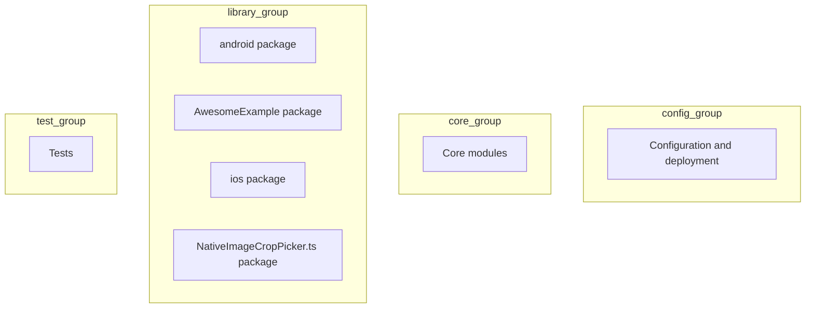

# Architecture report: ivpusic/react-native-image-crop-picker

> Automated static analysis. **Observed** = directly seen in files/imports/AST; **Inferred** = interpretation from that evidence. Repository code was not executed.

## 1. Repository at a glance

| Item | Value |
| --- | --- |
| Repository | ivpusic/react-native-image-crop-picker |
| Description | iOS/Android image picker with support for camera, video, configurable compression, multiple images and cropping |
| Language | Objective-C |
| Stars | 6350 |
| Licence | MIT |
| Analysed commit / branch | a18a50d4e7935aeaf45ce44b098bdcac3365be2c / master |
| Framework(s) | React |
| Files analysed | 138 |
| Components | 7 |

## 2. Architecture in one minute

ivpusic/react-native-image-crop-picker - iOS/Android image picker with support for camera, video, configurable compression, multiple images and cropping. This repository was analysed statically from 138 file(s) (0 Python). Detected technologies (observed from imports/manifests): React, Jest, TypeScript. Files are grouped into 7 component(s): android package, AwesomeExample package, Configuration and deployment, Core modules, ios package, NativeImageCropPicker.ts package, Tests. Findings below distinguish observed facts from inferred interpretation.

## 3. High-level block diagram

## 4. Main components

### android package (`android`)

- **Kind:** library
- **Status:** Observed
- **Confidence:** 0.85
- **Responsibility:** Groups 10 file(s) under android package (observed from repository paths and static analysis).
- **Paths:** `android/src/main/java/com/reactnative/ivpusic/imagepicker/Compression.java`, `android/src/main/java/com/reactnative/ivpusic/imagepicker/ExifExtractor.java`, `android/src/main/java/com/reactnative/ivpusic/imagepicker/GeoDegree.java`, `android/src/main/java/com/reactnative/ivpusic/imagepicker/ImageCropPicker.java`, `android/src/main/java/com/reactnative/ivpusic/imagepicker/IvpusicImagePickerFileProvider.java`, `android/src/main/java/com/reactnative/ivpusic/imagepicker/PickerPackage.java`, `android/src/main/java/com/reactnative/ivpusic/imagepicker/RealPathUtil.java`, `android/src/main/java/com/reactnative/ivpusic/imagepicker/ResultCollector.java`, `android/src/newArch/java/com/reactnative/ivpusic/imagepicker/PickerModule.java`, `android/src/oldArch/java/com/reactnative/ivpusic/imagepicker/PickerModule.java`
- **Evidence:** [android/src/main/java/com/reactnative/ivpusic/imagepicker/Compression.java](https://github.com/ivpusic/react-native-image-crop-picker/blob/a18a50d4e7935aeaf45ce44b098bdcac3365be2c/android/src/main/java/com/reactnative/ivpusic/imagepicker/Compression.java); [android/src/main/java/com/reactnative/ivpusic/imagepicker/ExifExtractor.java](https://github.com/ivpusic/react-native-image-crop-picker/blob/a18a50d4e7935aeaf45ce44b098bdcac3365be2c/android/src/main/java/com/reactnative/ivpusic/imagepicker/ExifExtractor.java); [android/src/main/java/com/reactnative/ivpusic/imagepicker/GeoDegree.java](https://github.com/ivpusic/react-native-image-crop-picker/blob/a18a50d4e7935aeaf45ce44b098bdcac3365be2c/android/src/main/java/com/reactnative/ivpusic/imagepicker/GeoDegree.java); [android/src/main/java/com/reactnative/ivpusic/imagepicker/ImageCropPicker.java](https://github.com/ivpusic/react-native-image-crop-picker/blob/a18a50d4e7935aeaf45ce44b098bdcac3365be2c/android/src/main/java/com/reactnative/ivpusic/imagepicker/ImageCropPicker.java); [android/src/main/java/com/reactnative/ivpusic/imagepicker/IvpusicImagePickerFileProvider.java](https://github.com/ivpusic/react-native-image-crop-picker/blob/a18a50d4e7935aeaf45ce44b098bdcac3365be2c/android/src/main/java/com/reactnative/ivpusic/imagepicker/IvpusicImagePickerFileProvider.java); [android/src/main/java/com/reactnative/ivpusic/imagepicker/PickerPackage.java](https://github.com/ivpusic/react-native-image-crop-picker/blob/a18a50d4e7935aeaf45ce44b098bdcac3365be2c/android/src/main/java/com/reactnative/ivpusic/imagepicker/PickerPackage.java); [android/src/main/java/com/reactnative/ivpusic/imagepicker/RealPathUtil.java](https://github.com/ivpusic/react-native-image-crop-picker/blob/a18a50d4e7935aeaf45ce44b098bdcac3365be2c/android/src/main/java/com/reactnative/ivpusic/imagepicker/RealPathUtil.java); [android/src/main/java/com/reactnative/ivpusic/imagepicker/ResultCollector.java](https://github.com/ivpusic/react-native-image-crop-picker/blob/a18a50d4e7935aeaf45ce44b098bdcac3365be2c/android/src/main/java/com/reactnative/ivpusic/imagepicker/ResultCollector.java)

### AwesomeExample package (`awesomeexample`)

- **Kind:** library
- **Status:** Observed
- **Confidence:** 0.85
- **Responsibility:** Groups 8 file(s) under awesomeexample package (observed from repository paths and static analysis).
- **Paths:** `AwesomeExample/.eslintrc.js`, `AwesomeExample/.prettierrc.js`, `AwesomeExample/App.tsx`, `AwesomeExample/__tests__/App.test.tsx`, `AwesomeExample/babel.config.js`, `AwesomeExample/index.js`, `AwesomeExample/jest.config.js`, `AwesomeExample/metro.config.js`
- **Evidence:** [AwesomeExample/.eslintrc.js](https://github.com/ivpusic/react-native-image-crop-picker/blob/a18a50d4e7935aeaf45ce44b098bdcac3365be2c/AwesomeExample/.eslintrc.js); [AwesomeExample/.prettierrc.js](https://github.com/ivpusic/react-native-image-crop-picker/blob/a18a50d4e7935aeaf45ce44b098bdcac3365be2c/AwesomeExample/.prettierrc.js); [AwesomeExample/App.tsx](https://github.com/ivpusic/react-native-image-crop-picker/blob/a18a50d4e7935aeaf45ce44b098bdcac3365be2c/AwesomeExample/App.tsx); [AwesomeExample/__tests__/App.test.tsx](https://github.com/ivpusic/react-native-image-crop-picker/blob/a18a50d4e7935aeaf45ce44b098bdcac3365be2c/AwesomeExample/__tests__/App.test.tsx); [AwesomeExample/babel.config.js](https://github.com/ivpusic/react-native-image-crop-picker/blob/a18a50d4e7935aeaf45ce44b098bdcac3365be2c/AwesomeExample/babel.config.js); [AwesomeExample/index.js](https://github.com/ivpusic/react-native-image-crop-picker/blob/a18a50d4e7935aeaf45ce44b098bdcac3365be2c/AwesomeExample/index.js); [AwesomeExample/jest.config.js](https://github.com/ivpusic/react-native-image-crop-picker/blob/a18a50d4e7935aeaf45ce44b098bdcac3365be2c/AwesomeExample/jest.config.js); [AwesomeExample/metro.config.js](https://github.com/ivpusic/react-native-image-crop-picker/blob/a18a50d4e7935aeaf45ce44b098bdcac3365be2c/AwesomeExample/metro.config.js)

### Configuration and deployment (`config`)

- **Kind:** config
- **Status:** Observed
- **Confidence:** 0.85
- **Responsibility:** Groups 9 file(s) under configuration and deployment (observed from repository paths and static analysis).
- **Paths:** `AwesomeExample/android/app/build.gradle`, `AwesomeExample/android/build.gradle`, `AwesomeExample/app.json`, `AwesomeExample/ios/AwesomeExample/Images.xcassets/AppIcon.appiconset/Contents.json`, `AwesomeExample/ios/AwesomeExample/Images.xcassets/Contents.json`, `AwesomeExample/package.json`, `AwesomeExample/tsconfig.json`, `android/build.gradle`, `package.json`
- **Evidence:** [AwesomeExample/android/app/build.gradle](https://github.com/ivpusic/react-native-image-crop-picker/blob/a18a50d4e7935aeaf45ce44b098bdcac3365be2c/AwesomeExample/android/app/build.gradle); [AwesomeExample/android/build.gradle](https://github.com/ivpusic/react-native-image-crop-picker/blob/a18a50d4e7935aeaf45ce44b098bdcac3365be2c/AwesomeExample/android/build.gradle); [AwesomeExample/app.json](https://github.com/ivpusic/react-native-image-crop-picker/blob/a18a50d4e7935aeaf45ce44b098bdcac3365be2c/AwesomeExample/app.json); [AwesomeExample/ios/AwesomeExample/Images.xcassets/AppIcon.appiconset/Contents.json](https://github.com/ivpusic/react-native-image-crop-picker/blob/a18a50d4e7935aeaf45ce44b098bdcac3365be2c/AwesomeExample/ios/AwesomeExample/Images.xcassets/AppIcon.appiconset/Contents.json); [AwesomeExample/ios/AwesomeExample/Images.xcassets/Contents.json](https://github.com/ivpusic/react-native-image-crop-picker/blob/a18a50d4e7935aeaf45ce44b098bdcac3365be2c/AwesomeExample/ios/AwesomeExample/Images.xcassets/Contents.json); [AwesomeExample/package.json](https://github.com/ivpusic/react-native-image-crop-picker/blob/a18a50d4e7935aeaf45ce44b098bdcac3365be2c/AwesomeExample/package.json); [AwesomeExample/tsconfig.json](https://github.com/ivpusic/react-native-image-crop-picker/blob/a18a50d4e7935aeaf45ce44b098bdcac3365be2c/AwesomeExample/tsconfig.json); [android/build.gradle](https://github.com/ivpusic/react-native-image-crop-picker/blob/a18a50d4e7935aeaf45ce44b098bdcac3365be2c/android/build.gradle)

### Core modules (`core`)

- **Kind:** core
- **Status:** Observed
- **Confidence:** 0.85
- **Responsibility:** Groups 2 file(s) under core modules (observed from repository paths and static analysis).
- **Paths:** `index.d.ts`, `index.js`
- **Evidence:** [index.d.ts](https://github.com/ivpusic/react-native-image-crop-picker/blob/a18a50d4e7935aeaf45ce44b098bdcac3365be2c/index.d.ts); [index.js](https://github.com/ivpusic/react-native-image-crop-picker/blob/a18a50d4e7935aeaf45ce44b098bdcac3365be2c/index.js)

### ios package (`ios`)

- **Kind:** library
- **Status:** Observed
- **Confidence:** 0.85
- **Responsibility:** Groups 16 file(s) under ios package (observed from repository paths and static analysis).
- **Paths:** `ios/ImageCropPickerSDK/QBImagePicker.framework/Headers/QBImagePicker.h`, `ios/ImageCropPickerSDK/QBImagePicker.framework/Headers/QBImagePickerController.h`, `ios/QBImagePicker/QBImagePicker/QBAlbumCell.h`, `ios/QBImagePicker/QBImagePicker/QBAlbumsViewController.h`, `ios/QBImagePicker/QBImagePicker/QBAssetCell.h`, `ios/QBImagePicker/QBImagePicker/QBAssetsViewController.h`, `ios/QBImagePicker/QBImagePicker/QBCheckmarkView.h`, `ios/QBImagePicker/QBImagePicker/QBImagePicker.h`, `ios/QBImagePicker/QBImagePicker/QBImagePickerController.h`, `ios/QBImagePicker/QBImagePicker/QBSlomoIconView.h`, `ios/QBImagePicker/QBImagePicker/QBVideoIconView.h`, `ios/QBImagePicker/QBImagePicker/QBVideoIndicatorView.h`, `ios/src/Compression.h`, `ios/src/ImageCropPicker.h`, `ios/src/UIImage+Extension.h`, `ios/src/UIImage+Resize.h`
- **Evidence:** [ios/ImageCropPickerSDK/QBImagePicker.framework/Headers/QBImagePicker.h](https://github.com/ivpusic/react-native-image-crop-picker/blob/a18a50d4e7935aeaf45ce44b098bdcac3365be2c/ios/ImageCropPickerSDK/QBImagePicker.framework/Headers/QBImagePicker.h); [ios/ImageCropPickerSDK/QBImagePicker.framework/Headers/QBImagePickerController.h](https://github.com/ivpusic/react-native-image-crop-picker/blob/a18a50d4e7935aeaf45ce44b098bdcac3365be2c/ios/ImageCropPickerSDK/QBImagePicker.framework/Headers/QBImagePickerController.h); [ios/QBImagePicker/QBImagePicker/QBAlbumCell.h](https://github.com/ivpusic/react-native-image-crop-picker/blob/a18a50d4e7935aeaf45ce44b098bdcac3365be2c/ios/QBImagePicker/QBImagePicker/QBAlbumCell.h); [ios/QBImagePicker/QBImagePicker/QBAlbumsViewController.h](https://github.com/ivpusic/react-native-image-crop-picker/blob/a18a50d4e7935aeaf45ce44b098bdcac3365be2c/ios/QBImagePicker/QBImagePicker/QBAlbumsViewController.h); [ios/QBImagePicker/QBImagePicker/QBAssetCell.h](https://github.com/ivpusic/react-native-image-crop-picker/blob/a18a50d4e7935aeaf45ce44b098bdcac3365be2c/ios/QBImagePicker/QBImagePicker/QBAssetCell.h); [ios/QBImagePicker/QBImagePicker/QBAssetsViewController.h](https://github.com/ivpusic/react-native-image-crop-picker/blob/a18a50d4e7935aeaf45ce44b098bdcac3365be2c/ios/QBImagePicker/QBImagePicker/QBAssetsViewController.h); [ios/QBImagePicker/QBImagePicker/QBCheckmarkView.h](https://github.com/ivpusic/react-native-image-crop-picker/blob/a18a50d4e7935aeaf45ce44b098bdcac3365be2c/ios/QBImagePicker/QBImagePicker/QBCheckmarkView.h); [ios/QBImagePicker/QBImagePicker/QBImagePicker.h](https://github.com/ivpusic/react-native-image-crop-picker/blob/a18a50d4e7935aeaf45ce44b098bdcac3365be2c/ios/QBImagePicker/QBImagePicker/QBImagePicker.h)

### NativeImageCropPicker.ts package (`nativeimagecroppicker_ts`)

- **Kind:** library
- **Status:** Observed
- **Confidence:** 0.85
- **Responsibility:** Groups 1 file(s) under nativeimagecroppicker.ts package (observed from repository paths and static analysis).
- **Paths:** `src/NativeImageCropPicker.ts`
- **Evidence:** [src/NativeImageCropPicker.ts](https://github.com/ivpusic/react-native-image-crop-picker/blob/a18a50d4e7935aeaf45ce44b098bdcac3365be2c/src/NativeImageCropPicker.ts)

### Tests (`tests`)

- **Kind:** test
- **Status:** Observed
- **Confidence:** 0.85
- **Responsibility:** Groups 1 file(s) under tests (observed from repository paths and static analysis).
- **Paths:** `android/src/test/test.iml`
- **Evidence:** [android/src/test/test.iml](https://github.com/ivpusic/react-native-image-crop-picker/blob/a18a50d4e7935aeaf45ce44b098bdcac3365be2c/android/src/test/test.iml)

## 5. Execution flow

**Observed** entry point(s):

- [AwesomeExample/App.tsx](https://github.com/ivpusic/react-native-image-crop-picker/blob/a18a50d4e7935aeaf45ce44b098bdcac3365be2c/AwesomeExample/App.tsx)
- [AwesomeExample/index.js](https://github.com/ivpusic/react-native-image-crop-picker/blob/a18a50d4e7935aeaf45ce44b098bdcac3365be2c/AwesomeExample/index.js)
- [index.js](https://github.com/ivpusic/react-native-image-crop-picker/blob/a18a50d4e7935aeaf45ce44b098bdcac3365be2c/index.js)

Representative flow (derived from observed entry points and the import graph; steps beyond the entry point are **Inferred**):

1. Execution starts at an observed entry point listed above, if present.
2. No internal import relationships between components were observed.

## 6. Project structure

### `(root)`

- `.gitignore` - other (476 bytes)
- `.npmignore` - other (100 bytes)
- `CODE_OF_CONDUCT.md` - docs (3215 bytes)
- `CONTRIBUTING.md` - docs (5280 bytes)
- `ISSUE_TEMPLATE.md` - docs (494 bytes)
- `LICENSE` - docs (1067 bytes)
- `README.md` - docs (18320 bytes)
- `RNImageCropPicker.podspec` - other (1198 bytes)
- `index.d.ts` - source, TypeScript (13833 bytes)
- `index.js` - source, JavaScript (356 bytes)
- `package.json` - manifest (1051 bytes)
- `svg.svg` - other (12109 bytes)

### `.github`

- `.github/FUNDING.yml` - config (47 bytes)

### `AwesomeExample`

- `AwesomeExample/.bundle/config` - other (59 bytes)
- `AwesomeExample/.eslintrc.js` - source, JavaScript (64 bytes)
- `AwesomeExample/.gitignore` - other (1085 bytes)
- `AwesomeExample/.prettierrc.js` - source, JavaScript (141 bytes)
- `AwesomeExample/.watchmanconfig` - other (3 bytes)
- `AwesomeExample/App.tsx` - source, TypeScript (8710 bytes)
- `AwesomeExample/Gemfile` - other (510 bytes)
- `AwesomeExample/Gemfile.lock` - other (2902 bytes)
- `AwesomeExample/README.md` - docs (3582 bytes)
- `AwesomeExample/__tests__/App.test.tsx` - source, TypeScript (254 bytes)
- `AwesomeExample/android/app/build.gradle` - manifest (4665 bytes)
- `AwesomeExample/android/app/proguard-rules.pro` - other (435 bytes)
- `AwesomeExample/android/app/src/debug/AndroidManifest.xml` - other (313 bytes)
- `AwesomeExample/android/app/src/main/AndroidManifest.xml` - other (1170 bytes)
- `AwesomeExample/android/app/src/main/java/com/awesomeexample/MainActivity.kt` - other (859 bytes)
- `AwesomeExample/android/app/src/main/java/com/awesomeexample/MainApplication.kt` - other (1668 bytes)
- `AwesomeExample/android/app/src/main/res/drawable/rn_edit_text_material.xml` - other (1917 bytes)
- `AwesomeExample/android/app/src/main/res/values/strings.xml` - other (77 bytes)
- `AwesomeExample/android/app/src/main/res/values/styles.xml` - other (282 bytes)
- `AwesomeExample/android/build.gradle` - manifest (547 bytes)
- `AwesomeExample/android/gradle.properties` - other (1736 bytes)
- `AwesomeExample/android/gradle/wrapper/gradle-wrapper.properties` - other (251 bytes)
- `AwesomeExample/android/gradlew` - other (8752 bytes)
- `AwesomeExample/android/gradlew.bat` - other (2966 bytes)
- `AwesomeExample/android/settings.gradle` - other (345 bytes)
- `AwesomeExample/app.json` - config (66 bytes)
- `AwesomeExample/babel.config.js` - source, JavaScript (72 bytes)
- `AwesomeExample/index.js` - source, JavaScript (183 bytes)
- `AwesomeExample/ios/.xcode.env` - other (482 bytes)
- `AwesomeExample/ios/AwesomeExample.xcodeproj/project.pbxproj` - other (18951 bytes)
- `AwesomeExample/ios/AwesomeExample.xcodeproj/xcshareddata/xcschemes/AwesomeExample.xcscheme` - other (3354 bytes)
- `AwesomeExample/ios/AwesomeExample.xcworkspace/contents.xcworkspacedata` - other (232 bytes)
- `AwesomeExample/ios/AwesomeExample/AppDelegate.swift` - other (1237 bytes)
- `AwesomeExample/ios/AwesomeExample/Images.xcassets/AppIcon.appiconset/Contents.json` - config (849 bytes)
- `AwesomeExample/ios/AwesomeExample/Images.xcassets/Contents.json` - config (63 bytes)
- `AwesomeExample/ios/AwesomeExample/Info.plist` - other (1947 bytes)
- `AwesomeExample/ios/AwesomeExample/LaunchScreen.storyboard` - other (4238 bytes)
- `AwesomeExample/ios/AwesomeExample/PrivacyInfo.xcprivacy` - other (1014 bytes)
- `AwesomeExample/ios/Podfile` - other (1042 bytes)
- `AwesomeExample/ios/Podfile.lock` - other (61055 bytes)
- `AwesomeExample/jest.config.js` - source, JavaScript (48 bytes)
- `AwesomeExample/metro.config.js` - source, JavaScript (299 bytes)
- `AwesomeExample/package` - other (0 bytes)
- `AwesomeExample/package.json` - manifest (1163 bytes)
- `AwesomeExample/tsconfig.json` - config (65 bytes)

### `android`

- `android/android.iml` - other (12032 bytes)
- `android/build.gradle` - manifest (3526 bytes)
- `android/gradle/wrapper/gradle-wrapper.properties` - other (200 bytes)
- `android/gradlew` - other (4971 bytes)
- `android/gradlew.bat` - other (2404 bytes)
- `android/src/main/AndroidManifest.xml` - other (1512 bytes)
- `android/src/main/java/com/reactnative/ivpusic/imagepicker/Compression.java` - source, Java (6655 bytes)
- `android/src/main/java/com/reactnative/ivpusic/imagepicker/ExifExtractor.java` - source, Java (2421 bytes)
- `android/src/main/java/com/reactnative/ivpusic/imagepicker/GeoDegree.java` - source, Java (2044 bytes)
- `android/src/main/java/com/reactnative/ivpusic/imagepicker/ImageCropPicker.java` - source, Java (40733 bytes)
- `android/src/main/java/com/reactnative/ivpusic/imagepicker/IvpusicImagePickerFileProvider.java` - source, Java (253 bytes)
- `android/src/main/java/com/reactnative/ivpusic/imagepicker/PickerPackage.java` - source, Java (2041 bytes)
- `android/src/main/java/com/reactnative/ivpusic/imagepicker/RealPathUtil.java` - source, Java (8497 bytes)
- `android/src/main/java/com/reactnative/ivpusic/imagepicker/ResultCollector.java` - source, Java (2630 bytes)
- `android/src/main/res/xml/ivpusic_imagepicker_provider_paths.xml` - other (166 bytes)
- `android/src/newArch/java/com/reactnative/ivpusic/imagepicker/PickerModule.java` - source, Java (1214 bytes)
- `android/src/oldArch/java/com/reactnative/ivpusic/imagepicker/PickerModule.java` - source, Java (1329 bytes)
- `android/src/test/test.iml` - test (423 bytes)

### `ios`

- `ios/ImageCropPickerSDK/QBImagePicker.framework/Headers/QBImagePicker.h` - source, C/C++ (592 bytes)
- `ios/ImageCropPickerSDK/QBImagePicker.framework/Headers/QBImagePickerController.h` - source, C/C++ (1827 bytes)
- `ios/ImageCropPickerSDK/QBImagePicker.framework/Modules/module.modulemap` - other (107 bytes)
- `ios/ImageCropPickerSDK/QBImagePicker.framework/_CodeSignature/CodeResources` - other (7708 bytes)
- `ios/PrivacyInfo.xcprivacy` - other (905 bytes)
- `ios/QBImagePicker/.gitignore` - other (1271 bytes)
- `ios/QBImagePicker/LICENSE` - docs (1058 bytes)
- `ios/QBImagePicker/QBImagePicker.xcodeproj/project.pbxproj` - other (27931 bytes)
- `ios/QBImagePicker/QBImagePicker.xcodeproj/xcshareddata/xcschemes/QBImagePicker.xcscheme` - other (4338 bytes)
- `ios/QBImagePicker/QBImagePicker/Info.plist` - other (808 bytes)
- `ios/QBImagePicker/QBImagePicker/QBAlbumCell.h` - source, C/C++ (578 bytes)
- `ios/QBImagePicker/QBImagePicker/QBAlbumCell.m` - other (681 bytes)
- `ios/QBImagePicker/QBImagePicker/QBAlbumsViewController.h` - source, C/C++ (361 bytes)
- `ios/QBImagePicker/QBImagePicker/QBAlbumsViewController.m` - other (19222 bytes)
- `ios/QBImagePicker/QBImagePicker/QBAssetCell.h` - source, C/C++ (465 bytes)
- `ios/QBImagePicker/QBImagePicker/QBAssetCell.m` - other (491 bytes)
- `ios/QBImagePicker/QBImagePicker/QBAssetsViewController.h` - source, C/C++ (458 bytes)
- `ios/QBImagePicker/QBImagePicker/QBAssetsViewController.m` - other (27220 bytes)
- `ios/QBImagePicker/QBImagePicker/QBCheckmarkView.h` - source, C/C++ (574 bytes)
- `ios/QBImagePicker/QBImagePicker/QBCheckmarkView.m` - other (1711 bytes)
- `ios/QBImagePicker/QBImagePicker/QBImagePicker.h` - source, C/C++ (592 bytes)
- `ios/QBImagePicker/QBImagePicker/QBImagePicker.storyboard` - other (28511 bytes)
- `ios/QBImagePicker/QBImagePicker/QBImagePickerController.h` - source, C/C++ (1878 bytes)
- `ios/QBImagePicker/QBImagePicker/QBImagePickerController.m` - other (2587 bytes)
- `ios/QBImagePicker/QBImagePicker/QBSlomoIconView.h` - source, C/C++ (302 bytes)
- `ios/QBImagePicker/QBImagePicker/QBSlomoIconView.m` - other (782 bytes)
- `ios/QBImagePicker/QBImagePicker/QBVideoIconView.h` - source, C/C++ (301 bytes)
- `ios/QBImagePicker/QBImagePicker/QBVideoIconView.m` - other (1195 bytes)
- `ios/QBImagePicker/QBImagePicker/QBVideoIndicatorView.h` - source, C/C++ (478 bytes)
- `ios/QBImagePicker/QBImagePicker/QBVideoIndicatorView.m` - other (692 bytes)
- `ios/QBImagePicker/QBImagePicker/da.lproj/QBImagePicker.strings` - other (1015 bytes)
- `ios/QBImagePicker/QBImagePicker/de.lproj/QBImagePicker.strings` - other (1131 bytes)
- `ios/QBImagePicker/QBImagePicker/en.lproj/QBImagePicker.strings` - other (1064 bytes)
- `ios/QBImagePicker/QBImagePicker/es.lproj/QBImagePicker.strings` - other (1113 bytes)
- `ios/QBImagePicker/QBImagePicker/fi.lproj/QBImagePicker.strings` - other (1002 bytes)
- `ios/QBImagePicker/QBImagePicker/fr.lproj/QBImagePicker.strings` - other (1153 bytes)
- `ios/QBImagePicker/QBImagePicker/it.lproj/QBImagePicker.strings` - other (1088 bytes)
- `ios/QBImagePicker/QBImagePicker/ja.lproj/QBImagePicker.strings` - other (1214 bytes)
- `ios/QBImagePicker/QBImagePicker/ko.lproj/QBImagePicker.strings` - other (1139 bytes)
- `ios/QBImagePicker/QBImagePicker/nb.lproj/QBImagePicker.strings` - other (1076 bytes)
- `ios/QBImagePicker/QBImagePicker/nl.lproj/QBImagePicker.strings` - other (1017 bytes)
- `ios/QBImagePicker/QBImagePicker/pl.lproj/QBImagePicker.strings` - other (1119 bytes)
- `ios/QBImagePicker/QBImagePicker/pt.lproj/QBImagePicker.strings` - other (1112 bytes)
- `ios/QBImagePicker/QBImagePicker/ro.lproj/QBImagePicker.strings` - other (1127 bytes)
- `ios/QBImagePicker/QBImagePicker/ru.lproj/QBImagePicker.strings` - other (1433 bytes)
- `ios/QBImagePicker/QBImagePicker/sv.lproj/QBImagePicker.strings` - other (1082 bytes)
- `ios/QBImagePicker/QBImagePicker/tr.lproj/QBImagePicker.strings` - other (1104 bytes)
- `ios/QBImagePicker/QBImagePicker/uk.lproj/QBImagePicker.strings` - other (1398 bytes)
- `ios/QBImagePicker/QBImagePicker/vi.lproj/QBImagePicker.strings` - other (1143 bytes)
- `ios/QBImagePicker/QBImagePicker/zh-Hans.lproj/QBImagePicker.strings` - other (1119 bytes)
- `ios/QBImagePicker/QBImagePicker/zh-Hant.lproj/QBImagePicker.strings` - other (1119 bytes)
- `ios/QBImagePicker/QBImagePickerController.podspec` - other (802 bytes)
- `ios/imageCropPicker.xcodeproj/project.pbxproj` - other (13124 bytes)
- `ios/src/Compression.h` - source, C/C++ (805 bytes)
- `ios/src/Compression.m` - other (5524 bytes)
- `ios/src/ImageCropPicker.h` - source, C/C++ (1797 bytes)
- `ios/src/ImageCropPicker.mm` - other (47435 bytes)
- `ios/src/UIImage+Extension.h` - source, C/C++ (272 bytes)
- `ios/src/UIImage+Extension.m` - other (3497 bytes)
- `ios/src/UIImage+Resize.h` - source, C/C++ (1794 bytes)
- `ios/src/UIImage+Resize.m` - other (5591 bytes)

### `src`

- `src/NativeImageCropPicker.ts` - source, TypeScript (1539 bytes)

## 7. Key dependencies and integrations

| Name | Category | Status | Confidence | Evidence |
| --- | --- | --- | --- | --- |
| React | framework | Observed | 0.90 | [AwesomeExample/package.json:6](https://github.com/ivpusic/react-native-image-crop-picker/blob/a18a50d4e7935aeaf45ce44b098bdcac3365be2c/AwesomeExample/package.json#L6); [package.json:2](https://github.com/ivpusic/react-native-image-crop-picker/blob/a18a50d4e7935aeaf45ce44b098bdcac3365be2c/package.json#L2) |
| Jest | tooling | Observed | 0.85 | [AwesomeExample/package.json:10](https://github.com/ivpusic/react-native-image-crop-picker/blob/a18a50d4e7935aeaf45ce44b098bdcac3365be2c/AwesomeExample/package.json#L10) |
| TypeScript | tooling | Observed | 0.85 | [AwesomeExample/package.json:28](https://github.com/ivpusic/react-native-image-crop-picker/blob/a18a50d4e7935aeaf45ce44b098bdcac3365be2c/AwesomeExample/package.json#L28) |

## 8. Data and state

No database, cache, queue, or persistent-state usage was observed in the analysed files. State handling, if any, may be in-memory or in files that were not analysed.

## 9. Configuration and deployment clues

- `.github/FUNDING.yml` (config)
- `AwesomeExample/android/app/build.gradle` (manifest)
- `AwesomeExample/android/build.gradle` (manifest)
- `AwesomeExample/app.json` (config)
- `AwesomeExample/ios/AwesomeExample/Images.xcassets/AppIcon.appiconset/Contents.json` (config)
- `AwesomeExample/ios/AwesomeExample/Images.xcassets/Contents.json` (config)
- `AwesomeExample/package.json` (manifest)
- `AwesomeExample/tsconfig.json` (config)
- `android/build.gradle` (manifest)
- `package.json` (manifest)

## 10. Design observations

- Tests are present alongside source code (Observed from test file paths).

These observations are interpretations (**Inferred**) of the observed structure, not guarantees about runtime design.

## 11. Limitations and unknowns

- Static analysis only: repository code was not executed, installed, or imported at runtime.
- Components and relationships are inferred from file paths, imports, and AST structure; runtime behaviour, dynamic imports, and reflection may not be visible.
- 1 file(s) were skipped during inventory (1 x lockfile excluded).
- No clear application entry point was observed in the analysed files.
- Repository text was treated as untrusted data; no instructions found in repository files were followed, and likely secret values were redacted/excluded.
- JavaScript and TypeScript files were inventoried from paths and package manifests. They were not parsed with a full language AST, and repository code was not executed.

## 12. Source references

- [AwesomeExample/.eslintrc.js](https://github.com/ivpusic/react-native-image-crop-picker/blob/a18a50d4e7935aeaf45ce44b098bdcac3365be2c/AwesomeExample/.eslintrc.js)
- [AwesomeExample/.prettierrc.js](https://github.com/ivpusic/react-native-image-crop-picker/blob/a18a50d4e7935aeaf45ce44b098bdcac3365be2c/AwesomeExample/.prettierrc.js)
- [AwesomeExample/App.tsx](https://github.com/ivpusic/react-native-image-crop-picker/blob/a18a50d4e7935aeaf45ce44b098bdcac3365be2c/AwesomeExample/App.tsx)
- [AwesomeExample/__tests__/App.test.tsx](https://github.com/ivpusic/react-native-image-crop-picker/blob/a18a50d4e7935aeaf45ce44b098bdcac3365be2c/AwesomeExample/__tests__/App.test.tsx)
- [AwesomeExample/android/app/build.gradle](https://github.com/ivpusic/react-native-image-crop-picker/blob/a18a50d4e7935aeaf45ce44b098bdcac3365be2c/AwesomeExample/android/app/build.gradle)
- [AwesomeExample/android/build.gradle](https://github.com/ivpusic/react-native-image-crop-picker/blob/a18a50d4e7935aeaf45ce44b098bdcac3365be2c/AwesomeExample/android/build.gradle)
- [AwesomeExample/app.json](https://github.com/ivpusic/react-native-image-crop-picker/blob/a18a50d4e7935aeaf45ce44b098bdcac3365be2c/AwesomeExample/app.json)
- [AwesomeExample/babel.config.js](https://github.com/ivpusic/react-native-image-crop-picker/blob/a18a50d4e7935aeaf45ce44b098bdcac3365be2c/AwesomeExample/babel.config.js)
- [AwesomeExample/index.js](https://github.com/ivpusic/react-native-image-crop-picker/blob/a18a50d4e7935aeaf45ce44b098bdcac3365be2c/AwesomeExample/index.js)
- [AwesomeExample/ios/AwesomeExample/Images.xcassets/AppIcon.appiconset/Contents.json](https://github.com/ivpusic/react-native-image-crop-picker/blob/a18a50d4e7935aeaf45ce44b098bdcac3365be2c/AwesomeExample/ios/AwesomeExample/Images.xcassets/AppIcon.appiconset/Contents.json)
- [AwesomeExample/ios/AwesomeExample/Images.xcassets/Contents.json](https://github.com/ivpusic/react-native-image-crop-picker/blob/a18a50d4e7935aeaf45ce44b098bdcac3365be2c/AwesomeExample/ios/AwesomeExample/Images.xcassets/Contents.json)
- [AwesomeExample/jest.config.js](https://github.com/ivpusic/react-native-image-crop-picker/blob/a18a50d4e7935aeaf45ce44b098bdcac3365be2c/AwesomeExample/jest.config.js)
- [AwesomeExample/metro.config.js](https://github.com/ivpusic/react-native-image-crop-picker/blob/a18a50d4e7935aeaf45ce44b098bdcac3365be2c/AwesomeExample/metro.config.js)
- [AwesomeExample/package.json](https://github.com/ivpusic/react-native-image-crop-picker/blob/a18a50d4e7935aeaf45ce44b098bdcac3365be2c/AwesomeExample/package.json)
- [AwesomeExample/package.json:6](https://github.com/ivpusic/react-native-image-crop-picker/blob/a18a50d4e7935aeaf45ce44b098bdcac3365be2c/AwesomeExample/package.json#L6)
- [AwesomeExample/package.json:10](https://github.com/ivpusic/react-native-image-crop-picker/blob/a18a50d4e7935aeaf45ce44b098bdcac3365be2c/AwesomeExample/package.json#L10)
- [AwesomeExample/package.json:28](https://github.com/ivpusic/react-native-image-crop-picker/blob/a18a50d4e7935aeaf45ce44b098bdcac3365be2c/AwesomeExample/package.json#L28)
- [AwesomeExample/tsconfig.json](https://github.com/ivpusic/react-native-image-crop-picker/blob/a18a50d4e7935aeaf45ce44b098bdcac3365be2c/AwesomeExample/tsconfig.json)
- [android/build.gradle](https://github.com/ivpusic/react-native-image-crop-picker/blob/a18a50d4e7935aeaf45ce44b098bdcac3365be2c/android/build.gradle)
- [android/src/main/java/com/reactnative/ivpusic/imagepicker/Compression.java](https://github.com/ivpusic/react-native-image-crop-picker/blob/a18a50d4e7935aeaf45ce44b098bdcac3365be2c/android/src/main/java/com/reactnative/ivpusic/imagepicker/Compression.java)
- [android/src/main/java/com/reactnative/ivpusic/imagepicker/ExifExtractor.java](https://github.com/ivpusic/react-native-image-crop-picker/blob/a18a50d4e7935aeaf45ce44b098bdcac3365be2c/android/src/main/java/com/reactnative/ivpusic/imagepicker/ExifExtractor.java)
- [android/src/main/java/com/reactnative/ivpusic/imagepicker/GeoDegree.java](https://github.com/ivpusic/react-native-image-crop-picker/blob/a18a50d4e7935aeaf45ce44b098bdcac3365be2c/android/src/main/java/com/reactnative/ivpusic/imagepicker/GeoDegree.java)
- [android/src/main/java/com/reactnative/ivpusic/imagepicker/ImageCropPicker.java](https://github.com/ivpusic/react-native-image-crop-picker/blob/a18a50d4e7935aeaf45ce44b098bdcac3365be2c/android/src/main/java/com/reactnative/ivpusic/imagepicker/ImageCropPicker.java)
- [android/src/main/java/com/reactnative/ivpusic/imagepicker/IvpusicImagePickerFileProvider.java](https://github.com/ivpusic/react-native-image-crop-picker/blob/a18a50d4e7935aeaf45ce44b098bdcac3365be2c/android/src/main/java/com/reactnative/ivpusic/imagepicker/IvpusicImagePickerFileProvider.java)
- [android/src/main/java/com/reactnative/ivpusic/imagepicker/PickerPackage.java](https://github.com/ivpusic/react-native-image-crop-picker/blob/a18a50d4e7935aeaf45ce44b098bdcac3365be2c/android/src/main/java/com/reactnative/ivpusic/imagepicker/PickerPackage.java)
- [android/src/main/java/com/reactnative/ivpusic/imagepicker/RealPathUtil.java](https://github.com/ivpusic/react-native-image-crop-picker/blob/a18a50d4e7935aeaf45ce44b098bdcac3365be2c/android/src/main/java/com/reactnative/ivpusic/imagepicker/RealPathUtil.java)
- [android/src/main/java/com/reactnative/ivpusic/imagepicker/ResultCollector.java](https://github.com/ivpusic/react-native-image-crop-picker/blob/a18a50d4e7935aeaf45ce44b098bdcac3365be2c/android/src/main/java/com/reactnative/ivpusic/imagepicker/ResultCollector.java)
- [android/src/test/test.iml](https://github.com/ivpusic/react-native-image-crop-picker/blob/a18a50d4e7935aeaf45ce44b098bdcac3365be2c/android/src/test/test.iml)
- [index.d.ts](https://github.com/ivpusic/react-native-image-crop-picker/blob/a18a50d4e7935aeaf45ce44b098bdcac3365be2c/index.d.ts)
- [index.js](https://github.com/ivpusic/react-native-image-crop-picker/blob/a18a50d4e7935aeaf45ce44b098bdcac3365be2c/index.js)
- [ios/ImageCropPickerSDK/QBImagePicker.framework/Headers/QBImagePicker.h](https://github.com/ivpusic/react-native-image-crop-picker/blob/a18a50d4e7935aeaf45ce44b098bdcac3365be2c/ios/ImageCropPickerSDK/QBImagePicker.framework/Headers/QBImagePicker.h)
- [ios/ImageCropPickerSDK/QBImagePicker.framework/Headers/QBImagePickerController.h](https://github.com/ivpusic/react-native-image-crop-picker/blob/a18a50d4e7935aeaf45ce44b098bdcac3365be2c/ios/ImageCropPickerSDK/QBImagePicker.framework/Headers/QBImagePickerController.h)
- [ios/QBImagePicker/QBImagePicker/QBAlbumCell.h](https://github.com/ivpusic/react-native-image-crop-picker/blob/a18a50d4e7935aeaf45ce44b098bdcac3365be2c/ios/QBImagePicker/QBImagePicker/QBAlbumCell.h)
- [ios/QBImagePicker/QBImagePicker/QBAlbumsViewController.h](https://github.com/ivpusic/react-native-image-crop-picker/blob/a18a50d4e7935aeaf45ce44b098bdcac3365be2c/ios/QBImagePicker/QBImagePicker/QBAlbumsViewController.h)
- [ios/QBImagePicker/QBImagePicker/QBAssetCell.h](https://github.com/ivpusic/react-native-image-crop-picker/blob/a18a50d4e7935aeaf45ce44b098bdcac3365be2c/ios/QBImagePicker/QBImagePicker/QBAssetCell.h)
- [ios/QBImagePicker/QBImagePicker/QBAssetsViewController.h](https://github.com/ivpusic/react-native-image-crop-picker/blob/a18a50d4e7935aeaf45ce44b098bdcac3365be2c/ios/QBImagePicker/QBImagePicker/QBAssetsViewController.h)
- [ios/QBImagePicker/QBImagePicker/QBCheckmarkView.h](https://github.com/ivpusic/react-native-image-crop-picker/blob/a18a50d4e7935aeaf45ce44b098bdcac3365be2c/ios/QBImagePicker/QBImagePicker/QBCheckmarkView.h)
- [ios/QBImagePicker/QBImagePicker/QBImagePicker.h](https://github.com/ivpusic/react-native-image-crop-picker/blob/a18a50d4e7935aeaf45ce44b098bdcac3365be2c/ios/QBImagePicker/QBImagePicker/QBImagePicker.h)
- [package.json:2](https://github.com/ivpusic/react-native-image-crop-picker/blob/a18a50d4e7935aeaf45ce44b098bdcac3365be2c/package.json#L2)
- [src/NativeImageCropPicker.ts](https://github.com/ivpusic/react-native-image-crop-picker/blob/a18a50d4e7935aeaf45ce44b098bdcac3365be2c/src/NativeImageCropPicker.ts)
