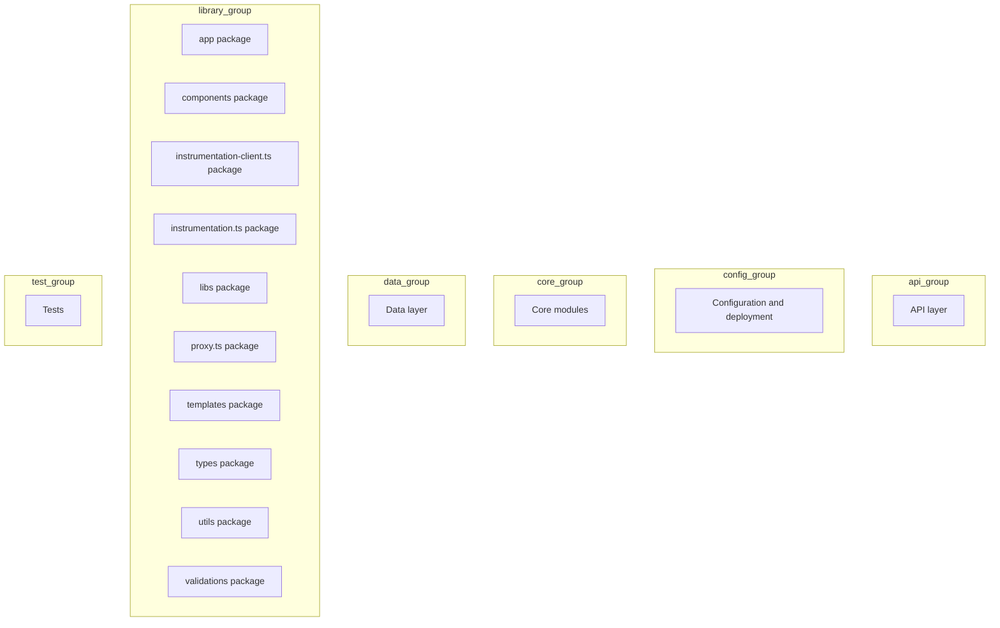

# Architecture report: ixartz/Next-js-Boilerplate

> Automated static analysis. **Observed** = directly seen in files/imports/AST; **Inferred** = interpretation from that evidence. Repository code was not executed.

## 1. Repository at a glance

| Item | Value |
| --- | --- |
| Repository | ixartz/Next-js-Boilerplate |
| Description | 🚀🎉📚 Nextjs Boilerplate and Starter with App Router and Page Router support, Tailwind CSS 4 and TypeScript ⚡️ Made with developer experience first: Next.js 16 + TypeScript + ESLint + Prettier + Drizzle ORM + Husky + Lint-Staged + Vitest + Testing Library + Playwright + Storybook + Commitlint + VSCod… |
| Language | TypeScript |
| Stars | 13094 |
| Licence | MIT |
| Analysed commit / branch | b83157a8018f55b926a3c25a4b7a7e14b0dfbc35 / main |
| Framework(s) | Next.js, React |
| Files analysed | 94 |
| Components | 15 |

## 2. Architecture in one minute

ixartz/Next-js-Boilerplate - 🚀🎉📚 Nextjs Boilerplate and Starter with App Router and Page Router support, Tailwind CSS 4 and TypeScript ⚡️ Made with developer experience first: Next.js 16 + TypeScript + ESLint + Prettier + Drizzl…. This repository was analysed statically from 94 file(s) (0 Python). Detected technologies (observed from imports/manifests): GitHub Actions, Next.js, React, Tailwind CSS, Docker, TypeScript. Files are grouped into 15 component(s): API layer, app package, components package, Configuration and deployment, Core modules, Data layer, instrumentation-client.ts package, instrumentation.ts package. Findings below distinguish observed facts from inferred interpretation.

## 3. High-level block diagram

## 4. Main components

### API layer (`api_layer`)

- **Kind:** api
- **Status:** Observed
- **Confidence:** 0.85
- **Responsibility:** Groups 1 file(s) under api layer (observed from repository paths and static analysis).
- **Paths:** `src/app/api/counter/route.ts`
- **Evidence:** [src/app/api/counter/route.ts](https://github.com/ixartz/Next-js-Boilerplate/blob/b83157a8018f55b926a3c25a4b7a7e14b0dfbc35/src/app/api/counter/route.ts)

### app package (`app`)

- **Kind:** library
- **Status:** Observed
- **Confidence:** 0.85
- **Responsibility:** Groups 17 file(s) under app package (observed from repository paths and static analysis).
- **Paths:** `src/app/[locale]/(auth)/(center)/layout.tsx`, `src/app/[locale]/(auth)/(center)/sign-in/[[...sign-in]]/page.tsx`, `src/app/[locale]/(auth)/(center)/sign-up/[[...sign-up]]/page.tsx`, `src/app/[locale]/(auth)/dashboard/layout.tsx`, `src/app/[locale]/(auth)/dashboard/page.tsx`, `src/app/[locale]/(auth)/dashboard/user-profile/[[...user-profile]]/page.tsx`, `src/app/[locale]/(auth)/layout.tsx`, `src/app/[locale]/(marketing)/about/page.tsx`, `src/app/[locale]/(marketing)/counter/page.tsx`, `src/app/[locale]/(marketing)/layout.tsx`, `src/app/[locale]/(marketing)/page.tsx`, `src/app/[locale]/(marketing)/portfolio/[slug]/page.tsx`, `src/app/[locale]/(marketing)/portfolio/page.tsx`, `src/app/[locale]/layout.tsx`, `src/app/global-error.tsx`, `src/app/robots.ts`, `src/app/sitemap.ts`
- **Evidence:** [src/app/[locale]/(auth)/(center)/layout.tsx](https://github.com/ixartz/Next-js-Boilerplate/blob/b83157a8018f55b926a3c25a4b7a7e14b0dfbc35/src/app/%5Blocale%5D/%28auth%29/%28center%29/layout.tsx); [src/app/[locale]/(auth)/(center)/sign-in/[[...sign-in]]/page.tsx](https://github.com/ixartz/Next-js-Boilerplate/blob/b83157a8018f55b926a3c25a4b7a7e14b0dfbc35/src/app/%5Blocale%5D/%28auth%29/%28center%29/sign-in/%5B%5B...sign-in%5D%5D/page.tsx); [src/app/[locale]/(auth)/(center)/sign-up/[[...sign-up]]/page.tsx](https://github.com/ixartz/Next-js-Boilerplate/blob/b83157a8018f55b926a3c25a4b7a7e14b0dfbc35/src/app/%5Blocale%5D/%28auth%29/%28center%29/sign-up/%5B%5B...sign-up%5D%5D/page.tsx); [src/app/[locale]/(auth)/dashboard/layout.tsx](https://github.com/ixartz/Next-js-Boilerplate/blob/b83157a8018f55b926a3c25a4b7a7e14b0dfbc35/src/app/%5Blocale%5D/%28auth%29/dashboard/layout.tsx); [src/app/[locale]/(auth)/dashboard/page.tsx](https://github.com/ixartz/Next-js-Boilerplate/blob/b83157a8018f55b926a3c25a4b7a7e14b0dfbc35/src/app/%5Blocale%5D/%28auth%29/dashboard/page.tsx); [src/app/[locale]/(auth)/dashboard/user-profile/[[...user-profile]]/page.tsx](https://github.com/ixartz/Next-js-Boilerplate/blob/b83157a8018f55b926a3c25a4b7a7e14b0dfbc35/src/app/%5Blocale%5D/%28auth%29/dashboard/user-profile/%5B%5B...user-profile%5D%5D/page.tsx); [src/app/[locale]/(auth)/layout.tsx](https://github.com/ixartz/Next-js-Boilerplate/blob/b83157a8018f55b926a3c25a4b7a7e14b0dfbc35/src/app/%5Blocale%5D/%28auth%29/layout.tsx); [src/app/[locale]/(marketing)/about/page.tsx](https://github.com/ixartz/Next-js-Boilerplate/blob/b83157a8018f55b926a3c25a4b7a7e14b0dfbc35/src/app/%5Blocale%5D/%28marketing%29/about/page.tsx)

### components package (`components`)

- **Kind:** library
- **Status:** Observed
- **Confidence:** 0.85
- **Responsibility:** Groups 7 file(s) under components package (observed from repository paths and static analysis).
- **Paths:** `src/components/CounterForm.tsx`, `src/components/CurrentCount.tsx`, `src/components/DemoBadge.tsx`, `src/components/DemoBanner.tsx`, `src/components/Hello.tsx`, `src/components/LocaleSwitcher.tsx`, `src/components/Sponsors.tsx`
- **Evidence:** [src/components/CounterForm.tsx](https://github.com/ixartz/Next-js-Boilerplate/blob/b83157a8018f55b926a3c25a4b7a7e14b0dfbc35/src/components/CounterForm.tsx); [src/components/CurrentCount.tsx](https://github.com/ixartz/Next-js-Boilerplate/blob/b83157a8018f55b926a3c25a4b7a7e14b0dfbc35/src/components/CurrentCount.tsx); [src/components/DemoBadge.tsx](https://github.com/ixartz/Next-js-Boilerplate/blob/b83157a8018f55b926a3c25a4b7a7e14b0dfbc35/src/components/DemoBadge.tsx); [src/components/DemoBanner.tsx](https://github.com/ixartz/Next-js-Boilerplate/blob/b83157a8018f55b926a3c25a4b7a7e14b0dfbc35/src/components/DemoBanner.tsx); [src/components/Hello.tsx](https://github.com/ixartz/Next-js-Boilerplate/blob/b83157a8018f55b926a3c25a4b7a7e14b0dfbc35/src/components/Hello.tsx); [src/components/LocaleSwitcher.tsx](https://github.com/ixartz/Next-js-Boilerplate/blob/b83157a8018f55b926a3c25a4b7a7e14b0dfbc35/src/components/LocaleSwitcher.tsx); [src/components/Sponsors.tsx](https://github.com/ixartz/Next-js-Boilerplate/blob/b83157a8018f55b926a3c25a4b7a7e14b0dfbc35/src/components/Sponsors.tsx)

### Configuration and deployment (`config`)

- **Kind:** config
- **Status:** Observed
- **Confidence:** 0.85
- **Responsibility:** Groups 9 file(s) under configuration and deployment (observed from repository paths and static analysis).
- **Paths:** `codecov.yml`, `crowdin.yml`, `lefthook.yml`, `migrations/meta/0000_snapshot.json`, `migrations/meta/_journal.json`, `package.json`, `src/locales/en.json`, `src/locales/fr.json`, `tsconfig.json`
- **Evidence:** [codecov.yml](https://github.com/ixartz/Next-js-Boilerplate/blob/b83157a8018f55b926a3c25a4b7a7e14b0dfbc35/codecov.yml); [crowdin.yml](https://github.com/ixartz/Next-js-Boilerplate/blob/b83157a8018f55b926a3c25a4b7a7e14b0dfbc35/crowdin.yml); [lefthook.yml](https://github.com/ixartz/Next-js-Boilerplate/blob/b83157a8018f55b926a3c25a4b7a7e14b0dfbc35/lefthook.yml); [migrations/meta/0000_snapshot.json](https://github.com/ixartz/Next-js-Boilerplate/blob/b83157a8018f55b926a3c25a4b7a7e14b0dfbc35/migrations/meta/0000_snapshot.json); [migrations/meta/_journal.json](https://github.com/ixartz/Next-js-Boilerplate/blob/b83157a8018f55b926a3c25a4b7a7e14b0dfbc35/migrations/meta/_journal.json); [package.json](https://github.com/ixartz/Next-js-Boilerplate/blob/b83157a8018f55b926a3c25a4b7a7e14b0dfbc35/package.json); [src/locales/en.json](https://github.com/ixartz/Next-js-Boilerplate/blob/b83157a8018f55b926a3c25a4b7a7e14b0dfbc35/src/locales/en.json); [src/locales/fr.json](https://github.com/ixartz/Next-js-Boilerplate/blob/b83157a8018f55b926a3c25a4b7a7e14b0dfbc35/src/locales/fr.json)

### Core modules (`core`)

- **Kind:** core
- **Status:** Observed
- **Confidence:** 0.85
- **Responsibility:** Groups 8 file(s) under core modules (observed from repository paths and static analysis).
- **Paths:** `commitlint.config.ts`, `drizzle.config.ts`, `knip.config.ts`, `next.config.ts`, `oxfmt.config.ts`, `oxlint.config.ts`, `playwright.config.ts`, `vitest.config.ts`
- **Evidence:** [commitlint.config.ts](https://github.com/ixartz/Next-js-Boilerplate/blob/b83157a8018f55b926a3c25a4b7a7e14b0dfbc35/commitlint.config.ts); [drizzle.config.ts](https://github.com/ixartz/Next-js-Boilerplate/blob/b83157a8018f55b926a3c25a4b7a7e14b0dfbc35/drizzle.config.ts); [knip.config.ts](https://github.com/ixartz/Next-js-Boilerplate/blob/b83157a8018f55b926a3c25a4b7a7e14b0dfbc35/knip.config.ts); [next.config.ts](https://github.com/ixartz/Next-js-Boilerplate/blob/b83157a8018f55b926a3c25a4b7a7e14b0dfbc35/next.config.ts); [oxfmt.config.ts](https://github.com/ixartz/Next-js-Boilerplate/blob/b83157a8018f55b926a3c25a4b7a7e14b0dfbc35/oxfmt.config.ts); [oxlint.config.ts](https://github.com/ixartz/Next-js-Boilerplate/blob/b83157a8018f55b926a3c25a4b7a7e14b0dfbc35/oxlint.config.ts); [playwright.config.ts](https://github.com/ixartz/Next-js-Boilerplate/blob/b83157a8018f55b926a3c25a4b7a7e14b0dfbc35/playwright.config.ts); [vitest.config.ts](https://github.com/ixartz/Next-js-Boilerplate/blob/b83157a8018f55b926a3c25a4b7a7e14b0dfbc35/vitest.config.ts)

### Data layer (`data_layer`)

- **Kind:** data
- **Status:** Observed
- **Confidence:** 0.85
- **Responsibility:** Groups 1 file(s) under data layer (observed from repository paths and static analysis).
- **Paths:** `src/models/Schema.ts`
- **Evidence:** [src/models/Schema.ts](https://github.com/ixartz/Next-js-Boilerplate/blob/b83157a8018f55b926a3c25a4b7a7e14b0dfbc35/src/models/Schema.ts)

### instrumentation-client.ts package (`instrumentation_client_ts`)

- **Kind:** library
- **Status:** Observed
- **Confidence:** 0.85
- **Responsibility:** Groups 1 file(s) under instrumentation-client.ts package (observed from repository paths and static analysis).
- **Paths:** `src/instrumentation-client.ts`
- **Evidence:** [src/instrumentation-client.ts](https://github.com/ixartz/Next-js-Boilerplate/blob/b83157a8018f55b926a3c25a4b7a7e14b0dfbc35/src/instrumentation-client.ts)

### instrumentation.ts package (`instrumentation_ts`)

- **Kind:** library
- **Status:** Observed
- **Confidence:** 0.85
- **Responsibility:** Groups 1 file(s) under instrumentation.ts package (observed from repository paths and static analysis).
- **Paths:** `src/instrumentation.ts`
- **Evidence:** [src/instrumentation.ts](https://github.com/ixartz/Next-js-Boilerplate/blob/b83157a8018f55b926a3c25a4b7a7e14b0dfbc35/src/instrumentation.ts)

### libs package (`libs`)

- **Kind:** library
- **Status:** Observed
- **Confidence:** 0.85
- **Responsibility:** Groups 7 file(s) under libs package (observed from repository paths and static analysis).
- **Paths:** `src/libs/Arcjet.ts`, `src/libs/DB.ts`, `src/libs/Env.ts`, `src/libs/I18n.ts`, `src/libs/I18nNavigation.ts`, `src/libs/I18nRouting.ts`, `src/libs/Logger.ts`
- **Evidence:** [src/libs/Arcjet.ts](https://github.com/ixartz/Next-js-Boilerplate/blob/b83157a8018f55b926a3c25a4b7a7e14b0dfbc35/src/libs/Arcjet.ts); [src/libs/DB.ts](https://github.com/ixartz/Next-js-Boilerplate/blob/b83157a8018f55b926a3c25a4b7a7e14b0dfbc35/src/libs/DB.ts); [src/libs/Env.ts](https://github.com/ixartz/Next-js-Boilerplate/blob/b83157a8018f55b926a3c25a4b7a7e14b0dfbc35/src/libs/Env.ts); [src/libs/I18n.ts](https://github.com/ixartz/Next-js-Boilerplate/blob/b83157a8018f55b926a3c25a4b7a7e14b0dfbc35/src/libs/I18n.ts); [src/libs/I18nNavigation.ts](https://github.com/ixartz/Next-js-Boilerplate/blob/b83157a8018f55b926a3c25a4b7a7e14b0dfbc35/src/libs/I18nNavigation.ts); [src/libs/I18nRouting.ts](https://github.com/ixartz/Next-js-Boilerplate/blob/b83157a8018f55b926a3c25a4b7a7e14b0dfbc35/src/libs/I18nRouting.ts); [src/libs/Logger.ts](https://github.com/ixartz/Next-js-Boilerplate/blob/b83157a8018f55b926a3c25a4b7a7e14b0dfbc35/src/libs/Logger.ts)

### proxy.ts package (`proxy_ts`)

- **Kind:** library
- **Status:** Observed
- **Confidence:** 0.85
- **Responsibility:** Groups 1 file(s) under proxy.ts package (observed from repository paths and static analysis).
- **Paths:** `src/proxy.ts`
- **Evidence:** [src/proxy.ts](https://github.com/ixartz/Next-js-Boilerplate/blob/b83157a8018f55b926a3c25a4b7a7e14b0dfbc35/src/proxy.ts)

### templates package (`templates`)

- **Kind:** library
- **Status:** Observed
- **Confidence:** 0.85
- **Responsibility:** Groups 3 file(s) under templates package (observed from repository paths and static analysis).
- **Paths:** `src/templates/BaseTemplate.stories.tsx`, `src/templates/BaseTemplate.test.tsx`, `src/templates/BaseTemplate.tsx`
- **Evidence:** [src/templates/BaseTemplate.stories.tsx](https://github.com/ixartz/Next-js-Boilerplate/blob/b83157a8018f55b926a3c25a4b7a7e14b0dfbc35/src/templates/BaseTemplate.stories.tsx); [src/templates/BaseTemplate.test.tsx](https://github.com/ixartz/Next-js-Boilerplate/blob/b83157a8018f55b926a3c25a4b7a7e14b0dfbc35/src/templates/BaseTemplate.test.tsx); [src/templates/BaseTemplate.tsx](https://github.com/ixartz/Next-js-Boilerplate/blob/b83157a8018f55b926a3c25a4b7a7e14b0dfbc35/src/templates/BaseTemplate.tsx)

### Tests (`tests`)

- **Kind:** test
- **Status:** Observed
- **Confidence:** 0.85
- **Responsibility:** Groups 5 file(s) under tests (observed from repository paths and static analysis).
- **Paths:** `tests/e2e/Counter.e2e.ts`, `tests/e2e/I18n.e2e.ts`, `tests/e2e/Sanity.check.e2e.ts`, `tests/e2e/Visual.e2e.ts`, `tests/integration/Counter.integ.ts`
- **Evidence:** [tests/e2e/Counter.e2e.ts](https://github.com/ixartz/Next-js-Boilerplate/blob/b83157a8018f55b926a3c25a4b7a7e14b0dfbc35/tests/e2e/Counter.e2e.ts); [tests/e2e/I18n.e2e.ts](https://github.com/ixartz/Next-js-Boilerplate/blob/b83157a8018f55b926a3c25a4b7a7e14b0dfbc35/tests/e2e/I18n.e2e.ts); [tests/e2e/Sanity.check.e2e.ts](https://github.com/ixartz/Next-js-Boilerplate/blob/b83157a8018f55b926a3c25a4b7a7e14b0dfbc35/tests/e2e/Sanity.check.e2e.ts); [tests/e2e/Visual.e2e.ts](https://github.com/ixartz/Next-js-Boilerplate/blob/b83157a8018f55b926a3c25a4b7a7e14b0dfbc35/tests/e2e/Visual.e2e.ts); [tests/integration/Counter.integ.ts](https://github.com/ixartz/Next-js-Boilerplate/blob/b83157a8018f55b926a3c25a4b7a7e14b0dfbc35/tests/integration/Counter.integ.ts)

### types package (`types`)

- **Kind:** library
- **Status:** Observed
- **Confidence:** 0.85
- **Responsibility:** Groups 1 file(s) under types package (observed from repository paths and static analysis).
- **Paths:** `src/types/I18n.ts`
- **Evidence:** [src/types/I18n.ts](https://github.com/ixartz/Next-js-Boilerplate/blob/b83157a8018f55b926a3c25a4b7a7e14b0dfbc35/src/types/I18n.ts)

### utils package (`utils`)

- **Kind:** library
- **Status:** Observed
- **Confidence:** 0.85
- **Responsibility:** Groups 4 file(s) under utils package (observed from repository paths and static analysis).
- **Paths:** `src/utils/AppConfig.ts`, `src/utils/DBConnection.ts`, `src/utils/Helpers.test.ts`, `src/utils/Helpers.ts`
- **Evidence:** [src/utils/AppConfig.ts](https://github.com/ixartz/Next-js-Boilerplate/blob/b83157a8018f55b926a3c25a4b7a7e14b0dfbc35/src/utils/AppConfig.ts); [src/utils/DBConnection.ts](https://github.com/ixartz/Next-js-Boilerplate/blob/b83157a8018f55b926a3c25a4b7a7e14b0dfbc35/src/utils/DBConnection.ts); [src/utils/Helpers.test.ts](https://github.com/ixartz/Next-js-Boilerplate/blob/b83157a8018f55b926a3c25a4b7a7e14b0dfbc35/src/utils/Helpers.test.ts); [src/utils/Helpers.ts](https://github.com/ixartz/Next-js-Boilerplate/blob/b83157a8018f55b926a3c25a4b7a7e14b0dfbc35/src/utils/Helpers.ts)

### validations package (`validations`)

- **Kind:** library
- **Status:** Observed
- **Confidence:** 0.85
- **Responsibility:** Groups 1 file(s) under validations package (observed from repository paths and static analysis).
- **Paths:** `src/validations/CounterValidation.ts`
- **Evidence:** [src/validations/CounterValidation.ts](https://github.com/ixartz/Next-js-Boilerplate/blob/b83157a8018f55b926a3c25a4b7a7e14b0dfbc35/src/validations/CounterValidation.ts)

## 5. Execution flow

**Observed** entry point(s):

- [.storybook/main.ts](https://github.com/ixartz/Next-js-Boilerplate/blob/b83157a8018f55b926a3c25a4b7a7e14b0dfbc35/.storybook/main.ts)

Representative flow (derived from observed entry points and the import graph; steps beyond the entry point are **Inferred**):

1. Execution starts at an observed entry point listed above, if present.
2. No internal import relationships between components were observed.

## 6. Project structure

### `(root)`

- `.coderabbit.yaml` - config (700 bytes)
- `.gitignore` - other (703 bytes)
- `AGENTS.md` - docs (3646 bytes)
- `CLAUDE.md` - docs (11 bytes)
- `LICENSE` - docs (1064 bytes)
- `README.md` - docs (35049 bytes)
- `codecov.yml` - config (35 bytes)
- `commitlint.config.ts` - source, TypeScript (296 bytes)
- `crowdin.yml` - config (713 bytes)
- `drizzle.config.ts` - source, TypeScript (261 bytes)
- `knip.config.ts` - source, TypeScript (525 bytes)
- `lefthook.yml` - config (497 bytes)
- `next.config.ts` - source, TypeScript (2340 bytes)
- `oxfmt.config.ts` - source, TypeScript (360 bytes)
- `oxlint.config.ts` - source, TypeScript (1890 bytes)
- `package.json` - manifest (3538 bytes)
- `playwright.config.ts` - source, TypeScript (2683 bytes)
- `tsconfig.json` - config (3208 bytes)
- `vitest.config.ts` - source, TypeScript (1345 bytes)

### `.github`

- `.github/FUNDING.yml` - config (97 bytes)
- `.github/actions/setup-project/action.yml` - config (1159 bytes)
- `.github/dependabot.yml` - config (1322 bytes)
- `.github/workflows/CI.yml` - ci, YAML (5872 bytes)
- `.github/workflows/crowdin.yml` - ci, YAML (1136 bytes)
- `.github/workflows/release.yml` - ci, YAML (998 bytes)

### `.storybook`

- `.storybook/main.ts` - source, TypeScript (453 bytes)
- `.storybook/preview.ts` - source, TypeScript (511 bytes)
- `.storybook/vitest.config.ts` - source, TypeScript (805 bytes)
- `.storybook/vitest.setup.ts` - source, TypeScript (455 bytes)

### `.vscode`

- `.vscode/extensions.json` - config (251 bytes)
- `.vscode/launch.json` - config (793 bytes)
- `.vscode/settings.json` - config (1765 bytes)
- `.vscode/tasks.json` - config (471 bytes)

### `migrations`

- `migrations/0000_init-db.sql` - data, SQL (186 bytes)
- `migrations/meta/0000_snapshot.json` - config (1304 bytes)
- `migrations/meta/_journal.json` - config (201 bytes)

### `public`

- `public/assets/images/arcjet-dark.svg` - other (2560 bytes)
- `public/assets/images/arcjet-light.svg` - other (2573 bytes)
- `public/assets/images/coderabbit-logo-dark.svg` - other (9606 bytes)
- `public/assets/images/coderabbit-logo-light.svg` - other (9621 bytes)
- `public/assets/images/posthog-logo.svg` - other (4517 bytes)

### `src`

- `src/app/[locale]/(auth)/(center)/layout.tsx` - source, TypeScript (349 bytes)
- `src/app/[locale]/(auth)/(center)/sign-in/[[...sign-in]]/page.tsx` - source, TypeScript (755 bytes)
- `src/app/[locale]/(auth)/(center)/sign-up/[[...sign-up]]/page.tsx` - source, TypeScript (755 bytes)
- `src/app/[locale]/(auth)/dashboard/layout.tsx` - source, TypeScript (1869 bytes)
- `src/app/[locale]/(auth)/dashboard/page.tsx` - source, TypeScript (345 bytes)
- `src/app/[locale]/(auth)/dashboard/user-profile/[[...user-profile]]/page.tsx` - source, TypeScript (506 bytes)
- `src/app/[locale]/(auth)/layout.tsx` - source, TypeScript (859 bytes)
- `src/app/[locale]/(marketing)/about/page.tsx` - source, TypeScript (1348 bytes)
- `src/app/[locale]/(marketing)/counter/page.tsx` - source, TypeScript (1297 bytes)
- `src/app/[locale]/(marketing)/layout.tsx` - source, TypeScript (2295 bytes)
- `src/app/[locale]/(marketing)/page.tsx` - source, TypeScript (4876 bytes)
- `src/app/[locale]/(marketing)/portfolio/[slug]/page.tsx` - source, TypeScript (1868 bytes)
- `src/app/[locale]/(marketing)/portfolio/page.tsx` - source, TypeScript (1909 bytes)
- `src/app/[locale]/layout.tsx` - source, TypeScript (1401 bytes)
- `src/app/api/counter/route.ts` - source, TypeScript (1207 bytes)
- `src/app/global-error.tsx` - source, TypeScript (748 bytes)
- `src/app/robots.ts` - source, TypeScript (299 bytes)
- `src/app/sitemap.ts` - source, TypeScript (821 bytes)
- `src/components/CounterForm.tsx` - source, TypeScript (1960 bytes)
- `src/components/CurrentCount.tsx` - source, TypeScript (827 bytes)
- `src/components/DemoBadge.tsx` - source, TypeScript (350 bytes)
- `src/components/DemoBanner.tsx` - source, TypeScript (341 bytes)
- `src/components/Hello.tsx` - source, TypeScript (1150 bytes)
- `src/components/LocaleSwitcher.tsx` - source, TypeScript (1086 bytes)
- `src/components/Sponsors.tsx` - source, TypeScript (3856 bytes)
- `src/instrumentation-client.ts` - source, TypeScript (2108 bytes)
- `src/instrumentation.ts` - source, TypeScript (1277 bytes)
- `src/libs/Arcjet.ts` - source, TypeScript (619 bytes)
- `src/libs/DB.ts` - source, TypeScript (515 bytes)
- `src/libs/Env.ts` - source, TypeScript (1626 bytes)
- `src/libs/I18n.ts` - source, TypeScript (1088 bytes)
- `src/libs/I18nNavigation.ts` - source, TypeScript (174 bytes)
- `src/libs/I18nRouting.ts` - source, TypeScript (269 bytes)
- `src/libs/Logger.ts` - source, TypeScript (1173 bytes)
- `src/locales/en.json` - config (3402 bytes)
- `src/locales/fr.json` - config (3666 bytes)
- `src/models/Schema.ts` - source, TypeScript (1074 bytes)
- `src/proxy.ts` - source, TypeScript (2458 bytes)
- `src/styles/global.css` - other (128 bytes)
- `src/templates/BaseTemplate.stories.tsx` - source, TypeScript (1027 bytes)
- `src/templates/BaseTemplate.test.tsx` - source, TypeScript (1667 bytes)
- `src/templates/BaseTemplate.tsx` - source, TypeScript (1954 bytes)
- `src/types/I18n.ts` - source, TypeScript (304 bytes)
- `src/utils/AppConfig.ts` - source, TypeScript (700 bytes)
- `src/utils/DBConnection.ts` - source, TypeScript (593 bytes)
- `src/utils/Helpers.test.ts` - source, TypeScript (609 bytes)
- `src/utils/Helpers.ts` - source, TypeScript (791 bytes)
- `src/validations/CounterValidation.ts` - source, TypeScript (114 bytes)

### `tests`

- `tests/e2e/Counter.e2e.ts` - test, TypeScript (2059 bytes)
- `tests/e2e/I18n.e2e.ts` - test, TypeScript (1067 bytes)
- `tests/e2e/Sanity.check.e2e.ts` - test, TypeScript (1697 bytes)
- `tests/e2e/Visual.e2e.ts` - test, TypeScript (1613 bytes)
- `tests/integration/Counter.integ.ts` - test, TypeScript (2367 bytes)

## 7. Key dependencies and integrations

| Name | Category | Status | Confidence | Evidence |
| --- | --- | --- | --- | --- |
| GitHub Actions | ci | Observed | 0.90 | [.github/workflows/CI.yml](https://github.com/ixartz/Next-js-Boilerplate/blob/b83157a8018f55b926a3c25a4b7a7e14b0dfbc35/.github/workflows/CI.yml); [.github/workflows/crowdin.yml](https://github.com/ixartz/Next-js-Boilerplate/blob/b83157a8018f55b926a3c25a4b7a7e14b0dfbc35/.github/workflows/crowdin.yml); [.github/workflows/release.yml](https://github.com/ixartz/Next-js-Boilerplate/blob/b83157a8018f55b926a3c25a4b7a7e14b0dfbc35/.github/workflows/release.yml) |
| Next.js | framework | Observed | 0.85 | [package.json:2](https://github.com/ixartz/Next-js-Boilerplate/blob/b83157a8018f55b926a3c25a4b7a7e14b0dfbc35/package.json#L2) |
| React | framework | Observed | 0.90 | [package.json:44](https://github.com/ixartz/Next-js-Boilerplate/blob/b83157a8018f55b926a3c25a4b7a7e14b0dfbc35/package.json#L44); [package.json:45](https://github.com/ixartz/Next-js-Boilerplate/blob/b83157a8018f55b926a3c25a4b7a7e14b0dfbc35/package.json#L45) |
| Tailwind CSS | library | Observed | 0.85 | [package.json:65](https://github.com/ixartz/Next-js-Boilerplate/blob/b83157a8018f55b926a3c25a4b7a7e14b0dfbc35/package.json#L65) |
| Docker | tooling | Observed | 0.70 | [.github/workflows/CI.yml:104](https://github.com/ixartz/Next-js-Boilerplate/blob/b83157a8018f55b926a3c25a4b7a7e14b0dfbc35/.github/workflows/CI.yml#L104) |
| TypeScript | tooling | Observed | 0.85 | [package.json:85](https://github.com/ixartz/Next-js-Boilerplate/blob/b83157a8018f55b926a3c25a4b7a7e14b0dfbc35/package.json#L85) |
| Vitest | tooling | Observed | 0.85 | [package.json:21](https://github.com/ixartz/Next-js-Boilerplate/blob/b83157a8018f55b926a3c25a4b7a7e14b0dfbc35/package.json#L21) |

## 8. Data and state

- Data component `data_layer` (Observed): Groups 1 file(s) under data layer (observed from repository paths and static analysis).

## 9. Configuration and deployment clues

- `.coderabbit.yaml` (config)
- `.github/FUNDING.yml` (config)
- `.github/actions/setup-project/action.yml` (config)
- `.github/dependabot.yml` (config)
- `.github/workflows/CI.yml` (ci)
- `.github/workflows/crowdin.yml` (ci)
- `.github/workflows/release.yml` (ci)
- `.vscode/extensions.json` (config)
- `.vscode/launch.json` (config)
- `.vscode/settings.json` (config)
- `.vscode/tasks.json` (config)
- `codecov.yml` (config)
- `crowdin.yml` (config)
- `lefthook.yml` (config)
- `migrations/meta/0000_snapshot.json` (config)
- `migrations/meta/_journal.json` (config)
- `package.json` (manifest)
- `src/locales/en.json` (config)
- `src/locales/fr.json` (config)
- `tsconfig.json` (config)

## 10. Design observations

- An entry/API layer is separated from other code (Inferred from paths and decorators).
- Data-related code is grouped separately, suggesting a data-layer boundary (Inferred).
- Tests are present alongside source code (Observed from test file paths).

These observations are interpretations (**Inferred**) of the observed structure, not guarantees about runtime design.

## 11. Limitations and unknowns

- Static analysis only: repository code was not executed, installed, or imported at runtime.
- Components and relationships are inferred from file paths, imports, and AST structure; runtime behaviour, dynamic imports, and reflection may not be visible.
- 2 file(s) were skipped during inventory (2 x likely secret file excluded).
- No clear application entry point was observed in the analysed files.
- Repository text was treated as untrusted data; no instructions found in repository files were followed, and likely secret values were redacted/excluded.
- JavaScript and TypeScript files were inventoried from paths and package manifests. They were not parsed with a full language AST, and repository code was not executed.

## 12. Source references

- [.github/workflows/CI.yml](https://github.com/ixartz/Next-js-Boilerplate/blob/b83157a8018f55b926a3c25a4b7a7e14b0dfbc35/.github/workflows/CI.yml)
- [.github/workflows/CI.yml:104](https://github.com/ixartz/Next-js-Boilerplate/blob/b83157a8018f55b926a3c25a4b7a7e14b0dfbc35/.github/workflows/CI.yml#L104)
- [.github/workflows/crowdin.yml](https://github.com/ixartz/Next-js-Boilerplate/blob/b83157a8018f55b926a3c25a4b7a7e14b0dfbc35/.github/workflows/crowdin.yml)
- [.github/workflows/release.yml](https://github.com/ixartz/Next-js-Boilerplate/blob/b83157a8018f55b926a3c25a4b7a7e14b0dfbc35/.github/workflows/release.yml)
- [.storybook/main.ts](https://github.com/ixartz/Next-js-Boilerplate/blob/b83157a8018f55b926a3c25a4b7a7e14b0dfbc35/.storybook/main.ts)
- [codecov.yml](https://github.com/ixartz/Next-js-Boilerplate/blob/b83157a8018f55b926a3c25a4b7a7e14b0dfbc35/codecov.yml)
- [commitlint.config.ts](https://github.com/ixartz/Next-js-Boilerplate/blob/b83157a8018f55b926a3c25a4b7a7e14b0dfbc35/commitlint.config.ts)
- [crowdin.yml](https://github.com/ixartz/Next-js-Boilerplate/blob/b83157a8018f55b926a3c25a4b7a7e14b0dfbc35/crowdin.yml)
- [drizzle.config.ts](https://github.com/ixartz/Next-js-Boilerplate/blob/b83157a8018f55b926a3c25a4b7a7e14b0dfbc35/drizzle.config.ts)
- [knip.config.ts](https://github.com/ixartz/Next-js-Boilerplate/blob/b83157a8018f55b926a3c25a4b7a7e14b0dfbc35/knip.config.ts)
- [lefthook.yml](https://github.com/ixartz/Next-js-Boilerplate/blob/b83157a8018f55b926a3c25a4b7a7e14b0dfbc35/lefthook.yml)
- [migrations/meta/0000_snapshot.json](https://github.com/ixartz/Next-js-Boilerplate/blob/b83157a8018f55b926a3c25a4b7a7e14b0dfbc35/migrations/meta/0000_snapshot.json)
- [migrations/meta/_journal.json](https://github.com/ixartz/Next-js-Boilerplate/blob/b83157a8018f55b926a3c25a4b7a7e14b0dfbc35/migrations/meta/_journal.json)
- [next.config.ts](https://github.com/ixartz/Next-js-Boilerplate/blob/b83157a8018f55b926a3c25a4b7a7e14b0dfbc35/next.config.ts)
- [oxfmt.config.ts](https://github.com/ixartz/Next-js-Boilerplate/blob/b83157a8018f55b926a3c25a4b7a7e14b0dfbc35/oxfmt.config.ts)
- [oxlint.config.ts](https://github.com/ixartz/Next-js-Boilerplate/blob/b83157a8018f55b926a3c25a4b7a7e14b0dfbc35/oxlint.config.ts)
- [package.json](https://github.com/ixartz/Next-js-Boilerplate/blob/b83157a8018f55b926a3c25a4b7a7e14b0dfbc35/package.json)
- [package.json:2](https://github.com/ixartz/Next-js-Boilerplate/blob/b83157a8018f55b926a3c25a4b7a7e14b0dfbc35/package.json#L2)
- [package.json:21](https://github.com/ixartz/Next-js-Boilerplate/blob/b83157a8018f55b926a3c25a4b7a7e14b0dfbc35/package.json#L21)
- [package.json:44](https://github.com/ixartz/Next-js-Boilerplate/blob/b83157a8018f55b926a3c25a4b7a7e14b0dfbc35/package.json#L44)
- [package.json:45](https://github.com/ixartz/Next-js-Boilerplate/blob/b83157a8018f55b926a3c25a4b7a7e14b0dfbc35/package.json#L45)
- [package.json:65](https://github.com/ixartz/Next-js-Boilerplate/blob/b83157a8018f55b926a3c25a4b7a7e14b0dfbc35/package.json#L65)
- [package.json:85](https://github.com/ixartz/Next-js-Boilerplate/blob/b83157a8018f55b926a3c25a4b7a7e14b0dfbc35/package.json#L85)
- [playwright.config.ts](https://github.com/ixartz/Next-js-Boilerplate/blob/b83157a8018f55b926a3c25a4b7a7e14b0dfbc35/playwright.config.ts)
- [src/app/[locale]/(auth)/(center)/layout.tsx](https://github.com/ixartz/Next-js-Boilerplate/blob/b83157a8018f55b926a3c25a4b7a7e14b0dfbc35/src/app/%5Blocale%5D/%28auth%29/%28center%29/layout.tsx)
- [src/app/[locale]/(auth)/(center)/sign-in/[[...sign-in]]/page.tsx](https://github.com/ixartz/Next-js-Boilerplate/blob/b83157a8018f55b926a3c25a4b7a7e14b0dfbc35/src/app/%5Blocale%5D/%28auth%29/%28center%29/sign-in/%5B%5B...sign-in%5D%5D/page.tsx)
- [src/app/[locale]/(auth)/(center)/sign-up/[[...sign-up]]/page.tsx](https://github.com/ixartz/Next-js-Boilerplate/blob/b83157a8018f55b926a3c25a4b7a7e14b0dfbc35/src/app/%5Blocale%5D/%28auth%29/%28center%29/sign-up/%5B%5B...sign-up%5D%5D/page.tsx)
- [src/app/[locale]/(auth)/dashboard/layout.tsx](https://github.com/ixartz/Next-js-Boilerplate/blob/b83157a8018f55b926a3c25a4b7a7e14b0dfbc35/src/app/%5Blocale%5D/%28auth%29/dashboard/layout.tsx)
- [src/app/[locale]/(auth)/dashboard/page.tsx](https://github.com/ixartz/Next-js-Boilerplate/blob/b83157a8018f55b926a3c25a4b7a7e14b0dfbc35/src/app/%5Blocale%5D/%28auth%29/dashboard/page.tsx)
- [src/app/[locale]/(auth)/dashboard/user-profile/[[...user-profile]]/page.tsx](https://github.com/ixartz/Next-js-Boilerplate/blob/b83157a8018f55b926a3c25a4b7a7e14b0dfbc35/src/app/%5Blocale%5D/%28auth%29/dashboard/user-profile/%5B%5B...user-profile%5D%5D/page.tsx)
- [src/app/[locale]/(auth)/layout.tsx](https://github.com/ixartz/Next-js-Boilerplate/blob/b83157a8018f55b926a3c25a4b7a7e14b0dfbc35/src/app/%5Blocale%5D/%28auth%29/layout.tsx)
- [src/app/[locale]/(marketing)/about/page.tsx](https://github.com/ixartz/Next-js-Boilerplate/blob/b83157a8018f55b926a3c25a4b7a7e14b0dfbc35/src/app/%5Blocale%5D/%28marketing%29/about/page.tsx)
- [src/app/api/counter/route.ts](https://github.com/ixartz/Next-js-Boilerplate/blob/b83157a8018f55b926a3c25a4b7a7e14b0dfbc35/src/app/api/counter/route.ts)
- [src/components/CounterForm.tsx](https://github.com/ixartz/Next-js-Boilerplate/blob/b83157a8018f55b926a3c25a4b7a7e14b0dfbc35/src/components/CounterForm.tsx)
- [src/components/CurrentCount.tsx](https://github.com/ixartz/Next-js-Boilerplate/blob/b83157a8018f55b926a3c25a4b7a7e14b0dfbc35/src/components/CurrentCount.tsx)
- [src/components/DemoBadge.tsx](https://github.com/ixartz/Next-js-Boilerplate/blob/b83157a8018f55b926a3c25a4b7a7e14b0dfbc35/src/components/DemoBadge.tsx)
- [src/components/DemoBanner.tsx](https://github.com/ixartz/Next-js-Boilerplate/blob/b83157a8018f55b926a3c25a4b7a7e14b0dfbc35/src/components/DemoBanner.tsx)
- [src/components/Hello.tsx](https://github.com/ixartz/Next-js-Boilerplate/blob/b83157a8018f55b926a3c25a4b7a7e14b0dfbc35/src/components/Hello.tsx)
- [src/components/LocaleSwitcher.tsx](https://github.com/ixartz/Next-js-Boilerplate/blob/b83157a8018f55b926a3c25a4b7a7e14b0dfbc35/src/components/LocaleSwitcher.tsx)
- [src/components/Sponsors.tsx](https://github.com/ixartz/Next-js-Boilerplate/blob/b83157a8018f55b926a3c25a4b7a7e14b0dfbc35/src/components/Sponsors.tsx)
- [src/instrumentation-client.ts](https://github.com/ixartz/Next-js-Boilerplate/blob/b83157a8018f55b926a3c25a4b7a7e14b0dfbc35/src/instrumentation-client.ts)
- [src/instrumentation.ts](https://github.com/ixartz/Next-js-Boilerplate/blob/b83157a8018f55b926a3c25a4b7a7e14b0dfbc35/src/instrumentation.ts)
- [src/libs/Arcjet.ts](https://github.com/ixartz/Next-js-Boilerplate/blob/b83157a8018f55b926a3c25a4b7a7e14b0dfbc35/src/libs/Arcjet.ts)
- [src/libs/DB.ts](https://github.com/ixartz/Next-js-Boilerplate/blob/b83157a8018f55b926a3c25a4b7a7e14b0dfbc35/src/libs/DB.ts)
- [src/libs/Env.ts](https://github.com/ixartz/Next-js-Boilerplate/blob/b83157a8018f55b926a3c25a4b7a7e14b0dfbc35/src/libs/Env.ts)
- [src/libs/I18n.ts](https://github.com/ixartz/Next-js-Boilerplate/blob/b83157a8018f55b926a3c25a4b7a7e14b0dfbc35/src/libs/I18n.ts)
- [src/libs/I18nNavigation.ts](https://github.com/ixartz/Next-js-Boilerplate/blob/b83157a8018f55b926a3c25a4b7a7e14b0dfbc35/src/libs/I18nNavigation.ts)
- [src/libs/I18nRouting.ts](https://github.com/ixartz/Next-js-Boilerplate/blob/b83157a8018f55b926a3c25a4b7a7e14b0dfbc35/src/libs/I18nRouting.ts)
- [src/libs/Logger.ts](https://github.com/ixartz/Next-js-Boilerplate/blob/b83157a8018f55b926a3c25a4b7a7e14b0dfbc35/src/libs/Logger.ts)
- [src/locales/en.json](https://github.com/ixartz/Next-js-Boilerplate/blob/b83157a8018f55b926a3c25a4b7a7e14b0dfbc35/src/locales/en.json)
- [src/locales/fr.json](https://github.com/ixartz/Next-js-Boilerplate/blob/b83157a8018f55b926a3c25a4b7a7e14b0dfbc35/src/locales/fr.json)
- [src/models/Schema.ts](https://github.com/ixartz/Next-js-Boilerplate/blob/b83157a8018f55b926a3c25a4b7a7e14b0dfbc35/src/models/Schema.ts)
- [src/proxy.ts](https://github.com/ixartz/Next-js-Boilerplate/blob/b83157a8018f55b926a3c25a4b7a7e14b0dfbc35/src/proxy.ts)
- [src/templates/BaseTemplate.stories.tsx](https://github.com/ixartz/Next-js-Boilerplate/blob/b83157a8018f55b926a3c25a4b7a7e14b0dfbc35/src/templates/BaseTemplate.stories.tsx)
- [src/templates/BaseTemplate.test.tsx](https://github.com/ixartz/Next-js-Boilerplate/blob/b83157a8018f55b926a3c25a4b7a7e14b0dfbc35/src/templates/BaseTemplate.test.tsx)
- [src/templates/BaseTemplate.tsx](https://github.com/ixartz/Next-js-Boilerplate/blob/b83157a8018f55b926a3c25a4b7a7e14b0dfbc35/src/templates/BaseTemplate.tsx)
- [src/types/I18n.ts](https://github.com/ixartz/Next-js-Boilerplate/blob/b83157a8018f55b926a3c25a4b7a7e14b0dfbc35/src/types/I18n.ts)
- [src/utils/AppConfig.ts](https://github.com/ixartz/Next-js-Boilerplate/blob/b83157a8018f55b926a3c25a4b7a7e14b0dfbc35/src/utils/AppConfig.ts)
- [src/utils/DBConnection.ts](https://github.com/ixartz/Next-js-Boilerplate/blob/b83157a8018f55b926a3c25a4b7a7e14b0dfbc35/src/utils/DBConnection.ts)
- [src/utils/Helpers.test.ts](https://github.com/ixartz/Next-js-Boilerplate/blob/b83157a8018f55b926a3c25a4b7a7e14b0dfbc35/src/utils/Helpers.test.ts)
- [src/utils/Helpers.ts](https://github.com/ixartz/Next-js-Boilerplate/blob/b83157a8018f55b926a3c25a4b7a7e14b0dfbc35/src/utils/Helpers.ts)
- [src/validations/CounterValidation.ts](https://github.com/ixartz/Next-js-Boilerplate/blob/b83157a8018f55b926a3c25a4b7a7e14b0dfbc35/src/validations/CounterValidation.ts)
- [tests/e2e/Counter.e2e.ts](https://github.com/ixartz/Next-js-Boilerplate/blob/b83157a8018f55b926a3c25a4b7a7e14b0dfbc35/tests/e2e/Counter.e2e.ts)
- [tests/e2e/I18n.e2e.ts](https://github.com/ixartz/Next-js-Boilerplate/blob/b83157a8018f55b926a3c25a4b7a7e14b0dfbc35/tests/e2e/I18n.e2e.ts)
- [tests/e2e/Sanity.check.e2e.ts](https://github.com/ixartz/Next-js-Boilerplate/blob/b83157a8018f55b926a3c25a4b7a7e14b0dfbc35/tests/e2e/Sanity.check.e2e.ts)
- [tests/e2e/Visual.e2e.ts](https://github.com/ixartz/Next-js-Boilerplate/blob/b83157a8018f55b926a3c25a4b7a7e14b0dfbc35/tests/e2e/Visual.e2e.ts)
- [tests/integration/Counter.integ.ts](https://github.com/ixartz/Next-js-Boilerplate/blob/b83157a8018f55b926a3c25a4b7a7e14b0dfbc35/tests/integration/Counter.integ.ts)
- [vitest.config.ts](https://github.com/ixartz/Next-js-Boilerplate/blob/b83157a8018f55b926a3c25a4b7a7e14b0dfbc35/vitest.config.ts)
