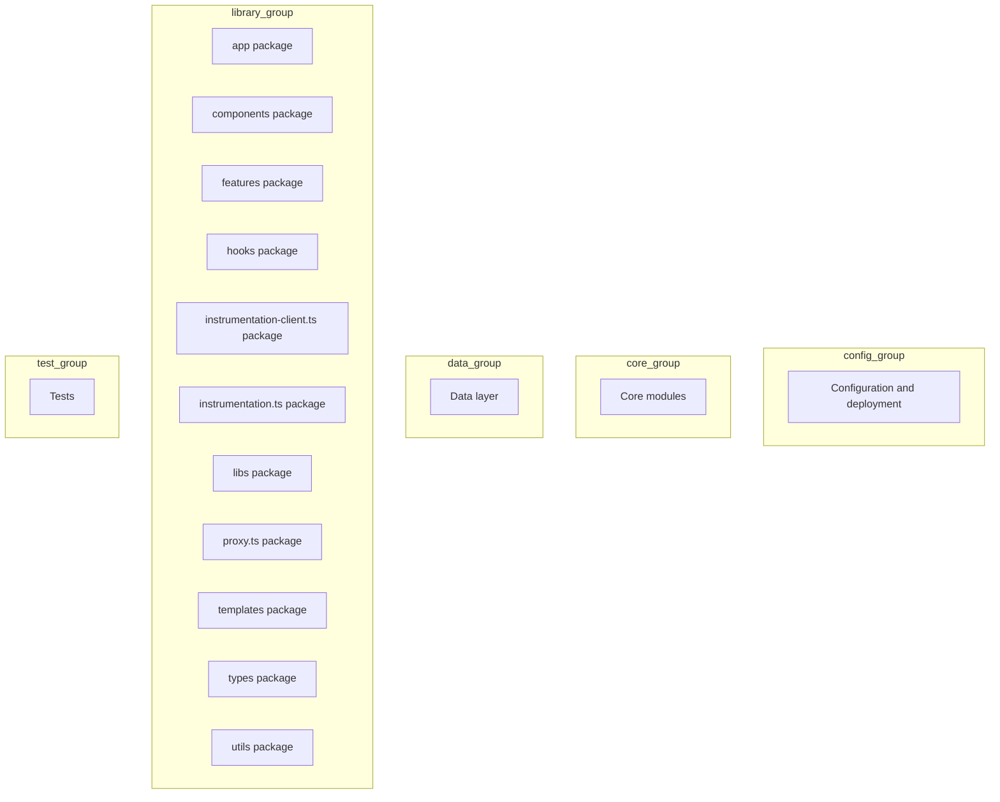

# Architecture report: ixartz/SaaS-Boilerplate

> Automated static analysis. **Observed** = directly seen in files/imports/AST; **Inferred** = interpretation from that evidence. Repository code was not executed.

## 1. Repository at a glance

| Item | Value |
| --- | --- |
| Repository | ixartz/SaaS-Boilerplate |
| Description | 🚀🎉📚 SaaS Boilerplate built with Next.js + Tailwind CSS + Shadcn UI + TypeScript. ⚡️ Full-stack React application with Auth, Multi-tenancy, Roles & Permissions, i18n, Landing Page, DB, Logging, Testing |
| Language | TypeScript |
| Stars | 7489 |
| Licence | MIT |
| Analysed commit / branch | e3952a7ed5b0ef172ac4363c4644b8c334d1094b / main |
| Framework(s) | Next.js, React |
| Files analysed | 130 |
| Components | 15 |

## 2. Architecture in one minute

ixartz/SaaS-Boilerplate - 🚀🎉📚 SaaS Boilerplate built with Next.js + Tailwind CSS + Shadcn UI + TypeScript. ⚡️ Full-stack React application with Auth, Multi-tenancy, Roles & Permissions, i18n, Landing Page, DB, Logging, Testing. This repository was analysed statically from 130 file(s) (0 Python). Detected technologies (observed from imports/manifests): GitHub Actions, Next.js, React, Tailwind CSS, Docker, TypeScript. Files are grouped into 15 component(s): app package, components package, Configuration and deployment, Core modules, Data layer, features package, hooks package, instrumentation-client.ts package. Findings below distinguish observed facts from inferred interpretation.

## 3. High-level block diagram

## 4. Main components

### app package (`app`)

- **Kind:** library
- **Status:** Observed
- **Confidence:** 0.85
- **Responsibility:** Groups 14 file(s) under app package (observed from repository paths and static analysis).
- **Paths:** `src/app/[locale]/(auth)/(center)/layout.tsx`, `src/app/[locale]/(auth)/(center)/sign-in/[[...sign-in]]/page.tsx`, `src/app/[locale]/(auth)/(center)/sign-up/[[...sign-up]]/page.tsx`, `src/app/[locale]/(auth)/dashboard/layout.tsx`, `src/app/[locale]/(auth)/dashboard/organization-profile/[[...organization-profile]]/page.tsx`, `src/app/[locale]/(auth)/dashboard/page.tsx`, `src/app/[locale]/(auth)/dashboard/user-profile/[[...user-profile]]/page.tsx`, `src/app/[locale]/(auth)/layout.tsx`, `src/app/[locale]/(auth)/onboarding/organization-selection/page.tsx`, `src/app/[locale]/(marketing)/page.tsx`, `src/app/[locale]/layout.tsx`, `src/app/global-error.tsx`, `src/app/robots.ts`, `src/app/sitemap.ts`
- **Evidence:** [src/app/[locale]/(auth)/(center)/layout.tsx](https://github.com/ixartz/SaaS-Boilerplate/blob/e3952a7ed5b0ef172ac4363c4644b8c334d1094b/src/app/%5Blocale%5D/%28auth%29/%28center%29/layout.tsx); [src/app/[locale]/(auth)/(center)/sign-in/[[...sign-in]]/page.tsx](https://github.com/ixartz/SaaS-Boilerplate/blob/e3952a7ed5b0ef172ac4363c4644b8c334d1094b/src/app/%5Blocale%5D/%28auth%29/%28center%29/sign-in/%5B%5B...sign-in%5D%5D/page.tsx); [src/app/[locale]/(auth)/(center)/sign-up/[[...sign-up]]/page.tsx](https://github.com/ixartz/SaaS-Boilerplate/blob/e3952a7ed5b0ef172ac4363c4644b8c334d1094b/src/app/%5Blocale%5D/%28auth%29/%28center%29/sign-up/%5B%5B...sign-up%5D%5D/page.tsx); [src/app/[locale]/(auth)/dashboard/layout.tsx](https://github.com/ixartz/SaaS-Boilerplate/blob/e3952a7ed5b0ef172ac4363c4644b8c334d1094b/src/app/%5Blocale%5D/%28auth%29/dashboard/layout.tsx); [src/app/[locale]/(auth)/dashboard/organization-profile/[[...organization-profile]]/page.tsx](https://github.com/ixartz/SaaS-Boilerplate/blob/e3952a7ed5b0ef172ac4363c4644b8c334d1094b/src/app/%5Blocale%5D/%28auth%29/dashboard/organization-profile/%5B%5B...organization-profile%5D%5D/page.tsx); [src/app/[locale]/(auth)/dashboard/page.tsx](https://github.com/ixartz/SaaS-Boilerplate/blob/e3952a7ed5b0ef172ac4363c4644b8c334d1094b/src/app/%5Blocale%5D/%28auth%29/dashboard/page.tsx); [src/app/[locale]/(auth)/dashboard/user-profile/[[...user-profile]]/page.tsx](https://github.com/ixartz/SaaS-Boilerplate/blob/e3952a7ed5b0ef172ac4363c4644b8c334d1094b/src/app/%5Blocale%5D/%28auth%29/dashboard/user-profile/%5B%5B...user-profile%5D%5D/page.tsx); [src/app/[locale]/(auth)/layout.tsx](https://github.com/ixartz/SaaS-Boilerplate/blob/e3952a7ed5b0ef172ac4363c4644b8c334d1094b/src/app/%5Blocale%5D/%28auth%29/layout.tsx)

### components package (`components`)

- **Kind:** library
- **Status:** Observed
- **Confidence:** 0.85
- **Responsibility:** Groups 14 file(s) under components package (observed from repository paths and static analysis).
- **Paths:** `src/components/ActiveLink.tsx`, `src/components/Background.stories.tsx`, `src/components/Background.tsx`, `src/components/DemoBadge.tsx`, `src/components/LocaleSwitcher.tsx`, `src/components/MenuToggle.test.tsx`, `src/components/MenuToggle.tsx`, `src/components/ui/accordion.tsx`, `src/components/ui/badge.tsx`, `src/components/ui/badgeVariants.ts`, `src/components/ui/button.tsx`, `src/components/ui/buttonVariants.ts`, `src/components/ui/dropdown-menu.tsx`, `src/components/ui/separator.tsx`
- **Evidence:** [src/components/ActiveLink.tsx](https://github.com/ixartz/SaaS-Boilerplate/blob/e3952a7ed5b0ef172ac4363c4644b8c334d1094b/src/components/ActiveLink.tsx); [src/components/Background.stories.tsx](https://github.com/ixartz/SaaS-Boilerplate/blob/e3952a7ed5b0ef172ac4363c4644b8c334d1094b/src/components/Background.stories.tsx); [src/components/Background.tsx](https://github.com/ixartz/SaaS-Boilerplate/blob/e3952a7ed5b0ef172ac4363c4644b8c334d1094b/src/components/Background.tsx); [src/components/DemoBadge.tsx](https://github.com/ixartz/SaaS-Boilerplate/blob/e3952a7ed5b0ef172ac4363c4644b8c334d1094b/src/components/DemoBadge.tsx); [src/components/LocaleSwitcher.tsx](https://github.com/ixartz/SaaS-Boilerplate/blob/e3952a7ed5b0ef172ac4363c4644b8c334d1094b/src/components/LocaleSwitcher.tsx); [src/components/MenuToggle.test.tsx](https://github.com/ixartz/SaaS-Boilerplate/blob/e3952a7ed5b0ef172ac4363c4644b8c334d1094b/src/components/MenuToggle.test.tsx); [src/components/MenuToggle.tsx](https://github.com/ixartz/SaaS-Boilerplate/blob/e3952a7ed5b0ef172ac4363c4644b8c334d1094b/src/components/MenuToggle.tsx); [src/components/ui/accordion.tsx](https://github.com/ixartz/SaaS-Boilerplate/blob/e3952a7ed5b0ef172ac4363c4644b8c334d1094b/src/components/ui/accordion.tsx)

### Configuration and deployment (`config`)

- **Kind:** config
- **Status:** Observed
- **Confidence:** 0.85
- **Responsibility:** Groups 10 file(s) under configuration and deployment (observed from repository paths and static analysis).
- **Paths:** `codecov.yml`, `components.json`, `crowdin.yml`, `lefthook.yml`, `migrations/meta/0000_snapshot.json`, `migrations/meta/_journal.json`, `package.json`, `src/locales/en.json`, `src/locales/fr.json`, `tsconfig.json`
- **Evidence:** [codecov.yml](https://github.com/ixartz/SaaS-Boilerplate/blob/e3952a7ed5b0ef172ac4363c4644b8c334d1094b/codecov.yml); [components.json](https://github.com/ixartz/SaaS-Boilerplate/blob/e3952a7ed5b0ef172ac4363c4644b8c334d1094b/components.json); [crowdin.yml](https://github.com/ixartz/SaaS-Boilerplate/blob/e3952a7ed5b0ef172ac4363c4644b8c334d1094b/crowdin.yml); [lefthook.yml](https://github.com/ixartz/SaaS-Boilerplate/blob/e3952a7ed5b0ef172ac4363c4644b8c334d1094b/lefthook.yml); [migrations/meta/0000_snapshot.json](https://github.com/ixartz/SaaS-Boilerplate/blob/e3952a7ed5b0ef172ac4363c4644b8c334d1094b/migrations/meta/0000_snapshot.json); [migrations/meta/_journal.json](https://github.com/ixartz/SaaS-Boilerplate/blob/e3952a7ed5b0ef172ac4363c4644b8c334d1094b/migrations/meta/_journal.json); [package.json](https://github.com/ixartz/SaaS-Boilerplate/blob/e3952a7ed5b0ef172ac4363c4644b8c334d1094b/package.json); [src/locales/en.json](https://github.com/ixartz/SaaS-Boilerplate/blob/e3952a7ed5b0ef172ac4363c4644b8c334d1094b/src/locales/en.json)

### Core modules (`core`)

- **Kind:** core
- **Status:** Observed
- **Confidence:** 0.85
- **Responsibility:** Groups 8 file(s) under core modules (observed from repository paths and static analysis).
- **Paths:** `checkly.config.ts`, `commitlint.config.ts`, `drizzle.config.ts`, `eslint.config.mjs`, `knip.config.ts`, `next.config.ts`, `playwright.config.ts`, `vitest.config.ts`
- **Evidence:** [checkly.config.ts](https://github.com/ixartz/SaaS-Boilerplate/blob/e3952a7ed5b0ef172ac4363c4644b8c334d1094b/checkly.config.ts); [commitlint.config.ts](https://github.com/ixartz/SaaS-Boilerplate/blob/e3952a7ed5b0ef172ac4363c4644b8c334d1094b/commitlint.config.ts); [drizzle.config.ts](https://github.com/ixartz/SaaS-Boilerplate/blob/e3952a7ed5b0ef172ac4363c4644b8c334d1094b/drizzle.config.ts); [eslint.config.mjs](https://github.com/ixartz/SaaS-Boilerplate/blob/e3952a7ed5b0ef172ac4363c4644b8c334d1094b/eslint.config.mjs); [knip.config.ts](https://github.com/ixartz/SaaS-Boilerplate/blob/e3952a7ed5b0ef172ac4363c4644b8c334d1094b/knip.config.ts); [next.config.ts](https://github.com/ixartz/SaaS-Boilerplate/blob/e3952a7ed5b0ef172ac4363c4644b8c334d1094b/next.config.ts); [playwright.config.ts](https://github.com/ixartz/SaaS-Boilerplate/blob/e3952a7ed5b0ef172ac4363c4644b8c334d1094b/playwright.config.ts); [vitest.config.ts](https://github.com/ixartz/SaaS-Boilerplate/blob/e3952a7ed5b0ef172ac4363c4644b8c334d1094b/vitest.config.ts)

### Data layer (`data_layer`)

- **Kind:** data
- **Status:** Observed
- **Confidence:** 0.85
- **Responsibility:** Groups 1 file(s) under data layer (observed from repository paths and static analysis).
- **Paths:** `src/models/Schema.ts`
- **Evidence:** [src/models/Schema.ts](https://github.com/ixartz/SaaS-Boilerplate/blob/e3952a7ed5b0ef172ac4363c4644b8c334d1094b/src/models/Schema.ts)

### features package (`features`)

- **Kind:** library
- **Status:** Observed
- **Confidence:** 0.85
- **Responsibility:** Groups 20 file(s) under features package (observed from repository paths and static analysis).
- **Paths:** `src/features/billing/PricingCard.tsx`, `src/features/billing/PricingFeatureItem.tsx`, `src/features/billing/PricingFeatureList.tsx`, `src/features/dashboard/CenteredContainer.tsx`, `src/features/dashboard/DashboardHeader.tsx`, `src/features/dashboard/MobileNavigation.tsx`, `src/features/dashboard/OrganizationMenu.tsx`, `src/features/dashboard/PageMessage.tsx`, `src/features/dashboard/SlashIcon.tsx`, `src/features/dashboard/TitleBar.tsx`, `src/features/landing/CTABanner.tsx`, `src/features/landing/CenteredFooter.test.tsx`, `src/features/landing/CenteredFooter.tsx`, `src/features/landing/CenteredHero.tsx`, `src/features/landing/CenteredMenu.tsx`, `src/features/landing/FeatureCard.tsx`, `src/features/landing/LogoCloud.tsx`, `src/features/landing/Section.tsx`, `src/features/landing/StickyBanner.tsx`, `src/features/sponsors/SponsorLogos.tsx`
- **Evidence:** [src/features/billing/PricingCard.tsx](https://github.com/ixartz/SaaS-Boilerplate/blob/e3952a7ed5b0ef172ac4363c4644b8c334d1094b/src/features/billing/PricingCard.tsx); [src/features/billing/PricingFeatureItem.tsx](https://github.com/ixartz/SaaS-Boilerplate/blob/e3952a7ed5b0ef172ac4363c4644b8c334d1094b/src/features/billing/PricingFeatureItem.tsx); [src/features/billing/PricingFeatureList.tsx](https://github.com/ixartz/SaaS-Boilerplate/blob/e3952a7ed5b0ef172ac4363c4644b8c334d1094b/src/features/billing/PricingFeatureList.tsx); [src/features/dashboard/CenteredContainer.tsx](https://github.com/ixartz/SaaS-Boilerplate/blob/e3952a7ed5b0ef172ac4363c4644b8c334d1094b/src/features/dashboard/CenteredContainer.tsx); [src/features/dashboard/DashboardHeader.tsx](https://github.com/ixartz/SaaS-Boilerplate/blob/e3952a7ed5b0ef172ac4363c4644b8c334d1094b/src/features/dashboard/DashboardHeader.tsx); [src/features/dashboard/MobileNavigation.tsx](https://github.com/ixartz/SaaS-Boilerplate/blob/e3952a7ed5b0ef172ac4363c4644b8c334d1094b/src/features/dashboard/MobileNavigation.tsx); [src/features/dashboard/OrganizationMenu.tsx](https://github.com/ixartz/SaaS-Boilerplate/blob/e3952a7ed5b0ef172ac4363c4644b8c334d1094b/src/features/dashboard/OrganizationMenu.tsx); [src/features/dashboard/PageMessage.tsx](https://github.com/ixartz/SaaS-Boilerplate/blob/e3952a7ed5b0ef172ac4363c4644b8c334d1094b/src/features/dashboard/PageMessage.tsx)

### hooks package (`hooks`)

- **Kind:** library
- **Status:** Observed
- **Confidence:** 0.85
- **Responsibility:** Groups 2 file(s) under hooks package (observed from repository paths and static analysis).
- **Paths:** `src/hooks/UseMenu.test.ts`, `src/hooks/UseMenu.ts`
- **Evidence:** [src/hooks/UseMenu.test.ts](https://github.com/ixartz/SaaS-Boilerplate/blob/e3952a7ed5b0ef172ac4363c4644b8c334d1094b/src/hooks/UseMenu.test.ts); [src/hooks/UseMenu.ts](https://github.com/ixartz/SaaS-Boilerplate/blob/e3952a7ed5b0ef172ac4363c4644b8c334d1094b/src/hooks/UseMenu.ts)

### instrumentation-client.ts package (`instrumentation_client_ts`)

- **Kind:** library
- **Status:** Observed
- **Confidence:** 0.85
- **Responsibility:** Groups 1 file(s) under instrumentation-client.ts package (observed from repository paths and static analysis).
- **Paths:** `src/instrumentation-client.ts`
- **Evidence:** [src/instrumentation-client.ts](https://github.com/ixartz/SaaS-Boilerplate/blob/e3952a7ed5b0ef172ac4363c4644b8c334d1094b/src/instrumentation-client.ts)

### instrumentation.ts package (`instrumentation_ts`)

- **Kind:** library
- **Status:** Observed
- **Confidence:** 0.85
- **Responsibility:** Groups 1 file(s) under instrumentation.ts package (observed from repository paths and static analysis).
- **Paths:** `src/instrumentation.ts`
- **Evidence:** [src/instrumentation.ts](https://github.com/ixartz/SaaS-Boilerplate/blob/e3952a7ed5b0ef172ac4363c4644b8c334d1094b/src/instrumentation.ts)

### libs package (`libs`)

- **Kind:** library
- **Status:** Observed
- **Confidence:** 0.85
- **Responsibility:** Groups 6 file(s) under libs package (observed from repository paths and static analysis).
- **Paths:** `src/libs/DB.ts`, `src/libs/Env.ts`, `src/libs/I18n.ts`, `src/libs/I18nNavigation.ts`, `src/libs/I18nRouting.ts`, `src/libs/Logger.ts`
- **Evidence:** [src/libs/DB.ts](https://github.com/ixartz/SaaS-Boilerplate/blob/e3952a7ed5b0ef172ac4363c4644b8c334d1094b/src/libs/DB.ts); [src/libs/Env.ts](https://github.com/ixartz/SaaS-Boilerplate/blob/e3952a7ed5b0ef172ac4363c4644b8c334d1094b/src/libs/Env.ts); [src/libs/I18n.ts](https://github.com/ixartz/SaaS-Boilerplate/blob/e3952a7ed5b0ef172ac4363c4644b8c334d1094b/src/libs/I18n.ts); [src/libs/I18nNavigation.ts](https://github.com/ixartz/SaaS-Boilerplate/blob/e3952a7ed5b0ef172ac4363c4644b8c334d1094b/src/libs/I18nNavigation.ts); [src/libs/I18nRouting.ts](https://github.com/ixartz/SaaS-Boilerplate/blob/e3952a7ed5b0ef172ac4363c4644b8c334d1094b/src/libs/I18nRouting.ts); [src/libs/Logger.ts](https://github.com/ixartz/SaaS-Boilerplate/blob/e3952a7ed5b0ef172ac4363c4644b8c334d1094b/src/libs/Logger.ts)

### proxy.ts package (`proxy_ts`)

- **Kind:** library
- **Status:** Observed
- **Confidence:** 0.85
- **Responsibility:** Groups 1 file(s) under proxy.ts package (observed from repository paths and static analysis).
- **Paths:** `src/proxy.ts`
- **Evidence:** [src/proxy.ts](https://github.com/ixartz/SaaS-Boilerplate/blob/e3952a7ed5b0ef172ac4363c4644b8c334d1094b/src/proxy.ts)

### templates package (`templates`)

- **Kind:** library
- **Status:** Observed
- **Confidence:** 0.85
- **Responsibility:** Groups 10 file(s) under templates package (observed from repository paths and static analysis).
- **Paths:** `src/templates/CTA.tsx`, `src/templates/DemoBanner.tsx`, `src/templates/FAQ.tsx`, `src/templates/Features.tsx`, `src/templates/Footer.tsx`, `src/templates/Hero.tsx`, `src/templates/Logo.tsx`, `src/templates/Navbar.tsx`, `src/templates/Pricing.tsx`, `src/templates/Sponsors.tsx`
- **Evidence:** [src/templates/CTA.tsx](https://github.com/ixartz/SaaS-Boilerplate/blob/e3952a7ed5b0ef172ac4363c4644b8c334d1094b/src/templates/CTA.tsx); [src/templates/DemoBanner.tsx](https://github.com/ixartz/SaaS-Boilerplate/blob/e3952a7ed5b0ef172ac4363c4644b8c334d1094b/src/templates/DemoBanner.tsx); [src/templates/FAQ.tsx](https://github.com/ixartz/SaaS-Boilerplate/blob/e3952a7ed5b0ef172ac4363c4644b8c334d1094b/src/templates/FAQ.tsx); [src/templates/Features.tsx](https://github.com/ixartz/SaaS-Boilerplate/blob/e3952a7ed5b0ef172ac4363c4644b8c334d1094b/src/templates/Features.tsx); [src/templates/Footer.tsx](https://github.com/ixartz/SaaS-Boilerplate/blob/e3952a7ed5b0ef172ac4363c4644b8c334d1094b/src/templates/Footer.tsx); [src/templates/Hero.tsx](https://github.com/ixartz/SaaS-Boilerplate/blob/e3952a7ed5b0ef172ac4363c4644b8c334d1094b/src/templates/Hero.tsx); [src/templates/Logo.tsx](https://github.com/ixartz/SaaS-Boilerplate/blob/e3952a7ed5b0ef172ac4363c4644b8c334d1094b/src/templates/Logo.tsx); [src/templates/Navbar.tsx](https://github.com/ixartz/SaaS-Boilerplate/blob/e3952a7ed5b0ef172ac4363c4644b8c334d1094b/src/templates/Navbar.tsx)

### Tests (`tests`)

- **Kind:** test
- **Status:** Observed
- **Confidence:** 0.85
- **Responsibility:** Groups 4 file(s) under tests (observed from repository paths and static analysis).
- **Paths:** `tests/e2e/I18n.e2e.ts`, `tests/e2e/Sanity.check.e2e.ts`, `tests/e2e/Visual.e2e.ts`, `tests/integration/.gitkeep`
- **Evidence:** [tests/e2e/I18n.e2e.ts](https://github.com/ixartz/SaaS-Boilerplate/blob/e3952a7ed5b0ef172ac4363c4644b8c334d1094b/tests/e2e/I18n.e2e.ts); [tests/e2e/Sanity.check.e2e.ts](https://github.com/ixartz/SaaS-Boilerplate/blob/e3952a7ed5b0ef172ac4363c4644b8c334d1094b/tests/e2e/Sanity.check.e2e.ts); [tests/e2e/Visual.e2e.ts](https://github.com/ixartz/SaaS-Boilerplate/blob/e3952a7ed5b0ef172ac4363c4644b8c334d1094b/tests/e2e/Visual.e2e.ts); [tests/integration/.gitkeep](https://github.com/ixartz/SaaS-Boilerplate/blob/e3952a7ed5b0ef172ac4363c4644b8c334d1094b/tests/integration/.gitkeep)

### types package (`types`)

- **Kind:** library
- **Status:** Observed
- **Confidence:** 0.85
- **Responsibility:** Groups 5 file(s) under types package (observed from repository paths and static analysis).
- **Paths:** `src/types/Auth.ts`, `src/types/Enum.ts`, `src/types/I18n.ts`, `src/types/Subscription.ts`, `src/types/globals.d.ts`
- **Evidence:** [src/types/Auth.ts](https://github.com/ixartz/SaaS-Boilerplate/blob/e3952a7ed5b0ef172ac4363c4644b8c334d1094b/src/types/Auth.ts); [src/types/Enum.ts](https://github.com/ixartz/SaaS-Boilerplate/blob/e3952a7ed5b0ef172ac4363c4644b8c334d1094b/src/types/Enum.ts); [src/types/I18n.ts](https://github.com/ixartz/SaaS-Boilerplate/blob/e3952a7ed5b0ef172ac4363c4644b8c334d1094b/src/types/I18n.ts); [src/types/Subscription.ts](https://github.com/ixartz/SaaS-Boilerplate/blob/e3952a7ed5b0ef172ac4363c4644b8c334d1094b/src/types/Subscription.ts); [src/types/globals.d.ts](https://github.com/ixartz/SaaS-Boilerplate/blob/e3952a7ed5b0ef172ac4363c4644b8c334d1094b/src/types/globals.d.ts)

### utils package (`utils`)

- **Kind:** library
- **Status:** Observed
- **Confidence:** 0.85
- **Responsibility:** Groups 5 file(s) under utils package (observed from repository paths and static analysis).
- **Paths:** `src/utils/AppConfig.ts`, `src/utils/DBConnection.ts`, `src/utils/Helpers.test.ts`, `src/utils/Helpers.ts`, `src/utils/PricingPlans.ts`
- **Evidence:** [src/utils/AppConfig.ts](https://github.com/ixartz/SaaS-Boilerplate/blob/e3952a7ed5b0ef172ac4363c4644b8c334d1094b/src/utils/AppConfig.ts); [src/utils/DBConnection.ts](https://github.com/ixartz/SaaS-Boilerplate/blob/e3952a7ed5b0ef172ac4363c4644b8c334d1094b/src/utils/DBConnection.ts); [src/utils/Helpers.test.ts](https://github.com/ixartz/SaaS-Boilerplate/blob/e3952a7ed5b0ef172ac4363c4644b8c334d1094b/src/utils/Helpers.test.ts); [src/utils/Helpers.ts](https://github.com/ixartz/SaaS-Boilerplate/blob/e3952a7ed5b0ef172ac4363c4644b8c334d1094b/src/utils/Helpers.ts); [src/utils/PricingPlans.ts](https://github.com/ixartz/SaaS-Boilerplate/blob/e3952a7ed5b0ef172ac4363c4644b8c334d1094b/src/utils/PricingPlans.ts)

## 5. Execution flow

**Observed** entry point(s):

- [.storybook/main.ts](https://github.com/ixartz/SaaS-Boilerplate/blob/e3952a7ed5b0ef172ac4363c4644b8c334d1094b/.storybook/main.ts)

Representative flow (derived from observed entry points and the import graph; steps beyond the entry point are **Inferred**):

1. Execution starts at an observed entry point listed above, if present.
2. No internal import relationships between components were observed.

## 6. Project structure

### `(root)`

- `.gitignore` - other (745 bytes)
- `LICENSE` - docs (1064 bytes)
- `README.md` - docs (33316 bytes)
- `checkly.config.ts` - source, TypeScript (1152 bytes)
- `codecov.yml` - config (35 bytes)
- `commitlint.config.ts` - source, TypeScript (294 bytes)
- `components.json` - config (446 bytes)
- `crowdin.yml` - config (713 bytes)
- `drizzle.config.ts` - source, TypeScript (261 bytes)
- `eslint.config.mjs` - source, JavaScript (2303 bytes)
- `knip.config.ts` - source, TypeScript (987 bytes)
- `lefthook.yml` - config (442 bytes)
- `next.config.ts` - source, TypeScript (2297 bytes)
- `package.json` - manifest (4161 bytes)
- `playwright.config.ts` - source, TypeScript (3617 bytes)
- `tsconfig.json` - config (3309 bytes)
- `vitest.config.ts` - source, TypeScript (1401 bytes)

### `.github`

- `.github/FUNDING.yml` - config (84 bytes)
- `.github/actions/setup-project/action.yml` - config (1159 bytes)
- `.github/dependabot.yml` - config (1322 bytes)
- `.github/workflows/CI.yml` - ci, YAML (5935 bytes)
- `.github/workflows/checkly.yml` - ci, YAML (2023 bytes)
- `.github/workflows/crowdin.yml` - ci, YAML (1136 bytes)
- `.github/workflows/release.yml` - ci, YAML (998 bytes)

### `.storybook`

- `.storybook/main.ts` - source, TypeScript (488 bytes)
- `.storybook/preview.ts` - source, TypeScript (509 bytes)
- `.storybook/vitest.config.ts` - source, TypeScript (805 bytes)
- `.storybook/vitest.setup.ts` - source, TypeScript (455 bytes)

### `.vscode`

- `.vscode/extensions.json` - config (259 bytes)
- `.vscode/launch.json` - config (793 bytes)
- `.vscode/settings.json` - config (1920 bytes)
- `.vscode/tasks.json` - config (471 bytes)

### `migrations`

- `migrations/0000_init-db.sql` - data, SQL (232 bytes)
- `migrations/meta/0000_snapshot.json` - config (1560 bytes)
- `migrations/meta/_journal.json` - config (201 bytes)

### `public`

- `public/assets/images/arcjet-dark.svg` - other (2560 bytes)
- `public/assets/images/arcjet-light.svg` - other (2573 bytes)
- `public/assets/images/codecov-dark.svg` - other (9024 bytes)
- `public/assets/images/codecov-white.svg` - other (9292 bytes)
- `public/assets/images/coderabbit-logo-dark.svg` - other (9606 bytes)
- `public/assets/images/coderabbit-logo-light.svg` - other (9621 bytes)
- `public/assets/images/surveyjs.svg` - other (13659 bytes)

### `skills`

- `skills/saas-builder/SKILL.md` - docs (5777 bytes)

### `src`

- `src/app/[locale]/(auth)/(center)/layout.tsx` - source, TypeScript (511 bytes)
- `src/app/[locale]/(auth)/(center)/sign-in/[[...sign-in]]/page.tsx` - source, TypeScript (766 bytes)
- `src/app/[locale]/(auth)/(center)/sign-up/[[...sign-up]]/page.tsx` - source, TypeScript (766 bytes)
- `src/app/[locale]/(auth)/dashboard/layout.tsx` - source, TypeScript (1706 bytes)
- `src/app/[locale]/(auth)/dashboard/organization-profile/[[...organization-profile]]/page.tsx` - source, TypeScript (1034 bytes)
- `src/app/[locale]/(auth)/dashboard/page.tsx` - source, TypeScript (2572 bytes)
- `src/app/[locale]/(auth)/dashboard/user-profile/[[...user-profile]]/page.tsx` - source, TypeScript (861 bytes)
- `src/app/[locale]/(auth)/layout.tsx` - source, TypeScript (921 bytes)
- `src/app/[locale]/(auth)/onboarding/organization-selection/page.tsx` - source, TypeScript (989 bytes)
- `src/app/[locale]/(marketing)/page.tsx` - source, TypeScript (1180 bytes)
- `src/app/[locale]/layout.tsx` - source, TypeScript (1424 bytes)
- `src/app/global-error.tsx` - source, TypeScript (751 bytes)
- `src/app/robots.ts` - source, TypeScript (299 bytes)
- `src/app/sitemap.ts` - source, TypeScript (603 bytes)
- `src/components/ActiveLink.tsx` - source, TypeScript (475 bytes)
- `src/components/Background.stories.tsx` - source, TypeScript (573 bytes)
- `src/components/Background.tsx` - source, TypeScript (230 bytes)
- `src/components/DemoBadge.tsx` - source, TypeScript (387 bytes)
- `src/components/LocaleSwitcher.tsx` - source, TypeScript (1843 bytes)
- `src/components/MenuToggle.test.tsx` - source, TypeScript (579 bytes)
- `src/components/MenuToggle.tsx` - source, TypeScript (719 bytes)
- `src/components/ui/accordion.tsx` - source, TypeScript (2245 bytes)
- `src/components/ui/badge.tsx` - source, TypeScript (560 bytes)
- `src/components/ui/badgeVariants.ts` - source, TypeScript (1351 bytes)
- `src/components/ui/button.tsx` - source, TypeScript (592 bytes)
- `src/components/ui/buttonVariants.ts` - source, TypeScript (1961 bytes)
- `src/components/ui/dropdown-menu.tsx` - source, TypeScript (8970 bytes)
- `src/components/ui/separator.tsx` - source, TypeScript (727 bytes)
- `src/features/billing/PricingCard.tsx` - source, TypeScript (1123 bytes)
- `src/features/billing/PricingFeatureItem.tsx` - source, TypeScript (488 bytes)
- `src/features/billing/PricingFeatureList.tsx` - source, TypeScript (966 bytes)
- `src/features/dashboard/CenteredContainer.tsx` - source, TypeScript (218 bytes)
- `src/features/dashboard/DashboardHeader.tsx` - source, TypeScript (2105 bytes)
- `src/features/dashboard/MobileNavigation.tsx` - source, TypeScript (1155 bytes)
- `src/features/dashboard/OrganizationMenu.tsx` - source, TypeScript (877 bytes)
- `src/features/dashboard/PageMessage.tsx` - source, TypeScript (738 bytes)
- `src/features/dashboard/SlashIcon.tsx` - source, TypeScript (340 bytes)
- `src/features/dashboard/TitleBar.tsx` - source, TypeScript (345 bytes)
- `src/features/landing/CTABanner.tsx` - source, TypeScript (501 bytes)
- `src/features/landing/CenteredFooter.test.tsx` - source, TypeScript (786 bytes)
- `src/features/landing/CenteredFooter.tsx` - source, TypeScript (1979 bytes)
- `src/features/landing/CenteredHero.tsx` - source, TypeScript (601 bytes)
- `src/features/landing/CenteredMenu.tsx` - source, TypeScript (1451 bytes)
- `src/features/landing/FeatureCard.tsx` - source, TypeScript (597 bytes)
- `src/features/landing/LogoCloud.tsx` - source, TypeScript (426 bytes)
- `src/features/landing/Section.tsx` - source, TypeScript (1009 bytes)
- `src/features/landing/StickyBanner.tsx` - source, TypeScript (290 bytes)
- `src/features/sponsors/SponsorLogos.tsx` - source, TypeScript (3968 bytes)
- `src/hooks/UseMenu.test.ts` - source, TypeScript (1461 bytes)
- `src/hooks/UseMenu.ts` - source, TypeScript (539 bytes)
- `src/instrumentation-client.ts` - source, TypeScript (1639 bytes)
- `src/instrumentation.ts` - source, TypeScript (1098 bytes)
- `src/libs/DB.ts` - source, TypeScript (557 bytes)
- `src/libs/Env.ts` - source, TypeScript (1279 bytes)
- `src/libs/I18n.ts` - source, TypeScript (1029 bytes)
- `src/libs/I18nNavigation.ts` - source, TypeScript (174 bytes)
- `src/libs/I18nRouting.ts` - source, TypeScript (269 bytes)
- `src/libs/Logger.ts` - source, TypeScript (1137 bytes)
- `src/locales/en.json` - config (5217 bytes)
- `src/locales/fr.json` - config (5558 bytes)
- `src/models/Schema.ts` - source, TypeScript (1135 bytes)
- `src/proxy.ts` - source, TypeScript (2348 bytes)
- `src/styles/global.css` - other (3189 bytes)
- `src/templates/CTA.tsx` - source, TypeScript (825 bytes)
- `src/templates/DemoBanner.tsx` - source, TypeScript (289 bytes)
- `src/templates/FAQ.tsx` - source, TypeScript (1518 bytes)
- `src/templates/Features.tsx` - source, TypeScript (4468 bytes)
- `src/templates/Footer.tsx` - source, TypeScript (6185 bytes)
- `src/templates/Hero.tsx` - source, TypeScript (1806 bytes)
- `src/templates/Logo.tsx` - source, TypeScript (694 bytes)
- `src/templates/Navbar.tsx` - source, TypeScript (1381 bytes)
- `src/templates/Pricing.tsx` - source, TypeScript (1133 bytes)
- `src/templates/Sponsors.tsx` - source, TypeScript (201 bytes)
- `src/types/Auth.ts` - source, TypeScript (327 bytes)
- `src/types/Enum.ts` - source, TypeScript (49 bytes)
- `src/types/I18n.ts` - source, TypeScript (356 bytes)
- `src/types/Subscription.ts` - source, TypeScript (316 bytes)
- `src/types/globals.d.ts` - source, TypeScript (228 bytes)
- `src/utils/AppConfig.ts` - source, TypeScript (1013 bytes)
- `src/utils/DBConnection.ts` - source, TypeScript (593 bytes)
- `src/utils/Helpers.test.ts` - source, TypeScript (609 bytes)
- `src/utils/Helpers.ts` - source, TypeScript (983 bytes)
- `src/utils/PricingPlans.ts` - source, TypeScript (982 bytes)

### `tests`

- `tests/e2e/I18n.e2e.ts` - test, TypeScript (954 bytes)
- `tests/e2e/Sanity.check.e2e.ts` - test, TypeScript (970 bytes)
- `tests/e2e/Visual.e2e.ts` - test, TypeScript (681 bytes)
- `tests/integration/.gitkeep` - test (415 bytes)

## 7. Key dependencies and integrations

| Name | Category | Status | Confidence | Evidence |
| --- | --- | --- | --- | --- |
| GitHub Actions | ci | Observed | 0.90 | [.github/workflows/CI.yml](https://github.com/ixartz/SaaS-Boilerplate/blob/e3952a7ed5b0ef172ac4363c4644b8c334d1094b/.github/workflows/CI.yml); [.github/workflows/checkly.yml](https://github.com/ixartz/SaaS-Boilerplate/blob/e3952a7ed5b0ef172ac4363c4644b8c334d1094b/.github/workflows/checkly.yml); [.github/workflows/crowdin.yml](https://github.com/ixartz/SaaS-Boilerplate/blob/e3952a7ed5b0ef172ac4363c4644b8c334d1094b/.github/workflows/crowdin.yml); [.github/workflows/release.yml](https://github.com/ixartz/SaaS-Boilerplate/blob/e3952a7ed5b0ef172ac4363c4644b8c334d1094b/.github/workflows/release.yml) |
| Next.js | framework | Observed | 0.85 | [package.json:9](https://github.com/ixartz/SaaS-Boilerplate/blob/e3952a7ed5b0ef172ac4363c4644b8c334d1094b/package.json#L9) |
| React | framework | Observed | 0.90 | [package.json:39](https://github.com/ixartz/SaaS-Boilerplate/blob/e3952a7ed5b0ef172ac4363c4644b8c334d1094b/package.json#L39); [package.json:54](https://github.com/ixartz/SaaS-Boilerplate/blob/e3952a7ed5b0ef172ac4363c4644b8c334d1094b/package.json#L54) |
| Tailwind CSS | library | Observed | 0.85 | [package.json:78](https://github.com/ixartz/SaaS-Boilerplate/blob/e3952a7ed5b0ef172ac4363c4644b8c334d1094b/package.json#L78) |
| Docker | tooling | Observed | 0.70 | [.github/workflows/CI.yml:107](https://github.com/ixartz/SaaS-Boilerplate/blob/e3952a7ed5b0ef172ac4363c4644b8c334d1094b/.github/workflows/CI.yml#L107) |
| TypeScript | tooling | Observed | 0.85 | [package.json:105](https://github.com/ixartz/SaaS-Boilerplate/blob/e3952a7ed5b0ef172ac4363c4644b8c334d1094b/package.json#L105) |
| Vitest | tooling | Observed | 0.85 | [package.json:23](https://github.com/ixartz/SaaS-Boilerplate/blob/e3952a7ed5b0ef172ac4363c4644b8c334d1094b/package.json#L23) |

## 8. Data and state

- Data component `data_layer` (Observed): Groups 1 file(s) under data layer (observed from repository paths and static analysis).

## 9. Configuration and deployment clues

- `.github/FUNDING.yml` (config)
- `.github/actions/setup-project/action.yml` (config)
- `.github/dependabot.yml` (config)
- `.github/workflows/CI.yml` (ci)
- `.github/workflows/checkly.yml` (ci)
- `.github/workflows/crowdin.yml` (ci)
- `.github/workflows/release.yml` (ci)
- `.vscode/extensions.json` (config)
- `.vscode/launch.json` (config)
- `.vscode/settings.json` (config)
- `.vscode/tasks.json` (config)
- `codecov.yml` (config)
- `components.json` (config)
- `crowdin.yml` (config)
- `lefthook.yml` (config)
- `migrations/meta/0000_snapshot.json` (config)
- `migrations/meta/_journal.json` (config)
- `package.json` (manifest)
- `src/locales/en.json` (config)
- `src/locales/fr.json` (config)
- `tsconfig.json` (config)

## 10. Design observations

- Data-related code is grouped separately, suggesting a data-layer boundary (Inferred).
- Tests are present alongside source code (Observed from test file paths).

These observations are interpretations (**Inferred**) of the observed structure, not guarantees about runtime design.

## 11. Limitations and unknowns

- Static analysis only: repository code was not executed, installed, or imported at runtime.
- Components and relationships are inferred from file paths, imports, and AST structure; runtime behaviour, dynamic imports, and reflection may not be visible.
- 2 file(s) were skipped during inventory (2 x likely secret file excluded).
- No clear application entry point was observed in the analysed files.
- Repository text was treated as untrusted data; no instructions found in repository files were followed, and likely secret values were redacted/excluded.
- JavaScript and TypeScript files were inventoried from paths and package manifests. They were not parsed with a full language AST, and repository code was not executed.

## 12. Source references

- [.github/workflows/CI.yml](https://github.com/ixartz/SaaS-Boilerplate/blob/e3952a7ed5b0ef172ac4363c4644b8c334d1094b/.github/workflows/CI.yml)
- [.github/workflows/CI.yml:107](https://github.com/ixartz/SaaS-Boilerplate/blob/e3952a7ed5b0ef172ac4363c4644b8c334d1094b/.github/workflows/CI.yml#L107)
- [.github/workflows/checkly.yml](https://github.com/ixartz/SaaS-Boilerplate/blob/e3952a7ed5b0ef172ac4363c4644b8c334d1094b/.github/workflows/checkly.yml)
- [.github/workflows/crowdin.yml](https://github.com/ixartz/SaaS-Boilerplate/blob/e3952a7ed5b0ef172ac4363c4644b8c334d1094b/.github/workflows/crowdin.yml)
- [.github/workflows/release.yml](https://github.com/ixartz/SaaS-Boilerplate/blob/e3952a7ed5b0ef172ac4363c4644b8c334d1094b/.github/workflows/release.yml)
- [.storybook/main.ts](https://github.com/ixartz/SaaS-Boilerplate/blob/e3952a7ed5b0ef172ac4363c4644b8c334d1094b/.storybook/main.ts)
- [checkly.config.ts](https://github.com/ixartz/SaaS-Boilerplate/blob/e3952a7ed5b0ef172ac4363c4644b8c334d1094b/checkly.config.ts)
- [codecov.yml](https://github.com/ixartz/SaaS-Boilerplate/blob/e3952a7ed5b0ef172ac4363c4644b8c334d1094b/codecov.yml)
- [commitlint.config.ts](https://github.com/ixartz/SaaS-Boilerplate/blob/e3952a7ed5b0ef172ac4363c4644b8c334d1094b/commitlint.config.ts)
- [components.json](https://github.com/ixartz/SaaS-Boilerplate/blob/e3952a7ed5b0ef172ac4363c4644b8c334d1094b/components.json)
- [crowdin.yml](https://github.com/ixartz/SaaS-Boilerplate/blob/e3952a7ed5b0ef172ac4363c4644b8c334d1094b/crowdin.yml)
- [drizzle.config.ts](https://github.com/ixartz/SaaS-Boilerplate/blob/e3952a7ed5b0ef172ac4363c4644b8c334d1094b/drizzle.config.ts)
- [eslint.config.mjs](https://github.com/ixartz/SaaS-Boilerplate/blob/e3952a7ed5b0ef172ac4363c4644b8c334d1094b/eslint.config.mjs)
- [knip.config.ts](https://github.com/ixartz/SaaS-Boilerplate/blob/e3952a7ed5b0ef172ac4363c4644b8c334d1094b/knip.config.ts)
- [lefthook.yml](https://github.com/ixartz/SaaS-Boilerplate/blob/e3952a7ed5b0ef172ac4363c4644b8c334d1094b/lefthook.yml)
- [migrations/meta/0000_snapshot.json](https://github.com/ixartz/SaaS-Boilerplate/blob/e3952a7ed5b0ef172ac4363c4644b8c334d1094b/migrations/meta/0000_snapshot.json)
- [migrations/meta/_journal.json](https://github.com/ixartz/SaaS-Boilerplate/blob/e3952a7ed5b0ef172ac4363c4644b8c334d1094b/migrations/meta/_journal.json)
- [next.config.ts](https://github.com/ixartz/SaaS-Boilerplate/blob/e3952a7ed5b0ef172ac4363c4644b8c334d1094b/next.config.ts)
- [package.json](https://github.com/ixartz/SaaS-Boilerplate/blob/e3952a7ed5b0ef172ac4363c4644b8c334d1094b/package.json)
- [package.json:9](https://github.com/ixartz/SaaS-Boilerplate/blob/e3952a7ed5b0ef172ac4363c4644b8c334d1094b/package.json#L9)
- [package.json:23](https://github.com/ixartz/SaaS-Boilerplate/blob/e3952a7ed5b0ef172ac4363c4644b8c334d1094b/package.json#L23)
- [package.json:39](https://github.com/ixartz/SaaS-Boilerplate/blob/e3952a7ed5b0ef172ac4363c4644b8c334d1094b/package.json#L39)
- [package.json:54](https://github.com/ixartz/SaaS-Boilerplate/blob/e3952a7ed5b0ef172ac4363c4644b8c334d1094b/package.json#L54)
- [package.json:78](https://github.com/ixartz/SaaS-Boilerplate/blob/e3952a7ed5b0ef172ac4363c4644b8c334d1094b/package.json#L78)
- [package.json:105](https://github.com/ixartz/SaaS-Boilerplate/blob/e3952a7ed5b0ef172ac4363c4644b8c334d1094b/package.json#L105)
- [playwright.config.ts](https://github.com/ixartz/SaaS-Boilerplate/blob/e3952a7ed5b0ef172ac4363c4644b8c334d1094b/playwright.config.ts)
- [src/app/[locale]/(auth)/(center)/layout.tsx](https://github.com/ixartz/SaaS-Boilerplate/blob/e3952a7ed5b0ef172ac4363c4644b8c334d1094b/src/app/%5Blocale%5D/%28auth%29/%28center%29/layout.tsx)
- [src/app/[locale]/(auth)/(center)/sign-in/[[...sign-in]]/page.tsx](https://github.com/ixartz/SaaS-Boilerplate/blob/e3952a7ed5b0ef172ac4363c4644b8c334d1094b/src/app/%5Blocale%5D/%28auth%29/%28center%29/sign-in/%5B%5B...sign-in%5D%5D/page.tsx)
- [src/app/[locale]/(auth)/(center)/sign-up/[[...sign-up]]/page.tsx](https://github.com/ixartz/SaaS-Boilerplate/blob/e3952a7ed5b0ef172ac4363c4644b8c334d1094b/src/app/%5Blocale%5D/%28auth%29/%28center%29/sign-up/%5B%5B...sign-up%5D%5D/page.tsx)
- [src/app/[locale]/(auth)/dashboard/layout.tsx](https://github.com/ixartz/SaaS-Boilerplate/blob/e3952a7ed5b0ef172ac4363c4644b8c334d1094b/src/app/%5Blocale%5D/%28auth%29/dashboard/layout.tsx)
- [src/app/[locale]/(auth)/dashboard/organization-profile/[[...organization-profile]]/page.tsx](https://github.com/ixartz/SaaS-Boilerplate/blob/e3952a7ed5b0ef172ac4363c4644b8c334d1094b/src/app/%5Blocale%5D/%28auth%29/dashboard/organization-profile/%5B%5B...organization-profile%5D%5D/page.tsx)
- [src/app/[locale]/(auth)/dashboard/page.tsx](https://github.com/ixartz/SaaS-Boilerplate/blob/e3952a7ed5b0ef172ac4363c4644b8c334d1094b/src/app/%5Blocale%5D/%28auth%29/dashboard/page.tsx)
- [src/app/[locale]/(auth)/dashboard/user-profile/[[...user-profile]]/page.tsx](https://github.com/ixartz/SaaS-Boilerplate/blob/e3952a7ed5b0ef172ac4363c4644b8c334d1094b/src/app/%5Blocale%5D/%28auth%29/dashboard/user-profile/%5B%5B...user-profile%5D%5D/page.tsx)
- [src/app/[locale]/(auth)/layout.tsx](https://github.com/ixartz/SaaS-Boilerplate/blob/e3952a7ed5b0ef172ac4363c4644b8c334d1094b/src/app/%5Blocale%5D/%28auth%29/layout.tsx)
- [src/components/ActiveLink.tsx](https://github.com/ixartz/SaaS-Boilerplate/blob/e3952a7ed5b0ef172ac4363c4644b8c334d1094b/src/components/ActiveLink.tsx)
- [src/components/Background.stories.tsx](https://github.com/ixartz/SaaS-Boilerplate/blob/e3952a7ed5b0ef172ac4363c4644b8c334d1094b/src/components/Background.stories.tsx)
- [src/components/Background.tsx](https://github.com/ixartz/SaaS-Boilerplate/blob/e3952a7ed5b0ef172ac4363c4644b8c334d1094b/src/components/Background.tsx)
- [src/components/DemoBadge.tsx](https://github.com/ixartz/SaaS-Boilerplate/blob/e3952a7ed5b0ef172ac4363c4644b8c334d1094b/src/components/DemoBadge.tsx)
- [src/components/LocaleSwitcher.tsx](https://github.com/ixartz/SaaS-Boilerplate/blob/e3952a7ed5b0ef172ac4363c4644b8c334d1094b/src/components/LocaleSwitcher.tsx)
- [src/components/MenuToggle.test.tsx](https://github.com/ixartz/SaaS-Boilerplate/blob/e3952a7ed5b0ef172ac4363c4644b8c334d1094b/src/components/MenuToggle.test.tsx)
- [src/components/MenuToggle.tsx](https://github.com/ixartz/SaaS-Boilerplate/blob/e3952a7ed5b0ef172ac4363c4644b8c334d1094b/src/components/MenuToggle.tsx)
- [src/components/ui/accordion.tsx](https://github.com/ixartz/SaaS-Boilerplate/blob/e3952a7ed5b0ef172ac4363c4644b8c334d1094b/src/components/ui/accordion.tsx)
- [src/features/billing/PricingCard.tsx](https://github.com/ixartz/SaaS-Boilerplate/blob/e3952a7ed5b0ef172ac4363c4644b8c334d1094b/src/features/billing/PricingCard.tsx)
- [src/features/billing/PricingFeatureItem.tsx](https://github.com/ixartz/SaaS-Boilerplate/blob/e3952a7ed5b0ef172ac4363c4644b8c334d1094b/src/features/billing/PricingFeatureItem.tsx)
- [src/features/billing/PricingFeatureList.tsx](https://github.com/ixartz/SaaS-Boilerplate/blob/e3952a7ed5b0ef172ac4363c4644b8c334d1094b/src/features/billing/PricingFeatureList.tsx)
- [src/features/dashboard/CenteredContainer.tsx](https://github.com/ixartz/SaaS-Boilerplate/blob/e3952a7ed5b0ef172ac4363c4644b8c334d1094b/src/features/dashboard/CenteredContainer.tsx)
- [src/features/dashboard/DashboardHeader.tsx](https://github.com/ixartz/SaaS-Boilerplate/blob/e3952a7ed5b0ef172ac4363c4644b8c334d1094b/src/features/dashboard/DashboardHeader.tsx)
- [src/features/dashboard/MobileNavigation.tsx](https://github.com/ixartz/SaaS-Boilerplate/blob/e3952a7ed5b0ef172ac4363c4644b8c334d1094b/src/features/dashboard/MobileNavigation.tsx)
- [src/features/dashboard/OrganizationMenu.tsx](https://github.com/ixartz/SaaS-Boilerplate/blob/e3952a7ed5b0ef172ac4363c4644b8c334d1094b/src/features/dashboard/OrganizationMenu.tsx)
- [src/features/dashboard/PageMessage.tsx](https://github.com/ixartz/SaaS-Boilerplate/blob/e3952a7ed5b0ef172ac4363c4644b8c334d1094b/src/features/dashboard/PageMessage.tsx)
- [src/hooks/UseMenu.test.ts](https://github.com/ixartz/SaaS-Boilerplate/blob/e3952a7ed5b0ef172ac4363c4644b8c334d1094b/src/hooks/UseMenu.test.ts)
- [src/hooks/UseMenu.ts](https://github.com/ixartz/SaaS-Boilerplate/blob/e3952a7ed5b0ef172ac4363c4644b8c334d1094b/src/hooks/UseMenu.ts)
- [src/instrumentation-client.ts](https://github.com/ixartz/SaaS-Boilerplate/blob/e3952a7ed5b0ef172ac4363c4644b8c334d1094b/src/instrumentation-client.ts)
- [src/instrumentation.ts](https://github.com/ixartz/SaaS-Boilerplate/blob/e3952a7ed5b0ef172ac4363c4644b8c334d1094b/src/instrumentation.ts)
- [src/libs/DB.ts](https://github.com/ixartz/SaaS-Boilerplate/blob/e3952a7ed5b0ef172ac4363c4644b8c334d1094b/src/libs/DB.ts)
- [src/libs/Env.ts](https://github.com/ixartz/SaaS-Boilerplate/blob/e3952a7ed5b0ef172ac4363c4644b8c334d1094b/src/libs/Env.ts)
- [src/libs/I18n.ts](https://github.com/ixartz/SaaS-Boilerplate/blob/e3952a7ed5b0ef172ac4363c4644b8c334d1094b/src/libs/I18n.ts)
- [src/libs/I18nNavigation.ts](https://github.com/ixartz/SaaS-Boilerplate/blob/e3952a7ed5b0ef172ac4363c4644b8c334d1094b/src/libs/I18nNavigation.ts)
- [src/libs/I18nRouting.ts](https://github.com/ixartz/SaaS-Boilerplate/blob/e3952a7ed5b0ef172ac4363c4644b8c334d1094b/src/libs/I18nRouting.ts)
- [src/libs/Logger.ts](https://github.com/ixartz/SaaS-Boilerplate/blob/e3952a7ed5b0ef172ac4363c4644b8c334d1094b/src/libs/Logger.ts)
- [src/locales/en.json](https://github.com/ixartz/SaaS-Boilerplate/blob/e3952a7ed5b0ef172ac4363c4644b8c334d1094b/src/locales/en.json)
- [src/models/Schema.ts](https://github.com/ixartz/SaaS-Boilerplate/blob/e3952a7ed5b0ef172ac4363c4644b8c334d1094b/src/models/Schema.ts)
- [src/proxy.ts](https://github.com/ixartz/SaaS-Boilerplate/blob/e3952a7ed5b0ef172ac4363c4644b8c334d1094b/src/proxy.ts)
- [src/templates/CTA.tsx](https://github.com/ixartz/SaaS-Boilerplate/blob/e3952a7ed5b0ef172ac4363c4644b8c334d1094b/src/templates/CTA.tsx)
- [src/templates/DemoBanner.tsx](https://github.com/ixartz/SaaS-Boilerplate/blob/e3952a7ed5b0ef172ac4363c4644b8c334d1094b/src/templates/DemoBanner.tsx)
- [src/templates/FAQ.tsx](https://github.com/ixartz/SaaS-Boilerplate/blob/e3952a7ed5b0ef172ac4363c4644b8c334d1094b/src/templates/FAQ.tsx)
- [src/templates/Features.tsx](https://github.com/ixartz/SaaS-Boilerplate/blob/e3952a7ed5b0ef172ac4363c4644b8c334d1094b/src/templates/Features.tsx)
- [src/templates/Footer.tsx](https://github.com/ixartz/SaaS-Boilerplate/blob/e3952a7ed5b0ef172ac4363c4644b8c334d1094b/src/templates/Footer.tsx)
- [src/templates/Hero.tsx](https://github.com/ixartz/SaaS-Boilerplate/blob/e3952a7ed5b0ef172ac4363c4644b8c334d1094b/src/templates/Hero.tsx)
- [src/templates/Logo.tsx](https://github.com/ixartz/SaaS-Boilerplate/blob/e3952a7ed5b0ef172ac4363c4644b8c334d1094b/src/templates/Logo.tsx)
- [src/templates/Navbar.tsx](https://github.com/ixartz/SaaS-Boilerplate/blob/e3952a7ed5b0ef172ac4363c4644b8c334d1094b/src/templates/Navbar.tsx)
- [src/types/Auth.ts](https://github.com/ixartz/SaaS-Boilerplate/blob/e3952a7ed5b0ef172ac4363c4644b8c334d1094b/src/types/Auth.ts)
- [src/types/Enum.ts](https://github.com/ixartz/SaaS-Boilerplate/blob/e3952a7ed5b0ef172ac4363c4644b8c334d1094b/src/types/Enum.ts)
- [src/types/I18n.ts](https://github.com/ixartz/SaaS-Boilerplate/blob/e3952a7ed5b0ef172ac4363c4644b8c334d1094b/src/types/I18n.ts)
- [src/types/Subscription.ts](https://github.com/ixartz/SaaS-Boilerplate/blob/e3952a7ed5b0ef172ac4363c4644b8c334d1094b/src/types/Subscription.ts)
- [src/types/globals.d.ts](https://github.com/ixartz/SaaS-Boilerplate/blob/e3952a7ed5b0ef172ac4363c4644b8c334d1094b/src/types/globals.d.ts)
- [src/utils/AppConfig.ts](https://github.com/ixartz/SaaS-Boilerplate/blob/e3952a7ed5b0ef172ac4363c4644b8c334d1094b/src/utils/AppConfig.ts)
- [src/utils/DBConnection.ts](https://github.com/ixartz/SaaS-Boilerplate/blob/e3952a7ed5b0ef172ac4363c4644b8c334d1094b/src/utils/DBConnection.ts)
- [src/utils/Helpers.test.ts](https://github.com/ixartz/SaaS-Boilerplate/blob/e3952a7ed5b0ef172ac4363c4644b8c334d1094b/src/utils/Helpers.test.ts)
- [src/utils/Helpers.ts](https://github.com/ixartz/SaaS-Boilerplate/blob/e3952a7ed5b0ef172ac4363c4644b8c334d1094b/src/utils/Helpers.ts)
- [src/utils/PricingPlans.ts](https://github.com/ixartz/SaaS-Boilerplate/blob/e3952a7ed5b0ef172ac4363c4644b8c334d1094b/src/utils/PricingPlans.ts)
- [tests/e2e/I18n.e2e.ts](https://github.com/ixartz/SaaS-Boilerplate/blob/e3952a7ed5b0ef172ac4363c4644b8c334d1094b/tests/e2e/I18n.e2e.ts)
- [tests/e2e/Sanity.check.e2e.ts](https://github.com/ixartz/SaaS-Boilerplate/blob/e3952a7ed5b0ef172ac4363c4644b8c334d1094b/tests/e2e/Sanity.check.e2e.ts)
- [tests/e2e/Visual.e2e.ts](https://github.com/ixartz/SaaS-Boilerplate/blob/e3952a7ed5b0ef172ac4363c4644b8c334d1094b/tests/e2e/Visual.e2e.ts)
- [tests/integration/.gitkeep](https://github.com/ixartz/SaaS-Boilerplate/blob/e3952a7ed5b0ef172ac4363c4644b8c334d1094b/tests/integration/.gitkeep)
- [vitest.config.ts](https://github.com/ixartz/SaaS-Boilerplate/blob/e3952a7ed5b0ef172ac4363c4644b8c334d1094b/vitest.config.ts)
