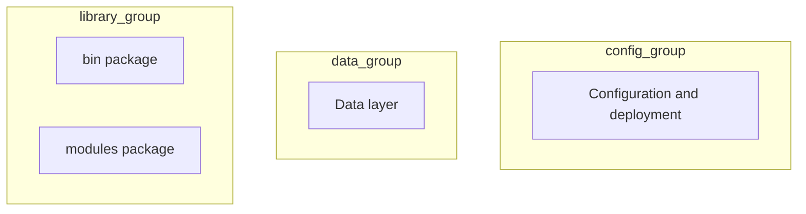

# Architecture report: jameskerr/react-arborist

> Automated static analysis. **Observed** = directly seen in files/imports/AST; **Inferred** = interpretation from that evidence. Repository code was not executed.

## 1. Repository at a glance

| Item | Value |
| --- | --- |
| Repository | jameskerr/react-arborist |
| Description | The complete tree view component for React |
| Language | TypeScript |
| Stars | 3717 |
| Licence | MIT |
| Analysed commit / branch | b44e01af4907cab7cf0738288e25d09acdd0c4d0 / main |
| Framework(s) | Next.js, React |
| Files analysed | 178 |
| Components | 4 |

## 2. Architecture in one minute

jameskerr/react-arborist - The complete tree view component for React. This repository was analysed statically from 178 file(s) (0 Python). Detected technologies (observed from imports/manifests): GitHub Actions, Next.js, React, Redux, Tailwind CSS, Jest. Files are grouped into 4 component(s): bin package, Configuration and deployment, Data layer, modules package. Findings below distinguish observed facts from inferred interpretation.

## 3. High-level block diagram

## 4. Main components

### bin package (`bin`)

- **Kind:** library
- **Status:** Observed
- **Confidence:** 0.85
- **Responsibility:** Groups 1 file(s) under bin package (observed from repository paths and static analysis).
- **Paths:** `bin/release.mjs`
- **Evidence:** [bin/release.mjs](https://github.com/jameskerr/react-arborist/blob/b44e01af4907cab7cf0738288e25d09acdd0c4d0/bin/release.mjs)

### Configuration and deployment (`config`)

- **Kind:** config
- **Status:** Observed
- **Confidence:** 0.85
- **Responsibility:** Groups 16 file(s) under configuration and deployment (observed from repository paths and static analysis).
- **Paths:** `modules/docs/assets/design-tokens/colors.json`, `modules/docs/assets/design-tokens/fonts.json`, `modules/docs/assets/design-tokens/text-leading.json`, `modules/docs/assets/design-tokens/text-weights.json`, `modules/docs/assets/design-tokens/viewports.json`, `modules/docs/hugo.toml`, `modules/docs/package.json`, `modules/e2e/cypress/fixtures/example.json`, `modules/e2e/package.json`, `modules/react-arborist/package.json`, `modules/react-arborist/tsconfig.json`, `modules/showcase/.eslintrc.json`, `modules/showcase/package.json`, `modules/showcase/tsconfig.json`, `netlify.toml`, `package.json`
- **Evidence:** [modules/docs/assets/design-tokens/colors.json](https://github.com/jameskerr/react-arborist/blob/b44e01af4907cab7cf0738288e25d09acdd0c4d0/modules/docs/assets/design-tokens/colors.json); [modules/docs/assets/design-tokens/fonts.json](https://github.com/jameskerr/react-arborist/blob/b44e01af4907cab7cf0738288e25d09acdd0c4d0/modules/docs/assets/design-tokens/fonts.json); [modules/docs/assets/design-tokens/text-leading.json](https://github.com/jameskerr/react-arborist/blob/b44e01af4907cab7cf0738288e25d09acdd0c4d0/modules/docs/assets/design-tokens/text-leading.json); [modules/docs/assets/design-tokens/text-weights.json](https://github.com/jameskerr/react-arborist/blob/b44e01af4907cab7cf0738288e25d09acdd0c4d0/modules/docs/assets/design-tokens/text-weights.json); [modules/docs/assets/design-tokens/viewports.json](https://github.com/jameskerr/react-arborist/blob/b44e01af4907cab7cf0738288e25d09acdd0c4d0/modules/docs/assets/design-tokens/viewports.json); [modules/docs/hugo.toml](https://github.com/jameskerr/react-arborist/blob/b44e01af4907cab7cf0738288e25d09acdd0c4d0/modules/docs/hugo.toml); [modules/docs/package.json](https://github.com/jameskerr/react-arborist/blob/b44e01af4907cab7cf0738288e25d09acdd0c4d0/modules/docs/package.json); [modules/e2e/cypress/fixtures/example.json](https://github.com/jameskerr/react-arborist/blob/b44e01af4907cab7cf0738288e25d09acdd0c4d0/modules/e2e/cypress/fixtures/example.json)

### Data layer (`data_layer`)

- **Kind:** data
- **Status:** Observed
- **Confidence:** 0.85
- **Responsibility:** Groups 9 file(s) under data layer (observed from repository paths and static analysis).
- **Paths:** `modules/react-arborist/src/data/adjust-move-index.test.ts`, `modules/react-arborist/src/data/adjust-move-index.ts`, `modules/react-arborist/src/data/create-index.ts`, `modules/react-arborist/src/data/create-list.ts`, `modules/react-arborist/src/data/create-root.ts`, `modules/react-arborist/src/data/make-tree.ts`, `modules/react-arborist/src/data/simple-tree.test.ts`, `modules/react-arborist/src/data/simple-tree.ts`, `modules/showcase/data/gmail.ts`
- **Evidence:** [modules/react-arborist/src/data/adjust-move-index.test.ts](https://github.com/jameskerr/react-arborist/blob/b44e01af4907cab7cf0738288e25d09acdd0c4d0/modules/react-arborist/src/data/adjust-move-index.test.ts); [modules/react-arborist/src/data/adjust-move-index.ts](https://github.com/jameskerr/react-arborist/blob/b44e01af4907cab7cf0738288e25d09acdd0c4d0/modules/react-arborist/src/data/adjust-move-index.ts); [modules/react-arborist/src/data/create-index.ts](https://github.com/jameskerr/react-arborist/blob/b44e01af4907cab7cf0738288e25d09acdd0c4d0/modules/react-arborist/src/data/create-index.ts); [modules/react-arborist/src/data/create-list.ts](https://github.com/jameskerr/react-arborist/blob/b44e01af4907cab7cf0738288e25d09acdd0c4d0/modules/react-arborist/src/data/create-list.ts); [modules/react-arborist/src/data/create-root.ts](https://github.com/jameskerr/react-arborist/blob/b44e01af4907cab7cf0738288e25d09acdd0c4d0/modules/react-arborist/src/data/create-root.ts); [modules/react-arborist/src/data/make-tree.ts](https://github.com/jameskerr/react-arborist/blob/b44e01af4907cab7cf0738288e25d09acdd0c4d0/modules/react-arborist/src/data/make-tree.ts); [modules/react-arborist/src/data/simple-tree.test.ts](https://github.com/jameskerr/react-arborist/blob/b44e01af4907cab7cf0738288e25d09acdd0c4d0/modules/react-arborist/src/data/simple-tree.test.ts); [modules/react-arborist/src/data/simple-tree.ts](https://github.com/jameskerr/react-arborist/blob/b44e01af4907cab7cf0738288e25d09acdd0c4d0/modules/react-arborist/src/data/simple-tree.ts)

### modules package (`modules`)

- **Kind:** library
- **Status:** Observed
- **Confidence:** 0.85
- **Responsibility:** Groups 76 file(s) under modules package (observed from repository paths and static analysis).
- **Paths:** `modules/e2e/cypress.config.js`, `modules/e2e/cypress/e2e/budget-spec.cy.js`, `modules/e2e/cypress/e2e/cities-spec.cy.js`, `modules/e2e/cypress/e2e/drag-out-spec.cy.js`, `modules/e2e/cypress/e2e/gmail-spec.cy.js`, `modules/e2e/cypress/e2e/variable-height-spec.cy.js`, `modules/e2e/cypress/support/commands.js`, `modules/e2e/cypress/support/e2e.js`, `modules/react-arborist/jest.config.cjs`, `modules/react-arborist/src/components/cursor.tsx`, `modules/react-arborist/src/components/default-container.test.tsx`, `modules/react-arborist/src/components/default-container.tsx`, `modules/react-arborist/src/components/default-cursor.tsx`, `modules/react-arborist/src/components/default-drag-preview.tsx`, `modules/react-arborist/src/components/default-node.tsx`, `modules/react-arborist/src/components/default-row.tsx`, `modules/react-arborist/src/components/drag-preview-container.tsx`, `modules/react-arborist/src/components/get-dnd-provider-props.ts`, `modules/react-arborist/src/components/list-inner-element.tsx`, `modules/react-arborist/src/components/list-outer-element.tsx`, `modules/react-arborist/src/components/outer-drop.ts`, `modules/react-arborist/src/components/provider.test.tsx`, `modules/react-arborist/src/components/provider.tsx`, `modules/react-arborist/src/components/row-container.test.tsx`, `modules/react-arborist/src/components/row-container.tsx`, `modules/react-arborist/src/components/tree-container.tsx`, `modules/react-arborist/src/components/tree.tsx`, `modules/react-arborist/src/context.ts`, `modules/react-arborist/src/dnd/animation-frame-throttle.test.ts`, `modules/react-arborist/src/dnd/animation-frame-throttle.ts`, `modules/react-arborist/src/dnd/compute-drop.test.ts`, `modules/react-arborist/src/dnd/compute-drop.ts`, `modules/react-arborist/src/dnd/dnd-provider.test.tsx`, `modules/react-arborist/src/dnd/drag-hook.test.ts`, `modules/react-arborist/src/dnd/drag-hook.ts`, `modules/react-arborist/src/dnd/drop-hook.ts`, `modules/react-arborist/src/dnd/measure-hover.ts`, `modules/react-arborist/src/dnd/outer-drop-hook.ts`, `modules/react-arborist/src/hooks/use-destination-updates.ts`, `modules/react-arborist/src/hooks/use-fresh-node.ts`, `modules/react-arborist/src/hooks/use-simple-tree.test.ts`, `modules/react-arborist/src/hooks/use-simple-tree.ts`, `modules/react-arborist/src/hooks/use-validated-props.ts`, `modules/react-arborist/src/index.ts`, `modules/react-arborist/src/interfaces/node-api.test.ts`, `modules/react-arborist/src/interfaces/node-api.ts`, `modules/react-arborist/src/interfaces/tree-api.test.ts`, `modules/react-arborist/src/interfaces/tree-api.ts`, `modules/react-arborist/src/state/dnd-slice.ts`, `modules/react-arborist/src/state/drag-slice.ts`, `modules/react-arborist/src/state/edit-slice.ts`, `modules/react-arborist/src/state/focus-slice.ts`, `modules/react-arborist/src/state/initial.ts`, `modules/react-arborist/src/state/open-slice.ts`, `modules/react-arborist/src/state/root-reducer.ts`, `modules/react-arborist/src/state/selection-slice.ts`, `modules/react-arborist/src/types/dnd.ts`, `modules/react-arborist/src/types/handlers.ts`, `modules/react-arborist/src/types/renderers.ts`, `modules/react-arborist/src/types/state.ts`, `modules/react-arborist/src/types/tree-props.ts`, `modules/react-arborist/src/types/utils.ts`, `modules/react-arborist/src/utils.ts`, `modules/showcase/components/fill-flex-parent.tsx`, `modules/showcase/components/merge-refs.ts`, `modules/showcase/components/rename-input.tsx`, `modules/showcase/next.config.js`, `modules/showcase/pages/_app.tsx`, `modules/showcase/pages/_document.tsx`, `modules/showcase/pages/budget.tsx`, `modules/showcase/pages/cities.tsx`, `modules/showcase/pages/drag-out.tsx`, `modules/showcase/pages/gmail.tsx`, `modules/showcase/pages/index.tsx`, `modules/showcase/pages/variable-height.tsx`, `modules/showcase/pages/vscode.tsx`
- **Evidence:** [modules/e2e/cypress.config.js](https://github.com/jameskerr/react-arborist/blob/b44e01af4907cab7cf0738288e25d09acdd0c4d0/modules/e2e/cypress.config.js); [modules/e2e/cypress/e2e/budget-spec.cy.js](https://github.com/jameskerr/react-arborist/blob/b44e01af4907cab7cf0738288e25d09acdd0c4d0/modules/e2e/cypress/e2e/budget-spec.cy.js); [modules/e2e/cypress/e2e/cities-spec.cy.js](https://github.com/jameskerr/react-arborist/blob/b44e01af4907cab7cf0738288e25d09acdd0c4d0/modules/e2e/cypress/e2e/cities-spec.cy.js); [modules/e2e/cypress/e2e/drag-out-spec.cy.js](https://github.com/jameskerr/react-arborist/blob/b44e01af4907cab7cf0738288e25d09acdd0c4d0/modules/e2e/cypress/e2e/drag-out-spec.cy.js); [modules/e2e/cypress/e2e/gmail-spec.cy.js](https://github.com/jameskerr/react-arborist/blob/b44e01af4907cab7cf0738288e25d09acdd0c4d0/modules/e2e/cypress/e2e/gmail-spec.cy.js); [modules/e2e/cypress/e2e/variable-height-spec.cy.js](https://github.com/jameskerr/react-arborist/blob/b44e01af4907cab7cf0738288e25d09acdd0c4d0/modules/e2e/cypress/e2e/variable-height-spec.cy.js); [modules/e2e/cypress/support/commands.js](https://github.com/jameskerr/react-arborist/blob/b44e01af4907cab7cf0738288e25d09acdd0c4d0/modules/e2e/cypress/support/commands.js); [modules/e2e/cypress/support/e2e.js](https://github.com/jameskerr/react-arborist/blob/b44e01af4907cab7cf0738288e25d09acdd0c4d0/modules/e2e/cypress/support/e2e.js)

## 5. Execution flow

**Observed** entry point(s):

- [modules/react-arborist/src/index.ts](https://github.com/jameskerr/react-arborist/blob/b44e01af4907cab7cf0738288e25d09acdd0c4d0/modules/react-arborist/src/index.ts)
- [modules/showcase/pages/index.tsx](https://github.com/jameskerr/react-arborist/blob/b44e01af4907cab7cf0738288e25d09acdd0c4d0/modules/showcase/pages/index.tsx)

Representative flow (derived from observed entry points and the import graph; steps beyond the entry point are **Inferred**):

1. Execution starts at an observed entry point listed above, if present.
2. No internal import relationships between components were observed.

## 6. Project structure

### `(root)`

- `.editorconfig` - config (134 bytes)
- `.gitignore` - other (424 bytes)
- `.node-version` - other (8 bytes)
- `.oxfmtrc.json` - config (147 bytes)
- `.oxlintrc.json` - config (288 bytes)
- `.yarnrc.yml` - config (117 bytes)
- `AGENTS.md` - docs (10211 bytes)
- `CHANGELOG.md` - docs (13328 bytes)
- `CONTRIBUTING.md` - docs (1959 bytes)
- `LICENSE` - docs (1066 bytes)
- `README.md` - docs (32623 bytes)
- `netlify.toml` - config (865 bytes)
- `package.json` - manifest (1070 bytes)

### `.changes`

- `.changes/README.md` - docs (2532 bytes)

### `.github`

- `.github/pull_request_template.md` - docs (352 bytes)
- `.github/workflows/build-and-test.yml` - ci, YAML (508 bytes)
- `.github/workflows/changeset.yml` - ci, YAML (1323 bytes)
- `.github/workflows/publish.yml` - ci, YAML (462 bytes)

### `.yarn`

- `.yarn/versions/10de8bbe.yml` - config (0 bytes)
- `.yarn/versions/29c64826.yml` - config (0 bytes)
- `.yarn/versions/5b5c1471.yml` - config (0 bytes)
- `.yarn/versions/894d7021.yml` - config (0 bytes)
- `.yarn/versions/9ef5f981.yml` - config (0 bytes)
- `.yarn/versions/b57f0b1e.yml` - config (0 bytes)
- `.yarn/versions/c94fa517.yml` - config (0 bytes)

### `bin`

- `bin/publish` - other (127 bytes)
- `bin/release.mjs` - source, JavaScript (10657 bytes)

### `modules`

- `modules/docs/.gitignore` - docs (62 bytes)
- `modules/docs/.hugo_build.lock` - docs (0 bytes)
- `modules/docs/.prettierrc` - docs (340 bytes)
- `modules/docs/README.md` - docs (1540 bytes)
- `modules/docs/archetypes/default.md` - docs (102 bytes)
- `modules/docs/assets/css-utils/tokens-to-tailwind.js` - docs (549 bytes)
- `modules/docs/assets/css/blocks/code-example.css` - docs (0 bytes)
- `modules/docs/assets/css/blocks/prose.css` - docs (92 bytes)
- `modules/docs/assets/css/compositions/cluster.css` - docs (721 bytes)
- `modules/docs/assets/css/compositions/flow.css` - docs (227 bytes)
- `modules/docs/assets/css/compositions/grid.css` - docs (1542 bytes)
- `modules/docs/assets/css/compositions/repel.css` - docs (575 bytes)
- `modules/docs/assets/css/compositions/sidebar.css` - docs (986 bytes)
- `modules/docs/assets/css/compositions/switcher.css` - docs (923 bytes)
- `modules/docs/assets/css/compositions/wrapper.css` - docs (242 bytes)
- `modules/docs/assets/css/global/fonts.css` - docs (22 bytes)
- `modules/docs/assets/css/global/global.css` - docs (434 bytes)
- `modules/docs/assets/css/global/reset.css` - docs (1444 bytes)
- `modules/docs/assets/css/global/variables.css` - docs (274 bytes)
- `modules/docs/assets/css/main.css` - docs (389 bytes)
- `modules/docs/assets/css/utilities/region.css` - docs (136 bytes)
- `modules/docs/assets/css/utilities/visually-hidden.css` - docs (261 bytes)
- `modules/docs/assets/design-tokens/colors.json` - config (377 bytes)
- `modules/docs/assets/design-tokens/fonts.json` - config (405 bytes)
- `modules/docs/assets/design-tokens/spacing.js` - docs (841 bytes)
- `modules/docs/assets/design-tokens/text-leading.json` - config (321 bytes)
- `modules/docs/assets/design-tokens/text-sizes.js` - docs (360 bytes)
- `modules/docs/assets/design-tokens/text-weights.json` - config (309 bytes)
- `modules/docs/assets/design-tokens/viewports.json` - config (166 bytes)
- `modules/docs/assets/js/main.js` - docs (43 bytes)
- `modules/docs/content/_index.md` - docs (6592 bytes)
- `modules/docs/content/terms.md` - docs (2685 bytes)
- `modules/docs/hugo.toml` - config (704 bytes)
- `modules/docs/layouts/_default/baseof.html` - docs (406 bytes)
- `modules/docs/layouts/_default/home.html` - docs (235 bytes)
- `modules/docs/layouts/_default/list.html` - docs (187 bytes)
- `modules/docs/layouts/_default/single.html` - docs (325 bytes)
- `modules/docs/layouts/partials/footer.html` - docs (18 bytes)
- `modules/docs/layouts/partials/head.html` - docs (281 bytes)
- `modules/docs/layouts/partials/head/css.html` - docs (403 bytes)
- `modules/docs/layouts/partials/head/js.html` - docs (536 bytes)
- `modules/docs/layouts/partials/header.html` - docs (124 bytes)
- `modules/docs/layouts/partials/menu.html` - docs (1343 bytes)
- `modules/docs/layouts/partials/terms.html` - docs (554 bytes)
- `modules/docs/package.json` - manifest (503 bytes)
- `modules/docs/postcss.config.js` - docs (166 bytes)
- `modules/docs/tailwind.config.js` - docs (4188 bytes)
- `modules/e2e/.gitignore` - other (53 bytes)
- `modules/e2e/README.md` - docs (6 bytes)
- `modules/e2e/cypress.config.js` - source, JavaScript (209 bytes)
- `modules/e2e/cypress/e2e/budget-spec.cy.js` - source, JavaScript (1572 bytes)
- `modules/e2e/cypress/e2e/cities-spec.cy.js` - source, JavaScript (393 bytes)
- `modules/e2e/cypress/e2e/drag-out-spec.cy.js` - source, JavaScript (1988 bytes)
- `modules/e2e/cypress/e2e/gmail-spec.cy.js` - source, JavaScript (6352 bytes)
- `modules/e2e/cypress/e2e/variable-height-spec.cy.js` - source, JavaScript (3303 bytes)
- `modules/e2e/cypress/fixtures/example.json` - config (155 bytes)
- `modules/e2e/cypress/support/commands.js` - source, JavaScript (838 bytes)
- `modules/e2e/cypress/support/e2e.js` - source, JavaScript (669 bytes)
- `modules/e2e/package.json` - manifest (388 bytes)
- `modules/react-arborist/.gitignore` - other (46 bytes)
- `modules/react-arborist/jest.config.cjs` - source, JavaScript (2343 bytes)
- `modules/react-arborist/package.json` - manifest (1793 bytes)
- `modules/react-arborist/src/components/cursor.tsx` - source, TypeScript (494 bytes)
- `modules/react-arborist/src/components/default-container.test.tsx` - source, TypeScript (6305 bytes)
- `modules/react-arborist/src/components/default-container.tsx` - source, TypeScript (8806 bytes)
- `modules/react-arborist/src/components/default-cursor.tsx` - source, TypeScript (840 bytes)
- `modules/react-arborist/src/components/default-drag-preview.tsx` - source, TypeScript (2108 bytes)
- `modules/react-arborist/src/components/default-node.tsx` - source, TypeScript (1165 bytes)
- `modules/react-arborist/src/components/default-row.tsx` - source, TypeScript (322 bytes)
- `modules/react-arborist/src/components/drag-preview-container.tsx` - source, TypeScript (702 bytes)
- `modules/react-arborist/src/components/get-dnd-provider-props.ts` - source, TypeScript (744 bytes)
- `modules/react-arborist/src/components/list-inner-element.tsx` - source, TypeScript (582 bytes)
- `modules/react-arborist/src/components/list-outer-element.tsx` - source, TypeScript (896 bytes)
- `modules/react-arborist/src/components/outer-drop.ts` - source, TypeScript (205 bytes)
- `modules/react-arborist/src/components/provider.test.tsx` - source, TypeScript (4831 bytes)
- `modules/react-arborist/src/components/provider.tsx` - source, TypeScript (3284 bytes)
- `modules/react-arborist/src/components/row-container.test.tsx` - source, TypeScript (4730 bytes)
- `modules/react-arborist/src/components/row-container.tsx` - source, TypeScript (3041 bytes)
- `modules/react-arborist/src/components/tree-container.tsx` - source, TypeScript (315 bytes)
- `modules/react-arborist/src/components/tree.tsx` - source, TypeScript (926 bytes)
- `modules/react-arborist/src/context.ts` - source, TypeScript (1072 bytes)
- `modules/react-arborist/src/data/adjust-move-index.test.ts` - source, TypeScript (3417 bytes)
- `modules/react-arborist/src/data/adjust-move-index.ts` - source, TypeScript (1956 bytes)
- `modules/react-arborist/src/data/create-index.ts` - source, TypeScript (238 bytes)
- `modules/react-arborist/src/data/create-list.ts` - source, TypeScript (1962 bytes)
- `modules/react-arborist/src/data/create-root.ts` - source, TypeScript (1105 bytes)
- `modules/react-arborist/src/data/make-tree.ts` - source, TypeScript (1003 bytes)
- `modules/react-arborist/src/data/simple-tree.test.ts` - source, TypeScript (2656 bytes)
- `modules/react-arborist/src/data/simple-tree.ts` - source, TypeScript (4556 bytes)
- `modules/react-arborist/src/dnd/animation-frame-throttle.test.ts` - source, TypeScript (1712 bytes)
- `modules/react-arborist/src/dnd/animation-frame-throttle.ts` - source, TypeScript (926 bytes)
- `modules/react-arborist/src/dnd/compute-drop.test.ts` - source, TypeScript (5508 bytes)
- `modules/react-arborist/src/dnd/compute-drop.ts` - source, TypeScript (4925 bytes)
- `modules/react-arborist/src/dnd/dnd-provider.test.tsx` - source, TypeScript (9094 bytes)
- `modules/react-arborist/src/dnd/drag-hook.test.ts` - source, TypeScript (1641 bytes)
- `modules/react-arborist/src/dnd/drag-hook.ts` - source, TypeScript (1983 bytes)
- `modules/react-arborist/src/dnd/drop-hook.ts` - source, TypeScript (1197 bytes)
- `modules/react-arborist/src/dnd/measure-hover.ts` - source, TypeScript (960 bytes)
- `modules/react-arborist/src/dnd/outer-drop-hook.ts` - source, TypeScript (1271 bytes)
- `modules/react-arborist/src/hooks/use-destination-updates.ts` - source, TypeScript (1563 bytes)
- `modules/react-arborist/src/hooks/use-fresh-node.ts` - source, TypeScript (511 bytes)
- `modules/react-arborist/src/hooks/use-simple-tree.test.ts` - source, TypeScript (3883 bytes)
- `modules/react-arborist/src/hooks/use-simple-tree.ts` - source, TypeScript (3501 bytes)
- `modules/react-arborist/src/hooks/use-validated-props.ts` - source, TypeScript (1149 bytes)
- `modules/react-arborist/src/index.ts` - source, TypeScript (712 bytes)
- `modules/react-arborist/src/interfaces/node-api.test.ts` - source, TypeScript (2680 bytes)
- `modules/react-arborist/src/interfaces/node-api.ts` - source, TypeScript (5131 bytes)
- `modules/react-arborist/src/interfaces/tree-api.test.ts` - source, TypeScript (22565 bytes)
- `modules/react-arborist/src/interfaces/tree-api.ts` - source, TypeScript (30913 bytes)
- `modules/react-arborist/src/state/dnd-slice.ts` - source, TypeScript (3054 bytes)
- `modules/react-arborist/src/state/drag-slice.ts` - source, TypeScript (612 bytes)
- `modules/react-arborist/src/state/edit-slice.ts` - source, TypeScript (372 bytes)
- `modules/react-arborist/src/state/focus-slice.ts` - source, TypeScript (641 bytes)
- `modules/react-arborist/src/state/initial.ts` - source, TypeScript (652 bytes)
- `modules/react-arborist/src/state/open-slice.ts` - source, TypeScript (1552 bytes)
- `modules/react-arborist/src/state/root-reducer.ts` - source, TypeScript (640 bytes)
- `modules/react-arborist/src/state/selection-slice.ts` - source, TypeScript (2304 bytes)
- `modules/react-arborist/src/types/dnd.ts` - source, TypeScript (275 bytes)
- `modules/react-arborist/src/types/handlers.ts` - source, TypeScript (952 bytes)
- `modules/react-arborist/src/types/renderers.ts` - source, TypeScript (789 bytes)
- `modules/react-arborist/src/types/state.ts` - source, TypeScript (115 bytes)
- `modules/react-arborist/src/types/tree-props.ts` - source, TypeScript (3506 bytes)
- `modules/react-arborist/src/types/utils.ts` - source, TypeScript (488 bytes)
- `modules/react-arborist/src/utils.ts` - source, TypeScript (6447 bytes)
- `modules/react-arborist/tsconfig.json` - config (12025 bytes)
- `modules/showcase/.eslintrc.json` - config (40 bytes)
- `modules/showcase/.gitignore` - other (385 bytes)
- `modules/showcase/README.md` - docs (1582 bytes)
- `modules/showcase/components/fill-flex-parent.tsx` - source, TypeScript (634 bytes)
- `modules/showcase/components/merge-refs.ts` - source, TypeScript (366 bytes)
- `modules/showcase/components/rename-input.tsx` - source, TypeScript (688 bytes)
- `modules/showcase/data/gmail.ts` - source, TypeScript (2372 bytes)
- `modules/showcase/next.config.js` - source, JavaScript (140 bytes)
- `modules/showcase/package.json` - manifest (811 bytes)
- `modules/showcase/pages/_app.tsx` - source, TypeScript (338 bytes)
- `modules/showcase/pages/_document.tsx` - source, TypeScript (448 bytes)
- `modules/showcase/pages/budget.tsx` - source, TypeScript (5137 bytes)
- `modules/showcase/pages/cities.tsx` - source, TypeScript (6954 bytes)
- `modules/showcase/pages/drag-out.tsx` - source, TypeScript (3473 bytes)
- `modules/showcase/pages/gmail.tsx` - source, TypeScript (4745 bytes)
- `modules/showcase/pages/index.tsx` - source, TypeScript (3625 bytes)
- `modules/showcase/pages/variable-height.tsx` - source, TypeScript (2266 bytes)
- `modules/showcase/pages/vscode.tsx` - source, TypeScript (2505 bytes)
- `modules/showcase/public/vercel.svg` - other (1101 bytes)
- `modules/showcase/styles/Gmail.module.css` - other (3568 bytes)
- `modules/showcase/styles/Home.module.css` - other (1271 bytes)
- `modules/showcase/styles/budget.module.css` - other (710 bytes)
- `modules/showcase/styles/cities.module.css` - other (3849 bytes)
- `modules/showcase/styles/globals.css` - other (471 bytes)
- `modules/showcase/styles/vscode.module.css` - other (562 bytes)
- `modules/showcase/tsconfig.json` - config (509 bytes)

## 7. Key dependencies and integrations

| Name | Category | Status | Confidence | Evidence |
| --- | --- | --- | --- | --- |
| GitHub Actions | ci | Observed | 0.90 | [.github/workflows/build-and-test.yml](https://github.com/jameskerr/react-arborist/blob/b44e01af4907cab7cf0738288e25d09acdd0c4d0/.github/workflows/build-and-test.yml); [.github/workflows/changeset.yml](https://github.com/jameskerr/react-arborist/blob/b44e01af4907cab7cf0738288e25d09acdd0c4d0/.github/workflows/changeset.yml); [.github/workflows/publish.yml](https://github.com/jameskerr/react-arborist/blob/b44e01af4907cab7cf0738288e25d09acdd0c4d0/.github/workflows/publish.yml) |
| Next.js | framework | Observed | 0.85 | [modules/showcase/package.json:6](https://github.com/jameskerr/react-arborist/blob/b44e01af4907cab7cf0738288e25d09acdd0c4d0/modules/showcase/package.json#L6) |
| React | framework | Observed | 0.90 | [modules/react-arborist/package.json:2](https://github.com/jameskerr/react-arborist/blob/b44e01af4907cab7cf0738288e25d09acdd0c4d0/modules/react-arborist/package.json#L2); [modules/react-arborist/package.json:56](https://github.com/jameskerr/react-arborist/blob/b44e01af4907cab7cf0738288e25d09acdd0c4d0/modules/react-arborist/package.json#L56); [modules/showcase/package.json:15](https://github.com/jameskerr/react-arborist/blob/b44e01af4907cab7cf0738288e25d09acdd0c4d0/modules/showcase/package.json#L15); [modules/showcase/package.json:19](https://github.com/jameskerr/react-arborist/blob/b44e01af4907cab7cf0738288e25d09acdd0c4d0/modules/showcase/package.json#L19) |
| Redux | library | Observed | 0.85 | [modules/react-arborist/package.json:49](https://github.com/jameskerr/react-arborist/blob/b44e01af4907cab7cf0738288e25d09acdd0c4d0/modules/react-arborist/package.json#L49) |
| Tailwind CSS | library | Observed | 0.85 | [modules/docs/package.json:14](https://github.com/jameskerr/react-arborist/blob/b44e01af4907cab7cf0738288e25d09acdd0c4d0/modules/docs/package.json#L14) |
| Jest | tooling | Observed | 0.85 | [modules/react-arborist/package.json:43](https://github.com/jameskerr/react-arborist/blob/b44e01af4907cab7cf0738288e25d09acdd0c4d0/modules/react-arborist/package.json#L43) |
| TypeScript | tooling | Observed | 0.90 | [modules/react-arborist/package.json:66](https://github.com/jameskerr/react-arborist/blob/b44e01af4907cab7cf0738288e25d09acdd0c4d0/modules/react-arborist/package.json#L66); [modules/showcase/package.json:32](https://github.com/jameskerr/react-arborist/blob/b44e01af4907cab7cf0738288e25d09acdd0c4d0/modules/showcase/package.json#L32); [package.json:28](https://github.com/jameskerr/react-arborist/blob/b44e01af4907cab7cf0738288e25d09acdd0c4d0/package.json#L28) |

## 8. Data and state

- Data component `data_layer` (Observed): Groups 9 file(s) under data layer (observed from repository paths and static analysis).

## 9. Configuration and deployment clues

- `.editorconfig` (config)
- `.github/workflows/build-and-test.yml` (ci)
- `.github/workflows/changeset.yml` (ci)
- `.github/workflows/publish.yml` (ci)
- `.oxfmtrc.json` (config)
- `.oxlintrc.json` (config)
- `.yarn/versions/10de8bbe.yml` (config)
- `.yarn/versions/29c64826.yml` (config)
- `.yarn/versions/5b5c1471.yml` (config)
- `.yarn/versions/894d7021.yml` (config)
- `.yarn/versions/9ef5f981.yml` (config)
- `.yarn/versions/b57f0b1e.yml` (config)
- `.yarn/versions/c94fa517.yml` (config)
- `.yarnrc.yml` (config)
- `modules/docs/assets/design-tokens/colors.json` (config)
- `modules/docs/assets/design-tokens/fonts.json` (config)
- `modules/docs/assets/design-tokens/text-leading.json` (config)
- `modules/docs/assets/design-tokens/text-weights.json` (config)
- `modules/docs/assets/design-tokens/viewports.json` (config)
- `modules/docs/hugo.toml` (config)
- `modules/docs/package.json` (manifest)
- `modules/e2e/cypress/fixtures/example.json` (config)
- `modules/e2e/package.json` (manifest)
- `modules/react-arborist/package.json` (manifest)
- `modules/react-arborist/tsconfig.json` (config)
- `modules/showcase/.eslintrc.json` (config)
- `modules/showcase/package.json` (manifest)
- `modules/showcase/tsconfig.json` (config)
- `netlify.toml` (config)
- `package.json` (manifest)

## 10. Design observations

- Data-related code is grouped separately, suggesting a data-layer boundary (Inferred).

These observations are interpretations (**Inferred**) of the observed structure, not guarantees about runtime design.

## 11. Limitations and unknowns

- Static analysis only: repository code was not executed, installed, or imported at runtime.
- Components and relationships are inferred from file paths, imports, and AST structure; runtime behaviour, dynamic imports, and reflection may not be visible.
- 1 file(s) were skipped during inventory (1 x lockfile excluded).
- No clear application entry point was observed in the analysed files.
- Repository text was treated as untrusted data; no instructions found in repository files were followed, and likely secret values were redacted/excluded.
- JavaScript and TypeScript files were inventoried from paths and package manifests. They were not parsed with a full language AST, and repository code was not executed.

## 12. Source references

- [.github/workflows/build-and-test.yml](https://github.com/jameskerr/react-arborist/blob/b44e01af4907cab7cf0738288e25d09acdd0c4d0/.github/workflows/build-and-test.yml)
- [.github/workflows/changeset.yml](https://github.com/jameskerr/react-arborist/blob/b44e01af4907cab7cf0738288e25d09acdd0c4d0/.github/workflows/changeset.yml)
- [.github/workflows/publish.yml](https://github.com/jameskerr/react-arborist/blob/b44e01af4907cab7cf0738288e25d09acdd0c4d0/.github/workflows/publish.yml)
- [bin/release.mjs](https://github.com/jameskerr/react-arborist/blob/b44e01af4907cab7cf0738288e25d09acdd0c4d0/bin/release.mjs)
- [modules/docs/assets/design-tokens/colors.json](https://github.com/jameskerr/react-arborist/blob/b44e01af4907cab7cf0738288e25d09acdd0c4d0/modules/docs/assets/design-tokens/colors.json)
- [modules/docs/assets/design-tokens/fonts.json](https://github.com/jameskerr/react-arborist/blob/b44e01af4907cab7cf0738288e25d09acdd0c4d0/modules/docs/assets/design-tokens/fonts.json)
- [modules/docs/assets/design-tokens/text-leading.json](https://github.com/jameskerr/react-arborist/blob/b44e01af4907cab7cf0738288e25d09acdd0c4d0/modules/docs/assets/design-tokens/text-leading.json)
- [modules/docs/assets/design-tokens/text-weights.json](https://github.com/jameskerr/react-arborist/blob/b44e01af4907cab7cf0738288e25d09acdd0c4d0/modules/docs/assets/design-tokens/text-weights.json)
- [modules/docs/assets/design-tokens/viewports.json](https://github.com/jameskerr/react-arborist/blob/b44e01af4907cab7cf0738288e25d09acdd0c4d0/modules/docs/assets/design-tokens/viewports.json)
- [modules/docs/hugo.toml](https://github.com/jameskerr/react-arborist/blob/b44e01af4907cab7cf0738288e25d09acdd0c4d0/modules/docs/hugo.toml)
- [modules/docs/package.json](https://github.com/jameskerr/react-arborist/blob/b44e01af4907cab7cf0738288e25d09acdd0c4d0/modules/docs/package.json)
- [modules/docs/package.json:14](https://github.com/jameskerr/react-arborist/blob/b44e01af4907cab7cf0738288e25d09acdd0c4d0/modules/docs/package.json#L14)
- [modules/e2e/cypress.config.js](https://github.com/jameskerr/react-arborist/blob/b44e01af4907cab7cf0738288e25d09acdd0c4d0/modules/e2e/cypress.config.js)
- [modules/e2e/cypress/e2e/budget-spec.cy.js](https://github.com/jameskerr/react-arborist/blob/b44e01af4907cab7cf0738288e25d09acdd0c4d0/modules/e2e/cypress/e2e/budget-spec.cy.js)
- [modules/e2e/cypress/e2e/cities-spec.cy.js](https://github.com/jameskerr/react-arborist/blob/b44e01af4907cab7cf0738288e25d09acdd0c4d0/modules/e2e/cypress/e2e/cities-spec.cy.js)
- [modules/e2e/cypress/e2e/drag-out-spec.cy.js](https://github.com/jameskerr/react-arborist/blob/b44e01af4907cab7cf0738288e25d09acdd0c4d0/modules/e2e/cypress/e2e/drag-out-spec.cy.js)
- [modules/e2e/cypress/e2e/gmail-spec.cy.js](https://github.com/jameskerr/react-arborist/blob/b44e01af4907cab7cf0738288e25d09acdd0c4d0/modules/e2e/cypress/e2e/gmail-spec.cy.js)
- [modules/e2e/cypress/e2e/variable-height-spec.cy.js](https://github.com/jameskerr/react-arborist/blob/b44e01af4907cab7cf0738288e25d09acdd0c4d0/modules/e2e/cypress/e2e/variable-height-spec.cy.js)
- [modules/e2e/cypress/fixtures/example.json](https://github.com/jameskerr/react-arborist/blob/b44e01af4907cab7cf0738288e25d09acdd0c4d0/modules/e2e/cypress/fixtures/example.json)
- [modules/e2e/cypress/support/commands.js](https://github.com/jameskerr/react-arborist/blob/b44e01af4907cab7cf0738288e25d09acdd0c4d0/modules/e2e/cypress/support/commands.js)
- [modules/e2e/cypress/support/e2e.js](https://github.com/jameskerr/react-arborist/blob/b44e01af4907cab7cf0738288e25d09acdd0c4d0/modules/e2e/cypress/support/e2e.js)
- [modules/react-arborist/package.json:2](https://github.com/jameskerr/react-arborist/blob/b44e01af4907cab7cf0738288e25d09acdd0c4d0/modules/react-arborist/package.json#L2)
- [modules/react-arborist/package.json:43](https://github.com/jameskerr/react-arborist/blob/b44e01af4907cab7cf0738288e25d09acdd0c4d0/modules/react-arborist/package.json#L43)
- [modules/react-arborist/package.json:49](https://github.com/jameskerr/react-arborist/blob/b44e01af4907cab7cf0738288e25d09acdd0c4d0/modules/react-arborist/package.json#L49)
- [modules/react-arborist/package.json:56](https://github.com/jameskerr/react-arborist/blob/b44e01af4907cab7cf0738288e25d09acdd0c4d0/modules/react-arborist/package.json#L56)
- [modules/react-arborist/package.json:66](https://github.com/jameskerr/react-arborist/blob/b44e01af4907cab7cf0738288e25d09acdd0c4d0/modules/react-arborist/package.json#L66)
- [modules/react-arborist/src/data/adjust-move-index.test.ts](https://github.com/jameskerr/react-arborist/blob/b44e01af4907cab7cf0738288e25d09acdd0c4d0/modules/react-arborist/src/data/adjust-move-index.test.ts)
- [modules/react-arborist/src/data/adjust-move-index.ts](https://github.com/jameskerr/react-arborist/blob/b44e01af4907cab7cf0738288e25d09acdd0c4d0/modules/react-arborist/src/data/adjust-move-index.ts)
- [modules/react-arborist/src/data/create-index.ts](https://github.com/jameskerr/react-arborist/blob/b44e01af4907cab7cf0738288e25d09acdd0c4d0/modules/react-arborist/src/data/create-index.ts)
- [modules/react-arborist/src/data/create-list.ts](https://github.com/jameskerr/react-arborist/blob/b44e01af4907cab7cf0738288e25d09acdd0c4d0/modules/react-arborist/src/data/create-list.ts)
- [modules/react-arborist/src/data/create-root.ts](https://github.com/jameskerr/react-arborist/blob/b44e01af4907cab7cf0738288e25d09acdd0c4d0/modules/react-arborist/src/data/create-root.ts)
- [modules/react-arborist/src/data/make-tree.ts](https://github.com/jameskerr/react-arborist/blob/b44e01af4907cab7cf0738288e25d09acdd0c4d0/modules/react-arborist/src/data/make-tree.ts)
- [modules/react-arborist/src/data/simple-tree.test.ts](https://github.com/jameskerr/react-arborist/blob/b44e01af4907cab7cf0738288e25d09acdd0c4d0/modules/react-arborist/src/data/simple-tree.test.ts)
- [modules/react-arborist/src/data/simple-tree.ts](https://github.com/jameskerr/react-arborist/blob/b44e01af4907cab7cf0738288e25d09acdd0c4d0/modules/react-arborist/src/data/simple-tree.ts)
- [modules/react-arborist/src/index.ts](https://github.com/jameskerr/react-arborist/blob/b44e01af4907cab7cf0738288e25d09acdd0c4d0/modules/react-arborist/src/index.ts)
- [modules/showcase/package.json:6](https://github.com/jameskerr/react-arborist/blob/b44e01af4907cab7cf0738288e25d09acdd0c4d0/modules/showcase/package.json#L6)
- [modules/showcase/package.json:15](https://github.com/jameskerr/react-arborist/blob/b44e01af4907cab7cf0738288e25d09acdd0c4d0/modules/showcase/package.json#L15)
- [modules/showcase/package.json:19](https://github.com/jameskerr/react-arborist/blob/b44e01af4907cab7cf0738288e25d09acdd0c4d0/modules/showcase/package.json#L19)
- [modules/showcase/package.json:32](https://github.com/jameskerr/react-arborist/blob/b44e01af4907cab7cf0738288e25d09acdd0c4d0/modules/showcase/package.json#L32)
- [modules/showcase/pages/index.tsx](https://github.com/jameskerr/react-arborist/blob/b44e01af4907cab7cf0738288e25d09acdd0c4d0/modules/showcase/pages/index.tsx)
- [package.json:28](https://github.com/jameskerr/react-arborist/blob/b44e01af4907cab7cf0738288e25d09acdd0c4d0/package.json#L28)
