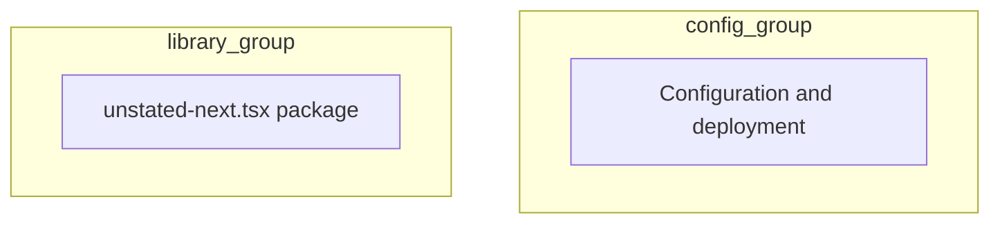

# Architecture report: jamiebuilds/unstated-next

> Automated static analysis. **Observed** = directly seen in files/imports/AST; **Inferred** = interpretation from that evidence. Repository code was not executed.

## 1. Repository at a glance

| Item | Value |
| --- | --- |
| Repository | jamiebuilds/unstated-next |
| Description | 200 bytes to never think about React state management libraries ever again |
| Language | TypeScript |
| Stars | 4180 |
| Licence | MIT |
| Analysed commit / branch | 15329b5962771b475c5beb48f6a6fee2d56c1bfb / master |
| Framework(s) | React |
| Files analysed | 14 |
| Components | 2 |

## 2. Architecture in one minute

jamiebuilds/unstated-next - 200 bytes to never think about React state management libraries ever again. This repository was analysed statically from 14 file(s) (0 Python). Detected technologies (observed from imports/manifests): React, TypeScript. Files are grouped into 2 component(s): Configuration and deployment, unstated-next.tsx package. Findings below distinguish observed facts from inferred interpretation.

## 3. High-level block diagram

## 4. Main components

### Configuration and deployment (`config`)

- **Kind:** config
- **Status:** Observed
- **Confidence:** 0.85
- **Responsibility:** Groups 2 file(s) under configuration and deployment (observed from repository paths and static analysis).
- **Paths:** `package.json`, `tsconfig.json`
- **Evidence:** [package.json](https://github.com/jamiebuilds/unstated-next/blob/15329b5962771b475c5beb48f6a6fee2d56c1bfb/package.json); [tsconfig.json](https://github.com/jamiebuilds/unstated-next/blob/15329b5962771b475c5beb48f6a6fee2d56c1bfb/tsconfig.json)

### unstated-next.tsx package (`unstated_next_tsx`)

- **Kind:** library
- **Status:** Observed
- **Confidence:** 0.85
- **Responsibility:** Groups 1 file(s) under unstated-next.tsx package (observed from repository paths and static analysis).
- **Paths:** `src/unstated-next.tsx`
- **Evidence:** [src/unstated-next.tsx](https://github.com/jamiebuilds/unstated-next/blob/15329b5962771b475c5beb48f6a6fee2d56c1bfb/src/unstated-next.tsx)

## 5. Execution flow

No entry point was observed; the startup flow below is therefore limited.

Representative flow (derived from observed entry points and the import graph; steps beyond the entry point are **Inferred**):

1. Execution starts at an observed entry point listed above, if present.
2. No internal import relationships between components were observed.

## 6. Project structure

### `(root)`

- `.gitignore` - other (58 bytes)
- `.prettierignore` - other (49 bytes)
- `.prettierrc` - other (152 bytes)
- `LICENSE` - docs (1038 bytes)
- `README-ru-ru.md` - docs (20241 bytes)
- `README-th-th.md` - docs (20857 bytes)
- `README-vi-vn.md` - docs (17041 bytes)
- `README-zh-cn.md` - docs (14519 bytes)
- `README.md` - docs (15285 bytes)
- `package.json` - manifest (1131 bytes)
- `tsconfig.json` - config (5724 bytes)

### `example`

- `example/index.html` - other (323 bytes)
- `example/index.tsx` - source, TypeScript (900 bytes)

### `src`

- `src/unstated-next.tsx` - source, TypeScript (1057 bytes)

## 7. Key dependencies and integrations

| Name | Category | Status | Confidence | Evidence |
| --- | --- | --- | --- | --- |
| React | framework | Observed | 0.90 | [package.json:4](https://github.com/jamiebuilds/unstated-next/blob/15329b5962771b475c5beb48f6a6fee2d56c1bfb/package.json#L4); [package.json:23](https://github.com/jamiebuilds/unstated-next/blob/15329b5962771b475c5beb48f6a6fee2d56c1bfb/package.json#L23) |
| TypeScript | tooling | Observed | 0.85 | [package.json:33](https://github.com/jamiebuilds/unstated-next/blob/15329b5962771b475c5beb48f6a6fee2d56c1bfb/package.json#L33) |

## 8. Data and state

No database, cache, queue, or persistent-state usage was observed in the analysed files. State handling, if any, may be in-memory or in files that were not analysed.

## 9. Configuration and deployment clues

- `package.json` (manifest)
- `tsconfig.json` (config)

## 10. Design observations

- No strong design patterns could be established from the available evidence.

These observations are interpretations (**Inferred**) of the observed structure, not guarantees about runtime design.

## 11. Limitations and unknowns

- Static analysis only: repository code was not executed, installed, or imported at runtime.
- Components and relationships are inferred from file paths, imports, and AST structure; runtime behaviour, dynamic imports, and reflection may not be visible.
- No clear application entry point was observed in the analysed files.
- Repository text was treated as untrusted data; no instructions found in repository files were followed, and likely secret values were redacted/excluded.
- JavaScript and TypeScript files were inventoried from paths and package manifests. They were not parsed with a full language AST, and repository code was not executed.

## 12. Source references

- [package.json](https://github.com/jamiebuilds/unstated-next/blob/15329b5962771b475c5beb48f6a6fee2d56c1bfb/package.json)
- [package.json:4](https://github.com/jamiebuilds/unstated-next/blob/15329b5962771b475c5beb48f6a6fee2d56c1bfb/package.json#L4)
- [package.json:23](https://github.com/jamiebuilds/unstated-next/blob/15329b5962771b475c5beb48f6a6fee2d56c1bfb/package.json#L23)
- [package.json:33](https://github.com/jamiebuilds/unstated-next/blob/15329b5962771b475c5beb48f6a6fee2d56c1bfb/package.json#L33)
- [src/unstated-next.tsx](https://github.com/jamiebuilds/unstated-next/blob/15329b5962771b475c5beb48f6a6fee2d56c1bfb/src/unstated-next.tsx)
- [tsconfig.json](https://github.com/jamiebuilds/unstated-next/blob/15329b5962771b475c5beb48f6a6fee2d56c1bfb/tsconfig.json)
