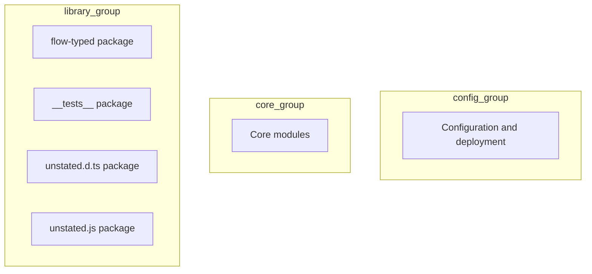

# Architecture report: jamiebuilds/unstated

> Automated static analysis. **Observed** = directly seen in files/imports/AST; **Inferred** = interpretation from that evidence. Repository code was not executed.

## 1. Repository at a glance

| Item | Value |
| --- | --- |
| Repository | jamiebuilds/unstated |
| Description | State so simple, it goes without saying |
| Language | JavaScript |
| Stars | 7709 |
| Licence | MIT |
| Analysed commit / branch | 0c8b3102d2ed404672a641d768f888804a2e7d2e / master |
| Framework(s) | React |
| Files analysed | 21 |
| Components | 6 |

## 2. Architecture in one minute

jamiebuilds/unstated - State so simple, it goes without saying. This repository was analysed statically from 21 file(s) (0 Python). Detected technologies (observed from imports/manifests): React, Jest, TypeScript. Files are grouped into 6 component(s): Configuration and deployment, Core modules, flow-typed package, __tests__ package, unstated.d.ts package, unstated.js package. Findings below distinguish observed facts from inferred interpretation.

## 3. High-level block diagram

## 4. Main components

### Configuration and deployment (`config`)

- **Kind:** config
- **Status:** Observed
- **Confidence:** 0.85
- **Responsibility:** Groups 2 file(s) under configuration and deployment (observed from repository paths and static analysis).
- **Paths:** `package.json`, `tsconfig.json`
- **Evidence:** [package.json](https://github.com/jamiebuilds/unstated/blob/0c8b3102d2ed404672a641d768f888804a2e7d2e/package.json); [tsconfig.json](https://github.com/jamiebuilds/unstated/blob/0c8b3102d2ed404672a641d768f888804a2e7d2e/tsconfig.json)

### Core modules (`core`)

- **Kind:** core
- **Status:** Observed
- **Confidence:** 0.85
- **Responsibility:** Groups 1 file(s) under core modules (observed from repository paths and static analysis).
- **Paths:** `rollup.config.js`
- **Evidence:** [rollup.config.js](https://github.com/jamiebuilds/unstated/blob/0c8b3102d2ed404672a641d768f888804a2e7d2e/rollup.config.js)

### flow-typed package (`flow_typed`)

- **Kind:** library
- **Status:** Observed
- **Confidence:** 0.85
- **Responsibility:** Groups 1 file(s) under flow-typed package (observed from repository paths and static analysis).
- **Paths:** `flow-typed/npm/jest_v22.x.x.js`
- **Evidence:** [flow-typed/npm/jest_v22.x.x.js](https://github.com/jamiebuilds/unstated/blob/0c8b3102d2ed404672a641d768f888804a2e7d2e/flow-typed/npm/jest_v22.x.x.js)

### __tests__ package (`tests`)

- **Kind:** library
- **Status:** Observed
- **Confidence:** 0.85
- **Responsibility:** Groups 2 file(s) under __tests__ package (observed from repository paths and static analysis).
- **Paths:** `__tests__/unstated.js`, `__tests__/unstated.tsx`
- **Evidence:** [__tests__/unstated.js](https://github.com/jamiebuilds/unstated/blob/0c8b3102d2ed404672a641d768f888804a2e7d2e/__tests__/unstated.js); [__tests__/unstated.tsx](https://github.com/jamiebuilds/unstated/blob/0c8b3102d2ed404672a641d768f888804a2e7d2e/__tests__/unstated.tsx)

### unstated.d.ts package (`unstated_d_ts`)

- **Kind:** library
- **Status:** Observed
- **Confidence:** 0.85
- **Responsibility:** Groups 1 file(s) under unstated.d.ts package (observed from repository paths and static analysis).
- **Paths:** `src/unstated.d.ts`
- **Evidence:** [src/unstated.d.ts](https://github.com/jamiebuilds/unstated/blob/0c8b3102d2ed404672a641d768f888804a2e7d2e/src/unstated.d.ts)

### unstated.js package (`unstated_js`)

- **Kind:** library
- **Status:** Observed
- **Confidence:** 0.85
- **Responsibility:** Groups 1 file(s) under unstated.js package (observed from repository paths and static analysis).
- **Paths:** `src/unstated.js`
- **Evidence:** [src/unstated.js](https://github.com/jamiebuilds/unstated/blob/0c8b3102d2ed404672a641d768f888804a2e7d2e/src/unstated.js)

## 5. Execution flow

No entry point was observed; the startup flow below is therefore limited.

Representative flow (derived from observed entry points and the import graph; steps beyond the entry point are **Inferred**):

1. Execution starts at an observed entry point listed above, if present.
2. No internal import relationships between components were observed.

## 6. Project structure

### `(root)`

- `.babelrc` - other (33 bytes)
- `.babelrc.js` - source, JavaScript (435 bytes)
- `.flowconfig` - other (58 bytes)
- `.gitignore` - other (43 bytes)
- `.prettierrc` - other (26 bytes)
- `.travis.yml` - ci, YAML (183 bytes)
- `LICENSE` - docs (1084 bytes)
- `README.md` - docs (13676 bytes)
- `logo.svg` - other (1659 bytes)
- `package.json` - manifest (1677 bytes)
- `rollup.config.js` - source, JavaScript (382 bytes)
- `tsconfig.json` - config (310 bytes)

### `__tests__`

- `__tests__/unstated.js` - source, JavaScript (2181 bytes)
- `__tests__/unstated.tsx` - source, TypeScript (2425 bytes)

### `example`

- `example/complex.js` - source, JavaScript (1511 bytes)
- `example/index.html` - other (473 bytes)
- `example/shared.js` - source, JavaScript (889 bytes)
- `example/simple.js` - source, JavaScript (812 bytes)

### `flow-typed`

- `flow-typed/npm/jest_v22.x.x.js` - source, JavaScript (18438 bytes)

### `src`

- `src/unstated.d.ts` - source, TypeScript (822 bytes)
- `src/unstated.js` - source, JavaScript (4260 bytes)

## 7. Key dependencies and integrations

| Name | Category | Status | Confidence | Evidence |
| --- | --- | --- | --- | --- |
| React | framework | Observed | 0.90 | [package.json:25](https://github.com/jamiebuilds/unstated/blob/0c8b3102d2ed404672a641d768f888804a2e7d2e/package.json#L25); [package.json:48](https://github.com/jamiebuilds/unstated/blob/0c8b3102d2ed404672a641d768f888804a2e7d2e/package.json#L48) |
| Jest | tooling | Observed | 0.85 | [package.json:17](https://github.com/jamiebuilds/unstated/blob/0c8b3102d2ed404672a641d768f888804a2e7d2e/package.json#L17) |
| TypeScript | tooling | Observed | 0.85 | [package.json:22](https://github.com/jamiebuilds/unstated/blob/0c8b3102d2ed404672a641d768f888804a2e7d2e/package.json#L22) |

## 8. Data and state

No database, cache, queue, or persistent-state usage was observed in the analysed files. State handling, if any, may be in-memory or in files that were not analysed.

## 9. Configuration and deployment clues

- `.travis.yml` (ci)
- `package.json` (manifest)
- `tsconfig.json` (config)

## 10. Design observations

- No strong design patterns could be established from the available evidence.

These observations are interpretations (**Inferred**) of the observed structure, not guarantees about runtime design.

## 11. Limitations and unknowns

- Static analysis only: repository code was not executed, installed, or imported at runtime.
- Components and relationships are inferred from file paths, imports, and AST structure; runtime behaviour, dynamic imports, and reflection may not be visible.
- 1 file(s) were skipped during inventory (1 x lockfile excluded).
- No clear application entry point was observed in the analysed files.
- Repository text was treated as untrusted data; no instructions found in repository files were followed, and likely secret values were redacted/excluded.
- JavaScript and TypeScript files were inventoried from paths and package manifests. They were not parsed with a full language AST, and repository code was not executed.

## 12. Source references

- [__tests__/unstated.js](https://github.com/jamiebuilds/unstated/blob/0c8b3102d2ed404672a641d768f888804a2e7d2e/__tests__/unstated.js)
- [__tests__/unstated.tsx](https://github.com/jamiebuilds/unstated/blob/0c8b3102d2ed404672a641d768f888804a2e7d2e/__tests__/unstated.tsx)
- [flow-typed/npm/jest_v22.x.x.js](https://github.com/jamiebuilds/unstated/blob/0c8b3102d2ed404672a641d768f888804a2e7d2e/flow-typed/npm/jest_v22.x.x.js)
- [package.json](https://github.com/jamiebuilds/unstated/blob/0c8b3102d2ed404672a641d768f888804a2e7d2e/package.json)
- [package.json:17](https://github.com/jamiebuilds/unstated/blob/0c8b3102d2ed404672a641d768f888804a2e7d2e/package.json#L17)
- [package.json:22](https://github.com/jamiebuilds/unstated/blob/0c8b3102d2ed404672a641d768f888804a2e7d2e/package.json#L22)
- [package.json:25](https://github.com/jamiebuilds/unstated/blob/0c8b3102d2ed404672a641d768f888804a2e7d2e/package.json#L25)
- [package.json:48](https://github.com/jamiebuilds/unstated/blob/0c8b3102d2ed404672a641d768f888804a2e7d2e/package.json#L48)
- [rollup.config.js](https://github.com/jamiebuilds/unstated/blob/0c8b3102d2ed404672a641d768f888804a2e7d2e/rollup.config.js)
- [src/unstated.d.ts](https://github.com/jamiebuilds/unstated/blob/0c8b3102d2ed404672a641d768f888804a2e7d2e/src/unstated.d.ts)
- [src/unstated.js](https://github.com/jamiebuilds/unstated/blob/0c8b3102d2ed404672a641d768f888804a2e7d2e/src/unstated.js)
- [tsconfig.json](https://github.com/jamiebuilds/unstated/blob/0c8b3102d2ed404672a641d768f888804a2e7d2e/tsconfig.json)
