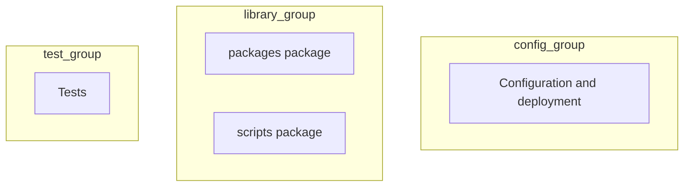

# Architecture report: jaredpalmer/after.js

> Automated static analysis. **Observed** = directly seen in files/imports/AST; **Inferred** = interpretation from that evidence. Repository code was not executed.

## 1. Repository at a glance

| Item | Value |
| --- | --- |
| Repository | jaredpalmer/after.js |
| Description | Next.js-like framework for server-rendered React apps built with React Router |
| Language | TypeScript |
| Stars | 4088 |
| Licence | MIT |
| Analysed commit / branch | dbc362fa9b7204349e2d8fdc8c7ea4d80132faf7 / master |
| Framework(s) | Express, React |
| Files analysed | 241 |
| Components | 4 |

## 2. Architecture in one minute

jaredpalmer/after.js - Next.js-like framework for server-rendered React apps built with React Router. This repository was analysed statically from 241 file(s) (0 Python). Detected technologies (observed from imports/manifests): GitHub Actions, Express, React, React Router, Redux, TypeScript. Files are grouped into 4 component(s): Configuration and deployment, packages package, scripts package, Tests. Findings below distinguish observed facts from inferred interpretation.

## 3. High-level block diagram

## 4. Main components

### Configuration and deployment (`config`)

- **Kind:** config
- **Status:** Observed
- **Confidence:** 0.85
- **Responsibility:** Groups 10 file(s) under configuration and deployment (observed from repository paths and static analysis).
- **Paths:** `lerna.json`, `package.json`, `packages/after.js/.eslintrc.json`, `packages/after.js/basic-example/package.json`, `packages/after.js/package.json`, `packages/after.js/tsconfig.json`, `packages/babel-plugin-after/package.json`, `packages/create-after-app/package.json`, `packages/create-after-app/templates/default/package.json`, `turbo.json`
- **Evidence:** [lerna.json](https://github.com/jaredpalmer/after.js/blob/dbc362fa9b7204349e2d8fdc8c7ea4d80132faf7/lerna.json); [package.json](https://github.com/jaredpalmer/after.js/blob/dbc362fa9b7204349e2d8fdc8c7ea4d80132faf7/package.json); [packages/after.js/.eslintrc.json](https://github.com/jaredpalmer/after.js/blob/dbc362fa9b7204349e2d8fdc8c7ea4d80132faf7/packages/after.js/.eslintrc.json); [packages/after.js/basic-example/package.json](https://github.com/jaredpalmer/after.js/blob/dbc362fa9b7204349e2d8fdc8c7ea4d80132faf7/packages/after.js/basic-example/package.json); [packages/after.js/package.json](https://github.com/jaredpalmer/after.js/blob/dbc362fa9b7204349e2d8fdc8c7ea4d80132faf7/packages/after.js/package.json); [packages/after.js/tsconfig.json](https://github.com/jaredpalmer/after.js/blob/dbc362fa9b7204349e2d8fdc8c7ea4d80132faf7/packages/after.js/tsconfig.json); [packages/babel-plugin-after/package.json](https://github.com/jaredpalmer/after.js/blob/dbc362fa9b7204349e2d8fdc8c7ea4d80132faf7/packages/babel-plugin-after/package.json); [packages/create-after-app/package.json](https://github.com/jaredpalmer/after.js/blob/dbc362fa9b7204349e2d8fdc8c7ea4d80132faf7/packages/create-after-app/package.json)

### packages package (`packages`)

- **Kind:** library
- **Status:** Observed
- **Confidence:** 0.85
- **Responsibility:** Groups 43 file(s) under packages package (observed from repository paths and static analysis).
- **Paths:** `packages/after.js/basic-example/razzle.config.js`, `packages/after.js/basic-example/src/About.js`, `packages/after.js/basic-example/src/Document.js`, `packages/after.js/basic-example/src/Home.js`, `packages/after.js/basic-example/src/client.js`, `packages/after.js/basic-example/src/index.js`, `packages/after.js/basic-example/src/routes.js`, `packages/after.js/basic-example/src/server.js`, `packages/after.js/src/After.tsx`, `packages/after.js/src/Document.tsx`, `packages/after.js/src/NotFoundComponent.tsx`, `packages/after.js/src/asyncComponent.tsx`, `packages/after.js/src/ensureReady.ts`, `packages/after.js/src/getAssets.ts`, `packages/after.js/src/index.tsx`, `packages/after.js/src/loadInitialProps.tsx`, `packages/after.js/src/loadStaticProps.ts`, `packages/after.js/src/render.tsx`, `packages/after.js/src/renderApp.tsx`, `packages/after.js/src/renderStatic.tsx`, `packages/after.js/src/serializeData.tsx`, `packages/after.js/src/types.ts`, `packages/after.js/src/utils.ts`, `packages/after.js/vitest.config.ts`, `packages/babel-plugin-after/example/input.js`, `packages/babel-plugin-after/example/output.js`, `packages/babel-plugin-after/src/helpers.js`, `packages/babel-plugin-after/src/index.js`, `packages/create-after-app/index.js`, `packages/create-after-app/lib/index.js`, `packages/create-after-app/lib/messages.js`, `packages/create-after-app/lib/utils/copy-dir.js`, `packages/create-after-app/lib/utils/get-install-cmd.js`, `packages/create-after-app/lib/utils/install.js`, `packages/create-after-app/lib/utils/load-example.js`, `packages/create-after-app/lib/utils/output.js`, `packages/create-after-app/templates/default/razzle.config.js`, `packages/create-after-app/templates/default/src/About.js`, `packages/create-after-app/templates/default/src/Home.js`, `packages/create-after-app/templates/default/src/client.js`, `packages/create-after-app/templates/default/src/index.js`, `packages/create-after-app/templates/default/src/routes.js`, `packages/create-after-app/templates/default/src/server.js`
- **Evidence:** [packages/after.js/basic-example/razzle.config.js](https://github.com/jaredpalmer/after.js/blob/dbc362fa9b7204349e2d8fdc8c7ea4d80132faf7/packages/after.js/basic-example/razzle.config.js); [packages/after.js/basic-example/src/About.js](https://github.com/jaredpalmer/after.js/blob/dbc362fa9b7204349e2d8fdc8c7ea4d80132faf7/packages/after.js/basic-example/src/About.js); [packages/after.js/basic-example/src/Document.js](https://github.com/jaredpalmer/after.js/blob/dbc362fa9b7204349e2d8fdc8c7ea4d80132faf7/packages/after.js/basic-example/src/Document.js); [packages/after.js/basic-example/src/Home.js](https://github.com/jaredpalmer/after.js/blob/dbc362fa9b7204349e2d8fdc8c7ea4d80132faf7/packages/after.js/basic-example/src/Home.js); [packages/after.js/basic-example/src/client.js](https://github.com/jaredpalmer/after.js/blob/dbc362fa9b7204349e2d8fdc8c7ea4d80132faf7/packages/after.js/basic-example/src/client.js); [packages/after.js/basic-example/src/index.js](https://github.com/jaredpalmer/after.js/blob/dbc362fa9b7204349e2d8fdc8c7ea4d80132faf7/packages/after.js/basic-example/src/index.js); [packages/after.js/basic-example/src/routes.js](https://github.com/jaredpalmer/after.js/blob/dbc362fa9b7204349e2d8fdc8c7ea4d80132faf7/packages/after.js/basic-example/src/routes.js); [packages/after.js/basic-example/src/server.js](https://github.com/jaredpalmer/after.js/blob/dbc362fa9b7204349e2d8fdc8c7ea4d80132faf7/packages/after.js/basic-example/src/server.js)

### scripts package (`scripts`)

- **Kind:** library
- **Status:** Observed
- **Confidence:** 0.85
- **Responsibility:** Groups 1 file(s) under scripts package (observed from repository paths and static analysis).
- **Paths:** `scripts/release-notes.js`
- **Evidence:** [scripts/release-notes.js](https://github.com/jaredpalmer/after.js/blob/dbc362fa9b7204349e2d8fdc8c7ea4d80132faf7/scripts/release-notes.js)

### Tests (`tests`)

- **Kind:** test
- **Status:** Observed
- **Confidence:** 0.85
- **Responsibility:** Groups 15 file(s) under tests (observed from repository paths and static analysis).
- **Paths:** `packages/after.js/test/chunks.ts`, `packages/after.js/test/components/AsyncGetInitialProps.tsx`, `packages/after.js/test/components/AsyncNotFoundComponent.tsx`, `packages/after.js/test/components/AsyncRedirectComponent.tsx`, `packages/after.js/test/components/Home.tsx`, `packages/after.js/test/components/NoGetInitialProps.tsx`, `packages/after.js/test/components/NoNDefaultExport.tsx`, `packages/after.js/test/components/NonAsyncRedirectComponent.tsx`, `packages/after.js/test/components/NonDynamicExport.tsx`, `packages/after.js/test/components/UserDefined404Component.tsx`, `packages/after.js/test/errorPage.test.tsx`, `packages/after.js/test/getAssets.test.tsx`, `packages/after.js/test/loadInitialProps.test.tsx`, `packages/after.js/test/routes.tsx`, `packages/after.js/test/setup-test-env.ts`
- **Evidence:** [packages/after.js/test/chunks.ts](https://github.com/jaredpalmer/after.js/blob/dbc362fa9b7204349e2d8fdc8c7ea4d80132faf7/packages/after.js/test/chunks.ts); [packages/after.js/test/components/AsyncGetInitialProps.tsx](https://github.com/jaredpalmer/after.js/blob/dbc362fa9b7204349e2d8fdc8c7ea4d80132faf7/packages/after.js/test/components/AsyncGetInitialProps.tsx); [packages/after.js/test/components/AsyncNotFoundComponent.tsx](https://github.com/jaredpalmer/after.js/blob/dbc362fa9b7204349e2d8fdc8c7ea4d80132faf7/packages/after.js/test/components/AsyncNotFoundComponent.tsx); [packages/after.js/test/components/AsyncRedirectComponent.tsx](https://github.com/jaredpalmer/after.js/blob/dbc362fa9b7204349e2d8fdc8c7ea4d80132faf7/packages/after.js/test/components/AsyncRedirectComponent.tsx); [packages/after.js/test/components/Home.tsx](https://github.com/jaredpalmer/after.js/blob/dbc362fa9b7204349e2d8fdc8c7ea4d80132faf7/packages/after.js/test/components/Home.tsx); [packages/after.js/test/components/NoGetInitialProps.tsx](https://github.com/jaredpalmer/after.js/blob/dbc362fa9b7204349e2d8fdc8c7ea4d80132faf7/packages/after.js/test/components/NoGetInitialProps.tsx); [packages/after.js/test/components/NoNDefaultExport.tsx](https://github.com/jaredpalmer/after.js/blob/dbc362fa9b7204349e2d8fdc8c7ea4d80132faf7/packages/after.js/test/components/NoNDefaultExport.tsx); [packages/after.js/test/components/NonAsyncRedirectComponent.tsx](https://github.com/jaredpalmer/after.js/blob/dbc362fa9b7204349e2d8fdc8c7ea4d80132faf7/packages/after.js/test/components/NonAsyncRedirectComponent.tsx)

## 5. Execution flow

**Observed** entry point(s):

- [packages/after.js/src/index.tsx](https://github.com/jaredpalmer/after.js/blob/dbc362fa9b7204349e2d8fdc8c7ea4d80132faf7/packages/after.js/src/index.tsx)
- [packages/babel-plugin-after/src/index.js](https://github.com/jaredpalmer/after.js/blob/dbc362fa9b7204349e2d8fdc8c7ea4d80132faf7/packages/babel-plugin-after/src/index.js)
- [packages/create-after-app/bin/create-after-app](https://github.com/jaredpalmer/after.js/blob/dbc362fa9b7204349e2d8fdc8c7ea4d80132faf7/packages/create-after-app/bin/create-after-app)
- [packages/create-after-app/index.js](https://github.com/jaredpalmer/after.js/blob/dbc362fa9b7204349e2d8fdc8c7ea4d80132faf7/packages/create-after-app/index.js)
- [packages/create-after-app/lib/index.js](https://github.com/jaredpalmer/after.js/blob/dbc362fa9b7204349e2d8fdc8c7ea4d80132faf7/packages/create-after-app/lib/index.js)

Representative flow (derived from observed entry points and the import graph; steps beyond the entry point are **Inferred**):

1. Execution starts at an observed entry point listed above, if present.
2. No internal import relationships between components were observed.

## 6. Project structure

### `(root)`

- `.gitignore` - other (85 bytes)
- `.prettierignore` - other (64 bytes)
- `LICENSE` - docs (1079 bytes)
- `SECURITY.md` - docs (325 bytes)
- `UPGRADING.md` - docs (12303 bytes)
- `lerna.json` - config (350 bytes)
- `package.json` - manifest (772 bytes)
- `turbo.json` - config (208 bytes)

### `.changeset`

- `.changeset/README.md` - docs (510 bytes)
- `.changeset/config.json` - config (277 bytes)

### `.github`

- `.github/CONTRIBUTING.md` - docs (4722 bytes)
- `.github/FUNDING.yml` - config (68 bytes)
- `.github/ISSUE_TEMPLATE/Bug_report.md` - docs (923 bytes)
- `.github/ISSUE_TEMPLATE/Documentation.md` - docs (124 bytes)
- `.github/ISSUE_TEMPLATE/Feature_request.md` - docs (1029 bytes)
- `.github/ISSUE_TEMPLATE/Question.md` - docs (75 bytes)
- `.github/labeler.yml` - config (298 bytes)
- `.github/stale.yml` - config (1985 bytes)
- `.github/workflows/label.yml` - ci, YAML (494 bytes)
- `.github/workflows/main.yml` - ci, YAML (1435 bytes)
- `.github/workflows/size.yml` - ci, YAML (297 bytes)

### `.husky`

- `.husky/pre-commit` - other (70 bytes)

### `examples`

- `examples/basic/.babelrc` - other (58 bytes)
- `examples/basic/.gitignore` - other (142 bytes)
- `examples/basic/README.md` - docs (429 bytes)
- `examples/basic/package.json` - manifest (782 bytes)
- `examples/basic/public/robots.txt` - docs (15 bytes)
- `examples/basic/razzle.config.js` - source, JavaScript (47 bytes)
- `examples/basic/src/About.js` - source, JavaScript (146 bytes)
- `examples/basic/src/Home.css` - other (457 bytes)
- `examples/basic/src/Home.js` - source, JavaScript (754 bytes)
- `examples/basic/src/client.css` - other (180 bytes)
- `examples/basic/src/client.js` - source, JavaScript (443 bytes)
- `examples/basic/src/index.js` - source, JavaScript (607 bytes)
- `examples/basic/src/react.svg` - other (7839 bytes)
- `examples/basic/src/routes.js` - source, JavaScript (572 bytes)
- `examples/basic/src/server.js` - source, JavaScript (678 bytes)
- `examples/layout-component/.babelrc` - other (58 bytes)
- `examples/layout-component/.gitignore` - other (142 bytes)
- `examples/layout-component/README.md` - docs (1555 bytes)
- `examples/layout-component/package.json` - manifest (794 bytes)
- `examples/layout-component/public/robots.txt` - docs (15 bytes)
- `examples/layout-component/razzle.config.js` - source, JavaScript (47 bytes)
- `examples/layout-component/src/About.js` - source, JavaScript (146 bytes)
- `examples/layout-component/src/Document.js` - source, JavaScript (1217 bytes)
- `examples/layout-component/src/Home.css` - other (457 bytes)
- `examples/layout-component/src/Home.js` - source, JavaScript (754 bytes)
- `examples/layout-component/src/Layout.js` - source, JavaScript (610 bytes)
- `examples/layout-component/src/client.css` - other (180 bytes)
- `examples/layout-component/src/client.js` - source, JavaScript (507 bytes)
- `examples/layout-component/src/index.js` - source, JavaScript (607 bytes)
- `examples/layout-component/src/react.svg` - other (7839 bytes)
- `examples/layout-component/src/routes.js` - source, JavaScript (572 bytes)
- `examples/layout-component/src/server.js` - source, JavaScript (672 bytes)
- `examples/with-context-api/.babelrc` - other (58 bytes)
- `examples/with-context-api/.gitignore` - other (142 bytes)
- `examples/with-context-api/README.md` - docs (528 bytes)
- `examples/with-context-api/package.json` - manifest (793 bytes)
- `examples/with-context-api/public/robots.txt` - docs (15 bytes)
- `examples/with-context-api/razzle.config.js` - source, JavaScript (47 bytes)
- `examples/with-context-api/src/About.js` - source, JavaScript (146 bytes)
- `examples/with-context-api/src/Counter.js` - source, JavaScript (909 bytes)
- `examples/with-context-api/src/Document.js` - source, JavaScript (1282 bytes)
- `examples/with-context-api/src/Home.css` - other (871 bytes)
- `examples/with-context-api/src/Home.js` - source, JavaScript (838 bytes)
- `examples/with-context-api/src/client.css` - other (180 bytes)
- `examples/with-context-api/src/client.js` - source, JavaScript (552 bytes)
- `examples/with-context-api/src/context/AppContext.js` - source, JavaScript (901 bytes)
- `examples/with-context-api/src/index.js` - source, JavaScript (607 bytes)
- `examples/with-context-api/src/react.svg` - other (7909 bytes)
- `examples/with-context-api/src/routes.js` - source, JavaScript (568 bytes)
- `examples/with-context-api/src/server.js` - source, JavaScript (741 bytes)
- `examples/with-material-ui-rtl/.babelrc` - other (58 bytes)
- `examples/with-material-ui-rtl/.gitignore` - other (142 bytes)
- `examples/with-material-ui-rtl/README.md` - docs (852 bytes)
- `examples/with-material-ui-rtl/package.json` - manifest (858 bytes)
- `examples/with-material-ui-rtl/public/robots.txt` - docs (15 bytes)
- `examples/with-material-ui-rtl/razzle.config.js` - source, JavaScript (47 bytes)
- `examples/with-material-ui-rtl/src/About.js` - source, JavaScript (914 bytes)
- `examples/with-material-ui-rtl/src/Document.js` - source, JavaScript (1611 bytes)
- `examples/with-material-ui-rtl/src/Home.js` - source, JavaScript (884 bytes)
- `examples/with-material-ui-rtl/src/ProTip.js` - source, JavaScript (1126 bytes)
- `examples/with-material-ui-rtl/src/RTL.js` - source, JavaScript (361 bytes)
- `examples/with-material-ui-rtl/src/client.js` - source, JavaScript (866 bytes)
- `examples/with-material-ui-rtl/src/index.js` - source, JavaScript (607 bytes)
- `examples/with-material-ui-rtl/src/routes.js` - source, JavaScript (207 bytes)
- `examples/with-material-ui-rtl/src/server.js` - source, JavaScript (741 bytes)
- `examples/with-material-ui-rtl/src/theme.js` - source, JavaScript (414 bytes)
- `examples/with-material-ui/.babelrc` - other (58 bytes)
- `examples/with-material-ui/.gitignore` - other (142 bytes)
- `examples/with-material-ui/README.md` - docs (819 bytes)
- `examples/with-material-ui/package.json` - manifest (829 bytes)
- `examples/with-material-ui/public/robots.txt` - docs (15 bytes)
- `examples/with-material-ui/razzle.config.js` - source, JavaScript (47 bytes)
- `examples/with-material-ui/src/About.js` - source, JavaScript (914 bytes)
- `examples/with-material-ui/src/Document.js` - source, JavaScript (1565 bytes)
- `examples/with-material-ui/src/Home.js` - source, JavaScript (884 bytes)
- `examples/with-material-ui/src/ProTip.js` - source, JavaScript (1126 bytes)
- `examples/with-material-ui/src/client.js` - source, JavaScript (810 bytes)
- `examples/with-material-ui/src/index.js` - source, JavaScript (607 bytes)
- `examples/with-material-ui/src/routes.js` - source, JavaScript (207 bytes)
- `examples/with-material-ui/src/server.js` - source, JavaScript (741 bytes)
- `examples/with-material-ui/src/theme.js` - source, JavaScript (394 bytes)
- `examples/with-redux/.babelrc` - other (58 bytes)
- `examples/with-redux/.gitignore` - other (142 bytes)
- `examples/with-redux/README.md` - docs (1603 bytes)
- `examples/with-redux/package.json` - manifest (868 bytes)
- `examples/with-redux/public/robots.txt` - docs (15 bytes)
- `examples/with-redux/razzle.config.js` - source, JavaScript (47 bytes)
- `examples/with-redux/src/Document.js` - source, JavaScript (1511 bytes)
- `examples/with-redux/src/client.css` - other (180 bytes)
- `examples/with-redux/src/client.js` - source, JavaScript (815 bytes)
- `examples/with-redux/src/common/actions/index.js` - source, JavaScript (654 bytes)
- `examples/with-redux/src/common/api/counter.js` - source, JavaScript (205 bytes)
- `examples/with-redux/src/common/components/Counter.js` - source, JavaScript (700 bytes)
- `examples/with-redux/src/common/containers/Home.js` - source, JavaScript (593 bytes)
- `examples/with-redux/src/common/reducers/counter.js` - source, JavaScript (367 bytes)
- `examples/with-redux/src/common/reducers/index.js` - source, JavaScript (157 bytes)
- `examples/with-redux/src/common/store/configureStore.js` - source, JavaScript (563 bytes)
- `examples/with-redux/src/index.js` - source, JavaScript (607 bytes)
- `examples/with-redux/src/routes.js` - source, JavaScript (352 bytes)
- `examples/with-redux/src/server.js` - source, JavaScript (853 bytes)
- `examples/with-scss/.babelrc` - other (58 bytes)
- `examples/with-scss/.gitignore` - other (142 bytes)
- `examples/with-scss/README.md` - docs (429 bytes)
- `examples/with-scss/package.json` - manifest (822 bytes)
- `examples/with-scss/public/robots.txt` - docs (15 bytes)
- `examples/with-scss/razzle.config.js` - source, JavaScript (55 bytes)
- `examples/with-scss/src/About.js` - source, JavaScript (146 bytes)
- `examples/with-scss/src/Home.js` - source, JavaScript (755 bytes)
- `examples/with-scss/src/Home.scss` - other (496 bytes)
- `examples/with-scss/src/client.js` - source, JavaScript (444 bytes)
- `examples/with-scss/src/client.scss` - other (246 bytes)
- `examples/with-scss/src/index.js` - source, JavaScript (607 bytes)
- `examples/with-scss/src/react.svg` - other (7839 bytes)
- `examples/with-scss/src/routes.js` - source, JavaScript (572 bytes)
- `examples/with-scss/src/server.js` - source, JavaScript (678 bytes)
- `examples/with-static-export/.babelrc` - other (58 bytes)
- `examples/with-static-export/.gitignore` - other (142 bytes)
- `examples/with-static-export/README.md` - docs (1851 bytes)
- `examples/with-static-export/package.json` - manifest (826 bytes)
- `examples/with-static-export/public/robots.txt` - docs (15 bytes)
- `examples/with-static-export/razzle.config.js` - source, JavaScript (47 bytes)
- `examples/with-static-export/src/About.js` - source, JavaScript (424 bytes)
- `examples/with-static-export/src/Home.css` - other (457 bytes)
- `examples/with-static-export/src/Home.js` - source, JavaScript (709 bytes)
- `examples/with-static-export/src/client.css` - other (180 bytes)
- `examples/with-static-export/src/client.js` - source, JavaScript (443 bytes)
- `examples/with-static-export/src/index.js` - source, JavaScript (607 bytes)
- `examples/with-static-export/src/react.svg` - other (7839 bytes)
- `examples/with-static-export/src/routes.js` - source, JavaScript (448 bytes)
- `examples/with-static-export/src/server.js` - source, JavaScript (678 bytes)
- `examples/with-static-export/src/static_export.js` - source, JavaScript (467 bytes)

### `packages`

- `packages/after.js/.eslintrc.json` - config (455 bytes)
- `packages/after.js/.gitignore` - other (41 bytes)
- `packages/after.js/README.md` - docs (21784 bytes)
- `packages/after.js/basic-example/.babelrc` - other (58 bytes)
- `packages/after.js/basic-example/.gitignore` - other (83 bytes)
- `packages/after.js/basic-example/.npmignore` - other (24 bytes)
- `packages/after.js/basic-example/package.json` - manifest (781 bytes)
- `packages/after.js/basic-example/public/robots.txt` - docs (15 bytes)
- `packages/after.js/basic-example/razzle.config.js` - source, JavaScript (47 bytes)
- `packages/after.js/basic-example/src/About.js` - source, JavaScript (146 bytes)
- `packages/after.js/basic-example/src/Document.js` - source, JavaScript (1118 bytes)
- `packages/after.js/basic-example/src/Home.css` - other (457 bytes)
- `packages/after.js/basic-example/src/Home.js` - source, JavaScript (754 bytes)
- `packages/after.js/basic-example/src/client.css` - other (180 bytes)
- `packages/after.js/basic-example/src/client.js` - source, JavaScript (431 bytes)
- `packages/after.js/basic-example/src/index.js` - source, JavaScript (607 bytes)
- `packages/after.js/basic-example/src/react.svg` - other (7839 bytes)
- `packages/after.js/basic-example/src/routes.js` - source, JavaScript (670 bytes)
- `packages/after.js/basic-example/src/server.js` - source, JavaScript (660 bytes)
- `packages/after.js/package.json` - manifest (1962 bytes)
- `packages/after.js/src/After.tsx` - source, TypeScript (5940 bytes)
- `packages/after.js/src/Document.tsx` - source, TypeScript (2608 bytes)
- `packages/after.js/src/NotFoundComponent.tsx` - source, TypeScript (434 bytes)
- `packages/after.js/src/asyncComponent.tsx` - source, TypeScript (2173 bytes)
- `packages/after.js/src/ensureReady.ts` - source, TypeScript (768 bytes)
- `packages/after.js/src/getAssets.ts` - source, TypeScript (1308 bytes)
- `packages/after.js/src/index.tsx` - source, TypeScript (328 bytes)
- `packages/after.js/src/loadInitialProps.tsx` - source, TypeScript (1332 bytes)
- `packages/after.js/src/loadStaticProps.ts` - source, TypeScript (1127 bytes)
- `packages/after.js/src/render.tsx` - source, TypeScript (416 bytes)
- `packages/after.js/src/renderApp.tsx` - source, TypeScript (5731 bytes)
- `packages/after.js/src/renderStatic.tsx` - source, TypeScript (449 bytes)
- `packages/after.js/src/serializeData.tsx` - source, TypeScript (888 bytes)
- `packages/after.js/src/types.ts` - source, TypeScript (4054 bytes)
- `packages/after.js/src/utils.ts` - source, TypeScript (2576 bytes)
- `packages/after.js/test/chunks.ts` - test, TypeScript (652 bytes)
- `packages/after.js/test/components/AsyncGetInitialProps.tsx` - test, TypeScript (397 bytes)
- `packages/after.js/test/components/AsyncNotFoundComponent.tsx` - test, TypeScript (401 bytes)
- `packages/after.js/test/components/AsyncRedirectComponent.tsx` - test, TypeScript (343 bytes)
- `packages/after.js/test/components/Home.tsx` - test, TypeScript (248 bytes)
- `packages/after.js/test/components/NoGetInitialProps.tsx` - test, TypeScript (96 bytes)
- `packages/after.js/test/components/NoNDefaultExport.tsx` - test, TypeScript (271 bytes)
- `packages/after.js/test/components/NonAsyncRedirectComponent.tsx` - test, TypeScript (431 bytes)
- `packages/after.js/test/components/NonDynamicExport.tsx` - test, TypeScript (298 bytes)
- `packages/after.js/test/components/UserDefined404Component.tsx` - test, TypeScript (503 bytes)
- `packages/after.js/test/errorPage.test.tsx` - test, TypeScript (4388 bytes)
- `packages/after.js/test/getAssets.test.tsx` - test, TypeScript (2010 bytes)
- `packages/after.js/test/loadInitialProps.test.tsx` - test, TypeScript (1814 bytes)
- `packages/after.js/test/routes.tsx` - test, TypeScript (1487 bytes)
- `packages/after.js/test/setup-test-env.ts` - test, TypeScript (36 bytes)
- `packages/after.js/tsconfig.json` - config (1553 bytes)
- `packages/after.js/vitest.config.ts` - source, TypeScript (456 bytes)
- `packages/babel-plugin-after/.babelrc` - other (38 bytes)
- `packages/babel-plugin-after/.gitignore` - other (16 bytes)
- `packages/babel-plugin-after/README.md` - docs (4971 bytes)
- `packages/babel-plugin-after/example/.babelrc` - other (37 bytes)
- `packages/babel-plugin-after/example/input.js` - source, JavaScript (736 bytes)
- `packages/babel-plugin-after/example/output.js` - source, JavaScript (996 bytes)
- `packages/babel-plugin-after/package.json` - manifest (1048 bytes)
- `packages/babel-plugin-after/src/helpers.js` - source, JavaScript (2667 bytes)
- `packages/babel-plugin-after/src/index.js` - source, JavaScript (3734 bytes)
- `packages/create-after-app/README.md` - docs (459 bytes)
- `packages/create-after-app/bin/create-after-app` - other (664 bytes)
- `packages/create-after-app/index.js` - source, JavaScript (173 bytes)
- `packages/create-after-app/lib/index.js` - source, JavaScript (1748 bytes)
- `packages/create-after-app/lib/messages.js` - source, JavaScript (2669 bytes)
- `packages/create-after-app/lib/utils/copy-dir.js` - source, JavaScript (1139 bytes)
- `packages/create-after-app/lib/utils/get-install-cmd.js` - source, JavaScript (259 bytes)
- `packages/create-after-app/lib/utils/install.js` - source, JavaScript (1586 bytes)
- `packages/create-after-app/lib/utils/load-example.js` - source, JavaScript (832 bytes)
- `packages/create-after-app/lib/utils/output.js` - source, JavaScript (1833 bytes)
- `packages/create-after-app/package.json` - manifest (1006 bytes)
- `packages/create-after-app/templates/default/.babelrc` - other (58 bytes)
- `packages/create-after-app/templates/default/README.md` - docs (429 bytes)
- `packages/create-after-app/templates/default/gitignore` - other (136 bytes)
- `packages/create-after-app/templates/default/package.json` - manifest (782 bytes)
- `packages/create-after-app/templates/default/public/robots.txt` - docs (15 bytes)
- `packages/create-after-app/templates/default/razzle.config.js` - source, JavaScript (47 bytes)
- `packages/create-after-app/templates/default/src/About.js` - source, JavaScript (99 bytes)
- `packages/create-after-app/templates/default/src/Home.css` - other (457 bytes)
- `packages/create-after-app/templates/default/src/Home.js` - source, JavaScript (709 bytes)
- `packages/create-after-app/templates/default/src/client.css` - other (180 bytes)
- `packages/create-after-app/templates/default/src/client.js` - source, JavaScript (443 bytes)
- `packages/create-after-app/templates/default/src/index.js` - source, JavaScript (607 bytes)
- `packages/create-after-app/templates/default/src/react.svg` - other (7839 bytes)
- `packages/create-after-app/templates/default/src/routes.js` - source, JavaScript (448 bytes)
- `packages/create-after-app/templates/default/src/server.js` - source, JavaScript (678 bytes)

### `scripts`

- `scripts/release-notes.js` - source, JavaScript (3003 bytes)

## 7. Key dependencies and integrations

| Name | Category | Status | Confidence | Evidence |
| --- | --- | --- | --- | --- |
| GitHub Actions | ci | Observed | 0.90 | [.github/workflows/label.yml](https://github.com/jaredpalmer/after.js/blob/dbc362fa9b7204349e2d8fdc8c7ea4d80132faf7/.github/workflows/label.yml); [.github/workflows/main.yml](https://github.com/jaredpalmer/after.js/blob/dbc362fa9b7204349e2d8fdc8c7ea4d80132faf7/.github/workflows/main.yml); [.github/workflows/size.yml](https://github.com/jaredpalmer/after.js/blob/dbc362fa9b7204349e2d8fdc8c7ea4d80132faf7/.github/workflows/size.yml) |
| Express | framework | Observed | 0.90 | [examples/basic/package.json:13](https://github.com/jaredpalmer/after.js/blob/dbc362fa9b7204349e2d8fdc8c7ea4d80132faf7/examples/basic/package.json#L13); [examples/layout-component/package.json:13](https://github.com/jaredpalmer/after.js/blob/dbc362fa9b7204349e2d8fdc8c7ea4d80132faf7/examples/layout-component/package.json#L13); [examples/with-context-api/package.json:13](https://github.com/jaredpalmer/after.js/blob/dbc362fa9b7204349e2d8fdc8c7ea4d80132faf7/examples/with-context-api/package.json#L13); [examples/with-material-ui-rtl/package.json:14](https://github.com/jaredpalmer/after.js/blob/dbc362fa9b7204349e2d8fdc8c7ea4d80132faf7/examples/with-material-ui-rtl/package.json#L14) |
| React | framework | Observed | 0.90 | [examples/basic/package.json:14](https://github.com/jaredpalmer/after.js/blob/dbc362fa9b7204349e2d8fdc8c7ea4d80132faf7/examples/basic/package.json#L14); [examples/basic/package.json:15](https://github.com/jaredpalmer/after.js/blob/dbc362fa9b7204349e2d8fdc8c7ea4d80132faf7/examples/basic/package.json#L15); [examples/layout-component/package.json:14](https://github.com/jaredpalmer/after.js/blob/dbc362fa9b7204349e2d8fdc8c7ea4d80132faf7/examples/layout-component/package.json#L14); [examples/layout-component/package.json:15](https://github.com/jaredpalmer/after.js/blob/dbc362fa9b7204349e2d8fdc8c7ea4d80132faf7/examples/layout-component/package.json#L15) |
| React Router | library | Observed | 0.90 | [examples/basic/package.json:17](https://github.com/jaredpalmer/after.js/blob/dbc362fa9b7204349e2d8fdc8c7ea4d80132faf7/examples/basic/package.json#L17); [examples/layout-component/package.json:17](https://github.com/jaredpalmer/after.js/blob/dbc362fa9b7204349e2d8fdc8c7ea4d80132faf7/examples/layout-component/package.json#L17); [examples/with-context-api/package.json:17](https://github.com/jaredpalmer/after.js/blob/dbc362fa9b7204349e2d8fdc8c7ea4d80132faf7/examples/with-context-api/package.json#L17); [examples/with-material-ui-rtl/package.json:19](https://github.com/jaredpalmer/after.js/blob/dbc362fa9b7204349e2d8fdc8c7ea4d80132faf7/examples/with-material-ui-rtl/package.json#L19) |
| Redux | library | Observed | 0.85 | [examples/with-redux/package.json:2](https://github.com/jaredpalmer/after.js/blob/dbc362fa9b7204349e2d8fdc8c7ea4d80132faf7/examples/with-redux/package.json#L2) |
| TypeScript | tooling | Observed | 0.85 | [packages/after.js/package.json:44](https://github.com/jaredpalmer/after.js/blob/dbc362fa9b7204349e2d8fdc8c7ea4d80132faf7/packages/after.js/package.json#L44) |
| Vitest | tooling | Observed | 0.85 | [packages/after.js/package.json:23](https://github.com/jaredpalmer/after.js/blob/dbc362fa9b7204349e2d8fdc8c7ea4d80132faf7/packages/after.js/package.json#L23) |
| webpack | tooling | Observed | 0.90 | [examples/basic/package.json:24](https://github.com/jaredpalmer/after.js/blob/dbc362fa9b7204349e2d8fdc8c7ea4d80132faf7/examples/basic/package.json#L24); [examples/layout-component/package.json:21](https://github.com/jaredpalmer/after.js/blob/dbc362fa9b7204349e2d8fdc8c7ea4d80132faf7/examples/layout-component/package.json#L21); [examples/with-context-api/package.json:21](https://github.com/jaredpalmer/after.js/blob/dbc362fa9b7204349e2d8fdc8c7ea4d80132faf7/examples/with-context-api/package.json#L21); [examples/with-material-ui-rtl/package.json:23](https://github.com/jaredpalmer/after.js/blob/dbc362fa9b7204349e2d8fdc8c7ea4d80132faf7/examples/with-material-ui-rtl/package.json#L23) |

## 8. Data and state

No database, cache, queue, or persistent-state usage was observed in the analysed files. State handling, if any, may be in-memory or in files that were not analysed.

## 9. Configuration and deployment clues

- `.changeset/config.json` (config)
- `.github/FUNDING.yml` (config)
- `.github/labeler.yml` (config)
- `.github/stale.yml` (config)
- `.github/workflows/label.yml` (ci)
- `.github/workflows/main.yml` (ci)
- `.github/workflows/size.yml` (ci)
- `examples/basic/package.json` (manifest)
- `examples/layout-component/package.json` (manifest)
- `examples/with-context-api/package.json` (manifest)
- `examples/with-material-ui-rtl/package.json` (manifest)
- `examples/with-material-ui/package.json` (manifest)
- `examples/with-redux/package.json` (manifest)
- `examples/with-scss/package.json` (manifest)
- `examples/with-static-export/package.json` (manifest)
- `lerna.json` (config)
- `package.json` (manifest)
- `packages/after.js/.eslintrc.json` (config)
- `packages/after.js/basic-example/package.json` (manifest)
- `packages/after.js/package.json` (manifest)
- `packages/after.js/tsconfig.json` (config)
- `packages/babel-plugin-after/package.json` (manifest)
- `packages/create-after-app/package.json` (manifest)
- `packages/create-after-app/templates/default/package.json` (manifest)
- `turbo.json` (config)

## 10. Design observations

- Tests are present alongside source code (Observed from test file paths).

These observations are interpretations (**Inferred**) of the observed structure, not guarantees about runtime design.

## 11. Limitations and unknowns

- Static analysis only: repository code was not executed, installed, or imported at runtime.
- Components and relationships are inferred from file paths, imports, and AST structure; runtime behaviour, dynamic imports, and reflection may not be visible.
- No clear application entry point was observed in the analysed files.
- Repository text was treated as untrusted data; no instructions found in repository files were followed, and likely secret values were redacted/excluded.
- JavaScript and TypeScript files were inventoried from paths and package manifests. They were not parsed with a full language AST, and repository code was not executed.

## 12. Source references

- [.github/workflows/label.yml](https://github.com/jaredpalmer/after.js/blob/dbc362fa9b7204349e2d8fdc8c7ea4d80132faf7/.github/workflows/label.yml)
- [.github/workflows/main.yml](https://github.com/jaredpalmer/after.js/blob/dbc362fa9b7204349e2d8fdc8c7ea4d80132faf7/.github/workflows/main.yml)
- [.github/workflows/size.yml](https://github.com/jaredpalmer/after.js/blob/dbc362fa9b7204349e2d8fdc8c7ea4d80132faf7/.github/workflows/size.yml)
- [examples/basic/package.json:13](https://github.com/jaredpalmer/after.js/blob/dbc362fa9b7204349e2d8fdc8c7ea4d80132faf7/examples/basic/package.json#L13)
- [examples/basic/package.json:14](https://github.com/jaredpalmer/after.js/blob/dbc362fa9b7204349e2d8fdc8c7ea4d80132faf7/examples/basic/package.json#L14)
- [examples/basic/package.json:15](https://github.com/jaredpalmer/after.js/blob/dbc362fa9b7204349e2d8fdc8c7ea4d80132faf7/examples/basic/package.json#L15)
- [examples/basic/package.json:17](https://github.com/jaredpalmer/after.js/blob/dbc362fa9b7204349e2d8fdc8c7ea4d80132faf7/examples/basic/package.json#L17)
- [examples/basic/package.json:24](https://github.com/jaredpalmer/after.js/blob/dbc362fa9b7204349e2d8fdc8c7ea4d80132faf7/examples/basic/package.json#L24)
- [examples/layout-component/package.json:13](https://github.com/jaredpalmer/after.js/blob/dbc362fa9b7204349e2d8fdc8c7ea4d80132faf7/examples/layout-component/package.json#L13)
- [examples/layout-component/package.json:14](https://github.com/jaredpalmer/after.js/blob/dbc362fa9b7204349e2d8fdc8c7ea4d80132faf7/examples/layout-component/package.json#L14)
- [examples/layout-component/package.json:15](https://github.com/jaredpalmer/after.js/blob/dbc362fa9b7204349e2d8fdc8c7ea4d80132faf7/examples/layout-component/package.json#L15)
- [examples/layout-component/package.json:17](https://github.com/jaredpalmer/after.js/blob/dbc362fa9b7204349e2d8fdc8c7ea4d80132faf7/examples/layout-component/package.json#L17)
- [examples/layout-component/package.json:21](https://github.com/jaredpalmer/after.js/blob/dbc362fa9b7204349e2d8fdc8c7ea4d80132faf7/examples/layout-component/package.json#L21)
- [examples/with-context-api/package.json:13](https://github.com/jaredpalmer/after.js/blob/dbc362fa9b7204349e2d8fdc8c7ea4d80132faf7/examples/with-context-api/package.json#L13)
- [examples/with-context-api/package.json:14](https://github.com/jaredpalmer/after.js/blob/dbc362fa9b7204349e2d8fdc8c7ea4d80132faf7/examples/with-context-api/package.json#L14)
- [examples/with-context-api/package.json:15](https://github.com/jaredpalmer/after.js/blob/dbc362fa9b7204349e2d8fdc8c7ea4d80132faf7/examples/with-context-api/package.json#L15)
- [examples/with-context-api/package.json:17](https://github.com/jaredpalmer/after.js/blob/dbc362fa9b7204349e2d8fdc8c7ea4d80132faf7/examples/with-context-api/package.json#L17)
- [examples/with-context-api/package.json:21](https://github.com/jaredpalmer/after.js/blob/dbc362fa9b7204349e2d8fdc8c7ea4d80132faf7/examples/with-context-api/package.json#L21)
- [examples/with-material-ui-rtl/package.json:14](https://github.com/jaredpalmer/after.js/blob/dbc362fa9b7204349e2d8fdc8c7ea4d80132faf7/examples/with-material-ui-rtl/package.json#L14)
- [examples/with-material-ui-rtl/package.json:16](https://github.com/jaredpalmer/after.js/blob/dbc362fa9b7204349e2d8fdc8c7ea4d80132faf7/examples/with-material-ui-rtl/package.json#L16)
- [examples/with-material-ui-rtl/package.json:17](https://github.com/jaredpalmer/after.js/blob/dbc362fa9b7204349e2d8fdc8c7ea4d80132faf7/examples/with-material-ui-rtl/package.json#L17)
- [examples/with-material-ui-rtl/package.json:19](https://github.com/jaredpalmer/after.js/blob/dbc362fa9b7204349e2d8fdc8c7ea4d80132faf7/examples/with-material-ui-rtl/package.json#L19)
- [examples/with-material-ui-rtl/package.json:23](https://github.com/jaredpalmer/after.js/blob/dbc362fa9b7204349e2d8fdc8c7ea4d80132faf7/examples/with-material-ui-rtl/package.json#L23)
- [examples/with-material-ui/package.json:14](https://github.com/jaredpalmer/after.js/blob/dbc362fa9b7204349e2d8fdc8c7ea4d80132faf7/examples/with-material-ui/package.json#L14)
- [examples/with-material-ui/package.json:18](https://github.com/jaredpalmer/after.js/blob/dbc362fa9b7204349e2d8fdc8c7ea4d80132faf7/examples/with-material-ui/package.json#L18)
- [examples/with-material-ui/package.json:25](https://github.com/jaredpalmer/after.js/blob/dbc362fa9b7204349e2d8fdc8c7ea4d80132faf7/examples/with-material-ui/package.json#L25)
- [examples/with-redux/package.json:2](https://github.com/jaredpalmer/after.js/blob/dbc362fa9b7204349e2d8fdc8c7ea4d80132faf7/examples/with-redux/package.json#L2)
- [examples/with-redux/package.json:13](https://github.com/jaredpalmer/after.js/blob/dbc362fa9b7204349e2d8fdc8c7ea4d80132faf7/examples/with-redux/package.json#L13)
- [examples/with-redux/package.json:18](https://github.com/jaredpalmer/after.js/blob/dbc362fa9b7204349e2d8fdc8c7ea4d80132faf7/examples/with-redux/package.json#L18)
- [examples/with-redux/package.json:24](https://github.com/jaredpalmer/after.js/blob/dbc362fa9b7204349e2d8fdc8c7ea4d80132faf7/examples/with-redux/package.json#L24)
- [examples/with-scss/package.json:13](https://github.com/jaredpalmer/after.js/blob/dbc362fa9b7204349e2d8fdc8c7ea4d80132faf7/examples/with-scss/package.json#L13)
- [examples/with-scss/package.json:17](https://github.com/jaredpalmer/after.js/blob/dbc362fa9b7204349e2d8fdc8c7ea4d80132faf7/examples/with-scss/package.json#L17)
- [examples/with-scss/package.json:21](https://github.com/jaredpalmer/after.js/blob/dbc362fa9b7204349e2d8fdc8c7ea4d80132faf7/examples/with-scss/package.json#L21)
- [examples/with-static-export/package.json:14](https://github.com/jaredpalmer/after.js/blob/dbc362fa9b7204349e2d8fdc8c7ea4d80132faf7/examples/with-static-export/package.json#L14)
- [examples/with-static-export/package.json:18](https://github.com/jaredpalmer/after.js/blob/dbc362fa9b7204349e2d8fdc8c7ea4d80132faf7/examples/with-static-export/package.json#L18)
- [examples/with-static-export/package.json:22](https://github.com/jaredpalmer/after.js/blob/dbc362fa9b7204349e2d8fdc8c7ea4d80132faf7/examples/with-static-export/package.json#L22)
- [lerna.json](https://github.com/jaredpalmer/after.js/blob/dbc362fa9b7204349e2d8fdc8c7ea4d80132faf7/lerna.json)
- [package.json](https://github.com/jaredpalmer/after.js/blob/dbc362fa9b7204349e2d8fdc8c7ea4d80132faf7/package.json)
- [packages/after.js/.eslintrc.json](https://github.com/jaredpalmer/after.js/blob/dbc362fa9b7204349e2d8fdc8c7ea4d80132faf7/packages/after.js/.eslintrc.json)
- [packages/after.js/basic-example/package.json](https://github.com/jaredpalmer/after.js/blob/dbc362fa9b7204349e2d8fdc8c7ea4d80132faf7/packages/after.js/basic-example/package.json)
- [packages/after.js/basic-example/razzle.config.js](https://github.com/jaredpalmer/after.js/blob/dbc362fa9b7204349e2d8fdc8c7ea4d80132faf7/packages/after.js/basic-example/razzle.config.js)
- [packages/after.js/basic-example/src/About.js](https://github.com/jaredpalmer/after.js/blob/dbc362fa9b7204349e2d8fdc8c7ea4d80132faf7/packages/after.js/basic-example/src/About.js)
- [packages/after.js/basic-example/src/Document.js](https://github.com/jaredpalmer/after.js/blob/dbc362fa9b7204349e2d8fdc8c7ea4d80132faf7/packages/after.js/basic-example/src/Document.js)
- [packages/after.js/basic-example/src/Home.js](https://github.com/jaredpalmer/after.js/blob/dbc362fa9b7204349e2d8fdc8c7ea4d80132faf7/packages/after.js/basic-example/src/Home.js)
- [packages/after.js/basic-example/src/client.js](https://github.com/jaredpalmer/after.js/blob/dbc362fa9b7204349e2d8fdc8c7ea4d80132faf7/packages/after.js/basic-example/src/client.js)
- [packages/after.js/basic-example/src/index.js](https://github.com/jaredpalmer/after.js/blob/dbc362fa9b7204349e2d8fdc8c7ea4d80132faf7/packages/after.js/basic-example/src/index.js)
- [packages/after.js/basic-example/src/routes.js](https://github.com/jaredpalmer/after.js/blob/dbc362fa9b7204349e2d8fdc8c7ea4d80132faf7/packages/after.js/basic-example/src/routes.js)
- [packages/after.js/basic-example/src/server.js](https://github.com/jaredpalmer/after.js/blob/dbc362fa9b7204349e2d8fdc8c7ea4d80132faf7/packages/after.js/basic-example/src/server.js)
- [packages/after.js/package.json](https://github.com/jaredpalmer/after.js/blob/dbc362fa9b7204349e2d8fdc8c7ea4d80132faf7/packages/after.js/package.json)
- [packages/after.js/package.json:23](https://github.com/jaredpalmer/after.js/blob/dbc362fa9b7204349e2d8fdc8c7ea4d80132faf7/packages/after.js/package.json#L23)
- [packages/after.js/package.json:44](https://github.com/jaredpalmer/after.js/blob/dbc362fa9b7204349e2d8fdc8c7ea4d80132faf7/packages/after.js/package.json#L44)
- [packages/after.js/src/index.tsx](https://github.com/jaredpalmer/after.js/blob/dbc362fa9b7204349e2d8fdc8c7ea4d80132faf7/packages/after.js/src/index.tsx)
- [packages/after.js/test/chunks.ts](https://github.com/jaredpalmer/after.js/blob/dbc362fa9b7204349e2d8fdc8c7ea4d80132faf7/packages/after.js/test/chunks.ts)
- [packages/after.js/test/components/AsyncGetInitialProps.tsx](https://github.com/jaredpalmer/after.js/blob/dbc362fa9b7204349e2d8fdc8c7ea4d80132faf7/packages/after.js/test/components/AsyncGetInitialProps.tsx)
- [packages/after.js/test/components/AsyncNotFoundComponent.tsx](https://github.com/jaredpalmer/after.js/blob/dbc362fa9b7204349e2d8fdc8c7ea4d80132faf7/packages/after.js/test/components/AsyncNotFoundComponent.tsx)
- [packages/after.js/test/components/AsyncRedirectComponent.tsx](https://github.com/jaredpalmer/after.js/blob/dbc362fa9b7204349e2d8fdc8c7ea4d80132faf7/packages/after.js/test/components/AsyncRedirectComponent.tsx)
- [packages/after.js/test/components/Home.tsx](https://github.com/jaredpalmer/after.js/blob/dbc362fa9b7204349e2d8fdc8c7ea4d80132faf7/packages/after.js/test/components/Home.tsx)
- [packages/after.js/test/components/NoGetInitialProps.tsx](https://github.com/jaredpalmer/after.js/blob/dbc362fa9b7204349e2d8fdc8c7ea4d80132faf7/packages/after.js/test/components/NoGetInitialProps.tsx)
- [packages/after.js/test/components/NoNDefaultExport.tsx](https://github.com/jaredpalmer/after.js/blob/dbc362fa9b7204349e2d8fdc8c7ea4d80132faf7/packages/after.js/test/components/NoNDefaultExport.tsx)
- [packages/after.js/test/components/NonAsyncRedirectComponent.tsx](https://github.com/jaredpalmer/after.js/blob/dbc362fa9b7204349e2d8fdc8c7ea4d80132faf7/packages/after.js/test/components/NonAsyncRedirectComponent.tsx)
- [packages/after.js/tsconfig.json](https://github.com/jaredpalmer/after.js/blob/dbc362fa9b7204349e2d8fdc8c7ea4d80132faf7/packages/after.js/tsconfig.json)
- [packages/babel-plugin-after/package.json](https://github.com/jaredpalmer/after.js/blob/dbc362fa9b7204349e2d8fdc8c7ea4d80132faf7/packages/babel-plugin-after/package.json)
- [packages/babel-plugin-after/src/index.js](https://github.com/jaredpalmer/after.js/blob/dbc362fa9b7204349e2d8fdc8c7ea4d80132faf7/packages/babel-plugin-after/src/index.js)
- [packages/create-after-app/bin/create-after-app](https://github.com/jaredpalmer/after.js/blob/dbc362fa9b7204349e2d8fdc8c7ea4d80132faf7/packages/create-after-app/bin/create-after-app)
- [packages/create-after-app/index.js](https://github.com/jaredpalmer/after.js/blob/dbc362fa9b7204349e2d8fdc8c7ea4d80132faf7/packages/create-after-app/index.js)
- [packages/create-after-app/lib/index.js](https://github.com/jaredpalmer/after.js/blob/dbc362fa9b7204349e2d8fdc8c7ea4d80132faf7/packages/create-after-app/lib/index.js)
- [packages/create-after-app/package.json](https://github.com/jaredpalmer/after.js/blob/dbc362fa9b7204349e2d8fdc8c7ea4d80132faf7/packages/create-after-app/package.json)
- [scripts/release-notes.js](https://github.com/jaredpalmer/after.js/blob/dbc362fa9b7204349e2d8fdc8c7ea4d80132faf7/scripts/release-notes.js)
