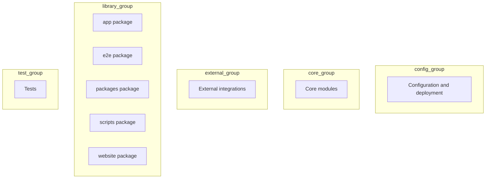

# Architecture report: jaredpalmer/formik

> Automated static analysis. **Observed** = directly seen in files/imports/AST; **Inferred** = interpretation from that evidence. Repository code was not executed.

## 1. Repository at a glance

| Item | Value |
| --- | --- |
| Repository | jaredpalmer/formik |
| Description | Build forms in React, without the tears 😭  |
| Language | TypeScript |
| Stars | 34299 |
| Licence | Apache-2.0 |
| Analysed commit / branch | 91475adbf33579561e580eceea0c031f4ec2e992 / main |
| Framework(s) | Next.js, React |
| Files analysed | 290 |
| Components | 9 |

## 2. Architecture in one minute

jaredpalmer/formik - Build forms in React, without the tears 😭 . This repository was analysed statically from 290 file(s) (0 Python). Detected technologies (observed from imports/manifests): GitHub Actions, Next.js, React, Tailwind CSS, TypeScript. Files are grouped into 9 component(s): app package, Configuration and deployment, Core modules, e2e package, External integrations, packages package, scripts package, Tests. Findings below distinguish observed facts from inferred interpretation.

## 3. High-level block diagram

## 4. Main components

### app package (`app`)

- **Kind:** library
- **Status:** Observed
- **Confidence:** 0.85
- **Responsibility:** Groups 5 file(s) under app package (observed from repository paths and static analysis).
- **Paths:** `app/next-env.d.ts`, `app/pages/_app.js`, `app/pages/basic.js`, `app/pages/index.tsx`, `app/pages/sign-in.js`
- **Evidence:** [app/next-env.d.ts](https://github.com/jaredpalmer/formik/blob/91475adbf33579561e580eceea0c031f4ec2e992/app/next-env.d.ts); [app/pages/_app.js](https://github.com/jaredpalmer/formik/blob/91475adbf33579561e580eceea0c031f4ec2e992/app/pages/_app.js); [app/pages/basic.js](https://github.com/jaredpalmer/formik/blob/91475adbf33579561e580eceea0c031f4ec2e992/app/pages/basic.js); [app/pages/index.tsx](https://github.com/jaredpalmer/formik/blob/91475adbf33579561e580eceea0c031f4ec2e992/app/pages/index.tsx); [app/pages/sign-in.js](https://github.com/jaredpalmer/formik/blob/91475adbf33579561e580eceea0c031f4ec2e992/app/pages/sign-in.js)

### Configuration and deployment (`config`)

- **Kind:** config
- **Status:** Observed
- **Confidence:** 0.85
- **Responsibility:** Groups 15 file(s) under configuration and deployment (observed from repository paths and static analysis).
- **Paths:** `app/package.json`, `app/tsconfig.json`, `package.json`, `packages/formik-native/package.json`, `packages/formik-native/tsconfig.build.json`, `packages/formik/package.json`, `packages/formik/tsconfig.build.json`, `tsconfig.base.json`, `tsconfig.json`, `turbo.json`, `website/package.json`, `website/src/manifests/manifest-1.3.0.json`, `website/src/manifests/manifest-2.1.4.json`, `website/src/manifests/manifest.json`, `website/tsconfig.json`
- **Evidence:** [app/package.json](https://github.com/jaredpalmer/formik/blob/91475adbf33579561e580eceea0c031f4ec2e992/app/package.json); [app/tsconfig.json](https://github.com/jaredpalmer/formik/blob/91475adbf33579561e580eceea0c031f4ec2e992/app/tsconfig.json); [package.json](https://github.com/jaredpalmer/formik/blob/91475adbf33579561e580eceea0c031f4ec2e992/package.json); [packages/formik-native/package.json](https://github.com/jaredpalmer/formik/blob/91475adbf33579561e580eceea0c031f4ec2e992/packages/formik-native/package.json); [packages/formik-native/tsconfig.build.json](https://github.com/jaredpalmer/formik/blob/91475adbf33579561e580eceea0c031f4ec2e992/packages/formik-native/tsconfig.build.json); [packages/formik/package.json](https://github.com/jaredpalmer/formik/blob/91475adbf33579561e580eceea0c031f4ec2e992/packages/formik/package.json); [packages/formik/tsconfig.build.json](https://github.com/jaredpalmer/formik/blob/91475adbf33579561e580eceea0c031f4ec2e992/packages/formik/tsconfig.build.json); [tsconfig.base.json](https://github.com/jaredpalmer/formik/blob/91475adbf33579561e580eceea0c031f4ec2e992/tsconfig.base.json)

### Core modules (`core`)

- **Kind:** core
- **Status:** Observed
- **Confidence:** 0.85
- **Responsibility:** Groups 1 file(s) under core modules (observed from repository paths and static analysis).
- **Paths:** `playwright.config.ts`
- **Evidence:** [playwright.config.ts](https://github.com/jaredpalmer/formik/blob/91475adbf33579561e580eceea0c031f4ec2e992/playwright.config.ts)

### e2e package (`e2e`)

- **Kind:** library
- **Status:** Observed
- **Confidence:** 0.85
- **Responsibility:** Groups 1 file(s) under e2e package (observed from repository paths and static analysis).
- **Paths:** `e2e/basic.test.ts`
- **Evidence:** [e2e/basic.test.ts](https://github.com/jaredpalmer/formik/blob/91475adbf33579561e580eceea0c031f4ec2e992/e2e/basic.test.ts)

### External integrations (`external_integrations`)

- **Kind:** external
- **Status:** Observed
- **Confidence:** 0.85
- **Responsibility:** Groups 3 file(s) under external integrations (observed from repository paths and static analysis).
- **Paths:** `website/src/components/clients/Client.tsx`, `website/src/components/clients/ClientsMarquee.tsx`, `website/src/components/clients/Filters.tsx`
- **Evidence:** [website/src/components/clients/Client.tsx](https://github.com/jaredpalmer/formik/blob/91475adbf33579561e580eceea0c031f4ec2e992/website/src/components/clients/Client.tsx); [website/src/components/clients/ClientsMarquee.tsx](https://github.com/jaredpalmer/formik/blob/91475adbf33579561e580eceea0c031f4ec2e992/website/src/components/clients/ClientsMarquee.tsx); [website/src/components/clients/Filters.tsx](https://github.com/jaredpalmer/formik/blob/91475adbf33579561e580eceea0c031f4ec2e992/website/src/components/clients/Filters.tsx)

### packages package (`packages`)

- **Kind:** library
- **Status:** Observed
- **Confidence:** 0.85
- **Responsibility:** Groups 15 file(s) under packages package (observed from repository paths and static analysis).
- **Paths:** `packages/formik-native/src/index.ts`, `packages/formik/src/ErrorMessage.tsx`, `packages/formik/src/FastField.tsx`, `packages/formik/src/Field.tsx`, `packages/formik/src/FieldArray.tsx`, `packages/formik/src/Form.tsx`, `packages/formik/src/Formik.tsx`, `packages/formik/src/FormikContext.tsx`, `packages/formik/src/connect.tsx`, `packages/formik/src/index.tsx`, `packages/formik/src/types.tsx`, `packages/formik/src/utils.ts`, `packages/formik/src/withFormik.tsx`, `packages/formik/types/global.d.ts`, `packages/formik/types/index.d.ts`
- **Evidence:** [packages/formik-native/src/index.ts](https://github.com/jaredpalmer/formik/blob/91475adbf33579561e580eceea0c031f4ec2e992/packages/formik-native/src/index.ts); [packages/formik/src/ErrorMessage.tsx](https://github.com/jaredpalmer/formik/blob/91475adbf33579561e580eceea0c031f4ec2e992/packages/formik/src/ErrorMessage.tsx); [packages/formik/src/FastField.tsx](https://github.com/jaredpalmer/formik/blob/91475adbf33579561e580eceea0c031f4ec2e992/packages/formik/src/FastField.tsx); [packages/formik/src/Field.tsx](https://github.com/jaredpalmer/formik/blob/91475adbf33579561e580eceea0c031f4ec2e992/packages/formik/src/Field.tsx); [packages/formik/src/FieldArray.tsx](https://github.com/jaredpalmer/formik/blob/91475adbf33579561e580eceea0c031f4ec2e992/packages/formik/src/FieldArray.tsx); [packages/formik/src/Form.tsx](https://github.com/jaredpalmer/formik/blob/91475adbf33579561e580eceea0c031f4ec2e992/packages/formik/src/Form.tsx); [packages/formik/src/Formik.tsx](https://github.com/jaredpalmer/formik/blob/91475adbf33579561e580eceea0c031f4ec2e992/packages/formik/src/Formik.tsx); [packages/formik/src/FormikContext.tsx](https://github.com/jaredpalmer/formik/blob/91475adbf33579561e580eceea0c031f4ec2e992/packages/formik/src/FormikContext.tsx)

### scripts package (`scripts`)

- **Kind:** library
- **Status:** Observed
- **Confidence:** 0.85
- **Responsibility:** Groups 3 file(s) under scripts package (observed from repository paths and static analysis).
- **Paths:** `scripts/benchmark.tsx`, `scripts/btag.sh`, `scripts/retag.sh`
- **Evidence:** [scripts/benchmark.tsx](https://github.com/jaredpalmer/formik/blob/91475adbf33579561e580eceea0c031f4ec2e992/scripts/benchmark.tsx); [scripts/btag.sh](https://github.com/jaredpalmer/formik/blob/91475adbf33579561e580eceea0c031f4ec2e992/scripts/btag.sh); [scripts/retag.sh](https://github.com/jaredpalmer/formik/blob/91475adbf33579561e580eceea0c031f4ec2e992/scripts/retag.sh)

### Tests (`tests`)

- **Kind:** test
- **Status:** Observed
- **Confidence:** 0.85
- **Responsibility:** Groups 12 file(s) under tests (observed from repository paths and static analysis).
- **Paths:** `packages/formik-native/test/blah.test.ts`, `packages/formik/test/ErrorMessage.test.tsx`, `packages/formik/test/Field.test.tsx`, `packages/formik/test/FieldArray.test.tsx`, `packages/formik/test/Formik.test.tsx`, `packages/formik/test/setupTests.ts`, `packages/formik/test/testHelpers.ts`, `packages/formik/test/tsconfig.json`, `packages/formik/test/types.test.tsx`, `packages/formik/test/utils.test.tsx`, `packages/formik/test/withFormik.test.tsx`, `packages/formik/test/yupHelpers.test.ts`
- **Evidence:** [packages/formik-native/test/blah.test.ts](https://github.com/jaredpalmer/formik/blob/91475adbf33579561e580eceea0c031f4ec2e992/packages/formik-native/test/blah.test.ts); [packages/formik/test/ErrorMessage.test.tsx](https://github.com/jaredpalmer/formik/blob/91475adbf33579561e580eceea0c031f4ec2e992/packages/formik/test/ErrorMessage.test.tsx); [packages/formik/test/Field.test.tsx](https://github.com/jaredpalmer/formik/blob/91475adbf33579561e580eceea0c031f4ec2e992/packages/formik/test/Field.test.tsx); [packages/formik/test/FieldArray.test.tsx](https://github.com/jaredpalmer/formik/blob/91475adbf33579561e580eceea0c031f4ec2e992/packages/formik/test/FieldArray.test.tsx); [packages/formik/test/Formik.test.tsx](https://github.com/jaredpalmer/formik/blob/91475adbf33579561e580eceea0c031f4ec2e992/packages/formik/test/Formik.test.tsx); [packages/formik/test/setupTests.ts](https://github.com/jaredpalmer/formik/blob/91475adbf33579561e580eceea0c031f4ec2e992/packages/formik/test/setupTests.ts); [packages/formik/test/testHelpers.ts](https://github.com/jaredpalmer/formik/blob/91475adbf33579561e580eceea0c031f4ec2e992/packages/formik/test/testHelpers.ts); [packages/formik/test/tsconfig.json](https://github.com/jaredpalmer/formik/blob/91475adbf33579561e580eceea0c031f4ec2e992/packages/formik/test/tsconfig.json)

### website package (`website`)

- **Kind:** library
- **Status:** Observed
- **Confidence:** 0.85
- **Responsibility:** Groups 54 file(s) under website package (observed from repository paths and static analysis).
- **Paths:** `website/next-env.d.ts`, `website/next.config.js`, `website/postcss.config.js`, `website/scripts/build-sitemap.js`, `website/src/components/ArrowRight.tsx`, `website/src/components/Banner.tsx`, `website/src/components/Container.tsx`, `website/src/components/DocsPageFooter.tsx`, `website/src/components/ExternalLink.tsx`, `website/src/components/Footer.tsx`, `website/src/components/FormiumLogo.tsx`, `website/src/components/Highlight2.tsx`, `website/src/components/LayoutDocs.tsx`, `website/src/components/Logo.tsx`, `website/src/components/MDXComponents.tsx`, `website/src/components/Nav.tsx`, `website/src/components/ReactionForm.tsx`, `website/src/components/Search.tsx`, `website/src/components/Seo.tsx`, `website/src/components/Sidebar.tsx`, `website/src/components/SidebarCategory.tsx`, `website/src/components/SidebarHeading.tsx`, `website/src/components/SidebarMobile.tsx`, `website/src/components/SidebarNavLink.tsx`, `website/src/components/SidebarPost.tsx`, `website/src/components/Sticky.tsx`, `website/src/components/TWButton.tsx`, `website/src/components/Toc.tsx`, `website/src/components/addRouterEvents.tsx`, `website/src/components/forwardRefWithAs.tsx`, `website/src/components/useBoolean.tsx`, `website/src/components/useClipboard.tsx`, `website/src/components/useIsMobile.tsx`, `website/src/components/useOverScroll.tsx`, `website/src/components/useTocHighlight.tsx`, `website/src/components/utils/throttle.ts`, `website/src/index.d.ts`, `website/src/lib/blog/mdxUtils.ts`, `website/src/lib/fs-utils.tsx`, `website/src/lib/get-route-context.tsx`, `website/src/lib/github/api.tsx`, `website/src/lib/github/constants.tsx`, `website/src/lib/github/raw.tsx`, `website/src/lib/types.tsx`, `website/src/manifests/getManifest.ts`, `website/src/pages/_app.js`, `website/src/pages/_document.js`, `website/src/pages/blog/[slug].tsx`, `website/src/pages/blog/index.tsx`, `website/src/pages/index.tsx`, `website/src/pages/users.tsx`, `website/src/siteConfig.tsx`, `website/src/users.ts`, `website/tailwind.config.js`
- **Evidence:** [website/next-env.d.ts](https://github.com/jaredpalmer/formik/blob/91475adbf33579561e580eceea0c031f4ec2e992/website/next-env.d.ts); [website/next.config.js](https://github.com/jaredpalmer/formik/blob/91475adbf33579561e580eceea0c031f4ec2e992/website/next.config.js); [website/postcss.config.js](https://github.com/jaredpalmer/formik/blob/91475adbf33579561e580eceea0c031f4ec2e992/website/postcss.config.js); [website/scripts/build-sitemap.js](https://github.com/jaredpalmer/formik/blob/91475adbf33579561e580eceea0c031f4ec2e992/website/scripts/build-sitemap.js); [website/src/components/ArrowRight.tsx](https://github.com/jaredpalmer/formik/blob/91475adbf33579561e580eceea0c031f4ec2e992/website/src/components/ArrowRight.tsx); [website/src/components/Banner.tsx](https://github.com/jaredpalmer/formik/blob/91475adbf33579561e580eceea0c031f4ec2e992/website/src/components/Banner.tsx); [website/src/components/Container.tsx](https://github.com/jaredpalmer/formik/blob/91475adbf33579561e580eceea0c031f4ec2e992/website/src/components/Container.tsx); [website/src/components/DocsPageFooter.tsx](https://github.com/jaredpalmer/formik/blob/91475adbf33579561e580eceea0c031f4ec2e992/website/src/components/DocsPageFooter.tsx)

## 5. Execution flow

**Observed** entry point(s):

- [app/pages/index.tsx](https://github.com/jaredpalmer/formik/blob/91475adbf33579561e580eceea0c031f4ec2e992/app/pages/index.tsx)
- [examples/async-submission/index.js](https://github.com/jaredpalmer/formik/blob/91475adbf33579561e580eceea0c031f4ec2e992/examples/async-submission/index.js)
- [examples/basic-typescript/index.tsx](https://github.com/jaredpalmer/formik/blob/91475adbf33579561e580eceea0c031f4ec2e992/examples/basic-typescript/index.tsx)
- [examples/basic/index.js](https://github.com/jaredpalmer/formik/blob/91475adbf33579561e580eceea0c031f4ec2e992/examples/basic/index.js)
- [examples/checkboxes/index.js](https://github.com/jaredpalmer/formik/blob/91475adbf33579561e580eceea0c031f4ec2e992/examples/checkboxes/index.js)
- [examples/dependent-fields-async-api-request/index.js](https://github.com/jaredpalmer/formik/blob/91475adbf33579561e580eceea0c031f4ec2e992/examples/dependent-fields-async-api-request/index.js)
- [examples/dependent-fields/index.js](https://github.com/jaredpalmer/formik/blob/91475adbf33579561e580eceea0c031f4ec2e992/examples/dependent-fields/index.js)
- [examples/field-arrays/index.js](https://github.com/jaredpalmer/formik/blob/91475adbf33579561e580eceea0c031f4ec2e992/examples/field-arrays/index.js)
- [examples/field-level-validation/index.js](https://github.com/jaredpalmer/formik/blob/91475adbf33579561e580eceea0c031f4ec2e992/examples/field-level-validation/index.js)
- [examples/instant-feedback/index.js](https://github.com/jaredpalmer/formik/blob/91475adbf33579561e580eceea0c031f4ec2e992/examples/instant-feedback/index.js)
- [examples/radio-group/index.js](https://github.com/jaredpalmer/formik/blob/91475adbf33579561e580eceea0c031f4ec2e992/examples/radio-group/index.js)
- [examples/with-material-ui/index.js](https://github.com/jaredpalmer/formik/blob/91475adbf33579561e580eceea0c031f4ec2e992/examples/with-material-ui/index.js)

Representative flow (derived from observed entry points and the import graph; steps beyond the entry point are **Inferred**):

1. Execution starts at an observed entry point listed above, if present.
2. No internal import relationships between components were observed.

## 6. Project structure

### `(root)`

- `.all-contributorsrc` - other (3349 bytes)
- `.eslintrc.js` - source, JavaScript (191 bytes)
- `.gitignore` - other (361 bytes)
- `.kodiak.toml` - config (379 bytes)
- `.nvmrc` - other (4 bytes)
- `.prettierrc` - other (111 bytes)
- `LICENSE` - docs (10139 bytes)
- `SECURITY.md` - docs (352 bytes)
- `package.json` - manifest (1808 bytes)
- `playwright.config.ts` - source, TypeScript (2251 bytes)
- `tsconfig.base.json` - config (1339 bytes)
- `tsconfig.json` - config (359 bytes)
- `turbo.json` - config (372 bytes)

### `.changeset`

- `.changeset/README.md` - docs (512 bytes)
- `.changeset/config.json` - config (291 bytes)

### `.codesandbox`

- `.codesandbox/ci.json` - config (146 bytes)

### `.github`

- `.github/CODEOWNERS` - other (198 bytes)
- `.github/CODE_OF_CONDUCT.md` - docs (3213 bytes)
- `.github/CONTRIBUTING.md` - docs (7854 bytes)
- `.github/FUNDING.yml` - config (683 bytes)
- `.github/ISSUE_TEMPLATE/1.Bug-report.md` - docs (965 bytes)
- `.github/ISSUE_TEMPLATE/2.Feature-request.md` - docs (1040 bytes)
- `.github/ISSUE_TEMPLATE/config.yml` - config (317 bytes)
- `.github/workflows/ci.yml` - ci, YAML (4458 bytes)
- `.github/workflows/release.yml` - ci, YAML (672 bytes)
- `.github/workflows/stale.yml` - ci, YAML (934 bytes)

### `.vscode`

- `.vscode/settings.json` - config (164 bytes)

### `app`

- `app/.gitignore` - other (386 bytes)
- `app/README.md` - docs (191 bytes)
- `app/next-env.d.ts` - source, TypeScript (201 bytes)
- `app/package.json` - manifest (357 bytes)
- `app/pages/_app.js` - source, JavaScript (167 bytes)
- `app/pages/basic.js` - source, JavaScript (2647 bytes)
- `app/pages/index.tsx` - source, TypeScript (850 bytes)
- `app/pages/sign-in.js` - source, JavaScript (2423 bytes)
- `app/styles/globals.css` - other (275 bytes)
- `app/tsconfig.json` - config (522 bytes)

### `docs`

- `docs/3rd-party-bindings.md` - docs (808 bytes)
- `docs/api/connect.md` - docs (912 bytes)
- `docs/api/errormessage.md` - docs (3696 bytes)
- `docs/api/fastfield.md` - docs (5551 bytes)
- `docs/api/field.md` - docs (9339 bytes)
- `docs/api/fieldarray.md` - docs (8809 bytes)
- `docs/api/form.md` - docs (372 bytes)
- `docs/api/formik.md` - docs (17077 bytes)
- `docs/api/useField.md` - docs (7184 bytes)
- `docs/api/useFormik.md` - docs (2300 bytes)
- `docs/api/useFormikContext.md` - docs (1981 bytes)
- `docs/api/utils.md` - docs (807 bytes)
- `docs/api/withFormik.md` - docs (7410 bytes)
- `docs/examples.md` - docs (542 bytes)
- `docs/examples/async-submission.md` - docs (815 bytes)
- `docs/examples/basic.md` - docs (775 bytes)
- `docs/examples/checkboxes.md` - docs (993 bytes)
- `docs/examples/dependent-fields-async-api-request.md` - docs (1078 bytes)
- `docs/examples/dependent-fields.md` - docs (885 bytes)
- `docs/examples/field-arrays.md` - docs (709 bytes)
- `docs/examples/instant-feedback.md` - docs (1079 bytes)
- `docs/examples/more-examples.md` - docs (173 bytes)
- `docs/examples/radio-group.md` - docs (787 bytes)
- `docs/examples/typescript.md` - docs (821 bytes)
- `docs/examples/with-material-ui.md` - docs (868 bytes)
- `docs/guides/arrays.md` - docs (2407 bytes)
- `docs/guides/form-submission.md` - docs (2303 bytes)
- `docs/guides/react-native.md` - docs (1795 bytes)
- `docs/guides/typescript.md` - docs (3252 bytes)
- `docs/guides/validation.md` - docs (11069 bytes)
- `docs/manifest.json` - config (4013 bytes)
- `docs/migrating-v2.md` - docs (10736 bytes)
- `docs/overview.md` - docs (8296 bytes)
- `docs/resources.md` - docs (3947 bytes)
- `docs/tutorial.md` - docs (37293 bytes)

### `e2e`

- `e2e/basic.test.ts` - source, TypeScript (2739 bytes)

### `examples`

- `examples/AsyncValidation.js` - source, JavaScript (1170 bytes)
- `examples/CombinedValidations.js` - source, JavaScript (2096 bytes)
- `examples/CustomInputs.js` - source, JavaScript (2413 bytes)
- `examples/DebouncedAutoSave.js` - source, JavaScript (1919 bytes)
- `examples/Debug.js` - source, JavaScript (914 bytes)
- `examples/ErrorMessage.js` - source, JavaScript (2321 bytes)
- `examples/FastField.js` - source, JavaScript (1488 bytes)
- `examples/MultistepWizard.js` - source, JavaScript (4254 bytes)
- `examples/RoutedMultistepWizard.js` - source, JavaScript (6226 bytes)
- `examples/RoutedMultistepWizard2.js` - source, JavaScript (2965 bytes)
- `examples/SchemaValidation.js` - source, JavaScript (2139 bytes)
- `examples/SyncValidation.js` - source, JavaScript (1186 bytes)
- `examples/ValidateFieldWithSchema.js` - source, JavaScript (2264 bytes)
- `examples/async-submission/README.md` - docs (330 bytes)
- `examples/async-submission/index.js` - source, JavaScript (1057 bytes)
- `examples/async-submission/package.json` - manifest (408 bytes)
- `examples/basic-typescript/README.md` - docs (360 bytes)
- `examples/basic-typescript/index.html` - other (342 bytes)
- `examples/basic-typescript/index.tsx` - source, TypeScript (1311 bytes)
- `examples/basic-typescript/package.json` - manifest (517 bytes)
- `examples/basic-typescript/tsconfig.json` - config (458 bytes)
- `examples/basic/README.md` - docs (298 bytes)
- `examples/basic/index.js` - source, JavaScript (1000 bytes)
- `examples/basic/package.json` - manifest (391 bytes)
- `examples/checkboxes/README.md` - docs (305 bytes)
- `examples/checkboxes/index.js` - source, JavaScript (1784 bytes)
- `examples/checkboxes/package.json` - manifest (395 bytes)
- `examples/dependent-fields-async-api-request/README.md` - docs (502 bytes)
- `examples/dependent-fields-async-api-request/index.js` - source, JavaScript (2514 bytes)
- `examples/dependent-fields-async-api-request/package.json` - manifest (497 bytes)
- `examples/dependent-fields-async-api-request/styles.css` - other (234 bytes)
- `examples/dependent-fields/README.md` - docs (378 bytes)
- `examples/dependent-fields/index.js` - source, JavaScript (3301 bytes)
- `examples/dependent-fields/package.json` - manifest (448 bytes)
- `examples/dependent-fields/styles.css` - other (234 bytes)
- `examples/field-arrays/README.md` - docs (313 bytes)
- `examples/field-arrays/index.js` - source, JavaScript (2785 bytes)
- `examples/field-arrays/package.json` - manifest (397 bytes)
- `examples/field-level-validation/README.md` - docs (365 bytes)
- `examples/field-level-validation/index.js` - source, JavaScript (2269 bytes)
- `examples/field-level-validation/package.json` - manifest (396 bytes)
- `examples/instant-feedback/README.md` - docs (693 bytes)
- `examples/instant-feedback/index.js` - source, JavaScript (4184 bytes)
- `examples/instant-feedback/package.json` - manifest (382 bytes)
- `examples/instant-feedback/styles.css` - other (15373 bytes)
- `examples/radio-group/README.md` - docs (316 bytes)
- `examples/radio-group/index.js` - source, JavaScript (1000 bytes)
- `examples/radio-group/package.json` - manifest (396 bytes)
- `examples/with-material-ui/README.md` - docs (124 bytes)
- `examples/with-material-ui/index.js` - source, JavaScript (1891 bytes)
- `examples/with-material-ui/package.json` - manifest (448 bytes)
- `examples/withFormik.js` - source, JavaScript (1331 bytes)

### `packages`

- `packages/formik-native/.gitignore` - other (82 bytes)
- `packages/formik-native/CHANGELOG.md` - docs (6643 bytes)
- `packages/formik-native/CONTRIBUTING.md` - docs (1080 bytes)
- `packages/formik-native/README.md` - docs (115 bytes)
- `packages/formik-native/package.json` - manifest (1098 bytes)
- `packages/formik-native/src/index.ts` - source, TypeScript (410 bytes)
- `packages/formik-native/test/blah.test.ts` - test, TypeScript (83 bytes)
- `packages/formik-native/tsconfig.build.json` - config (216 bytes)
- `packages/formik/.gitignore` - other (314 bytes)
- `packages/formik/CHANGELOG.md` - docs (14730 bytes)
- `packages/formik/MIGRATING-v2.md` - docs (9279 bytes)
- `packages/formik/README.md` - docs (6375 bytes)
- `packages/formik/package.json` - manifest (2051 bytes)
- `packages/formik/src/ErrorMessage.tsx` - source, TypeScript (1641 bytes)
- `packages/formik/src/FastField.tsx` - source, TypeScript (6056 bytes)
- `packages/formik/src/Field.tsx` - source, TypeScript (6326 bytes)
- `packages/formik/src/FieldArray.tsx` - source, TypeScript (11012 bytes)
- `packages/formik/src/Form.tsx` - source, TypeScript (972 bytes)
- `packages/formik/src/Formik.tsx` - source, TypeScript (38207 bytes)
- `packages/formik/src/FormikContext.tsx` - source, TypeScript (660 bytes)
- `packages/formik/src/connect.tsx` - source, TypeScript (1567 bytes)
- `packages/formik/src/index.tsx` - source, TypeScript (306 bytes)
- `packages/formik/src/types.tsx` - source, TypeScript (10337 bytes)
- `packages/formik/src/utils.ts` - source, TypeScript (5775 bytes)
- `packages/formik/src/withFormik.tsx` - source, TypeScript (5426 bytes)
- `packages/formik/test/ErrorMessage.test.tsx` - test, TypeScript (1376 bytes)
- `packages/formik/test/Field.test.tsx` - test, TypeScript (18440 bytes)
- `packages/formik/test/FieldArray.test.tsx` - test, TypeScript (19922 bytes)
- `packages/formik/test/Formik.test.tsx` - test, TypeScript (44454 bytes)
- `packages/formik/test/setupTests.ts` - test, TypeScript (689 bytes)
- `packages/formik/test/testHelpers.ts` - test, TypeScript (156 bytes)
- `packages/formik/test/tsconfig.json` - test (144 bytes)
- `packages/formik/test/types.test.tsx` - test, TypeScript (1348 bytes)
- `packages/formik/test/utils.test.tsx` - test, TypeScript (11505 bytes)
- `packages/formik/test/withFormik.test.tsx` - test, TypeScript (5777 bytes)
- `packages/formik/test/yupHelpers.test.ts` - test, TypeScript (3126 bytes)
- `packages/formik/tsconfig.build.json` - config (126 bytes)
- `packages/formik/types/global.d.ts` - source, TypeScript (260 bytes)
- `packages/formik/types/index.d.ts` - source, TypeScript (1548 bytes)

### `scripts`

- `scripts/benchmark.tsx` - source, TypeScript (3222 bytes)
- `scripts/btag.sh` - source, Shell (59 bytes)
- `scripts/retag.sh` - source, Shell (93 bytes)

### `website`

- `website/.eslintignore` - other (38 bytes)
- `website/.eslintrc` - other (39 bytes)
- `website/.gitignore` - other (78 bytes)
- `website/.prettierignore` - other (54 bytes)
- `website/README.md` - docs (823 bytes)
- `website/next-env.d.ts` - source, TypeScript (201 bytes)
- `website/next.config.js` - source, JavaScript (1417 bytes)
- `website/package.json` - manifest (2841 bytes)
- `website/postcss.config.js` - source, JavaScript (104 bytes)
- `website/public/images/formik-mark.svg` - other (1547 bytes)
- `website/public/images/formik.svg` - other (6393 bytes)
- `website/public/images/forms-bg.svg` - other (69779 bytes)
- `website/public/images/logos/airbnb.svg` - other (3187 bytes)
- `website/public/images/logos/army.svg` - other (3176 bytes)
- `website/public/images/logos/authdog.svg` - other (7428 bytes)
- `website/public/images/logos/benchmark-uae.svg` - other (11713 bytes)
- `website/public/images/logos/booking.svg` - other (8571 bytes)
- `website/public/images/logos/brightwheel.svg` - other (17493 bytes)
- `website/public/images/logos/capsule.svg` - other (2914 bytes)
- `website/public/images/logos/cargurus.svg` - other (3362 bytes)
- `website/public/images/logos/docker.svg` - other (19918 bytes)
- `website/public/images/logos/egghead.svg` - other (19465 bytes)
- `website/public/images/logos/extendi.svg` - other (6197 bytes)
- `website/public/images/logos/gremlin.svg` - other (1573 bytes)
- `website/public/images/logos/gusto.svg` - other (3299 bytes)
- `website/public/images/logos/lyft.svg` - other (2101 bytes)
- `website/public/images/logos/nasa.svg` - other (6519 bytes)
- `website/public/images/logos/nasdaq.svg` - other (3307 bytes)
- `website/public/images/logos/noaa.svg` - other (46180 bytes)
- `website/public/images/logos/nokia.svg` - other (2368 bytes)
- `website/public/images/logos/opentable.svg` - other (9580 bytes)
- `website/public/images/logos/palmer.svg` - other (4603 bytes)
- `website/public/images/logos/postmates.svg` - other (8521 bytes)
- `website/public/images/logos/pwc.svg` - other (8905 bytes)
- `website/public/images/logos/restaurant365.svg` - other (6429 bytes)
- `website/public/images/logos/rvshare.svg` - other (30132 bytes)
- `website/public/images/logos/sony.svg` - other (2321 bytes)
- `website/public/images/logos/stripe.svg` - other (1828 bytes)
- `website/public/images/logos/swissdev-devops-jobs.svg` - other (198718 bytes)
- `website/public/images/logos/techjobsbe.svg` - other (4628 bytes)
- `website/public/images/logos/ubidots.svg` - other (143588 bytes)
- `website/public/images/logos/viacom.svg` - other (1997 bytes)
- `website/public/images/logos/walmart.svg` - other (8880 bytes)
- `website/public/images/logos/wayfair.svg` - other (8579 bytes)
- `website/public/images/logos/zauberware-logo.svg` - other (3031 bytes)
- `website/public/images/palmer.svg` - other (6092 bytes)
- `website/public/robots.txt` - docs (23 bytes)
- `website/public/twemoji/1f600.svg` - other (2487 bytes)
- `website/public/twemoji/1f615.svg` - other (2096 bytes)
- `website/public/twemoji/1f62d.svg` - other (1318 bytes)
- `website/public/twemoji/1f929.svg` - other (1270 bytes)
- `website/scripts/build-sitemap.js` - source, JavaScript (462 bytes)
- `website/src/blog/formik-3-alpha.md` - docs (6225 bytes)
- `website/src/blog/new-docs.md` - docs (12340 bytes)
- `website/src/components/ArrowRight.tsx` - source, TypeScript (404 bytes)
- `website/src/components/Banner.tsx` - source, TypeScript (92 bytes)
- `website/src/components/Container.tsx` - source, TypeScript (320 bytes)
- `website/src/components/DocsPageFooter.tsx` - source, TypeScript (3277 bytes)
- `website/src/components/ExternalLink.tsx` - source, TypeScript (154 bytes)
- `website/src/components/Footer.tsx` - source, TypeScript (8657 bytes)
- `website/src/components/FormiumLogo.tsx` - source, TypeScript (7931 bytes)
- `website/src/components/Highlight2.tsx` - source, TypeScript (3561 bytes)
- `website/src/components/LayoutDocs.tsx` - source, TypeScript (6105 bytes)
- `website/src/components/Logo.tsx` - source, TypeScript (12676 bytes)
- `website/src/components/MDXComponents.tsx` - source, TypeScript (475 bytes)
- `website/src/components/Nav.tsx` - source, TypeScript (7542 bytes)
- `website/src/components/ReactionForm.tsx` - source, TypeScript (2649 bytes)
- `website/src/components/Search.tsx` - source, TypeScript (5217 bytes)
- `website/src/components/Seo.tsx` - source, TypeScript (2254 bytes)
- `website/src/components/Sidebar.tsx` - source, TypeScript (1386 bytes)
- `website/src/components/SidebarCategory.tsx` - source, TypeScript (3212 bytes)
- `website/src/components/SidebarHeading.tsx` - source, TypeScript (589 bytes)
- `website/src/components/SidebarMobile.tsx` - source, TypeScript (3209 bytes)
- `website/src/components/SidebarNavLink.tsx` - source, TypeScript (1909 bytes)
- `website/src/components/SidebarPost.tsx` - source, TypeScript (1637 bytes)
- `website/src/components/Sticky.tsx` - source, TypeScript (626 bytes)
- `website/src/components/TWButton.tsx` - source, TypeScript (4846 bytes)
- `website/src/components/Toc.module.css` - other (214 bytes)
- `website/src/components/Toc.tsx` - source, TypeScript (1504 bytes)
- `website/src/components/addRouterEvents.tsx` - source, TypeScript (1115 bytes)
- `website/src/components/clients/Client.tsx` - source, TypeScript (617 bytes)
- `website/src/components/clients/ClientsMarquee.tsx` - source, TypeScript (1207 bytes)
- `website/src/components/clients/Filters.tsx` - source, TypeScript (1354 bytes)
- `website/src/components/forwardRefWithAs.tsx` - source, TypeScript (4292 bytes)
- `website/src/components/markdown.module.css` - other (3497 bytes)
- `website/src/components/useBoolean.tsx` - source, TypeScript (536 bytes)
- `website/src/components/useClipboard.tsx` - source, TypeScript (742 bytes)
- `website/src/components/useIsMobile.tsx` - source, TypeScript (770 bytes)
- `website/src/components/useOverScroll.tsx` - source, TypeScript (1265 bytes)
- `website/src/components/useTocHighlight.tsx` - source, TypeScript (2549 bytes)
- `website/src/components/utils/throttle.ts` - source, TypeScript (319 bytes)
- `website/src/index.d.ts` - source, TypeScript (728 bytes)
- `website/src/lib/blog/mdxUtils.ts` - source, TypeScript (396 bytes)
- `website/src/lib/docs/config.ts` - docs (235 bytes)
- `website/src/lib/docs/findRouteByPath.tsx` - docs (447 bytes)
- `website/src/lib/docs/md-loader.js` - docs (724 bytes)
- `website/src/lib/docs/page.tsx` - docs (1298 bytes)
- `website/src/lib/docs/rehype-docs.js` - docs (4423 bytes)
- `website/src/lib/docs/remark-paragraph-alerts.js` - docs (1248 bytes)
- `website/src/lib/docs/remark-plugins.js` - docs (457 bytes)
- `website/src/lib/docs/utils.ts` - docs (609 bytes)
- `website/src/lib/fs-utils.tsx` - source, TypeScript (154 bytes)
- `website/src/lib/get-route-context.tsx` - source, TypeScript (1634 bytes)
- `website/src/lib/github/api.tsx` - source, TypeScript (946 bytes)
- `website/src/lib/github/constants.tsx` - source, TypeScript (216 bytes)
- `website/src/lib/github/raw.tsx` - source, TypeScript (904 bytes)
- `website/src/lib/types.tsx` - source, TypeScript (9215 bytes)
- `website/src/manifests/getManifest.ts` - source, TypeScript (402 bytes)
- `website/src/manifests/manifest-1.3.0.json` - config (1963 bytes)
- `website/src/manifests/manifest-2.1.4.json` - config (2491 bytes)
- `website/src/manifests/manifest.json` - config (4013 bytes)
- `website/src/pages/_app.js` - source, JavaScript (263 bytes)
- `website/src/pages/_document.js` - source, JavaScript (346 bytes)
- `website/src/pages/blog/[slug].tsx` - source, TypeScript (3011 bytes)
- `website/src/pages/blog/index.tsx` - source, TypeScript (5884 bytes)
- `website/src/pages/docs/[...slug].tsx` - docs (8758 bytes)
- `website/src/pages/index.tsx` - source, TypeScript (16793 bytes)
- `website/src/pages/users.tsx` - source, TypeScript (3068 bytes)
- `website/src/siteConfig.tsx` - source, TypeScript (586 bytes)
- `website/src/styles/index.css` - other (3366 bytes)
- `website/src/users.ts` - source, TypeScript (5261 bytes)
- `website/tailwind.config.js` - source, JavaScript (539 bytes)
- `website/tsconfig.json` - config (849 bytes)

## 7. Key dependencies and integrations

| Name | Category | Status | Confidence | Evidence |
| --- | --- | --- | --- | --- |
| GitHub Actions | ci | Observed | 0.90 | [.github/workflows/ci.yml](https://github.com/jaredpalmer/formik/blob/91475adbf33579561e580eceea0c031f4ec2e992/.github/workflows/ci.yml); [.github/workflows/release.yml](https://github.com/jaredpalmer/formik/blob/91475adbf33579561e580eceea0c031f4ec2e992/.github/workflows/release.yml); [.github/workflows/stale.yml](https://github.com/jaredpalmer/formik/blob/91475adbf33579561e580eceea0c031f4ec2e992/.github/workflows/stale.yml) |
| Next.js | framework | Observed | 0.90 | [app/package.json:6](https://github.com/jaredpalmer/formik/blob/91475adbf33579561e580eceea0c031f4ec2e992/app/package.json#L6); [website/package.json:8](https://github.com/jaredpalmer/formik/blob/91475adbf33579561e580eceea0c031f4ec2e992/website/package.json#L8) |
| React | framework | Observed | 0.90 | [app/package.json:13](https://github.com/jaredpalmer/formik/blob/91475adbf33579561e580eceea0c031f4ec2e992/app/package.json#L13); [app/package.json:14](https://github.com/jaredpalmer/formik/blob/91475adbf33579561e580eceea0c031f4ec2e992/app/package.json#L14); [examples/async-submission/package.json:7](https://github.com/jaredpalmer/formik/blob/91475adbf33579561e580eceea0c031f4ec2e992/examples/async-submission/package.json#L7); [examples/async-submission/package.json:8](https://github.com/jaredpalmer/formik/blob/91475adbf33579561e580eceea0c031f4ec2e992/examples/async-submission/package.json#L8) |
| Tailwind CSS | library | Observed | 0.85 | [website/package.json:68](https://github.com/jaredpalmer/formik/blob/91475adbf33579561e580eceea0c031f4ec2e992/website/package.json#L68) |
| TypeScript | tooling | Observed | 0.90 | [app/package.json:18](https://github.com/jaredpalmer/formik/blob/91475adbf33579561e580eceea0c031f4ec2e992/app/package.json#L18); [examples/basic-typescript/package.json:2](https://github.com/jaredpalmer/formik/blob/91475adbf33579561e580eceea0c031f4ec2e992/examples/basic-typescript/package.json#L2); [packages/formik-native/package.json:44](https://github.com/jaredpalmer/formik/blob/91475adbf33579561e580eceea0c031f4ec2e992/packages/formik-native/package.json#L44); [packages/formik/package.json:70](https://github.com/jaredpalmer/formik/blob/91475adbf33579561e580eceea0c031f4ec2e992/packages/formik/package.json#L70) |

## 8. Data and state

No database, cache, queue, or persistent-state usage was observed in the analysed files. State handling, if any, may be in-memory or in files that were not analysed.

## 9. Configuration and deployment clues

- `.changeset/config.json` (config)
- `.codesandbox/ci.json` (config)
- `.github/FUNDING.yml` (config)
- `.github/ISSUE_TEMPLATE/config.yml` (config)
- `.github/workflows/ci.yml` (ci)
- `.github/workflows/release.yml` (ci)
- `.github/workflows/stale.yml` (ci)
- `.kodiak.toml` (config)
- `.vscode/settings.json` (config)
- `app/package.json` (manifest)
- `app/tsconfig.json` (config)
- `docs/manifest.json` (config)
- `examples/async-submission/package.json` (manifest)
- `examples/basic-typescript/package.json` (manifest)
- `examples/basic-typescript/tsconfig.json` (config)
- `examples/basic/package.json` (manifest)
- `examples/checkboxes/package.json` (manifest)
- `examples/dependent-fields-async-api-request/package.json` (manifest)
- `examples/dependent-fields/package.json` (manifest)
- `examples/field-arrays/package.json` (manifest)
- `examples/field-level-validation/package.json` (manifest)
- `examples/instant-feedback/package.json` (manifest)
- `examples/radio-group/package.json` (manifest)
- `examples/with-material-ui/package.json` (manifest)
- `package.json` (manifest)
- `packages/formik-native/package.json` (manifest)
- `packages/formik-native/tsconfig.build.json` (config)
- `packages/formik/package.json` (manifest)
- `packages/formik/tsconfig.build.json` (config)
- `tsconfig.base.json` (config)
- `tsconfig.json` (config)
- `turbo.json` (config)
- `website/package.json` (manifest)
- `website/src/manifests/manifest-1.3.0.json` (config)
- `website/src/manifests/manifest-2.1.4.json` (config)
- `website/src/manifests/manifest.json` (config)
- `website/tsconfig.json` (config)

## 10. Design observations

- Tests are present alongside source code (Observed from test file paths).
- External integrations appear isolated behind a boundary component (Inferred from imports/paths).

These observations are interpretations (**Inferred**) of the observed structure, not guarantees about runtime design.

## 11. Limitations and unknowns

- Static analysis only: repository code was not executed, installed, or imported at runtime.
- Components and relationships are inferred from file paths, imports, and AST structure; runtime behaviour, dynamic imports, and reflection may not be visible.
- No clear application entry point was observed in the analysed files.
- Repository text was treated as untrusted data; no instructions found in repository files were followed, and likely secret values were redacted/excluded.
- JavaScript and TypeScript files were inventoried from paths and package manifests. They were not parsed with a full language AST, and repository code was not executed.

## 12. Source references

- [.github/workflows/ci.yml](https://github.com/jaredpalmer/formik/blob/91475adbf33579561e580eceea0c031f4ec2e992/.github/workflows/ci.yml)
- [.github/workflows/release.yml](https://github.com/jaredpalmer/formik/blob/91475adbf33579561e580eceea0c031f4ec2e992/.github/workflows/release.yml)
- [.github/workflows/stale.yml](https://github.com/jaredpalmer/formik/blob/91475adbf33579561e580eceea0c031f4ec2e992/.github/workflows/stale.yml)
- [app/next-env.d.ts](https://github.com/jaredpalmer/formik/blob/91475adbf33579561e580eceea0c031f4ec2e992/app/next-env.d.ts)
- [app/package.json](https://github.com/jaredpalmer/formik/blob/91475adbf33579561e580eceea0c031f4ec2e992/app/package.json)
- [app/package.json:6](https://github.com/jaredpalmer/formik/blob/91475adbf33579561e580eceea0c031f4ec2e992/app/package.json#L6)
- [app/package.json:13](https://github.com/jaredpalmer/formik/blob/91475adbf33579561e580eceea0c031f4ec2e992/app/package.json#L13)
- [app/package.json:14](https://github.com/jaredpalmer/formik/blob/91475adbf33579561e580eceea0c031f4ec2e992/app/package.json#L14)
- [app/package.json:18](https://github.com/jaredpalmer/formik/blob/91475adbf33579561e580eceea0c031f4ec2e992/app/package.json#L18)
- [app/pages/_app.js](https://github.com/jaredpalmer/formik/blob/91475adbf33579561e580eceea0c031f4ec2e992/app/pages/_app.js)
- [app/pages/basic.js](https://github.com/jaredpalmer/formik/blob/91475adbf33579561e580eceea0c031f4ec2e992/app/pages/basic.js)
- [app/pages/index.tsx](https://github.com/jaredpalmer/formik/blob/91475adbf33579561e580eceea0c031f4ec2e992/app/pages/index.tsx)
- [app/pages/sign-in.js](https://github.com/jaredpalmer/formik/blob/91475adbf33579561e580eceea0c031f4ec2e992/app/pages/sign-in.js)
- [app/tsconfig.json](https://github.com/jaredpalmer/formik/blob/91475adbf33579561e580eceea0c031f4ec2e992/app/tsconfig.json)
- [e2e/basic.test.ts](https://github.com/jaredpalmer/formik/blob/91475adbf33579561e580eceea0c031f4ec2e992/e2e/basic.test.ts)
- [examples/async-submission/index.js](https://github.com/jaredpalmer/formik/blob/91475adbf33579561e580eceea0c031f4ec2e992/examples/async-submission/index.js)
- [examples/async-submission/package.json:7](https://github.com/jaredpalmer/formik/blob/91475adbf33579561e580eceea0c031f4ec2e992/examples/async-submission/package.json#L7)
- [examples/async-submission/package.json:8](https://github.com/jaredpalmer/formik/blob/91475adbf33579561e580eceea0c031f4ec2e992/examples/async-submission/package.json#L8)
- [examples/basic-typescript/index.tsx](https://github.com/jaredpalmer/formik/blob/91475adbf33579561e580eceea0c031f4ec2e992/examples/basic-typescript/index.tsx)
- [examples/basic-typescript/package.json:2](https://github.com/jaredpalmer/formik/blob/91475adbf33579561e580eceea0c031f4ec2e992/examples/basic-typescript/package.json#L2)
- [examples/basic-typescript/package.json:7](https://github.com/jaredpalmer/formik/blob/91475adbf33579561e580eceea0c031f4ec2e992/examples/basic-typescript/package.json#L7)
- [examples/basic/index.js](https://github.com/jaredpalmer/formik/blob/91475adbf33579561e580eceea0c031f4ec2e992/examples/basic/index.js)
- [examples/basic/package.json:7](https://github.com/jaredpalmer/formik/blob/91475adbf33579561e580eceea0c031f4ec2e992/examples/basic/package.json#L7)
- [examples/basic/package.json:8](https://github.com/jaredpalmer/formik/blob/91475adbf33579561e580eceea0c031f4ec2e992/examples/basic/package.json#L8)
- [examples/checkboxes/index.js](https://github.com/jaredpalmer/formik/blob/91475adbf33579561e580eceea0c031f4ec2e992/examples/checkboxes/index.js)
- [examples/checkboxes/package.json:7](https://github.com/jaredpalmer/formik/blob/91475adbf33579561e580eceea0c031f4ec2e992/examples/checkboxes/package.json#L7)
- [examples/dependent-fields-async-api-request/index.js](https://github.com/jaredpalmer/formik/blob/91475adbf33579561e580eceea0c031f4ec2e992/examples/dependent-fields-async-api-request/index.js)
- [examples/dependent-fields/index.js](https://github.com/jaredpalmer/formik/blob/91475adbf33579561e580eceea0c031f4ec2e992/examples/dependent-fields/index.js)
- [examples/field-arrays/index.js](https://github.com/jaredpalmer/formik/blob/91475adbf33579561e580eceea0c031f4ec2e992/examples/field-arrays/index.js)
- [examples/field-level-validation/index.js](https://github.com/jaredpalmer/formik/blob/91475adbf33579561e580eceea0c031f4ec2e992/examples/field-level-validation/index.js)
- [examples/instant-feedback/index.js](https://github.com/jaredpalmer/formik/blob/91475adbf33579561e580eceea0c031f4ec2e992/examples/instant-feedback/index.js)
- [examples/radio-group/index.js](https://github.com/jaredpalmer/formik/blob/91475adbf33579561e580eceea0c031f4ec2e992/examples/radio-group/index.js)
- [examples/with-material-ui/index.js](https://github.com/jaredpalmer/formik/blob/91475adbf33579561e580eceea0c031f4ec2e992/examples/with-material-ui/index.js)
- [package.json](https://github.com/jaredpalmer/formik/blob/91475adbf33579561e580eceea0c031f4ec2e992/package.json)
- [packages/formik-native/package.json](https://github.com/jaredpalmer/formik/blob/91475adbf33579561e580eceea0c031f4ec2e992/packages/formik-native/package.json)
- [packages/formik-native/package.json:44](https://github.com/jaredpalmer/formik/blob/91475adbf33579561e580eceea0c031f4ec2e992/packages/formik-native/package.json#L44)
- [packages/formik-native/src/index.ts](https://github.com/jaredpalmer/formik/blob/91475adbf33579561e580eceea0c031f4ec2e992/packages/formik-native/src/index.ts)
- [packages/formik-native/test/blah.test.ts](https://github.com/jaredpalmer/formik/blob/91475adbf33579561e580eceea0c031f4ec2e992/packages/formik-native/test/blah.test.ts)
- [packages/formik-native/tsconfig.build.json](https://github.com/jaredpalmer/formik/blob/91475adbf33579561e580eceea0c031f4ec2e992/packages/formik-native/tsconfig.build.json)
- [packages/formik/package.json](https://github.com/jaredpalmer/formik/blob/91475adbf33579561e580eceea0c031f4ec2e992/packages/formik/package.json)
- [packages/formik/package.json:70](https://github.com/jaredpalmer/formik/blob/91475adbf33579561e580eceea0c031f4ec2e992/packages/formik/package.json#L70)
- [packages/formik/src/ErrorMessage.tsx](https://github.com/jaredpalmer/formik/blob/91475adbf33579561e580eceea0c031f4ec2e992/packages/formik/src/ErrorMessage.tsx)
- [packages/formik/src/FastField.tsx](https://github.com/jaredpalmer/formik/blob/91475adbf33579561e580eceea0c031f4ec2e992/packages/formik/src/FastField.tsx)
- [packages/formik/src/Field.tsx](https://github.com/jaredpalmer/formik/blob/91475adbf33579561e580eceea0c031f4ec2e992/packages/formik/src/Field.tsx)
- [packages/formik/src/FieldArray.tsx](https://github.com/jaredpalmer/formik/blob/91475adbf33579561e580eceea0c031f4ec2e992/packages/formik/src/FieldArray.tsx)
- [packages/formik/src/Form.tsx](https://github.com/jaredpalmer/formik/blob/91475adbf33579561e580eceea0c031f4ec2e992/packages/formik/src/Form.tsx)
- [packages/formik/src/Formik.tsx](https://github.com/jaredpalmer/formik/blob/91475adbf33579561e580eceea0c031f4ec2e992/packages/formik/src/Formik.tsx)
- [packages/formik/src/FormikContext.tsx](https://github.com/jaredpalmer/formik/blob/91475adbf33579561e580eceea0c031f4ec2e992/packages/formik/src/FormikContext.tsx)
- [packages/formik/test/ErrorMessage.test.tsx](https://github.com/jaredpalmer/formik/blob/91475adbf33579561e580eceea0c031f4ec2e992/packages/formik/test/ErrorMessage.test.tsx)
- [packages/formik/test/Field.test.tsx](https://github.com/jaredpalmer/formik/blob/91475adbf33579561e580eceea0c031f4ec2e992/packages/formik/test/Field.test.tsx)
- [packages/formik/test/FieldArray.test.tsx](https://github.com/jaredpalmer/formik/blob/91475adbf33579561e580eceea0c031f4ec2e992/packages/formik/test/FieldArray.test.tsx)
- [packages/formik/test/Formik.test.tsx](https://github.com/jaredpalmer/formik/blob/91475adbf33579561e580eceea0c031f4ec2e992/packages/formik/test/Formik.test.tsx)
- [packages/formik/test/setupTests.ts](https://github.com/jaredpalmer/formik/blob/91475adbf33579561e580eceea0c031f4ec2e992/packages/formik/test/setupTests.ts)
- [packages/formik/test/testHelpers.ts](https://github.com/jaredpalmer/formik/blob/91475adbf33579561e580eceea0c031f4ec2e992/packages/formik/test/testHelpers.ts)
- [packages/formik/test/tsconfig.json](https://github.com/jaredpalmer/formik/blob/91475adbf33579561e580eceea0c031f4ec2e992/packages/formik/test/tsconfig.json)
- [packages/formik/tsconfig.build.json](https://github.com/jaredpalmer/formik/blob/91475adbf33579561e580eceea0c031f4ec2e992/packages/formik/tsconfig.build.json)
- [playwright.config.ts](https://github.com/jaredpalmer/formik/blob/91475adbf33579561e580eceea0c031f4ec2e992/playwright.config.ts)
- [scripts/benchmark.tsx](https://github.com/jaredpalmer/formik/blob/91475adbf33579561e580eceea0c031f4ec2e992/scripts/benchmark.tsx)
- [scripts/btag.sh](https://github.com/jaredpalmer/formik/blob/91475adbf33579561e580eceea0c031f4ec2e992/scripts/btag.sh)
- [scripts/retag.sh](https://github.com/jaredpalmer/formik/blob/91475adbf33579561e580eceea0c031f4ec2e992/scripts/retag.sh)
- [tsconfig.base.json](https://github.com/jaredpalmer/formik/blob/91475adbf33579561e580eceea0c031f4ec2e992/tsconfig.base.json)
- [website/next-env.d.ts](https://github.com/jaredpalmer/formik/blob/91475adbf33579561e580eceea0c031f4ec2e992/website/next-env.d.ts)
- [website/next.config.js](https://github.com/jaredpalmer/formik/blob/91475adbf33579561e580eceea0c031f4ec2e992/website/next.config.js)
- [website/package.json:8](https://github.com/jaredpalmer/formik/blob/91475adbf33579561e580eceea0c031f4ec2e992/website/package.json#L8)
- [website/package.json:68](https://github.com/jaredpalmer/formik/blob/91475adbf33579561e580eceea0c031f4ec2e992/website/package.json#L68)
- [website/package.json:91](https://github.com/jaredpalmer/formik/blob/91475adbf33579561e580eceea0c031f4ec2e992/website/package.json#L91)
- [website/postcss.config.js](https://github.com/jaredpalmer/formik/blob/91475adbf33579561e580eceea0c031f4ec2e992/website/postcss.config.js)
- [website/scripts/build-sitemap.js](https://github.com/jaredpalmer/formik/blob/91475adbf33579561e580eceea0c031f4ec2e992/website/scripts/build-sitemap.js)
- [website/src/components/ArrowRight.tsx](https://github.com/jaredpalmer/formik/blob/91475adbf33579561e580eceea0c031f4ec2e992/website/src/components/ArrowRight.tsx)
- [website/src/components/Banner.tsx](https://github.com/jaredpalmer/formik/blob/91475adbf33579561e580eceea0c031f4ec2e992/website/src/components/Banner.tsx)
- [website/src/components/Container.tsx](https://github.com/jaredpalmer/formik/blob/91475adbf33579561e580eceea0c031f4ec2e992/website/src/components/Container.tsx)
- [website/src/components/DocsPageFooter.tsx](https://github.com/jaredpalmer/formik/blob/91475adbf33579561e580eceea0c031f4ec2e992/website/src/components/DocsPageFooter.tsx)
- [website/src/components/clients/Client.tsx](https://github.com/jaredpalmer/formik/blob/91475adbf33579561e580eceea0c031f4ec2e992/website/src/components/clients/Client.tsx)
- [website/src/components/clients/ClientsMarquee.tsx](https://github.com/jaredpalmer/formik/blob/91475adbf33579561e580eceea0c031f4ec2e992/website/src/components/clients/ClientsMarquee.tsx)
- [website/src/components/clients/Filters.tsx](https://github.com/jaredpalmer/formik/blob/91475adbf33579561e580eceea0c031f4ec2e992/website/src/components/clients/Filters.tsx)
