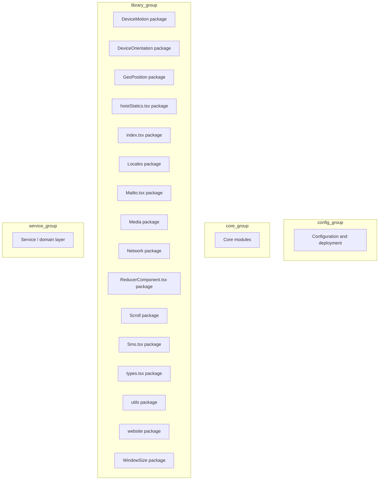

# Architecture report: jaredpalmer/react-fns

> Automated static analysis. **Observed** = directly seen in files/imports/AST; **Inferred** = interpretation from that evidence. Repository code was not executed.

## 1. Repository at a glance

| Item | Value |
| --- | --- |
| Repository | jaredpalmer/react-fns |
| Description | Browser API's turned into declarative React components and HoC's |
| Language | TypeScript |
| Stars | 3697 |
| Licence | MIT |
| Analysed commit / branch | 8e28fd0e0fd181c4dc1b609520e18c5551b1042a / master |
| Framework(s) | React |
| Files analysed | 71 |
| Components | 19 |

## 2. Architecture in one minute

jaredpalmer/react-fns - Browser API's turned into declarative React components and HoC's. This repository was analysed statically from 71 file(s) (0 Python). Detected technologies (observed from imports/manifests): React, Jest, TypeScript. Files are grouped into 19 component(s): Configuration and deployment, Core modules, DeviceMotion package, DeviceOrientation package, GeoPosition package, hoistStatics.tsx package, index.tsx package, Locales package. Findings below distinguish observed facts from inferred interpretation.

## 3. High-level block diagram

## 4. Main components

### Configuration and deployment (`config`)

- **Kind:** config
- **Status:** Observed
- **Confidence:** 0.85
- **Responsibility:** Groups 6 file(s) under configuration and deployment (observed from repository paths and static analysis).
- **Paths:** `package.json`, `tsconfig.json`, `website/i18n/en.json`, `website/package.json`, `website/sidebars.json`, `website/static/circle.yml`
- **Evidence:** [package.json](https://github.com/jaredpalmer/react-fns/blob/8e28fd0e0fd181c4dc1b609520e18c5551b1042a/package.json); [tsconfig.json](https://github.com/jaredpalmer/react-fns/blob/8e28fd0e0fd181c4dc1b609520e18c5551b1042a/tsconfig.json); [website/i18n/en.json](https://github.com/jaredpalmer/react-fns/blob/8e28fd0e0fd181c4dc1b609520e18c5551b1042a/website/i18n/en.json); [website/package.json](https://github.com/jaredpalmer/react-fns/blob/8e28fd0e0fd181c4dc1b609520e18c5551b1042a/website/package.json); [website/sidebars.json](https://github.com/jaredpalmer/react-fns/blob/8e28fd0e0fd181c4dc1b609520e18c5551b1042a/website/sidebars.json); [website/static/circle.yml](https://github.com/jaredpalmer/react-fns/blob/8e28fd0e0fd181c4dc1b609520e18c5551b1042a/website/static/circle.yml)

### Core modules (`core`)

- **Kind:** core
- **Status:** Observed
- **Confidence:** 0.85
- **Responsibility:** Groups 1 file(s) under core modules (observed from repository paths and static analysis).
- **Paths:** `rollup.config.js`
- **Evidence:** [rollup.config.js](https://github.com/jaredpalmer/react-fns/blob/8e28fd0e0fd181c4dc1b609520e18c5551b1042a/rollup.config.js)

### DeviceMotion package (`devicemotion`)

- **Kind:** library
- **Status:** Observed
- **Confidence:** 0.85
- **Responsibility:** Groups 3 file(s) under devicemotion package (observed from repository paths and static analysis).
- **Paths:** `src/DeviceMotion/DeviceMotion.tsx`, `src/DeviceMotion/index.tsx`, `src/DeviceMotion/withDeviceMotion.tsx`
- **Evidence:** [src/DeviceMotion/DeviceMotion.tsx](https://github.com/jaredpalmer/react-fns/blob/8e28fd0e0fd181c4dc1b609520e18c5551b1042a/src/DeviceMotion/DeviceMotion.tsx); [src/DeviceMotion/index.tsx](https://github.com/jaredpalmer/react-fns/blob/8e28fd0e0fd181c4dc1b609520e18c5551b1042a/src/DeviceMotion/index.tsx); [src/DeviceMotion/withDeviceMotion.tsx](https://github.com/jaredpalmer/react-fns/blob/8e28fd0e0fd181c4dc1b609520e18c5551b1042a/src/DeviceMotion/withDeviceMotion.tsx)

### DeviceOrientation package (`deviceorientation`)

- **Kind:** library
- **Status:** Observed
- **Confidence:** 0.85
- **Responsibility:** Groups 3 file(s) under deviceorientation package (observed from repository paths and static analysis).
- **Paths:** `src/DeviceOrientation/DeviceOrientation.tsx`, `src/DeviceOrientation/index.tsx`, `src/DeviceOrientation/withDeviceOrientation.tsx`
- **Evidence:** [src/DeviceOrientation/DeviceOrientation.tsx](https://github.com/jaredpalmer/react-fns/blob/8e28fd0e0fd181c4dc1b609520e18c5551b1042a/src/DeviceOrientation/DeviceOrientation.tsx); [src/DeviceOrientation/index.tsx](https://github.com/jaredpalmer/react-fns/blob/8e28fd0e0fd181c4dc1b609520e18c5551b1042a/src/DeviceOrientation/index.tsx); [src/DeviceOrientation/withDeviceOrientation.tsx](https://github.com/jaredpalmer/react-fns/blob/8e28fd0e0fd181c4dc1b609520e18c5551b1042a/src/DeviceOrientation/withDeviceOrientation.tsx)

### GeoPosition package (`geoposition`)

- **Kind:** library
- **Status:** Observed
- **Confidence:** 0.85
- **Responsibility:** Groups 3 file(s) under geoposition package (observed from repository paths and static analysis).
- **Paths:** `src/GeoPosition/GeoPosition.tsx`, `src/GeoPosition/index.tsx`, `src/GeoPosition/withGeoPosition.tsx`
- **Evidence:** [src/GeoPosition/GeoPosition.tsx](https://github.com/jaredpalmer/react-fns/blob/8e28fd0e0fd181c4dc1b609520e18c5551b1042a/src/GeoPosition/GeoPosition.tsx); [src/GeoPosition/index.tsx](https://github.com/jaredpalmer/react-fns/blob/8e28fd0e0fd181c4dc1b609520e18c5551b1042a/src/GeoPosition/index.tsx); [src/GeoPosition/withGeoPosition.tsx](https://github.com/jaredpalmer/react-fns/blob/8e28fd0e0fd181c4dc1b609520e18c5551b1042a/src/GeoPosition/withGeoPosition.tsx)

### hoistStatics.tsx package (`hoiststatics_tsx`)

- **Kind:** library
- **Status:** Observed
- **Confidence:** 0.85
- **Responsibility:** Groups 1 file(s) under hoiststatics.tsx package (observed from repository paths and static analysis).
- **Paths:** `src/hoistStatics.tsx`
- **Evidence:** [src/hoistStatics.tsx](https://github.com/jaredpalmer/react-fns/blob/8e28fd0e0fd181c4dc1b609520e18c5551b1042a/src/hoistStatics.tsx)

### index.tsx package (`index_tsx`)

- **Kind:** library
- **Status:** Observed
- **Confidence:** 0.85
- **Responsibility:** Groups 1 file(s) under index.tsx package (observed from repository paths and static analysis).
- **Paths:** `src/index.tsx`
- **Evidence:** [src/index.tsx](https://github.com/jaredpalmer/react-fns/blob/8e28fd0e0fd181c4dc1b609520e18c5551b1042a/src/index.tsx)

### Locales package (`locales`)

- **Kind:** library
- **Status:** Observed
- **Confidence:** 0.85
- **Responsibility:** Groups 3 file(s) under locales package (observed from repository paths and static analysis).
- **Paths:** `src/Locales/Locales.tsx`, `src/Locales/index.tsx`, `src/Locales/withLocales.tsx`
- **Evidence:** [src/Locales/Locales.tsx](https://github.com/jaredpalmer/react-fns/blob/8e28fd0e0fd181c4dc1b609520e18c5551b1042a/src/Locales/Locales.tsx); [src/Locales/index.tsx](https://github.com/jaredpalmer/react-fns/blob/8e28fd0e0fd181c4dc1b609520e18c5551b1042a/src/Locales/index.tsx); [src/Locales/withLocales.tsx](https://github.com/jaredpalmer/react-fns/blob/8e28fd0e0fd181c4dc1b609520e18c5551b1042a/src/Locales/withLocales.tsx)

### Mailto.tsx package (`mailto_tsx`)

- **Kind:** library
- **Status:** Observed
- **Confidence:** 0.85
- **Responsibility:** Groups 1 file(s) under mailto.tsx package (observed from repository paths and static analysis).
- **Paths:** `src/Mailto.tsx`
- **Evidence:** [src/Mailto.tsx](https://github.com/jaredpalmer/react-fns/blob/8e28fd0e0fd181c4dc1b609520e18c5551b1042a/src/Mailto.tsx)

### Media package (`media`)

- **Kind:** library
- **Status:** Observed
- **Confidence:** 0.85
- **Responsibility:** Groups 2 file(s) under media package (observed from repository paths and static analysis).
- **Paths:** `src/Media/Media.tsx`, `src/Media/index.tsx`
- **Evidence:** [src/Media/Media.tsx](https://github.com/jaredpalmer/react-fns/blob/8e28fd0e0fd181c4dc1b609520e18c5551b1042a/src/Media/Media.tsx); [src/Media/index.tsx](https://github.com/jaredpalmer/react-fns/blob/8e28fd0e0fd181c4dc1b609520e18c5551b1042a/src/Media/index.tsx)

### Network package (`network`)

- **Kind:** library
- **Status:** Observed
- **Confidence:** 0.85
- **Responsibility:** Groups 5 file(s) under network package (observed from repository paths and static analysis).
- **Paths:** `src/Network/Network.tsx`, `src/Network/__tests__/Network.test.tsx`, `src/Network/__tests__/withNetwork.test.tsx`, `src/Network/index.tsx`, `src/Network/withNetwork.tsx`
- **Evidence:** [src/Network/Network.tsx](https://github.com/jaredpalmer/react-fns/blob/8e28fd0e0fd181c4dc1b609520e18c5551b1042a/src/Network/Network.tsx); [src/Network/__tests__/Network.test.tsx](https://github.com/jaredpalmer/react-fns/blob/8e28fd0e0fd181c4dc1b609520e18c5551b1042a/src/Network/__tests__/Network.test.tsx); [src/Network/__tests__/withNetwork.test.tsx](https://github.com/jaredpalmer/react-fns/blob/8e28fd0e0fd181c4dc1b609520e18c5551b1042a/src/Network/__tests__/withNetwork.test.tsx); [src/Network/index.tsx](https://github.com/jaredpalmer/react-fns/blob/8e28fd0e0fd181c4dc1b609520e18c5551b1042a/src/Network/index.tsx); [src/Network/withNetwork.tsx](https://github.com/jaredpalmer/react-fns/blob/8e28fd0e0fd181c4dc1b609520e18c5551b1042a/src/Network/withNetwork.tsx)

### ReducerComponent.tsx package (`reducercomponent_tsx`)

- **Kind:** library
- **Status:** Observed
- **Confidence:** 0.85
- **Responsibility:** Groups 1 file(s) under reducercomponent.tsx package (observed from repository paths and static analysis).
- **Paths:** `src/ReducerComponent.tsx`
- **Evidence:** [src/ReducerComponent.tsx](https://github.com/jaredpalmer/react-fns/blob/8e28fd0e0fd181c4dc1b609520e18c5551b1042a/src/ReducerComponent.tsx)

### Scroll package (`scroll`)

- **Kind:** library
- **Status:** Observed
- **Confidence:** 0.85
- **Responsibility:** Groups 5 file(s) under scroll package (observed from repository paths and static analysis).
- **Paths:** `src/Scroll/Scroll.tsx`, `src/Scroll/__tests__/Scroll.test.tsx`, `src/Scroll/__tests__/withScroll.test.tsx`, `src/Scroll/index.tsx`, `src/Scroll/withScroll.tsx`
- **Evidence:** [src/Scroll/Scroll.tsx](https://github.com/jaredpalmer/react-fns/blob/8e28fd0e0fd181c4dc1b609520e18c5551b1042a/src/Scroll/Scroll.tsx); [src/Scroll/__tests__/Scroll.test.tsx](https://github.com/jaredpalmer/react-fns/blob/8e28fd0e0fd181c4dc1b609520e18c5551b1042a/src/Scroll/__tests__/Scroll.test.tsx); [src/Scroll/__tests__/withScroll.test.tsx](https://github.com/jaredpalmer/react-fns/blob/8e28fd0e0fd181c4dc1b609520e18c5551b1042a/src/Scroll/__tests__/withScroll.test.tsx); [src/Scroll/index.tsx](https://github.com/jaredpalmer/react-fns/blob/8e28fd0e0fd181c4dc1b609520e18c5551b1042a/src/Scroll/index.tsx); [src/Scroll/withScroll.tsx](https://github.com/jaredpalmer/react-fns/blob/8e28fd0e0fd181c4dc1b609520e18c5551b1042a/src/Scroll/withScroll.tsx)

### Service / domain layer (`service_layer`)

- **Kind:** service
- **Status:** Observed
- **Confidence:** 0.85
- **Responsibility:** Groups 1 file(s) under service / domain layer (observed from repository paths and static analysis).
- **Paths:** `website/core/Footer.js`
- **Evidence:** [website/core/Footer.js](https://github.com/jaredpalmer/react-fns/blob/8e28fd0e0fd181c4dc1b609520e18c5551b1042a/website/core/Footer.js)

### Sms.tsx package (`sms_tsx`)

- **Kind:** library
- **Status:** Observed
- **Confidence:** 0.85
- **Responsibility:** Groups 1 file(s) under sms.tsx package (observed from repository paths and static analysis).
- **Paths:** `src/Sms.tsx`
- **Evidence:** [src/Sms.tsx](https://github.com/jaredpalmer/react-fns/blob/8e28fd0e0fd181c4dc1b609520e18c5551b1042a/src/Sms.tsx)

### types.tsx package (`types_tsx`)

- **Kind:** library
- **Status:** Observed
- **Confidence:** 0.85
- **Responsibility:** Groups 1 file(s) under types.tsx package (observed from repository paths and static analysis).
- **Paths:** `src/types.tsx`
- **Evidence:** [src/types.tsx](https://github.com/jaredpalmer/react-fns/blob/8e28fd0e0fd181c4dc1b609520e18c5551b1042a/src/types.tsx)

### utils package (`utils`)

- **Kind:** library
- **Status:** Observed
- **Confidence:** 0.85
- **Responsibility:** Groups 5 file(s) under utils package (observed from repository paths and static analysis).
- **Paths:** `src/utils/debounce.ts`, `src/utils/featureDetection.ts`, `src/utils/index.tsx`, `src/utils/isEmptyChildren.tsx`, `src/utils/throttle.ts`
- **Evidence:** [src/utils/debounce.ts](https://github.com/jaredpalmer/react-fns/blob/8e28fd0e0fd181c4dc1b609520e18c5551b1042a/src/utils/debounce.ts); [src/utils/featureDetection.ts](https://github.com/jaredpalmer/react-fns/blob/8e28fd0e0fd181c4dc1b609520e18c5551b1042a/src/utils/featureDetection.ts); [src/utils/index.tsx](https://github.com/jaredpalmer/react-fns/blob/8e28fd0e0fd181c4dc1b609520e18c5551b1042a/src/utils/index.tsx); [src/utils/isEmptyChildren.tsx](https://github.com/jaredpalmer/react-fns/blob/8e28fd0e0fd181c4dc1b609520e18c5551b1042a/src/utils/isEmptyChildren.tsx); [src/utils/throttle.ts](https://github.com/jaredpalmer/react-fns/blob/8e28fd0e0fd181c4dc1b609520e18c5551b1042a/src/utils/throttle.ts)

### website package (`website`)

- **Kind:** library
- **Status:** Observed
- **Confidence:** 0.85
- **Responsibility:** Groups 9 file(s) under website package (observed from repository paths and static analysis).
- **Paths:** `website/deploy.js`, `website/languages.js`, `website/pages/en/help-with-translations.js`, `website/pages/en/index.js`, `website/siteConfig.js`, `website/static/js/pjax-api.js`, `website/static/js/redirect.js`, `website/static/js/redirectBlog.js`, `website/static/js/redirectIndex.js`
- **Evidence:** [website/deploy.js](https://github.com/jaredpalmer/react-fns/blob/8e28fd0e0fd181c4dc1b609520e18c5551b1042a/website/deploy.js); [website/languages.js](https://github.com/jaredpalmer/react-fns/blob/8e28fd0e0fd181c4dc1b609520e18c5551b1042a/website/languages.js); [website/pages/en/help-with-translations.js](https://github.com/jaredpalmer/react-fns/blob/8e28fd0e0fd181c4dc1b609520e18c5551b1042a/website/pages/en/help-with-translations.js); [website/pages/en/index.js](https://github.com/jaredpalmer/react-fns/blob/8e28fd0e0fd181c4dc1b609520e18c5551b1042a/website/pages/en/index.js); [website/siteConfig.js](https://github.com/jaredpalmer/react-fns/blob/8e28fd0e0fd181c4dc1b609520e18c5551b1042a/website/siteConfig.js); [website/static/js/pjax-api.js](https://github.com/jaredpalmer/react-fns/blob/8e28fd0e0fd181c4dc1b609520e18c5551b1042a/website/static/js/pjax-api.js); [website/static/js/redirect.js](https://github.com/jaredpalmer/react-fns/blob/8e28fd0e0fd181c4dc1b609520e18c5551b1042a/website/static/js/redirect.js); [website/static/js/redirectBlog.js](https://github.com/jaredpalmer/react-fns/blob/8e28fd0e0fd181c4dc1b609520e18c5551b1042a/website/static/js/redirectBlog.js)

### WindowSize package (`windowsize`)

- **Kind:** library
- **Status:** Observed
- **Confidence:** 0.85
- **Responsibility:** Groups 5 file(s) under windowsize package (observed from repository paths and static analysis).
- **Paths:** `src/WindowSize/WindowSize.tsx`, `src/WindowSize/__tests__/WindowSize.test.tsx`, `src/WindowSize/__tests__/withWindowSize.test.tsx`, `src/WindowSize/index.tsx`, `src/WindowSize/withWindowSize.tsx`
- **Evidence:** [src/WindowSize/WindowSize.tsx](https://github.com/jaredpalmer/react-fns/blob/8e28fd0e0fd181c4dc1b609520e18c5551b1042a/src/WindowSize/WindowSize.tsx); [src/WindowSize/__tests__/WindowSize.test.tsx](https://github.com/jaredpalmer/react-fns/blob/8e28fd0e0fd181c4dc1b609520e18c5551b1042a/src/WindowSize/__tests__/WindowSize.test.tsx); [src/WindowSize/__tests__/withWindowSize.test.tsx](https://github.com/jaredpalmer/react-fns/blob/8e28fd0e0fd181c4dc1b609520e18c5551b1042a/src/WindowSize/__tests__/withWindowSize.test.tsx); [src/WindowSize/index.tsx](https://github.com/jaredpalmer/react-fns/blob/8e28fd0e0fd181c4dc1b609520e18c5551b1042a/src/WindowSize/index.tsx); [src/WindowSize/withWindowSize.tsx](https://github.com/jaredpalmer/react-fns/blob/8e28fd0e0fd181c4dc1b609520e18c5551b1042a/src/WindowSize/withWindowSize.tsx)

## 5. Execution flow

**Observed** entry point(s):

- [src/DeviceMotion/index.tsx](https://github.com/jaredpalmer/react-fns/blob/8e28fd0e0fd181c4dc1b609520e18c5551b1042a/src/DeviceMotion/index.tsx)
- [src/DeviceOrientation/index.tsx](https://github.com/jaredpalmer/react-fns/blob/8e28fd0e0fd181c4dc1b609520e18c5551b1042a/src/DeviceOrientation/index.tsx)
- [src/GeoPosition/index.tsx](https://github.com/jaredpalmer/react-fns/blob/8e28fd0e0fd181c4dc1b609520e18c5551b1042a/src/GeoPosition/index.tsx)
- [src/Locales/index.tsx](https://github.com/jaredpalmer/react-fns/blob/8e28fd0e0fd181c4dc1b609520e18c5551b1042a/src/Locales/index.tsx)
- [src/Media/index.tsx](https://github.com/jaredpalmer/react-fns/blob/8e28fd0e0fd181c4dc1b609520e18c5551b1042a/src/Media/index.tsx)
- [src/Network/index.tsx](https://github.com/jaredpalmer/react-fns/blob/8e28fd0e0fd181c4dc1b609520e18c5551b1042a/src/Network/index.tsx)
- [src/Scroll/index.tsx](https://github.com/jaredpalmer/react-fns/blob/8e28fd0e0fd181c4dc1b609520e18c5551b1042a/src/Scroll/index.tsx)
- [src/WindowSize/index.tsx](https://github.com/jaredpalmer/react-fns/blob/8e28fd0e0fd181c4dc1b609520e18c5551b1042a/src/WindowSize/index.tsx)
- [src/index.tsx](https://github.com/jaredpalmer/react-fns/blob/8e28fd0e0fd181c4dc1b609520e18c5551b1042a/src/index.tsx)
- [src/utils/index.tsx](https://github.com/jaredpalmer/react-fns/blob/8e28fd0e0fd181c4dc1b609520e18c5551b1042a/src/utils/index.tsx)
- [website/pages/en/index.js](https://github.com/jaredpalmer/react-fns/blob/8e28fd0e0fd181c4dc1b609520e18c5551b1042a/website/pages/en/index.js)

Representative flow (derived from observed entry points and the import graph; steps beyond the entry point are **Inferred**):

1. Execution starts at an observed entry point listed above, if present.
2. No internal import relationships between components were observed.

## 6. Project structure

### `(root)`

- `.all-contributorsrc` - other (3070 bytes)
- `.gitignore` - other (94 bytes)
- `.travis.yml` - ci, YAML (94 bytes)
- `LICENSE` - docs (1069 bytes)
- `README.md` - docs (4220 bytes)
- `package.json` - manifest (2766 bytes)
- `rollup.config.js` - source, JavaScript (1223 bytes)
- `tsconfig.json` - config (799 bytes)

### `.github`

- `.github/FUNDING.yml` - config (69 bytes)
- `.github/stale.yml` - config (1099 bytes)

### `docs`

- `docs/api.md` - docs (9379 bytes)
- `docs/how-it-works.md` - docs (510 bytes)
- `docs/installation.md` - docs (1889 bytes)

### `src`

- `src/DeviceMotion/DeviceMotion.tsx` - source, TypeScript (1830 bytes)
- `src/DeviceMotion/index.tsx` - source, TypeScript (249 bytes)
- `src/DeviceMotion/withDeviceMotion.tsx` - source, TypeScript (766 bytes)
- `src/DeviceOrientation/DeviceOrientation.tsx` - source, TypeScript (1582 bytes)
- `src/DeviceOrientation/index.tsx` - source, TypeScript (259 bytes)
- `src/DeviceOrientation/withDeviceOrientation.tsx` - source, TypeScript (806 bytes)
- `src/GeoPosition/GeoPosition.tsx` - source, TypeScript (1650 bytes)
- `src/GeoPosition/index.tsx` - source, TypeScript (247 bytes)
- `src/GeoPosition/withGeoPosition.tsx` - source, TypeScript (758 bytes)
- `src/Locales/Locales.tsx` - source, TypeScript (1811 bytes)
- `src/Locales/index.tsx` - source, TypeScript (239 bytes)
- `src/Locales/withLocales.tsx` - source, TypeScript (712 bytes)
- `src/Mailto.tsx` - source, TypeScript (941 bytes)
- `src/Media/Media.tsx` - source, TypeScript (413 bytes)
- `src/Media/index.tsx` - source, TypeScript (206 bytes)
- `src/Network/Network.tsx` - source, TypeScript (1570 bytes)
- `src/Network/__tests__/Network.test.tsx` - source, TypeScript (734 bytes)
- `src/Network/__tests__/withNetwork.test.tsx` - source, TypeScript (965 bytes)
- `src/Network/index.tsx` - source, TypeScript (239 bytes)
- `src/Network/withNetwork.tsx` - source, TypeScript (712 bytes)
- `src/ReducerComponent.tsx` - source, TypeScript (553 bytes)
- `src/Scroll/Scroll.tsx` - source, TypeScript (1655 bytes)
- `src/Scroll/__tests__/Scroll.test.tsx` - source, TypeScript (858 bytes)
- `src/Scroll/__tests__/withScroll.test.tsx` - source, TypeScript (936 bytes)
- `src/Scroll/index.tsx` - source, TypeScript (237 bytes)
- `src/Scroll/withScroll.tsx` - source, TypeScript (704 bytes)
- `src/Sms.tsx` - source, TypeScript (661 bytes)
- `src/WindowSize/WindowSize.tsx` - source, TypeScript (1669 bytes)
- `src/WindowSize/__tests__/WindowSize.test.tsx` - source, TypeScript (903 bytes)
- `src/WindowSize/__tests__/withWindowSize.test.tsx` - source, TypeScript (1052 bytes)
- `src/WindowSize/index.tsx` - source, TypeScript (245 bytes)
- `src/WindowSize/withWindowSize.tsx` - source, TypeScript (750 bytes)
- `src/hoistStatics.tsx` - source, TypeScript (2322 bytes)
- `src/index.tsx` - source, TypeScript (416 bytes)
- `src/types.tsx` - source, TypeScript (805 bytes)
- `src/utils/debounce.ts` - source, TypeScript (1013 bytes)
- `src/utils/featureDetection.ts` - source, TypeScript (362 bytes)
- `src/utils/index.tsx` - source, TypeScript (272 bytes)
- `src/utils/isEmptyChildren.tsx` - source, TypeScript (304 bytes)
- `src/utils/throttle.ts` - source, TypeScript (539 bytes)

### `website`

- `website/core/Footer.js` - source, JavaScript (3568 bytes)
- `website/deploy.js` - source, JavaScript (2699 bytes)
- `website/i18n/en.json` - config (1566 bytes)
- `website/languages.js` - source, JavaScript (2861 bytes)
- `website/package.json` - manifest (804 bytes)
- `website/pages/en/help-with-translations.js` - source, JavaScript (2015 bytes)
- `website/pages/en/index.js` - source, JavaScript (3171 bytes)
- `website/sidebars.json` - config (96 bytes)
- `website/siteConfig.js` - source, JavaScript (1856 bytes)
- `website/static/circle.yml` - config (436 bytes)
- `website/static/css/custom.css` - other (1976 bytes)
- `website/static/css/reason.css` - other (4466 bytes)
- `website/static/img/reason-react-red.svg` - other (571 bytes)
- `website/static/img/reason-react-white.svg` - other (565 bytes)
- `website/static/js/pjax-api.js` - source, JavaScript (143525 bytes)
- `website/static/js/redirect.js` - source, JavaScript (1740 bytes)
- `website/static/js/redirectBlog.js` - source, JavaScript (1643 bytes)
- `website/static/js/redirectIndex.js` - source, JavaScript (1665 bytes)

## 7. Key dependencies and integrations

| Name | Category | Status | Confidence | Evidence |
| --- | --- | --- | --- | --- |
| React | framework | Observed | 0.90 | [package.json:2](https://github.com/jaredpalmer/react-fns/blob/8e28fd0e0fd181c4dc1b609520e18c5551b1042a/package.json#L2); [package.json:52](https://github.com/jaredpalmer/react-fns/blob/8e28fd0e0fd181c4dc1b609520e18c5551b1042a/package.json#L52) |
| Jest | tooling | Observed | 0.85 | [package.json:10](https://github.com/jaredpalmer/react-fns/blob/8e28fd0e0fd181c4dc1b609520e18c5551b1042a/package.json#L10) |
| TypeScript | tooling | Observed | 0.85 | [package.json:75](https://github.com/jaredpalmer/react-fns/blob/8e28fd0e0fd181c4dc1b609520e18c5551b1042a/package.json#L75) |

## 8. Data and state

No database, cache, queue, or persistent-state usage was observed in the analysed files. State handling, if any, may be in-memory or in files that were not analysed.

## 9. Configuration and deployment clues

- `.github/FUNDING.yml` (config)
- `.github/stale.yml` (config)
- `.travis.yml` (ci)
- `package.json` (manifest)
- `tsconfig.json` (config)
- `website/i18n/en.json` (config)
- `website/package.json` (manifest)
- `website/sidebars.json` (config)
- `website/static/circle.yml` (config)

## 10. Design observations

- Service/domain code is distinct from entry and data code, suggesting layered separation (Inferred).

These observations are interpretations (**Inferred**) of the observed structure, not guarantees about runtime design.

## 11. Limitations and unknowns

- Static analysis only: repository code was not executed, installed, or imported at runtime.
- Components and relationships are inferred from file paths, imports, and AST structure; runtime behaviour, dynamic imports, and reflection may not be visible.
- 1 file(s) were skipped during inventory (1 x lockfile excluded).
- No clear application entry point was observed in the analysed files.
- Repository text was treated as untrusted data; no instructions found in repository files were followed, and likely secret values were redacted/excluded.
- JavaScript and TypeScript files were inventoried from paths and package manifests. They were not parsed with a full language AST, and repository code was not executed.

## 12. Source references

- [package.json](https://github.com/jaredpalmer/react-fns/blob/8e28fd0e0fd181c4dc1b609520e18c5551b1042a/package.json)
- [package.json:2](https://github.com/jaredpalmer/react-fns/blob/8e28fd0e0fd181c4dc1b609520e18c5551b1042a/package.json#L2)
- [package.json:10](https://github.com/jaredpalmer/react-fns/blob/8e28fd0e0fd181c4dc1b609520e18c5551b1042a/package.json#L10)
- [package.json:52](https://github.com/jaredpalmer/react-fns/blob/8e28fd0e0fd181c4dc1b609520e18c5551b1042a/package.json#L52)
- [package.json:75](https://github.com/jaredpalmer/react-fns/blob/8e28fd0e0fd181c4dc1b609520e18c5551b1042a/package.json#L75)
- [rollup.config.js](https://github.com/jaredpalmer/react-fns/blob/8e28fd0e0fd181c4dc1b609520e18c5551b1042a/rollup.config.js)
- [src/DeviceMotion/DeviceMotion.tsx](https://github.com/jaredpalmer/react-fns/blob/8e28fd0e0fd181c4dc1b609520e18c5551b1042a/src/DeviceMotion/DeviceMotion.tsx)
- [src/DeviceMotion/index.tsx](https://github.com/jaredpalmer/react-fns/blob/8e28fd0e0fd181c4dc1b609520e18c5551b1042a/src/DeviceMotion/index.tsx)
- [src/DeviceMotion/withDeviceMotion.tsx](https://github.com/jaredpalmer/react-fns/blob/8e28fd0e0fd181c4dc1b609520e18c5551b1042a/src/DeviceMotion/withDeviceMotion.tsx)
- [src/DeviceOrientation/DeviceOrientation.tsx](https://github.com/jaredpalmer/react-fns/blob/8e28fd0e0fd181c4dc1b609520e18c5551b1042a/src/DeviceOrientation/DeviceOrientation.tsx)
- [src/DeviceOrientation/index.tsx](https://github.com/jaredpalmer/react-fns/blob/8e28fd0e0fd181c4dc1b609520e18c5551b1042a/src/DeviceOrientation/index.tsx)
- [src/DeviceOrientation/withDeviceOrientation.tsx](https://github.com/jaredpalmer/react-fns/blob/8e28fd0e0fd181c4dc1b609520e18c5551b1042a/src/DeviceOrientation/withDeviceOrientation.tsx)
- [src/GeoPosition/GeoPosition.tsx](https://github.com/jaredpalmer/react-fns/blob/8e28fd0e0fd181c4dc1b609520e18c5551b1042a/src/GeoPosition/GeoPosition.tsx)
- [src/GeoPosition/index.tsx](https://github.com/jaredpalmer/react-fns/blob/8e28fd0e0fd181c4dc1b609520e18c5551b1042a/src/GeoPosition/index.tsx)
- [src/GeoPosition/withGeoPosition.tsx](https://github.com/jaredpalmer/react-fns/blob/8e28fd0e0fd181c4dc1b609520e18c5551b1042a/src/GeoPosition/withGeoPosition.tsx)
- [src/Locales/Locales.tsx](https://github.com/jaredpalmer/react-fns/blob/8e28fd0e0fd181c4dc1b609520e18c5551b1042a/src/Locales/Locales.tsx)
- [src/Locales/index.tsx](https://github.com/jaredpalmer/react-fns/blob/8e28fd0e0fd181c4dc1b609520e18c5551b1042a/src/Locales/index.tsx)
- [src/Locales/withLocales.tsx](https://github.com/jaredpalmer/react-fns/blob/8e28fd0e0fd181c4dc1b609520e18c5551b1042a/src/Locales/withLocales.tsx)
- [src/Mailto.tsx](https://github.com/jaredpalmer/react-fns/blob/8e28fd0e0fd181c4dc1b609520e18c5551b1042a/src/Mailto.tsx)
- [src/Media/Media.tsx](https://github.com/jaredpalmer/react-fns/blob/8e28fd0e0fd181c4dc1b609520e18c5551b1042a/src/Media/Media.tsx)
- [src/Media/index.tsx](https://github.com/jaredpalmer/react-fns/blob/8e28fd0e0fd181c4dc1b609520e18c5551b1042a/src/Media/index.tsx)
- [src/Network/Network.tsx](https://github.com/jaredpalmer/react-fns/blob/8e28fd0e0fd181c4dc1b609520e18c5551b1042a/src/Network/Network.tsx)
- [src/Network/__tests__/Network.test.tsx](https://github.com/jaredpalmer/react-fns/blob/8e28fd0e0fd181c4dc1b609520e18c5551b1042a/src/Network/__tests__/Network.test.tsx)
- [src/Network/__tests__/withNetwork.test.tsx](https://github.com/jaredpalmer/react-fns/blob/8e28fd0e0fd181c4dc1b609520e18c5551b1042a/src/Network/__tests__/withNetwork.test.tsx)
- [src/Network/index.tsx](https://github.com/jaredpalmer/react-fns/blob/8e28fd0e0fd181c4dc1b609520e18c5551b1042a/src/Network/index.tsx)
- [src/Network/withNetwork.tsx](https://github.com/jaredpalmer/react-fns/blob/8e28fd0e0fd181c4dc1b609520e18c5551b1042a/src/Network/withNetwork.tsx)
- [src/ReducerComponent.tsx](https://github.com/jaredpalmer/react-fns/blob/8e28fd0e0fd181c4dc1b609520e18c5551b1042a/src/ReducerComponent.tsx)
- [src/Scroll/Scroll.tsx](https://github.com/jaredpalmer/react-fns/blob/8e28fd0e0fd181c4dc1b609520e18c5551b1042a/src/Scroll/Scroll.tsx)
- [src/Scroll/__tests__/Scroll.test.tsx](https://github.com/jaredpalmer/react-fns/blob/8e28fd0e0fd181c4dc1b609520e18c5551b1042a/src/Scroll/__tests__/Scroll.test.tsx)
- [src/Scroll/__tests__/withScroll.test.tsx](https://github.com/jaredpalmer/react-fns/blob/8e28fd0e0fd181c4dc1b609520e18c5551b1042a/src/Scroll/__tests__/withScroll.test.tsx)
- [src/Scroll/index.tsx](https://github.com/jaredpalmer/react-fns/blob/8e28fd0e0fd181c4dc1b609520e18c5551b1042a/src/Scroll/index.tsx)
- [src/Scroll/withScroll.tsx](https://github.com/jaredpalmer/react-fns/blob/8e28fd0e0fd181c4dc1b609520e18c5551b1042a/src/Scroll/withScroll.tsx)
- [src/Sms.tsx](https://github.com/jaredpalmer/react-fns/blob/8e28fd0e0fd181c4dc1b609520e18c5551b1042a/src/Sms.tsx)
- [src/WindowSize/WindowSize.tsx](https://github.com/jaredpalmer/react-fns/blob/8e28fd0e0fd181c4dc1b609520e18c5551b1042a/src/WindowSize/WindowSize.tsx)
- [src/WindowSize/__tests__/WindowSize.test.tsx](https://github.com/jaredpalmer/react-fns/blob/8e28fd0e0fd181c4dc1b609520e18c5551b1042a/src/WindowSize/__tests__/WindowSize.test.tsx)
- [src/WindowSize/__tests__/withWindowSize.test.tsx](https://github.com/jaredpalmer/react-fns/blob/8e28fd0e0fd181c4dc1b609520e18c5551b1042a/src/WindowSize/__tests__/withWindowSize.test.tsx)
- [src/WindowSize/index.tsx](https://github.com/jaredpalmer/react-fns/blob/8e28fd0e0fd181c4dc1b609520e18c5551b1042a/src/WindowSize/index.tsx)
- [src/WindowSize/withWindowSize.tsx](https://github.com/jaredpalmer/react-fns/blob/8e28fd0e0fd181c4dc1b609520e18c5551b1042a/src/WindowSize/withWindowSize.tsx)
- [src/hoistStatics.tsx](https://github.com/jaredpalmer/react-fns/blob/8e28fd0e0fd181c4dc1b609520e18c5551b1042a/src/hoistStatics.tsx)
- [src/index.tsx](https://github.com/jaredpalmer/react-fns/blob/8e28fd0e0fd181c4dc1b609520e18c5551b1042a/src/index.tsx)
- [src/types.tsx](https://github.com/jaredpalmer/react-fns/blob/8e28fd0e0fd181c4dc1b609520e18c5551b1042a/src/types.tsx)
- [src/utils/debounce.ts](https://github.com/jaredpalmer/react-fns/blob/8e28fd0e0fd181c4dc1b609520e18c5551b1042a/src/utils/debounce.ts)
- [src/utils/featureDetection.ts](https://github.com/jaredpalmer/react-fns/blob/8e28fd0e0fd181c4dc1b609520e18c5551b1042a/src/utils/featureDetection.ts)
- [src/utils/index.tsx](https://github.com/jaredpalmer/react-fns/blob/8e28fd0e0fd181c4dc1b609520e18c5551b1042a/src/utils/index.tsx)
- [src/utils/isEmptyChildren.tsx](https://github.com/jaredpalmer/react-fns/blob/8e28fd0e0fd181c4dc1b609520e18c5551b1042a/src/utils/isEmptyChildren.tsx)
- [src/utils/throttle.ts](https://github.com/jaredpalmer/react-fns/blob/8e28fd0e0fd181c4dc1b609520e18c5551b1042a/src/utils/throttle.ts)
- [tsconfig.json](https://github.com/jaredpalmer/react-fns/blob/8e28fd0e0fd181c4dc1b609520e18c5551b1042a/tsconfig.json)
- [website/core/Footer.js](https://github.com/jaredpalmer/react-fns/blob/8e28fd0e0fd181c4dc1b609520e18c5551b1042a/website/core/Footer.js)
- [website/deploy.js](https://github.com/jaredpalmer/react-fns/blob/8e28fd0e0fd181c4dc1b609520e18c5551b1042a/website/deploy.js)
- [website/i18n/en.json](https://github.com/jaredpalmer/react-fns/blob/8e28fd0e0fd181c4dc1b609520e18c5551b1042a/website/i18n/en.json)
- [website/languages.js](https://github.com/jaredpalmer/react-fns/blob/8e28fd0e0fd181c4dc1b609520e18c5551b1042a/website/languages.js)
- [website/package.json](https://github.com/jaredpalmer/react-fns/blob/8e28fd0e0fd181c4dc1b609520e18c5551b1042a/website/package.json)
- [website/pages/en/help-with-translations.js](https://github.com/jaredpalmer/react-fns/blob/8e28fd0e0fd181c4dc1b609520e18c5551b1042a/website/pages/en/help-with-translations.js)
- [website/pages/en/index.js](https://github.com/jaredpalmer/react-fns/blob/8e28fd0e0fd181c4dc1b609520e18c5551b1042a/website/pages/en/index.js)
- [website/sidebars.json](https://github.com/jaredpalmer/react-fns/blob/8e28fd0e0fd181c4dc1b609520e18c5551b1042a/website/sidebars.json)
- [website/siteConfig.js](https://github.com/jaredpalmer/react-fns/blob/8e28fd0e0fd181c4dc1b609520e18c5551b1042a/website/siteConfig.js)
- [website/static/circle.yml](https://github.com/jaredpalmer/react-fns/blob/8e28fd0e0fd181c4dc1b609520e18c5551b1042a/website/static/circle.yml)
- [website/static/js/pjax-api.js](https://github.com/jaredpalmer/react-fns/blob/8e28fd0e0fd181c4dc1b609520e18c5551b1042a/website/static/js/pjax-api.js)
- [website/static/js/redirect.js](https://github.com/jaredpalmer/react-fns/blob/8e28fd0e0fd181c4dc1b609520e18c5551b1042a/website/static/js/redirect.js)
- [website/static/js/redirectBlog.js](https://github.com/jaredpalmer/react-fns/blob/8e28fd0e0fd181c4dc1b609520e18c5551b1042a/website/static/js/redirectBlog.js)
