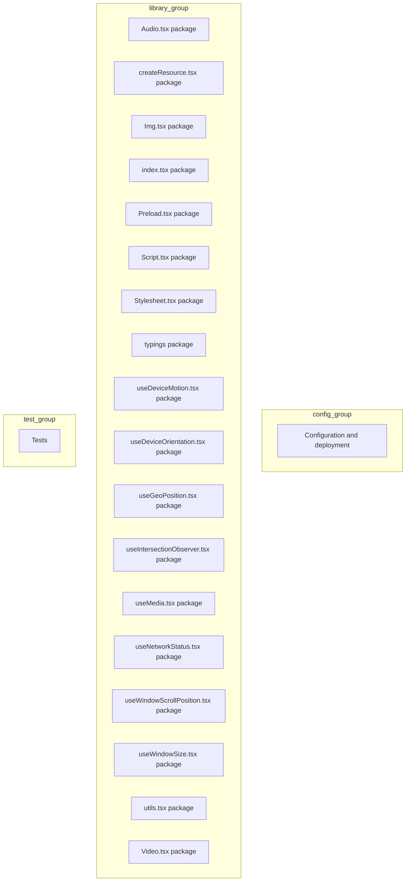

# Architecture report: jaredpalmer/the-platform

> Automated static analysis. **Observed** = directly seen in files/imports/AST; **Inferred** = interpretation from that evidence. Repository code was not executed.

## 1. Repository at a glance

| Item | Value |
| --- | --- |
| Repository | jaredpalmer/the-platform |
| Description | Web. Components. 😂 |
| Language | TypeScript |
| Stars | 4368 |
| Licence | MIT |
| Analysed commit / branch | e1ee9e1544eba46b6a2430a4189aa1c690ab0b7a / master |
| Framework(s) | React |
| Files analysed | 39 |
| Components | 20 |

## 2. Architecture in one minute

jaredpalmer/the-platform - Web. Components. 😂. This repository was analysed statically from 39 file(s) (0 Python). Detected technologies (observed from imports/manifests): React, Jest, TypeScript. Files are grouped into 20 component(s): Audio.tsx package, Configuration and deployment, createResource.tsx package, Img.tsx package, index.tsx package, Preload.tsx package, Script.tsx package, Stylesheet.tsx package. Findings below distinguish observed facts from inferred interpretation.

## 3. High-level block diagram

## 4. Main components

### Audio.tsx package (`audio_tsx`)

- **Kind:** library
- **Status:** Observed
- **Confidence:** 0.85
- **Responsibility:** Groups 1 file(s) under audio.tsx package (observed from repository paths and static analysis).
- **Paths:** `src/Audio.tsx`
- **Evidence:** [src/Audio.tsx](https://github.com/jaredpalmer/the-platform/blob/e1ee9e1544eba46b6a2430a4189aa1c690ab0b7a/src/Audio.tsx)

### Configuration and deployment (`config`)

- **Kind:** config
- **Status:** Observed
- **Confidence:** 0.85
- **Responsibility:** Groups 3 file(s) under configuration and deployment (observed from repository paths and static analysis).
- **Paths:** `package.json`, `tsconfig.json`, `tslint.json`
- **Evidence:** [package.json](https://github.com/jaredpalmer/the-platform/blob/e1ee9e1544eba46b6a2430a4189aa1c690ab0b7a/package.json); [tsconfig.json](https://github.com/jaredpalmer/the-platform/blob/e1ee9e1544eba46b6a2430a4189aa1c690ab0b7a/tsconfig.json); [tslint.json](https://github.com/jaredpalmer/the-platform/blob/e1ee9e1544eba46b6a2430a4189aa1c690ab0b7a/tslint.json)

### createResource.tsx package (`createresource_tsx`)

- **Kind:** library
- **Status:** Observed
- **Confidence:** 0.85
- **Responsibility:** Groups 1 file(s) under createresource.tsx package (observed from repository paths and static analysis).
- **Paths:** `src/createResource.tsx`
- **Evidence:** [src/createResource.tsx](https://github.com/jaredpalmer/the-platform/blob/e1ee9e1544eba46b6a2430a4189aa1c690ab0b7a/src/createResource.tsx)

### Img.tsx package (`img_tsx`)

- **Kind:** library
- **Status:** Observed
- **Confidence:** 0.85
- **Responsibility:** Groups 1 file(s) under img.tsx package (observed from repository paths and static analysis).
- **Paths:** `src/Img.tsx`
- **Evidence:** [src/Img.tsx](https://github.com/jaredpalmer/the-platform/blob/e1ee9e1544eba46b6a2430a4189aa1c690ab0b7a/src/Img.tsx)

### index.tsx package (`index_tsx`)

- **Kind:** library
- **Status:** Observed
- **Confidence:** 0.85
- **Responsibility:** Groups 1 file(s) under index.tsx package (observed from repository paths and static analysis).
- **Paths:** `src/index.tsx`
- **Evidence:** [src/index.tsx](https://github.com/jaredpalmer/the-platform/blob/e1ee9e1544eba46b6a2430a4189aa1c690ab0b7a/src/index.tsx)

### Preload.tsx package (`preload_tsx`)

- **Kind:** library
- **Status:** Observed
- **Confidence:** 0.85
- **Responsibility:** Groups 1 file(s) under preload.tsx package (observed from repository paths and static analysis).
- **Paths:** `src/Preload.tsx`
- **Evidence:** [src/Preload.tsx](https://github.com/jaredpalmer/the-platform/blob/e1ee9e1544eba46b6a2430a4189aa1c690ab0b7a/src/Preload.tsx)

### Script.tsx package (`script_tsx`)

- **Kind:** library
- **Status:** Observed
- **Confidence:** 0.85
- **Responsibility:** Groups 1 file(s) under script.tsx package (observed from repository paths and static analysis).
- **Paths:** `src/Script.tsx`
- **Evidence:** [src/Script.tsx](https://github.com/jaredpalmer/the-platform/blob/e1ee9e1544eba46b6a2430a4189aa1c690ab0b7a/src/Script.tsx)

### Stylesheet.tsx package (`stylesheet_tsx`)

- **Kind:** library
- **Status:** Observed
- **Confidence:** 0.85
- **Responsibility:** Groups 1 file(s) under stylesheet.tsx package (observed from repository paths and static analysis).
- **Paths:** `src/Stylesheet.tsx`
- **Evidence:** [src/Stylesheet.tsx](https://github.com/jaredpalmer/the-platform/blob/e1ee9e1544eba46b6a2430a4189aa1c690ab0b7a/src/Stylesheet.tsx)

### Tests (`tests`)

- **Kind:** test
- **Status:** Observed
- **Confidence:** 0.85
- **Responsibility:** Groups 3 file(s) under tests (observed from repository paths and static analysis).
- **Paths:** `tests/jest.setup.js`, `tests/useWindowScrollPosition.test.js`, `tests/useWindowSize.test.js`
- **Evidence:** [tests/jest.setup.js](https://github.com/jaredpalmer/the-platform/blob/e1ee9e1544eba46b6a2430a4189aa1c690ab0b7a/tests/jest.setup.js); [tests/useWindowScrollPosition.test.js](https://github.com/jaredpalmer/the-platform/blob/e1ee9e1544eba46b6a2430a4189aa1c690ab0b7a/tests/useWindowScrollPosition.test.js); [tests/useWindowSize.test.js](https://github.com/jaredpalmer/the-platform/blob/e1ee9e1544eba46b6a2430a4189aa1c690ab0b7a/tests/useWindowSize.test.js)

### typings package (`typings`)

- **Kind:** library
- **Status:** Observed
- **Confidence:** 0.85
- **Responsibility:** Groups 2 file(s) under typings package (observed from repository paths and static analysis).
- **Paths:** `typings/json2mq.d.ts`, `typings/react-cache.d.ts`
- **Evidence:** [typings/json2mq.d.ts](https://github.com/jaredpalmer/the-platform/blob/e1ee9e1544eba46b6a2430a4189aa1c690ab0b7a/typings/json2mq.d.ts); [typings/react-cache.d.ts](https://github.com/jaredpalmer/the-platform/blob/e1ee9e1544eba46b6a2430a4189aa1c690ab0b7a/typings/react-cache.d.ts)

### useDeviceMotion.tsx package (`usedevicemotion_tsx`)

- **Kind:** library
- **Status:** Observed
- **Confidence:** 0.85
- **Responsibility:** Groups 1 file(s) under usedevicemotion.tsx package (observed from repository paths and static analysis).
- **Paths:** `src/useDeviceMotion.tsx`
- **Evidence:** [src/useDeviceMotion.tsx](https://github.com/jaredpalmer/the-platform/blob/e1ee9e1544eba46b6a2430a4189aa1c690ab0b7a/src/useDeviceMotion.tsx)

### useDeviceOrientation.tsx package (`usedeviceorientation_tsx`)

- **Kind:** library
- **Status:** Observed
- **Confidence:** 0.85
- **Responsibility:** Groups 1 file(s) under usedeviceorientation.tsx package (observed from repository paths and static analysis).
- **Paths:** `src/useDeviceOrientation.tsx`
- **Evidence:** [src/useDeviceOrientation.tsx](https://github.com/jaredpalmer/the-platform/blob/e1ee9e1544eba46b6a2430a4189aa1c690ab0b7a/src/useDeviceOrientation.tsx)

### useGeoPosition.tsx package (`usegeoposition_tsx`)

- **Kind:** library
- **Status:** Observed
- **Confidence:** 0.85
- **Responsibility:** Groups 1 file(s) under usegeoposition.tsx package (observed from repository paths and static analysis).
- **Paths:** `src/useGeoPosition.tsx`
- **Evidence:** [src/useGeoPosition.tsx](https://github.com/jaredpalmer/the-platform/blob/e1ee9e1544eba46b6a2430a4189aa1c690ab0b7a/src/useGeoPosition.tsx)

### useIntersectionObserver.tsx package (`useintersectionobserver_tsx`)

- **Kind:** library
- **Status:** Observed
- **Confidence:** 0.85
- **Responsibility:** Groups 1 file(s) under useintersectionobserver.tsx package (observed from repository paths and static analysis).
- **Paths:** `src/useIntersectionObserver.tsx`
- **Evidence:** [src/useIntersectionObserver.tsx](https://github.com/jaredpalmer/the-platform/blob/e1ee9e1544eba46b6a2430a4189aa1c690ab0b7a/src/useIntersectionObserver.tsx)

### useMedia.tsx package (`usemedia_tsx`)

- **Kind:** library
- **Status:** Observed
- **Confidence:** 0.85
- **Responsibility:** Groups 1 file(s) under usemedia.tsx package (observed from repository paths and static analysis).
- **Paths:** `src/useMedia.tsx`
- **Evidence:** [src/useMedia.tsx](https://github.com/jaredpalmer/the-platform/blob/e1ee9e1544eba46b6a2430a4189aa1c690ab0b7a/src/useMedia.tsx)

### useNetworkStatus.tsx package (`usenetworkstatus_tsx`)

- **Kind:** library
- **Status:** Observed
- **Confidence:** 0.85
- **Responsibility:** Groups 1 file(s) under usenetworkstatus.tsx package (observed from repository paths and static analysis).
- **Paths:** `src/useNetworkStatus.tsx`
- **Evidence:** [src/useNetworkStatus.tsx](https://github.com/jaredpalmer/the-platform/blob/e1ee9e1544eba46b6a2430a4189aa1c690ab0b7a/src/useNetworkStatus.tsx)

### useWindowScrollPosition.tsx package (`usewindowscrollposition_tsx`)

- **Kind:** library
- **Status:** Observed
- **Confidence:** 0.85
- **Responsibility:** Groups 1 file(s) under usewindowscrollposition.tsx package (observed from repository paths and static analysis).
- **Paths:** `src/useWindowScrollPosition.tsx`
- **Evidence:** [src/useWindowScrollPosition.tsx](https://github.com/jaredpalmer/the-platform/blob/e1ee9e1544eba46b6a2430a4189aa1c690ab0b7a/src/useWindowScrollPosition.tsx)

### useWindowSize.tsx package (`usewindowsize_tsx`)

- **Kind:** library
- **Status:** Observed
- **Confidence:** 0.85
- **Responsibility:** Groups 1 file(s) under usewindowsize.tsx package (observed from repository paths and static analysis).
- **Paths:** `src/useWindowSize.tsx`
- **Evidence:** [src/useWindowSize.tsx](https://github.com/jaredpalmer/the-platform/blob/e1ee9e1544eba46b6a2430a4189aa1c690ab0b7a/src/useWindowSize.tsx)

### utils.tsx package (`utils_tsx`)

- **Kind:** library
- **Status:** Observed
- **Confidence:** 0.85
- **Responsibility:** Groups 1 file(s) under utils.tsx package (observed from repository paths and static analysis).
- **Paths:** `src/utils.tsx`
- **Evidence:** [src/utils.tsx](https://github.com/jaredpalmer/the-platform/blob/e1ee9e1544eba46b6a2430a4189aa1c690ab0b7a/src/utils.tsx)

### Video.tsx package (`video_tsx`)

- **Kind:** library
- **Status:** Observed
- **Confidence:** 0.85
- **Responsibility:** Groups 1 file(s) under video.tsx package (observed from repository paths and static analysis).
- **Paths:** `src/Video.tsx`
- **Evidence:** [src/Video.tsx](https://github.com/jaredpalmer/the-platform/blob/e1ee9e1544eba46b6a2430a4189aa1c690ab0b7a/src/Video.tsx)

## 5. Execution flow

**Observed** entry point(s):

- [example/index.js](https://github.com/jaredpalmer/the-platform/blob/e1ee9e1544eba46b6a2430a4189aa1c690ab0b7a/example/index.js)
- [src/index.tsx](https://github.com/jaredpalmer/the-platform/blob/e1ee9e1544eba46b6a2430a4189aa1c690ab0b7a/src/index.tsx)

Representative flow (derived from observed entry points and the import graph; steps beyond the entry point are **Inferred**):

1. Execution starts at an observed entry point listed above, if present.
2. No internal import relationships between components were observed.

## 6. Project structure

### `(root)`

- `.babelrc` - other (198 bytes)
- `.gitignore` - other (75 bytes)
- `.npmignore` - other (98 bytes)
- `LICENSE` - docs (1081 bytes)
- `README.md` - docs (8893 bytes)
- `package.json` - manifest (2701 bytes)
- `tsconfig.json` - config (323 bytes)
- `tslint.json` - config (42 bytes)

### `.circleci`

- `.circleci/config.yml` - ci, YAML (760 bytes)

### `.github`

- `.github/FUNDING.yml` - config (69 bytes)
- `.github/stale.yml` - config (1099 bytes)

### `example`

- `example/.gitignore` - other (74 bytes)
- `example/App.js` - source, JavaScript (1031 bytes)
- `example/index.css` - other (259 bytes)
- `example/index.html` - other (149 bytes)
- `example/index.js` - source, JavaScript (193 bytes)
- `example/package.json` - manifest (441 bytes)

### `src`

- `src/Audio.tsx` - source, TypeScript (619 bytes)
- `src/Img.tsx` - source, TypeScript (807 bytes)
- `src/Preload.tsx` - source, TypeScript (760 bytes)
- `src/Script.tsx` - source, TypeScript (789 bytes)
- `src/Stylesheet.tsx` - source, TypeScript (812 bytes)
- `src/Video.tsx` - source, TypeScript (598 bytes)
- `src/createResource.tsx` - source, TypeScript (230 bytes)
- `src/index.tsx` - source, TypeScript (448 bytes)
- `src/useDeviceMotion.tsx` - source, TypeScript (894 bytes)
- `src/useDeviceOrientation.tsx` - source, TypeScript (762 bytes)
- `src/useGeoPosition.tsx` - source, TypeScript (1371 bytes)
- `src/useIntersectionObserver.tsx` - source, TypeScript (808 bytes)
- `src/useMedia.tsx` - source, TypeScript (916 bytes)
- `src/useNetworkStatus.tsx` - source, TypeScript (814 bytes)
- `src/useWindowScrollPosition.tsx` - source, TypeScript (674 bytes)
- `src/useWindowSize.tsx` - source, TypeScript (935 bytes)
- `src/utils.tsx` - source, TypeScript (574 bytes)

### `tests`

- `tests/jest.setup.js` - test, JavaScript (81 bytes)
- `tests/useWindowScrollPosition.test.js` - test, JavaScript (776 bytes)
- `tests/useWindowSize.test.js` - test, JavaScript (704 bytes)

### `typings`

- `typings/json2mq.d.ts` - source, TypeScript (93 bytes)
- `typings/react-cache.d.ts` - source, TypeScript (346 bytes)

## 7. Key dependencies and integrations

| Name | Category | Status | Confidence | Evidence |
| --- | --- | --- | --- | --- |
| React | framework | Observed | 0.90 | [example/package.json:11](https://github.com/jaredpalmer/the-platform/blob/e1ee9e1544eba46b6a2430a4189aa1c690ab0b7a/example/package.json#L11); [example/package.json:19](https://github.com/jaredpalmer/the-platform/blob/e1ee9e1544eba46b6a2430a4189aa1c690ab0b7a/example/package.json#L19); [package.json:6](https://github.com/jaredpalmer/the-platform/blob/e1ee9e1544eba46b6a2430a4189aa1c690ab0b7a/package.json#L6); [package.json:9](https://github.com/jaredpalmer/the-platform/blob/e1ee9e1544eba46b6a2430a4189aa1c690ab0b7a/package.json#L9) |
| Jest | tooling | Observed | 0.85 | [package.json:24](https://github.com/jaredpalmer/the-platform/blob/e1ee9e1544eba46b6a2430a4189aa1c690ab0b7a/package.json#L24) |
| TypeScript | tooling | Observed | 0.85 | [package.json:46](https://github.com/jaredpalmer/the-platform/blob/e1ee9e1544eba46b6a2430a4189aa1c690ab0b7a/package.json#L46) |

## 8. Data and state

No database, cache, queue, or persistent-state usage was observed in the analysed files. State handling, if any, may be in-memory or in files that were not analysed.

## 9. Configuration and deployment clues

- `.circleci/config.yml` (ci)
- `.github/FUNDING.yml` (config)
- `.github/stale.yml` (config)
- `example/package.json` (manifest)
- `package.json` (manifest)
- `tsconfig.json` (config)
- `tslint.json` (config)

## 10. Design observations

- Tests are present alongside source code (Observed from test file paths).

These observations are interpretations (**Inferred**) of the observed structure, not guarantees about runtime design.

## 11. Limitations and unknowns

- Static analysis only: repository code was not executed, installed, or imported at runtime.
- Components and relationships are inferred from file paths, imports, and AST structure; runtime behaviour, dynamic imports, and reflection may not be visible.
- 7 file(s) were skipped during inventory (1 x lockfile excluded; 6 x vendored/generated directory excluded).
- No clear application entry point was observed in the analysed files.
- Repository text was treated as untrusted data; no instructions found in repository files were followed, and likely secret values were redacted/excluded.
- JavaScript and TypeScript files were inventoried from paths and package manifests. They were not parsed with a full language AST, and repository code was not executed.

## 12. Source references

- [example/index.js](https://github.com/jaredpalmer/the-platform/blob/e1ee9e1544eba46b6a2430a4189aa1c690ab0b7a/example/index.js)
- [example/package.json:11](https://github.com/jaredpalmer/the-platform/blob/e1ee9e1544eba46b6a2430a4189aa1c690ab0b7a/example/package.json#L11)
- [example/package.json:19](https://github.com/jaredpalmer/the-platform/blob/e1ee9e1544eba46b6a2430a4189aa1c690ab0b7a/example/package.json#L19)
- [package.json](https://github.com/jaredpalmer/the-platform/blob/e1ee9e1544eba46b6a2430a4189aa1c690ab0b7a/package.json)
- [package.json:6](https://github.com/jaredpalmer/the-platform/blob/e1ee9e1544eba46b6a2430a4189aa1c690ab0b7a/package.json#L6)
- [package.json:9](https://github.com/jaredpalmer/the-platform/blob/e1ee9e1544eba46b6a2430a4189aa1c690ab0b7a/package.json#L9)
- [package.json:24](https://github.com/jaredpalmer/the-platform/blob/e1ee9e1544eba46b6a2430a4189aa1c690ab0b7a/package.json#L24)
- [package.json:46](https://github.com/jaredpalmer/the-platform/blob/e1ee9e1544eba46b6a2430a4189aa1c690ab0b7a/package.json#L46)
- [src/Audio.tsx](https://github.com/jaredpalmer/the-platform/blob/e1ee9e1544eba46b6a2430a4189aa1c690ab0b7a/src/Audio.tsx)
- [src/Img.tsx](https://github.com/jaredpalmer/the-platform/blob/e1ee9e1544eba46b6a2430a4189aa1c690ab0b7a/src/Img.tsx)
- [src/Preload.tsx](https://github.com/jaredpalmer/the-platform/blob/e1ee9e1544eba46b6a2430a4189aa1c690ab0b7a/src/Preload.tsx)
- [src/Script.tsx](https://github.com/jaredpalmer/the-platform/blob/e1ee9e1544eba46b6a2430a4189aa1c690ab0b7a/src/Script.tsx)
- [src/Stylesheet.tsx](https://github.com/jaredpalmer/the-platform/blob/e1ee9e1544eba46b6a2430a4189aa1c690ab0b7a/src/Stylesheet.tsx)
- [src/Video.tsx](https://github.com/jaredpalmer/the-platform/blob/e1ee9e1544eba46b6a2430a4189aa1c690ab0b7a/src/Video.tsx)
- [src/createResource.tsx](https://github.com/jaredpalmer/the-platform/blob/e1ee9e1544eba46b6a2430a4189aa1c690ab0b7a/src/createResource.tsx)
- [src/index.tsx](https://github.com/jaredpalmer/the-platform/blob/e1ee9e1544eba46b6a2430a4189aa1c690ab0b7a/src/index.tsx)
- [src/useDeviceMotion.tsx](https://github.com/jaredpalmer/the-platform/blob/e1ee9e1544eba46b6a2430a4189aa1c690ab0b7a/src/useDeviceMotion.tsx)
- [src/useDeviceOrientation.tsx](https://github.com/jaredpalmer/the-platform/blob/e1ee9e1544eba46b6a2430a4189aa1c690ab0b7a/src/useDeviceOrientation.tsx)
- [src/useGeoPosition.tsx](https://github.com/jaredpalmer/the-platform/blob/e1ee9e1544eba46b6a2430a4189aa1c690ab0b7a/src/useGeoPosition.tsx)
- [src/useIntersectionObserver.tsx](https://github.com/jaredpalmer/the-platform/blob/e1ee9e1544eba46b6a2430a4189aa1c690ab0b7a/src/useIntersectionObserver.tsx)
- [src/useMedia.tsx](https://github.com/jaredpalmer/the-platform/blob/e1ee9e1544eba46b6a2430a4189aa1c690ab0b7a/src/useMedia.tsx)
- [src/useNetworkStatus.tsx](https://github.com/jaredpalmer/the-platform/blob/e1ee9e1544eba46b6a2430a4189aa1c690ab0b7a/src/useNetworkStatus.tsx)
- [src/useWindowScrollPosition.tsx](https://github.com/jaredpalmer/the-platform/blob/e1ee9e1544eba46b6a2430a4189aa1c690ab0b7a/src/useWindowScrollPosition.tsx)
- [src/useWindowSize.tsx](https://github.com/jaredpalmer/the-platform/blob/e1ee9e1544eba46b6a2430a4189aa1c690ab0b7a/src/useWindowSize.tsx)
- [src/utils.tsx](https://github.com/jaredpalmer/the-platform/blob/e1ee9e1544eba46b6a2430a4189aa1c690ab0b7a/src/utils.tsx)
- [tests/jest.setup.js](https://github.com/jaredpalmer/the-platform/blob/e1ee9e1544eba46b6a2430a4189aa1c690ab0b7a/tests/jest.setup.js)
- [tests/useWindowScrollPosition.test.js](https://github.com/jaredpalmer/the-platform/blob/e1ee9e1544eba46b6a2430a4189aa1c690ab0b7a/tests/useWindowScrollPosition.test.js)
- [tests/useWindowSize.test.js](https://github.com/jaredpalmer/the-platform/blob/e1ee9e1544eba46b6a2430a4189aa1c690ab0b7a/tests/useWindowSize.test.js)
- [tsconfig.json](https://github.com/jaredpalmer/the-platform/blob/e1ee9e1544eba46b6a2430a4189aa1c690ab0b7a/tsconfig.json)
- [tslint.json](https://github.com/jaredpalmer/the-platform/blob/e1ee9e1544eba46b6a2430a4189aa1c690ab0b7a/tslint.json)
- [typings/json2mq.d.ts](https://github.com/jaredpalmer/the-platform/blob/e1ee9e1544eba46b6a2430a4189aa1c690ab0b7a/typings/json2mq.d.ts)
- [typings/react-cache.d.ts](https://github.com/jaredpalmer/the-platform/blob/e1ee9e1544eba46b6a2430a4189aa1c690ab0b7a/typings/react-cache.d.ts)
