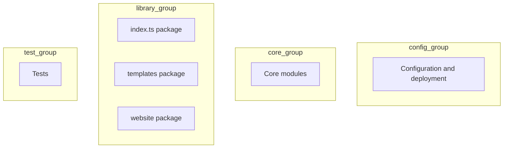

# Architecture report: jaredpalmer/tsdx

> Automated static analysis. **Observed** = directly seen in files/imports/AST; **Inferred** = interpretation from that evidence. Repository code was not executed.

## 1. Repository at a glance

| Item | Value |
| --- | --- |
| Repository | jaredpalmer/tsdx |
| Description | Zero-config CLI for TypeScript package development |
| Language | TypeScript |
| Stars | 11464 |
| Licence | MIT |
| Analysed commit / branch | 5b1aa0d67788bfb5ae46e6845e2e4e07c1c73e99 / master |
| Framework(s) | Next.js, React |
| Files analysed | 78 |
| Components | 6 |

## 2. Architecture in one minute

jaredpalmer/tsdx - Zero-config CLI for TypeScript package development. This repository was analysed statically from 78 file(s) (0 Python). Detected technologies (observed from imports/manifests): GitHub Actions, Next.js, React, Tailwind CSS, TypeScript, Vite. Files are grouped into 6 component(s): Configuration and deployment, Core modules, index.ts package, templates package, Tests, website package. Findings below distinguish observed facts from inferred interpretation.

## 3. High-level block diagram

## 4. Main components

### Configuration and deployment (`config`)

- **Kind:** config
- **Status:** Observed
- **Confidence:** 0.85
- **Responsibility:** Groups 16 file(s) under configuration and deployment (observed from repository paths and static analysis).
- **Paths:** `package.json`, `templates/basic/.github/workflows/main.yml`, `templates/basic/.github/workflows/size.yml`, `templates/basic/package.json`, `templates/basic/tsconfig.json`, `templates/react/.github/workflows/main.yml`, `templates/react/.github/workflows/size.yml`, `templates/react/example/package.json`, `templates/react/example/tsconfig.json`, `templates/react/package.json`, `templates/react/tsconfig.json`, `tsconfig.json`, `website/content/docs/meta.json`, `website/package.json`, `website/tsconfig.json`, `website/vercel.json`
- **Evidence:** [package.json](https://github.com/jaredpalmer/tsdx/blob/5b1aa0d67788bfb5ae46e6845e2e4e07c1c73e99/package.json); [templates/basic/.github/workflows/main.yml](https://github.com/jaredpalmer/tsdx/blob/5b1aa0d67788bfb5ae46e6845e2e4e07c1c73e99/templates/basic/.github/workflows/main.yml); [templates/basic/.github/workflows/size.yml](https://github.com/jaredpalmer/tsdx/blob/5b1aa0d67788bfb5ae46e6845e2e4e07c1c73e99/templates/basic/.github/workflows/size.yml); [templates/basic/package.json](https://github.com/jaredpalmer/tsdx/blob/5b1aa0d67788bfb5ae46e6845e2e4e07c1c73e99/templates/basic/package.json); [templates/basic/tsconfig.json](https://github.com/jaredpalmer/tsdx/blob/5b1aa0d67788bfb5ae46e6845e2e4e07c1c73e99/templates/basic/tsconfig.json); [templates/react/.github/workflows/main.yml](https://github.com/jaredpalmer/tsdx/blob/5b1aa0d67788bfb5ae46e6845e2e4e07c1c73e99/templates/react/.github/workflows/main.yml); [templates/react/.github/workflows/size.yml](https://github.com/jaredpalmer/tsdx/blob/5b1aa0d67788bfb5ae46e6845e2e4e07c1c73e99/templates/react/.github/workflows/size.yml); [templates/react/example/package.json](https://github.com/jaredpalmer/tsdx/blob/5b1aa0d67788bfb5ae46e6845e2e4e07c1c73e99/templates/react/example/package.json)

### Core modules (`core`)

- **Kind:** core
- **Status:** Observed
- **Confidence:** 0.85
- **Responsibility:** Groups 1 file(s) under core modules (observed from repository paths and static analysis).
- **Paths:** `vitest.config.ts`
- **Evidence:** [vitest.config.ts](https://github.com/jaredpalmer/tsdx/blob/5b1aa0d67788bfb5ae46e6845e2e4e07c1c73e99/vitest.config.ts)

### index.ts package (`index_ts`)

- **Kind:** library
- **Status:** Observed
- **Confidence:** 0.85
- **Responsibility:** Groups 1 file(s) under index.ts package (observed from repository paths and static analysis).
- **Paths:** `src/index.ts`
- **Evidence:** [src/index.ts](https://github.com/jaredpalmer/tsdx/blob/5b1aa0d67788bfb5ae46e6845e2e4e07c1c73e99/src/index.ts)

### templates package (`templates`)

- **Kind:** library
- **Status:** Observed
- **Confidence:** 0.85
- **Responsibility:** Groups 6 file(s) under templates package (observed from repository paths and static analysis).
- **Paths:** `templates/basic/src/index.ts`, `templates/basic/vitest.config.ts`, `templates/react/example/index.tsx`, `templates/react/example/vite.config.ts`, `templates/react/src/index.tsx`, `templates/react/vitest.config.ts`
- **Evidence:** [templates/basic/src/index.ts](https://github.com/jaredpalmer/tsdx/blob/5b1aa0d67788bfb5ae46e6845e2e4e07c1c73e99/templates/basic/src/index.ts); [templates/basic/vitest.config.ts](https://github.com/jaredpalmer/tsdx/blob/5b1aa0d67788bfb5ae46e6845e2e4e07c1c73e99/templates/basic/vitest.config.ts); [templates/react/example/index.tsx](https://github.com/jaredpalmer/tsdx/blob/5b1aa0d67788bfb5ae46e6845e2e4e07c1c73e99/templates/react/example/index.tsx); [templates/react/example/vite.config.ts](https://github.com/jaredpalmer/tsdx/blob/5b1aa0d67788bfb5ae46e6845e2e4e07c1c73e99/templates/react/example/vite.config.ts); [templates/react/src/index.tsx](https://github.com/jaredpalmer/tsdx/blob/5b1aa0d67788bfb5ae46e6845e2e4e07c1c73e99/templates/react/src/index.tsx); [templates/react/vitest.config.ts](https://github.com/jaredpalmer/tsdx/blob/5b1aa0d67788bfb5ae46e6845e2e4e07c1c73e99/templates/react/vitest.config.ts)

### Tests (`tests`)

- **Kind:** test
- **Status:** Observed
- **Confidence:** 0.85
- **Responsibility:** Groups 4 file(s) under tests (observed from repository paths and static analysis).
- **Paths:** `templates/basic/test/index.test.ts`, `templates/react/test/index.test.tsx`, `test/cli.test.ts`, `test/e2e.test.ts`
- **Evidence:** [templates/basic/test/index.test.ts](https://github.com/jaredpalmer/tsdx/blob/5b1aa0d67788bfb5ae46e6845e2e4e07c1c73e99/templates/basic/test/index.test.ts); [templates/react/test/index.test.tsx](https://github.com/jaredpalmer/tsdx/blob/5b1aa0d67788bfb5ae46e6845e2e4e07c1c73e99/templates/react/test/index.test.tsx); [test/cli.test.ts](https://github.com/jaredpalmer/tsdx/blob/5b1aa0d67788bfb5ae46e6845e2e4e07c1c73e99/test/cli.test.ts); [test/e2e.test.ts](https://github.com/jaredpalmer/tsdx/blob/5b1aa0d67788bfb5ae46e6845e2e4e07c1c73e99/test/e2e.test.ts)

### website package (`website`)

- **Kind:** library
- **Status:** Observed
- **Confidence:** 0.85
- **Responsibility:** Groups 9 file(s) under website package (observed from repository paths and static analysis).
- **Paths:** `website/app/(home)/layout.tsx`, `website/app/(home)/page.tsx`, `website/app/layout.config.tsx`, `website/app/layout.tsx`, `website/lib/source.ts`, `website/mdx-components.tsx`, `website/next.config.mjs`, `website/postcss.config.js`, `website/source.config.ts`
- **Evidence:** [website/app/(home)/layout.tsx](https://github.com/jaredpalmer/tsdx/blob/5b1aa0d67788bfb5ae46e6845e2e4e07c1c73e99/website/app/%28home%29/layout.tsx); [website/app/(home)/page.tsx](https://github.com/jaredpalmer/tsdx/blob/5b1aa0d67788bfb5ae46e6845e2e4e07c1c73e99/website/app/%28home%29/page.tsx); [website/app/layout.config.tsx](https://github.com/jaredpalmer/tsdx/blob/5b1aa0d67788bfb5ae46e6845e2e4e07c1c73e99/website/app/layout.config.tsx); [website/app/layout.tsx](https://github.com/jaredpalmer/tsdx/blob/5b1aa0d67788bfb5ae46e6845e2e4e07c1c73e99/website/app/layout.tsx); [website/lib/source.ts](https://github.com/jaredpalmer/tsdx/blob/5b1aa0d67788bfb5ae46e6845e2e4e07c1c73e99/website/lib/source.ts); [website/mdx-components.tsx](https://github.com/jaredpalmer/tsdx/blob/5b1aa0d67788bfb5ae46e6845e2e4e07c1c73e99/website/mdx-components.tsx); [website/next.config.mjs](https://github.com/jaredpalmer/tsdx/blob/5b1aa0d67788bfb5ae46e6845e2e4e07c1c73e99/website/next.config.mjs); [website/postcss.config.js](https://github.com/jaredpalmer/tsdx/blob/5b1aa0d67788bfb5ae46e6845e2e4e07c1c73e99/website/postcss.config.js)

## 5. Execution flow

**Observed** entry point(s):

- [src/index.ts](https://github.com/jaredpalmer/tsdx/blob/5b1aa0d67788bfb5ae46e6845e2e4e07c1c73e99/src/index.ts)
- [templates/basic/src/index.ts](https://github.com/jaredpalmer/tsdx/blob/5b1aa0d67788bfb5ae46e6845e2e4e07c1c73e99/templates/basic/src/index.ts)
- [templates/react/src/index.tsx](https://github.com/jaredpalmer/tsdx/blob/5b1aa0d67788bfb5ae46e6845e2e4e07c1c73e99/templates/react/src/index.tsx)
- [website/app/(home)/page.tsx](https://github.com/jaredpalmer/tsdx/blob/5b1aa0d67788bfb5ae46e6845e2e4e07c1c73e99/website/app/%28home%29/page.tsx)

Representative flow (derived from observed entry points and the import graph; steps beyond the entry point are **Inferred**):

1. Execution starts at an observed entry point listed above, if present.
2. No internal import relationships between components were observed.

## 6. Project structure

### `(root)`

- `.gitignore` - other (306 bytes)
- `CHANGELOG.md` - docs (476 bytes)
- `CLAUDE.md` - docs (3674 bytes)
- `CODE_OF_CONDUCT.md` - docs (3348 bytes)
- `CONTRIBUTING.md` - docs (3709 bytes)
- `LICENSE` - docs (1092 bytes)
- `MIGRATION.md` - docs (9648 bytes)
- `README.md` - docs (8933 bytes)
- `bun.lock` - other (74576 bytes)
- `package.json` - manifest (1571 bytes)
- `tsconfig.json` - config (643 bytes)
- `vitest.config.ts` - source, TypeScript (224 bytes)

### `.changeset`

- `.changeset/README.md` - docs (510 bytes)
- `.changeset/config.json` - config (320 bytes)

### `.github`

- `.github/ISSUE_TEMPLATE/bug_report.md` - docs (803 bytes)
- `.github/ISSUE_TEMPLATE/config.yml` - config (28 bytes)
- `.github/ISSUE_TEMPLATE/feature_request.md` - docs (566 bytes)
- `.github/dependabot.yml` - config (301 bytes)
- `.github/stale.yml` - config (553 bytes)
- `.github/workflows/nodejs.yml` - ci, YAML (912 bytes)
- `.github/workflows/release.yml` - ci, YAML (1153 bytes)

### `src`

- `src/index.ts` - source, TypeScript (13502 bytes)

### `templates`

- `templates/basic/.github/workflows/main.yml` - ci, YAML (912 bytes)
- `templates/basic/.github/workflows/size.yml` - ci, YAML (496 bytes)
- `templates/basic/LICENSE` - docs (1066 bytes)
- `templates/basic/README.md` - docs (1814 bytes)
- `templates/basic/gitignore` - other (240 bytes)
- `templates/basic/package.json` - manifest (974 bytes)
- `templates/basic/src/index.ts` - source, TypeScript (112 bytes)
- `templates/basic/test/index.test.ts` - test, TypeScript (332 bytes)
- `templates/basic/tsconfig.json` - config (637 bytes)
- `templates/basic/vitest.config.ts` - source, TypeScript (176 bytes)
- `templates/react/.github/workflows/main.yml` - ci, YAML (912 bytes)
- `templates/react/.github/workflows/size.yml` - ci, YAML (496 bytes)
- `templates/react/LICENSE` - docs (1066 bytes)
- `templates/react/README.md` - docs (2213 bytes)
- `templates/react/example/index.html` - other (299 bytes)
- `templates/react/example/index.tsx` - source, TypeScript (466 bytes)
- `templates/react/example/package.json` - manifest (439 bytes)
- `templates/react/example/tsconfig.json` - config (344 bytes)
- `templates/react/example/vite.config.ts` - source, TypeScript (136 bytes)
- `templates/react/gitignore` - other (247 bytes)
- `templates/react/package.json` - manifest (1232 bytes)
- `templates/react/src/index.tsx` - source, TypeScript (254 bytes)
- `templates/react/test/index.test.tsx` - test, TypeScript (450 bytes)
- `templates/react/tsconfig.json` - config (688 bytes)
- `templates/react/vitest.config.ts` - source, TypeScript (183 bytes)

### `test`

- `test/cli.test.ts` - test, TypeScript (936 bytes)
- `test/e2e.test.ts` - test, TypeScript (37813 bytes)

### `website`

- `website/.gitignore` - other (285 bytes)
- `website/app/(home)/layout.tsx` - source, TypeScript (284 bytes)
- `website/app/(home)/page.tsx` - source, TypeScript (17645 bytes)
- `website/app/docs/[[...slug]]/page.tsx` - docs (1040 bytes)
- `website/app/docs/layout.tsx` - docs (368 bytes)
- `website/app/global.css` - other (400 bytes)
- `website/app/layout.config.tsx` - source, TypeScript (3275 bytes)
- `website/app/layout.tsx` - source, TypeScript (2022 bytes)
- `website/bun.lock` - other (108162 bytes)
- `website/content/docs/commands.mdx` - docs (3894 bytes)
- `website/content/docs/configuration.mdx` - docs (4148 bytes)
- `website/content/docs/index.mdx` - docs (2018 bytes)
- `website/content/docs/installation.mdx` - docs (1225 bytes)
- `website/content/docs/meta.json` - config (294 bytes)
- `website/content/docs/migration.mdx` - docs (6191 bytes)
- `website/content/docs/project-structure.mdx` - docs (4439 bytes)
- `website/content/docs/quick-start.mdx` - docs (2127 bytes)
- `website/content/docs/templates.mdx` - docs (3562 bytes)
- `website/lib/source.ts` - source, TypeScript (269 bytes)
- `website/mdx-components.tsx` - source, TypeScript (238 bytes)
- `website/next.config.mjs` - source, JavaScript (258 bytes)
- `website/package.json` - manifest (663 bytes)
- `website/postcss.config.js` - source, JavaScript (72 bytes)
- `website/public/bg.svg` - other (8344 bytes)
- `website/public/favicon/site.webmanifest` - other (368 bytes)
- `website/public/logo.svg` - other (2457 bytes)
- `website/source.config.ts` - source, TypeScript (167 bytes)
- `website/tsconfig.json` - config (790 bytes)
- `website/vercel.json` - config (98 bytes)

## 7. Key dependencies and integrations

| Name | Category | Status | Confidence | Evidence |
| --- | --- | --- | --- | --- |
| GitHub Actions | ci | Observed | 0.90 | [.github/workflows/nodejs.yml](https://github.com/jaredpalmer/tsdx/blob/5b1aa0d67788bfb5ae46e6845e2e4e07c1c73e99/.github/workflows/nodejs.yml); [.github/workflows/release.yml](https://github.com/jaredpalmer/tsdx/blob/5b1aa0d67788bfb5ae46e6845e2e4e07c1c73e99/.github/workflows/release.yml); [templates/basic/.github/workflows/main.yml](https://github.com/jaredpalmer/tsdx/blob/5b1aa0d67788bfb5ae46e6845e2e4e07c1c73e99/templates/basic/.github/workflows/main.yml); [templates/basic/.github/workflows/size.yml](https://github.com/jaredpalmer/tsdx/blob/5b1aa0d67788bfb5ae46e6845e2e4e07c1c73e99/templates/basic/.github/workflows/size.yml) |
| Next.js | framework | Observed | 0.85 | [website/package.json:6](https://github.com/jaredpalmer/tsdx/blob/5b1aa0d67788bfb5ae46e6845e2e4e07c1c73e99/website/package.json#L6) |
| React | framework | Observed | 0.90 | [templates/react/example/package.json:12](https://github.com/jaredpalmer/tsdx/blob/5b1aa0d67788bfb5ae46e6845e2e4e07c1c73e99/templates/react/example/package.json#L12); [templates/react/example/package.json:13](https://github.com/jaredpalmer/tsdx/blob/5b1aa0d67788bfb5ae46e6845e2e4e07c1c73e99/templates/react/example/package.json#L13); [templates/react/package.json:42](https://github.com/jaredpalmer/tsdx/blob/5b1aa0d67788bfb5ae46e6845e2e4e07c1c73e99/templates/react/package.json#L42); [templates/react/package.json:43](https://github.com/jaredpalmer/tsdx/blob/5b1aa0d67788bfb5ae46e6845e2e4e07c1c73e99/templates/react/package.json#L43) |
| Tailwind CSS | library | Observed | 0.85 | [website/package.json:11](https://github.com/jaredpalmer/tsdx/blob/5b1aa0d67788bfb5ae46e6845e2e4e07c1c73e99/website/package.json#L11) |
| TypeScript | tooling | Observed | 0.90 | [package.json:5](https://github.com/jaredpalmer/tsdx/blob/5b1aa0d67788bfb5ae46e6845e2e4e07c1c73e99/package.json#L5); [templates/basic/package.json:44](https://github.com/jaredpalmer/tsdx/blob/5b1aa0d67788bfb5ae46e6845e2e4e07c1c73e99/templates/basic/package.json#L44); [templates/react/example/package.json:19](https://github.com/jaredpalmer/tsdx/blob/5b1aa0d67788bfb5ae46e6845e2e4e07c1c73e99/templates/react/example/package.json#L19); [templates/react/package.json:54](https://github.com/jaredpalmer/tsdx/blob/5b1aa0d67788bfb5ae46e6845e2e4e07c1c73e99/templates/react/package.json#L54) |
| Vite | tooling | Observed | 0.85 | [templates/react/example/package.json:7](https://github.com/jaredpalmer/tsdx/blob/5b1aa0d67788bfb5ae46e6845e2e4e07c1c73e99/templates/react/example/package.json#L7) |
| Vitest | tooling | Observed | 0.85 | [package.json:16](https://github.com/jaredpalmer/tsdx/blob/5b1aa0d67788bfb5ae46e6845e2e4e07c1c73e99/package.json#L16) |

## 8. Data and state

No database, cache, queue, or persistent-state usage was observed in the analysed files. State handling, if any, may be in-memory or in files that were not analysed.

## 9. Configuration and deployment clues

- `.changeset/config.json` (config)
- `.github/ISSUE_TEMPLATE/config.yml` (config)
- `.github/dependabot.yml` (config)
- `.github/stale.yml` (config)
- `.github/workflows/nodejs.yml` (ci)
- `.github/workflows/release.yml` (ci)
- `package.json` (manifest)
- `templates/basic/.github/workflows/main.yml` (ci)
- `templates/basic/.github/workflows/size.yml` (ci)
- `templates/basic/package.json` (manifest)
- `templates/basic/tsconfig.json` (config)
- `templates/react/.github/workflows/main.yml` (ci)
- `templates/react/.github/workflows/size.yml` (ci)
- `templates/react/example/package.json` (manifest)
- `templates/react/example/tsconfig.json` (config)
- `templates/react/package.json` (manifest)
- `templates/react/tsconfig.json` (config)
- `tsconfig.json` (config)
- `website/content/docs/meta.json` (config)
- `website/package.json` (manifest)
- `website/tsconfig.json` (config)
- `website/vercel.json` (config)

## 10. Design observations

- Tests are present alongside source code (Observed from test file paths).

These observations are interpretations (**Inferred**) of the observed structure, not guarantees about runtime design.

## 11. Limitations and unknowns

- Static analysis only: repository code was not executed, installed, or imported at runtime.
- Components and relationships are inferred from file paths, imports, and AST structure; runtime behaviour, dynamic imports, and reflection may not be visible.
- No clear application entry point was observed in the analysed files.
- Repository text was treated as untrusted data; no instructions found in repository files were followed, and likely secret values were redacted/excluded.
- JavaScript and TypeScript files were inventoried from paths and package manifests. They were not parsed with a full language AST, and repository code was not executed.

## 12. Source references

- [.github/workflows/nodejs.yml](https://github.com/jaredpalmer/tsdx/blob/5b1aa0d67788bfb5ae46e6845e2e4e07c1c73e99/.github/workflows/nodejs.yml)
- [.github/workflows/release.yml](https://github.com/jaredpalmer/tsdx/blob/5b1aa0d67788bfb5ae46e6845e2e4e07c1c73e99/.github/workflows/release.yml)
- [package.json](https://github.com/jaredpalmer/tsdx/blob/5b1aa0d67788bfb5ae46e6845e2e4e07c1c73e99/package.json)
- [package.json:5](https://github.com/jaredpalmer/tsdx/blob/5b1aa0d67788bfb5ae46e6845e2e4e07c1c73e99/package.json#L5)
- [package.json:16](https://github.com/jaredpalmer/tsdx/blob/5b1aa0d67788bfb5ae46e6845e2e4e07c1c73e99/package.json#L16)
- [src/index.ts](https://github.com/jaredpalmer/tsdx/blob/5b1aa0d67788bfb5ae46e6845e2e4e07c1c73e99/src/index.ts)
- [templates/basic/.github/workflows/main.yml](https://github.com/jaredpalmer/tsdx/blob/5b1aa0d67788bfb5ae46e6845e2e4e07c1c73e99/templates/basic/.github/workflows/main.yml)
- [templates/basic/.github/workflows/size.yml](https://github.com/jaredpalmer/tsdx/blob/5b1aa0d67788bfb5ae46e6845e2e4e07c1c73e99/templates/basic/.github/workflows/size.yml)
- [templates/basic/package.json](https://github.com/jaredpalmer/tsdx/blob/5b1aa0d67788bfb5ae46e6845e2e4e07c1c73e99/templates/basic/package.json)
- [templates/basic/package.json:44](https://github.com/jaredpalmer/tsdx/blob/5b1aa0d67788bfb5ae46e6845e2e4e07c1c73e99/templates/basic/package.json#L44)
- [templates/basic/src/index.ts](https://github.com/jaredpalmer/tsdx/blob/5b1aa0d67788bfb5ae46e6845e2e4e07c1c73e99/templates/basic/src/index.ts)
- [templates/basic/test/index.test.ts](https://github.com/jaredpalmer/tsdx/blob/5b1aa0d67788bfb5ae46e6845e2e4e07c1c73e99/templates/basic/test/index.test.ts)
- [templates/basic/tsconfig.json](https://github.com/jaredpalmer/tsdx/blob/5b1aa0d67788bfb5ae46e6845e2e4e07c1c73e99/templates/basic/tsconfig.json)
- [templates/basic/vitest.config.ts](https://github.com/jaredpalmer/tsdx/blob/5b1aa0d67788bfb5ae46e6845e2e4e07c1c73e99/templates/basic/vitest.config.ts)
- [templates/react/.github/workflows/main.yml](https://github.com/jaredpalmer/tsdx/blob/5b1aa0d67788bfb5ae46e6845e2e4e07c1c73e99/templates/react/.github/workflows/main.yml)
- [templates/react/.github/workflows/size.yml](https://github.com/jaredpalmer/tsdx/blob/5b1aa0d67788bfb5ae46e6845e2e4e07c1c73e99/templates/react/.github/workflows/size.yml)
- [templates/react/example/index.tsx](https://github.com/jaredpalmer/tsdx/blob/5b1aa0d67788bfb5ae46e6845e2e4e07c1c73e99/templates/react/example/index.tsx)
- [templates/react/example/package.json](https://github.com/jaredpalmer/tsdx/blob/5b1aa0d67788bfb5ae46e6845e2e4e07c1c73e99/templates/react/example/package.json)
- [templates/react/example/package.json:7](https://github.com/jaredpalmer/tsdx/blob/5b1aa0d67788bfb5ae46e6845e2e4e07c1c73e99/templates/react/example/package.json#L7)
- [templates/react/example/package.json:12](https://github.com/jaredpalmer/tsdx/blob/5b1aa0d67788bfb5ae46e6845e2e4e07c1c73e99/templates/react/example/package.json#L12)
- [templates/react/example/package.json:13](https://github.com/jaredpalmer/tsdx/blob/5b1aa0d67788bfb5ae46e6845e2e4e07c1c73e99/templates/react/example/package.json#L13)
- [templates/react/example/package.json:19](https://github.com/jaredpalmer/tsdx/blob/5b1aa0d67788bfb5ae46e6845e2e4e07c1c73e99/templates/react/example/package.json#L19)
- [templates/react/example/vite.config.ts](https://github.com/jaredpalmer/tsdx/blob/5b1aa0d67788bfb5ae46e6845e2e4e07c1c73e99/templates/react/example/vite.config.ts)
- [templates/react/package.json:42](https://github.com/jaredpalmer/tsdx/blob/5b1aa0d67788bfb5ae46e6845e2e4e07c1c73e99/templates/react/package.json#L42)
- [templates/react/package.json:43](https://github.com/jaredpalmer/tsdx/blob/5b1aa0d67788bfb5ae46e6845e2e4e07c1c73e99/templates/react/package.json#L43)
- [templates/react/package.json:54](https://github.com/jaredpalmer/tsdx/blob/5b1aa0d67788bfb5ae46e6845e2e4e07c1c73e99/templates/react/package.json#L54)
- [templates/react/src/index.tsx](https://github.com/jaredpalmer/tsdx/blob/5b1aa0d67788bfb5ae46e6845e2e4e07c1c73e99/templates/react/src/index.tsx)
- [templates/react/test/index.test.tsx](https://github.com/jaredpalmer/tsdx/blob/5b1aa0d67788bfb5ae46e6845e2e4e07c1c73e99/templates/react/test/index.test.tsx)
- [templates/react/vitest.config.ts](https://github.com/jaredpalmer/tsdx/blob/5b1aa0d67788bfb5ae46e6845e2e4e07c1c73e99/templates/react/vitest.config.ts)
- [test/cli.test.ts](https://github.com/jaredpalmer/tsdx/blob/5b1aa0d67788bfb5ae46e6845e2e4e07c1c73e99/test/cli.test.ts)
- [test/e2e.test.ts](https://github.com/jaredpalmer/tsdx/blob/5b1aa0d67788bfb5ae46e6845e2e4e07c1c73e99/test/e2e.test.ts)
- [vitest.config.ts](https://github.com/jaredpalmer/tsdx/blob/5b1aa0d67788bfb5ae46e6845e2e4e07c1c73e99/vitest.config.ts)
- [website/app/(home)/layout.tsx](https://github.com/jaredpalmer/tsdx/blob/5b1aa0d67788bfb5ae46e6845e2e4e07c1c73e99/website/app/%28home%29/layout.tsx)
- [website/app/(home)/page.tsx](https://github.com/jaredpalmer/tsdx/blob/5b1aa0d67788bfb5ae46e6845e2e4e07c1c73e99/website/app/%28home%29/page.tsx)
- [website/app/layout.config.tsx](https://github.com/jaredpalmer/tsdx/blob/5b1aa0d67788bfb5ae46e6845e2e4e07c1c73e99/website/app/layout.config.tsx)
- [website/app/layout.tsx](https://github.com/jaredpalmer/tsdx/blob/5b1aa0d67788bfb5ae46e6845e2e4e07c1c73e99/website/app/layout.tsx)
- [website/lib/source.ts](https://github.com/jaredpalmer/tsdx/blob/5b1aa0d67788bfb5ae46e6845e2e4e07c1c73e99/website/lib/source.ts)
- [website/mdx-components.tsx](https://github.com/jaredpalmer/tsdx/blob/5b1aa0d67788bfb5ae46e6845e2e4e07c1c73e99/website/mdx-components.tsx)
- [website/next.config.mjs](https://github.com/jaredpalmer/tsdx/blob/5b1aa0d67788bfb5ae46e6845e2e4e07c1c73e99/website/next.config.mjs)
- [website/package.json:6](https://github.com/jaredpalmer/tsdx/blob/5b1aa0d67788bfb5ae46e6845e2e4e07c1c73e99/website/package.json#L6)
- [website/package.json:11](https://github.com/jaredpalmer/tsdx/blob/5b1aa0d67788bfb5ae46e6845e2e4e07c1c73e99/website/package.json#L11)
- [website/package.json:16](https://github.com/jaredpalmer/tsdx/blob/5b1aa0d67788bfb5ae46e6845e2e4e07c1c73e99/website/package.json#L16)
- [website/package.json:17](https://github.com/jaredpalmer/tsdx/blob/5b1aa0d67788bfb5ae46e6845e2e4e07c1c73e99/website/package.json#L17)
- [website/package.json:27](https://github.com/jaredpalmer/tsdx/blob/5b1aa0d67788bfb5ae46e6845e2e4e07c1c73e99/website/package.json#L27)
- [website/postcss.config.js](https://github.com/jaredpalmer/tsdx/blob/5b1aa0d67788bfb5ae46e6845e2e4e07c1c73e99/website/postcss.config.js)
