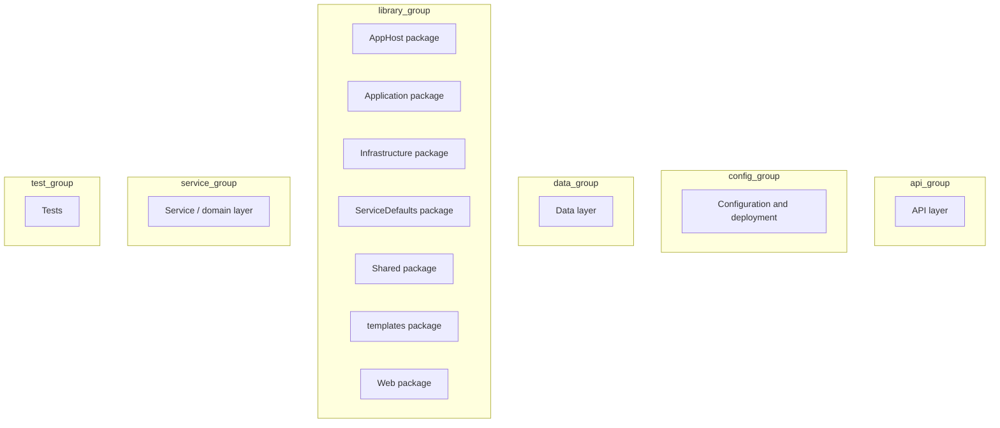

# Architecture report: jasontaylordev/CleanArchitecture

> Automated static analysis. **Observed** = directly seen in files/imports/AST; **Inferred** = interpretation from that evidence. Repository code was not executed.

## 1. Repository at a glance

| Item | Value |
| --- | --- |
| Repository | jasontaylordev/CleanArchitecture |
| Description | Clean Architecture Solution Template for ASP.NET Core |
| Language | C# |
| Stars | 20719 |
| Licence | MIT |
| Analysed commit / branch | e1ab4cc4d5d7b4e25e57bd8b0514b766573b8c04 / main |
| Framework(s) | React |
| Files analysed | 244 |
| Components | 12 |

## 2. Architecture in one minute

jasontaylordev/CleanArchitecture - Clean Architecture Solution Template for ASP.NET Core. This repository was analysed statically from 244 file(s) (0 Python). Detected technologies (observed from imports/manifests): GitHub Actions, React, React Router, TypeScript, Vite, Vitest. Files are grouped into 12 component(s): API layer, AppHost package, Application package, Configuration and deployment, Data layer, Infrastructure package, Service / domain layer, ServiceDefaults package. Findings below distinguish observed facts from inferred interpretation.

## 3. High-level block diagram

## 4. Main components

### API layer (`api_layer`)

- **Kind:** api
- **Status:** Observed
- **Confidence:** 0.85
- **Responsibility:** Groups 4 file(s) under api layer (observed from repository paths and static analysis).
- **Paths:** `src/Web/Endpoints/TodoItems.cs`, `src/Web/Endpoints/TodoLists.cs`, `src/Web/Endpoints/Users.cs`, `src/Web/Endpoints/WeatherForecasts.cs`
- **Evidence:** [src/Web/Endpoints/TodoItems.cs](https://github.com/jasontaylordev/CleanArchitecture/blob/e1ab4cc4d5d7b4e25e57bd8b0514b766573b8c04/src/Web/Endpoints/TodoItems.cs); [src/Web/Endpoints/TodoLists.cs](https://github.com/jasontaylordev/CleanArchitecture/blob/e1ab4cc4d5d7b4e25e57bd8b0514b766573b8c04/src/Web/Endpoints/TodoLists.cs); [src/Web/Endpoints/Users.cs](https://github.com/jasontaylordev/CleanArchitecture/blob/e1ab4cc4d5d7b4e25e57bd8b0514b766573b8c04/src/Web/Endpoints/Users.cs); [src/Web/Endpoints/WeatherForecasts.cs](https://github.com/jasontaylordev/CleanArchitecture/blob/e1ab4cc4d5d7b4e25e57bd8b0514b766573b8c04/src/Web/Endpoints/WeatherForecasts.cs)

### AppHost package (`apphost`)

- **Kind:** library
- **Status:** Observed
- **Confidence:** 0.85
- **Responsibility:** Groups 2 file(s) under apphost package (observed from repository paths and static analysis).
- **Paths:** `src/AppHost/Extensions.cs`, `src/AppHost/Program.cs`
- **Evidence:** [src/AppHost/Extensions.cs](https://github.com/jasontaylordev/CleanArchitecture/blob/e1ab4cc4d5d7b4e25e57bd8b0514b766573b8c04/src/AppHost/Extensions.cs); [src/AppHost/Program.cs](https://github.com/jasontaylordev/CleanArchitecture/blob/e1ab4cc4d5d7b4e25e57bd8b0514b766573b8c04/src/AppHost/Program.cs)

### Application package (`application`)

- **Kind:** library
- **Status:** Observed
- **Confidence:** 0.85
- **Responsibility:** Groups 31 file(s) under application package (observed from repository paths and static analysis).
- **Paths:** `src/Application/Common/Behaviours/AuthorizationBehaviour.cs`, `src/Application/Common/Behaviours/LoggingBehaviour.cs`, `src/Application/Common/Behaviours/PerformanceBehaviour.cs`, `src/Application/Common/Behaviours/UnhandledExceptionBehaviour.cs`, `src/Application/Common/Behaviours/ValidationBehaviour.cs`, `src/Application/Common/Exceptions/ForbiddenAccessException.cs`, `src/Application/Common/Exceptions/ValidationException.cs`, `src/Application/Common/Interfaces/IApplicationDbContext.cs`, `src/Application/Common/Interfaces/IIdentityService.cs`, `src/Application/Common/Interfaces/IUser.cs`, `src/Application/Common/Security/AuthorizeAttribute.cs`, `src/Application/DependencyInjection.cs`, `src/Application/GlobalUsings.cs`, `src/Application/TodoItems/Commands/CreateTodoItem/CreateTodoItem.cs`, `src/Application/TodoItems/Commands/CreateTodoItem/CreateTodoItemCommandValidator.cs`, `src/Application/TodoItems/Commands/DeleteTodoItem/DeleteTodoItem.cs`, `src/Application/TodoItems/Commands/UpdateTodoItem/UpdateTodoItem.cs`, `src/Application/TodoItems/Commands/UpdateTodoItem/UpdateTodoItemCommandValidator.cs`, `src/Application/TodoItems/Commands/UpdateTodoItemDetail/UpdateTodoItemDetail.cs`, `src/Application/TodoItems/EventHandlers/LogTodoItemCompleted.cs`, `src/Application/TodoLists/Commands/CreateTodoList/CreateTodoList.cs`, `src/Application/TodoLists/Commands/CreateTodoList/CreateTodoListCommandValidator.cs`, `src/Application/TodoLists/Commands/DeleteTodoList/DeleteTodoList.cs`, `src/Application/TodoLists/Commands/UpdateTodoList/UpdateTodoList.cs`, `src/Application/TodoLists/Commands/UpdateTodoList/UpdateTodoListCommandValidator.cs`, `src/Application/TodoLists/Queries/GetTodos/GetTodos.cs`, `src/Application/TodoLists/Queries/GetTodos/TodoItemDto.cs`, `src/Application/TodoLists/Queries/GetTodos/TodoListDto.cs`, `src/Application/TodoLists/Queries/GetTodos/TodosVm.cs`, `src/Application/WeatherForecasts/Queries/GetWeatherForecasts/GetWeatherForecastsQuery.cs`, `src/Application/WeatherForecasts/Queries/GetWeatherForecasts/WeatherForecast.cs`
- **Evidence:** [src/Application/Common/Behaviours/AuthorizationBehaviour.cs](https://github.com/jasontaylordev/CleanArchitecture/blob/e1ab4cc4d5d7b4e25e57bd8b0514b766573b8c04/src/Application/Common/Behaviours/AuthorizationBehaviour.cs); [src/Application/Common/Behaviours/LoggingBehaviour.cs](https://github.com/jasontaylordev/CleanArchitecture/blob/e1ab4cc4d5d7b4e25e57bd8b0514b766573b8c04/src/Application/Common/Behaviours/LoggingBehaviour.cs); [src/Application/Common/Behaviours/PerformanceBehaviour.cs](https://github.com/jasontaylordev/CleanArchitecture/blob/e1ab4cc4d5d7b4e25e57bd8b0514b766573b8c04/src/Application/Common/Behaviours/PerformanceBehaviour.cs); [src/Application/Common/Behaviours/UnhandledExceptionBehaviour.cs](https://github.com/jasontaylordev/CleanArchitecture/blob/e1ab4cc4d5d7b4e25e57bd8b0514b766573b8c04/src/Application/Common/Behaviours/UnhandledExceptionBehaviour.cs); [src/Application/Common/Behaviours/ValidationBehaviour.cs](https://github.com/jasontaylordev/CleanArchitecture/blob/e1ab4cc4d5d7b4e25e57bd8b0514b766573b8c04/src/Application/Common/Behaviours/ValidationBehaviour.cs); [src/Application/Common/Exceptions/ForbiddenAccessException.cs](https://github.com/jasontaylordev/CleanArchitecture/blob/e1ab4cc4d5d7b4e25e57bd8b0514b766573b8c04/src/Application/Common/Exceptions/ForbiddenAccessException.cs); [src/Application/Common/Exceptions/ValidationException.cs](https://github.com/jasontaylordev/CleanArchitecture/blob/e1ab4cc4d5d7b4e25e57bd8b0514b766573b8c04/src/Application/Common/Exceptions/ValidationException.cs); [src/Application/Common/Interfaces/IApplicationDbContext.cs](https://github.com/jasontaylordev/CleanArchitecture/blob/e1ab4cc4d5d7b4e25e57bd8b0514b766573b8c04/src/Application/Common/Interfaces/IApplicationDbContext.cs)

### Configuration and deployment (`config`)

- **Kind:** config
- **Status:** Observed
- **Confidence:** 0.85
- **Responsibility:** Groups 23 file(s) under configuration and deployment (observed from repository paths and static analysis).
- **Paths:** `aspire.config.json`, `global.json`, `renovate.json`, `src/AppHost/Properties/launchSettings.json`, `src/AppHost/appsettings.Development.json`, `src/AppHost/appsettings.json`, `src/Web/ClientApp-React/nswag.json`, `src/Web/ClientApp-React/package.json`, `src/Web/ClientApp-React/tsconfig.json`, `src/Web/ClientApp/.editorconfig`, `src/Web/ClientApp/angular.json`, `src/Web/ClientApp/nswag.json`, `src/Web/ClientApp/package.json`, `src/Web/ClientApp/tsconfig.app.json`, `src/Web/ClientApp/tsconfig.json`, `src/Web/ClientApp/tsconfig.spec.json`, `src/Web/Properties/launchSettings.json`, `src/Web/appsettings.PostgreSQL.json`, `src/Web/appsettings.SQLServer.json`, `src/Web/appsettings.SQLite.json`, `src/Web/appsettings.json`, `templates/ca-use-case/.template.config/dotnetcli.host.json`, `templates/ca-use-case/.template.config/template.json`
- **Evidence:** [aspire.config.json](https://github.com/jasontaylordev/CleanArchitecture/blob/e1ab4cc4d5d7b4e25e57bd8b0514b766573b8c04/aspire.config.json); [global.json](https://github.com/jasontaylordev/CleanArchitecture/blob/e1ab4cc4d5d7b4e25e57bd8b0514b766573b8c04/global.json); [renovate.json](https://github.com/jasontaylordev/CleanArchitecture/blob/e1ab4cc4d5d7b4e25e57bd8b0514b766573b8c04/renovate.json); [src/AppHost/Properties/launchSettings.json](https://github.com/jasontaylordev/CleanArchitecture/blob/e1ab4cc4d5d7b4e25e57bd8b0514b766573b8c04/src/AppHost/Properties/launchSettings.json); [src/AppHost/appsettings.Development.json](https://github.com/jasontaylordev/CleanArchitecture/blob/e1ab4cc4d5d7b4e25e57bd8b0514b766573b8c04/src/AppHost/appsettings.Development.json); [src/AppHost/appsettings.json](https://github.com/jasontaylordev/CleanArchitecture/blob/e1ab4cc4d5d7b4e25e57bd8b0514b766573b8c04/src/AppHost/appsettings.json); [src/Web/ClientApp-React/nswag.json](https://github.com/jasontaylordev/CleanArchitecture/blob/e1ab4cc4d5d7b4e25e57bd8b0514b766573b8c04/src/Web/ClientApp-React/nswag.json); [src/Web/ClientApp-React/package.json](https://github.com/jasontaylordev/CleanArchitecture/blob/e1ab4cc4d5d7b4e25e57bd8b0514b766573b8c04/src/Web/ClientApp-React/package.json)

### Data layer (`data_layer`)

- **Kind:** data
- **Status:** Observed
- **Confidence:** 0.85
- **Responsibility:** Groups 8 file(s) under data layer (observed from repository paths and static analysis).
- **Paths:** `src/Application/Common/Models/LookupDto.cs`, `src/Application/Common/Models/Result.cs`, `src/Infrastructure/Data/ApplicationDbContext.cs`, `src/Infrastructure/Data/ApplicationDbContextInitialiser.cs`, `src/Infrastructure/Data/Configurations/TodoItemConfiguration.cs`, `src/Infrastructure/Data/Configurations/TodoListConfiguration.cs`, `src/Infrastructure/Data/Interceptors/AuditableEntityInterceptor.cs`, `src/Infrastructure/Data/Interceptors/DispatchDomainEventsInterceptor.cs`
- **Evidence:** [src/Application/Common/Models/LookupDto.cs](https://github.com/jasontaylordev/CleanArchitecture/blob/e1ab4cc4d5d7b4e25e57bd8b0514b766573b8c04/src/Application/Common/Models/LookupDto.cs); [src/Application/Common/Models/Result.cs](https://github.com/jasontaylordev/CleanArchitecture/blob/e1ab4cc4d5d7b4e25e57bd8b0514b766573b8c04/src/Application/Common/Models/Result.cs); [src/Infrastructure/Data/ApplicationDbContext.cs](https://github.com/jasontaylordev/CleanArchitecture/blob/e1ab4cc4d5d7b4e25e57bd8b0514b766573b8c04/src/Infrastructure/Data/ApplicationDbContext.cs); [src/Infrastructure/Data/ApplicationDbContextInitialiser.cs](https://github.com/jasontaylordev/CleanArchitecture/blob/e1ab4cc4d5d7b4e25e57bd8b0514b766573b8c04/src/Infrastructure/Data/ApplicationDbContextInitialiser.cs); [src/Infrastructure/Data/Configurations/TodoItemConfiguration.cs](https://github.com/jasontaylordev/CleanArchitecture/blob/e1ab4cc4d5d7b4e25e57bd8b0514b766573b8c04/src/Infrastructure/Data/Configurations/TodoItemConfiguration.cs); [src/Infrastructure/Data/Configurations/TodoListConfiguration.cs](https://github.com/jasontaylordev/CleanArchitecture/blob/e1ab4cc4d5d7b4e25e57bd8b0514b766573b8c04/src/Infrastructure/Data/Configurations/TodoListConfiguration.cs); [src/Infrastructure/Data/Interceptors/AuditableEntityInterceptor.cs](https://github.com/jasontaylordev/CleanArchitecture/blob/e1ab4cc4d5d7b4e25e57bd8b0514b766573b8c04/src/Infrastructure/Data/Interceptors/AuditableEntityInterceptor.cs); [src/Infrastructure/Data/Interceptors/DispatchDomainEventsInterceptor.cs](https://github.com/jasontaylordev/CleanArchitecture/blob/e1ab4cc4d5d7b4e25e57bd8b0514b766573b8c04/src/Infrastructure/Data/Interceptors/DispatchDomainEventsInterceptor.cs)

### Infrastructure package (`infrastructure`)

- **Kind:** library
- **Status:** Observed
- **Confidence:** 0.85
- **Responsibility:** Groups 5 file(s) under infrastructure package (observed from repository paths and static analysis).
- **Paths:** `src/Infrastructure/DependencyInjection.cs`, `src/Infrastructure/GlobalUsings.cs`, `src/Infrastructure/Identity/ApplicationUser.cs`, `src/Infrastructure/Identity/IdentityResultExtensions.cs`, `src/Infrastructure/Identity/IdentityService.cs`
- **Evidence:** [src/Infrastructure/DependencyInjection.cs](https://github.com/jasontaylordev/CleanArchitecture/blob/e1ab4cc4d5d7b4e25e57bd8b0514b766573b8c04/src/Infrastructure/DependencyInjection.cs); [src/Infrastructure/GlobalUsings.cs](https://github.com/jasontaylordev/CleanArchitecture/blob/e1ab4cc4d5d7b4e25e57bd8b0514b766573b8c04/src/Infrastructure/GlobalUsings.cs); [src/Infrastructure/Identity/ApplicationUser.cs](https://github.com/jasontaylordev/CleanArchitecture/blob/e1ab4cc4d5d7b4e25e57bd8b0514b766573b8c04/src/Infrastructure/Identity/ApplicationUser.cs); [src/Infrastructure/Identity/IdentityResultExtensions.cs](https://github.com/jasontaylordev/CleanArchitecture/blob/e1ab4cc4d5d7b4e25e57bd8b0514b766573b8c04/src/Infrastructure/Identity/IdentityResultExtensions.cs); [src/Infrastructure/Identity/IdentityService.cs](https://github.com/jasontaylordev/CleanArchitecture/blob/e1ab4cc4d5d7b4e25e57bd8b0514b766573b8c04/src/Infrastructure/Identity/IdentityService.cs)

### Service / domain layer (`service_layer`)

- **Kind:** service
- **Status:** Observed
- **Confidence:** 0.85
- **Responsibility:** Groups 13 file(s) under service / domain layer (observed from repository paths and static analysis).
- **Paths:** `src/Domain/Common/BaseAuditableEntity.cs`, `src/Domain/Common/BaseEntity.cs`, `src/Domain/Common/BaseEvent.cs`, `src/Domain/Common/ValueObject.cs`, `src/Domain/Constants/Roles.cs`, `src/Domain/Entities/TodoItem.cs`, `src/Domain/Entities/TodoList.cs`, `src/Domain/Enums/PriorityLevel.cs`, `src/Domain/Events/TodoItemCompletedEvent.cs`, `src/Domain/Exceptions/UnsupportedColourException.cs`, `src/Domain/GlobalUsings.cs`, `src/Domain/ValueObjects/Colour.cs`, `src/Web/Services/CurrentUser.cs`
- **Evidence:** [src/Domain/Common/BaseAuditableEntity.cs](https://github.com/jasontaylordev/CleanArchitecture/blob/e1ab4cc4d5d7b4e25e57bd8b0514b766573b8c04/src/Domain/Common/BaseAuditableEntity.cs); [src/Domain/Common/BaseEntity.cs](https://github.com/jasontaylordev/CleanArchitecture/blob/e1ab4cc4d5d7b4e25e57bd8b0514b766573b8c04/src/Domain/Common/BaseEntity.cs); [src/Domain/Common/BaseEvent.cs](https://github.com/jasontaylordev/CleanArchitecture/blob/e1ab4cc4d5d7b4e25e57bd8b0514b766573b8c04/src/Domain/Common/BaseEvent.cs); [src/Domain/Common/ValueObject.cs](https://github.com/jasontaylordev/CleanArchitecture/blob/e1ab4cc4d5d7b4e25e57bd8b0514b766573b8c04/src/Domain/Common/ValueObject.cs); [src/Domain/Constants/Roles.cs](https://github.com/jasontaylordev/CleanArchitecture/blob/e1ab4cc4d5d7b4e25e57bd8b0514b766573b8c04/src/Domain/Constants/Roles.cs); [src/Domain/Entities/TodoItem.cs](https://github.com/jasontaylordev/CleanArchitecture/blob/e1ab4cc4d5d7b4e25e57bd8b0514b766573b8c04/src/Domain/Entities/TodoItem.cs); [src/Domain/Entities/TodoList.cs](https://github.com/jasontaylordev/CleanArchitecture/blob/e1ab4cc4d5d7b4e25e57bd8b0514b766573b8c04/src/Domain/Entities/TodoList.cs); [src/Domain/Enums/PriorityLevel.cs](https://github.com/jasontaylordev/CleanArchitecture/blob/e1ab4cc4d5d7b4e25e57bd8b0514b766573b8c04/src/Domain/Enums/PriorityLevel.cs)

### ServiceDefaults package (`servicedefaults`)

- **Kind:** library
- **Status:** Observed
- **Confidence:** 0.85
- **Responsibility:** Groups 1 file(s) under servicedefaults package (observed from repository paths and static analysis).
- **Paths:** `src/ServiceDefaults/Extensions.cs`
- **Evidence:** [src/ServiceDefaults/Extensions.cs](https://github.com/jasontaylordev/CleanArchitecture/blob/e1ab4cc4d5d7b4e25e57bd8b0514b766573b8c04/src/ServiceDefaults/Extensions.cs)

### Shared package (`shared`)

- **Kind:** library
- **Status:** Observed
- **Confidence:** 0.85
- **Responsibility:** Groups 1 file(s) under shared package (observed from repository paths and static analysis).
- **Paths:** `src/Shared/Services.cs`
- **Evidence:** [src/Shared/Services.cs](https://github.com/jasontaylordev/CleanArchitecture/blob/e1ab4cc4d5d7b4e25e57bd8b0514b766573b8c04/src/Shared/Services.cs)

### templates package (`templates`)

- **Kind:** library
- **Status:** Observed
- **Confidence:** 0.85
- **Responsibility:** Groups 2 file(s) under templates package (observed from repository paths and static analysis).
- **Paths:** `templates/ca-use-case/FeatureName/Commands/CleanArchitectureUseCase/CleanArchitectureUseCase.cs`, `templates/ca-use-case/FeatureName/Queries/CleanArchitectureUseCase/CleanArchitectureUseCase.cs`
- **Evidence:** [templates/ca-use-case/FeatureName/Commands/CleanArchitectureUseCase/CleanArchitectureUseCase.cs](https://github.com/jasontaylordev/CleanArchitecture/blob/e1ab4cc4d5d7b4e25e57bd8b0514b766573b8c04/templates/ca-use-case/FeatureName/Commands/CleanArchitectureUseCase/CleanArchitectureUseCase.cs); [templates/ca-use-case/FeatureName/Queries/CleanArchitectureUseCase/CleanArchitectureUseCase.cs](https://github.com/jasontaylordev/CleanArchitecture/blob/e1ab4cc4d5d7b4e25e57bd8b0514b766573b8c04/templates/ca-use-case/FeatureName/Queries/CleanArchitectureUseCase/CleanArchitectureUseCase.cs)

### Tests (`tests`)

- **Kind:** test
- **Status:** Observed
- **Confidence:** 0.85
- **Responsibility:** Groups 42 file(s) under tests (observed from repository paths and static analysis).
- **Paths:** `tests/Application.FunctionalTests/Application.FunctionalTests.csproj`, `tests/Application.FunctionalTests/FunctionalTestSetup.cs`, `tests/Application.FunctionalTests/GlobalUsings.cs`, `tests/Application.FunctionalTests/Infrastructure/DatabaseResetter.cs`, `tests/Application.FunctionalTests/Infrastructure/TestApp.cs`, `tests/Application.FunctionalTests/Infrastructure/TestBase.cs`, `tests/Application.FunctionalTests/Infrastructure/WebApiFactory.cs`, `tests/Application.FunctionalTests/TodoItems/Commands/CreateTodoItemTests.cs`, `tests/Application.FunctionalTests/TodoItems/Commands/DeleteTodoItemTests.cs`, `tests/Application.FunctionalTests/TodoItems/Commands/UpdateTodoItemDetailTests.cs`, `tests/Application.FunctionalTests/TodoItems/Commands/UpdateTodoItemTests.cs`, `tests/Application.FunctionalTests/TodoLists/Commands/CreateTodoListTests.cs`, `tests/Application.FunctionalTests/TodoLists/Commands/DeleteTodoListTests.cs`, `tests/Application.FunctionalTests/TodoLists/Commands/UpdateTodoListTests.cs`, `tests/Application.FunctionalTests/TodoLists/Queries/GetTodosTests.cs`, `tests/Application.UnitTests/Application.UnitTests.csproj`, `tests/Application.UnitTests/Common/Behaviours/RequestLoggerTests.cs`, `tests/Application.UnitTests/Common/Exceptions/ValidationExceptionTests.cs`, `tests/Application.UnitTests/Common/Mappings/MappingTests.cs`, `tests/Domain.UnitTests/Domain.UnitTests.csproj`, `tests/Domain.UnitTests/ValueObjects/ColourTests.cs`, `tests/Infrastructure.IntegrationTests/GlobalUsings.cs`, `tests/Infrastructure.IntegrationTests/Infrastructure.IntegrationTests.csproj`, `tests/TestAppHost/Program.cs`, `tests/TestAppHost/TestAppHost.csproj`, `tests/Web.AcceptanceTests/AspireSetup.cs`, `tests/Web.AcceptanceTests/Features/Counter.feature`, `tests/Web.AcceptanceTests/Features/Home.feature`, `tests/Web.AcceptanceTests/Features/Login.feature`, `tests/Web.AcceptanceTests/Features/Weather.feature`, `tests/Web.AcceptanceTests/GlobalUsings.cs`, `tests/Web.AcceptanceTests/Pages/BasePage.cs`, `tests/Web.AcceptanceTests/Pages/CounterPage.cs`, `tests/Web.AcceptanceTests/Pages/HomePage.cs`, `tests/Web.AcceptanceTests/Pages/LoginPage.cs`, `tests/Web.AcceptanceTests/Pages/WeatherPage.cs`, `tests/Web.AcceptanceTests/PlaywrightSetup.cs`, `tests/Web.AcceptanceTests/StepDefinitions/CounterStepDefinitions.cs`, `tests/Web.AcceptanceTests/StepDefinitions/HomeStepDefinitions.cs`, `tests/Web.AcceptanceTests/StepDefinitions/LoginStepDefinitions.cs`, `tests/Web.AcceptanceTests/StepDefinitions/WeatherStepDefinitions.cs`, `tests/Web.AcceptanceTests/Web.AcceptanceTests.csproj`
- **Evidence:** [tests/Application.FunctionalTests/Application.FunctionalTests.csproj](https://github.com/jasontaylordev/CleanArchitecture/blob/e1ab4cc4d5d7b4e25e57bd8b0514b766573b8c04/tests/Application.FunctionalTests/Application.FunctionalTests.csproj); [tests/Application.FunctionalTests/FunctionalTestSetup.cs](https://github.com/jasontaylordev/CleanArchitecture/blob/e1ab4cc4d5d7b4e25e57bd8b0514b766573b8c04/tests/Application.FunctionalTests/FunctionalTestSetup.cs); [tests/Application.FunctionalTests/GlobalUsings.cs](https://github.com/jasontaylordev/CleanArchitecture/blob/e1ab4cc4d5d7b4e25e57bd8b0514b766573b8c04/tests/Application.FunctionalTests/GlobalUsings.cs); [tests/Application.FunctionalTests/Infrastructure/DatabaseResetter.cs](https://github.com/jasontaylordev/CleanArchitecture/blob/e1ab4cc4d5d7b4e25e57bd8b0514b766573b8c04/tests/Application.FunctionalTests/Infrastructure/DatabaseResetter.cs); [tests/Application.FunctionalTests/Infrastructure/TestApp.cs](https://github.com/jasontaylordev/CleanArchitecture/blob/e1ab4cc4d5d7b4e25e57bd8b0514b766573b8c04/tests/Application.FunctionalTests/Infrastructure/TestApp.cs); [tests/Application.FunctionalTests/Infrastructure/TestBase.cs](https://github.com/jasontaylordev/CleanArchitecture/blob/e1ab4cc4d5d7b4e25e57bd8b0514b766573b8c04/tests/Application.FunctionalTests/Infrastructure/TestBase.cs); [tests/Application.FunctionalTests/Infrastructure/WebApiFactory.cs](https://github.com/jasontaylordev/CleanArchitecture/blob/e1ab4cc4d5d7b4e25e57bd8b0514b766573b8c04/tests/Application.FunctionalTests/Infrastructure/WebApiFactory.cs); [tests/Application.FunctionalTests/TodoItems/Commands/CreateTodoItemTests.cs](https://github.com/jasontaylordev/CleanArchitecture/blob/e1ab4cc4d5d7b4e25e57bd8b0514b766573b8c04/tests/Application.FunctionalTests/TodoItems/Commands/CreateTodoItemTests.cs)

### Web package (`web`)

- **Kind:** library
- **Status:** Observed
- **Confidence:** 0.85
- **Responsibility:** Groups 52 file(s) under web package (observed from repository paths and static analysis).
- **Paths:** `src/Web/ClientApp-React/aspnetcore-https.cjs`, `src/Web/ClientApp-React/src/App.jsx`, `src/Web/ClientApp-React/src/AppRoutes.jsx`, `src/Web/ClientApp-React/src/components/Counter.jsx`, `src/Web/ClientApp-React/src/components/Home.jsx`, `src/Web/ClientApp-React/src/components/Layout.jsx`, `src/Web/ClientApp-React/src/components/NavMenu.jsx`, `src/Web/ClientApp-React/src/components/ThemeContext.jsx`, `src/Web/ClientApp-React/src/components/ThemeToggle.jsx`, `src/Web/ClientApp-React/src/components/Todo.jsx`, `src/Web/ClientApp-React/src/components/Weather.jsx`, `src/Web/ClientApp-React/src/components/api-authorization/AuthContext.jsx`, `src/Web/ClientApp-React/src/components/api-authorization/LoginPage.jsx`, `src/Web/ClientApp-React/src/components/api-authorization/ProtectedRoute.jsx`, `src/Web/ClientApp-React/src/components/api-authorization/RegisterPage.jsx`, `src/Web/ClientApp-React/src/main.jsx`, `src/Web/ClientApp-React/src/vite-env.d.ts`, `src/Web/ClientApp-React/vite.config.ts`, `src/Web/ClientApp/proxy.conf.js`, `src/Web/ClientApp/src/api-authorization/auth.guard.ts`, `src/Web/ClientApp/src/api-authorization/auth.service.ts`, `src/Web/ClientApp/src/api-authorization/authorize.interceptor.spec.ts`, `src/Web/ClientApp/src/api-authorization/authorize.interceptor.ts`, `src/Web/ClientApp/src/api-authorization/login/login.component.ts`, `src/Web/ClientApp/src/api-authorization/register/register.component.ts`, `src/Web/ClientApp/src/app/app.component.ts`, `src/Web/ClientApp/src/app/app.module.ts`, `src/Web/ClientApp/src/app/app.server.module.ts`, `src/Web/ClientApp/src/app/counter/counter.component.spec.ts`, `src/Web/ClientApp/src/app/counter/counter.component.ts`, `src/Web/ClientApp/src/app/fetch-data/fetch-data.component.ts`, `src/Web/ClientApp/src/app/home/home.component.ts`, `src/Web/ClientApp/src/app/nav-menu/nav-menu.component.ts`, `src/Web/ClientApp/src/app/theme-toggle/theme-toggle.component.ts`, `src/Web/ClientApp/src/app/theme.service.ts`, `src/Web/ClientApp/src/app/todo/todo.component.ts`, `src/Web/ClientApp/src/app/weather/weather.component.ts`, `src/Web/ClientApp/src/environments/environment.prod.ts`, `src/Web/ClientApp/src/environments/environment.ts`, `src/Web/ClientApp/src/main.ts`, `src/Web/ClientApp/src/polyfills.ts`, `src/Web/DependencyInjection.cs`, `src/Web/GlobalUsings.cs`, `src/Web/Infrastructure/ApiExceptionOperationTransformer.cs`, `src/Web/Infrastructure/BearerSecuritySchemeTransformer.cs`, `src/Web/Infrastructure/EndpointRouteBuilderExtensions.cs`, `src/Web/Infrastructure/IEndpointGroup.cs`, `src/Web/Infrastructure/IdentityApiOperationTransformer.cs`, `src/Web/Infrastructure/MethodInfoExtensions.cs`, `src/Web/Infrastructure/ProblemDetailsExceptionHandler.cs`, `src/Web/Infrastructure/WebApplicationExtensions.cs`, `src/Web/Program.cs`
- **Evidence:** [src/Web/ClientApp-React/aspnetcore-https.cjs](https://github.com/jasontaylordev/CleanArchitecture/blob/e1ab4cc4d5d7b4e25e57bd8b0514b766573b8c04/src/Web/ClientApp-React/aspnetcore-https.cjs); [src/Web/ClientApp-React/src/App.jsx](https://github.com/jasontaylordev/CleanArchitecture/blob/e1ab4cc4d5d7b4e25e57bd8b0514b766573b8c04/src/Web/ClientApp-React/src/App.jsx); [src/Web/ClientApp-React/src/AppRoutes.jsx](https://github.com/jasontaylordev/CleanArchitecture/blob/e1ab4cc4d5d7b4e25e57bd8b0514b766573b8c04/src/Web/ClientApp-React/src/AppRoutes.jsx); [src/Web/ClientApp-React/src/components/Counter.jsx](https://github.com/jasontaylordev/CleanArchitecture/blob/e1ab4cc4d5d7b4e25e57bd8b0514b766573b8c04/src/Web/ClientApp-React/src/components/Counter.jsx); [src/Web/ClientApp-React/src/components/Home.jsx](https://github.com/jasontaylordev/CleanArchitecture/blob/e1ab4cc4d5d7b4e25e57bd8b0514b766573b8c04/src/Web/ClientApp-React/src/components/Home.jsx); [src/Web/ClientApp-React/src/components/Layout.jsx](https://github.com/jasontaylordev/CleanArchitecture/blob/e1ab4cc4d5d7b4e25e57bd8b0514b766573b8c04/src/Web/ClientApp-React/src/components/Layout.jsx); [src/Web/ClientApp-React/src/components/NavMenu.jsx](https://github.com/jasontaylordev/CleanArchitecture/blob/e1ab4cc4d5d7b4e25e57bd8b0514b766573b8c04/src/Web/ClientApp-React/src/components/NavMenu.jsx); [src/Web/ClientApp-React/src/components/ThemeContext.jsx](https://github.com/jasontaylordev/CleanArchitecture/blob/e1ab4cc4d5d7b4e25e57bd8b0514b766573b8c04/src/Web/ClientApp-React/src/components/ThemeContext.jsx)

## 5. Execution flow

No entry point was observed; the startup flow below is therefore limited.

Representative flow (derived from observed entry points and the import graph; steps beyond the entry point are **Inferred**):

1. Execution starts at an observed entry point listed above, if present.
2. No internal import relationships between components were observed.

## 6. Project structure

### `(root)`

- `.editorconfig` - config (17875 bytes)
- `.gitattributes` - other (422 bytes)
- `.gitignore` - other (8173 bytes)
- `CODE_OF_CONDUCT.md` - docs (3357 bytes)
- `CleanArchitecture.nuspec` - other (1886 bytes)
- `CleanArchitecture.slnx` - other (1281 bytes)
- `Directory.Build.props` - other (602 bytes)
- `Directory.Packages.props` - other (4400 bytes)
- `LICENSE` - docs (1071 bytes)
- `README-template.md` - docs (1827 bytes)
- `README.md` - docs (5224 bytes)
- `aspire.config.json` - config (64 bytes)
- `global.json` - config (80 bytes)
- `renovate.json` - config (1799 bytes)

### `.devcontainer`

- `.devcontainer/README.md` - docs (806 bytes)
- `.devcontainer/devcontainer.json` - config (862 bytes)

### `.github`

- `.github/FUNDING.yml` - config (838 bytes)
- `.github/ISSUE_TEMPLATE/bug_report.md` - docs (540 bytes)
- `.github/ISSUE_TEMPLATE/config.yml` - config (215 bytes)
- `.github/ISSUE_TEMPLATE/feature_request.md` - docs (599 bytes)
- `.github/workflows/build.yml` - ci, YAML (1487 bytes)
- `.github/workflows/codeql.yml` - ci, YAML (812 bytes)
- `.github/workflows/release.yml` - ci, YAML (1939 bytes)
- `.github/workflows/test-templates.yml` - ci, YAML (2111 bytes)

### `.template.config`

- `.template.config/dotnetcli.host.json` - config (841 bytes)
- `.template.config/ide.host.json` - config (549 bytes)
- `.template.config/template.json` - config (11693 bytes)

### `docs`

- `docs/decisions/ADR-000-template.md` - docs (812 bytes)
- `docs/decisions/ADR-001-Use-EFCore-In-Application-Layer.md` - docs (5182 bytes)
- `docs/decisions/ADR-002-Aspire-For-Orchestration-And-Testing.md` - docs (2643 bytes)
- `docs/decisions/ADR-003-MediatR-Contracts-In-Domain.md` - docs (1752 bytes)
- `docs/decisions/README.md` - docs (782 bytes)

### `src`

- `src/AppHost/AppHost.csproj` - other (973 bytes)
- `src/AppHost/Extensions.cs` - source, C# (718 bytes)
- `src/AppHost/Program.cs` - source, C# (1379 bytes)
- `src/AppHost/Properties/launchSettings.json` - config (1426 bytes)
- `src/AppHost/appsettings.Development.json` - config (119 bytes)
- `src/AppHost/appsettings.json` - config (158 bytes)
- `src/Application/Application.csproj` - other (690 bytes)
- `src/Application/Common/Behaviours/AuthorizationBehaviour.cs` - source, C# (2770 bytes)
- `src/Application/Common/Behaviours/LoggingBehaviour.cs` - source, C# (1144 bytes)
- `src/Application/Common/Behaviours/PerformanceBehaviour.cs` - source, C# (1666 bytes)
- `src/Application/Common/Behaviours/UnhandledExceptionBehaviour.cs` - source, C# (860 bytes)
- `src/Application/Common/Behaviours/ValidationBehaviour.cs` - source, C# (1161 bytes)
- `src/Application/Common/Exceptions/ForbiddenAccessException.cs` - source, C# (168 bytes)
- `src/Application/Common/Exceptions/ValidationException.cs` - source, C# (658 bytes)
- `src/Application/Common/Interfaces/IApplicationDbContext.cs` - source, C# (297 bytes)
- `src/Application/Common/Interfaces/IIdentityService.cs` - source, C# (472 bytes)
- `src/Application/Common/Interfaces/IUser.cs` - source, C# (148 bytes)
- `src/Application/Common/Models/LookupDto.cs` - source, C# (388 bytes)
- `src/Application/Common/Models/Result.cs` - source, C# (530 bytes)
- `src/Application/Common/Security/AuthorizeAttribute.cs` - source, C# (808 bytes)
- `src/Application/DependencyInjection.cs` - source, C# (986 bytes)
- `src/Application/GlobalUsings.cs` - source, C# (204 bytes)
- `src/Application/TodoItems/Commands/CreateTodoItem/CreateTodoItem.cs` - source, C# (964 bytes)
- `src/Application/TodoItems/Commands/CreateTodoItem/CreateTodoItemCommandValidator.cs` - source, C# (313 bytes)
- `src/Application/TodoItems/Commands/DeleteTodoItem/DeleteTodoItem.cs` - source, C# (816 bytes)
- `src/Application/TodoItems/Commands/UpdateTodoItem/UpdateTodoItem.cs` - source, C# (952 bytes)
- `src/Application/TodoItems/Commands/UpdateTodoItem/UpdateTodoItemCommandValidator.cs` - source, C# (313 bytes)
- `src/Application/TodoItems/Commands/UpdateTodoItemDetail/UpdateTodoItemDetail.cs` - source, C# (1122 bytes)
- `src/Application/TodoItems/EventHandlers/LogTodoItemCompleted.cs` - source, C# (655 bytes)
- `src/Application/TodoLists/Commands/CreateTodoList/CreateTodoList.cs` - source, C# (1015 bytes)
- `src/Application/TodoLists/Commands/CreateTodoList/CreateTodoListCommandValidator.cs` - source, C# (837 bytes)
- `src/Application/TodoLists/Commands/DeleteTodoList/DeleteTodoList.cs` - source, C# (856 bytes)
- `src/Application/TodoLists/Commands/UpdateTodoList/UpdateTodoList.cs` - source, C# (1081 bytes)
- `src/Application/TodoLists/Commands/UpdateTodoList/UpdateTodoListCommandValidator.cs` - source, C# (908 bytes)
- `src/Application/TodoLists/Queries/GetTodos/GetTodos.cs` - source, C# (1938 bytes)
- `src/Application/TodoLists/Queries/GetTodos/TodoItemDto.cs` - source, C# (600 bytes)
- `src/Application/TodoLists/Queries/GetTodos/TodoListDto.cs` - source, C# (525 bytes)
- `src/Application/TodoLists/Queries/GetTodos/TodosVm.cs` - source, C# (508 bytes)
- `src/Application/WeatherForecasts/Queries/GetWeatherForecasts/GetWeatherForecastsQuery.cs` - source, C# (1092 bytes)
- `src/Application/WeatherForecasts/Queries/GetWeatherForecasts/WeatherForecast.cs` - source, C# (332 bytes)
- `src/Domain/Common/BaseAuditableEntity.cs` - source, C# (301 bytes)
- `src/Domain/Common/BaseEntity.cs` - source, C# (790 bytes)
- `src/Domain/Common/BaseEvent.cs` - source, C# (115 bytes)
- `src/Domain/Common/ValueObject.cs` - source, C# (1439 bytes)
- `src/Domain/Constants/Roles.cs` - source, C# (144 bytes)
- `src/Domain/Domain.csproj` - other (288 bytes)
- `src/Domain/Entities/TodoItem.cs` - source, C# (577 bytes)
- `src/Domain/Entities/TodoList.cs` - source, C# (271 bytes)
- `src/Domain/Enums/PriorityLevel.cs` - source, C# (132 bytes)
- `src/Domain/Events/TodoItemCompletedEvent.cs` - source, C# (216 bytes)
- `src/Domain/Exceptions/UnsupportedColourException.cs` - source, C# (223 bytes)
- `src/Domain/GlobalUsings.cs` - source, C# (289 bytes)
- `src/Domain/ValueObjects/Colour.cs` - source, C# (1495 bytes)
- `src/Infrastructure/Data/ApplicationDbContext.cs` - source, C# (832 bytes)
- `src/Infrastructure/Data/ApplicationDbContextInitialiser.cs` - source, C# (3660 bytes)
- `src/Infrastructure/Data/Configurations/TodoItemConfiguration.cs` - source, C# (450 bytes)
- `src/Infrastructure/Data/Configurations/TodoListConfiguration.cs` - source, C# (504 bytes)
- `src/Infrastructure/Data/Interceptors/AuditableEntityInterceptor.cs` - source, C# (2187 bytes)
- `src/Infrastructure/Data/Interceptors/DispatchDomainEventsInterceptor.cs` - source, C# (1587 bytes)
- `src/Infrastructure/DependencyInjection.cs` - source, C# (3009 bytes)
- `src/Infrastructure/GlobalUsings.cs` - source, C# (76 bytes)
- `src/Infrastructure/Identity/ApplicationUser.cs` - source, C# (143 bytes)
- `src/Infrastructure/Identity/IdentityResultExtensions.cs` - source, C# (415 bytes)
- `src/Infrastructure/Identity/IdentityService.cs` - source, C# (2517 bytes)
- `src/Infrastructure/Infrastructure.csproj` - other (1145 bytes)
- `src/ServiceDefaults/Extensions.cs` - source, C# (4524 bytes)
- `src/ServiceDefaults/ServiceDefaults.csproj` - other (888 bytes)
- `src/Shared/Services.cs` - source, C# (950 bytes)
- `src/Shared/Shared.csproj` - other (366 bytes)
- `src/Web/ClientApp-React/.gitignore` - other (285 bytes)
- `src/Web/ClientApp-React/README.md` - docs (1422 bytes)
- `src/Web/ClientApp-React/aspnetcore-https.cjs` - source, JavaScript (1254 bytes)
- `src/Web/ClientApp-React/index.html` - other (1078 bytes)
- `src/Web/ClientApp-React/nswag.json` - config (2389 bytes)
- `src/Web/ClientApp-React/package.json` - manifest (975 bytes)
- `src/Web/ClientApp-React/public/manifest.webmanifest` - other (327 bytes)
- `src/Web/ClientApp-React/src/App.jsx` - source, JavaScript (763 bytes)
- `src/Web/ClientApp-React/src/AppRoutes.jsx` - source, JavaScript (852 bytes)
- `src/Web/ClientApp-React/src/components/Counter.jsx` - source, JavaScript (369 bytes)
- `src/Web/ClientApp-React/src/components/Home.jsx` - source, JavaScript (1520 bytes)
- `src/Web/ClientApp-React/src/components/Layout.jsx` - source, JavaScript (158 bytes)
- `src/Web/ClientApp-React/src/components/NavMenu.jsx` - source, JavaScript (1170 bytes)
- `src/Web/ClientApp-React/src/components/ThemeContext.jsx` - source, JavaScript (742 bytes)
- `src/Web/ClientApp-React/src/components/ThemeToggle.jsx` - source, JavaScript (567 bytes)
- `src/Web/ClientApp-React/src/components/Todo.jsx` - source, JavaScript (17113 bytes)
- `src/Web/ClientApp-React/src/components/Weather.jsx` - source, JavaScript (1630 bytes)
- `src/Web/ClientApp-React/src/components/api-authorization/AuthContext.jsx` - source, JavaScript (1141 bytes)
- `src/Web/ClientApp-React/src/components/api-authorization/LoginPage.jsx` - source, JavaScript (1712 bytes)
- `src/Web/ClientApp-React/src/components/api-authorization/ProtectedRoute.jsx` - source, JavaScript (391 bytes)
- `src/Web/ClientApp-React/src/components/api-authorization/RegisterPage.jsx` - source, JavaScript (2502 bytes)
- `src/Web/ClientApp-React/src/main.jsx` - source, JavaScript (396 bytes)
- `src/Web/ClientApp-React/src/styles.scss` - other (9310 bytes)
- `src/Web/ClientApp-React/src/vite-env.d.ts` - source, TypeScript (38 bytes)
- `src/Web/ClientApp-React/tsconfig.json` - config (746 bytes)
- `src/Web/ClientApp-React/vite.config.ts` - source, TypeScript (881 bytes)
- `src/Web/ClientApp/.editorconfig` - config (313 bytes)
- `src/Web/ClientApp/.gitignore` - other (526 bytes)
- `src/Web/ClientApp/README.md` - docs (1064 bytes)
- `src/Web/ClientApp/angular.json` - config (3473 bytes)
- `src/Web/ClientApp/nswag.json` - config (2394 bytes)
- `src/Web/ClientApp/package.json` - manifest (1439 bytes)
- `src/Web/ClientApp/proxy.conf.js` - source, JavaScript (383 bytes)
- `src/Web/ClientApp/src/api-authorization/auth.guard.ts` - source, TypeScript (776 bytes)
- `src/Web/ClientApp/src/api-authorization/auth.service.ts` - source, TypeScript (1223 bytes)
- `src/Web/ClientApp/src/api-authorization/authorize.interceptor.spec.ts` - source, TypeScript (508 bytes)
- `src/Web/ClientApp/src/api-authorization/authorize.interceptor.ts` - source, TypeScript (1000 bytes)
- `src/Web/ClientApp/src/api-authorization/login/login.component.html` - other (892 bytes)
- `src/Web/ClientApp/src/api-authorization/login/login.component.ts` - source, TypeScript (969 bytes)
- `src/Web/ClientApp/src/api-authorization/register/register.component.html` - other (1159 bytes)
- `src/Web/ClientApp/src/api-authorization/register/register.component.ts` - source, TypeScript (1272 bytes)
- `src/Web/ClientApp/src/app/app.component.html` - other (79 bytes)
- `src/Web/ClientApp/src/app/app.component.ts` - source, TypeScript (265 bytes)
- `src/Web/ClientApp/src/app/app.module.ts` - source, TypeScript (2784 bytes)
- `src/Web/ClientApp/src/app/app.server.module.ts` - source, TypeScript (308 bytes)
- `src/Web/ClientApp/src/app/counter/counter.component.html` - other (210 bytes)
- `src/Web/ClientApp/src/app/counter/counter.component.spec.ts` - source, TypeScript (1039 bytes)
- `src/Web/ClientApp/src/app/counter/counter.component.ts` - source, TypeScript (356 bytes)
- `src/Web/ClientApp/src/app/fetch-data/fetch-data.component.html` - other (641 bytes)
- `src/Web/ClientApp/src/app/fetch-data/fetch-data.component.ts` - source, TypeScript (649 bytes)
- `src/Web/ClientApp/src/app/home/home.component.html` - other (1565 bytes)
- `src/Web/ClientApp/src/app/home/home.component.ts` - source, TypeScript (251 bytes)
- `src/Web/ClientApp/src/app/nav-menu/nav-menu.component.html` - other (997 bytes)
- `src/Web/ClientApp/src/app/nav-menu/nav-menu.component.scss` - other (42 bytes)
- `src/Web/ClientApp/src/app/nav-menu/nav-menu.component.ts` - source, TypeScript (712 bytes)
- `src/Web/ClientApp/src/app/theme-toggle/theme-toggle.component.html` - other (166 bytes)
- `src/Web/ClientApp/src/app/theme-toggle/theme-toggle.component.ts` - source, TypeScript (939 bytes)
- `src/Web/ClientApp/src/app/theme.service.ts` - source, TypeScript (822 bytes)
- `src/Web/ClientApp/src/app/todo/todo.component.html` - other (6777 bytes)
- `src/Web/ClientApp/src/app/todo/todo.component.scss` - other (42 bytes)
- `src/Web/ClientApp/src/app/todo/todo.component.ts` - source, TypeScript (9718 bytes)
- `src/Web/ClientApp/src/app/weather/weather.component.html` - other (753 bytes)
- `src/Web/ClientApp/src/app/weather/weather.component.ts` - source, TypeScript (892 bytes)
- `src/Web/ClientApp/src/assets/.gitkeep` - other (0 bytes)
- `src/Web/ClientApp/src/environments/environment.prod.ts` - source, TypeScript (51 bytes)
- `src/Web/ClientApp/src/environments/environment.ts` - source, TypeScript (658 bytes)
- `src/Web/ClientApp/src/index.html` - other (906 bytes)
- `src/Web/ClientApp/src/main.ts` - source, TypeScript (531 bytes)
- `src/Web/ClientApp/src/polyfills.ts` - source, TypeScript (2820 bytes)
- `src/Web/ClientApp/src/styles.scss` - other (9489 bytes)
- `src/Web/ClientApp/tsconfig.app.json` - config (458 bytes)
- `src/Web/ClientApp/tsconfig.json` - config (724 bytes)
- `src/Web/ClientApp/tsconfig.spec.json` - config (489 bytes)
- `src/Web/DependencyInjection.cs` - source, C# (1618 bytes)
- `src/Web/Endpoints/TodoItems.cs` - source, C# (2421 bytes)
- `src/Web/Endpoints/TodoLists.cs` - source, C# (2184 bytes)
- `src/Web/Endpoints/Users.cs` - source, C# (912 bytes)
- `src/Web/Endpoints/WeatherForecasts.cs` - source, C# (758 bytes)
- `src/Web/GlobalUsings.cs` - source, C# (108 bytes)
- `src/Web/Infrastructure/ApiExceptionOperationTransformer.cs` - source, C# (1286 bytes)
- `src/Web/Infrastructure/BearerSecuritySchemeTransformer.cs` - source, C# (1430 bytes)
- `src/Web/Infrastructure/EndpointRouteBuilderExtensions.cs` - source, C# (2634 bytes)
- `src/Web/Infrastructure/IEndpointGroup.cs` - source, C# (777 bytes)
- `src/Web/Infrastructure/IdentityApiOperationTransformer.cs` - source, C# (2653 bytes)
- `src/Web/Infrastructure/MethodInfoExtensions.cs` - source, C# (1253 bytes)
- `src/Web/Infrastructure/ProblemDetailsExceptionHandler.cs` - source, C# (2382 bytes)
- `src/Web/Infrastructure/WebApplicationExtensions.cs` - source, C# (1192 bytes)
- `src/Web/Program.cs` - source, C# (1105 bytes)
- `src/Web/Properties/launchSettings.json` - config (677 bytes)
- `src/Web/Services/CurrentUser.cs` - source, C# (604 bytes)
- `src/Web/Web-webapi.http` - other (2376 bytes)
- `src/Web/Web.csproj` - other (2959 bytes)
- `src/Web/Web.http` - other (2655 bytes)
- `src/Web/appsettings.PostgreSQL.json` - config (308 bytes)
- `src/Web/appsettings.SQLServer.json` - config (332 bytes)
- `src/Web/appsettings.SQLite.json` - config (263 bytes)
- `src/Web/appsettings.json` - config (286 bytes)

### `templates`

- `templates/ca-use-case/.template.config/dotnetcli.host.json` - config (458 bytes)
- `templates/ca-use-case/.template.config/template.json` - config (3066 bytes)
- `templates/ca-use-case/FeatureName/Commands/CleanArchitectureUseCase/CleanArchitectureUseCase.cs` - source, C# (1311 bytes)
- `templates/ca-use-case/FeatureName/Queries/CleanArchitectureUseCase/CleanArchitectureUseCase.cs` - source, C# (1286 bytes)

### `tests`

- `tests/Application.FunctionalTests/Application.FunctionalTests.csproj` - test (1653 bytes)
- `tests/Application.FunctionalTests/FunctionalTestSetup.cs` - test, C# (1870 bytes)
- `tests/Application.FunctionalTests/GlobalUsings.cs` - test, C# (223 bytes)
- `tests/Application.FunctionalTests/Infrastructure/DatabaseResetter.cs` - test, C# (1353 bytes)
- `tests/Application.FunctionalTests/Infrastructure/TestApp.cs` - test, C# (3823 bytes)
- `tests/Application.FunctionalTests/Infrastructure/TestBase.cs` - test, C# (198 bytes)
- `tests/Application.FunctionalTests/Infrastructure/WebApiFactory.cs` - test, C# (1072 bytes)
- `tests/Application.FunctionalTests/TodoItems/Commands/CreateTodoItemTests.cs` - test, C# (1455 bytes)
- `tests/Application.FunctionalTests/TodoItems/Commands/DeleteTodoItemTests.cs` - test, C# (1108 bytes)
- `tests/Application.FunctionalTests/TodoItems/Commands/UpdateTodoItemDetailTests.cs` - test, C# (1824 bytes)
- `tests/Application.FunctionalTests/TodoItems/Commands/UpdateTodoItemTests.cs` - test, C# (1532 bytes)
- `tests/Application.FunctionalTests/TodoLists/Commands/CreateTodoListTests.cs` - test, C# (1419 bytes)
- `tests/Application.FunctionalTests/TodoLists/Commands/DeleteTodoListTests.cs` - test, C# (882 bytes)
- `tests/Application.FunctionalTests/TodoLists/Commands/UpdateTodoListTests.cs` - test, C# (2014 bytes)
- `tests/Application.FunctionalTests/TodoLists/Queries/GetTodosTests.cs` - test, C# (1706 bytes)
- `tests/Application.UnitTests/Application.UnitTests.csproj` - test (1257 bytes)
- `tests/Application.UnitTests/Common/Behaviours/RequestLoggerTests.cs` - test, C# (1674 bytes)
- `tests/Application.UnitTests/Common/Exceptions/ValidationExceptionTests.cs` - test, C# (2162 bytes)
- `tests/Application.UnitTests/Common/Mappings/MappingTests.cs` - test, C# (1757 bytes)
- `tests/Domain.UnitTests/Domain.UnitTests.csproj` - test (1054 bytes)
- `tests/Domain.UnitTests/ValueObjects/ColourTests.cs` - test, C# (1359 bytes)
- `tests/Infrastructure.IntegrationTests/GlobalUsings.cs` - test, C# (29 bytes)
- `tests/Infrastructure.IntegrationTests/Infrastructure.IntegrationTests.csproj` - test (929 bytes)
- `tests/TestAppHost/Program.cs` - test, C# (595 bytes)
- `tests/TestAppHost/TestAppHost.csproj` - test (804 bytes)
- `tests/Web.AcceptanceTests/AspireSetup.cs` - test, C# (2058 bytes)
- `tests/Web.AcceptanceTests/Features/Counter.feature` - test (339 bytes)
- `tests/Web.AcceptanceTests/Features/Home.feature` - test (140 bytes)
- `tests/Web.AcceptanceTests/Features/Login.feature` - test (361 bytes)
- `tests/Web.AcceptanceTests/Features/Weather.feature` - test (265 bytes)
- `tests/Web.AcceptanceTests/GlobalUsings.cs` - test, C# (209 bytes)
- `tests/Web.AcceptanceTests/Pages/BasePage.cs` - test, C# (364 bytes)
- `tests/Web.AcceptanceTests/Pages/CounterPage.cs` - test, C# (552 bytes)
- `tests/Web.AcceptanceTests/Pages/HomePage.cs` - test, C# (275 bytes)
- `tests/Web.AcceptanceTests/Pages/LoginPage.cs` - test, C# (675 bytes)
- `tests/Web.AcceptanceTests/Pages/WeatherPage.cs` - test, C# (524 bytes)
- `tests/Web.AcceptanceTests/PlaywrightSetup.cs` - test, C# (810 bytes)
- `tests/Web.AcceptanceTests/StepDefinitions/CounterStepDefinitions.cs` - test, C# (1216 bytes)
- `tests/Web.AcceptanceTests/StepDefinitions/HomeStepDefinitions.cs` - test, C# (931 bytes)
- `tests/Web.AcceptanceTests/StepDefinitions/LoginStepDefinitions.cs` - test, C# (1703 bytes)
- `tests/Web.AcceptanceTests/StepDefinitions/WeatherStepDefinitions.cs` - test, C# (1632 bytes)
- `tests/Web.AcceptanceTests/Web.AcceptanceTests.csproj` - test (1266 bytes)

## 7. Key dependencies and integrations

| Name | Category | Status | Confidence | Evidence |
| --- | --- | --- | --- | --- |
| GitHub Actions | ci | Observed | 0.90 | [.github/workflows/build.yml](https://github.com/jasontaylordev/CleanArchitecture/blob/e1ab4cc4d5d7b4e25e57bd8b0514b766573b8c04/.github/workflows/build.yml); [.github/workflows/codeql.yml](https://github.com/jasontaylordev/CleanArchitecture/blob/e1ab4cc4d5d7b4e25e57bd8b0514b766573b8c04/.github/workflows/codeql.yml); [.github/workflows/release.yml](https://github.com/jasontaylordev/CleanArchitecture/blob/e1ab4cc4d5d7b4e25e57bd8b0514b766573b8c04/.github/workflows/release.yml); [.github/workflows/test-templates.yml](https://github.com/jasontaylordev/CleanArchitecture/blob/e1ab4cc4d5d7b4e25e57bd8b0514b766573b8c04/.github/workflows/test-templates.yml) |
| React | framework | Observed | 0.90 | [src/Web/ClientApp-React/package.json:8](https://github.com/jasontaylordev/CleanArchitecture/blob/e1ab4cc4d5d7b4e25e57bd8b0514b766573b8c04/src/Web/ClientApp-React/package.json#L8); [src/Web/ClientApp-React/package.json:10](https://github.com/jasontaylordev/CleanArchitecture/blob/e1ab4cc4d5d7b4e25e57bd8b0514b766573b8c04/src/Web/ClientApp-React/package.json#L10) |
| React Router | library | Observed | 0.85 | [src/Web/ClientApp-React/package.json:11](https://github.com/jasontaylordev/CleanArchitecture/blob/e1ab4cc4d5d7b4e25e57bd8b0514b766573b8c04/src/Web/ClientApp-React/package.json#L11) |
| TypeScript | tooling | Observed | 0.90 | [src/Web/ClientApp-React/package.json:24](https://github.com/jasontaylordev/CleanArchitecture/blob/e1ab4cc4d5d7b4e25e57bd8b0514b766573b8c04/src/Web/ClientApp-React/package.json#L24); [src/Web/ClientApp/package.json:39](https://github.com/jasontaylordev/CleanArchitecture/blob/e1ab4cc4d5d7b4e25e57bd8b0514b766573b8c04/src/Web/ClientApp/package.json#L39) |
| Vite | tooling | Observed | 0.85 | [src/Web/ClientApp-React/package.json:17](https://github.com/jasontaylordev/CleanArchitecture/blob/e1ab4cc4d5d7b4e25e57bd8b0514b766573b8c04/src/Web/ClientApp-React/package.json#L17) |
| Vitest | tooling | Observed | 0.85 | [src/Web/ClientApp/package.json:40](https://github.com/jasontaylordev/CleanArchitecture/blob/e1ab4cc4d5d7b4e25e57bd8b0514b766573b8c04/src/Web/ClientApp/package.json#L40) |

## 8. Data and state

- Data component `data_layer` (Observed): Groups 8 file(s) under data layer (observed from repository paths and static analysis).

## 9. Configuration and deployment clues

- `.devcontainer/devcontainer.json` (config)
- `.editorconfig` (config)
- `.github/FUNDING.yml` (config)
- `.github/ISSUE_TEMPLATE/config.yml` (config)
- `.github/workflows/build.yml` (ci)
- `.github/workflows/codeql.yml` (ci)
- `.github/workflows/release.yml` (ci)
- `.github/workflows/test-templates.yml` (ci)
- `.template.config/dotnetcli.host.json` (config)
- `.template.config/ide.host.json` (config)
- `.template.config/template.json` (config)
- `aspire.config.json` (config)
- `global.json` (config)
- `renovate.json` (config)
- `src/AppHost/Properties/launchSettings.json` (config)
- `src/AppHost/appsettings.Development.json` (config)
- `src/AppHost/appsettings.json` (config)
- `src/Web/ClientApp-React/nswag.json` (config)
- `src/Web/ClientApp-React/package.json` (manifest)
- `src/Web/ClientApp-React/tsconfig.json` (config)
- `src/Web/ClientApp/.editorconfig` (config)
- `src/Web/ClientApp/angular.json` (config)
- `src/Web/ClientApp/nswag.json` (config)
- `src/Web/ClientApp/package.json` (manifest)
- `src/Web/ClientApp/tsconfig.app.json` (config)
- `src/Web/ClientApp/tsconfig.json` (config)
- `src/Web/ClientApp/tsconfig.spec.json` (config)
- `src/Web/Properties/launchSettings.json` (config)
- `src/Web/appsettings.PostgreSQL.json` (config)
- `src/Web/appsettings.SQLServer.json` (config)
- `src/Web/appsettings.SQLite.json` (config)
- `src/Web/appsettings.json` (config)
- `templates/ca-use-case/.template.config/dotnetcli.host.json` (config)
- `templates/ca-use-case/.template.config/template.json` (config)

## 10. Design observations

- An entry/API layer is separated from other code (Inferred from paths and decorators).
- Data-related code is grouped separately, suggesting a data-layer boundary (Inferred).
- Service/domain code is distinct from entry and data code, suggesting layered separation (Inferred).
- Tests are present alongside source code (Observed from test file paths).

These observations are interpretations (**Inferred**) of the observed structure, not guarantees about runtime design.

## 11. Limitations and unknowns

- Static analysis only: repository code was not executed, installed, or imported at runtime.
- Components and relationships are inferred from file paths, imports, and AST structure; runtime behaviour, dynamic imports, and reflection may not be visible.
- 6 file(s) were skipped during inventory (2 x likely secret file excluded; 1 x lockfile excluded; 3 x vendored/generated directory excluded).
- No clear application entry point was observed in the analysed files.
- Repository text was treated as untrusted data; no instructions found in repository files were followed, and likely secret values were redacted/excluded.
- JavaScript and TypeScript files were inventoried from paths and package manifests. They were not parsed with a full language AST, and repository code was not executed.

## 12. Source references

- [.github/workflows/build.yml](https://github.com/jasontaylordev/CleanArchitecture/blob/e1ab4cc4d5d7b4e25e57bd8b0514b766573b8c04/.github/workflows/build.yml)
- [.github/workflows/codeql.yml](https://github.com/jasontaylordev/CleanArchitecture/blob/e1ab4cc4d5d7b4e25e57bd8b0514b766573b8c04/.github/workflows/codeql.yml)
- [.github/workflows/release.yml](https://github.com/jasontaylordev/CleanArchitecture/blob/e1ab4cc4d5d7b4e25e57bd8b0514b766573b8c04/.github/workflows/release.yml)
- [.github/workflows/test-templates.yml](https://github.com/jasontaylordev/CleanArchitecture/blob/e1ab4cc4d5d7b4e25e57bd8b0514b766573b8c04/.github/workflows/test-templates.yml)
- [aspire.config.json](https://github.com/jasontaylordev/CleanArchitecture/blob/e1ab4cc4d5d7b4e25e57bd8b0514b766573b8c04/aspire.config.json)
- [global.json](https://github.com/jasontaylordev/CleanArchitecture/blob/e1ab4cc4d5d7b4e25e57bd8b0514b766573b8c04/global.json)
- [renovate.json](https://github.com/jasontaylordev/CleanArchitecture/blob/e1ab4cc4d5d7b4e25e57bd8b0514b766573b8c04/renovate.json)
- [src/AppHost/Extensions.cs](https://github.com/jasontaylordev/CleanArchitecture/blob/e1ab4cc4d5d7b4e25e57bd8b0514b766573b8c04/src/AppHost/Extensions.cs)
- [src/AppHost/Program.cs](https://github.com/jasontaylordev/CleanArchitecture/blob/e1ab4cc4d5d7b4e25e57bd8b0514b766573b8c04/src/AppHost/Program.cs)
- [src/AppHost/Properties/launchSettings.json](https://github.com/jasontaylordev/CleanArchitecture/blob/e1ab4cc4d5d7b4e25e57bd8b0514b766573b8c04/src/AppHost/Properties/launchSettings.json)
- [src/AppHost/appsettings.Development.json](https://github.com/jasontaylordev/CleanArchitecture/blob/e1ab4cc4d5d7b4e25e57bd8b0514b766573b8c04/src/AppHost/appsettings.Development.json)
- [src/AppHost/appsettings.json](https://github.com/jasontaylordev/CleanArchitecture/blob/e1ab4cc4d5d7b4e25e57bd8b0514b766573b8c04/src/AppHost/appsettings.json)
- [src/Application/Common/Behaviours/AuthorizationBehaviour.cs](https://github.com/jasontaylordev/CleanArchitecture/blob/e1ab4cc4d5d7b4e25e57bd8b0514b766573b8c04/src/Application/Common/Behaviours/AuthorizationBehaviour.cs)
- [src/Application/Common/Behaviours/LoggingBehaviour.cs](https://github.com/jasontaylordev/CleanArchitecture/blob/e1ab4cc4d5d7b4e25e57bd8b0514b766573b8c04/src/Application/Common/Behaviours/LoggingBehaviour.cs)
- [src/Application/Common/Behaviours/PerformanceBehaviour.cs](https://github.com/jasontaylordev/CleanArchitecture/blob/e1ab4cc4d5d7b4e25e57bd8b0514b766573b8c04/src/Application/Common/Behaviours/PerformanceBehaviour.cs)
- [src/Application/Common/Behaviours/UnhandledExceptionBehaviour.cs](https://github.com/jasontaylordev/CleanArchitecture/blob/e1ab4cc4d5d7b4e25e57bd8b0514b766573b8c04/src/Application/Common/Behaviours/UnhandledExceptionBehaviour.cs)
- [src/Application/Common/Behaviours/ValidationBehaviour.cs](https://github.com/jasontaylordev/CleanArchitecture/blob/e1ab4cc4d5d7b4e25e57bd8b0514b766573b8c04/src/Application/Common/Behaviours/ValidationBehaviour.cs)
- [src/Application/Common/Exceptions/ForbiddenAccessException.cs](https://github.com/jasontaylordev/CleanArchitecture/blob/e1ab4cc4d5d7b4e25e57bd8b0514b766573b8c04/src/Application/Common/Exceptions/ForbiddenAccessException.cs)
- [src/Application/Common/Exceptions/ValidationException.cs](https://github.com/jasontaylordev/CleanArchitecture/blob/e1ab4cc4d5d7b4e25e57bd8b0514b766573b8c04/src/Application/Common/Exceptions/ValidationException.cs)
- [src/Application/Common/Interfaces/IApplicationDbContext.cs](https://github.com/jasontaylordev/CleanArchitecture/blob/e1ab4cc4d5d7b4e25e57bd8b0514b766573b8c04/src/Application/Common/Interfaces/IApplicationDbContext.cs)
- [src/Application/Common/Models/LookupDto.cs](https://github.com/jasontaylordev/CleanArchitecture/blob/e1ab4cc4d5d7b4e25e57bd8b0514b766573b8c04/src/Application/Common/Models/LookupDto.cs)
- [src/Application/Common/Models/Result.cs](https://github.com/jasontaylordev/CleanArchitecture/blob/e1ab4cc4d5d7b4e25e57bd8b0514b766573b8c04/src/Application/Common/Models/Result.cs)
- [src/Domain/Common/BaseAuditableEntity.cs](https://github.com/jasontaylordev/CleanArchitecture/blob/e1ab4cc4d5d7b4e25e57bd8b0514b766573b8c04/src/Domain/Common/BaseAuditableEntity.cs)
- [src/Domain/Common/BaseEntity.cs](https://github.com/jasontaylordev/CleanArchitecture/blob/e1ab4cc4d5d7b4e25e57bd8b0514b766573b8c04/src/Domain/Common/BaseEntity.cs)
- [src/Domain/Common/BaseEvent.cs](https://github.com/jasontaylordev/CleanArchitecture/blob/e1ab4cc4d5d7b4e25e57bd8b0514b766573b8c04/src/Domain/Common/BaseEvent.cs)
- [src/Domain/Common/ValueObject.cs](https://github.com/jasontaylordev/CleanArchitecture/blob/e1ab4cc4d5d7b4e25e57bd8b0514b766573b8c04/src/Domain/Common/ValueObject.cs)
- [src/Domain/Constants/Roles.cs](https://github.com/jasontaylordev/CleanArchitecture/blob/e1ab4cc4d5d7b4e25e57bd8b0514b766573b8c04/src/Domain/Constants/Roles.cs)
- [src/Domain/Entities/TodoItem.cs](https://github.com/jasontaylordev/CleanArchitecture/blob/e1ab4cc4d5d7b4e25e57bd8b0514b766573b8c04/src/Domain/Entities/TodoItem.cs)
- [src/Domain/Entities/TodoList.cs](https://github.com/jasontaylordev/CleanArchitecture/blob/e1ab4cc4d5d7b4e25e57bd8b0514b766573b8c04/src/Domain/Entities/TodoList.cs)
- [src/Domain/Enums/PriorityLevel.cs](https://github.com/jasontaylordev/CleanArchitecture/blob/e1ab4cc4d5d7b4e25e57bd8b0514b766573b8c04/src/Domain/Enums/PriorityLevel.cs)
- [src/Infrastructure/Data/ApplicationDbContext.cs](https://github.com/jasontaylordev/CleanArchitecture/blob/e1ab4cc4d5d7b4e25e57bd8b0514b766573b8c04/src/Infrastructure/Data/ApplicationDbContext.cs)
- [src/Infrastructure/Data/ApplicationDbContextInitialiser.cs](https://github.com/jasontaylordev/CleanArchitecture/blob/e1ab4cc4d5d7b4e25e57bd8b0514b766573b8c04/src/Infrastructure/Data/ApplicationDbContextInitialiser.cs)
- [src/Infrastructure/Data/Configurations/TodoItemConfiguration.cs](https://github.com/jasontaylordev/CleanArchitecture/blob/e1ab4cc4d5d7b4e25e57bd8b0514b766573b8c04/src/Infrastructure/Data/Configurations/TodoItemConfiguration.cs)
- [src/Infrastructure/Data/Configurations/TodoListConfiguration.cs](https://github.com/jasontaylordev/CleanArchitecture/blob/e1ab4cc4d5d7b4e25e57bd8b0514b766573b8c04/src/Infrastructure/Data/Configurations/TodoListConfiguration.cs)
- [src/Infrastructure/Data/Interceptors/AuditableEntityInterceptor.cs](https://github.com/jasontaylordev/CleanArchitecture/blob/e1ab4cc4d5d7b4e25e57bd8b0514b766573b8c04/src/Infrastructure/Data/Interceptors/AuditableEntityInterceptor.cs)
- [src/Infrastructure/Data/Interceptors/DispatchDomainEventsInterceptor.cs](https://github.com/jasontaylordev/CleanArchitecture/blob/e1ab4cc4d5d7b4e25e57bd8b0514b766573b8c04/src/Infrastructure/Data/Interceptors/DispatchDomainEventsInterceptor.cs)
- [src/Infrastructure/DependencyInjection.cs](https://github.com/jasontaylordev/CleanArchitecture/blob/e1ab4cc4d5d7b4e25e57bd8b0514b766573b8c04/src/Infrastructure/DependencyInjection.cs)
- [src/Infrastructure/GlobalUsings.cs](https://github.com/jasontaylordev/CleanArchitecture/blob/e1ab4cc4d5d7b4e25e57bd8b0514b766573b8c04/src/Infrastructure/GlobalUsings.cs)
- [src/Infrastructure/Identity/ApplicationUser.cs](https://github.com/jasontaylordev/CleanArchitecture/blob/e1ab4cc4d5d7b4e25e57bd8b0514b766573b8c04/src/Infrastructure/Identity/ApplicationUser.cs)
- [src/Infrastructure/Identity/IdentityResultExtensions.cs](https://github.com/jasontaylordev/CleanArchitecture/blob/e1ab4cc4d5d7b4e25e57bd8b0514b766573b8c04/src/Infrastructure/Identity/IdentityResultExtensions.cs)
- [src/Infrastructure/Identity/IdentityService.cs](https://github.com/jasontaylordev/CleanArchitecture/blob/e1ab4cc4d5d7b4e25e57bd8b0514b766573b8c04/src/Infrastructure/Identity/IdentityService.cs)
- [src/ServiceDefaults/Extensions.cs](https://github.com/jasontaylordev/CleanArchitecture/blob/e1ab4cc4d5d7b4e25e57bd8b0514b766573b8c04/src/ServiceDefaults/Extensions.cs)
- [src/Shared/Services.cs](https://github.com/jasontaylordev/CleanArchitecture/blob/e1ab4cc4d5d7b4e25e57bd8b0514b766573b8c04/src/Shared/Services.cs)
- [src/Web/ClientApp-React/aspnetcore-https.cjs](https://github.com/jasontaylordev/CleanArchitecture/blob/e1ab4cc4d5d7b4e25e57bd8b0514b766573b8c04/src/Web/ClientApp-React/aspnetcore-https.cjs)
- [src/Web/ClientApp-React/nswag.json](https://github.com/jasontaylordev/CleanArchitecture/blob/e1ab4cc4d5d7b4e25e57bd8b0514b766573b8c04/src/Web/ClientApp-React/nswag.json)
- [src/Web/ClientApp-React/package.json](https://github.com/jasontaylordev/CleanArchitecture/blob/e1ab4cc4d5d7b4e25e57bd8b0514b766573b8c04/src/Web/ClientApp-React/package.json)
- [src/Web/ClientApp-React/package.json:8](https://github.com/jasontaylordev/CleanArchitecture/blob/e1ab4cc4d5d7b4e25e57bd8b0514b766573b8c04/src/Web/ClientApp-React/package.json#L8)
- [src/Web/ClientApp-React/package.json:10](https://github.com/jasontaylordev/CleanArchitecture/blob/e1ab4cc4d5d7b4e25e57bd8b0514b766573b8c04/src/Web/ClientApp-React/package.json#L10)
- [src/Web/ClientApp-React/package.json:11](https://github.com/jasontaylordev/CleanArchitecture/blob/e1ab4cc4d5d7b4e25e57bd8b0514b766573b8c04/src/Web/ClientApp-React/package.json#L11)
- [src/Web/ClientApp-React/package.json:17](https://github.com/jasontaylordev/CleanArchitecture/blob/e1ab4cc4d5d7b4e25e57bd8b0514b766573b8c04/src/Web/ClientApp-React/package.json#L17)
- [src/Web/ClientApp-React/package.json:24](https://github.com/jasontaylordev/CleanArchitecture/blob/e1ab4cc4d5d7b4e25e57bd8b0514b766573b8c04/src/Web/ClientApp-React/package.json#L24)
- [src/Web/ClientApp-React/src/App.jsx](https://github.com/jasontaylordev/CleanArchitecture/blob/e1ab4cc4d5d7b4e25e57bd8b0514b766573b8c04/src/Web/ClientApp-React/src/App.jsx)
- [src/Web/ClientApp-React/src/AppRoutes.jsx](https://github.com/jasontaylordev/CleanArchitecture/blob/e1ab4cc4d5d7b4e25e57bd8b0514b766573b8c04/src/Web/ClientApp-React/src/AppRoutes.jsx)
- [src/Web/ClientApp-React/src/components/Counter.jsx](https://github.com/jasontaylordev/CleanArchitecture/blob/e1ab4cc4d5d7b4e25e57bd8b0514b766573b8c04/src/Web/ClientApp-React/src/components/Counter.jsx)
- [src/Web/ClientApp-React/src/components/Home.jsx](https://github.com/jasontaylordev/CleanArchitecture/blob/e1ab4cc4d5d7b4e25e57bd8b0514b766573b8c04/src/Web/ClientApp-React/src/components/Home.jsx)
- [src/Web/ClientApp-React/src/components/Layout.jsx](https://github.com/jasontaylordev/CleanArchitecture/blob/e1ab4cc4d5d7b4e25e57bd8b0514b766573b8c04/src/Web/ClientApp-React/src/components/Layout.jsx)
- [src/Web/ClientApp-React/src/components/NavMenu.jsx](https://github.com/jasontaylordev/CleanArchitecture/blob/e1ab4cc4d5d7b4e25e57bd8b0514b766573b8c04/src/Web/ClientApp-React/src/components/NavMenu.jsx)
- [src/Web/ClientApp-React/src/components/ThemeContext.jsx](https://github.com/jasontaylordev/CleanArchitecture/blob/e1ab4cc4d5d7b4e25e57bd8b0514b766573b8c04/src/Web/ClientApp-React/src/components/ThemeContext.jsx)
- [src/Web/ClientApp/package.json:39](https://github.com/jasontaylordev/CleanArchitecture/blob/e1ab4cc4d5d7b4e25e57bd8b0514b766573b8c04/src/Web/ClientApp/package.json#L39)
- [src/Web/ClientApp/package.json:40](https://github.com/jasontaylordev/CleanArchitecture/blob/e1ab4cc4d5d7b4e25e57bd8b0514b766573b8c04/src/Web/ClientApp/package.json#L40)
- [src/Web/Endpoints/TodoItems.cs](https://github.com/jasontaylordev/CleanArchitecture/blob/e1ab4cc4d5d7b4e25e57bd8b0514b766573b8c04/src/Web/Endpoints/TodoItems.cs)
- [src/Web/Endpoints/TodoLists.cs](https://github.com/jasontaylordev/CleanArchitecture/blob/e1ab4cc4d5d7b4e25e57bd8b0514b766573b8c04/src/Web/Endpoints/TodoLists.cs)
- [src/Web/Endpoints/Users.cs](https://github.com/jasontaylordev/CleanArchitecture/blob/e1ab4cc4d5d7b4e25e57bd8b0514b766573b8c04/src/Web/Endpoints/Users.cs)
- [src/Web/Endpoints/WeatherForecasts.cs](https://github.com/jasontaylordev/CleanArchitecture/blob/e1ab4cc4d5d7b4e25e57bd8b0514b766573b8c04/src/Web/Endpoints/WeatherForecasts.cs)
- [templates/ca-use-case/FeatureName/Commands/CleanArchitectureUseCase/CleanArchitectureUseCase.cs](https://github.com/jasontaylordev/CleanArchitecture/blob/e1ab4cc4d5d7b4e25e57bd8b0514b766573b8c04/templates/ca-use-case/FeatureName/Commands/CleanArchitectureUseCase/CleanArchitectureUseCase.cs)
- [templates/ca-use-case/FeatureName/Queries/CleanArchitectureUseCase/CleanArchitectureUseCase.cs](https://github.com/jasontaylordev/CleanArchitecture/blob/e1ab4cc4d5d7b4e25e57bd8b0514b766573b8c04/templates/ca-use-case/FeatureName/Queries/CleanArchitectureUseCase/CleanArchitectureUseCase.cs)
- [tests/Application.FunctionalTests/Application.FunctionalTests.csproj](https://github.com/jasontaylordev/CleanArchitecture/blob/e1ab4cc4d5d7b4e25e57bd8b0514b766573b8c04/tests/Application.FunctionalTests/Application.FunctionalTests.csproj)
- [tests/Application.FunctionalTests/FunctionalTestSetup.cs](https://github.com/jasontaylordev/CleanArchitecture/blob/e1ab4cc4d5d7b4e25e57bd8b0514b766573b8c04/tests/Application.FunctionalTests/FunctionalTestSetup.cs)
- [tests/Application.FunctionalTests/GlobalUsings.cs](https://github.com/jasontaylordev/CleanArchitecture/blob/e1ab4cc4d5d7b4e25e57bd8b0514b766573b8c04/tests/Application.FunctionalTests/GlobalUsings.cs)
- [tests/Application.FunctionalTests/Infrastructure/DatabaseResetter.cs](https://github.com/jasontaylordev/CleanArchitecture/blob/e1ab4cc4d5d7b4e25e57bd8b0514b766573b8c04/tests/Application.FunctionalTests/Infrastructure/DatabaseResetter.cs)
- [tests/Application.FunctionalTests/Infrastructure/TestApp.cs](https://github.com/jasontaylordev/CleanArchitecture/blob/e1ab4cc4d5d7b4e25e57bd8b0514b766573b8c04/tests/Application.FunctionalTests/Infrastructure/TestApp.cs)
- [tests/Application.FunctionalTests/Infrastructure/TestBase.cs](https://github.com/jasontaylordev/CleanArchitecture/blob/e1ab4cc4d5d7b4e25e57bd8b0514b766573b8c04/tests/Application.FunctionalTests/Infrastructure/TestBase.cs)
- [tests/Application.FunctionalTests/Infrastructure/WebApiFactory.cs](https://github.com/jasontaylordev/CleanArchitecture/blob/e1ab4cc4d5d7b4e25e57bd8b0514b766573b8c04/tests/Application.FunctionalTests/Infrastructure/WebApiFactory.cs)
- [tests/Application.FunctionalTests/TodoItems/Commands/CreateTodoItemTests.cs](https://github.com/jasontaylordev/CleanArchitecture/blob/e1ab4cc4d5d7b4e25e57bd8b0514b766573b8c04/tests/Application.FunctionalTests/TodoItems/Commands/CreateTodoItemTests.cs)
