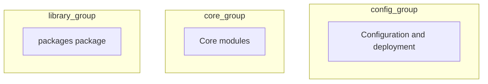

# Architecture report: jd-opensource/taro-ui

> Automated static analysis. **Observed** = directly seen in files/imports/AST; **Inferred** = interpretation from that evidence. Repository code was not executed.

## 1. Repository at a glance

| Item | Value |
| --- | --- |
| Repository | jd-opensource/taro-ui |
| Description | 一款基于 Taro 框架开发的多端 UI 组件库 |
| Language | TypeScript |
| Stars | 4732 |
| Licence | MIT |
| Analysed commit / branch | d0653307e44015ebf6de382f0a31dab4c9756e15 / next |
| Framework(s) | React, Vue |
| Files analysed | 787 |
| Components | 3 |

## 2. Architecture in one minute

jd-opensource/taro-ui - 一款基于 Taro 框架开发的多端 UI 组件库. This repository was analysed statically from 787 file(s) (0 Python). Detected technologies (observed from imports/manifests): GitHub Actions, React, Vue, React Router, Jest, TypeScript. Files are grouped into 3 component(s): Configuration and deployment, Core modules, packages package. Findings below distinguish observed facts from inferred interpretation.

## 3. High-level block diagram

## 4. Main components

### Configuration and deployment (`config`)

- **Kind:** config
- **Status:** Observed
- **Confidence:** 0.85
- **Responsibility:** Groups 6 file(s) under configuration and deployment (observed from repository paths and static analysis).
- **Paths:** `babel.config.json`, `package.json`, `packages/taro-ui/babel.config.json`, `packages/taro-ui/config/copy-assets.js`, `packages/taro-ui/config/iconsMaker.js`, `packages/taro-ui/package.json`
- **Evidence:** [babel.config.json](https://github.com/jd-opensource/taro-ui/blob/d0653307e44015ebf6de382f0a31dab4c9756e15/babel.config.json); [package.json](https://github.com/jd-opensource/taro-ui/blob/d0653307e44015ebf6de382f0a31dab4c9756e15/package.json); [packages/taro-ui/babel.config.json](https://github.com/jd-opensource/taro-ui/blob/d0653307e44015ebf6de382f0a31dab4c9756e15/packages/taro-ui/babel.config.json); [packages/taro-ui/config/copy-assets.js](https://github.com/jd-opensource/taro-ui/blob/d0653307e44015ebf6de382f0a31dab4c9756e15/packages/taro-ui/config/copy-assets.js); [packages/taro-ui/config/iconsMaker.js](https://github.com/jd-opensource/taro-ui/blob/d0653307e44015ebf6de382f0a31dab4c9756e15/packages/taro-ui/config/iconsMaker.js); [packages/taro-ui/package.json](https://github.com/jd-opensource/taro-ui/blob/d0653307e44015ebf6de382f0a31dab4c9756e15/packages/taro-ui/package.json)

### Core modules (`core`)

- **Kind:** core
- **Status:** Observed
- **Confidence:** 0.85
- **Responsibility:** Groups 1 file(s) under core modules (observed from repository paths and static analysis).
- **Paths:** `commitlint.config.js`
- **Evidence:** [commitlint.config.js](https://github.com/jd-opensource/taro-ui/blob/d0653307e44015ebf6de382f0a31dab4c9756e15/commitlint.config.js)

### packages package (`packages`)

- **Kind:** library
- **Status:** Observed
- **Confidence:** 0.85
- **Responsibility:** Groups 1 file(s) under packages package (observed from repository paths and static analysis).
- **Paths:** `packages/taro-ui/jest.config.js`
- **Evidence:** [packages/taro-ui/jest.config.js](https://github.com/jd-opensource/taro-ui/blob/d0653307e44015ebf6de382f0a31dab4c9756e15/packages/taro-ui/jest.config.js)

## 5. Execution flow

No entry point was observed; the startup flow below is therefore limited.

Representative flow (derived from observed entry points and the import graph; steps beyond the entry point are **Inferred**):

1. Execution starts at an observed entry point listed above, if present.
2. No internal import relationships between components were observed.

## 6. Project structure

### `(root)`

- `.editorconfig` - config (214 bytes)
- `.eslintignore` - other (250 bytes)
- `.eslintrc.json` - config (4857 bytes)
- `.gitignore` - other (627 bytes)
- `.node-version` - other (9 bytes)
- `.prettierrc.json` - config (216 bytes)
- `.stylelintignore` - other (11 bytes)
- `.stylelintrc.json` - config (884 bytes)
- `.travis.yml` - ci, YAML (1747 bytes)
- `CHANGELOG.md` - docs (9216 bytes)
- `LICENSE` - docs (1067 bytes)
- `PLANS.md` - docs (1303 bytes)
- `README.md` - docs (3174 bytes)
- `RN.md` - docs (952 bytes)
- `ROADMAP.md` - docs (9254 bytes)
- `babel.config.json` - config (750 bytes)
- `commitlint.config.js` - source, JavaScript (315 bytes)
- `package.json` - manifest (3165 bytes)

### `.github`

- `.github/CONTRIBUTING.md` - docs (2736 bytes)
- `.github/ISSUE_TEMPLATE/BUG_REPORT.md` - docs (1761 bytes)
- `.github/ISSUE_TEMPLATE/FEATURE_REQUEST.md` - docs (1201 bytes)
- `.github/workflows/deploy-pages.yml` - ci, YAML (1309 bytes)
- `.github/workflows/deploy-tcb.yml` - ci, YAML (1213 bytes)
- `.github/workflows/node.yml` - ci, YAML (812 bytes)
- `.github/workflows/publish.yml` - ci, YAML (6423 bytes)
- `.github/workflows/rn-release.yml` - ci, YAML (1428 bytes)
- `.github/workflows/stale.yml` - ci, YAML (2258 bytes)
- `.github/workflows/test.yml` - ci, YAML (664 bytes)

### `.husky`

- `.husky/commit-msg` - other (98 bytes)
- `.husky/pre-commit` - other (73 bytes)

### `docs`

- `docs/.vitepress/config.mts` - docs (6846 bytes)
- `docs/.vitepress/theme/Layout.vue` - docs (2140 bytes)
- `docs/.vitepress/theme/components/IconList.vue` - docs (483 bytes)
- `docs/.vitepress/theme/index.ts` - docs (371 bytes)
- `docs/.vitepress/theme/style.css` - docs (4490 bytes)
- `docs/CHANGELOG.md` - docs (243 bytes)
- `docs/MAINTENANCE.md` - docs (2220 bytes)
- `docs/MIGRATION_FC.md` - docs (9698 bytes)
- `docs/app.jsx` - docs (1541 bytes)
- `docs/assets/dark.svg` - docs (1178 bytes)
- `docs/assets/light.svg` - docs (6346 bytes)
- `docs/assets/style/dark.scss` - docs (213 bytes)
- `docs/assets/style/docs.scss` - docs (9666 bytes)
- `docs/assets/style/index.scss` - docs (6432 bytes)
- `docs/assets/style/mixin.scss` - docs (353 bytes)
- `docs/assets/taro-ui-roadmap.svg` - docs (4737 bytes)
- `docs/components/footer/index.jsx` - docs (6766 bytes)
- `docs/components/footer/style.scss` - docs (12713 bytes)
- `docs/components/header/index.jsx` - docs (5157 bytes)
- `docs/components/header/style.scss` - docs (4295 bytes)
- `docs/components/iconlist/icons.js` - docs (1702 bytes)
- `docs/components/iconlist/index.jsx` - docs (680 bytes)
- `docs/components/iconlist/style.scss` - docs (21208 bytes)
- `docs/components/sidebar/index.jsx` - docs (3769 bytes)
- `docs/components/sidebar/style.scss` - docs (3151 bytes)
- `docs/docs/components/accordion.md` - docs (3963 bytes)
- `docs/docs/components/action-sheet.md` - docs (2059 bytes)
- `docs/docs/components/activity-indicator.md` - docs (1635 bytes)
- `docs/docs/components/article.md` - docs (1859 bytes)
- `docs/docs/components/avatar.md` - docs (1899 bytes)
- `docs/docs/components/badge.md` - docs (1050 bytes)
- `docs/docs/components/button.md` - docs (7177 bytes)
- `docs/docs/components/calendar.md` - docs (3390 bytes)
- `docs/docs/components/card.md` - docs (1402 bytes)
- `docs/docs/components/checkbox.md` - docs (3708 bytes)
- `docs/docs/components/config-provider.md` - docs (2151 bytes)
- `docs/docs/components/countdown.md` - docs (2787 bytes)
- `docs/docs/components/curtain.md` - docs (2111 bytes)
- `docs/docs/components/divider.md` - docs (1512 bytes)
- `docs/docs/components/drawer.md` - docs (1878 bytes)
- `docs/docs/components/fab.md` - docs (1496 bytes)
- `docs/docs/components/flex.md` - docs (3393 bytes)
- `docs/docs/components/float-layout.md` - docs (2416 bytes)
- `docs/docs/components/form.md` - docs (2634 bytes)
- `docs/docs/components/grid.md` - docs (3924 bytes)
- `docs/docs/components/icon.md` - docs (5074 bytes)
- `docs/docs/components/image-picker.md` - docs (6445 bytes)
- `docs/docs/components/indexes.md` - docs (3162 bytes)
- `docs/docs/components/input-number.md` - docs (5371 bytes)
- `docs/docs/components/input.md` - docs (13842 bytes)
- `docs/docs/components/list.md` - docs (5753 bytes)
- `docs/docs/components/load-more.md` - docs (2799 bytes)
- `docs/docs/components/message.md` - docs (1776 bytes)
- `docs/docs/components/modal.md` - docs (2545 bytes)
- `docs/docs/components/navbar.md` - docs (2766 bytes)
- `docs/docs/components/noticebar.md` - docs (1861 bytes)
- `docs/docs/components/pagination.md` - docs (1254 bytes)
- `docs/docs/components/picker.md` - docs (8817 bytes)
- `docs/docs/components/progress.md` - docs (1854 bytes)
- `docs/docs/components/radio.md` - docs (2900 bytes)
- `docs/docs/components/range.md` - docs (2457 bytes)
- `docs/docs/components/rate.md` - docs (2700 bytes)
- `docs/docs/components/search-bar.md` - docs (6854 bytes)
- `docs/docs/components/segmented-control.md` - docs (3248 bytes)
- `docs/docs/components/slider.md` - docs (2587 bytes)
- `docs/docs/components/steps.md` - docs (5328 bytes)
- `docs/docs/components/swipe-action.md` - docs (3920 bytes)
- `docs/docs/components/swiper.md` - docs (3883 bytes)
- `docs/docs/components/switch.md` - docs (2090 bytes)
- `docs/docs/components/tabbar.md` - docs (7686 bytes)
- `docs/docs/components/tabs.md` - docs (9400 bytes)
- `docs/docs/components/tag.md` - docs (1431 bytes)
- `docs/docs/components/textarea.md` - docs (7925 bytes)
- `docs/docs/components/timeline.md` - docs (2925 bytes)
- `docs/docs/components/toast.md` - docs (1901 bytes)
- `docs/docs/guide/changelog.md` - docs (9293 bytes)
- `docs/docs/guide/color.md` - docs (3162 bytes)
- `docs/docs/guide/customize-theme.md` - docs (3000 bytes)
- `docs/docs/guide/i18n.md` - docs (46 bytes)
- `docs/docs/guide/introduction.md` - docs (1723 bytes)
- `docs/docs/guide/questions.md` - docs (2103 bytes)
- `docs/docs/guide/quickstart.md` - docs (5297 bytes)
- `docs/docs/guide/resource.md` - docs (806 bytes)
- `docs/docs/index.md` - docs (1076 bytes)
- `docs/index.html` - docs (955 bytes)
- `docs/lib/animations/collapse-transition.jsx` - docs (2847 bytes)
- `docs/lib/animations/collapseanimations.scss` - docs (289 bytes)
- `docs/lib/default.scss` - docs (20391 bytes)
- `docs/nav.config.yml` - config (3513 bytes)
- `docs/package.json` - manifest (1837 bytes)
- `docs/page-route.js` - docs (1453 bytes)
- `docs/pages/docs.jsx` - docs (4896 bytes)
- `docs/pages/guide.jsx` - docs (1750 bytes)
- `docs/pages/index.jsx` - docs (4129 bytes)
- `docs/scripts/migrate-md.js` - docs (2340 bytes)
- `docs/utils/const.js` - docs (80 bytes)
- `docs/view/Accordion/index.jsx` - docs (194 bytes)
- `docs/view/ActionSheet/index.jsx` - docs (205 bytes)
- `docs/view/ActionSheet/index.scss` - docs (0 bytes)
- `docs/view/ActivityIndicator/index.jsx` - docs (235 bytes)
- `docs/view/ActivityIndicator/index.scss` - docs (0 bytes)
- `docs/view/Article/index.jsx` - docs (184 bytes)
- `docs/view/Article/style.scss` - docs (0 bytes)
- `docs/view/Avatar/index.jsx` - docs (179 bytes)
- `docs/view/Avatar/style.scss` - docs (0 bytes)
- `docs/view/Badge/index.jsx` - docs (174 bytes)
- `docs/view/Badge/style.scss` - docs (0 bytes)
- `docs/view/Button/index.jsx` - docs (179 bytes)
- `docs/view/Button/style.scss` - docs (249 bytes)
- `docs/view/Calendar/index.jsx` - docs (189 bytes)
- `docs/view/Card/index.jsx` - docs (173 bytes)
- `docs/view/Card/index.scss` - docs (0 bytes)
- `docs/view/Changelog/index.jsx` - docs (216 bytes)
- `docs/view/Changelog/index.scss` - docs (3007 bytes)
- `docs/view/Checkbox/index.jsx` - docs (189 bytes)
- `docs/view/Color/index.jsx` - docs (197 bytes)
- `docs/view/Color/style.scss` - docs (702 bytes)
- `docs/view/ConfigProvider/index.jsx` - docs (220 bytes)
- `docs/view/Countdown/index.jsx` - docs (194 bytes)
- `docs/view/Curtain/index.jsx` - docs (184 bytes)
- `docs/view/CustomizeTheme/index.jsx` - docs (220 bytes)
- `docs/view/Divider/index.jsx` - docs (184 bytes)
- `docs/view/Drawer/index.jsx` - docs (179 bytes)
- `docs/view/Drawer/style.scss` - docs (0 bytes)
- `docs/view/Fab/index.jsx` - docs (164 bytes)
- `docs/view/Flex/index.jsx` - docs (173 bytes)
- `docs/view/Flex/index.scss` - docs (0 bytes)
- `docs/view/FloatLayout/index.jsx` - docs (205 bytes)
- `docs/view/FloatLayout/index.scss` - docs (0 bytes)
- `docs/view/Form/index.jsx` - docs (169 bytes)
- `docs/view/Form/index.scss` - docs (0 bytes)
- `docs/view/Grid/index.jsx` - docs (173 bytes)
- `docs/view/Grid/index.scss` - docs (0 bytes)
- `docs/view/Icon/index.jsx` - docs (169 bytes)
- `docs/view/Icon/style.scss` - docs (0 bytes)
- `docs/view/ImagePicker/index.jsx` - docs (205 bytes)
- `docs/view/Indexes/index.jsx` - docs (184 bytes)
- `docs/view/Input/index.jsx` - docs (174 bytes)
- `docs/view/InputNumber/index.jsx` - docs (205 bytes)
- `docs/view/Introduction/index.jsx` - docs (209 bytes)
- `docs/view/List/index.jsx` - docs (169 bytes)
- `docs/view/List/index.scss` - docs (0 bytes)
- `docs/view/LoadMore/index.jsx` - docs (190 bytes)
- `docs/view/Message/index.jsx` - docs (184 bytes)
- `docs/view/Modal/index.jsx` - docs (174 bytes)
- `docs/view/Modal/index.scss` - docs (0 bytes)
- `docs/view/NavBar/index.jsx` - docs (179 bytes)
- `docs/view/Noticebar/index.jsx` - docs (194 bytes)
- `docs/view/Noticebar/style.scss` - docs (0 bytes)
- `docs/view/Pagination/index.jsx` - docs (199 bytes)
- `docs/view/Pagination/style.scss` - docs (0 bytes)
- `docs/view/Picker/index.jsx` - docs (179 bytes)
- `docs/view/Progress/index.jsx` - docs (189 bytes)
- `docs/view/Progress/index.scss` - docs (0 bytes)
- `docs/view/Questions/index.jsx` - docs (192 bytes)
- `docs/view/Questions/index.scss` - docs (0 bytes)
- `docs/view/Quickstart/index.jsx` - docs (199 bytes)
- `docs/view/Radio/index.jsx` - docs (174 bytes)
- `docs/view/Range/index.jsx` - docs (174 bytes)
- `docs/view/Rate/index.jsx` - docs (169 bytes)
- `docs/view/Resource/index.jsx` - docs (181 bytes)
- `docs/view/SearchBar/index.jsx` - docs (195 bytes)
- `docs/view/SegmentedControl/index.jsx` - docs (230 bytes)
- `docs/view/Slider/index.jsx` - docs (179 bytes)
- `docs/view/Steps/index.jsx` - docs (174 bytes)
- `docs/view/SwipeAction/index.jsx` - docs (205 bytes)
- `docs/view/Swiper/index.jsx` - docs (179 bytes)
- `docs/view/Switch/index.jsx` - docs (179 bytes)
- `docs/view/TabBar/index.jsx` - docs (179 bytes)
- `docs/view/Tabs/index.jsx` - docs (169 bytes)
- `docs/view/Tag/index.jsx` - docs (164 bytes)
- `docs/view/Tag/style.scss` - docs (0 bytes)
- `docs/view/Textarea/index.jsx` - docs (189 bytes)
- `docs/view/Timeline/index.jsx` - docs (189 bytes)
- `docs/view/Timeline/style.scss` - docs (0 bytes)
- `docs/view/Toast/index.jsx` - docs (174 bytes)
- `docs/view/Toast/index.scss` - docs (0 bytes)

### `examples`

- `examples/demo-rn/CHANGELOG.md` - docs (243 bytes)
- `examples/demo-rn/babel.config.js` - source, JavaScript (255 bytes)
- `examples/demo-rn/config/dev.js` - source, JavaScript (136 bytes)
- `examples/demo-rn/config/index.js` - source, JavaScript (2037 bytes)
- `examples/demo-rn/config/prod.js` - source, JavaScript (421 bytes)
- `examples/demo-rn/global.d.ts` - source, TypeScript (432 bytes)
- `examples/demo-rn/index.js` - source, JavaScript (44 bytes)
- `examples/demo-rn/metro.config.js` - source, JavaScript (1897 bytes)
- `examples/demo-rn/package.json` - manifest (2702 bytes)
- `examples/demo-rn/project.config.json` - config (263 bytes)
- `examples/demo-rn/src/app.config.ts` - source, TypeScript (1903 bytes)
- `examples/demo-rn/src/app.scss` - other (2742 bytes)
- `examples/demo-rn/src/app.tsx` - source, TypeScript (319 bytes)
- `examples/demo-rn/src/index.html` - other (1499 bytes)
- `examples/demo-rn/src/pages/action/action-sheet/index.scss` - other (107 bytes)
- `examples/demo-rn/src/pages/action/action-sheet/index.tsx` - source, TypeScript (4809 bytes)
- `examples/demo-rn/src/pages/action/activity-indicator/index.scss` - other (493 bytes)
- `examples/demo-rn/src/pages/action/activity-indicator/index.tsx` - source, TypeScript (4261 bytes)
- `examples/demo-rn/src/pages/action/message/index.scss` - other (46 bytes)
- `examples/demo-rn/src/pages/action/message/index.tsx` - source, TypeScript (2520 bytes)
- `examples/demo-rn/src/pages/action/modal/index.scss` - other (0 bytes)
- `examples/demo-rn/src/pages/action/modal/index.tsx` - source, TypeScript (7008 bytes)
- `examples/demo-rn/src/pages/action/progress/index.scss` - other (236 bytes)
- `examples/demo-rn/src/pages/action/progress/index.tsx` - source, TypeScript (5787 bytes)
- `examples/demo-rn/src/pages/action/swipe-action/index.scss` - other (270 bytes)
- `examples/demo-rn/src/pages/action/swipe-action/index.tsx` - source, TypeScript (9460 bytes)
- `examples/demo-rn/src/pages/action/toast/index.scss` - other (0 bytes)
- `examples/demo-rn/src/pages/action/toast/index.tsx` - source, TypeScript (5484 bytes)
- `examples/demo-rn/src/pages/advanced/calendar/index.scss` - other (490 bytes)
- `examples/demo-rn/src/pages/advanced/calendar/index.tsx` - source, TypeScript (6148 bytes)
- `examples/demo-rn/src/pages/basic/button/index.scss` - other (550 bytes)
- `examples/demo-rn/src/pages/basic/button/index.tsx` - source, TypeScript (14675 bytes)
- `examples/demo-rn/src/pages/basic/color/index.scss` - other (1099 bytes)
- `examples/demo-rn/src/pages/basic/color/index.tsx` - source, TypeScript (4546 bytes)
- `examples/demo-rn/src/pages/basic/icon/icons.ts` - source, TypeScript (1702 bytes)
- `examples/demo-rn/src/pages/basic/icon/index.scss` - other (343 bytes)
- `examples/demo-rn/src/pages/basic/icon/index.tsx` - source, TypeScript (6608 bytes)
- `examples/demo-rn/src/pages/basic/typo/index.scss` - other (1079 bytes)
- `examples/demo-rn/src/pages/basic/typo/index.tsx` - source, TypeScript (3074 bytes)
- `examples/demo-rn/src/pages/components/doc-header/index.scss` - other (685 bytes)
- `examples/demo-rn/src/pages/components/doc-header/index.tsx` - source, TypeScript (765 bytes)
- `examples/demo-rn/src/pages/form/checkbox/index.scss` - other (0 bytes)
- `examples/demo-rn/src/pages/form/checkbox/index.tsx` - source, TypeScript (5133 bytes)
- `examples/demo-rn/src/pages/form/form/index.scss` - other (114 bytes)
- `examples/demo-rn/src/pages/form/form/index.tsx` - source, TypeScript (4209 bytes)
- `examples/demo-rn/src/pages/form/image-picker/index.scss` - other (0 bytes)
- `examples/demo-rn/src/pages/form/image-picker/index.tsx` - source, TypeScript (4023 bytes)
- `examples/demo-rn/src/pages/form/input-number/index.scss` - other (261 bytes)
- `examples/demo-rn/src/pages/form/input-number/index.tsx` - source, TypeScript (4960 bytes)
- `examples/demo-rn/src/pages/form/input/index.scss` - other (0 bytes)
- `examples/demo-rn/src/pages/form/input/index.tsx` - source, TypeScript (11335 bytes)
- `examples/demo-rn/src/pages/form/picker-view/index.scss` - other (146 bytes)
- `examples/demo-rn/src/pages/form/picker-view/index.tsx` - source, TypeScript (3107 bytes)
- `examples/demo-rn/src/pages/form/picker/index.scss` - other (692 bytes)
- `examples/demo-rn/src/pages/form/picker/index.tsx` - source, TypeScript (5616 bytes)
- `examples/demo-rn/src/pages/form/radio/index.scss` - other (0 bytes)
- `examples/demo-rn/src/pages/form/radio/index.tsx` - source, TypeScript (3763 bytes)
- `examples/demo-rn/src/pages/form/range/index.scss` - other (74 bytes)
- `examples/demo-rn/src/pages/form/range/index.tsx` - source, TypeScript (2451 bytes)
- `examples/demo-rn/src/pages/form/rate/index.scss` - other (176 bytes)
- `examples/demo-rn/src/pages/form/rate/index.tsx` - source, TypeScript (3479 bytes)
- `examples/demo-rn/src/pages/form/search-bar/index.scss` - other (0 bytes)
- `examples/demo-rn/src/pages/form/search-bar/index.tsx` - source, TypeScript (3529 bytes)
- `examples/demo-rn/src/pages/form/slider/index.scss` - other (167 bytes)
- `examples/demo-rn/src/pages/form/slider/index.tsx` - source, TypeScript (3317 bytes)
- `examples/demo-rn/src/pages/form/switch/index.scss` - other (0 bytes)
- `examples/demo-rn/src/pages/form/switch/index.tsx` - source, TypeScript (2077 bytes)
- `examples/demo-rn/src/pages/form/textarea/index.scss` - other (51 bytes)
- `examples/demo-rn/src/pages/form/textarea/index.tsx` - source, TypeScript (3208 bytes)
- `examples/demo-rn/src/pages/index/index.config.ts` - source, TypeScript (55 bytes)
- `examples/demo-rn/src/pages/index/index.scss` - other (3103 bytes)
- `examples/demo-rn/src/pages/index/index.tsx` - source, TypeScript (4079 bytes)
- `examples/demo-rn/src/pages/layout/accordion/index.scss` - other (0 bytes)
- `examples/demo-rn/src/pages/layout/accordion/index.tsx` - source, TypeScript (5772 bytes)
- `examples/demo-rn/src/pages/layout/card/index.scss` - other (0 bytes)
- `examples/demo-rn/src/pages/layout/card/index.tsx` - source, TypeScript (5454 bytes)
- `examples/demo-rn/src/pages/layout/flex/index.scss` - other (722 bytes)
- `examples/demo-rn/src/pages/layout/flex/index.tsx` - source, TypeScript (8834 bytes)
- `examples/demo-rn/src/pages/layout/float-layout/index.scss` - other (0 bytes)
- `examples/demo-rn/src/pages/layout/float-layout/index.tsx` - source, TypeScript (9196 bytes)
- `examples/demo-rn/src/pages/layout/grid/index.scss` - other (51 bytes)
- `examples/demo-rn/src/pages/layout/grid/index.tsx` - source, TypeScript (3874 bytes)
- `examples/demo-rn/src/pages/layout/list/index.scss` - other (0 bytes)
- `examples/demo-rn/src/pages/layout/list/index.tsx` - source, TypeScript (6624 bytes)
- `examples/demo-rn/src/pages/navigation/drawer/index.scss` - other (564 bytes)
- `examples/demo-rn/src/pages/navigation/drawer/index.tsx` - source, TypeScript (5394 bytes)
- `examples/demo-rn/src/pages/navigation/indexes/index.scss` - other (156 bytes)
- `examples/demo-rn/src/pages/navigation/indexes/index.tsx` - source, TypeScript (2031 bytes)
- `examples/demo-rn/src/pages/navigation/indexes/mock-data.ts` - source, TypeScript (18867 bytes)
- `examples/demo-rn/src/pages/navigation/navbar/index.scss` - other (118 bytes)
- `examples/demo-rn/src/pages/navigation/navbar/index.tsx` - source, TypeScript (5496 bytes)
- `examples/demo-rn/src/pages/navigation/pagination/index.scss` - other (90 bytes)
- `examples/demo-rn/src/pages/navigation/pagination/index.tsx` - source, TypeScript (4168 bytes)
- `examples/demo-rn/src/pages/navigation/segmented-control/index.scss` - other (161 bytes)
- `examples/demo-rn/src/pages/navigation/segmented-control/index.tsx` - source, TypeScript (2670 bytes)
- `examples/demo-rn/src/pages/navigation/tabbar/index.scss` - other (330 bytes)
- `examples/demo-rn/src/pages/navigation/tabbar/index.tsx` - source, TypeScript (4413 bytes)
- `examples/demo-rn/src/pages/navigation/tabs/index.scss` - other (333 bytes)
- `examples/demo-rn/src/pages/navigation/tabs/index.tsx` - source, TypeScript (7832 bytes)
- `examples/demo-rn/src/pages/panel/index.scss` - other (1469 bytes)
- `examples/demo-rn/src/pages/panel/index.tsx` - source, TypeScript (8101 bytes)
- `examples/demo-rn/src/pages/theme/index.scss` - other (45 bytes)
- `examples/demo-rn/src/pages/theme/index.tsx` - source, TypeScript (329 bytes)
- `examples/demo-rn/src/pages/view/article/index.scss` - other (55 bytes)
- `examples/demo-rn/src/pages/view/article/index.tsx` - source, TypeScript (3130 bytes)
- `examples/demo-rn/src/pages/view/avatar/index.scss` - other (0 bytes)
- `examples/demo-rn/src/pages/view/avatar/index.tsx` - source, TypeScript (5551 bytes)
- `examples/demo-rn/src/pages/view/badge/index.scss` - other (164 bytes)
- `examples/demo-rn/src/pages/view/badge/index.tsx` - source, TypeScript (3868 bytes)
- `examples/demo-rn/src/pages/view/countdown/index.scss` - other (51 bytes)
- `examples/demo-rn/src/pages/view/countdown/index.tsx` - source, TypeScript (2944 bytes)
- `examples/demo-rn/src/pages/view/curtain/index.scss` - other (0 bytes)
- `examples/demo-rn/src/pages/view/curtain/index.tsx` - source, TypeScript (5147 bytes)
- `examples/demo-rn/src/pages/view/divider/index.scss` - other (69 bytes)
- `examples/demo-rn/src/pages/view/divider/index.tsx` - source, TypeScript (2033 bytes)
- `examples/demo-rn/src/pages/view/load-more/index.scss` - other (131 bytes)
- `examples/demo-rn/src/pages/view/load-more/index.tsx` - source, TypeScript (1421 bytes)
- `examples/demo-rn/src/pages/view/noticebar/index.scss` - other (83 bytes)
- `examples/demo-rn/src/pages/view/noticebar/index.tsx` - source, TypeScript (8652 bytes)
- `examples/demo-rn/src/pages/view/steps/index.scss` - other (131 bytes)
- `examples/demo-rn/src/pages/view/steps/index.tsx` - source, TypeScript (4716 bytes)
- `examples/demo-rn/src/pages/view/swiper/index.scss` - other (519 bytes)
- `examples/demo-rn/src/pages/view/swiper/index.tsx` - source, TypeScript (5954 bytes)
- `examples/demo-rn/src/pages/view/tag/index.scss` - other (0 bytes)
- `examples/demo-rn/src/pages/view/tag/index.tsx` - source, TypeScript (9692 bytes)
- `examples/demo-rn/src/pages/view/timeline/index.scss` - other (51 bytes)
- `examples/demo-rn/src/pages/view/timeline/index.tsx` - source, TypeScript (4854 bytes)
- `examples/demo-rn/tsconfig.json` - config (376 bytes)
- `examples/demo-v4/.node-version` - other (9 bytes)
- `examples/demo-v4/CHANGELOG.md` - docs (243 bytes)
- `examples/demo-v4/babel.config.js` - source, JavaScript (275 bytes)
- `examples/demo-v4/config/dev.js` - source, JavaScript (153 bytes)
- `examples/demo-v4/config/index.js` - source, JavaScript (1582 bytes)
- `examples/demo-v4/config/prod.js` - source, JavaScript (1229 bytes)
- `examples/demo-v4/global.d.ts` - source, TypeScript (432 bytes)
- `examples/demo-v4/package.json` - manifest (3518 bytes)
- `examples/demo-v4/project.config.json` - config (996 bytes)
- `examples/demo-v4/src/app.config.ts` - source, TypeScript (1943 bytes)
- `examples/demo-v4/src/app.scss` - other (2020 bytes)
- `examples/demo-v4/src/app.tsx` - source, TypeScript (319 bytes)
- `examples/demo-v4/src/index.html` - other (1499 bytes)
- `examples/demo-v4/src/pages/action/action-sheet/index.config.ts` - source, TypeScript (55 bytes)
- `examples/demo-v4/src/pages/action/action-sheet/index.scss` - other (85 bytes)
- `examples/demo-v4/src/pages/action/action-sheet/index.tsx` - source, TypeScript (4716 bytes)
- `examples/demo-v4/src/pages/action/activity-indicator/index.config.ts` - source, TypeScript (55 bytes)
- `examples/demo-v4/src/pages/action/activity-indicator/index.scss` - other (497 bytes)
- `examples/demo-v4/src/pages/action/activity-indicator/index.tsx` - source, TypeScript (3923 bytes)
- `examples/demo-v4/src/pages/action/message/index.config.ts` - source, TypeScript (55 bytes)
- `examples/demo-v4/src/pages/action/message/index.scss` - other (75 bytes)
- `examples/demo-v4/src/pages/action/message/index.tsx` - source, TypeScript (2065 bytes)
- `examples/demo-v4/src/pages/action/modal/index.config.ts` - source, TypeScript (55 bytes)
- `examples/demo-v4/src/pages/action/modal/index.scss` - other (0 bytes)
- `examples/demo-v4/src/pages/action/modal/index.tsx` - source, TypeScript (6547 bytes)
- `examples/demo-v4/src/pages/action/progress/index.config.ts` - source, TypeScript (55 bytes)
- `examples/demo-v4/src/pages/action/progress/index.scss` - other (201 bytes)
- `examples/demo-v4/src/pages/action/progress/index.tsx` - source, TypeScript (5471 bytes)
- `examples/demo-v4/src/pages/action/swipe-action/index.config.ts` - source, TypeScript (55 bytes)
- `examples/demo-v4/src/pages/action/swipe-action/index.scss` - other (270 bytes)
- `examples/demo-v4/src/pages/action/swipe-action/index.tsx` - source, TypeScript (8491 bytes)
- `examples/demo-v4/src/pages/action/toast/index.config.ts` - source, TypeScript (55 bytes)
- `examples/demo-v4/src/pages/action/toast/index.scss` - other (75 bytes)
- `examples/demo-v4/src/pages/action/toast/index.tsx` - source, TypeScript (5369 bytes)
- `examples/demo-v4/src/pages/advanced/calendar/index.config.ts` - source, TypeScript (55 bytes)
- `examples/demo-v4/src/pages/advanced/calendar/index.scss` - other (490 bytes)
- `examples/demo-v4/src/pages/advanced/calendar/index.tsx` - source, TypeScript (6068 bytes)
- `examples/demo-v4/src/pages/basic/button/index.config.ts` - source, TypeScript (55 bytes)
- `examples/demo-v4/src/pages/basic/button/index.scss` - other (449 bytes)
- `examples/demo-v4/src/pages/basic/button/index.tsx` - source, TypeScript (13559 bytes)
- `examples/demo-v4/src/pages/basic/color/index.config.ts` - source, TypeScript (55 bytes)
- `examples/demo-v4/src/pages/basic/color/index.scss` - other (977 bytes)
- `examples/demo-v4/src/pages/basic/color/index.tsx` - source, TypeScript (4425 bytes)
- `examples/demo-v4/src/pages/basic/icon/icons.ts` - source, TypeScript (1702 bytes)
- `examples/demo-v4/src/pages/basic/icon/index.config.ts` - source, TypeScript (55 bytes)
- `examples/demo-v4/src/pages/basic/icon/index.scss` - other (295 bytes)
- `examples/demo-v4/src/pages/basic/icon/index.tsx` - source, TypeScript (6538 bytes)
- `examples/demo-v4/src/pages/basic/typo/index.config.ts` - source, TypeScript (55 bytes)
- `examples/demo-v4/src/pages/basic/typo/index.scss` - other (1026 bytes)
- `examples/demo-v4/src/pages/basic/typo/index.tsx` - source, TypeScript (2737 bytes)
- `examples/demo-v4/src/pages/components/doc-header/index.scss` - other (437 bytes)
- `examples/demo-v4/src/pages/components/doc-header/index.tsx` - source, TypeScript (678 bytes)
- `examples/demo-v4/src/pages/form/checkbox/index.config.ts` - source, TypeScript (55 bytes)
- `examples/demo-v4/src/pages/form/checkbox/index.scss` - other (0 bytes)
- `examples/demo-v4/src/pages/form/checkbox/index.tsx` - source, TypeScript (5037 bytes)
- `examples/demo-v4/src/pages/form/form/index.config.ts` - source, TypeScript (55 bytes)
- `examples/demo-v4/src/pages/form/form/index.scss` - other (114 bytes)
- `examples/demo-v4/src/pages/form/form/index.tsx` - source, TypeScript (4081 bytes)
- `examples/demo-v4/src/pages/form/image-picker/index.config.ts` - source, TypeScript (55 bytes)
- `examples/demo-v4/src/pages/form/image-picker/index.scss` - other (0 bytes)
- `examples/demo-v4/src/pages/form/image-picker/index.tsx` - source, TypeScript (3891 bytes)
- `examples/demo-v4/src/pages/form/input-number/index.config.ts` - source, TypeScript (55 bytes)
- `examples/demo-v4/src/pages/form/input-number/index.scss` - other (86 bytes)
- `examples/demo-v4/src/pages/form/input-number/index.tsx` - source, TypeScript (4804 bytes)
- `examples/demo-v4/src/pages/form/input/index.config.ts` - source, TypeScript (55 bytes)
- `examples/demo-v4/src/pages/form/input/index.scss` - other (0 bytes)
- `examples/demo-v4/src/pages/form/input/index.tsx` - source, TypeScript (10745 bytes)
- `examples/demo-v4/src/pages/form/picker-view/index.config.ts` - source, TypeScript (55 bytes)
- `examples/demo-v4/src/pages/form/picker-view/index.scss` - other (108 bytes)
- `examples/demo-v4/src/pages/form/picker-view/index.tsx` - source, TypeScript (4131 bytes)
- `examples/demo-v4/src/pages/form/picker/index.config.ts` - source, TypeScript (55 bytes)
- `examples/demo-v4/src/pages/form/picker/index.scss` - other (659 bytes)
- `examples/demo-v4/src/pages/form/picker/index.tsx` - source, TypeScript (5204 bytes)
- `examples/demo-v4/src/pages/form/radio/index.config.ts` - source, TypeScript (55 bytes)
- `examples/demo-v4/src/pages/form/radio/index.scss` - other (0 bytes)
- `examples/demo-v4/src/pages/form/radio/index.tsx` - source, TypeScript (3725 bytes)
- `examples/demo-v4/src/pages/form/range/index.config.ts` - source, TypeScript (55 bytes)
- `examples/demo-v4/src/pages/form/range/index.scss` - other (74 bytes)
- `examples/demo-v4/src/pages/form/range/index.tsx` - source, TypeScript (2389 bytes)
- `examples/demo-v4/src/pages/form/rate/index.config.ts` - source, TypeScript (55 bytes)
- `examples/demo-v4/src/pages/form/rate/index.scss` - other (52 bytes)
- `examples/demo-v4/src/pages/form/rate/index.tsx` - source, TypeScript (3349 bytes)
- `examples/demo-v4/src/pages/form/search-bar/index.config.ts` - source, TypeScript (55 bytes)
- `examples/demo-v4/src/pages/form/search-bar/index.scss` - other (0 bytes)
- `examples/demo-v4/src/pages/form/search-bar/index.tsx` - source, TypeScript (3489 bytes)
- `examples/demo-v4/src/pages/form/slider/index.config.ts` - source, TypeScript (55 bytes)
- `examples/demo-v4/src/pages/form/slider/index.scss` - other (61 bytes)
- `examples/demo-v4/src/pages/form/slider/index.tsx` - source, TypeScript (3187 bytes)
- `examples/demo-v4/src/pages/form/switch/index.config.ts` - source, TypeScript (55 bytes)
- `examples/demo-v4/src/pages/form/switch/index.scss` - other (0 bytes)
- `examples/demo-v4/src/pages/form/switch/index.tsx` - source, TypeScript (2025 bytes)
- `examples/demo-v4/src/pages/form/textarea/index.config.ts` - source, TypeScript (55 bytes)
- `examples/demo-v4/src/pages/form/textarea/index.scss` - other (0 bytes)
- `examples/demo-v4/src/pages/form/textarea/index.tsx` - source, TypeScript (3104 bytes)
- `examples/demo-v4/src/pages/index/index.config.ts` - source, TypeScript (55 bytes)
- `examples/demo-v4/src/pages/index/index.scss` - other (2906 bytes)
- `examples/demo-v4/src/pages/index/index.tsx` - source, TypeScript (3704 bytes)
- `examples/demo-v4/src/pages/layout/accordion/index.config.ts` - source, TypeScript (55 bytes)
- `examples/demo-v4/src/pages/layout/accordion/index.scss` - other (0 bytes)
- `examples/demo-v4/src/pages/layout/accordion/index.tsx` - source, TypeScript (4700 bytes)
- `examples/demo-v4/src/pages/layout/card/index.config.ts` - source, TypeScript (55 bytes)
- `examples/demo-v4/src/pages/layout/card/index.scss` - other (0 bytes)
- `examples/demo-v4/src/pages/layout/card/index.tsx` - source, TypeScript (5360 bytes)
- `examples/demo-v4/src/pages/layout/flex/index.config.ts` - source, TypeScript (55 bytes)
- `examples/demo-v4/src/pages/layout/flex/index.scss` - other (450 bytes)
- `examples/demo-v4/src/pages/layout/flex/index.tsx` - source, TypeScript (7965 bytes)
- `examples/demo-v4/src/pages/layout/float-layout/index.config.ts` - source, TypeScript (55 bytes)
- `examples/demo-v4/src/pages/layout/float-layout/index.scss` - other (0 bytes)
- `examples/demo-v4/src/pages/layout/float-layout/index.tsx` - source, TypeScript (9118 bytes)
- `examples/demo-v4/src/pages/layout/grid/index.config.ts` - source, TypeScript (55 bytes)
- `examples/demo-v4/src/pages/layout/grid/index.scss` - other (0 bytes)
- `examples/demo-v4/src/pages/layout/grid/index.tsx` - source, TypeScript (3388 bytes)
- `examples/demo-v4/src/pages/layout/list/index.config.ts` - source, TypeScript (55 bytes)
- `examples/demo-v4/src/pages/layout/list/index.scss` - other (0 bytes)
- `examples/demo-v4/src/pages/layout/list/index.tsx` - source, TypeScript (7161 bytes)
- `examples/demo-v4/src/pages/navigation/drawer/index.config.ts` - source, TypeScript (55 bytes)
- `examples/demo-v4/src/pages/navigation/drawer/index.scss` - other (552 bytes)
- `examples/demo-v4/src/pages/navigation/drawer/index.tsx` - source, TypeScript (4899 bytes)
- `examples/demo-v4/src/pages/navigation/indexes/index.config.ts` - source, TypeScript (55 bytes)
- `examples/demo-v4/src/pages/navigation/indexes/index.scss` - other (156 bytes)
- `examples/demo-v4/src/pages/navigation/indexes/index.tsx` - source, TypeScript (2054 bytes)
- `examples/demo-v4/src/pages/navigation/indexes/mock-data.ts` - source, TypeScript (18867 bytes)
- `examples/demo-v4/src/pages/navigation/navbar/index.config.ts` - source, TypeScript (55 bytes)
- `examples/demo-v4/src/pages/navigation/navbar/index.scss` - other (109 bytes)
- `examples/demo-v4/src/pages/navigation/navbar/index.tsx` - source, TypeScript (5366 bytes)
- `examples/demo-v4/src/pages/navigation/pagination/index.config.ts` - source, TypeScript (55 bytes)
- `examples/demo-v4/src/pages/navigation/pagination/index.scss` - other (90 bytes)
- `examples/demo-v4/src/pages/navigation/pagination/index.tsx` - source, TypeScript (4103 bytes)
- `examples/demo-v4/src/pages/navigation/segmented-control/index.config.ts` - source, TypeScript (55 bytes)
- `examples/demo-v4/src/pages/navigation/segmented-control/index.scss` - other (110 bytes)
- `examples/demo-v4/src/pages/navigation/segmented-control/index.tsx` - source, TypeScript (2562 bytes)
- `examples/demo-v4/src/pages/navigation/tabbar/index.config.ts` - source, TypeScript (55 bytes)
- `examples/demo-v4/src/pages/navigation/tabbar/index.scss` - other (285 bytes)
- `examples/demo-v4/src/pages/navigation/tabbar/index.tsx` - source, TypeScript (4108 bytes)
- `examples/demo-v4/src/pages/navigation/tabs/index.config.ts` - source, TypeScript (55 bytes)
- `examples/demo-v4/src/pages/navigation/tabs/index.scss` - other (274 bytes)
- `examples/demo-v4/src/pages/navigation/tabs/index.tsx` - source, TypeScript (7784 bytes)
- `examples/demo-v4/src/pages/panel/index.config.ts` - source, TypeScript (55 bytes)
- `examples/demo-v4/src/pages/panel/index.scss` - other (1074 bytes)
- `examples/demo-v4/src/pages/panel/index.tsx` - source, TypeScript (7814 bytes)
- `examples/demo-v4/src/pages/theme/index.config.ts` - source, TypeScript (55 bytes)
- `examples/demo-v4/src/pages/theme/index.scss` - other (41 bytes)
- `examples/demo-v4/src/pages/theme/index.tsx` - source, TypeScript (329 bytes)
- `examples/demo-v4/src/pages/view/article/index.config.ts` - source, TypeScript (55 bytes)
- `examples/demo-v4/src/pages/view/article/index.scss` - other (55 bytes)
- `examples/demo-v4/src/pages/view/article/index.tsx` - source, TypeScript (3004 bytes)
- `examples/demo-v4/src/pages/view/avatar/index.config.ts` - source, TypeScript (55 bytes)
- `examples/demo-v4/src/pages/view/avatar/index.scss` - other (118 bytes)
- `examples/demo-v4/src/pages/view/avatar/index.tsx` - source, TypeScript (4865 bytes)
- `examples/demo-v4/src/pages/view/badge/index.config.ts` - source, TypeScript (55 bytes)
- `examples/demo-v4/src/pages/view/badge/index.scss` - other (191 bytes)
- `examples/demo-v4/src/pages/view/badge/index.tsx` - source, TypeScript (3540 bytes)
- `examples/demo-v4/src/pages/view/countdown/index.config.ts` - source, TypeScript (55 bytes)
- `examples/demo-v4/src/pages/view/countdown/index.scss` - other (0 bytes)
- `examples/demo-v4/src/pages/view/countdown/index.tsx` - source, TypeScript (2904 bytes)
- `examples/demo-v4/src/pages/view/curtain/index.config.ts` - source, TypeScript (55 bytes)
- `examples/demo-v4/src/pages/view/curtain/index.scss` - other (0 bytes)
- `examples/demo-v4/src/pages/view/curtain/index.tsx` - source, TypeScript (4991 bytes)
- `examples/demo-v4/src/pages/view/divider/index.config.ts` - source, TypeScript (55 bytes)
- `examples/demo-v4/src/pages/view/divider/index.scss` - other (113 bytes)
- `examples/demo-v4/src/pages/view/divider/index.tsx` - source, TypeScript (1975 bytes)
- `examples/demo-v4/src/pages/view/load-more/index.config.ts` - source, TypeScript (55 bytes)
- `examples/demo-v4/src/pages/view/load-more/index.scss` - other (113 bytes)
- `examples/demo-v4/src/pages/view/load-more/index.tsx` - source, TypeScript (1411 bytes)
- `examples/demo-v4/src/pages/view/noticebar/index.config.ts` - source, TypeScript (55 bytes)
- `examples/demo-v4/src/pages/view/noticebar/index.scss` - other (113 bytes)
- `examples/demo-v4/src/pages/view/noticebar/index.tsx` - source, TypeScript (8294 bytes)
- `examples/demo-v4/src/pages/view/steps/index.config.ts` - source, TypeScript (55 bytes)
- `examples/demo-v4/src/pages/view/steps/index.scss` - other (0 bytes)
- `examples/demo-v4/src/pages/view/steps/index.tsx` - source, TypeScript (4716 bytes)
- `examples/demo-v4/src/pages/view/swiper/index.config.ts` - source, TypeScript (55 bytes)
- `examples/demo-v4/src/pages/view/swiper/index.scss` - other (340 bytes)
- `examples/demo-v4/src/pages/view/swiper/index.tsx` - source, TypeScript (5425 bytes)
- `examples/demo-v4/src/pages/view/tag/index.config.ts` - source, TypeScript (55 bytes)
- `examples/demo-v4/src/pages/view/tag/index.scss` - other (0 bytes)
- `examples/demo-v4/src/pages/view/tag/index.tsx` - source, TypeScript (9025 bytes)
- `examples/demo-v4/src/pages/view/timeline/index.config.ts` - source, TypeScript (55 bytes)
- `examples/demo-v4/src/pages/view/timeline/index.scss` - other (0 bytes)
- `examples/demo-v4/src/pages/view/timeline/index.tsx` - source, TypeScript (4854 bytes)
- `examples/demo-v4/tsconfig.json` - config (667 bytes)
- `examples/demo/.node-version` - other (9 bytes)
- `examples/demo/CHANGELOG.md` - docs (243 bytes)
- `examples/demo/babel.config.js` - source, JavaScript (275 bytes)
- `examples/demo/config/dev.js` - source, JavaScript (153 bytes)
- `examples/demo/config/index.js` - source, JavaScript (1542 bytes)
- `examples/demo/config/prod.js` - source, JavaScript (1229 bytes)
- `examples/demo/global.d.ts` - source, TypeScript (432 bytes)
- `examples/demo/package.json` - manifest (3569 bytes)
- `examples/demo/project.config.json` - config (606 bytes)
- `examples/demo/src/app.config.ts` - source, TypeScript (1987 bytes)
- `examples/demo/src/app.scss` - other (1965 bytes)
- `examples/demo/src/app.tsx` - source, TypeScript (319 bytes)
- `examples/demo/src/index.html` - other (1499 bytes)
- `examples/demo/src/pages/action/action-sheet/index.config.ts` - source, TypeScript (55 bytes)
- `examples/demo/src/pages/action/action-sheet/index.scss` - other (85 bytes)
- `examples/demo/src/pages/action/action-sheet/index.tsx` - source, TypeScript (4716 bytes)
- `examples/demo/src/pages/action/activity-indicator/index.config.ts` - source, TypeScript (55 bytes)
- `examples/demo/src/pages/action/activity-indicator/index.scss` - other (497 bytes)
- `examples/demo/src/pages/action/activity-indicator/index.tsx` - source, TypeScript (3923 bytes)
- `examples/demo/src/pages/action/message/index.config.ts` - source, TypeScript (55 bytes)
- `examples/demo/src/pages/action/message/index.scss` - other (75 bytes)
- `examples/demo/src/pages/action/message/index.tsx` - source, TypeScript (2065 bytes)
- `examples/demo/src/pages/action/modal/index.config.ts` - source, TypeScript (55 bytes)
- `examples/demo/src/pages/action/modal/index.scss` - other (0 bytes)
- `examples/demo/src/pages/action/modal/index.tsx` - source, TypeScript (6547 bytes)
- `examples/demo/src/pages/action/progress/index.config.ts` - source, TypeScript (55 bytes)
- `examples/demo/src/pages/action/progress/index.scss` - other (201 bytes)
- `examples/demo/src/pages/action/progress/index.tsx` - source, TypeScript (5471 bytes)
- `examples/demo/src/pages/action/swipe-action/index.config.ts` - source, TypeScript (55 bytes)
- `examples/demo/src/pages/action/swipe-action/index.scss` - other (270 bytes)
- `examples/demo/src/pages/action/swipe-action/index.tsx` - source, TypeScript (8491 bytes)
- `examples/demo/src/pages/action/toast/index.config.ts` - source, TypeScript (55 bytes)
- `examples/demo/src/pages/action/toast/index.scss` - other (75 bytes)
- `examples/demo/src/pages/action/toast/index.tsx` - source, TypeScript (5369 bytes)
- `examples/demo/src/pages/advanced/calendar/index.config.ts` - source, TypeScript (55 bytes)
- `examples/demo/src/pages/advanced/calendar/index.scss` - other (490 bytes)
- `examples/demo/src/pages/advanced/calendar/index.tsx` - source, TypeScript (6068 bytes)
- `examples/demo/src/pages/advanced/config-provider/index.config.ts` - source, TypeScript (62 bytes)
- `examples/demo/src/pages/advanced/config-provider/index.scss` - other (0 bytes)
- `examples/demo/src/pages/advanced/config-provider/index.tsx` - source, TypeScript (3978 bytes)
- `examples/demo/src/pages/basic/button/index.config.ts` - source, TypeScript (55 bytes)
- `examples/demo/src/pages/basic/button/index.scss` - other (449 bytes)
- `examples/demo/src/pages/basic/button/index.tsx` - source, TypeScript (13559 bytes)
- `examples/demo/src/pages/basic/color/index.config.ts` - source, TypeScript (55 bytes)
- `examples/demo/src/pages/basic/color/index.scss` - other (977 bytes)
- `examples/demo/src/pages/basic/color/index.tsx` - source, TypeScript (4425 bytes)
- `examples/demo/src/pages/basic/icon/icons.ts` - source, TypeScript (1702 bytes)
- `examples/demo/src/pages/basic/icon/index.config.ts` - source, TypeScript (55 bytes)
- `examples/demo/src/pages/basic/icon/index.scss` - other (295 bytes)
- `examples/demo/src/pages/basic/icon/index.tsx` - source, TypeScript (6538 bytes)
- `examples/demo/src/pages/basic/typo/index.config.ts` - source, TypeScript (55 bytes)
- `examples/demo/src/pages/basic/typo/index.scss` - other (1026 bytes)
- `examples/demo/src/pages/basic/typo/index.tsx` - source, TypeScript (2737 bytes)
- `examples/demo/src/pages/components/doc-header/index.scss` - other (437 bytes)
- `examples/demo/src/pages/components/doc-header/index.tsx` - source, TypeScript (678 bytes)
- `examples/demo/src/pages/form/checkbox/index.config.ts` - source, TypeScript (55 bytes)
- `examples/demo/src/pages/form/checkbox/index.scss` - other (0 bytes)
- `examples/demo/src/pages/form/checkbox/index.tsx` - source, TypeScript (5037 bytes)
- `examples/demo/src/pages/form/form/index.config.ts` - source, TypeScript (55 bytes)
- `examples/demo/src/pages/form/form/index.scss` - other (114 bytes)
- `examples/demo/src/pages/form/form/index.tsx` - source, TypeScript (4081 bytes)
- `examples/demo/src/pages/form/image-picker/index.config.ts` - source, TypeScript (55 bytes)
- `examples/demo/src/pages/form/image-picker/index.scss` - other (0 bytes)
- `examples/demo/src/pages/form/image-picker/index.tsx` - source, TypeScript (3891 bytes)
- `examples/demo/src/pages/form/input-number/index.config.ts` - source, TypeScript (55 bytes)
- `examples/demo/src/pages/form/input-number/index.scss` - other (86 bytes)
- `examples/demo/src/pages/form/input-number/index.tsx` - source, TypeScript (4804 bytes)
- `examples/demo/src/pages/form/input/index.config.ts` - source, TypeScript (55 bytes)
- `examples/demo/src/pages/form/input/index.scss` - other (0 bytes)
- `examples/demo/src/pages/form/input/index.tsx` - source, TypeScript (10745 bytes)
- `examples/demo/src/pages/form/picker-view/index.config.ts` - source, TypeScript (55 bytes)
- `examples/demo/src/pages/form/picker-view/index.scss` - other (108 bytes)
- `examples/demo/src/pages/form/picker-view/index.tsx` - source, TypeScript (4131 bytes)
- `examples/demo/src/pages/form/picker/index.config.ts` - source, TypeScript (55 bytes)
- `examples/demo/src/pages/form/picker/index.scss` - other (659 bytes)
- `examples/demo/src/pages/form/picker/index.tsx` - source, TypeScript (5204 bytes)
- `examples/demo/src/pages/form/radio/index.config.ts` - source, TypeScript (55 bytes)
- `examples/demo/src/pages/form/radio/index.scss` - other (0 bytes)
- `examples/demo/src/pages/form/radio/index.tsx` - source, TypeScript (3725 bytes)
- `examples/demo/src/pages/form/range/index.config.ts` - source, TypeScript (55 bytes)
- `examples/demo/src/pages/form/range/index.scss` - other (74 bytes)
- `examples/demo/src/pages/form/range/index.tsx` - source, TypeScript (2389 bytes)
- `examples/demo/src/pages/form/rate/index.config.ts` - source, TypeScript (55 bytes)
- `examples/demo/src/pages/form/rate/index.scss` - other (52 bytes)
- `examples/demo/src/pages/form/rate/index.tsx` - source, TypeScript (3349 bytes)
- `examples/demo/src/pages/form/search-bar/index.config.ts` - source, TypeScript (55 bytes)
- `examples/demo/src/pages/form/search-bar/index.scss` - other (0 bytes)
- `examples/demo/src/pages/form/search-bar/index.tsx` - source, TypeScript (3489 bytes)
- `examples/demo/src/pages/form/slider/index.config.ts` - source, TypeScript (55 bytes)
- `examples/demo/src/pages/form/slider/index.scss` - other (61 bytes)
- `examples/demo/src/pages/form/slider/index.tsx` - source, TypeScript (3187 bytes)
- `examples/demo/src/pages/form/switch/index.config.ts` - source, TypeScript (55 bytes)
- `examples/demo/src/pages/form/switch/index.scss` - other (0 bytes)
- `examples/demo/src/pages/form/switch/index.tsx` - source, TypeScript (2025 bytes)
- `examples/demo/src/pages/form/textarea/index.config.ts` - source, TypeScript (55 bytes)
- `examples/demo/src/pages/form/textarea/index.scss` - other (0 bytes)
- `examples/demo/src/pages/form/textarea/index.tsx` - source, TypeScript (3104 bytes)
- `examples/demo/src/pages/index/index.config.ts` - source, TypeScript (55 bytes)
- `examples/demo/src/pages/index/index.scss` - other (2906 bytes)
- `examples/demo/src/pages/index/index.tsx` - source, TypeScript (3716 bytes)
- `examples/demo/src/pages/layout/accordion/index.config.ts` - source, TypeScript (55 bytes)
- `examples/demo/src/pages/layout/accordion/index.scss` - other (0 bytes)
- `examples/demo/src/pages/layout/accordion/index.tsx` - source, TypeScript (4700 bytes)
- `examples/demo/src/pages/layout/card/index.config.ts` - source, TypeScript (55 bytes)
- `examples/demo/src/pages/layout/card/index.scss` - other (0 bytes)
- `examples/demo/src/pages/layout/card/index.tsx` - source, TypeScript (5360 bytes)
- `examples/demo/src/pages/layout/flex/index.config.ts` - source, TypeScript (55 bytes)
- `examples/demo/src/pages/layout/flex/index.scss` - other (453 bytes)
- `examples/demo/src/pages/layout/flex/index.tsx` - source, TypeScript (7965 bytes)
- `examples/demo/src/pages/layout/float-layout/index.config.ts` - source, TypeScript (55 bytes)
- `examples/demo/src/pages/layout/float-layout/index.scss` - other (0 bytes)
- `examples/demo/src/pages/layout/float-layout/index.tsx` - source, TypeScript (9118 bytes)
- `examples/demo/src/pages/layout/grid/index.config.ts` - source, TypeScript (55 bytes)
- `examples/demo/src/pages/layout/grid/index.scss` - other (0 bytes)
- `examples/demo/src/pages/layout/grid/index.tsx` - source, TypeScript (3388 bytes)
- `examples/demo/src/pages/layout/list/index.config.ts` - source, TypeScript (55 bytes)
- `examples/demo/src/pages/layout/list/index.scss` - other (0 bytes)
- `examples/demo/src/pages/layout/list/index.tsx` - source, TypeScript (7161 bytes)
- `examples/demo/src/pages/navigation/drawer/index.config.ts` - source, TypeScript (55 bytes)
- `examples/demo/src/pages/navigation/drawer/index.scss` - other (552 bytes)
- `examples/demo/src/pages/navigation/drawer/index.tsx` - source, TypeScript (4899 bytes)
- `examples/demo/src/pages/navigation/indexes/index.config.ts` - source, TypeScript (55 bytes)
- `examples/demo/src/pages/navigation/indexes/index.scss` - other (156 bytes)
- `examples/demo/src/pages/navigation/indexes/index.tsx` - source, TypeScript (2054 bytes)
- `examples/demo/src/pages/navigation/indexes/mock-data.ts` - source, TypeScript (18867 bytes)
- `examples/demo/src/pages/navigation/navbar/index.config.ts` - source, TypeScript (55 bytes)
- `examples/demo/src/pages/navigation/navbar/index.scss` - other (109 bytes)
- `examples/demo/src/pages/navigation/navbar/index.tsx` - source, TypeScript (5366 bytes)
- `examples/demo/src/pages/navigation/pagination/index.config.ts` - source, TypeScript (55 bytes)
- `examples/demo/src/pages/navigation/pagination/index.scss` - other (90 bytes)
- `examples/demo/src/pages/navigation/pagination/index.tsx` - source, TypeScript (4103 bytes)
- `examples/demo/src/pages/navigation/segmented-control/index.config.ts` - source, TypeScript (55 bytes)
- `examples/demo/src/pages/navigation/segmented-control/index.scss` - other (110 bytes)
- `examples/demo/src/pages/navigation/segmented-control/index.tsx` - source, TypeScript (2562 bytes)
- `examples/demo/src/pages/navigation/tabbar/index.config.ts` - source, TypeScript (55 bytes)
- `examples/demo/src/pages/navigation/tabbar/index.scss` - other (285 bytes)
- `examples/demo/src/pages/navigation/tabbar/index.tsx` - source, TypeScript (4108 bytes)
- `examples/demo/src/pages/navigation/tabs/index.config.ts` - source, TypeScript (55 bytes)
- `examples/demo/src/pages/navigation/tabs/index.scss` - other (274 bytes)
- `examples/demo/src/pages/navigation/tabs/index.tsx` - source, TypeScript (7784 bytes)
- `examples/demo/src/pages/panel/index.config.ts` - source, TypeScript (55 bytes)
- `examples/demo/src/pages/panel/index.scss` - other (1074 bytes)
- `examples/demo/src/pages/panel/index.tsx` - source, TypeScript (7904 bytes)
- `examples/demo/src/pages/theme/index.config.ts` - source, TypeScript (55 bytes)
- `examples/demo/src/pages/theme/index.scss` - other (41 bytes)
- `examples/demo/src/pages/theme/index.tsx` - source, TypeScript (329 bytes)
- `examples/demo/src/pages/view/article/index.config.ts` - source, TypeScript (55 bytes)
- `examples/demo/src/pages/view/article/index.scss` - other (55 bytes)
- `examples/demo/src/pages/view/article/index.tsx` - source, TypeScript (3004 bytes)
- `examples/demo/src/pages/view/avatar/index.config.ts` - source, TypeScript (55 bytes)
- `examples/demo/src/pages/view/avatar/index.scss` - other (118 bytes)
- `examples/demo/src/pages/view/avatar/index.tsx` - source, TypeScript (4865 bytes)
- `examples/demo/src/pages/view/badge/index.config.ts` - source, TypeScript (55 bytes)
- `examples/demo/src/pages/view/badge/index.scss` - other (191 bytes)
- `examples/demo/src/pages/view/badge/index.tsx` - source, TypeScript (3540 bytes)
- `examples/demo/src/pages/view/countdown/index.config.ts` - source, TypeScript (55 bytes)
- `examples/demo/src/pages/view/countdown/index.scss` - other (0 bytes)
- `examples/demo/src/pages/view/countdown/index.tsx` - source, TypeScript (2904 bytes)
- `examples/demo/src/pages/view/curtain/index.config.ts` - source, TypeScript (55 bytes)
- `examples/demo/src/pages/view/curtain/index.scss` - other (0 bytes)
- `examples/demo/src/pages/view/curtain/index.tsx` - source, TypeScript (4991 bytes)
- `examples/demo/src/pages/view/divider/index.config.ts` - source, TypeScript (55 bytes)
- `examples/demo/src/pages/view/divider/index.scss` - other (113 bytes)
- `examples/demo/src/pages/view/divider/index.tsx` - source, TypeScript (1975 bytes)
- `examples/demo/src/pages/view/load-more/index.config.ts` - source, TypeScript (55 bytes)
- `examples/demo/src/pages/view/load-more/index.scss` - other (113 bytes)
- `examples/demo/src/pages/view/load-more/index.tsx` - source, TypeScript (1411 bytes)
- `examples/demo/src/pages/view/noticebar/index.config.ts` - source, TypeScript (55 bytes)
- `examples/demo/src/pages/view/noticebar/index.scss` - other (113 bytes)
- `examples/demo/src/pages/view/noticebar/index.tsx` - source, TypeScript (8294 bytes)
- `examples/demo/src/pages/view/steps/index.config.ts` - source, TypeScript (55 bytes)
- `examples/demo/src/pages/view/steps/index.scss` - other (0 bytes)
- `examples/demo/src/pages/view/steps/index.tsx` - source, TypeScript (4716 bytes)
- `examples/demo/src/pages/view/swiper/index.config.ts` - source, TypeScript (55 bytes)
- `examples/demo/src/pages/view/swiper/index.scss` - other (340 bytes)
- `examples/demo/src/pages/view/swiper/index.tsx` - source, TypeScript (5425 bytes)
- `examples/demo/src/pages/view/tag/index.config.ts` - source, TypeScript (55 bytes)
- `examples/demo/src/pages/view/tag/index.scss` - other (0 bytes)
- `examples/demo/src/pages/view/tag/index.tsx` - source, TypeScript (9025 bytes)
- `examples/demo/src/pages/view/timeline/index.config.ts` - source, TypeScript (55 bytes)
- `examples/demo/src/pages/view/timeline/index.scss` - other (0 bytes)
- `examples/demo/src/pages/view/timeline/index.tsx` - source, TypeScript (4854 bytes)
- `examples/demo/tsconfig.json` - config (667 bytes)
- `examples/lazy-load-component/.eslintrc` - other (123 bytes)
- `examples/lazy-load-component/.gitignore` - other (68 bytes)
- `examples/lazy-load-component/README.md` - docs (1629 bytes)
- `examples/lazy-load-component/babel.config.js` - source, JavaScript (534 bytes)
- `examples/lazy-load-component/config/dev.js` - source, JavaScript (109 bytes)
- `examples/lazy-load-component/config/index.js` - source, JavaScript (1827 bytes)
- `examples/lazy-load-component/config/prod.js` - source, JavaScript (1228 bytes)
- `examples/lazy-load-component/package.json` - manifest (2590 bytes)
- `examples/lazy-load-component/project.config.json` - config (622 bytes)
- `examples/lazy-load-component/project.tt.json` - config (147 bytes)
- `examples/lazy-load-component/src/app.config.ts` - source, TypeScript (234 bytes)
- `examples/lazy-load-component/src/app.scss` - other (0 bytes)
- `examples/lazy-load-component/src/app.ts` - source, TypeScript (324 bytes)
- `examples/lazy-load-component/src/index.html` - other (714 bytes)
- `examples/lazy-load-component/src/pages/index/index.config.ts` - source, TypeScript (72 bytes)
- `examples/lazy-load-component/src/pages/index/index.scss` - other (139 bytes)
- `examples/lazy-load-component/src/pages/index/index.tsx` - source, TypeScript (816 bytes)
- `examples/lazy-load-component/tsconfig.json` - config (632 bytes)
- `examples/lazy-load-component/types/global.d.ts` - source, TypeScript (480 bytes)

### `packages`

- `packages/taro-ui-guide/SKILL.md` - docs (6818 bytes)
- `packages/taro-ui-guide/references/README.md` - docs (3020 bytes)
- `packages/taro-ui-guide/references/accordion.md` - docs (921 bytes)
- `packages/taro-ui-guide/references/action-sheet.md` - docs (878 bytes)
- `packages/taro-ui-guide/references/activity-indicator.md` - docs (846 bytes)
- `packages/taro-ui-guide/references/avatar.md` - docs (885 bytes)
- `packages/taro-ui-guide/references/badge.md` - docs (641 bytes)
- `packages/taro-ui-guide/references/button.md` - docs (902 bytes)
- `packages/taro-ui-guide/references/calendar.md` - docs (1469 bytes)
- `packages/taro-ui-guide/references/card.md` - docs (994 bytes)
- `packages/taro-ui-guide/references/checkbox.md` - docs (671 bytes)
- `packages/taro-ui-guide/references/config-provider.md` - docs (740 bytes)
- `packages/taro-ui-guide/references/countdown.md` - docs (1175 bytes)
- `packages/taro-ui-guide/references/curtain.md` - docs (765 bytes)
- `packages/taro-ui-guide/references/divider.md` - docs (791 bytes)
- `packages/taro-ui-guide/references/drawer.md` - docs (830 bytes)
- `packages/taro-ui-guide/references/fab.md` - docs (604 bytes)
- `packages/taro-ui-guide/references/float-layout.md` - docs (1400 bytes)
- `packages/taro-ui-guide/references/form.md` - docs (914 bytes)
- `packages/taro-ui-guide/references/grid.md` - docs (739 bytes)
- `packages/taro-ui-guide/references/icon.md` - docs (619 bytes)
- `packages/taro-ui-guide/references/image-picker.md` - docs (1429 bytes)
- `packages/taro-ui-guide/references/indexes.md` - docs (960 bytes)
- `packages/taro-ui-guide/references/input-number.md` - docs (1214 bytes)
- `packages/taro-ui-guide/references/input.md` - docs (2354 bytes)
- `packages/taro-ui-guide/references/list.md` - docs (1331 bytes)
- `packages/taro-ui-guide/references/load-more.md` - docs (1095 bytes)
- `packages/taro-ui-guide/references/loading.md` - docs (512 bytes)
- `packages/taro-ui-guide/references/message.md` - docs (786 bytes)
- `packages/taro-ui-guide/references/modal.md` - docs (1187 bytes)
- `packages/taro-ui-guide/references/nav-bar.md` - docs (1326 bytes)
- `packages/taro-ui-guide/references/noticebar.md` - docs (1063 bytes)
- `packages/taro-ui-guide/references/pagination.md` - docs (790 bytes)
- `packages/taro-ui-guide/references/progress.md` - docs (765 bytes)
- `packages/taro-ui-guide/references/radio.md` - docs (835 bytes)
- `packages/taro-ui-guide/references/range.md` - docs (1086 bytes)
- `packages/taro-ui-guide/references/rate.md` - docs (952 bytes)
- `packages/taro-ui-guide/references/search-bar.md` - docs (1339 bytes)
- `packages/taro-ui-guide/references/segmented-control.md` - docs (1165 bytes)
- `packages/taro-ui-guide/references/slider.md` - docs (1168 bytes)
- `packages/taro-ui-guide/references/steps.md` - docs (853 bytes)
- `packages/taro-ui-guide/references/swipe-action.md` - docs (1192 bytes)
- `packages/taro-ui-guide/references/switch.md` - docs (850 bytes)
- `packages/taro-ui-guide/references/tab-bar.md` - docs (1056 bytes)
- `packages/taro-ui-guide/references/tabs.md` - docs (1667 bytes)
- `packages/taro-ui-guide/references/tag.md` - docs (820 bytes)
- `packages/taro-ui-guide/references/textarea.md` - docs (2412 bytes)
- `packages/taro-ui-guide/references/timeline.md` - docs (714 bytes)
- `packages/taro-ui-guide/references/toast.md` - docs (1125 bytes)
- `packages/taro-ui/CHANGELOG.md` - docs (115046 bytes)
- `packages/taro-ui/README.md` - docs (3029 bytes)
- `packages/taro-ui/babel.config.json` - config (155 bytes)
- `packages/taro-ui/config/copy-assets.js` - source, JavaScript (536 bytes)
- `packages/taro-ui/config/iconsMaker.js` - source, JavaScript (1593 bytes)
- `packages/taro-ui/jest.config.js` - source, JavaScript (803 bytes)
- `packages/taro-ui/package.json` - manifest (3911 bytes)
- `packages/taro-ui/rn/assets/iconfont.svg` - other (39687 bytes)
- `packages/taro-ui/rn/assets/icons/add-circle.svg` - other (544 bytes)
- `packages/taro-ui/rn/assets/icons/add.svg` - other (290 bytes)
- `packages/taro-ui/rn/assets/icons/alert-circle.svg` - other (599 bytes)
- `packages/taro-ui/rn/assets/icons/align-center.svg` - other (359 bytes)
- `packages/taro-ui/rn/assets/icons/align-left.svg` - other (357 bytes)
- `packages/taro-ui/rn/assets/icons/analytics.svg` - other (340 bytes)
- `packages/taro-ui/rn/assets/icons/arrow-down.svg` - other (300 bytes)
- `packages/taro-ui/rn/assets/icons/arrow-left.svg` - other (300 bytes)
- `packages/taro-ui/rn/assets/icons/arrow-right.svg` - other (298 bytes)
- `packages/taro-ui/rn/assets/icons/arrow-up.svg` - other (297 bytes)
- `packages/taro-ui/rn/assets/icons/bell.svg` - other (557 bytes)
- `packages/taro-ui/rn/assets/icons/blocked.svg` - other (528 bytes)
- `packages/taro-ui/rn/assets/icons/bookmark.svg` - other (783 bytes)

## 7. Key dependencies and integrations

| Name | Category | Status | Confidence | Evidence |
| --- | --- | --- | --- | --- |
| GitHub Actions | ci | Observed | 0.90 | [.github/workflows/deploy-pages.yml](https://github.com/jd-opensource/taro-ui/blob/d0653307e44015ebf6de382f0a31dab4c9756e15/.github/workflows/deploy-pages.yml); [.github/workflows/deploy-tcb.yml](https://github.com/jd-opensource/taro-ui/blob/d0653307e44015ebf6de382f0a31dab4c9756e15/.github/workflows/deploy-tcb.yml); [.github/workflows/node.yml](https://github.com/jd-opensource/taro-ui/blob/d0653307e44015ebf6de382f0a31dab4c9756e15/.github/workflows/node.yml); [.github/workflows/publish.yml](https://github.com/jd-opensource/taro-ui/blob/d0653307e44015ebf6de382f0a31dab4c9756e15/.github/workflows/publish.yml) |
| React | framework | Observed | 0.90 | [examples/demo-rn/package.json:48](https://github.com/jd-opensource/taro-ui/blob/d0653307e44015ebf6de382f0a31dab4c9756e15/examples/demo-rn/package.json#L48); [examples/lazy-load-component/package.json:41](https://github.com/jd-opensource/taro-ui/blob/d0653307e44015ebf6de382f0a31dab4c9756e15/examples/lazy-load-component/package.json#L41); [examples/lazy-load-component/package.json:54](https://github.com/jd-opensource/taro-ui/blob/d0653307e44015ebf6de382f0a31dab4c9756e15/examples/lazy-load-component/package.json#L54); [package.json:35](https://github.com/jd-opensource/taro-ui/blob/d0653307e44015ebf6de382f0a31dab4c9756e15/package.json#L35) |
| Vue | framework | Observed | 0.85 | [docs/package.json:62](https://github.com/jd-opensource/taro-ui/blob/d0653307e44015ebf6de382f0a31dab4c9756e15/docs/package.json#L62) |
| React Router | library | Observed | 0.85 | [docs/package.json:31](https://github.com/jd-opensource/taro-ui/blob/d0653307e44015ebf6de382f0a31dab4c9756e15/docs/package.json#L31) |
| Jest | tooling | Observed | 0.85 | [packages/taro-ui/package.json:64](https://github.com/jd-opensource/taro-ui/blob/d0653307e44015ebf6de382f0a31dab4c9756e15/packages/taro-ui/package.json#L64) |
| TypeScript | tooling | Observed | 0.90 | [examples/demo-rn/package.json:15](https://github.com/jd-opensource/taro-ui/blob/d0653307e44015ebf6de382f0a31dab4c9756e15/examples/demo-rn/package.json#L15); [examples/lazy-load-component/package.json:8](https://github.com/jd-opensource/taro-ui/blob/d0653307e44015ebf6de382f0a31dab4c9756e15/examples/lazy-load-component/package.json#L8); [package.json:42](https://github.com/jd-opensource/taro-ui/blob/d0653307e44015ebf6de382f0a31dab4c9756e15/package.json#L42); [packages/taro-ui/package.json:97](https://github.com/jd-opensource/taro-ui/blob/d0653307e44015ebf6de382f0a31dab4c9756e15/packages/taro-ui/package.json#L97) |
| webpack | tooling | Observed | 0.90 | [docs/package.json:37](https://github.com/jd-opensource/taro-ui/blob/d0653307e44015ebf6de382f0a31dab4c9756e15/docs/package.json#L37); [examples/demo-v4/package.json:65](https://github.com/jd-opensource/taro-ui/blob/d0653307e44015ebf6de382f0a31dab4c9756e15/examples/demo-v4/package.json#L65); [examples/demo/package.json:65](https://github.com/jd-opensource/taro-ui/blob/d0653307e44015ebf6de382f0a31dab4c9756e15/examples/demo/package.json#L65); [examples/lazy-load-component/package.json:59](https://github.com/jd-opensource/taro-ui/blob/d0653307e44015ebf6de382f0a31dab4c9756e15/examples/lazy-load-component/package.json#L59) |

## 8. Data and state

No database, cache, queue, or persistent-state usage was observed in the analysed files. State handling, if any, may be in-memory or in files that were not analysed.

## 9. Configuration and deployment clues

- `.editorconfig` (config)
- `.eslintrc.json` (config)
- `.github/workflows/deploy-pages.yml` (ci)
- `.github/workflows/deploy-tcb.yml` (ci)
- `.github/workflows/node.yml` (ci)
- `.github/workflows/publish.yml` (ci)
- `.github/workflows/rn-release.yml` (ci)
- `.github/workflows/stale.yml` (ci)
- `.github/workflows/test.yml` (ci)
- `.prettierrc.json` (config)
- `.stylelintrc.json` (config)
- `.travis.yml` (ci)
- `babel.config.json` (config)
- `docs/nav.config.yml` (config)
- `docs/package.json` (manifest)
- `examples/demo-rn/package.json` (manifest)
- `examples/demo-rn/project.config.json` (config)
- `examples/demo-rn/tsconfig.json` (config)
- `examples/demo-v4/package.json` (manifest)
- `examples/demo-v4/project.config.json` (config)
- `examples/demo-v4/tsconfig.json` (config)
- `examples/demo/package.json` (manifest)
- `examples/demo/project.config.json` (config)
- `examples/demo/tsconfig.json` (config)
- `examples/lazy-load-component/package.json` (manifest)
- `examples/lazy-load-component/project.config.json` (config)
- `examples/lazy-load-component/project.tt.json` (config)
- `examples/lazy-load-component/tsconfig.json` (config)
- `package.json` (manifest)
- `packages/taro-ui/babel.config.json` (config)
- `packages/taro-ui/package.json` (manifest)

## 10. Design observations

- No strong design patterns could be established from the available evidence.

These observations are interpretations (**Inferred**) of the observed structure, not guarantees about runtime design.

## 11. Limitations and unknowns

- Static analysis only: repository code was not executed, installed, or imported at runtime.
- Components and relationships are inferred from file paths, imports, and AST structure; runtime behaviour, dynamic imports, and reflection may not be visible.
- 13 file(s) were skipped during inventory (1 x likely secret file excluded; 12 x vendored/generated directory excluded).
- No clear application entry point was observed in the analysed files.
- Repository text was treated as untrusted data; no instructions found in repository files were followed, and likely secret values were redacted/excluded.
- JavaScript and TypeScript files were inventoried from paths and package manifests. They were not parsed with a full language AST, and repository code was not executed.

## 12. Source references

- [.github/workflows/deploy-pages.yml](https://github.com/jd-opensource/taro-ui/blob/d0653307e44015ebf6de382f0a31dab4c9756e15/.github/workflows/deploy-pages.yml)
- [.github/workflows/deploy-tcb.yml](https://github.com/jd-opensource/taro-ui/blob/d0653307e44015ebf6de382f0a31dab4c9756e15/.github/workflows/deploy-tcb.yml)
- [.github/workflows/node.yml](https://github.com/jd-opensource/taro-ui/blob/d0653307e44015ebf6de382f0a31dab4c9756e15/.github/workflows/node.yml)
- [.github/workflows/publish.yml](https://github.com/jd-opensource/taro-ui/blob/d0653307e44015ebf6de382f0a31dab4c9756e15/.github/workflows/publish.yml)
- [.github/workflows/rn-release.yml](https://github.com/jd-opensource/taro-ui/blob/d0653307e44015ebf6de382f0a31dab4c9756e15/.github/workflows/rn-release.yml)
- [.github/workflows/stale.yml](https://github.com/jd-opensource/taro-ui/blob/d0653307e44015ebf6de382f0a31dab4c9756e15/.github/workflows/stale.yml)
- [.github/workflows/test.yml](https://github.com/jd-opensource/taro-ui/blob/d0653307e44015ebf6de382f0a31dab4c9756e15/.github/workflows/test.yml)
- [babel.config.json](https://github.com/jd-opensource/taro-ui/blob/d0653307e44015ebf6de382f0a31dab4c9756e15/babel.config.json)
- [commitlint.config.js](https://github.com/jd-opensource/taro-ui/blob/d0653307e44015ebf6de382f0a31dab4c9756e15/commitlint.config.js)
- [docs/package.json:31](https://github.com/jd-opensource/taro-ui/blob/d0653307e44015ebf6de382f0a31dab4c9756e15/docs/package.json#L31)
- [docs/package.json:37](https://github.com/jd-opensource/taro-ui/blob/d0653307e44015ebf6de382f0a31dab4c9756e15/docs/package.json#L37)
- [docs/package.json:62](https://github.com/jd-opensource/taro-ui/blob/d0653307e44015ebf6de382f0a31dab4c9756e15/docs/package.json#L62)
- [examples/demo-rn/package.json:15](https://github.com/jd-opensource/taro-ui/blob/d0653307e44015ebf6de382f0a31dab4c9756e15/examples/demo-rn/package.json#L15)
- [examples/demo-rn/package.json:48](https://github.com/jd-opensource/taro-ui/blob/d0653307e44015ebf6de382f0a31dab4c9756e15/examples/demo-rn/package.json#L48)
- [examples/demo-v4/package.json:65](https://github.com/jd-opensource/taro-ui/blob/d0653307e44015ebf6de382f0a31dab4c9756e15/examples/demo-v4/package.json#L65)
- [examples/demo/package.json:65](https://github.com/jd-opensource/taro-ui/blob/d0653307e44015ebf6de382f0a31dab4c9756e15/examples/demo/package.json#L65)
- [examples/lazy-load-component/package.json:8](https://github.com/jd-opensource/taro-ui/blob/d0653307e44015ebf6de382f0a31dab4c9756e15/examples/lazy-load-component/package.json#L8)
- [examples/lazy-load-component/package.json:41](https://github.com/jd-opensource/taro-ui/blob/d0653307e44015ebf6de382f0a31dab4c9756e15/examples/lazy-load-component/package.json#L41)
- [examples/lazy-load-component/package.json:54](https://github.com/jd-opensource/taro-ui/blob/d0653307e44015ebf6de382f0a31dab4c9756e15/examples/lazy-load-component/package.json#L54)
- [examples/lazy-load-component/package.json:59](https://github.com/jd-opensource/taro-ui/blob/d0653307e44015ebf6de382f0a31dab4c9756e15/examples/lazy-load-component/package.json#L59)
- [package.json](https://github.com/jd-opensource/taro-ui/blob/d0653307e44015ebf6de382f0a31dab4c9756e15/package.json)
- [package.json:35](https://github.com/jd-opensource/taro-ui/blob/d0653307e44015ebf6de382f0a31dab4c9756e15/package.json#L35)
- [package.json:41](https://github.com/jd-opensource/taro-ui/blob/d0653307e44015ebf6de382f0a31dab4c9756e15/package.json#L41)
- [package.json:42](https://github.com/jd-opensource/taro-ui/blob/d0653307e44015ebf6de382f0a31dab4c9756e15/package.json#L42)
- [packages/taro-ui/babel.config.json](https://github.com/jd-opensource/taro-ui/blob/d0653307e44015ebf6de382f0a31dab4c9756e15/packages/taro-ui/babel.config.json)
- [packages/taro-ui/config/copy-assets.js](https://github.com/jd-opensource/taro-ui/blob/d0653307e44015ebf6de382f0a31dab4c9756e15/packages/taro-ui/config/copy-assets.js)
- [packages/taro-ui/config/iconsMaker.js](https://github.com/jd-opensource/taro-ui/blob/d0653307e44015ebf6de382f0a31dab4c9756e15/packages/taro-ui/config/iconsMaker.js)
- [packages/taro-ui/jest.config.js](https://github.com/jd-opensource/taro-ui/blob/d0653307e44015ebf6de382f0a31dab4c9756e15/packages/taro-ui/jest.config.js)
- [packages/taro-ui/package.json](https://github.com/jd-opensource/taro-ui/blob/d0653307e44015ebf6de382f0a31dab4c9756e15/packages/taro-ui/package.json)
- [packages/taro-ui/package.json:9](https://github.com/jd-opensource/taro-ui/blob/d0653307e44015ebf6de382f0a31dab4c9756e15/packages/taro-ui/package.json#L9)
- [packages/taro-ui/package.json:64](https://github.com/jd-opensource/taro-ui/blob/d0653307e44015ebf6de382f0a31dab4c9756e15/packages/taro-ui/package.json#L64)
- [packages/taro-ui/package.json:93](https://github.com/jd-opensource/taro-ui/blob/d0653307e44015ebf6de382f0a31dab4c9756e15/packages/taro-ui/package.json#L93)
- [packages/taro-ui/package.json:97](https://github.com/jd-opensource/taro-ui/blob/d0653307e44015ebf6de382f0a31dab4c9756e15/packages/taro-ui/package.json#L97)
