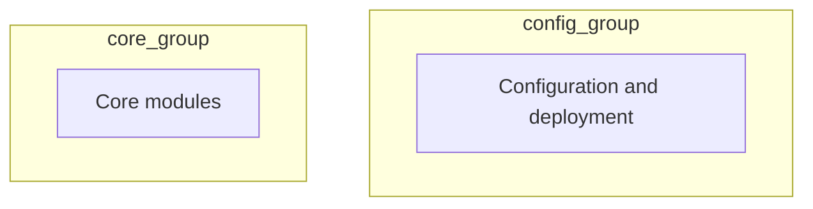

# Architecture report: jkchao/typescript-book-chinese

> Automated static analysis. **Observed** = directly seen in files/imports/AST; **Inferred** = interpretation from that evidence. Repository code was not executed.

## 1. Repository at a glance

| Item | Value |
| --- | --- |
| Repository | jkchao/typescript-book-chinese |
| Description | TypeScript Deep Dive 中文版  |
| Language | TypeScript |
| Stars | 6638 |
| Licence | MIT |
| Analysed commit / branch | f1e40c10e31be2f3599174dd22d95e4d3ab9cf55 / master |
| Framework(s) | None detected |
| Files analysed | 122 |
| Components | 2 |

## 2. Architecture in one minute

jkchao/typescript-book-chinese - TypeScript Deep Dive 中文版 . This repository was analysed statically from 122 file(s) (0 Python). Detected technologies (observed from imports/manifests): GitHub Actions. Files are grouped into 2 component(s): Configuration and deployment, Core modules. Findings below distinguish observed facts from inferred interpretation.

## 3. High-level block diagram

## 4. Main components

### Configuration and deployment (`config`)

- **Kind:** config
- **Status:** Observed
- **Confidence:** 0.85
- **Responsibility:** Groups 1 file(s) under configuration and deployment (observed from repository paths and static analysis).
- **Paths:** `package.json`
- **Evidence:** [package.json](https://github.com/jkchao/typescript-book-chinese/blob/f1e40c10e31be2f3599174dd22d95e4d3ab9cf55/package.json)

### Core modules (`core`)

- **Kind:** core
- **Status:** Observed
- **Confidence:** 0.85
- **Responsibility:** Groups 1 file(s) under core modules (observed from repository paths and static analysis).
- **Paths:** `commitlint.config.js`
- **Evidence:** [commitlint.config.js](https://github.com/jkchao/typescript-book-chinese/blob/f1e40c10e31be2f3599174dd22d95e4d3ab9cf55/commitlint.config.js)

## 5. Execution flow

No entry point was observed; the startup flow below is therefore limited.

Representative flow (derived from observed entry points and the import graph; steps beyond the entry point are **Inferred**):

1. Execution starts at an observed entry point listed above, if present.
2. No internal import relationships between components were observed.

## 6. Project structure

### `(root)`

- `.all-contributorsrc` - other (21126 bytes)
- `.gitattributes` - other (33 bytes)
- `.gitignore` - other (175 bytes)
- `.huskyrc.js` - source, JavaScript (123 bytes)
- `.prettierrc` - other (225 bytes)
- `LICENSE` - docs (1063 bytes)
- `README.md` - docs (27582 bytes)
- `commitlint.config.js` - source, JavaScript (349 bytes)
- `package.json` - manifest (1423 bytes)

### `.github`

- `.github/workflows/gh-pages.yml` - ci, YAML (578 bytes)

### `docs`

- `docs/.vuepress/config.js` - docs (5357 bytes)
- `docs/.vuepress/public/manifest.json` - config (1010 bytes)
- `docs/.vuepress/theme/components/Ads.vue` - docs (679 bytes)
- `docs/.vuepress/theme/components/AlgoliaSearchBox.vue` - docs (4125 bytes)
- `docs/.vuepress/theme/components/DropdownLink.vue` - docs (3962 bytes)
- `docs/.vuepress/theme/components/DropdownTransition.vue` - docs (560 bytes)
- `docs/.vuepress/theme/components/Home.vue` - docs (3322 bytes)
- `docs/.vuepress/theme/components/NavLink.vue` - docs (882 bytes)
- `docs/.vuepress/theme/components/NavLinks.vue` - docs (3645 bytes)
- `docs/.vuepress/theme/components/Navbar.vue` - docs (3269 bytes)
- `docs/.vuepress/theme/components/Page.vue` - docs (5454 bytes)
- `docs/.vuepress/theme/components/Sidebar.vue` - docs (1418 bytes)
- `docs/.vuepress/theme/components/SidebarButton.vue` - docs (919 bytes)
- `docs/.vuepress/theme/components/SidebarGroup.vue` - docs (2843 bytes)
- `docs/.vuepress/theme/components/SidebarLink.vue` - docs (2835 bytes)
- `docs/.vuepress/theme/components/SidebarLinks.vue` - docs (1684 bytes)
- `docs/.vuepress/theme/global-components/Badge.vue` - docs (811 bytes)
- `docs/.vuepress/theme/index.js` - docs (787 bytes)
- `docs/.vuepress/theme/layouts/404.vue` - docs (558 bytes)
- `docs/.vuepress/theme/layouts/Layout.vue` - docs (3159 bytes)
- `docs/.vuepress/theme/styles/arrow.styl` - docs (577 bytes)
- `docs/.vuepress/theme/styles/code.styl` - docs (2801 bytes)
- `docs/.vuepress/theme/styles/custom-blocks.styl` - docs (1041 bytes)
- `docs/.vuepress/theme/styles/mobile.styl` - docs (724 bytes)
- `docs/.vuepress/theme/styles/theme.styl` - docs (3150 bytes)
- `docs/.vuepress/theme/styles/toc.styl` - docs (54 bytes)
- `docs/.vuepress/theme/styles/wrapper.styl` - docs (183 bytes)
- `docs/.vuepress/theme/util/index.js` - docs (5747 bytes)
- `docs/README.md` - docs (3020 bytes)
- `docs/compiler/ast.md` - docs (5820 bytes)
- `docs/compiler/binder.md` - docs (15987 bytes)
- `docs/compiler/checker.md` - docs (2451 bytes)
- `docs/compiler/emitter.md` - docs (17617 bytes)
- `docs/compiler/overview.md` - docs (3130 bytes)
- `docs/compiler/parser.md` - docs (4521 bytes)
- `docs/compiler/program.md` - docs (829 bytes)
- `docs/compiler/scanner.md` - docs (2479 bytes)
- `docs/error/common.md` - docs (1846 bytes)
- `docs/error/interpreting.md` - docs (2780 bytes)
- `docs/faqs/class.md` - docs (8837 bytes)
- `docs/faqs/commandline-behavior.md` - docs (2947 bytes)
- `docs/faqs/comments.md` - docs (9 bytes)
- `docs/faqs/common-bug-not-bugs.md` - docs (2324 bytes)
- `docs/faqs/common-feature-request.md` - docs (692 bytes)
- `docs/faqs/decorators.md` - docs (13 bytes)
- `docs/faqs/enums.md` - docs (248 bytes)
- `docs/faqs/function.md` - docs (860 bytes)
- `docs/faqs/generics.md` - docs (2965 bytes)
- `docs/faqs/glossary-and-terms.md` - docs (12 bytes)
- `docs/faqs/jsx-and-react.md` - docs (975 bytes)
- `docs/faqs/modules.md` - docs (1224 bytes)
- `docs/faqs/thing-that-dont-work.md` - docs (1525 bytes)
- `docs/faqs/tsconfig-behavior.md` - docs (2845 bytes)
- `docs/faqs/type-guards.md` - docs (890 bytes)
- `docs/faqs/type-system-behavior.md` - docs (14670 bytes)
- `docs/jsx/nonReactJSX.md` - docs (2026 bytes)
- `docs/jsx/reactJSX.md` - docs (7680 bytes)
- `docs/jsx/support.md` - docs (1171 bytes)
- `docs/new/typescript-3.7.md` - docs (23349 bytes)
- `docs/new/typescript-3.8.md` - docs (19793 bytes)
- `docs/new/typescript-3.9.md` - docs (115 bytes)
- `docs/project/compilationContext.md` - docs (5920 bytes)
- `docs/project/declarationspaces.md` - docs (1615 bytes)
- `docs/project/dynamicImportExpressions.md` - docs (3002 bytes)
- `docs/project/modules.md` - docs (12286 bytes)
- `docs/project/namespaces.md` - docs (1712 bytes)
- `docs/tips/avoidExportDefault.md` - docs (2304 bytes)
- `docs/tips/barrel.md` - docs (2153 bytes)
- `docs/tips/bind.md` - docs (1970 bytes)
- `docs/tips/buildToggles.md` - docs (1345 bytes)
- `docs/tips/classAreUseful.md` - docs (1520 bytes)
- `docs/tips/covarianceAndContravariance.md` - docs (4514 bytes)
- `docs/tips/createArrays.md` - docs (279 bytes)
- `docs/tips/curry.md` - docs (253 bytes)
- `docs/tips/functionParameters.md` - docs (773 bytes)
- `docs/tips/infer.md` - docs (7247 bytes)
- `docs/tips/lazyObjectLiteralInitialization.md` - docs (2207 bytes)
- `docs/tips/limitPropertySetters.md` - docs (666 bytes)
- `docs/tips/metadata.md` - docs (5695 bytes)
- `docs/tips/nominalTyping.md` - docs (3730 bytes)
- `docs/tips/outFileCaution.md` - docs (3147 bytes)
- `docs/tips/singletonPatern.md` - docs (1134 bytes)
- `docs/tips/statefulFunctions.md` - docs (737 bytes)
- `docs/tips/staticConstructors.md` - docs (281 bytes)
- `docs/tips/stringBasedEmuns.md` - docs (373 bytes)
- `docs/tips/truthy.md` - docs (1509 bytes)
- `docs/tips/typeInstantiation.md` - docs (1415 bytes)
- `docs/tips/typesafeEventEmitter.md` - docs (1951 bytes)
- `docs/typings/ambient.md` - docs (2889 bytes)
- `docs/typings/callable.md` - docs (2189 bytes)
- `docs/typings/discrominatedUnion.md` - docs (5455 bytes)
- `docs/typings/enums.md` - docs (9270 bytes)
- `docs/typings/exceptionsHanding.md` - docs (4141 bytes)
- `docs/typings/freshness.md` - docs (3591 bytes)
- `docs/typings/functions.md` - docs (4358 bytes)
- `docs/typings/generices.md` - docs (6533 bytes)
- `docs/typings/indexSignatures.md` - docs (8246 bytes)
- `docs/typings/interfaces.md` - docs (2399 bytes)
- `docs/typings/lib.md` - docs (10333 bytes)
- `docs/typings/literals.md` - docs (2974 bytes)
- `docs/typings/migrating.md` - docs (5067 bytes)
- `docs/typings/mixins.md` - docs (2302 bytes)
- `docs/typings/movingTypes.md` - docs (2875 bytes)
- `docs/typings/neverType.md` - docs (2623 bytes)
- `docs/typings/overview.md` - docs (9795 bytes)
- `docs/typings/readonly.md` - docs (4369 bytes)
- `docs/typings/thisType.md` - docs (3314 bytes)
- `docs/typings/typeAssertion.md` - docs (3982 bytes)
- `docs/typings/typeCompatibility.md` - docs (9036 bytes)
- `docs/typings/typeGuard.md` - docs (3512 bytes)
- `docs/typings/typeInference.md` - docs (4831 bytes)
- `docs/typings/types.md` - docs (1556 bytes)

## 7. Key dependencies and integrations

| Name | Category | Status | Confidence | Evidence |
| --- | --- | --- | --- | --- |
| GitHub Actions | ci | Observed | 0.85 | [.github/workflows/gh-pages.yml](https://github.com/jkchao/typescript-book-chinese/blob/f1e40c10e31be2f3599174dd22d95e4d3ab9cf55/.github/workflows/gh-pages.yml) |

## 8. Data and state

No database, cache, queue, or persistent-state usage was observed in the analysed files. State handling, if any, may be in-memory or in files that were not analysed.

## 9. Configuration and deployment clues

- `.github/workflows/gh-pages.yml` (ci)
- `docs/.vuepress/public/manifest.json` (config)
- `package.json` (manifest)

## 10. Design observations

- No strong design patterns could be established from the available evidence.

These observations are interpretations (**Inferred**) of the observed structure, not guarantees about runtime design.

## 11. Limitations and unknowns

- Static analysis only: repository code was not executed, installed, or imported at runtime.
- Components and relationships are inferred from file paths, imports, and AST structure; runtime behaviour, dynamic imports, and reflection may not be visible.
- No clear application entry point was observed in the analysed files.
- Repository text was treated as untrusted data; no instructions found in repository files were followed, and likely secret values were redacted/excluded.
- JavaScript and TypeScript files were inventoried from paths and package manifests. They were not parsed with a full language AST, and repository code was not executed.

## 12. Source references

- [.github/workflows/gh-pages.yml](https://github.com/jkchao/typescript-book-chinese/blob/f1e40c10e31be2f3599174dd22d95e4d3ab9cf55/.github/workflows/gh-pages.yml)
- [commitlint.config.js](https://github.com/jkchao/typescript-book-chinese/blob/f1e40c10e31be2f3599174dd22d95e4d3ab9cf55/commitlint.config.js)
- [package.json](https://github.com/jkchao/typescript-book-chinese/blob/f1e40c10e31be2f3599174dd22d95e4d3ab9cf55/package.json)
