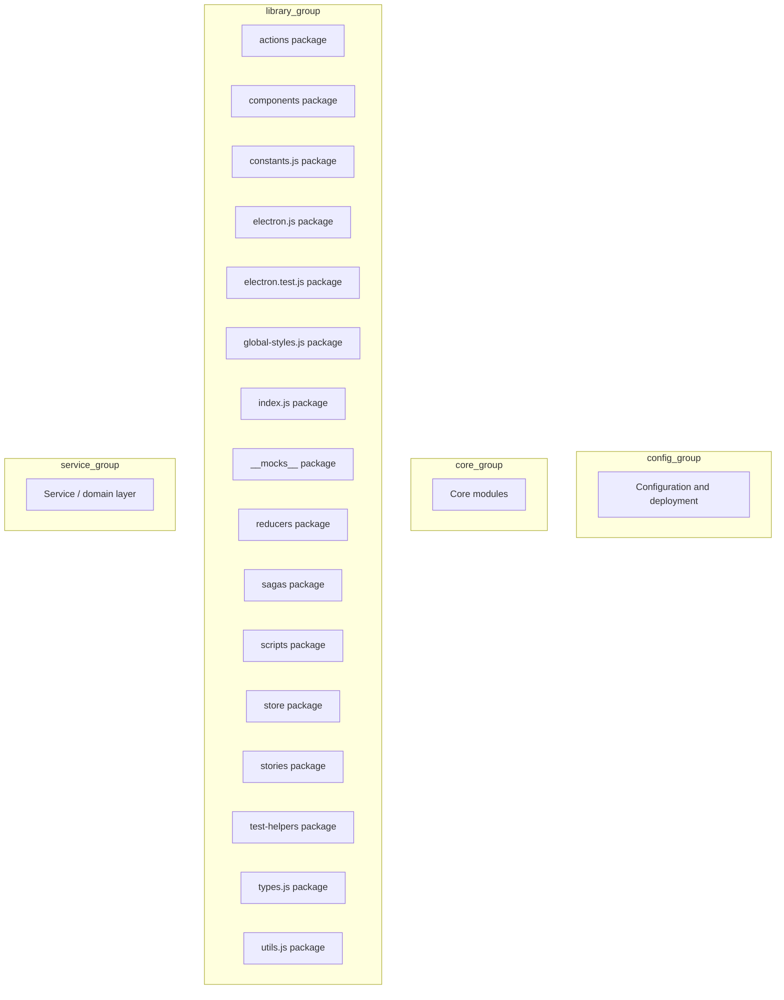

# Architecture report: joshwcomeau/guppy

> Automated static analysis. **Observed** = directly seen in files/imports/AST; **Inferred** = interpretation from that evidence. Repository code was not executed.

## 1. Repository at a glance

| Item | Value |
| --- | --- |
| Repository | joshwcomeau/guppy |
| Description | 🐠A friendly application manager and task runner for React.js |
| Language | JavaScript |
| Stars | 3237 |
| Licence | ISC |
| Analysed commit / branch | 72d84495d9c15d22053b0010ac1fd9a1061a7054 / master |
| Framework(s) | Electron, React |
| Files analysed | 411 |
| Components | 19 |

## 2. Architecture in one minute

joshwcomeau/guppy - 🐠A friendly application manager and task runner for React.js. This repository was analysed statically from 411 file(s) (0 Python). Detected technologies (observed from imports/manifests): Electron, React, Redux, Jest, webpack. Files are grouped into 19 component(s): actions package, components package, Configuration and deployment, constants.js package, Core modules, electron.js package, electron.test.js package, global-styles.js package. Findings below distinguish observed facts from inferred interpretation.

## 3. High-level block diagram

## 4. Main components

### actions package (`actions`)

- **Kind:** library
- **Status:** Observed
- **Confidence:** 0.85
- **Responsibility:** Groups 2 file(s) under actions package (observed from repository paths and static analysis).
- **Paths:** `src/actions/index.js`, `src/actions/types.js`
- **Evidence:** [src/actions/index.js](https://github.com/joshwcomeau/guppy/blob/72d84495d9c15d22053b0010ac1fd9a1061a7054/src/actions/index.js); [src/actions/types.js](https://github.com/joshwcomeau/guppy/blob/72d84495d9c15d22053b0010ac1fd9a1061a7054/src/actions/types.js)

### components package (`components`)

- **Kind:** library
- **Status:** Observed
- **Confidence:** 0.85
- **Responsibility:** Groups 247 file(s) under components package (observed from repository paths and static analysis).
- **Paths:** `src/components/App/App.js`, `src/components/App/index.js`, `src/components/AppSettingsModal/AppSettingsModal.js`, `src/components/AppSettingsModal/AppSettingsModal.test.js`, `src/components/AppSettingsModal/index.js`, `src/components/ApplicationMenu/ApplicationMenu.js`, `src/components/ApplicationMenu/index.js`, `src/components/AvailableWidth/AvailableWidth.js`, `src/components/AvailableWidth/index.js`, `src/components/BigClickableButton/BigClickableButton.js`, `src/components/BigClickableButton/BigClickableButton.test.js`, `src/components/BigClickableButton/index.js`, `src/components/Button/ButtonBase.js`, `src/components/Button/ButtonBase.stories.js`, `src/components/Button/ButtonBase.test.js`, `src/components/Button/FillButton.js`, `src/components/Button/FillButton.stories.js`, `src/components/Button/FillButton.test.js`, `src/components/Button/StrokeButton.js`, `src/components/Button/StrokeButton.stories.js`, `src/components/Button/StrokeButton.test.js`, `src/components/Button/index.js`, `src/components/ButtonWithIcon/ButtonWithIcon.js`, `src/components/ButtonWithIcon/ButtonWithIcon.test.js`, `src/components/ButtonWithIcon/ButtonsWithIcon.stories.js`, `src/components/ButtonWithIcon/index.js`, `src/components/Card/Card.js`, `src/components/Card/index.js`, `src/components/CircularOutline/CircularOutline.js`, `src/components/CircularOutline/CircularOutline.stories.js`, `src/components/CircularOutline/index.js`, `src/components/CodesandboxLogo/Logo.js`, `src/components/CodesandboxLogo/index.js`, `src/components/CreateNewProjectWizard/BuildPane.js`, `src/components/CreateNewProjectWizard/BuildStepProgress.js`, `src/components/CreateNewProjectWizard/CreateNewProjectWizard.js`, `src/components/CreateNewProjectWizard/Gatsby/MockStarterYaml.js`, `src/components/CreateNewProjectWizard/Gatsby/ProjectStarterSelection.js`, `src/components/CreateNewProjectWizard/Gatsby/ProjectStarterSelection.test.js`, `src/components/CreateNewProjectWizard/Gatsby/SelectStarterList.js`, `src/components/CreateNewProjectWizard/Gatsby/SelectStarterList.test.js`, `src/components/CreateNewProjectWizard/ImportExisting.js`, `src/components/CreateNewProjectWizard/MainPane.js`, `src/components/CreateNewProjectWizard/ProjectName.js`, `src/components/CreateNewProjectWizard/ProjectPath.js`, `src/components/CreateNewProjectWizard/SubmitButton.js`, `src/components/CreateNewProjectWizard/SummaryPane.js`, `src/components/CreateNewProjectWizard/__tests__/BuildPane.test.js`, `src/components/CreateNewProjectWizard/__tests__/BuildStepProgress.test.js`, `src/components/CreateNewProjectWizard/__tests__/CreateNewProjectWizard.test.js`, `src/components/CreateNewProjectWizard/__tests__/ImportExisting.test.js`, `src/components/CreateNewProjectWizard/__tests__/MainPane.test.js`, `src/components/CreateNewProjectWizard/__tests__/ProjectName.test.js`, `src/components/CreateNewProjectWizard/__tests__/ProjectPath.test.js`, `src/components/CreateNewProjectWizard/__tests__/SubmitButton.test.js`, `src/components/CreateNewProjectWizard/__tests__/SummaryPane.test.js`, `src/components/CreateNewProjectWizard/__tests__/helpers.test.js`, `src/components/CreateNewProjectWizard/helpers.js`, `src/components/CreateNewProjectWizard/index.js`, `src/components/CreateNewProjectWizard/types.js`, `src/components/CustomHighlight/CustomHighlight.js`, `src/components/CustomHighlight/index.js`, `src/components/Debounced/Debounced.js`, `src/components/Debounced/index.js`, `src/components/DependencyManagementPane/AddDependencyInitialScreen.js`, `src/components/DependencyManagementPane/AddDependencyModal.js`, `src/components/DependencyManagementPane/AddDependencySearchBox.js`, `src/components/DependencyManagementPane/AddDependencySearchProvider.js`, `src/components/DependencyManagementPane/AddDependencySearchResult.js`, `src/components/DependencyManagementPane/AlgoliaLogo.js`, `src/components/DependencyManagementPane/DeleteDependencyButton.js`, `src/components/DependencyManagementPane/DependencyDetails.js`, `src/components/DependencyManagementPane/DependencyDetailsTable.js`, `src/components/DependencyManagementPane/DependencyInfoFromNpm.js`, `src/components/DependencyManagementPane/DependencyInstalling.js`, `src/components/DependencyManagementPane/DependencyManagementPane.js`, `src/components/DependencyManagementPane/DependencyUpdateRow.js`, `src/components/DependencyManagementPane/__mocks__/dependency.js`, `src/components/DependencyManagementPane/__tests__/AddDependencyInitialScreen.test.js`, `src/components/DependencyManagementPane/__tests__/AddDependencyModal.test.js`, `src/components/DependencyManagementPane/__tests__/AddDependencySearchBox.test.js`, `src/components/DependencyManagementPane/__tests__/AddDependencySearchProvider.test.js`, `src/components/DependencyManagementPane/__tests__/AddDependencySearchResult.test.js`, `src/components/DependencyManagementPane/__tests__/DependencyDetails.test.js`, `src/components/DependencyManagementPane/__tests__/DependencyInstalling.test.js`, `src/components/DependencyManagementPane/__tests__/DependencyManagementPane.test.js`, `src/components/DependencyManagementPane/index.js`, `src/components/DetectActive/DetectActive.js`, `src/components/DetectActive/index.js`, `src/components/DevTools/index.dev.js`, `src/components/DevTools/index.js`, `src/components/DevTools/index.prod.js`, `src/components/DevelopmentServerPane/DevelopmentServerPane.js`, `src/components/DevelopmentServerPane/DevelopmentServerPane.test.js`, `src/components/DevelopmentServerPane/index.js`, `src/components/DevelopmentServerStatus/DevelopmentServerStatus.js`, `src/components/DevelopmentServerStatus/index.js`, `src/components/DirectoryPicker/DirectoryPicker.js`, `src/components/DirectoryPicker/index.js`, `src/components/Divider/Divider.js`, `src/components/Divider/index.js`, `src/components/Earth/Earth.js`, `src/components/Earth/index.js`, `src/components/EjectButton/EjectButton.js`, `src/components/EjectButton/EjectButton.test.js`, `src/components/EjectButton/index.js`, `src/components/ExternalLink/ExternalLink.js`, `src/components/ExternalLink/index.js`, `src/components/FadeIn/FadeIn.js`, `src/components/FadeIn/index.js`, `src/components/FadeOnChange/FadeOnChange.js`, `src/components/FadeOnChange/index.js`, `src/components/FeedbackButton/FeedbackButton.js`, `src/components/FeedbackButton/index.js`, `src/components/FormField/FormField.js`, `src/components/FormField/index.js`, `src/components/FullWidth/FullWidth.js`, `src/components/FullWidth/index.js`, `src/components/Heading/Heading.js`, `src/components/Heading/index.js`, `src/components/HelpButton/HelpButton.js`, `src/components/HelpButton/index.js`, `src/components/HoverableOutlineButton/HoverableOutlineButton.js`, `src/components/HoverableOutlineButton/index.js`, `src/components/Icons/index.js`, `src/components/ImportProjectButton/ImportProjectButton.js`, `src/components/ImportProjectButton/index.js`, `src/components/Initialization/Initialization.helpers.test.js`, `src/components/Initialization/Initialization.js`, `src/components/Initialization/index.js`, `src/components/IntroScreen/IntroScreen.js`, `src/components/IntroScreen/index.js`, `src/components/Label/Label.js`, `src/components/Label/index.js`, `src/components/LargeLED/LargeLED.helpers.js`, `src/components/LargeLED/LargeLED.js`, `src/components/LargeLED/index.js`, `src/components/License/License.js`, `src/components/License/index.js`, `src/components/LoadingScreen/LoadingScreen.js`, `src/components/LoadingScreen/index.js`, `src/components/Logo/Logo.js`, `src/components/Logo/Logo.stories.js`, `src/components/Logo/index.js`, `src/components/MainContentWrapper/MainContentWrapper.js`, `src/components/MainContentWrapper/index.js`, `src/components/Middot/Middot.js`, `src/components/Middot/index.js`, `src/components/Modal/Modal.js`, `src/components/Modal/index.js`, `src/components/ModalHeader/ModalHeader.js`, `src/components/ModalHeader/index.js`, `src/components/Module/Module.js`, `src/components/Module/index.js`, `src/components/MountAfter/MountAfter.js`, `src/components/MountAfter/MountAfter.stories.js`, `src/components/MountAfter/index.js`, `src/components/NodeProvider/NodeProvider.js`, `src/components/NodeProvider/index.js`, `src/components/OnlineChecker/OnlineChecker.js`, `src/components/OnlineChecker/index.js`, `src/components/OnlyOn/OnlyOn.js`, `src/components/OnlyOn/index.js`, `src/components/Paragraph/Paragraph.js`, `src/components/Paragraph/index.js`, `src/components/PixelShifter/PixelShifter.js`, `src/components/PixelShifter/index.js`, `src/components/Planet/EarthContinents.js`, `src/components/Planet/Orbit.js`, `src/components/Planet/Planet.helpers.js`, `src/components/Planet/Planet.js`, `src/components/Planet/Planet.stories.js`, `src/components/Planet/PlanetCloud.js`, `src/components/Planet/PlanetGlow.js`, `src/components/Planet/PlanetMoon.js`, `src/components/Planet/index.js`, `src/components/ProgressBar/ProgressBar.js`, `src/components/ProgressBar/ProgressBar.stories.js`, `src/components/ProgressBar/ProgressBar.test.js`, `src/components/ProgressBar/index.js`, `src/components/ProjectConfigurationModal/ProjectConfigurationModal.js`, `src/components/ProjectConfigurationModal/ProjectConfigurationModal.test.js`, `src/components/ProjectConfigurationModal/index.js`, `src/components/ProjectIconSelection/ProjectIconSelection.js`, `src/components/ProjectIconSelection/ProjectIconSelection.stories.js`, `src/components/ProjectIconSelection/index.js`, `src/components/ProjectPage/ProjectPage.js`, `src/components/ProjectPage/ProjectPage.test.js`, `src/components/ProjectPage/index.js`, `src/components/ProjectTitle/ProjectTitle.js`, `src/components/ProjectTitle/ProjectTitle.stories.js`, `src/components/ProjectTitle/index.js`, `src/components/ProjectTypeSelection/ProjectTypeSelection.js`, `src/components/ProjectTypeSelection/index.js`, `src/components/ScrollDisabler/ScrollDisabler.js`, `src/components/ScrollDisabler/index.js`, `src/components/SelectableImage/SelectableImage.js`, `src/components/SelectableImage/index.js`, `src/components/SelectableItem/SelectableItem.js`, `src/components/SelectableItem/index.js`, `src/components/SettingsButton/SettingsButton.js`, `src/components/SettingsButton/index.js`, `src/components/Sidebar/AddProjectButton.js`, `src/components/Sidebar/IntroductionBlurb.js`, `src/components/Sidebar/Sidebar.js`, `src/components/Sidebar/Sidebar.test.js`, `src/components/Sidebar/SidebarProjectIcon.js`, `src/components/Sidebar/SidebarProjectIcon.test.js`, `src/components/Sidebar/index.js`, `src/components/Spacer/Spacer.js`, `src/components/Spacer/index.js`, `src/components/Spinner/Spinner.js`, `src/components/Spinner/index.js`, `src/components/TaskDetailsModal/TaskDetailsModal.js`, `src/components/TaskDetailsModal/index.js`, `src/components/TaskRunnerPane/TaskRunnerPane.js`, `src/components/TaskRunnerPane/TaskRunnerPane.test.js`, `src/components/TaskRunnerPane/index.js`, `src/components/TaskRunnerPaneRow/TaskRunnerPaneRow.js`, `src/components/TaskRunnerPaneRow/index.js`, `src/components/TerminalOutput/TerminalOutput.js`, `src/components/TerminalOutput/TerminalOutput.test.js`, `src/components/TerminalOutput/index.js`, `src/components/TerminalOutput/localLinksAddon.js`, `src/components/TextButton/TextButton.js`, `src/components/TextButton/index.js`, `src/components/TextInput/TextInput.js`, `src/components/TextInput/index.js`, `src/components/TextInputWithButton/TextInputWithButton.js`, `src/components/TextInputWithButton/index.js`, `src/components/Titlebar/Titlebar.js`, `src/components/Titlebar/index.js`, `src/components/Toggle/Toggle.js`, `src/components/Toggle/Toggle.stories.js`, `src/components/Toggle/index.js`, `src/components/TwoPaneModal/TwoPaneModal.js`, `src/components/TwoPaneModal/index.js`, `src/components/WhimsicalInstaller/File.js`, `src/components/WhimsicalInstaller/Folder.js`, `src/components/WhimsicalInstaller/WhimsicalInstaller.helpers.js`, `src/components/WhimsicalInstaller/WhimsicalInstaller.helpers.test.js`, `src/components/WhimsicalInstaller/WhimsicalInstaller.js`, `src/components/WhimsicalInstaller/WhimsicalInstaller.stories.js`, `src/components/WhimsicalInstaller/WhimsicalInstaller.types.js`, `src/components/WhimsicalInstaller/index.js`, `src/components/WindowDimensions/WindowDimensions.js`, `src/components/WindowDimensions/index.js`
- **Evidence:** [src/components/App/App.js](https://github.com/joshwcomeau/guppy/blob/72d84495d9c15d22053b0010ac1fd9a1061a7054/src/components/App/App.js); [src/components/App/index.js](https://github.com/joshwcomeau/guppy/blob/72d84495d9c15d22053b0010ac1fd9a1061a7054/src/components/App/index.js); [src/components/AppSettingsModal/AppSettingsModal.js](https://github.com/joshwcomeau/guppy/blob/72d84495d9c15d22053b0010ac1fd9a1061a7054/src/components/AppSettingsModal/AppSettingsModal.js); [src/components/AppSettingsModal/AppSettingsModal.test.js](https://github.com/joshwcomeau/guppy/blob/72d84495d9c15d22053b0010ac1fd9a1061a7054/src/components/AppSettingsModal/AppSettingsModal.test.js); [src/components/AppSettingsModal/index.js](https://github.com/joshwcomeau/guppy/blob/72d84495d9c15d22053b0010ac1fd9a1061a7054/src/components/AppSettingsModal/index.js); [src/components/ApplicationMenu/ApplicationMenu.js](https://github.com/joshwcomeau/guppy/blob/72d84495d9c15d22053b0010ac1fd9a1061a7054/src/components/ApplicationMenu/ApplicationMenu.js); [src/components/ApplicationMenu/index.js](https://github.com/joshwcomeau/guppy/blob/72d84495d9c15d22053b0010ac1fd9a1061a7054/src/components/ApplicationMenu/index.js); [src/components/AvailableWidth/AvailableWidth.js](https://github.com/joshwcomeau/guppy/blob/72d84495d9c15d22053b0010ac1fd9a1061a7054/src/components/AvailableWidth/AvailableWidth.js)

### Configuration and deployment (`config`)

- **Kind:** config
- **Status:** Observed
- **Confidence:** 0.85
- **Responsibility:** Groups 18 file(s) under configuration and deployment (observed from repository paths and static analysis).
- **Paths:** `codecov.yml`, `config/.eslintrc.js`, `config/env.js`, `config/enzyme-setup.js`, `config/jest/babelTransform.js`, `config/jest/cssTransform.js`, `config/jest/electron.js`, `config/jest/fileTransform.js`, `config/jest/graphqlTransform.js`, `config/paths.js`, `config/polyfills.js`, `config/testFrameworkSetup.js`, `config/webpack.config.dev.js`, `config/webpack.config.prod.js`, `config/webpackDevServer.config.js`, `package.json`, `src/config/app.js`, `src/config/project-types.js`
- **Evidence:** [codecov.yml](https://github.com/joshwcomeau/guppy/blob/72d84495d9c15d22053b0010ac1fd9a1061a7054/codecov.yml); [config/.eslintrc.js](https://github.com/joshwcomeau/guppy/blob/72d84495d9c15d22053b0010ac1fd9a1061a7054/config/.eslintrc.js); [config/env.js](https://github.com/joshwcomeau/guppy/blob/72d84495d9c15d22053b0010ac1fd9a1061a7054/config/env.js); [config/enzyme-setup.js](https://github.com/joshwcomeau/guppy/blob/72d84495d9c15d22053b0010ac1fd9a1061a7054/config/enzyme-setup.js); [config/jest/babelTransform.js](https://github.com/joshwcomeau/guppy/blob/72d84495d9c15d22053b0010ac1fd9a1061a7054/config/jest/babelTransform.js); [config/jest/cssTransform.js](https://github.com/joshwcomeau/guppy/blob/72d84495d9c15d22053b0010ac1fd9a1061a7054/config/jest/cssTransform.js); [config/jest/electron.js](https://github.com/joshwcomeau/guppy/blob/72d84495d9c15d22053b0010ac1fd9a1061a7054/config/jest/electron.js); [config/jest/fileTransform.js](https://github.com/joshwcomeau/guppy/blob/72d84495d9c15d22053b0010ac1fd9a1061a7054/config/jest/fileTransform.js)

### constants.js package (`constants_js`)

- **Kind:** library
- **Status:** Observed
- **Confidence:** 0.85
- **Responsibility:** Groups 1 file(s) under constants.js package (observed from repository paths and static analysis).
- **Paths:** `src/constants.js`
- **Evidence:** [src/constants.js](https://github.com/joshwcomeau/guppy/blob/72d84495d9c15d22053b0010ac1fd9a1061a7054/src/constants.js)

### Core modules (`core`)

- **Kind:** core
- **Status:** Observed
- **Confidence:** 0.85
- **Responsibility:** Groups 1 file(s) under core modules (observed from repository paths and static analysis).
- **Paths:** `prettier.config.js`
- **Evidence:** [prettier.config.js](https://github.com/joshwcomeau/guppy/blob/72d84495d9c15d22053b0010ac1fd9a1061a7054/prettier.config.js)

### electron.js package (`electron_js`)

- **Kind:** library
- **Status:** Observed
- **Confidence:** 0.85
- **Responsibility:** Groups 1 file(s) under electron.js package (observed from repository paths and static analysis).
- **Paths:** `src/electron.js`
- **Evidence:** [src/electron.js](https://github.com/joshwcomeau/guppy/blob/72d84495d9c15d22053b0010ac1fd9a1061a7054/src/electron.js)

### electron.test.js package (`electron_test_js`)

- **Kind:** library
- **Status:** Observed
- **Confidence:** 0.85
- **Responsibility:** Groups 1 file(s) under electron.test.js package (observed from repository paths and static analysis).
- **Paths:** `src/electron.test.js`
- **Evidence:** [src/electron.test.js](https://github.com/joshwcomeau/guppy/blob/72d84495d9c15d22053b0010ac1fd9a1061a7054/src/electron.test.js)

### global-styles.js package (`global_styles_js`)

- **Kind:** library
- **Status:** Observed
- **Confidence:** 0.85
- **Responsibility:** Groups 1 file(s) under global-styles.js package (observed from repository paths and static analysis).
- **Paths:** `src/global-styles.js`
- **Evidence:** [src/global-styles.js](https://github.com/joshwcomeau/guppy/blob/72d84495d9c15d22053b0010ac1fd9a1061a7054/src/global-styles.js)

### index.js package (`index_js`)

- **Kind:** library
- **Status:** Observed
- **Confidence:** 0.85
- **Responsibility:** Groups 1 file(s) under index.js package (observed from repository paths and static analysis).
- **Paths:** `src/index.js`
- **Evidence:** [src/index.js](https://github.com/joshwcomeau/guppy/blob/72d84495d9c15d22053b0010ac1fd9a1061a7054/src/index.js)

### __mocks__ package (`mocks`)

- **Kind:** library
- **Status:** Observed
- **Confidence:** 0.85
- **Responsibility:** Groups 5 file(s) under __mocks__ package (observed from repository paths and static analysis).
- **Paths:** `src/__mocks__/electron-log.js`, `src/__mocks__/electron-store.js`, `src/__mocks__/electron-updater.js`, `src/__mocks__/electron.js`, `src/__mocks__/mixpanel-browser.js`
- **Evidence:** [src/__mocks__/electron-log.js](https://github.com/joshwcomeau/guppy/blob/72d84495d9c15d22053b0010ac1fd9a1061a7054/src/__mocks__/electron-log.js); [src/__mocks__/electron-store.js](https://github.com/joshwcomeau/guppy/blob/72d84495d9c15d22053b0010ac1fd9a1061a7054/src/__mocks__/electron-store.js); [src/__mocks__/electron-updater.js](https://github.com/joshwcomeau/guppy/blob/72d84495d9c15d22053b0010ac1fd9a1061a7054/src/__mocks__/electron-updater.js); [src/__mocks__/electron.js](https://github.com/joshwcomeau/guppy/blob/72d84495d9c15d22053b0010ac1fd9a1061a7054/src/__mocks__/electron.js); [src/__mocks__/mixpanel-browser.js](https://github.com/joshwcomeau/guppy/blob/72d84495d9c15d22053b0010ac1fd9a1061a7054/src/__mocks__/mixpanel-browser.js)

### reducers package (`reducers`)

- **Kind:** library
- **Status:** Observed
- **Confidence:** 0.85
- **Responsibility:** Groups 19 file(s) under reducers package (observed from repository paths and static analysis).
- **Paths:** `src/reducers/app-loaded.reducer.js`, `src/reducers/app-settings.reducer.js`, `src/reducers/app-settings.reducer.test.js`, `src/reducers/app-status.reducer.js`, `src/reducers/app-status.reducer.test.js`, `src/reducers/dependencies.reducer.js`, `src/reducers/dependencies.reducer.test.js`, `src/reducers/index.js`, `src/reducers/modal.reducer.js`, `src/reducers/modal.reducer.test.js`, `src/reducers/onboarding-status.reducer.js`, `src/reducers/paths.reducer.js`, `src/reducers/paths.reducer.test.js`, `src/reducers/projects.reducer.js`, `src/reducers/projects.reducer.test.js`, `src/reducers/queue.reducer.js`, `src/reducers/queue.reducer.test.js`, `src/reducers/tasks.reducer.js`, `src/reducers/tasks.reducer.test.js`
- **Evidence:** [src/reducers/app-loaded.reducer.js](https://github.com/joshwcomeau/guppy/blob/72d84495d9c15d22053b0010ac1fd9a1061a7054/src/reducers/app-loaded.reducer.js); [src/reducers/app-settings.reducer.js](https://github.com/joshwcomeau/guppy/blob/72d84495d9c15d22053b0010ac1fd9a1061a7054/src/reducers/app-settings.reducer.js); [src/reducers/app-settings.reducer.test.js](https://github.com/joshwcomeau/guppy/blob/72d84495d9c15d22053b0010ac1fd9a1061a7054/src/reducers/app-settings.reducer.test.js); [src/reducers/app-status.reducer.js](https://github.com/joshwcomeau/guppy/blob/72d84495d9c15d22053b0010ac1fd9a1061a7054/src/reducers/app-status.reducer.js); [src/reducers/app-status.reducer.test.js](https://github.com/joshwcomeau/guppy/blob/72d84495d9c15d22053b0010ac1fd9a1061a7054/src/reducers/app-status.reducer.test.js); [src/reducers/dependencies.reducer.js](https://github.com/joshwcomeau/guppy/blob/72d84495d9c15d22053b0010ac1fd9a1061a7054/src/reducers/dependencies.reducer.js); [src/reducers/dependencies.reducer.test.js](https://github.com/joshwcomeau/guppy/blob/72d84495d9c15d22053b0010ac1fd9a1061a7054/src/reducers/dependencies.reducer.test.js); [src/reducers/index.js](https://github.com/joshwcomeau/guppy/blob/72d84495d9c15d22053b0010ac1fd9a1061a7054/src/reducers/index.js)

### sagas package (`sagas`)

- **Kind:** library
- **Status:** Observed
- **Confidence:** 0.85
- **Responsibility:** Groups 19 file(s) under sagas package (observed from repository paths and static analysis).
- **Paths:** `src/sagas/analytics.saga.js`, `src/sagas/analytics.saga.test.js`, `src/sagas/delete-project.saga.js`, `src/sagas/delete-project.saga.test.js`, `src/sagas/dependency.saga.js`, `src/sagas/dependency.saga.test.js`, `src/sagas/development.saga.js`, `src/sagas/development.saga.test.js`, `src/sagas/import-project.saga.js`, `src/sagas/import-project.saga.test.js`, `src/sagas/index.js`, `src/sagas/queue.saga.js`, `src/sagas/queue.saga.test.js`, `src/sagas/refresh-projects.saga.js`, `src/sagas/refresh-projects.saga.test.js`, `src/sagas/save-project-settings.saga.js`, `src/sagas/save-project-settings.saga.test.js`, `src/sagas/task.saga.js`, `src/sagas/task.saga.test.js`
- **Evidence:** [src/sagas/analytics.saga.js](https://github.com/joshwcomeau/guppy/blob/72d84495d9c15d22053b0010ac1fd9a1061a7054/src/sagas/analytics.saga.js); [src/sagas/analytics.saga.test.js](https://github.com/joshwcomeau/guppy/blob/72d84495d9c15d22053b0010ac1fd9a1061a7054/src/sagas/analytics.saga.test.js); [src/sagas/delete-project.saga.js](https://github.com/joshwcomeau/guppy/blob/72d84495d9c15d22053b0010ac1fd9a1061a7054/src/sagas/delete-project.saga.js); [src/sagas/delete-project.saga.test.js](https://github.com/joshwcomeau/guppy/blob/72d84495d9c15d22053b0010ac1fd9a1061a7054/src/sagas/delete-project.saga.test.js); [src/sagas/dependency.saga.js](https://github.com/joshwcomeau/guppy/blob/72d84495d9c15d22053b0010ac1fd9a1061a7054/src/sagas/dependency.saga.js); [src/sagas/dependency.saga.test.js](https://github.com/joshwcomeau/guppy/blob/72d84495d9c15d22053b0010ac1fd9a1061a7054/src/sagas/dependency.saga.test.js); [src/sagas/development.saga.js](https://github.com/joshwcomeau/guppy/blob/72d84495d9c15d22053b0010ac1fd9a1061a7054/src/sagas/development.saga.js); [src/sagas/development.saga.test.js](https://github.com/joshwcomeau/guppy/blob/72d84495d9c15d22053b0010ac1fd9a1061a7054/src/sagas/development.saga.test.js)

### scripts package (`scripts`)

- **Kind:** library
- **Status:** Observed
- **Confidence:** 0.85
- **Responsibility:** Groups 4 file(s) under scripts package (observed from repository paths and static analysis).
- **Paths:** `scripts/.eslintrc.js`, `scripts/build.js`, `scripts/start.js`, `scripts/test.js`
- **Evidence:** [scripts/.eslintrc.js](https://github.com/joshwcomeau/guppy/blob/72d84495d9c15d22053b0010ac1fd9a1061a7054/scripts/.eslintrc.js); [scripts/build.js](https://github.com/joshwcomeau/guppy/blob/72d84495d9c15d22053b0010ac1fd9a1061a7054/scripts/build.js); [scripts/start.js](https://github.com/joshwcomeau/guppy/blob/72d84495d9c15d22053b0010ac1fd9a1061a7054/scripts/start.js); [scripts/test.js](https://github.com/joshwcomeau/guppy/blob/72d84495d9c15d22053b0010ac1fd9a1061a7054/scripts/test.js)

### Service / domain layer (`service_layer`)

- **Kind:** service
- **Status:** Observed
- **Confidence:** 0.85
- **Responsibility:** Groups 22 file(s) under service / domain layer (observed from repository paths and static analysis).
- **Paths:** `src/services/analytics.service.js`, `src/services/analytics.service.test.js`, `src/services/check-if-url-exists.service.js`, `src/services/config-variables.service.js`, `src/services/config-variables.service.test.js`, `src/services/create-project.fixtures.js`, `src/services/create-project.service.js`, `src/services/create-project.service.test.js`, `src/services/dependencies.service.js`, `src/services/electron-store.service.js`, `src/services/find-available-port.service.js`, `src/services/kill-process-id.service.js`, `src/services/kill-process-id.service.test.js`, `src/services/platform.service.js`, `src/services/platform.service.test.js`, `src/services/process-logger.service.js`, `src/services/project-name-service.test.js`, `src/services/project-name.service.js`, `src/services/project-type-specifics.js`, `src/services/project-type-specifics.test.js`, `src/services/read-from-disk.service.js`, `src/services/shell.service.js`
- **Evidence:** [src/services/analytics.service.js](https://github.com/joshwcomeau/guppy/blob/72d84495d9c15d22053b0010ac1fd9a1061a7054/src/services/analytics.service.js); [src/services/analytics.service.test.js](https://github.com/joshwcomeau/guppy/blob/72d84495d9c15d22053b0010ac1fd9a1061a7054/src/services/analytics.service.test.js); [src/services/check-if-url-exists.service.js](https://github.com/joshwcomeau/guppy/blob/72d84495d9c15d22053b0010ac1fd9a1061a7054/src/services/check-if-url-exists.service.js); [src/services/config-variables.service.js](https://github.com/joshwcomeau/guppy/blob/72d84495d9c15d22053b0010ac1fd9a1061a7054/src/services/config-variables.service.js); [src/services/config-variables.service.test.js](https://github.com/joshwcomeau/guppy/blob/72d84495d9c15d22053b0010ac1fd9a1061a7054/src/services/config-variables.service.test.js); [src/services/create-project.fixtures.js](https://github.com/joshwcomeau/guppy/blob/72d84495d9c15d22053b0010ac1fd9a1061a7054/src/services/create-project.fixtures.js); [src/services/create-project.service.js](https://github.com/joshwcomeau/guppy/blob/72d84495d9c15d22053b0010ac1fd9a1061a7054/src/services/create-project.service.js); [src/services/create-project.service.test.js](https://github.com/joshwcomeau/guppy/blob/72d84495d9c15d22053b0010ac1fd9a1061a7054/src/services/create-project.service.test.js)

### store package (`store`)

- **Kind:** library
- **Status:** Observed
- **Confidence:** 0.85
- **Responsibility:** Groups 4 file(s) under store package (observed from repository paths and static analysis).
- **Paths:** `src/store/index.js`, `src/store/migrations.js`, `src/store/migrations.test.js`, `src/store/storage-engine.js`
- **Evidence:** [src/store/index.js](https://github.com/joshwcomeau/guppy/blob/72d84495d9c15d22053b0010ac1fd9a1061a7054/src/store/index.js); [src/store/migrations.js](https://github.com/joshwcomeau/guppy/blob/72d84495d9c15d22053b0010ac1fd9a1061a7054/src/store/migrations.js); [src/store/migrations.test.js](https://github.com/joshwcomeau/guppy/blob/72d84495d9c15d22053b0010ac1fd9a1061a7054/src/store/migrations.test.js); [src/store/storage-engine.js](https://github.com/joshwcomeau/guppy/blob/72d84495d9c15d22053b0010ac1fd9a1061a7054/src/store/storage-engine.js)

### stories package (`stories`)

- **Kind:** library
- **Status:** Observed
- **Confidence:** 0.85
- **Responsibility:** Groups 1 file(s) under stories package (observed from repository paths and static analysis).
- **Paths:** `src/stories/colors.stories.js`
- **Evidence:** [src/stories/colors.stories.js](https://github.com/joshwcomeau/guppy/blob/72d84495d9c15d22053b0010ac1fd9a1061a7054/src/stories/colors.stories.js)

### test-helpers package (`test_helpers`)

- **Kind:** library
- **Status:** Observed
- **Confidence:** 0.85
- **Responsibility:** Groups 1 file(s) under test-helpers package (observed from repository paths and static analysis).
- **Paths:** `src/test-helpers/factories.js`
- **Evidence:** [src/test-helpers/factories.js](https://github.com/joshwcomeau/guppy/blob/72d84495d9c15d22053b0010ac1fd9a1061a7054/src/test-helpers/factories.js)

### types.js package (`types_js`)

- **Kind:** library
- **Status:** Observed
- **Confidence:** 0.85
- **Responsibility:** Groups 1 file(s) under types.js package (observed from repository paths and static analysis).
- **Paths:** `src/types.js`
- **Evidence:** [src/types.js](https://github.com/joshwcomeau/guppy/blob/72d84495d9c15d22053b0010ac1fd9a1061a7054/src/types.js)

### utils.js package (`utils_js`)

- **Kind:** library
- **Status:** Observed
- **Confidence:** 0.85
- **Responsibility:** Groups 1 file(s) under utils.js package (observed from repository paths and static analysis).
- **Paths:** `src/utils.js`
- **Evidence:** [src/utils.js](https://github.com/joshwcomeau/guppy/blob/72d84495d9c15d22053b0010ac1fd9a1061a7054/src/utils.js)

## 5. Execution flow

**Observed** entry point(s):

- [.storybook/components/Showcase/index.js](https://github.com/joshwcomeau/guppy/blob/72d84495d9c15d22053b0010ac1fd9a1061a7054/.storybook/components/Showcase/index.js)
- [.storybook/components/Wrapper/index.js](https://github.com/joshwcomeau/guppy/blob/72d84495d9c15d22053b0010ac1fd9a1061a7054/.storybook/components/Wrapper/index.js)
- [src/actions/index.js](https://github.com/joshwcomeau/guppy/blob/72d84495d9c15d22053b0010ac1fd9a1061a7054/src/actions/index.js)
- [src/components/App/App.js](https://github.com/joshwcomeau/guppy/blob/72d84495d9c15d22053b0010ac1fd9a1061a7054/src/components/App/App.js)
- [src/components/App/index.js](https://github.com/joshwcomeau/guppy/blob/72d84495d9c15d22053b0010ac1fd9a1061a7054/src/components/App/index.js)
- [src/components/AppSettingsModal/index.js](https://github.com/joshwcomeau/guppy/blob/72d84495d9c15d22053b0010ac1fd9a1061a7054/src/components/AppSettingsModal/index.js)
- [src/components/ApplicationMenu/index.js](https://github.com/joshwcomeau/guppy/blob/72d84495d9c15d22053b0010ac1fd9a1061a7054/src/components/ApplicationMenu/index.js)
- [src/components/AvailableWidth/index.js](https://github.com/joshwcomeau/guppy/blob/72d84495d9c15d22053b0010ac1fd9a1061a7054/src/components/AvailableWidth/index.js)
- [src/components/BigClickableButton/index.js](https://github.com/joshwcomeau/guppy/blob/72d84495d9c15d22053b0010ac1fd9a1061a7054/src/components/BigClickableButton/index.js)
- [src/components/Button/index.js](https://github.com/joshwcomeau/guppy/blob/72d84495d9c15d22053b0010ac1fd9a1061a7054/src/components/Button/index.js)
- [src/components/ButtonWithIcon/index.js](https://github.com/joshwcomeau/guppy/blob/72d84495d9c15d22053b0010ac1fd9a1061a7054/src/components/ButtonWithIcon/index.js)
- [src/electron.js](https://github.com/joshwcomeau/guppy/blob/72d84495d9c15d22053b0010ac1fd9a1061a7054/src/electron.js)

Representative flow (derived from observed entry points and the import graph; steps beyond the entry point are **Inferred**):

1. Execution starts at an observed entry point listed above, if present.
2. No internal import relationships between components were observed.

## 6. Project structure

### `(root)`

- `.eslintrc.js` - source, JavaScript (600 bytes)
- `.flowconfig` - other (778 bytes)
- `.gitignore` - other (405 bytes)
- `CODE_OF_CONDUCT.md` - docs (3251 bytes)
- `CONTRIBUTING.md` - docs (7882 bytes)
- `LICENSE.md` - docs (756 bytes)
- `PRIVACY.md` - docs (2555 bytes)
- `README.md` - docs (6428 bytes)
- `codecov.yml` - config (424 bytes)
- `package.json` - manifest (7225 bytes)
- `prettier.config.js` - source, JavaScript (84 bytes)

### `.circleci`

- `.circleci/config.yml` - ci, YAML (771 bytes)

### `.github`

- `.github/ISSUE_TEMPLATE/bug_report.md` - docs (1109 bytes)
- `.github/ISSUE_TEMPLATE/feature_request.md` - docs (935 bytes)
- `.github/PULL_REQUEST_TEMPLATE.md` - docs (880 bytes)

### `.storybook`

- `.storybook/.babelrc` - other (84 bytes)
- `.storybook/components/Showcase/Showcase.js` - source, JavaScript (1031 bytes)
- `.storybook/components/Showcase/index.js` - source, JavaScript (38 bytes)
- `.storybook/components/Wrapper/Wrapper.js` - source, JavaScript (717 bytes)
- `.storybook/components/Wrapper/index.js` - source, JavaScript (37 bytes)
- `.storybook/config.js` - source, JavaScript (611 bytes)
- `.storybook/manager-head.html` - other (311 bytes)
- `.storybook/webpack-config.js` - source, JavaScript (481 bytes)

### `.vscode`

- `.vscode/extensions.json` - config (166 bytes)
- `.vscode/launch.json` - config (538 bytes)
- `.vscode/settings.json` - config (366 bytes)

### `config`

- `config/.eslintrc.js` - source, JavaScript (117 bytes)
- `config/env.js` - source, JavaScript (3474 bytes)
- `config/enzyme-setup.js` - source, JavaScript (165 bytes)
- `config/jest/babelTransform.js` - source, JavaScript (158 bytes)
- `config/jest/cssTransform.js` - source, JavaScript (307 bytes)
- `config/jest/electron.js` - source, JavaScript (50 bytes)
- `config/jest/fileTransform.js` - source, JavaScript (588 bytes)
- `config/jest/graphqlTransform.js` - source, JavaScript (154 bytes)
- `config/paths.js` - source, JavaScript (2625 bytes)
- `config/polyfills.js` - source, JavaScript (227 bytes)
- `config/testFrameworkSetup.js` - source, JavaScript (672 bytes)
- `config/webpack.config.dev.js` - source, JavaScript (15974 bytes)
- `config/webpack.config.prod.js` - source, JavaScript (20496 bytes)
- `config/webpackDevServer.config.js` - source, JavaScript (5291 bytes)

### `docs`

- `docs/adding-a-project.md` - docs (4487 bytes)
- `docs/dev-info/code-structure.md` - docs (6282 bytes)
- `docs/dev-info/misc/icon-creation.md` - docs (932 bytes)
- `docs/dev-info/style-guide.md` - docs (2252 bytes)
- `docs/getting-started.md` - docs (10333 bytes)
- `docs/understanding-package.json.md` - docs (5472 bytes)

### `public`

- `public/guppy-logo.svg` - other (8446 bytes)
- `public/index.html` - other (684 bytes)

### `scripts`

- `scripts/.eslintrc.js` - source, JavaScript (190 bytes)
- `scripts/build.js` - source, JavaScript (5333 bytes)
- `scripts/start.js` - source, JavaScript (5073 bytes)
- `scripts/test.js` - source, JavaScript (843 bytes)

### `src`

- `src/__mocks__/electron-log.js` - source, JavaScript (144 bytes)
- `src/__mocks__/electron-store.js` - source, JavaScript (288 bytes)
- `src/__mocks__/electron-updater.js` - source, JavaScript (165 bytes)
- `src/__mocks__/electron.js` - source, JavaScript (627 bytes)
- `src/__mocks__/mixpanel-browser.js` - source, JavaScript (192 bytes)
- `src/actions/index.js` - source, JavaScript (11829 bytes)
- `src/actions/types.js` - source, JavaScript (2412 bytes)
- `src/assets/images/guppy-logo.svg` - other (8446 bytes)
- `src/assets/images/react-icon.svg` - other (3202 bytes)
- `src/base.css` - other (1221 bytes)
- `src/components/App/App.js` - source, JavaScript (2702 bytes)
- `src/components/App/index.js` - source, JavaScript (42 bytes)
- `src/components/AppSettingsModal/AppSettingsModal.js` - source, JavaScript (6145 bytes)
- `src/components/AppSettingsModal/AppSettingsModal.test.js` - source, JavaScript (3694 bytes)
- `src/components/AppSettingsModal/__snapshots__/AppSettingsModal.test.js.snap` - other (2055 bytes)
- `src/components/AppSettingsModal/index.js` - source, JavaScript (55 bytes)
- `src/components/ApplicationMenu/ApplicationMenu.js` - source, JavaScript (10104 bytes)
- `src/components/ApplicationMenu/index.js` - source, JavaScript (54 bytes)
- `src/components/AvailableWidth/AvailableWidth.js` - source, JavaScript (2331 bytes)
- `src/components/AvailableWidth/index.js` - source, JavaScript (53 bytes)
- `src/components/BigClickableButton/BigClickableButton.js` - source, JavaScript (4512 bytes)
- `src/components/BigClickableButton/BigClickableButton.test.js` - source, JavaScript (1074 bytes)
- `src/components/BigClickableButton/__snapshots__/BigClickableButton.test.js.snap` - other (3831 bytes)
- `src/components/BigClickableButton/index.js` - source, JavaScript (57 bytes)
- `src/components/Button/ButtonBase.js` - source, JavaScript (2782 bytes)
- `src/components/Button/ButtonBase.stories.js` - source, JavaScript (1917 bytes)
- `src/components/Button/ButtonBase.test.js` - source, JavaScript (1473 bytes)
- `src/components/Button/FillButton.js` - source, JavaScript (1148 bytes)
- `src/components/Button/FillButton.stories.js` - source, JavaScript (1060 bytes)
- `src/components/Button/FillButton.test.js` - source, JavaScript (963 bytes)
- `src/components/Button/StrokeButton.js` - source, JavaScript (1850 bytes)
- `src/components/Button/StrokeButton.stories.js` - source, JavaScript (1547 bytes)
- `src/components/Button/StrokeButton.test.js` - source, JavaScript (941 bytes)
- `src/components/Button/__snapshots__/ButtonBase.test.js.snap` - other (10749 bytes)
- `src/components/Button/__snapshots__/FillButton.test.js.snap` - other (1918 bytes)
- `src/components/Button/__snapshots__/StrokeButton.test.js.snap` - other (4350 bytes)
- `src/components/Button/index.js` - source, JavaScript (188 bytes)
- `src/components/ButtonWithIcon/ButtonWithIcon.js` - source, JavaScript (1025 bytes)
- `src/components/ButtonWithIcon/ButtonWithIcon.test.js` - source, JavaScript (547 bytes)
- `src/components/ButtonWithIcon/ButtonsWithIcon.stories.js` - source, JavaScript (1160 bytes)
- `src/components/ButtonWithIcon/__snapshots__/ButtonWithIcon.test.js.snap` - other (973 bytes)
- `src/components/ButtonWithIcon/index.js` - source, JavaScript (53 bytes)
- `src/components/Card/Card.js` - source, JavaScript (283 bytes)
- `src/components/Card/index.js` - source, JavaScript (43 bytes)
- `src/components/CircularOutline/CircularOutline.js` - source, JavaScript (4244 bytes)
- `src/components/CircularOutline/CircularOutline.stories.js` - source, JavaScript (2477 bytes)
- `src/components/CircularOutline/index.js` - source, JavaScript (54 bytes)
- `src/components/CodesandboxLogo/Logo.js` - source, JavaScript (1594 bytes)
- `src/components/CodesandboxLogo/index.js` - source, JavaScript (45 bytes)
- `src/components/CreateNewProjectWizard/BuildPane.js` - source, JavaScript (7627 bytes)
- `src/components/CreateNewProjectWizard/BuildStepProgress.js` - source, JavaScript (2581 bytes)
- `src/components/CreateNewProjectWizard/CreateNewProjectWizard.js` - source, JavaScript (9385 bytes)
- `src/components/CreateNewProjectWizard/Gatsby/MockStarterYaml.js` - source, JavaScript (2429 bytes)
- `src/components/CreateNewProjectWizard/Gatsby/ProjectStarterSelection.js` - source, JavaScript (5565 bytes)
- `src/components/CreateNewProjectWizard/Gatsby/ProjectStarterSelection.test.js` - source, JavaScript (4567 bytes)
- `src/components/CreateNewProjectWizard/Gatsby/SelectStarterList.js` - source, JavaScript (5219 bytes)
- `src/components/CreateNewProjectWizard/Gatsby/SelectStarterList.test.js` - source, JavaScript (2377 bytes)
- `src/components/CreateNewProjectWizard/ImportExisting.js` - source, JavaScript (1697 bytes)
- `src/components/CreateNewProjectWizard/MainPane.js` - source, JavaScript (6052 bytes)
- `src/components/CreateNewProjectWizard/ProjectName.js` - source, JavaScript (6231 bytes)
- `src/components/CreateNewProjectWizard/ProjectPath.js` - source, JavaScript (2782 bytes)
- `src/components/CreateNewProjectWizard/SubmitButton.js` - source, JavaScript (1738 bytes)
- `src/components/CreateNewProjectWizard/SummaryPane.js` - source, JavaScript (7712 bytes)
- `src/components/CreateNewProjectWizard/__tests__/BuildPane.test.js` - source, JavaScript (2680 bytes)
- `src/components/CreateNewProjectWizard/__tests__/BuildStepProgress.test.js` - source, JavaScript (1562 bytes)
- `src/components/CreateNewProjectWizard/__tests__/CreateNewProjectWizard.test.js` - source, JavaScript (6935 bytes)
- `src/components/CreateNewProjectWizard/__tests__/ImportExisting.test.js` - source, JavaScript (499 bytes)
- `src/components/CreateNewProjectWizard/__tests__/MainPane.test.js` - source, JavaScript (3617 bytes)
- `src/components/CreateNewProjectWizard/__tests__/ProjectName.test.js` - source, JavaScript (3526 bytes)
- `src/components/CreateNewProjectWizard/__tests__/ProjectPath.test.js` - source, JavaScript (2339 bytes)
- `src/components/CreateNewProjectWizard/__tests__/SubmitButton.test.js` - source, JavaScript (1339 bytes)
- `src/components/CreateNewProjectWizard/__tests__/SummaryPane.test.js` - source, JavaScript (1011 bytes)
- `src/components/CreateNewProjectWizard/__tests__/__snapshots__/BuildPane.test.js.snap` - other (7800 bytes)
- `src/components/CreateNewProjectWizard/__tests__/__snapshots__/BuildStepProgress.test.js.snap` - other (1359 bytes)
- `src/components/CreateNewProjectWizard/__tests__/__snapshots__/CreateNewProjectWizard.test.js.snap` - other (1119 bytes)
- `src/components/CreateNewProjectWizard/__tests__/__snapshots__/ImportExisting.test.js.snap` - other (1750 bytes)
- `src/components/CreateNewProjectWizard/__tests__/__snapshots__/MainPane.test.js.snap` - other (2397 bytes)
- `src/components/CreateNewProjectWizard/__tests__/__snapshots__/ProjectPath.test.js.snap` - other (2245 bytes)
- `src/components/CreateNewProjectWizard/__tests__/__snapshots__/SummaryPane.test.js.snap` - other (4496 bytes)
- `src/components/CreateNewProjectWizard/__tests__/helpers.test.js` - source, JavaScript (571 bytes)
- `src/components/CreateNewProjectWizard/helpers.js` - source, JavaScript (845 bytes)
- `src/components/CreateNewProjectWizard/index.js` - source, JavaScript (61 bytes)
- `src/components/CreateNewProjectWizard/types.js` - source, JavaScript (356 bytes)
- `src/components/CustomHighlight/CustomHighlight.js` - source, JavaScript (1011 bytes)
- `src/components/CustomHighlight/index.js` - source, JavaScript (54 bytes)
- `src/components/Debounced/Debounced.js` - source, JavaScript (1239 bytes)
- `src/components/Debounced/index.js` - source, JavaScript (48 bytes)
- `src/components/DependencyManagementPane/AddDependencyInitialScreen.js` - source, JavaScript (1659 bytes)
- `src/components/DependencyManagementPane/AddDependencyModal.js` - source, JavaScript (1861 bytes)
- `src/components/DependencyManagementPane/AddDependencySearchBox.js` - source, JavaScript (1429 bytes)
- `src/components/DependencyManagementPane/AddDependencySearchProvider.js` - source, JavaScript (763 bytes)
- `src/components/DependencyManagementPane/AddDependencySearchResult.js` - source, JavaScript (6875 bytes)
- `src/components/DependencyManagementPane/AlgoliaLogo.js` - source, JavaScript (8273 bytes)
- `src/components/DependencyManagementPane/DeleteDependencyButton.js` - source, JavaScript (2449 bytes)
- `src/components/DependencyManagementPane/DependencyDetails.js` - source, JavaScript (2716 bytes)
- `src/components/DependencyManagementPane/DependencyDetailsTable.js` - source, JavaScript (4227 bytes)
- `src/components/DependencyManagementPane/DependencyInfoFromNpm.js` - source, JavaScript (2788 bytes)
- `src/components/DependencyManagementPane/DependencyInstalling.js` - source, JavaScript (1285 bytes)
- `src/components/DependencyManagementPane/DependencyManagementPane.js` - source, JavaScript (10262 bytes)
- `src/components/DependencyManagementPane/DependencyUpdateRow.js` - source, JavaScript (3553 bytes)
- `src/components/DependencyManagementPane/__mocks__/dependency.js` - source, JavaScript (162 bytes)
- `src/components/DependencyManagementPane/__tests__/AddDependencyInitialScreen.test.js` - source, JavaScript (632 bytes)
- `src/components/DependencyManagementPane/__tests__/AddDependencyModal.test.js` - source, JavaScript (717 bytes)
- `src/components/DependencyManagementPane/__tests__/AddDependencySearchBox.test.js` - source, JavaScript (325 bytes)
- `src/components/DependencyManagementPane/__tests__/AddDependencySearchProvider.test.js` - source, JavaScript (400 bytes)
- `src/components/DependencyManagementPane/__tests__/AddDependencySearchResult.test.js` - source, JavaScript (2979 bytes)
- `src/components/DependencyManagementPane/__tests__/DependencyDetails.test.js` - source, JavaScript (660 bytes)
- `src/components/DependencyManagementPane/__tests__/DependencyInstalling.test.js` - source, JavaScript (589 bytes)
- `src/components/DependencyManagementPane/__tests__/DependencyManagementPane.test.js` - source, JavaScript (3739 bytes)
- `src/components/DependencyManagementPane/__tests__/__snapshots__/AddDependencyInitialScreen.test.js.snap` - other (2492 bytes)
- `src/components/DependencyManagementPane/__tests__/__snapshots__/AddDependencySearchBox.test.js.snap` - other (264 bytes)
- `src/components/DependencyManagementPane/__tests__/__snapshots__/AddDependencySearchProvider.test.js.snap` - other (765 bytes)
- `src/components/DependencyManagementPane/__tests__/__snapshots__/AddDependencySearchResult.test.js.snap` - other (7754 bytes)
- `src/components/DependencyManagementPane/__tests__/__snapshots__/DependencyDetails.test.js.snap` - other (1180 bytes)
- `src/components/DependencyManagementPane/__tests__/__snapshots__/DependencyInstalling.test.js.snap` - other (935 bytes)
- `src/components/DependencyManagementPane/__tests__/__snapshots__/DependencyManagementPane.test.js.snap` - other (1833 bytes)
- `src/components/DependencyManagementPane/index.js` - source, JavaScript (63 bytes)
- `src/components/DetectActive/DetectActive.js` - source, JavaScript (1196 bytes)
- `src/components/DetectActive/index.js` - source, JavaScript (51 bytes)
- `src/components/DevTools/index.dev.js` - source, JavaScript (421 bytes)
- `src/components/DevTools/index.js` - source, JavaScript (288 bytes)
- `src/components/DevTools/index.prod.js` - source, JavaScript (127 bytes)
- `src/components/DevelopmentServerPane/DevelopmentServerPane.js` - source, JavaScript (5222 bytes)
- `src/components/DevelopmentServerPane/DevelopmentServerPane.test.js` - source, JavaScript (1461 bytes)
- `src/components/DevelopmentServerPane/__snapshots__/DevelopmentServerPane.test.js.snap` - other (515 bytes)
- `src/components/DevelopmentServerPane/index.js` - source, JavaScript (60 bytes)
- `src/components/DevelopmentServerStatus/DevelopmentServerStatus.js` - source, JavaScript (2538 bytes)
- `src/components/DevelopmentServerStatus/index.js` - source, JavaScript (62 bytes)
- `src/components/DirectoryPicker/DirectoryPicker.js` - source, JavaScript (2949 bytes)
- `src/components/DirectoryPicker/index.js` - source, JavaScript (54 bytes)
- `src/components/Divider/Divider.js` - source, JavaScript (291 bytes)
- `src/components/Divider/index.js` - source, JavaScript (48 bytes)
- `src/components/Earth/Earth.js` - source, JavaScript (1894 bytes)
- `src/components/Earth/index.js` - source, JavaScript (44 bytes)
- `src/components/EjectButton/EjectButton.js` - source, JavaScript (1463 bytes)
- `src/components/EjectButton/EjectButton.test.js` - source, JavaScript (1478 bytes)
- `src/components/EjectButton/__snapshots__/EjectButton.test.js.snap` - other (1232 bytes)
- `src/components/EjectButton/index.js` - source, JavaScript (50 bytes)
- `src/components/ExternalLink/ExternalLink.js` - source, JavaScript (1134 bytes)
- `src/components/ExternalLink/index.js` - source, JavaScript (51 bytes)
- `src/components/FadeIn/FadeIn.js` - source, JavaScript (253 bytes)
- `src/components/FadeIn/index.js` - source, JavaScript (45 bytes)
- `src/components/FadeOnChange/FadeOnChange.js` - source, JavaScript (2517 bytes)
- `src/components/FadeOnChange/index.js` - source, JavaScript (51 bytes)
- `src/components/FeedbackButton/FeedbackButton.js` - source, JavaScript (4188 bytes)
- `src/components/FeedbackButton/index.js` - source, JavaScript (55 bytes)
- `src/components/FormField/FormField.js` - source, JavaScript (1466 bytes)
- `src/components/FormField/index.js` - source, JavaScript (48 bytes)
- `src/components/FullWidth/FullWidth.js` - source, JavaScript (315 bytes)
- `src/components/FullWidth/index.js` - source, JavaScript (48 bytes)
- `src/components/Heading/Heading.js` - source, JavaScript (1428 bytes)
- `src/components/Heading/index.js` - source, JavaScript (46 bytes)
- `src/components/HelpButton/HelpButton.js` - source, JavaScript (977 bytes)
- `src/components/HelpButton/index.js` - source, JavaScript (49 bytes)
- `src/components/HoverableOutlineButton/HoverableOutlineButton.js` - source, JavaScript (1011 bytes)
- `src/components/HoverableOutlineButton/index.js` - source, JavaScript (61 bytes)
- `src/components/Icons/index.js` - source, JavaScript (606 bytes)
- `src/components/ImportProjectButton/ImportProjectButton.js` - source, JavaScript (814 bytes)
- `src/components/ImportProjectButton/index.js` - source, JavaScript (58 bytes)
- `src/components/Initialization/Initialization.helpers.test.js` - source, JavaScript (2854 bytes)
- `src/components/Initialization/Initialization.js` - source, JavaScript (4770 bytes)
- `src/components/Initialization/index.js` - source, JavaScript (55 bytes)
- `src/components/IntroScreen/IntroScreen.js` - source, JavaScript (2180 bytes)
- `src/components/IntroScreen/index.js` - source, JavaScript (50 bytes)
- `src/components/Label/Label.js` - source, JavaScript (187 bytes)
- `src/components/Label/index.js` - source, JavaScript (44 bytes)
- `src/components/LargeLED/LargeLED.helpers.js` - source, JavaScript (1698 bytes)
- `src/components/LargeLED/LargeLED.js` - source, JavaScript (3403 bytes)
- `src/components/LargeLED/index.js` - source, JavaScript (47 bytes)
- `src/components/License/License.js` - source, JavaScript (1507 bytes)
- `src/components/License/index.js` - source, JavaScript (46 bytes)
- `src/components/LoadingScreen/LoadingScreen.js` - source, JavaScript (3383 bytes)
- `src/components/LoadingScreen/index.js` - source, JavaScript (52 bytes)
- `src/components/Logo/Logo.js` - source, JavaScript (930 bytes)
- `src/components/Logo/Logo.stories.js` - source, JavaScript (904 bytes)
- `src/components/Logo/index.js` - source, JavaScript (43 bytes)
- `src/components/MainContentWrapper/MainContentWrapper.js` - source, JavaScript (346 bytes)
- `src/components/MainContentWrapper/index.js` - source, JavaScript (57 bytes)
- `src/components/Middot/Middot.js` - source, JavaScript (128 bytes)
- `src/components/Middot/index.js` - source, JavaScript (45 bytes)
- `src/components/Modal/Modal.js` - source, JavaScript (4537 bytes)
- `src/components/Modal/index.js` - source, JavaScript (44 bytes)
- `src/components/ModalHeader/ModalHeader.js` - source, JavaScript (1751 bytes)
- `src/components/ModalHeader/index.js` - source, JavaScript (50 bytes)
- `src/components/Module/Module.js` - source, JavaScript (921 bytes)
- `src/components/Module/index.js` - source, JavaScript (45 bytes)
- `src/components/MountAfter/MountAfter.js` - source, JavaScript (852 bytes)
- `src/components/MountAfter/MountAfter.stories.js` - source, JavaScript (1151 bytes)
- `src/components/MountAfter/index.js` - source, JavaScript (49 bytes)
- `src/components/NodeProvider/NodeProvider.js` - source, JavaScript (1341 bytes)
- `src/components/NodeProvider/index.js` - source, JavaScript (65 bytes)
- `src/components/OnlineChecker/OnlineChecker.js` - source, JavaScript (2213 bytes)
- `src/components/OnlineChecker/index.js` - source, JavaScript (52 bytes)
- `src/components/OnlyOn/OnlyOn.js` - source, JavaScript (1489 bytes)
- `src/components/OnlyOn/index.js` - source, JavaScript (45 bytes)
- `src/components/Paragraph/Paragraph.js` - source, JavaScript (127 bytes)
- `src/components/Paragraph/index.js` - source, JavaScript (48 bytes)
- `src/components/PixelShifter/PixelShifter.js` - source, JavaScript (387 bytes)
- `src/components/PixelShifter/index.js` - source, JavaScript (51 bytes)
- `src/components/Planet/EarthContinents.js` - source, JavaScript (8109 bytes)
- `src/components/Planet/Orbit.js` - source, JavaScript (1142 bytes)
- `src/components/Planet/Planet.helpers.js` - source, JavaScript (954 bytes)
- `src/components/Planet/Planet.js` - source, JavaScript (2108 bytes)
- `src/components/Planet/Planet.stories.js` - source, JavaScript (627 bytes)
- `src/components/Planet/PlanetCloud.js` - source, JavaScript (2059 bytes)
- `src/components/Planet/PlanetGlow.js` - source, JavaScript (1229 bytes)
- `src/components/Planet/PlanetMoon.js` - source, JavaScript (3681 bytes)
- `src/components/Planet/index.js` - source, JavaScript (283 bytes)
- `src/components/ProgressBar/ProgressBar.js` - source, JavaScript (1626 bytes)
- `src/components/ProgressBar/ProgressBar.stories.js` - source, JavaScript (2519 bytes)
- `src/components/ProgressBar/ProgressBar.test.js` - source, JavaScript (1017 bytes)
- `src/components/ProgressBar/__snapshots__/ProgressBar.test.js.snap` - other (1500 bytes)
- `src/components/ProgressBar/index.js` - source, JavaScript (50 bytes)
- `src/components/ProjectConfigurationModal/ProjectConfigurationModal.js` - source, JavaScript (4973 bytes)
- `src/components/ProjectConfigurationModal/ProjectConfigurationModal.test.js` - source, JavaScript (4315 bytes)
- `src/components/ProjectConfigurationModal/__snapshots__/ProjectConfigurationModal.test.js.snap` - other (2736 bytes)
- `src/components/ProjectConfigurationModal/index.js` - source, JavaScript (64 bytes)
- `src/components/ProjectIconSelection/ProjectIconSelection.js` - source, JavaScript (1783 bytes)
- `src/components/ProjectIconSelection/ProjectIconSelection.stories.js` - source, JavaScript (1388 bytes)
- `src/components/ProjectIconSelection/index.js` - source, JavaScript (59 bytes)
- `src/components/ProjectPage/ProjectPage.js` - source, JavaScript (6444 bytes)
- `src/components/ProjectPage/ProjectPage.test.js` - source, JavaScript (3594 bytes)
- `src/components/ProjectPage/__snapshots__/ProjectPage.test.js.snap` - other (1720 bytes)
- `src/components/ProjectPage/index.js` - source, JavaScript (50 bytes)
- `src/components/ProjectTitle/ProjectTitle.js` - source, JavaScript (1789 bytes)
- `src/components/ProjectTitle/ProjectTitle.stories.js` - source, JavaScript (1059 bytes)
- `src/components/ProjectTitle/index.js` - source, JavaScript (51 bytes)
- `src/components/ProjectTypeSelection/ProjectTypeSelection.js` - source, JavaScript (1759 bytes)
- `src/components/ProjectTypeSelection/index.js` - source, JavaScript (59 bytes)
- `src/components/ScrollDisabler/ScrollDisabler.js` - source, JavaScript (1395 bytes)
- `src/components/ScrollDisabler/index.js` - source, JavaScript (53 bytes)
- `src/components/SelectableImage/SelectableImage.js` - source, JavaScript (874 bytes)
- `src/components/SelectableImage/index.js` - source, JavaScript (54 bytes)
- `src/components/SelectableItem/SelectableItem.js` - source, JavaScript (1450 bytes)
- `src/components/SelectableItem/index.js` - source, JavaScript (108 bytes)
- `src/components/SettingsButton/SettingsButton.js` - source, JavaScript (2935 bytes)
- `src/components/SettingsButton/index.js` - source, JavaScript (53 bytes)
- `src/components/Sidebar/AddProjectButton.js` - source, JavaScript (1416 bytes)
- `src/components/Sidebar/IntroductionBlurb.js` - source, JavaScript (1743 bytes)
- `src/components/Sidebar/Sidebar.js` - source, JavaScript (10347 bytes)
- `src/components/Sidebar/Sidebar.test.js` - source, JavaScript (4498 bytes)
- `src/components/Sidebar/SidebarProjectIcon.js` - source, JavaScript (1601 bytes)
- `src/components/Sidebar/SidebarProjectIcon.test.js` - source, JavaScript (1061 bytes)
- `src/components/Sidebar/index.js` - source, JavaScript (61 bytes)
- `src/components/Spacer/Spacer.js` - source, JavaScript (217 bytes)
- `src/components/Spacer/index.js` - source, JavaScript (45 bytes)
- `src/components/Spinner/Spinner.js` - source, JavaScript (660 bytes)
- `src/components/Spinner/index.js` - source, JavaScript (46 bytes)
- `src/components/TaskDetailsModal/TaskDetailsModal.js` - source, JavaScript (6383 bytes)
- `src/components/TaskDetailsModal/index.js` - source, JavaScript (55 bytes)
- `src/components/TaskRunnerPane/TaskRunnerPane.js` - source, JavaScript (3923 bytes)
- `src/components/TaskRunnerPane/TaskRunnerPane.test.js` - source, JavaScript (3335 bytes)
- `src/components/TaskRunnerPane/index.js` - source, JavaScript (53 bytes)
- `src/components/TaskRunnerPaneRow/TaskRunnerPaneRow.js` - source, JavaScript (4018 bytes)
- `src/components/TaskRunnerPaneRow/index.js` - source, JavaScript (56 bytes)
- `src/components/TerminalOutput/TerminalOutput.js` - source, JavaScript (5854 bytes)
- `src/components/TerminalOutput/TerminalOutput.test.js` - source, JavaScript (3654 bytes)
- `src/components/TerminalOutput/index.js` - source, JavaScript (53 bytes)
- `src/components/TerminalOutput/localLinksAddon.js` - source, JavaScript (5036 bytes)
- `src/components/TextButton/TextButton.js` - source, JavaScript (291 bytes)
- `src/components/TextButton/index.js` - source, JavaScript (49 bytes)
- `src/components/TextInput/TextInput.js` - source, JavaScript (969 bytes)
- `src/components/TextInput/index.js` - source, JavaScript (48 bytes)
- `src/components/TextInputWithButton/TextInputWithButton.js` - source, JavaScript (1594 bytes)
- `src/components/TextInputWithButton/index.js` - source, JavaScript (60 bytes)
- `src/components/Titlebar/Titlebar.js` - source, JavaScript (431 bytes)
- `src/components/Titlebar/index.js` - source, JavaScript (47 bytes)
- `src/components/Toggle/Toggle.js` - source, JavaScript (3344 bytes)
- `src/components/Toggle/Toggle.stories.js` - source, JavaScript (1137 bytes)
- `src/components/Toggle/index.js` - source, JavaScript (45 bytes)
- `src/components/TwoPaneModal/TwoPaneModal.js` - source, JavaScript (5885 bytes)
- `src/components/TwoPaneModal/index.js` - source, JavaScript (51 bytes)
- `src/components/WhimsicalInstaller/File.js` - source, JavaScript (3579 bytes)
- `src/components/WhimsicalInstaller/Folder.js` - source, JavaScript (2453 bytes)
- `src/components/WhimsicalInstaller/WhimsicalInstaller.helpers.js` - source, JavaScript (2907 bytes)
- `src/components/WhimsicalInstaller/WhimsicalInstaller.helpers.test.js` - source, JavaScript (5226 bytes)
- `src/components/WhimsicalInstaller/WhimsicalInstaller.js` - source, JavaScript (17997 bytes)
- `src/components/WhimsicalInstaller/WhimsicalInstaller.stories.js` - source, JavaScript (969 bytes)
- `src/components/WhimsicalInstaller/WhimsicalInstaller.types.js` - source, JavaScript (686 bytes)
- `src/components/WhimsicalInstaller/index.js` - source, JavaScript (57 bytes)
- `src/components/WindowDimensions/WindowDimensions.js` - source, JavaScript (759 bytes)
- `src/components/WindowDimensions/index.js` - source, JavaScript (55 bytes)
- `src/config/app.js` - source, JavaScript (292 bytes)
- `src/config/project-types.js` - source, JavaScript (1713 bytes)
- `src/constants.js` - source, JavaScript (3988 bytes)
- `src/electron.js` - source, JavaScript (8817 bytes)
- `src/electron.test.js` - source, JavaScript (2739 bytes)
- `src/fonts.css` - other (1269 bytes)
- `src/global-styles.js` - source, JavaScript (413 bytes)
- `src/index.js` - source, JavaScript (649 bytes)
- `src/reducers/__snapshots__/projects.reducer.test.js.snap` - other (1148 bytes)
- `src/reducers/app-loaded.reducer.js` - source, JavaScript (1009 bytes)
- `src/reducers/app-settings.reducer.js` - source, JavaScript (2273 bytes)
- `src/reducers/app-settings.reducer.test.js` - source, JavaScript (2217 bytes)
- `src/reducers/app-status.reducer.js` - source, JavaScript (1781 bytes)
- `src/reducers/app-status.reducer.test.js` - source, JavaScript (1990 bytes)
- `src/reducers/dependencies.reducer.js` - source, JavaScript (6828 bytes)
- `src/reducers/dependencies.reducer.test.js` - source, JavaScript (17502 bytes)
- `src/reducers/index.js` - source, JavaScript (658 bytes)
- `src/reducers/modal.reducer.js` - source, JavaScript (1215 bytes)
- `src/reducers/modal.reducer.test.js` - source, JavaScript (1635 bytes)
- `src/reducers/onboarding-status.reducer.js` - source, JavaScript (2653 bytes)
- `src/reducers/paths.reducer.js` - source, JavaScript (2510 bytes)
- `src/reducers/paths.reducer.test.js` - source, JavaScript (3672 bytes)
- `src/reducers/projects.reducer.js` - source, JavaScript (8569 bytes)
- `src/reducers/projects.reducer.test.js` - source, JavaScript (16129 bytes)
- `src/reducers/queue.reducer.js` - source, JavaScript (3863 bytes)
- `src/reducers/queue.reducer.test.js` - source, JavaScript (6817 bytes)
- `src/reducers/tasks.reducer.js` - source, JavaScript (12675 bytes)
- `src/reducers/tasks.reducer.test.js` - source, JavaScript (14480 bytes)
- `src/sagas/analytics.saga.js` - source, JavaScript (3153 bytes)
- `src/sagas/analytics.saga.test.js` - source, JavaScript (7221 bytes)
- `src/sagas/delete-project.saga.js` - source, JavaScript (5069 bytes)
- `src/sagas/delete-project.saga.test.js` - source, JavaScript (7468 bytes)
- `src/sagas/dependency.saga.js` - source, JavaScript (7589 bytes)
- `src/sagas/dependency.saga.test.js` - source, JavaScript (11331 bytes)
- `src/sagas/development.saga.js` - source, JavaScript (1138 bytes)
- `src/sagas/development.saga.test.js` - source, JavaScript (1105 bytes)
- `src/sagas/import-project.saga.js` - source, JavaScript (5673 bytes)
- `src/sagas/import-project.saga.test.js` - source, JavaScript (9345 bytes)
- `src/sagas/index.js` - source, JavaScript (942 bytes)
- `src/sagas/queue.saga.js` - source, JavaScript (2101 bytes)
- `src/sagas/queue.saga.test.js` - source, JavaScript (3507 bytes)
- `src/sagas/refresh-projects.saga.js` - source, JavaScript (770 bytes)
- `src/sagas/refresh-projects.saga.test.js` - source, JavaScript (2607 bytes)
- `src/sagas/save-project-settings.saga.js` - source, JavaScript (3860 bytes)
- `src/sagas/save-project-settings.saga.test.js` - source, JavaScript (2489 bytes)
- `src/sagas/task.saga.js` - source, JavaScript (14942 bytes)
- `src/sagas/task.saga.test.js` - source, JavaScript (13189 bytes)
- `src/services/analytics.service.js` - source, JavaScript (1605 bytes)
- `src/services/analytics.service.test.js` - source, JavaScript (2958 bytes)
- `src/services/check-if-url-exists.service.js` - source, JavaScript (205 bytes)
- `src/services/config-variables.service.js` - source, JavaScript (1889 bytes)
- `src/services/config-variables.service.test.js` - source, JavaScript (1312 bytes)
- `src/services/create-project.fixtures.js` - source, JavaScript (604 bytes)
- `src/services/create-project.service.js` - source, JavaScript (6860 bytes)
- `src/services/create-project.service.test.js` - source, JavaScript (5105 bytes)
- `src/services/dependencies.service.js` - source, JavaScript (2644 bytes)
- `src/services/electron-store.service.js` - source, JavaScript (206 bytes)
- `src/services/find-available-port.service.js` - source, JavaScript (1577 bytes)
- `src/services/kill-process-id.service.js` - source, JavaScript (1890 bytes)
- `src/services/kill-process-id.service.test.js` - source, JavaScript (1934 bytes)
- `src/services/platform.service.js` - source, JavaScript (3700 bytes)
- `src/services/platform.service.test.js` - source, JavaScript (770 bytes)
- `src/services/process-logger.service.js` - source, JavaScript (723 bytes)
- `src/services/project-name-service.test.js` - source, JavaScript (1274 bytes)
- `src/services/project-name.service.js` - source, JavaScript (2719 bytes)
- `src/services/project-type-specifics.js` - source, JavaScript (725 bytes)
- `src/services/project-type-specifics.test.js` - source, JavaScript (832 bytes)
- `src/services/read-from-disk.service.js` - source, JavaScript (7037 bytes)
- `src/services/shell.service.js` - source, JavaScript (1512 bytes)
- `src/store/index.js` - source, JavaScript (2208 bytes)
- `src/store/migrations.js` - source, JavaScript (3906 bytes)
- `src/store/migrations.test.js` - source, JavaScript (6538 bytes)
- `src/store/storage-engine.js` - source, JavaScript (888 bytes)
- `src/stories/colors.stories.js` - source, JavaScript (1778 bytes)
- `src/test-helpers/factories.js` - source, JavaScript (1814 bytes)
- `src/types.js` - source, JavaScript (3892 bytes)
- `src/utils.js` - source, JavaScript (8787 bytes)

## 7. Key dependencies and integrations

| Name | Category | Status | Confidence | Evidence |
| --- | --- | --- | --- | --- |
| Electron | framework | Observed | 0.85 | [package.json:6](https://github.com/joshwcomeau/guppy/blob/72d84495d9c15d22053b0010ac1fd9a1061a7054/package.json#L6) |
| React | framework | Observed | 0.90 | [package.json:24](https://github.com/joshwcomeau/guppy/blob/72d84495d9c15d22053b0010ac1fd9a1061a7054/package.json#L24); [package.json:138](https://github.com/joshwcomeau/guppy/blob/72d84495d9c15d22053b0010ac1fd9a1061a7054/package.json#L138) |
| Redux | library | Observed | 0.85 | [package.json:143](https://github.com/joshwcomeau/guppy/blob/72d84495d9c15d22053b0010ac1fd9a1061a7054/package.json#L143) |
| Jest | tooling | Observed | 0.85 | [package.json:79](https://github.com/joshwcomeau/guppy/blob/72d84495d9c15d22053b0010ac1fd9a1061a7054/package.json#L79) |
| webpack | tooling | Observed | 0.85 | [package.json:85](https://github.com/joshwcomeau/guppy/blob/72d84495d9c15d22053b0010ac1fd9a1061a7054/package.json#L85) |

## 8. Data and state

No database, cache, queue, or persistent-state usage was observed in the analysed files. State handling, if any, may be in-memory or in files that were not analysed.

## 9. Configuration and deployment clues

- `.circleci/config.yml` (ci)
- `.vscode/extensions.json` (config)
- `.vscode/launch.json` (config)
- `.vscode/settings.json` (config)
- `codecov.yml` (config)
- `package.json` (manifest)

## 10. Design observations

- Service/domain code is distinct from entry and data code, suggesting layered separation (Inferred).

These observations are interpretations (**Inferred**) of the observed structure, not guarantees about runtime design.

## 11. Limitations and unknowns

- Static analysis only: repository code was not executed, installed, or imported at runtime.
- Components and relationships are inferred from file paths, imports, and AST structure; runtime behaviour, dynamic imports, and reflection may not be visible.
- No clear application entry point was observed in the analysed files.
- Repository text was treated as untrusted data; no instructions found in repository files were followed, and likely secret values were redacted/excluded.
- JavaScript and TypeScript files were inventoried from paths and package manifests. They were not parsed with a full language AST, and repository code was not executed.
- The GitHub repository was marked archived at selection time.

## 12. Source references

- [.storybook/components/Showcase/index.js](https://github.com/joshwcomeau/guppy/blob/72d84495d9c15d22053b0010ac1fd9a1061a7054/.storybook/components/Showcase/index.js)
- [.storybook/components/Wrapper/index.js](https://github.com/joshwcomeau/guppy/blob/72d84495d9c15d22053b0010ac1fd9a1061a7054/.storybook/components/Wrapper/index.js)
- [codecov.yml](https://github.com/joshwcomeau/guppy/blob/72d84495d9c15d22053b0010ac1fd9a1061a7054/codecov.yml)
- [config/.eslintrc.js](https://github.com/joshwcomeau/guppy/blob/72d84495d9c15d22053b0010ac1fd9a1061a7054/config/.eslintrc.js)
- [config/env.js](https://github.com/joshwcomeau/guppy/blob/72d84495d9c15d22053b0010ac1fd9a1061a7054/config/env.js)
- [config/enzyme-setup.js](https://github.com/joshwcomeau/guppy/blob/72d84495d9c15d22053b0010ac1fd9a1061a7054/config/enzyme-setup.js)
- [config/jest/babelTransform.js](https://github.com/joshwcomeau/guppy/blob/72d84495d9c15d22053b0010ac1fd9a1061a7054/config/jest/babelTransform.js)
- [config/jest/cssTransform.js](https://github.com/joshwcomeau/guppy/blob/72d84495d9c15d22053b0010ac1fd9a1061a7054/config/jest/cssTransform.js)
- [config/jest/electron.js](https://github.com/joshwcomeau/guppy/blob/72d84495d9c15d22053b0010ac1fd9a1061a7054/config/jest/electron.js)
- [config/jest/fileTransform.js](https://github.com/joshwcomeau/guppy/blob/72d84495d9c15d22053b0010ac1fd9a1061a7054/config/jest/fileTransform.js)
- [package.json:6](https://github.com/joshwcomeau/guppy/blob/72d84495d9c15d22053b0010ac1fd9a1061a7054/package.json#L6)
- [package.json:24](https://github.com/joshwcomeau/guppy/blob/72d84495d9c15d22053b0010ac1fd9a1061a7054/package.json#L24)
- [package.json:79](https://github.com/joshwcomeau/guppy/blob/72d84495d9c15d22053b0010ac1fd9a1061a7054/package.json#L79)
- [package.json:85](https://github.com/joshwcomeau/guppy/blob/72d84495d9c15d22053b0010ac1fd9a1061a7054/package.json#L85)
- [package.json:138](https://github.com/joshwcomeau/guppy/blob/72d84495d9c15d22053b0010ac1fd9a1061a7054/package.json#L138)
- [package.json:143](https://github.com/joshwcomeau/guppy/blob/72d84495d9c15d22053b0010ac1fd9a1061a7054/package.json#L143)
- [prettier.config.js](https://github.com/joshwcomeau/guppy/blob/72d84495d9c15d22053b0010ac1fd9a1061a7054/prettier.config.js)
- [scripts/.eslintrc.js](https://github.com/joshwcomeau/guppy/blob/72d84495d9c15d22053b0010ac1fd9a1061a7054/scripts/.eslintrc.js)
- [scripts/build.js](https://github.com/joshwcomeau/guppy/blob/72d84495d9c15d22053b0010ac1fd9a1061a7054/scripts/build.js)
- [scripts/start.js](https://github.com/joshwcomeau/guppy/blob/72d84495d9c15d22053b0010ac1fd9a1061a7054/scripts/start.js)
- [scripts/test.js](https://github.com/joshwcomeau/guppy/blob/72d84495d9c15d22053b0010ac1fd9a1061a7054/scripts/test.js)
- [src/__mocks__/electron-log.js](https://github.com/joshwcomeau/guppy/blob/72d84495d9c15d22053b0010ac1fd9a1061a7054/src/__mocks__/electron-log.js)
- [src/__mocks__/electron-store.js](https://github.com/joshwcomeau/guppy/blob/72d84495d9c15d22053b0010ac1fd9a1061a7054/src/__mocks__/electron-store.js)
- [src/__mocks__/electron-updater.js](https://github.com/joshwcomeau/guppy/blob/72d84495d9c15d22053b0010ac1fd9a1061a7054/src/__mocks__/electron-updater.js)
- [src/__mocks__/electron.js](https://github.com/joshwcomeau/guppy/blob/72d84495d9c15d22053b0010ac1fd9a1061a7054/src/__mocks__/electron.js)
- [src/__mocks__/mixpanel-browser.js](https://github.com/joshwcomeau/guppy/blob/72d84495d9c15d22053b0010ac1fd9a1061a7054/src/__mocks__/mixpanel-browser.js)
- [src/actions/index.js](https://github.com/joshwcomeau/guppy/blob/72d84495d9c15d22053b0010ac1fd9a1061a7054/src/actions/index.js)
- [src/actions/types.js](https://github.com/joshwcomeau/guppy/blob/72d84495d9c15d22053b0010ac1fd9a1061a7054/src/actions/types.js)
- [src/components/App/App.js](https://github.com/joshwcomeau/guppy/blob/72d84495d9c15d22053b0010ac1fd9a1061a7054/src/components/App/App.js)
- [src/components/App/index.js](https://github.com/joshwcomeau/guppy/blob/72d84495d9c15d22053b0010ac1fd9a1061a7054/src/components/App/index.js)
- [src/components/AppSettingsModal/AppSettingsModal.js](https://github.com/joshwcomeau/guppy/blob/72d84495d9c15d22053b0010ac1fd9a1061a7054/src/components/AppSettingsModal/AppSettingsModal.js)
- [src/components/AppSettingsModal/AppSettingsModal.test.js](https://github.com/joshwcomeau/guppy/blob/72d84495d9c15d22053b0010ac1fd9a1061a7054/src/components/AppSettingsModal/AppSettingsModal.test.js)
- [src/components/AppSettingsModal/index.js](https://github.com/joshwcomeau/guppy/blob/72d84495d9c15d22053b0010ac1fd9a1061a7054/src/components/AppSettingsModal/index.js)
- [src/components/ApplicationMenu/ApplicationMenu.js](https://github.com/joshwcomeau/guppy/blob/72d84495d9c15d22053b0010ac1fd9a1061a7054/src/components/ApplicationMenu/ApplicationMenu.js)
- [src/components/ApplicationMenu/index.js](https://github.com/joshwcomeau/guppy/blob/72d84495d9c15d22053b0010ac1fd9a1061a7054/src/components/ApplicationMenu/index.js)
- [src/components/AvailableWidth/AvailableWidth.js](https://github.com/joshwcomeau/guppy/blob/72d84495d9c15d22053b0010ac1fd9a1061a7054/src/components/AvailableWidth/AvailableWidth.js)
- [src/components/AvailableWidth/index.js](https://github.com/joshwcomeau/guppy/blob/72d84495d9c15d22053b0010ac1fd9a1061a7054/src/components/AvailableWidth/index.js)
- [src/components/BigClickableButton/index.js](https://github.com/joshwcomeau/guppy/blob/72d84495d9c15d22053b0010ac1fd9a1061a7054/src/components/BigClickableButton/index.js)
- [src/components/Button/index.js](https://github.com/joshwcomeau/guppy/blob/72d84495d9c15d22053b0010ac1fd9a1061a7054/src/components/Button/index.js)
- [src/components/ButtonWithIcon/index.js](https://github.com/joshwcomeau/guppy/blob/72d84495d9c15d22053b0010ac1fd9a1061a7054/src/components/ButtonWithIcon/index.js)
- [src/constants.js](https://github.com/joshwcomeau/guppy/blob/72d84495d9c15d22053b0010ac1fd9a1061a7054/src/constants.js)
- [src/electron.js](https://github.com/joshwcomeau/guppy/blob/72d84495d9c15d22053b0010ac1fd9a1061a7054/src/electron.js)
- [src/electron.test.js](https://github.com/joshwcomeau/guppy/blob/72d84495d9c15d22053b0010ac1fd9a1061a7054/src/electron.test.js)
- [src/global-styles.js](https://github.com/joshwcomeau/guppy/blob/72d84495d9c15d22053b0010ac1fd9a1061a7054/src/global-styles.js)
- [src/index.js](https://github.com/joshwcomeau/guppy/blob/72d84495d9c15d22053b0010ac1fd9a1061a7054/src/index.js)
- [src/reducers/app-loaded.reducer.js](https://github.com/joshwcomeau/guppy/blob/72d84495d9c15d22053b0010ac1fd9a1061a7054/src/reducers/app-loaded.reducer.js)
- [src/reducers/app-settings.reducer.js](https://github.com/joshwcomeau/guppy/blob/72d84495d9c15d22053b0010ac1fd9a1061a7054/src/reducers/app-settings.reducer.js)
- [src/reducers/app-settings.reducer.test.js](https://github.com/joshwcomeau/guppy/blob/72d84495d9c15d22053b0010ac1fd9a1061a7054/src/reducers/app-settings.reducer.test.js)
- [src/reducers/app-status.reducer.js](https://github.com/joshwcomeau/guppy/blob/72d84495d9c15d22053b0010ac1fd9a1061a7054/src/reducers/app-status.reducer.js)
- [src/reducers/app-status.reducer.test.js](https://github.com/joshwcomeau/guppy/blob/72d84495d9c15d22053b0010ac1fd9a1061a7054/src/reducers/app-status.reducer.test.js)
- [src/reducers/dependencies.reducer.js](https://github.com/joshwcomeau/guppy/blob/72d84495d9c15d22053b0010ac1fd9a1061a7054/src/reducers/dependencies.reducer.js)
- [src/reducers/dependencies.reducer.test.js](https://github.com/joshwcomeau/guppy/blob/72d84495d9c15d22053b0010ac1fd9a1061a7054/src/reducers/dependencies.reducer.test.js)
- [src/reducers/index.js](https://github.com/joshwcomeau/guppy/blob/72d84495d9c15d22053b0010ac1fd9a1061a7054/src/reducers/index.js)
- [src/sagas/analytics.saga.js](https://github.com/joshwcomeau/guppy/blob/72d84495d9c15d22053b0010ac1fd9a1061a7054/src/sagas/analytics.saga.js)
- [src/sagas/analytics.saga.test.js](https://github.com/joshwcomeau/guppy/blob/72d84495d9c15d22053b0010ac1fd9a1061a7054/src/sagas/analytics.saga.test.js)
- [src/sagas/delete-project.saga.js](https://github.com/joshwcomeau/guppy/blob/72d84495d9c15d22053b0010ac1fd9a1061a7054/src/sagas/delete-project.saga.js)
- [src/sagas/delete-project.saga.test.js](https://github.com/joshwcomeau/guppy/blob/72d84495d9c15d22053b0010ac1fd9a1061a7054/src/sagas/delete-project.saga.test.js)
- [src/sagas/dependency.saga.js](https://github.com/joshwcomeau/guppy/blob/72d84495d9c15d22053b0010ac1fd9a1061a7054/src/sagas/dependency.saga.js)
- [src/sagas/dependency.saga.test.js](https://github.com/joshwcomeau/guppy/blob/72d84495d9c15d22053b0010ac1fd9a1061a7054/src/sagas/dependency.saga.test.js)
- [src/sagas/development.saga.js](https://github.com/joshwcomeau/guppy/blob/72d84495d9c15d22053b0010ac1fd9a1061a7054/src/sagas/development.saga.js)
- [src/sagas/development.saga.test.js](https://github.com/joshwcomeau/guppy/blob/72d84495d9c15d22053b0010ac1fd9a1061a7054/src/sagas/development.saga.test.js)
- [src/services/analytics.service.js](https://github.com/joshwcomeau/guppy/blob/72d84495d9c15d22053b0010ac1fd9a1061a7054/src/services/analytics.service.js)
- [src/services/analytics.service.test.js](https://github.com/joshwcomeau/guppy/blob/72d84495d9c15d22053b0010ac1fd9a1061a7054/src/services/analytics.service.test.js)
- [src/services/check-if-url-exists.service.js](https://github.com/joshwcomeau/guppy/blob/72d84495d9c15d22053b0010ac1fd9a1061a7054/src/services/check-if-url-exists.service.js)
- [src/services/config-variables.service.js](https://github.com/joshwcomeau/guppy/blob/72d84495d9c15d22053b0010ac1fd9a1061a7054/src/services/config-variables.service.js)
- [src/services/config-variables.service.test.js](https://github.com/joshwcomeau/guppy/blob/72d84495d9c15d22053b0010ac1fd9a1061a7054/src/services/config-variables.service.test.js)
- [src/services/create-project.fixtures.js](https://github.com/joshwcomeau/guppy/blob/72d84495d9c15d22053b0010ac1fd9a1061a7054/src/services/create-project.fixtures.js)
- [src/services/create-project.service.js](https://github.com/joshwcomeau/guppy/blob/72d84495d9c15d22053b0010ac1fd9a1061a7054/src/services/create-project.service.js)
- [src/services/create-project.service.test.js](https://github.com/joshwcomeau/guppy/blob/72d84495d9c15d22053b0010ac1fd9a1061a7054/src/services/create-project.service.test.js)
- [src/store/index.js](https://github.com/joshwcomeau/guppy/blob/72d84495d9c15d22053b0010ac1fd9a1061a7054/src/store/index.js)
- [src/store/migrations.js](https://github.com/joshwcomeau/guppy/blob/72d84495d9c15d22053b0010ac1fd9a1061a7054/src/store/migrations.js)
- [src/store/migrations.test.js](https://github.com/joshwcomeau/guppy/blob/72d84495d9c15d22053b0010ac1fd9a1061a7054/src/store/migrations.test.js)
- [src/store/storage-engine.js](https://github.com/joshwcomeau/guppy/blob/72d84495d9c15d22053b0010ac1fd9a1061a7054/src/store/storage-engine.js)
- [src/stories/colors.stories.js](https://github.com/joshwcomeau/guppy/blob/72d84495d9c15d22053b0010ac1fd9a1061a7054/src/stories/colors.stories.js)
- [src/test-helpers/factories.js](https://github.com/joshwcomeau/guppy/blob/72d84495d9c15d22053b0010ac1fd9a1061a7054/src/test-helpers/factories.js)
- [src/types.js](https://github.com/joshwcomeau/guppy/blob/72d84495d9c15d22053b0010ac1fd9a1061a7054/src/types.js)
- [src/utils.js](https://github.com/joshwcomeau/guppy/blob/72d84495d9c15d22053b0010ac1fd9a1061a7054/src/utils.js)
