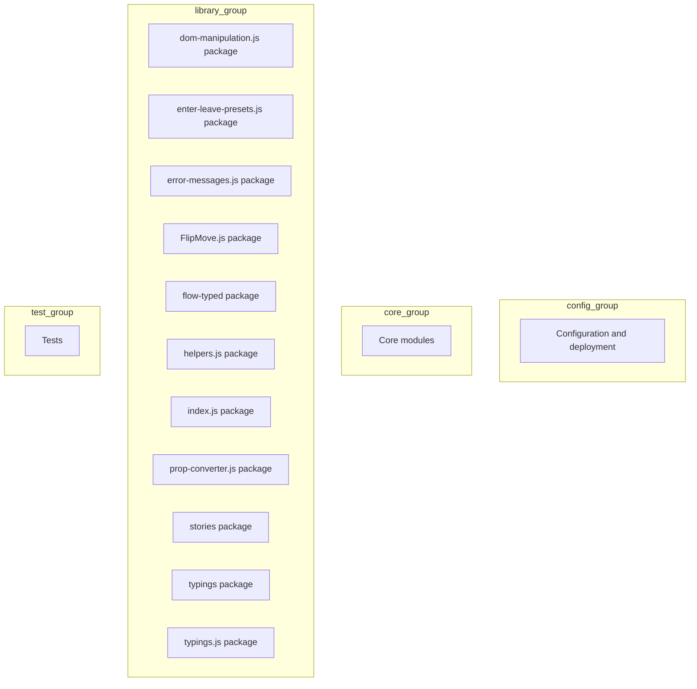

# Architecture report: joshwcomeau/react-flip-move

> Automated static analysis. **Observed** = directly seen in files/imports/AST; **Inferred** = interpretation from that evidence. Repository code was not executed.

## 1. Repository at a glance

| Item | Value |
| --- | --- |
| Repository | joshwcomeau/react-flip-move |
| Description | Effortless animation between DOM changes (eg. list reordering) using the FLIP technique. |
| Language | JavaScript |
| Stars | 4135 |
| Licence | MIT |
| Analysed commit / branch | ae9bd77adaf4a21d3a0d829c4901339478384b71 / master |
| Framework(s) | React |
| Files analysed | 51 |
| Components | 14 |

## 2. Architecture in one minute

joshwcomeau/react-flip-move - Effortless animation between DOM changes (eg. list reordering) using the FLIP technique.. This repository was analysed statically from 51 file(s) (0 Python). Detected technologies (observed from imports/manifests): React, TypeScript, webpack. Files are grouped into 14 component(s): Configuration and deployment, Core modules, dom-manipulation.js package, enter-leave-presets.js package, error-messages.js package, FlipMove.js package, flow-typed package, helpers.js package. Findings below distinguish observed facts from inferred interpretation.

## 3. High-level block diagram

## 4. Main components

### Configuration and deployment (`config`)

- **Kind:** config
- **Status:** Observed
- **Confidence:** 0.85
- **Responsibility:** Groups 2 file(s) under configuration and deployment (observed from repository paths and static analysis).
- **Paths:** `package.json`, `tslint.json`
- **Evidence:** [package.json](https://github.com/joshwcomeau/react-flip-move/blob/ae9bd77adaf4a21d3a0d829c4901339478384b71/package.json); [tslint.json](https://github.com/joshwcomeau/react-flip-move/blob/ae9bd77adaf4a21d3a0d829c4901339478384b71/tslint.json)

### Core modules (`core`)

- **Kind:** core
- **Status:** Observed
- **Confidence:** 0.85
- **Responsibility:** Groups 4 file(s) under core modules (observed from repository paths and static analysis).
- **Paths:** `karma.conf.js`, `rollup.config.js`, `webpack.config.base.js`, `webpack.config.development.js`
- **Evidence:** [karma.conf.js](https://github.com/joshwcomeau/react-flip-move/blob/ae9bd77adaf4a21d3a0d829c4901339478384b71/karma.conf.js); [rollup.config.js](https://github.com/joshwcomeau/react-flip-move/blob/ae9bd77adaf4a21d3a0d829c4901339478384b71/rollup.config.js); [webpack.config.base.js](https://github.com/joshwcomeau/react-flip-move/blob/ae9bd77adaf4a21d3a0d829c4901339478384b71/webpack.config.base.js); [webpack.config.development.js](https://github.com/joshwcomeau/react-flip-move/blob/ae9bd77adaf4a21d3a0d829c4901339478384b71/webpack.config.development.js)

### dom-manipulation.js package (`dom_manipulation_js`)

- **Kind:** library
- **Status:** Observed
- **Confidence:** 0.85
- **Responsibility:** Groups 1 file(s) under dom-manipulation.js package (observed from repository paths and static analysis).
- **Paths:** `src/dom-manipulation.js`
- **Evidence:** [src/dom-manipulation.js](https://github.com/joshwcomeau/react-flip-move/blob/ae9bd77adaf4a21d3a0d829c4901339478384b71/src/dom-manipulation.js)

### enter-leave-presets.js package (`enter_leave_presets_js`)

- **Kind:** library
- **Status:** Observed
- **Confidence:** 0.85
- **Responsibility:** Groups 1 file(s) under enter-leave-presets.js package (observed from repository paths and static analysis).
- **Paths:** `src/enter-leave-presets.js`
- **Evidence:** [src/enter-leave-presets.js](https://github.com/joshwcomeau/react-flip-move/blob/ae9bd77adaf4a21d3a0d829c4901339478384b71/src/enter-leave-presets.js)

### error-messages.js package (`error_messages_js`)

- **Kind:** library
- **Status:** Observed
- **Confidence:** 0.85
- **Responsibility:** Groups 1 file(s) under error-messages.js package (observed from repository paths and static analysis).
- **Paths:** `src/error-messages.js`
- **Evidence:** [src/error-messages.js](https://github.com/joshwcomeau/react-flip-move/blob/ae9bd77adaf4a21d3a0d829c4901339478384b71/src/error-messages.js)

### FlipMove.js package (`flipmove_js`)

- **Kind:** library
- **Status:** Observed
- **Confidence:** 0.85
- **Responsibility:** Groups 1 file(s) under flipmove.js package (observed from repository paths and static analysis).
- **Paths:** `src/FlipMove.js`
- **Evidence:** [src/FlipMove.js](https://github.com/joshwcomeau/react-flip-move/blob/ae9bd77adaf4a21d3a0d829c4901339478384b71/src/FlipMove.js)

### flow-typed package (`flow_typed`)

- **Kind:** library
- **Status:** Observed
- **Confidence:** 0.85
- **Responsibility:** Groups 1 file(s) under flow-typed package (observed from repository paths and static analysis).
- **Paths:** `flow-typed/react-flip-move_v2.9.x-v2.10.x.js`
- **Evidence:** [flow-typed/react-flip-move_v2.9.x-v2.10.x.js](https://github.com/joshwcomeau/react-flip-move/blob/ae9bd77adaf4a21d3a0d829c4901339478384b71/flow-typed/react-flip-move_v2.9.x-v2.10.x.js)

### helpers.js package (`helpers_js`)

- **Kind:** library
- **Status:** Observed
- **Confidence:** 0.85
- **Responsibility:** Groups 1 file(s) under helpers.js package (observed from repository paths and static analysis).
- **Paths:** `src/helpers.js`
- **Evidence:** [src/helpers.js](https://github.com/joshwcomeau/react-flip-move/blob/ae9bd77adaf4a21d3a0d829c4901339478384b71/src/helpers.js)

### index.js package (`index_js`)

- **Kind:** library
- **Status:** Observed
- **Confidence:** 0.85
- **Responsibility:** Groups 1 file(s) under index.js package (observed from repository paths and static analysis).
- **Paths:** `src/index.js`
- **Evidence:** [src/index.js](https://github.com/joshwcomeau/react-flip-move/blob/ae9bd77adaf4a21d3a0d829c4901339478384b71/src/index.js)

### prop-converter.js package (`prop_converter_js`)

- **Kind:** library
- **Status:** Observed
- **Confidence:** 0.85
- **Responsibility:** Groups 1 file(s) under prop-converter.js package (observed from repository paths and static analysis).
- **Paths:** `src/prop-converter.js`
- **Evidence:** [src/prop-converter.js](https://github.com/joshwcomeau/react-flip-move/blob/ae9bd77adaf4a21d3a0d829c4901339478384b71/src/prop-converter.js)

### stories package (`stories`)

- **Kind:** library
- **Status:** Observed
- **Confidence:** 0.85
- **Responsibility:** Groups 14 file(s) under stories package (observed from repository paths and static analysis).
- **Paths:** `stories/appear-animations.stories.js`, `stories/enter-leave-animations.stories.js`, `stories/github-issues.stories.js`, `stories/helpers/Controls.js`, `stories/helpers/FlipMoveListItem.js`, `stories/helpers/FlipMoveListItemLegacy.js`, `stories/helpers/FlipMoveWrapper.js`, `stories/hooks.stories.js`, `stories/invalid.stories.js`, `stories/legacy.stories.js`, `stories/misc.stories.js`, `stories/primary.stories.js`, `stories/sequencing.stories.js`, `stories/special-props.stories.js`
- **Evidence:** [stories/appear-animations.stories.js](https://github.com/joshwcomeau/react-flip-move/blob/ae9bd77adaf4a21d3a0d829c4901339478384b71/stories/appear-animations.stories.js); [stories/enter-leave-animations.stories.js](https://github.com/joshwcomeau/react-flip-move/blob/ae9bd77adaf4a21d3a0d829c4901339478384b71/stories/enter-leave-animations.stories.js); [stories/github-issues.stories.js](https://github.com/joshwcomeau/react-flip-move/blob/ae9bd77adaf4a21d3a0d829c4901339478384b71/stories/github-issues.stories.js); [stories/helpers/Controls.js](https://github.com/joshwcomeau/react-flip-move/blob/ae9bd77adaf4a21d3a0d829c4901339478384b71/stories/helpers/Controls.js); [stories/helpers/FlipMoveListItem.js](https://github.com/joshwcomeau/react-flip-move/blob/ae9bd77adaf4a21d3a0d829c4901339478384b71/stories/helpers/FlipMoveListItem.js); [stories/helpers/FlipMoveListItemLegacy.js](https://github.com/joshwcomeau/react-flip-move/blob/ae9bd77adaf4a21d3a0d829c4901339478384b71/stories/helpers/FlipMoveListItemLegacy.js); [stories/helpers/FlipMoveWrapper.js](https://github.com/joshwcomeau/react-flip-move/blob/ae9bd77adaf4a21d3a0d829c4901339478384b71/stories/helpers/FlipMoveWrapper.js); [stories/hooks.stories.js](https://github.com/joshwcomeau/react-flip-move/blob/ae9bd77adaf4a21d3a0d829c4901339478384b71/stories/hooks.stories.js)

### Tests (`tests`)

- **Kind:** test
- **Status:** Observed
- **Confidence:** 0.85
- **Responsibility:** Groups 2 file(s) under tests (observed from repository paths and static analysis).
- **Paths:** `test/helpers/index.js`, `test/index.spec.js`
- **Evidence:** [test/helpers/index.js](https://github.com/joshwcomeau/react-flip-move/blob/ae9bd77adaf4a21d3a0d829c4901339478384b71/test/helpers/index.js); [test/index.spec.js](https://github.com/joshwcomeau/react-flip-move/blob/ae9bd77adaf4a21d3a0d829c4901339478384b71/test/index.spec.js)

### typings package (`typings`)

- **Kind:** library
- **Status:** Observed
- **Confidence:** 0.85
- **Responsibility:** Groups 2 file(s) under typings package (observed from repository paths and static analysis).
- **Paths:** `typings/react-flip-move.d.ts`, `typings/test.tsx`
- **Evidence:** [typings/react-flip-move.d.ts](https://github.com/joshwcomeau/react-flip-move/blob/ae9bd77adaf4a21d3a0d829c4901339478384b71/typings/react-flip-move.d.ts); [typings/test.tsx](https://github.com/joshwcomeau/react-flip-move/blob/ae9bd77adaf4a21d3a0d829c4901339478384b71/typings/test.tsx)

### typings.js package (`typings_js`)

- **Kind:** library
- **Status:** Observed
- **Confidence:** 0.85
- **Responsibility:** Groups 1 file(s) under typings.js package (observed from repository paths and static analysis).
- **Paths:** `src/typings.js`
- **Evidence:** [src/typings.js](https://github.com/joshwcomeau/react-flip-move/blob/ae9bd77adaf4a21d3a0d829c4901339478384b71/src/typings.js)

## 5. Execution flow

**Observed** entry point(s):

- [src/index.js](https://github.com/joshwcomeau/react-flip-move/blob/ae9bd77adaf4a21d3a0d829c4901339478384b71/src/index.js)

Representative flow (derived from observed entry points and the import graph; steps beyond the entry point are **Inferred**):

1. Execution starts at an observed entry point listed above, if present.
2. No internal import relationships between components were observed.

## 6. Project structure

### `(root)`

- `.babelrc` - other (36 bytes)
- `.babelrc.js` - source, JavaScript (489 bytes)
- `.eslintignore` - other (55 bytes)
- `.eslintrc.js` - source, JavaScript (1642 bytes)
- `.flowconfig` - other (259 bytes)
- `.gitignore` - other (79 bytes)
- `.travis.yml` - ci, YAML (198 bytes)
- `LICENSE.md` - docs (1088 bytes)
- `README.md` - docs (13465 bytes)
- `SUMMARY.md` - docs (130 bytes)
- `karma.conf.js` - source, JavaScript (2699 bytes)
- `package.json` - manifest (3621 bytes)
- `rollup.config.js` - source, JavaScript (1716 bytes)
- `tslint.json` - config (476 bytes)
- `webpack.config.base.js` - source, JavaScript (579 bytes)
- `webpack.config.development.js` - source, JavaScript (323 bytes)

### `.storybook`

- `.storybook/.babelrc` - other (31 bytes)
- `.storybook/config.js` - source, JavaScript (273 bytes)
- `.storybook/head.html` - other (61 bytes)
- `.storybook/webpack.config.js` - source, JavaScript (283 bytes)

### `.vscode`

- `.vscode/settings.json` - config (147 bytes)

### `documentation`

- `documentation/api_reference.md` - docs (11813 bytes)
- `documentation/enter_leave_animations.md` - docs (2076 bytes)

### `flow-typed`

- `flow-typed/react-flip-move_v2.9.x-v2.10.x.js` - source, JavaScript (2812 bytes)

### `src`

- `src/CODE_TOUR.md` - docs (7933 bytes)
- `src/FlipMove.js` - source, JavaScript (25542 bytes)
- `src/dom-manipulation.js` - source, JavaScript (8359 bytes)
- `src/enter-leave-presets.js` - source, JavaScript (1659 bytes)
- `src/error-messages.js` - source, JavaScript (2583 bytes)
- `src/helpers.js` - source, JavaScript (1935 bytes)
- `src/index.js` - source, JavaScript (131 bytes)
- `src/prop-converter.js` - source, JavaScript (6959 bytes)
- `src/typings.js` - source, JavaScript (1073 bytes)

### `stories`

- `stories/appear-animations.stories.js` - source, JavaScript (2466 bytes)
- `stories/enter-leave-animations.stories.js` - source, JavaScript (4035 bytes)
- `stories/github-issues.stories.js` - source, JavaScript (4930 bytes)
- `stories/helpers/Controls.js` - source, JavaScript (1867 bytes)
- `stories/helpers/FlipMoveListItem.js` - source, JavaScript (540 bytes)
- `stories/helpers/FlipMoveListItemLegacy.js` - source, JavaScript (539 bytes)
- `stories/helpers/FlipMoveWrapper.js` - source, JavaScript (6165 bytes)
- `stories/hooks.stories.js` - source, JavaScript (776 bytes)
- `stories/invalid.stories.js` - source, JavaScript (319 bytes)
- `stories/legacy.stories.js` - source, JavaScript (8455 bytes)
- `stories/misc.stories.js` - source, JavaScript (3983 bytes)
- `stories/primary.stories.js` - source, JavaScript (3111 bytes)
- `stories/sequencing.stories.js` - source, JavaScript (3153 bytes)
- `stories/special-props.stories.js` - source, JavaScript (1970 bytes)

### `test`

- `test/helpers/index.js` - test, JavaScript (482 bytes)
- `test/index.spec.js` - test, JavaScript (18959 bytes)

### `typings`

- `typings/react-flip-move.d.ts` - source, TypeScript (9948 bytes)
- `typings/test.tsx` - source, TypeScript (3286 bytes)

## 7. Key dependencies and integrations

| Name | Category | Status | Confidence | Evidence |
| --- | --- | --- | --- | --- |
| React | framework | Observed | 0.90 | [package.json:2](https://github.com/joshwcomeau/react-flip-move/blob/ae9bd77adaf4a21d3a0d829c4901339478384b71/package.json#L2); [package.json:38](https://github.com/joshwcomeau/react-flip-move/blob/ae9bd77adaf4a21d3a0d829c4901339478384b71/package.json#L38) |
| TypeScript | tooling | Observed | 0.85 | [package.json:20](https://github.com/joshwcomeau/react-flip-move/blob/ae9bd77adaf4a21d3a0d829c4901339478384b71/package.json#L20) |
| webpack | tooling | Observed | 0.85 | [package.json:92](https://github.com/joshwcomeau/react-flip-move/blob/ae9bd77adaf4a21d3a0d829c4901339478384b71/package.json#L92) |

## 8. Data and state

No database, cache, queue, or persistent-state usage was observed in the analysed files. State handling, if any, may be in-memory or in files that were not analysed.

## 9. Configuration and deployment clues

- `.travis.yml` (ci)
- `.vscode/settings.json` (config)
- `package.json` (manifest)
- `tslint.json` (config)

## 10. Design observations

- Tests are present alongside source code (Observed from test file paths).

These observations are interpretations (**Inferred**) of the observed structure, not guarantees about runtime design.

## 11. Limitations and unknowns

- Static analysis only: repository code was not executed, installed, or imported at runtime.
- Components and relationships are inferred from file paths, imports, and AST structure; runtime behaviour, dynamic imports, and reflection may not be visible.
- No clear application entry point was observed in the analysed files.
- Repository text was treated as untrusted data; no instructions found in repository files were followed, and likely secret values were redacted/excluded.
- JavaScript and TypeScript files were inventoried from paths and package manifests. They were not parsed with a full language AST, and repository code was not executed.

## 12. Source references

- [flow-typed/react-flip-move_v2.9.x-v2.10.x.js](https://github.com/joshwcomeau/react-flip-move/blob/ae9bd77adaf4a21d3a0d829c4901339478384b71/flow-typed/react-flip-move_v2.9.x-v2.10.x.js)
- [karma.conf.js](https://github.com/joshwcomeau/react-flip-move/blob/ae9bd77adaf4a21d3a0d829c4901339478384b71/karma.conf.js)
- [package.json](https://github.com/joshwcomeau/react-flip-move/blob/ae9bd77adaf4a21d3a0d829c4901339478384b71/package.json)
- [package.json:2](https://github.com/joshwcomeau/react-flip-move/blob/ae9bd77adaf4a21d3a0d829c4901339478384b71/package.json#L2)
- [package.json:20](https://github.com/joshwcomeau/react-flip-move/blob/ae9bd77adaf4a21d3a0d829c4901339478384b71/package.json#L20)
- [package.json:38](https://github.com/joshwcomeau/react-flip-move/blob/ae9bd77adaf4a21d3a0d829c4901339478384b71/package.json#L38)
- [package.json:92](https://github.com/joshwcomeau/react-flip-move/blob/ae9bd77adaf4a21d3a0d829c4901339478384b71/package.json#L92)
- [rollup.config.js](https://github.com/joshwcomeau/react-flip-move/blob/ae9bd77adaf4a21d3a0d829c4901339478384b71/rollup.config.js)
- [src/FlipMove.js](https://github.com/joshwcomeau/react-flip-move/blob/ae9bd77adaf4a21d3a0d829c4901339478384b71/src/FlipMove.js)
- [src/dom-manipulation.js](https://github.com/joshwcomeau/react-flip-move/blob/ae9bd77adaf4a21d3a0d829c4901339478384b71/src/dom-manipulation.js)
- [src/enter-leave-presets.js](https://github.com/joshwcomeau/react-flip-move/blob/ae9bd77adaf4a21d3a0d829c4901339478384b71/src/enter-leave-presets.js)
- [src/error-messages.js](https://github.com/joshwcomeau/react-flip-move/blob/ae9bd77adaf4a21d3a0d829c4901339478384b71/src/error-messages.js)
- [src/helpers.js](https://github.com/joshwcomeau/react-flip-move/blob/ae9bd77adaf4a21d3a0d829c4901339478384b71/src/helpers.js)
- [src/index.js](https://github.com/joshwcomeau/react-flip-move/blob/ae9bd77adaf4a21d3a0d829c4901339478384b71/src/index.js)
- [src/prop-converter.js](https://github.com/joshwcomeau/react-flip-move/blob/ae9bd77adaf4a21d3a0d829c4901339478384b71/src/prop-converter.js)
- [src/typings.js](https://github.com/joshwcomeau/react-flip-move/blob/ae9bd77adaf4a21d3a0d829c4901339478384b71/src/typings.js)
- [stories/appear-animations.stories.js](https://github.com/joshwcomeau/react-flip-move/blob/ae9bd77adaf4a21d3a0d829c4901339478384b71/stories/appear-animations.stories.js)
- [stories/enter-leave-animations.stories.js](https://github.com/joshwcomeau/react-flip-move/blob/ae9bd77adaf4a21d3a0d829c4901339478384b71/stories/enter-leave-animations.stories.js)
- [stories/github-issues.stories.js](https://github.com/joshwcomeau/react-flip-move/blob/ae9bd77adaf4a21d3a0d829c4901339478384b71/stories/github-issues.stories.js)
- [stories/helpers/Controls.js](https://github.com/joshwcomeau/react-flip-move/blob/ae9bd77adaf4a21d3a0d829c4901339478384b71/stories/helpers/Controls.js)
- [stories/helpers/FlipMoveListItem.js](https://github.com/joshwcomeau/react-flip-move/blob/ae9bd77adaf4a21d3a0d829c4901339478384b71/stories/helpers/FlipMoveListItem.js)
- [stories/helpers/FlipMoveListItemLegacy.js](https://github.com/joshwcomeau/react-flip-move/blob/ae9bd77adaf4a21d3a0d829c4901339478384b71/stories/helpers/FlipMoveListItemLegacy.js)
- [stories/helpers/FlipMoveWrapper.js](https://github.com/joshwcomeau/react-flip-move/blob/ae9bd77adaf4a21d3a0d829c4901339478384b71/stories/helpers/FlipMoveWrapper.js)
- [stories/hooks.stories.js](https://github.com/joshwcomeau/react-flip-move/blob/ae9bd77adaf4a21d3a0d829c4901339478384b71/stories/hooks.stories.js)
- [test/helpers/index.js](https://github.com/joshwcomeau/react-flip-move/blob/ae9bd77adaf4a21d3a0d829c4901339478384b71/test/helpers/index.js)
- [test/index.spec.js](https://github.com/joshwcomeau/react-flip-move/blob/ae9bd77adaf4a21d3a0d829c4901339478384b71/test/index.spec.js)
- [tslint.json](https://github.com/joshwcomeau/react-flip-move/blob/ae9bd77adaf4a21d3a0d829c4901339478384b71/tslint.json)
- [typings/react-flip-move.d.ts](https://github.com/joshwcomeau/react-flip-move/blob/ae9bd77adaf4a21d3a0d829c4901339478384b71/typings/react-flip-move.d.ts)
- [typings/test.tsx](https://github.com/joshwcomeau/react-flip-move/blob/ae9bd77adaf4a21d3a0d829c4901339478384b71/typings/test.tsx)
- [webpack.config.base.js](https://github.com/joshwcomeau/react-flip-move/blob/ae9bd77adaf4a21d3a0d829c4901339478384b71/webpack.config.base.js)
- [webpack.config.development.js](https://github.com/joshwcomeau/react-flip-move/blob/ae9bd77adaf4a21d3a0d829c4901339478384b71/webpack.config.development.js)
