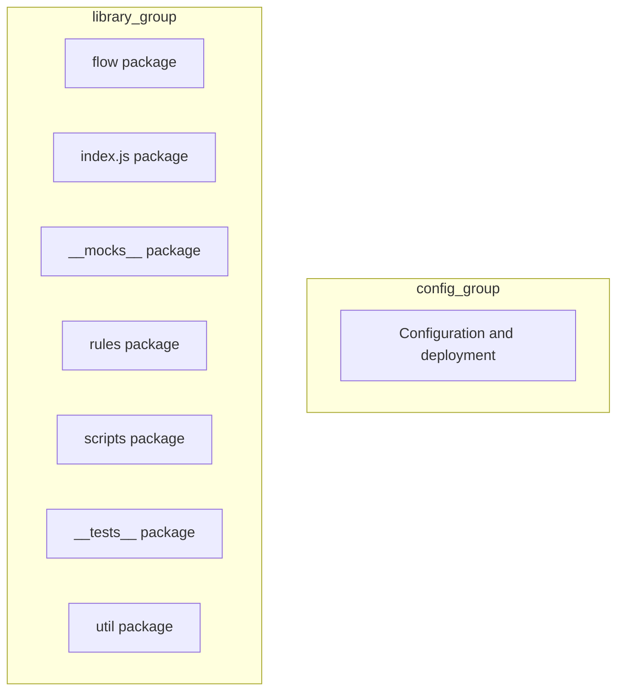

# Architecture report: jsx-eslint/eslint-plugin-jsx-a11y

> Automated static analysis. **Observed** = directly seen in files/imports/AST; **Inferred** = interpretation from that evidence. Repository code was not executed.

## 1. Repository at a glance

| Item | Value |
| --- | --- |
| Repository | jsx-eslint/eslint-plugin-jsx-a11y |
| Description | Static AST checker for a11y rules on JSX elements. |
| Language | JavaScript |
| Stars | 3631 |
| Licence | MIT |
| Analysed commit / branch | 8f75961d965e47afb88854d324bd32fafde7acfe / main |
| Framework(s) | React |
| Files analysed | 274 |
| Components | 8 |

## 2. Architecture in one minute

jsx-eslint/eslint-plugin-jsx-a11y - Static AST checker for a11y rules on JSX elements.. This repository was analysed statically from 274 file(s) (0 Python). Detected technologies (observed from imports/manifests): GitHub Actions, React. Files are grouped into 8 component(s): Configuration and deployment, flow package, index.js package, __mocks__ package, rules package, scripts package, __tests__ package, util package. Findings below distinguish observed facts from inferred interpretation.

## 3. High-level block diagram

## 4. Main components

### Configuration and deployment (`config`)

- **Kind:** config
- **Status:** Observed
- **Confidence:** 0.85
- **Responsibility:** Groups 3 file(s) under configuration and deployment (observed from repository paths and static analysis).
- **Paths:** `package.json`, `src/configs/flat-config-base.js`, `src/configs/legacy-config-base.js`
- **Evidence:** [package.json](https://github.com/jsx-eslint/eslint-plugin-jsx-a11y/blob/8f75961d965e47afb88854d324bd32fafde7acfe/package.json); [src/configs/flat-config-base.js](https://github.com/jsx-eslint/eslint-plugin-jsx-a11y/blob/8f75961d965e47afb88854d324bd32fafde7acfe/src/configs/flat-config-base.js); [src/configs/legacy-config-base.js](https://github.com/jsx-eslint/eslint-plugin-jsx-a11y/blob/8f75961d965e47afb88854d324bd32fafde7acfe/src/configs/legacy-config-base.js)

### flow package (`flow`)

- **Kind:** library
- **Status:** Observed
- **Confidence:** 0.85
- **Responsibility:** Groups 2 file(s) under flow package (observed from repository paths and static analysis).
- **Paths:** `flow/eslint-jsx.js`, `flow/eslint.js`
- **Evidence:** [flow/eslint-jsx.js](https://github.com/jsx-eslint/eslint-plugin-jsx-a11y/blob/8f75961d965e47afb88854d324bd32fafde7acfe/flow/eslint-jsx.js); [flow/eslint.js](https://github.com/jsx-eslint/eslint-plugin-jsx-a11y/blob/8f75961d965e47afb88854d324bd32fafde7acfe/flow/eslint.js)

### index.js package (`index_js`)

- **Kind:** library
- **Status:** Observed
- **Confidence:** 0.85
- **Responsibility:** Groups 1 file(s) under index.js package (observed from repository paths and static analysis).
- **Paths:** `src/index.js`
- **Evidence:** [src/index.js](https://github.com/jsx-eslint/eslint-plugin-jsx-a11y/blob/8f75961d965e47afb88854d324bd32fafde7acfe/src/index.js)

### __mocks__ package (`mocks`)

- **Kind:** library
- **Status:** Observed
- **Confidence:** 0.85
- **Responsibility:** Groups 8 file(s) under __mocks__ package (observed from repository paths and static analysis).
- **Paths:** `__mocks__/IdentifierMock.js`, `__mocks__/JSXAttributeMock.js`, `__mocks__/JSXElementMock.js`, `__mocks__/JSXExpressionContainerMock.js`, `__mocks__/JSXSpreadAttributeMock.js`, `__mocks__/JSXTextMock.js`, `__mocks__/LiteralMock.js`, `__mocks__/genInteractives.js`
- **Evidence:** [__mocks__/IdentifierMock.js](https://github.com/jsx-eslint/eslint-plugin-jsx-a11y/blob/8f75961d965e47afb88854d324bd32fafde7acfe/__mocks__/IdentifierMock.js); [__mocks__/JSXAttributeMock.js](https://github.com/jsx-eslint/eslint-plugin-jsx-a11y/blob/8f75961d965e47afb88854d324bd32fafde7acfe/__mocks__/JSXAttributeMock.js); [__mocks__/JSXElementMock.js](https://github.com/jsx-eslint/eslint-plugin-jsx-a11y/blob/8f75961d965e47afb88854d324bd32fafde7acfe/__mocks__/JSXElementMock.js); [__mocks__/JSXExpressionContainerMock.js](https://github.com/jsx-eslint/eslint-plugin-jsx-a11y/blob/8f75961d965e47afb88854d324bd32fafde7acfe/__mocks__/JSXExpressionContainerMock.js); [__mocks__/JSXSpreadAttributeMock.js](https://github.com/jsx-eslint/eslint-plugin-jsx-a11y/blob/8f75961d965e47afb88854d324bd32fafde7acfe/__mocks__/JSXSpreadAttributeMock.js); [__mocks__/JSXTextMock.js](https://github.com/jsx-eslint/eslint-plugin-jsx-a11y/blob/8f75961d965e47afb88854d324bd32fafde7acfe/__mocks__/JSXTextMock.js); [__mocks__/LiteralMock.js](https://github.com/jsx-eslint/eslint-plugin-jsx-a11y/blob/8f75961d965e47afb88854d324bd32fafde7acfe/__mocks__/LiteralMock.js); [__mocks__/genInteractives.js](https://github.com/jsx-eslint/eslint-plugin-jsx-a11y/blob/8f75961d965e47afb88854d324bd32fafde7acfe/__mocks__/genInteractives.js)

### rules package (`rules`)

- **Kind:** library
- **Status:** Observed
- **Confidence:** 0.85
- **Responsibility:** Groups 39 file(s) under rules package (observed from repository paths and static analysis).
- **Paths:** `src/rules/accessible-emoji.js`, `src/rules/alt-text.js`, `src/rules/anchor-ambiguous-text.js`, `src/rules/anchor-has-content.js`, `src/rules/anchor-is-valid.js`, `src/rules/aria-activedescendant-has-tabindex.js`, `src/rules/aria-props.js`, `src/rules/aria-proptypes.js`, `src/rules/aria-role.js`, `src/rules/aria-unsupported-elements.js`, `src/rules/autocomplete-valid.js`, `src/rules/click-events-have-key-events.js`, `src/rules/control-has-associated-label.js`, `src/rules/heading-has-content.js`, `src/rules/html-has-lang.js`, `src/rules/iframe-has-title.js`, `src/rules/img-redundant-alt.js`, `src/rules/interactive-supports-focus.js`, `src/rules/label-has-associated-control.js`, `src/rules/label-has-for.js`, `src/rules/lang.js`, `src/rules/media-has-caption.js`, `src/rules/mouse-events-have-key-events.js`, `src/rules/no-access-key.js`, `src/rules/no-aria-hidden-on-focusable.js`, `src/rules/no-autofocus.js`, `src/rules/no-distracting-elements.js`, `src/rules/no-interactive-element-to-noninteractive-role.js`, `src/rules/no-noninteractive-element-interactions.js`, `src/rules/no-noninteractive-element-to-interactive-role.js`, `src/rules/no-noninteractive-tabindex.js`, `src/rules/no-onchange.js`, `src/rules/no-redundant-roles.js`, `src/rules/no-static-element-interactions.js`, `src/rules/prefer-tag-over-role.js`, `src/rules/role-has-required-aria-props.js`, `src/rules/role-supports-aria-props.js`, `src/rules/scope.js`, `src/rules/tabindex-no-positive.js`
- **Evidence:** [src/rules/accessible-emoji.js](https://github.com/jsx-eslint/eslint-plugin-jsx-a11y/blob/8f75961d965e47afb88854d324bd32fafde7acfe/src/rules/accessible-emoji.js); [src/rules/alt-text.js](https://github.com/jsx-eslint/eslint-plugin-jsx-a11y/blob/8f75961d965e47afb88854d324bd32fafde7acfe/src/rules/alt-text.js); [src/rules/anchor-ambiguous-text.js](https://github.com/jsx-eslint/eslint-plugin-jsx-a11y/blob/8f75961d965e47afb88854d324bd32fafde7acfe/src/rules/anchor-ambiguous-text.js); [src/rules/anchor-has-content.js](https://github.com/jsx-eslint/eslint-plugin-jsx-a11y/blob/8f75961d965e47afb88854d324bd32fafde7acfe/src/rules/anchor-has-content.js); [src/rules/anchor-is-valid.js](https://github.com/jsx-eslint/eslint-plugin-jsx-a11y/blob/8f75961d965e47afb88854d324bd32fafde7acfe/src/rules/anchor-is-valid.js); [src/rules/aria-activedescendant-has-tabindex.js](https://github.com/jsx-eslint/eslint-plugin-jsx-a11y/blob/8f75961d965e47afb88854d324bd32fafde7acfe/src/rules/aria-activedescendant-has-tabindex.js); [src/rules/aria-props.js](https://github.com/jsx-eslint/eslint-plugin-jsx-a11y/blob/8f75961d965e47afb88854d324bd32fafde7acfe/src/rules/aria-props.js); [src/rules/aria-proptypes.js](https://github.com/jsx-eslint/eslint-plugin-jsx-a11y/blob/8f75961d965e47afb88854d324bd32fafde7acfe/src/rules/aria-proptypes.js)

### scripts package (`scripts`)

- **Kind:** library
- **Status:** Observed
- **Confidence:** 0.85
- **Responsibility:** Groups 5 file(s) under scripts package (observed from repository paths and static analysis).
- **Paths:** `scripts/addRuleToIndex.js`, `scripts/boilerplate/doc.js`, `scripts/boilerplate/rule.js`, `scripts/boilerplate/test.js`, `scripts/create-rule.js`
- **Evidence:** [scripts/addRuleToIndex.js](https://github.com/jsx-eslint/eslint-plugin-jsx-a11y/blob/8f75961d965e47afb88854d324bd32fafde7acfe/scripts/addRuleToIndex.js); [scripts/boilerplate/doc.js](https://github.com/jsx-eslint/eslint-plugin-jsx-a11y/blob/8f75961d965e47afb88854d324bd32fafde7acfe/scripts/boilerplate/doc.js); [scripts/boilerplate/rule.js](https://github.com/jsx-eslint/eslint-plugin-jsx-a11y/blob/8f75961d965e47afb88854d324bd32fafde7acfe/scripts/boilerplate/rule.js); [scripts/boilerplate/test.js](https://github.com/jsx-eslint/eslint-plugin-jsx-a11y/blob/8f75961d965e47afb88854d324bd32fafde7acfe/scripts/boilerplate/test.js); [scripts/create-rule.js](https://github.com/jsx-eslint/eslint-plugin-jsx-a11y/blob/8f75961d965e47afb88854d324bd32fafde7acfe/scripts/create-rule.js)

### __tests__ package (`tests`)

- **Kind:** library
- **Status:** Observed
- **Confidence:** 0.85
- **Responsibility:** Groups 74 file(s) under __tests__ package (observed from repository paths and static analysis).
- **Paths:** `__tests__/__util__/RuleTester.js`, `__tests__/__util__/axeMapping.js`, `__tests__/__util__/helpers/getESLintCoreRule.js`, `__tests__/__util__/helpers/parsers.js`, `__tests__/__util__/parserOptionsMapper.js`, `__tests__/__util__/ruleOptionsMapperFactory.js`, `__tests__/index-test.js`, `__tests__/src/rules/accessible-emoji-test.js`, `__tests__/src/rules/alt-text-test.js`, `__tests__/src/rules/anchor-ambiguous-text-test.js`, `__tests__/src/rules/anchor-has-content-test.js`, `__tests__/src/rules/anchor-is-valid-test.js`, `__tests__/src/rules/aria-activedescendant-has-tabindex-test.js`, `__tests__/src/rules/aria-props-test.js`, `__tests__/src/rules/aria-proptypes-test.js`, `__tests__/src/rules/aria-role-test.js`, `__tests__/src/rules/aria-unsupported-elements-test.js`, `__tests__/src/rules/autocomplete-valid-test.js`, `__tests__/src/rules/click-events-have-key-events-test.js`, `__tests__/src/rules/control-has-associated-label-test.js`, `__tests__/src/rules/heading-has-content-test.js`, `__tests__/src/rules/html-has-lang-test.js`, `__tests__/src/rules/iframe-has-title-test.js`, `__tests__/src/rules/img-redundant-alt-test.js`, `__tests__/src/rules/interactive-supports-focus-test.js`, `__tests__/src/rules/label-has-associated-control-test.js`, `__tests__/src/rules/label-has-for-test.js`, `__tests__/src/rules/lang-test.js`, `__tests__/src/rules/media-has-caption-test.js`, `__tests__/src/rules/mouse-events-have-key-events-test.js`, `__tests__/src/rules/no-access-key-test.js`, `__tests__/src/rules/no-aria-hidden-on-focusable-test.js`, `__tests__/src/rules/no-autofocus-test.js`, `__tests__/src/rules/no-distracting-elements-test.js`, `__tests__/src/rules/no-interactive-element-to-noninteractive-role-test.js`, `__tests__/src/rules/no-noninteractive-element-interactions-test.js`, `__tests__/src/rules/no-noninteractive-element-to-interactive-role-test.js`, `__tests__/src/rules/no-noninteractive-tabindex-test.js`, `__tests__/src/rules/no-onchange-test.js`, `__tests__/src/rules/no-redundant-roles-test.js`, `__tests__/src/rules/no-static-element-interactions-test.js`, `__tests__/src/rules/prefer-tag-over-role-test.js`, `__tests__/src/rules/role-has-required-aria-props-test.js`, `__tests__/src/rules/role-supports-aria-props-test.js`, `__tests__/src/rules/scope-test.js`, `__tests__/src/rules/tabindex-no-positive-test.js`, `__tests__/src/util/attributesComparator-test.js`, `__tests__/src/util/getAccessibleChildText-test.js`, `__tests__/src/util/getComputedRole-test.js`, `__tests__/src/util/getElementType-test.js`, `__tests__/src/util/getExplicitRole-test.js`, `__tests__/src/util/getImplicitRole-test.js`, `__tests__/src/util/getSuggestion-test.js`, `__tests__/src/util/getTabIndex-test.js`, `__tests__/src/util/hasAccessibleChild-test.js`, `__tests__/src/util/implicitRoles/input-test.js`, `__tests__/src/util/implicitRoles/menu-test.js`, `__tests__/src/util/implicitRoles/menuitem-test.js`, `__tests__/src/util/implicitRoles/select-test.js`, `__tests__/src/util/isAbstractRole-test.js`, `__tests__/src/util/isContentEditable-test.js`, `__tests__/src/util/isDOMElement-test.js`, `__tests__/src/util/isDisabledElement-test.js`, `__tests__/src/util/isFocusable-test.js`, `__tests__/src/util/isInteractiveElement-test.js`, `__tests__/src/util/isInteractiveRole-test.js`, `__tests__/src/util/isNonInteractiveElement-test.js`, `__tests__/src/util/isNonInteractiveRole-test.js`, `__tests__/src/util/isNonLiteralProperty-test.js`, `__tests__/src/util/isSemanticRoleElement-test.js`, `__tests__/src/util/mayContainChildComponent-test.js`, `__tests__/src/util/mayHaveAccessibleLabel-test.js`, `__tests__/src/util/parserOptionsMapper-test.js`, `__tests__/src/util/schemas-test.js`
- **Evidence:** [__tests__/__util__/RuleTester.js](https://github.com/jsx-eslint/eslint-plugin-jsx-a11y/blob/8f75961d965e47afb88854d324bd32fafde7acfe/__tests__/__util__/RuleTester.js); [__tests__/__util__/axeMapping.js](https://github.com/jsx-eslint/eslint-plugin-jsx-a11y/blob/8f75961d965e47afb88854d324bd32fafde7acfe/__tests__/__util__/axeMapping.js); [__tests__/__util__/helpers/getESLintCoreRule.js](https://github.com/jsx-eslint/eslint-plugin-jsx-a11y/blob/8f75961d965e47afb88854d324bd32fafde7acfe/__tests__/__util__/helpers/getESLintCoreRule.js); [__tests__/__util__/helpers/parsers.js](https://github.com/jsx-eslint/eslint-plugin-jsx-a11y/blob/8f75961d965e47afb88854d324bd32fafde7acfe/__tests__/__util__/helpers/parsers.js); [__tests__/__util__/parserOptionsMapper.js](https://github.com/jsx-eslint/eslint-plugin-jsx-a11y/blob/8f75961d965e47afb88854d324bd32fafde7acfe/__tests__/__util__/parserOptionsMapper.js); [__tests__/__util__/ruleOptionsMapperFactory.js](https://github.com/jsx-eslint/eslint-plugin-jsx-a11y/blob/8f75961d965e47afb88854d324bd32fafde7acfe/__tests__/__util__/ruleOptionsMapperFactory.js); [__tests__/index-test.js](https://github.com/jsx-eslint/eslint-plugin-jsx-a11y/blob/8f75961d965e47afb88854d324bd32fafde7acfe/__tests__/index-test.js); [__tests__/src/rules/accessible-emoji-test.js](https://github.com/jsx-eslint/eslint-plugin-jsx-a11y/blob/8f75961d965e47afb88854d324bd32fafde7acfe/__tests__/src/rules/accessible-emoji-test.js)

### util package (`util`)

- **Kind:** library
- **Status:** Observed
- **Confidence:** 0.85
- **Responsibility:** Groups 62 file(s) under util package (observed from repository paths and static analysis).
- **Paths:** `src/util/attributesComparator.js`, `src/util/getAccessibleChildText.js`, `src/util/getComputedRole.js`, `src/util/getElementType.js`, `src/util/getExplicitRole.js`, `src/util/getImplicitRole.js`, `src/util/getSuggestion.js`, `src/util/getTabIndex.js`, `src/util/hasAccessibleChild.js`, `src/util/implicitRoles/a.js`, `src/util/implicitRoles/area.js`, `src/util/implicitRoles/article.js`, `src/util/implicitRoles/aside.js`, `src/util/implicitRoles/body.js`, `src/util/implicitRoles/button.js`, `src/util/implicitRoles/datalist.js`, `src/util/implicitRoles/details.js`, `src/util/implicitRoles/dialog.js`, `src/util/implicitRoles/form.js`, `src/util/implicitRoles/h1.js`, `src/util/implicitRoles/h2.js`, `src/util/implicitRoles/h3.js`, `src/util/implicitRoles/h4.js`, `src/util/implicitRoles/h5.js`, `src/util/implicitRoles/h6.js`, `src/util/implicitRoles/hr.js`, `src/util/implicitRoles/img.js`, `src/util/implicitRoles/index.js`, `src/util/implicitRoles/input.js`, `src/util/implicitRoles/li.js`, `src/util/implicitRoles/link.js`, `src/util/implicitRoles/menu.js`, `src/util/implicitRoles/menuitem.js`, `src/util/implicitRoles/meter.js`, `src/util/implicitRoles/nav.js`, `src/util/implicitRoles/ol.js`, `src/util/implicitRoles/option.js`, `src/util/implicitRoles/output.js`, `src/util/implicitRoles/progress.js`, `src/util/implicitRoles/section.js`, `src/util/implicitRoles/select.js`, `src/util/implicitRoles/tbody.js`, `src/util/implicitRoles/textarea.js`, `src/util/implicitRoles/tfoot.js`, `src/util/implicitRoles/thead.js`, `src/util/implicitRoles/ul.js`, `src/util/isAbstractRole.js`, `src/util/isContentEditable.js`, `src/util/isDOMElement.js`, `src/util/isDisabledElement.js`, `src/util/isFocusable.js`, `src/util/isHiddenFromScreenReader.js`, `src/util/isInteractiveElement.js`, `src/util/isInteractiveRole.js`, `src/util/isNonInteractiveElement.js`, `src/util/isNonInteractiveRole.js`, `src/util/isNonLiteralProperty.js`, `src/util/isPresentationRole.js`, `src/util/isSemanticRoleElement.js`, `src/util/mayContainChildComponent.js`, `src/util/mayHaveAccessibleLabel.js`, `src/util/schemas.js`
- **Evidence:** [src/util/attributesComparator.js](https://github.com/jsx-eslint/eslint-plugin-jsx-a11y/blob/8f75961d965e47afb88854d324bd32fafde7acfe/src/util/attributesComparator.js); [src/util/getAccessibleChildText.js](https://github.com/jsx-eslint/eslint-plugin-jsx-a11y/blob/8f75961d965e47afb88854d324bd32fafde7acfe/src/util/getAccessibleChildText.js); [src/util/getComputedRole.js](https://github.com/jsx-eslint/eslint-plugin-jsx-a11y/blob/8f75961d965e47afb88854d324bd32fafde7acfe/src/util/getComputedRole.js); [src/util/getElementType.js](https://github.com/jsx-eslint/eslint-plugin-jsx-a11y/blob/8f75961d965e47afb88854d324bd32fafde7acfe/src/util/getElementType.js); [src/util/getExplicitRole.js](https://github.com/jsx-eslint/eslint-plugin-jsx-a11y/blob/8f75961d965e47afb88854d324bd32fafde7acfe/src/util/getExplicitRole.js); [src/util/getImplicitRole.js](https://github.com/jsx-eslint/eslint-plugin-jsx-a11y/blob/8f75961d965e47afb88854d324bd32fafde7acfe/src/util/getImplicitRole.js); [src/util/getSuggestion.js](https://github.com/jsx-eslint/eslint-plugin-jsx-a11y/blob/8f75961d965e47afb88854d324bd32fafde7acfe/src/util/getSuggestion.js); [src/util/getTabIndex.js](https://github.com/jsx-eslint/eslint-plugin-jsx-a11y/blob/8f75961d965e47afb88854d324bd32fafde7acfe/src/util/getTabIndex.js)

## 5. Execution flow

**Observed** entry point(s):

- [src/index.js](https://github.com/jsx-eslint/eslint-plugin-jsx-a11y/blob/8f75961d965e47afb88854d324bd32fafde7acfe/src/index.js)
- [src/util/implicitRoles/index.js](https://github.com/jsx-eslint/eslint-plugin-jsx-a11y/blob/8f75961d965e47afb88854d324bd32fafde7acfe/src/util/implicitRoles/index.js)

Representative flow (derived from observed entry points and the import graph; steps beyond the entry point are **Inferred**):

1. Execution starts at an observed entry point listed above, if present.
2. No internal import relationships between components were observed.

## 6. Project structure

### `(root)`

- `.babelrc` - other (246 bytes)
- `.eslintrc` - other (1041 bytes)
- `.flowconfig` - other (228 bytes)
- `.gitignore` - other (127 bytes)
- `CHANGELOG.md` - docs (47841 bytes)
- `CONTRIBUTING.md` - docs (404 bytes)
- `LICENSE.md` - docs (1077 bytes)
- `README.md` - docs (23994 bytes)
- `package.json` - manifest (4259 bytes)

### `.github`

- `.github/workflows/node-4+.yml` - ci, YAML (3485 bytes)
- `.github/workflows/node-pretest.yml` - ci, YAML (1302 bytes)
- `.github/workflows/readme.yml` - ci, YAML (330 bytes)
- `.github/workflows/rebase.yml` - ci, YAML (257 bytes)
- `.github/workflows/require-allow-edits.yml` - ci, YAML (330 bytes)

### `__mocks__`

- `__mocks__/IdentifierMock.js` - source, JavaScript (232 bytes)
- `__mocks__/JSXAttributeMock.js` - source, JavaScript (1035 bytes)
- `__mocks__/JSXElementMock.js` - source, JavaScript (713 bytes)
- `__mocks__/JSXExpressionContainerMock.js` - source, JavaScript (295 bytes)
- `__mocks__/JSXSpreadAttributeMock.js` - source, JavaScript (424 bytes)
- `__mocks__/JSXTextMock.js` - source, JavaScript (243 bytes)
- `__mocks__/LiteralMock.js` - source, JavaScript (243 bytes)
- `__mocks__/genInteractives.js` - source, JavaScript (6797 bytes)

### `__tests__`

- `__tests__/__util__/RuleTester.js` - source, JavaScript (776 bytes)
- `__tests__/__util__/axeMapping.js` - source, JavaScript (215 bytes)
- `__tests__/__util__/helpers/getESLintCoreRule.js` - source, JavaScript (410 bytes)
- `__tests__/__util__/helpers/parsers.js` - source, JavaScript (6691 bytes)
- `__tests__/__util__/parserOptionsMapper.js` - source, JavaScript (953 bytes)
- `__tests__/__util__/ruleOptionsMapperFactory.js` - source, JavaScript (970 bytes)
- `__tests__/index-test.js` - source, JavaScript (1431 bytes)
- `__tests__/src/rules/accessible-emoji-test.js` - source, JavaScript (2878 bytes)
- `__tests__/src/rules/alt-text-test.js` - source, JavaScript (13394 bytes)
- `__tests__/src/rules/anchor-ambiguous-text-test.js` - source, JavaScript (4815 bytes)
- `__tests__/src/rules/anchor-has-content-test.js` - source, JavaScript (1919 bytes)
- `__tests__/src/rules/anchor-is-valid-test.js` - source, JavaScript (26913 bytes)
- `__tests__/src/rules/aria-activedescendant-has-tabindex-test.js` - source, JavaScript (2813 bytes)
- `__tests__/src/rules/aria-props-test.js` - source, JavaScript (2303 bytes)
- `__tests__/src/rules/aria-proptypes-test.js` - source, JavaScript (12761 bytes)
- `__tests__/src/rules/aria-role-test.js` - source, JavaScript (4394 bytes)
- `__tests__/src/rules/aria-unsupported-elements-test.js` - source, JavaScript (2518 bytes)
- `__tests__/src/rules/autocomplete-valid-test.js` - source, JavaScript (3601 bytes)
- `__tests__/src/rules/click-events-have-key-events-test.js` - source, JavaScript (3772 bytes)
- `__tests__/src/rules/control-has-associated-label-test.js` - source, JavaScript (14104 bytes)
- `__tests__/src/rules/heading-has-content-test.js` - source, JavaScript (3359 bytes)
- `__tests__/src/rules/html-has-lang-test.js` - source, JavaScript (1608 bytes)
- `__tests__/src/rules/iframe-has-title-test.js` - source, JavaScript (2086 bytes)
- `__tests__/src/rules/img-redundant-alt-test.js` - source, JavaScript (5684 bytes)
- `__tests__/src/rules/interactive-supports-focus-test.js` - source, JavaScript (10871 bytes)
- `__tests__/src/rules/label-has-associated-control-test.js` - source, JavaScript (14818 bytes)
- `__tests__/src/rules/label-has-for-test.js` - source, JavaScript (11181 bytes)
- `__tests__/src/rules/lang-test.js` - source, JavaScript (2093 bytes)
- `__tests__/src/rules/media-has-caption-test.js` - source, JavaScript (6203 bytes)
- `__tests__/src/rules/mouse-events-have-key-events-test.js` - source, JavaScript (5596 bytes)
- `__tests__/src/rules/no-access-key-test.js` - source, JavaScript (2061 bytes)
- `__tests__/src/rules/no-aria-hidden-on-focusable-test.js` - source, JavaScript (1852 bytes)
- `__tests__/src/rules/no-autofocus-test.js` - source, JavaScript (2356 bytes)
- `__tests__/src/rules/no-distracting-elements-test.js` - source, JavaScript (1847 bytes)
- `__tests__/src/rules/no-interactive-element-to-noninteractive-role-test.js` - source, JavaScript (18380 bytes)
- `__tests__/src/rules/no-noninteractive-element-interactions-test.js` - source, JavaScript (27860 bytes)
- `__tests__/src/rules/no-noninteractive-element-to-interactive-role-test.js` - source, JavaScript (22930 bytes)
- `__tests__/src/rules/no-noninteractive-tabindex-test.js` - source, JavaScript (4377 bytes)
- `__tests__/src/rules/no-onchange-test.js` - source, JavaScript (2283 bytes)
- `__tests__/src/rules/no-redundant-roles-test.js` - source, JavaScript (5234 bytes)
- `__tests__/src/rules/no-static-element-interactions-test.js` - source, JavaScript (25626 bytes)
- `__tests__/src/rules/prefer-tag-over-role-test.js` - source, JavaScript (1896 bytes)
- `__tests__/src/rules/role-has-required-aria-props-test.js` - source, JavaScript (4581 bytes)
- `__tests__/src/rules/role-supports-aria-props-test.js` - source, JavaScript (23479 bytes)
- `__tests__/src/rules/scope-test.js` - source, JavaScript (1590 bytes)
- `__tests__/src/rules/tabindex-no-positive-test.js` - source, JavaScript (2076 bytes)
- `__tests__/src/util/attributesComparator-test.js` - source, JavaScript (2291 bytes)
- `__tests__/src/util/getAccessibleChildText-test.js` - source, JavaScript (4000 bytes)
- `__tests__/src/util/getComputedRole-test.js` - source, JavaScript (1373 bytes)
- `__tests__/src/util/getElementType-test.js` - source, JavaScript (4554 bytes)
- `__tests__/src/util/getExplicitRole-test.js` - source, JavaScript (611 bytes)
- `__tests__/src/util/getImplicitRole-test.js` - source, JavaScript (380 bytes)
- `__tests__/src/util/getSuggestion-test.js` - source, JavaScript (868 bytes)
- `__tests__/src/util/getTabIndex-test.js` - source, JavaScript (2092 bytes)
- `__tests__/src/util/hasAccessibleChild-test.js` - source, JavaScript (3458 bytes)
- `__tests__/src/util/implicitRoles/input-test.js` - source, JavaScript (1930 bytes)
- `__tests__/src/util/implicitRoles/menu-test.js` - source, JavaScript (463 bytes)
- `__tests__/src/util/implicitRoles/menuitem-test.js` - source, JavaScript (896 bytes)
- `__tests__/src/util/implicitRoles/select-test.js` - source, JavaScript (4139 bytes)
- `__tests__/src/util/isAbstractRole-test.js` - source, JavaScript (1303 bytes)
- `__tests__/src/util/isContentEditable-test.js` - source, JavaScript (1337 bytes)
- `__tests__/src/util/isDOMElement-test.js` - source, JavaScript (675 bytes)
- `__tests__/src/util/isDisabledElement-test.js` - source, JavaScript (1935 bytes)
- `__tests__/src/util/isFocusable-test.js` - source, JavaScript (3167 bytes)
- `__tests__/src/util/isInteractiveElement-test.js` - source, JavaScript (2693 bytes)
- `__tests__/src/util/isInteractiveRole-test.js` - source, JavaScript (1483 bytes)
- `__tests__/src/util/isNonInteractiveElement-test.js` - source, JavaScript (2567 bytes)
- `__tests__/src/util/isNonInteractiveRole-test.js` - source, JavaScript (1513 bytes)
- `__tests__/src/util/isNonLiteralProperty-test.js` - source, JavaScript (1766 bytes)
- `__tests__/src/util/isSemanticRoleElement-test.js` - source, JavaScript (1681 bytes)
- `__tests__/src/util/mayContainChildComponent-test.js` - source, JavaScript (5204 bytes)
- `__tests__/src/util/mayHaveAccessibleLabel-test.js` - source, JavaScript (6477 bytes)
- `__tests__/src/util/parserOptionsMapper-test.js` - source, JavaScript (1890 bytes)
- `__tests__/src/util/schemas-test.js` - source, JavaScript (769 bytes)

### `docs`

- `docs/rules/accessible-emoji.md` - docs (1016 bytes)
- `docs/rules/alt-text.md` - docs (5080 bytes)
- `docs/rules/anchor-ambiguous-text.md` - docs (3011 bytes)
- `docs/rules/anchor-has-content.md` - docs (1622 bytes)
- `docs/rules/anchor-is-valid.md` - docs (11076 bytes)
- `docs/rules/aria-activedescendant-has-tabindex.md` - docs (2068 bytes)
- `docs/rules/aria-props.md` - docs (870 bytes)
- `docs/rules/aria-proptypes.md` - docs (823 bytes)
- `docs/rules/aria-role.md` - docs (1999 bytes)
- `docs/rules/aria-unsupported-elements.md` - docs (1042 bytes)
- `docs/rules/autocomplete-valid.md` - docs (1427 bytes)
- `docs/rules/click-events-have-key-events.md` - docs (940 bytes)
- `docs/rules/control-has-associated-label.md` - docs (3811 bytes)
- `docs/rules/heading-has-content.md` - docs (1584 bytes)
- `docs/rules/html-has-lang.md` - docs (791 bytes)
- `docs/rules/iframe-has-title.md` - docs (889 bytes)
- `docs/rules/img-redundant-alt.md` - docs (1882 bytes)
- `docs/rules/interactive-supports-focus.md` - docs (6405 bytes)
- `docs/rules/label-has-associated-control.md` - docs (5164 bytes)
- `docs/rules/label-has-for.md` - docs (3777 bytes)
- `docs/rules/lang.md` - docs (709 bytes)
- `docs/rules/media-has-caption.md` - docs (2088 bytes)
- `docs/rules/mouse-events-have-key-events.md` - docs (2033 bytes)
- `docs/rules/no-access-key.md` - docs (896 bytes)
- `docs/rules/no-aria-hidden-on-focusable.md` - docs (1505 bytes)
- `docs/rules/no-autofocus.md` - docs (1119 bytes)
- `docs/rules/no-distracting-elements.md` - docs (1506 bytes)
- `docs/rules/no-interactive-element-to-noninteractive-role.md` - docs (2855 bytes)
- `docs/rules/no-noninteractive-element-interactions.md` - docs (5719 bytes)
- `docs/rules/no-noninteractive-element-to-interactive-role.md` - docs (2733 bytes)
- `docs/rules/no-noninteractive-tabindex.md` - docs (5322 bytes)
- `docs/rules/no-onchange.md` - docs (1671 bytes)
- `docs/rules/no-redundant-roles.md` - docs (1405 bytes)
- `docs/rules/no-static-element-interactions.md` - docs (4398 bytes)
- `docs/rules/prefer-tag-over-role.md` - docs (550 bytes)
- `docs/rules/role-has-required-aria-props.md` - docs (926 bytes)
- `docs/rules/role-supports-aria-props.md` - docs (1658 bytes)
- `docs/rules/scope.md` - docs (640 bytes)
- `docs/rules/tabindex-no-positive.md` - docs (849 bytes)

### `examples`

- `examples/flat-cjs/eslint.config.cjs` - source, JavaScript (573 bytes)
- `examples/flat-cjs/index.html` - other (361 bytes)
- `examples/flat-cjs/package.json` - manifest (454 bytes)
- `examples/flat-cjs/public/vite.svg` - other (1497 bytes)
- `examples/flat-cjs/src/App.css` - other (606 bytes)
- `examples/flat-cjs/src/App.jsx` - source, JavaScript (938 bytes)
- `examples/flat-cjs/src/assets/react.svg` - other (4126 bytes)
- `examples/flat-cjs/src/index.css` - other (1161 bytes)
- `examples/flat-cjs/src/main.jsx` - source, JavaScript (235 bytes)
- `examples/flat-esm/eslint.config.js` - source, JavaScript (555 bytes)
- `examples/flat-esm/index.html` - other (361 bytes)
- `examples/flat-esm/package.json` - manifest (454 bytes)
- `examples/flat-esm/public/vite.svg` - other (1497 bytes)
- `examples/flat-esm/src/App.css` - other (606 bytes)
- `examples/flat-esm/src/App.jsx` - source, JavaScript (938 bytes)
- `examples/flat-esm/src/assets/react.svg` - other (4126 bytes)
- `examples/flat-esm/src/index.css` - other (1161 bytes)
- `examples/flat-esm/src/main.jsx` - source, JavaScript (235 bytes)
- `examples/legacy/.eslintrc.cjs` - source, JavaScript (464 bytes)
- `examples/legacy/index.html` - other (361 bytes)
- `examples/legacy/package.json` - manifest (412 bytes)
- `examples/legacy/public/vite.svg` - other (1497 bytes)
- `examples/legacy/src/App.css` - other (606 bytes)
- `examples/legacy/src/App.jsx` - source, JavaScript (938 bytes)
- `examples/legacy/src/assets/react.svg` - other (4126 bytes)
- `examples/legacy/src/index.css` - other (1161 bytes)
- `examples/legacy/src/main.jsx` - source, JavaScript (235 bytes)

### `flow`

- `flow/eslint-jsx.js` - source, JavaScript (174 bytes)
- `flow/eslint.js` - source, JavaScript (601 bytes)

### `scripts`

- `scripts/addRuleToIndex.js` - source, JavaScript (1418 bytes)
- `scripts/boilerplate/doc.js` - source, JavaScript (269 bytes)
- `scripts/boilerplate/rule.js` - source, JavaScript (1003 bytes)
- `scripts/boilerplate/test.js` - source, JavaScript (1035 bytes)
- `scripts/create-rule.js` - source, JavaScript (2028 bytes)
- `scripts/create-rule.md` - docs (863 bytes)

### `src`

- `src/configs/flat-config-base.js` - source, JavaScript (126 bytes)
- `src/configs/legacy-config-base.js` - source, JavaScript (90 bytes)
- `src/index.js` - source, JavaScript (9794 bytes)
- `src/rules/accessible-emoji.js` - source, JavaScript (2291 bytes)
- `src/rules/alt-text.js` - source, JavaScript (7911 bytes)
- `src/rules/anchor-ambiguous-text.js` - source, JavaScript (2085 bytes)
- `src/rules/anchor-has-content.js` - source, JavaScript (1718 bytes)
- `src/rules/anchor-is-valid.js` - source, JavaScript (5462 bytes)
- `src/rules/aria-activedescendant-has-tabindex.js` - source, JavaScript (2082 bytes)
- `src/rules/aria-props.js` - source, JavaScript (1463 bytes)
- `src/rules/aria-proptypes.js` - source, JavaScript (3773 bytes)
- `src/rules/aria-role.js` - source, JavaScript (2460 bytes)
- `src/rules/aria-unsupported-elements.js` - source, JavaScript (1960 bytes)
- `src/rules/autocomplete-valid.js` - source, JavaScript (2048 bytes)
- `src/rules/click-events-have-key-events.js` - source, JavaScript (2220 bytes)
- `src/rules/control-has-associated-label.js` - source, JavaScript (3892 bytes)
- `src/rules/heading-has-content.js` - source, JavaScript (1835 bytes)
- `src/rules/html-has-lang.js` - source, JavaScript (1235 bytes)
- `src/rules/iframe-has-title.js` - source, JavaScript (1302 bytes)
- `src/rules/img-redundant-alt.js` - source, JavaScript (3060 bytes)
- `src/rules/interactive-supports-focus.js` - source, JavaScript (4939 bytes)
- `src/rules/label-has-associated-control.js` - source, JavaScript (5168 bytes)
- `src/rules/label-has-for.js` - source, JavaScript (4451 bytes)
- `src/rules/lang.js` - source, JavaScript (1666 bytes)
- `src/rules/media-has-caption.js` - source, JavaScript (3240 bytes)
- `src/rules/mouse-events-have-key-events.js` - source, JavaScript (3326 bytes)
- `src/rules/no-access-key.js` - source, JavaScript (1278 bytes)
- `src/rules/no-aria-hidden-on-focusable.js` - source, JavaScript (1361 bytes)
- `src/rules/no-autofocus.js` - source, JavaScript (1810 bytes)
- `src/rules/no-distracting-elements.js` - source, JavaScript (1489 bytes)
- `src/rules/no-interactive-element-to-noninteractive-role.js` - source, JavaScript (3029 bytes)
- `src/rules/no-noninteractive-element-interactions.js` - source, JavaScript (4029 bytes)
- `src/rules/no-noninteractive-element-to-interactive-role.js` - source, JavaScript (2809 bytes)
- `src/rules/no-noninteractive-tabindex.js` - source, JavaScript (3673 bytes)
- `src/rules/no-onchange.js` - source, JavaScript (1558 bytes)
- `src/rules/no-redundant-roles.js` - source, JavaScript (2565 bytes)
- `src/rules/no-static-element-interactions.js` - source, JavaScript (4450 bytes)
- `src/rules/prefer-tag-over-role.js` - source, JavaScript (2273 bytes)
- `src/rules/role-has-required-aria-props.js` - source, JavaScript (2973 bytes)
- `src/rules/role-supports-aria-props.js` - source, JavaScript (2924 bytes)
- `src/rules/scope.js` - source, JavaScript (1518 bytes)
- `src/rules/tabindex-no-positive.js` - source, JavaScript (1350 bytes)
- `src/util/attributesComparator.js` - source, JavaScript (958 bytes)
- `src/util/getAccessibleChildText.js` - source, JavaScript (2183 bytes)
- `src/util/getComputedRole.js` - source, JavaScript (483 bytes)
- `src/util/getElementType.js` - source, JavaScript (1148 bytes)
- `src/util/getExplicitRole.js` - source, JavaScript (703 bytes)
- `src/util/getImplicitRole.js` - source, JavaScript (584 bytes)
- `src/util/getSuggestion.js` - source, JavaScript (800 bytes)
- `src/util/getTabIndex.js` - source, JavaScript (855 bytes)
- `src/util/hasAccessibleChild.js` - source, JavaScript (1029 bytes)
- `src/util/implicitRoles/a.js` - source, JavaScript (237 bytes)
- `src/util/implicitRoles/area.js` - source, JavaScript (233 bytes)
- `src/util/implicitRoles/article.js` - source, JavaScript (133 bytes)
- `src/util/implicitRoles/aside.js` - source, JavaScript (135 bytes)
- `src/util/implicitRoles/body.js` - source, JavaScript (127 bytes)
- `src/util/implicitRoles/button.js` - source, JavaScript (129 bytes)
- `src/util/implicitRoles/datalist.js` - source, JavaScript (134 bytes)
- `src/util/implicitRoles/details.js` - source, JavaScript (130 bytes)
- `src/util/implicitRoles/dialog.js` - source, JavaScript (129 bytes)
- `src/util/implicitRoles/form.js` - source, JavaScript (123 bytes)
- `src/util/implicitRoles/h1.js` - source, JavaScript (123 bytes)
- `src/util/implicitRoles/h2.js` - source, JavaScript (123 bytes)
- `src/util/implicitRoles/h3.js` - source, JavaScript (123 bytes)
- `src/util/implicitRoles/h4.js` - source, JavaScript (123 bytes)
- `src/util/implicitRoles/h5.js` - source, JavaScript (123 bytes)
- `src/util/implicitRoles/h6.js` - source, JavaScript (122 bytes)
- `src/util/implicitRoles/hr.js` - source, JavaScript (125 bytes)
- `src/util/implicitRoles/img.js` - source, JavaScript (744 bytes)
- `src/util/implicitRoles/index.js` - source, JavaScript (1329 bytes)
- `src/util/implicitRoles/input.js` - source, JavaScript (889 bytes)
- `src/util/implicitRoles/li.js` - source, JavaScript (124 bytes)
- `src/util/implicitRoles/link.js` - source, JavaScript (232 bytes)
- `src/util/implicitRoles/menu.js` - source, JavaScript (376 bytes)
- `src/util/implicitRoles/menuitem.js` - source, JavaScript (579 bytes)
- `src/util/implicitRoles/meter.js` - source, JavaScript (132 bytes)
- `src/util/implicitRoles/nav.js` - source, JavaScript (127 bytes)
- `src/util/implicitRoles/ol.js` - source, JavaScript (120 bytes)
- `src/util/implicitRoles/option.js` - source, JavaScript (130 bytes)
- `src/util/implicitRoles/output.js` - source, JavaScript (130 bytes)
- `src/util/implicitRoles/progress.js` - source, JavaScript (138 bytes)
- `src/util/implicitRoles/section.js` - source, JavaScript (131 bytes)
- `src/util/implicitRoles/select.js` - source, JavaScript (540 bytes)
- `src/util/implicitRoles/tbody.js` - source, JavaScript (129 bytes)
- `src/util/implicitRoles/textarea.js` - source, JavaScript (134 bytes)
- `src/util/implicitRoles/tfoot.js` - source, JavaScript (129 bytes)
- `src/util/implicitRoles/thead.js` - source, JavaScript (129 bytes)
- `src/util/implicitRoles/ul.js` - source, JavaScript (119 bytes)
- `src/util/isAbstractRole.js` - source, JavaScript (593 bytes)
- `src/util/isContentEditable.js` - source, JavaScript (205 bytes)
- `src/util/isDOMElement.js` - source, JavaScript (238 bytes)
- `src/util/isDisabledElement.js` - source, JavaScript (765 bytes)
- `src/util/isFocusable.js` - source, JavaScript (617 bytes)
- `src/util/isHiddenFromScreenReader.js` - source, JavaScript (721 bytes)
- `src/util/isInteractiveElement.js` - source, JavaScript (3903 bytes)
- `src/util/isInteractiveRole.js` - source, JavaScript (1984 bytes)
- `src/util/isNonInteractiveElement.js` - source, JavaScript (4821 bytes)
- `src/util/isNonInteractiveRole.js` - source, JavaScript (2122 bytes)
- `src/util/isNonLiteralProperty.js` - source, JavaScript (927 bytes)
- `src/util/isPresentationRole.js` - source, JavaScript (293 bytes)
- `src/util/isSemanticRoleElement.js` - source, JavaScript (1635 bytes)
- `src/util/mayContainChildComponent.js` - source, JavaScript (1642 bytes)
- `src/util/mayHaveAccessibleLabel.js` - source, JavaScript (3211 bytes)
- `src/util/schemas.js` - source, JavaScript (668 bytes)

## 7. Key dependencies and integrations

| Name | Category | Status | Confidence | Evidence |
| --- | --- | --- | --- | --- |
| GitHub Actions | ci | Observed | 0.90 | [.github/workflows/node-4+.yml](https://github.com/jsx-eslint/eslint-plugin-jsx-a11y/blob/8f75961d965e47afb88854d324bd32fafde7acfe/.github/workflows/node-4%2B.yml); [.github/workflows/node-pretest.yml](https://github.com/jsx-eslint/eslint-plugin-jsx-a11y/blob/8f75961d965e47afb88854d324bd32fafde7acfe/.github/workflows/node-pretest.yml); [.github/workflows/readme.yml](https://github.com/jsx-eslint/eslint-plugin-jsx-a11y/blob/8f75961d965e47afb88854d324bd32fafde7acfe/.github/workflows/readme.yml); [.github/workflows/rebase.yml](https://github.com/jsx-eslint/eslint-plugin-jsx-a11y/blob/8f75961d965e47afb88854d324bd32fafde7acfe/.github/workflows/rebase.yml) |
| React | framework | Observed | 0.90 | [examples/flat-cjs/package.json:10](https://github.com/jsx-eslint/eslint-plugin-jsx-a11y/blob/8f75961d965e47afb88854d324bd32fafde7acfe/examples/flat-cjs/package.json#L10); [examples/flat-cjs/package.json:11](https://github.com/jsx-eslint/eslint-plugin-jsx-a11y/blob/8f75961d965e47afb88854d324bd32fafde7acfe/examples/flat-cjs/package.json#L11); [examples/flat-esm/package.json:10](https://github.com/jsx-eslint/eslint-plugin-jsx-a11y/blob/8f75961d965e47afb88854d324bd32fafde7acfe/examples/flat-esm/package.json#L10); [examples/flat-esm/package.json:11](https://github.com/jsx-eslint/eslint-plugin-jsx-a11y/blob/8f75961d965e47afb88854d324bd32fafde7acfe/examples/flat-esm/package.json#L11) |

## 8. Data and state

No database, cache, queue, or persistent-state usage was observed in the analysed files. State handling, if any, may be in-memory or in files that were not analysed.

## 9. Configuration and deployment clues

- `.github/workflows/node-4+.yml` (ci)
- `.github/workflows/node-pretest.yml` (ci)
- `.github/workflows/readme.yml` (ci)
- `.github/workflows/rebase.yml` (ci)
- `.github/workflows/require-allow-edits.yml` (ci)
- `examples/flat-cjs/package.json` (manifest)
- `examples/flat-esm/package.json` (manifest)
- `examples/legacy/package.json` (manifest)
- `package.json` (manifest)

## 10. Design observations

- No strong design patterns could be established from the available evidence.

These observations are interpretations (**Inferred**) of the observed structure, not guarantees about runtime design.

## 11. Limitations and unknowns

- Static analysis only: repository code was not executed, installed, or imported at runtime.
- Components and relationships are inferred from file paths, imports, and AST structure; runtime behaviour, dynamic imports, and reflection may not be visible.
- 1 file(s) were skipped during inventory (1 x likely secret file excluded).
- No clear application entry point was observed in the analysed files.
- Repository text was treated as untrusted data; no instructions found in repository files were followed, and likely secret values were redacted/excluded.
- JavaScript and TypeScript files were inventoried from paths and package manifests. They were not parsed with a full language AST, and repository code was not executed.

## 12. Source references

- [.github/workflows/node-4+.yml](https://github.com/jsx-eslint/eslint-plugin-jsx-a11y/blob/8f75961d965e47afb88854d324bd32fafde7acfe/.github/workflows/node-4%2B.yml)
- [.github/workflows/node-pretest.yml](https://github.com/jsx-eslint/eslint-plugin-jsx-a11y/blob/8f75961d965e47afb88854d324bd32fafde7acfe/.github/workflows/node-pretest.yml)
- [.github/workflows/readme.yml](https://github.com/jsx-eslint/eslint-plugin-jsx-a11y/blob/8f75961d965e47afb88854d324bd32fafde7acfe/.github/workflows/readme.yml)
- [.github/workflows/rebase.yml](https://github.com/jsx-eslint/eslint-plugin-jsx-a11y/blob/8f75961d965e47afb88854d324bd32fafde7acfe/.github/workflows/rebase.yml)
- [.github/workflows/require-allow-edits.yml](https://github.com/jsx-eslint/eslint-plugin-jsx-a11y/blob/8f75961d965e47afb88854d324bd32fafde7acfe/.github/workflows/require-allow-edits.yml)
- [__mocks__/IdentifierMock.js](https://github.com/jsx-eslint/eslint-plugin-jsx-a11y/blob/8f75961d965e47afb88854d324bd32fafde7acfe/__mocks__/IdentifierMock.js)
- [__mocks__/JSXAttributeMock.js](https://github.com/jsx-eslint/eslint-plugin-jsx-a11y/blob/8f75961d965e47afb88854d324bd32fafde7acfe/__mocks__/JSXAttributeMock.js)
- [__mocks__/JSXElementMock.js](https://github.com/jsx-eslint/eslint-plugin-jsx-a11y/blob/8f75961d965e47afb88854d324bd32fafde7acfe/__mocks__/JSXElementMock.js)
- [__mocks__/JSXExpressionContainerMock.js](https://github.com/jsx-eslint/eslint-plugin-jsx-a11y/blob/8f75961d965e47afb88854d324bd32fafde7acfe/__mocks__/JSXExpressionContainerMock.js)
- [__mocks__/JSXSpreadAttributeMock.js](https://github.com/jsx-eslint/eslint-plugin-jsx-a11y/blob/8f75961d965e47afb88854d324bd32fafde7acfe/__mocks__/JSXSpreadAttributeMock.js)
- [__mocks__/JSXTextMock.js](https://github.com/jsx-eslint/eslint-plugin-jsx-a11y/blob/8f75961d965e47afb88854d324bd32fafde7acfe/__mocks__/JSXTextMock.js)
- [__mocks__/LiteralMock.js](https://github.com/jsx-eslint/eslint-plugin-jsx-a11y/blob/8f75961d965e47afb88854d324bd32fafde7acfe/__mocks__/LiteralMock.js)
- [__mocks__/genInteractives.js](https://github.com/jsx-eslint/eslint-plugin-jsx-a11y/blob/8f75961d965e47afb88854d324bd32fafde7acfe/__mocks__/genInteractives.js)
- [__tests__/__util__/RuleTester.js](https://github.com/jsx-eslint/eslint-plugin-jsx-a11y/blob/8f75961d965e47afb88854d324bd32fafde7acfe/__tests__/__util__/RuleTester.js)
- [__tests__/__util__/axeMapping.js](https://github.com/jsx-eslint/eslint-plugin-jsx-a11y/blob/8f75961d965e47afb88854d324bd32fafde7acfe/__tests__/__util__/axeMapping.js)
- [__tests__/__util__/helpers/getESLintCoreRule.js](https://github.com/jsx-eslint/eslint-plugin-jsx-a11y/blob/8f75961d965e47afb88854d324bd32fafde7acfe/__tests__/__util__/helpers/getESLintCoreRule.js)
- [__tests__/__util__/helpers/parsers.js](https://github.com/jsx-eslint/eslint-plugin-jsx-a11y/blob/8f75961d965e47afb88854d324bd32fafde7acfe/__tests__/__util__/helpers/parsers.js)
- [__tests__/__util__/parserOptionsMapper.js](https://github.com/jsx-eslint/eslint-plugin-jsx-a11y/blob/8f75961d965e47afb88854d324bd32fafde7acfe/__tests__/__util__/parserOptionsMapper.js)
- [__tests__/__util__/ruleOptionsMapperFactory.js](https://github.com/jsx-eslint/eslint-plugin-jsx-a11y/blob/8f75961d965e47afb88854d324bd32fafde7acfe/__tests__/__util__/ruleOptionsMapperFactory.js)
- [__tests__/index-test.js](https://github.com/jsx-eslint/eslint-plugin-jsx-a11y/blob/8f75961d965e47afb88854d324bd32fafde7acfe/__tests__/index-test.js)
- [__tests__/src/rules/accessible-emoji-test.js](https://github.com/jsx-eslint/eslint-plugin-jsx-a11y/blob/8f75961d965e47afb88854d324bd32fafde7acfe/__tests__/src/rules/accessible-emoji-test.js)
- [examples/flat-cjs/package.json:10](https://github.com/jsx-eslint/eslint-plugin-jsx-a11y/blob/8f75961d965e47afb88854d324bd32fafde7acfe/examples/flat-cjs/package.json#L10)
- [examples/flat-cjs/package.json:11](https://github.com/jsx-eslint/eslint-plugin-jsx-a11y/blob/8f75961d965e47afb88854d324bd32fafde7acfe/examples/flat-cjs/package.json#L11)
- [examples/flat-esm/package.json:10](https://github.com/jsx-eslint/eslint-plugin-jsx-a11y/blob/8f75961d965e47afb88854d324bd32fafde7acfe/examples/flat-esm/package.json#L10)
- [examples/flat-esm/package.json:11](https://github.com/jsx-eslint/eslint-plugin-jsx-a11y/blob/8f75961d965e47afb88854d324bd32fafde7acfe/examples/flat-esm/package.json#L11)
- [examples/legacy/package.json:10](https://github.com/jsx-eslint/eslint-plugin-jsx-a11y/blob/8f75961d965e47afb88854d324bd32fafde7acfe/examples/legacy/package.json#L10)
- [examples/legacy/package.json:11](https://github.com/jsx-eslint/eslint-plugin-jsx-a11y/blob/8f75961d965e47afb88854d324bd32fafde7acfe/examples/legacy/package.json#L11)
- [flow/eslint-jsx.js](https://github.com/jsx-eslint/eslint-plugin-jsx-a11y/blob/8f75961d965e47afb88854d324bd32fafde7acfe/flow/eslint-jsx.js)
- [flow/eslint.js](https://github.com/jsx-eslint/eslint-plugin-jsx-a11y/blob/8f75961d965e47afb88854d324bd32fafde7acfe/flow/eslint.js)
- [package.json](https://github.com/jsx-eslint/eslint-plugin-jsx-a11y/blob/8f75961d965e47afb88854d324bd32fafde7acfe/package.json)
- [scripts/addRuleToIndex.js](https://github.com/jsx-eslint/eslint-plugin-jsx-a11y/blob/8f75961d965e47afb88854d324bd32fafde7acfe/scripts/addRuleToIndex.js)
- [scripts/boilerplate/doc.js](https://github.com/jsx-eslint/eslint-plugin-jsx-a11y/blob/8f75961d965e47afb88854d324bd32fafde7acfe/scripts/boilerplate/doc.js)
- [scripts/boilerplate/rule.js](https://github.com/jsx-eslint/eslint-plugin-jsx-a11y/blob/8f75961d965e47afb88854d324bd32fafde7acfe/scripts/boilerplate/rule.js)
- [scripts/boilerplate/test.js](https://github.com/jsx-eslint/eslint-plugin-jsx-a11y/blob/8f75961d965e47afb88854d324bd32fafde7acfe/scripts/boilerplate/test.js)
- [scripts/create-rule.js](https://github.com/jsx-eslint/eslint-plugin-jsx-a11y/blob/8f75961d965e47afb88854d324bd32fafde7acfe/scripts/create-rule.js)
- [src/configs/flat-config-base.js](https://github.com/jsx-eslint/eslint-plugin-jsx-a11y/blob/8f75961d965e47afb88854d324bd32fafde7acfe/src/configs/flat-config-base.js)
- [src/configs/legacy-config-base.js](https://github.com/jsx-eslint/eslint-plugin-jsx-a11y/blob/8f75961d965e47afb88854d324bd32fafde7acfe/src/configs/legacy-config-base.js)
- [src/index.js](https://github.com/jsx-eslint/eslint-plugin-jsx-a11y/blob/8f75961d965e47afb88854d324bd32fafde7acfe/src/index.js)
- [src/rules/accessible-emoji.js](https://github.com/jsx-eslint/eslint-plugin-jsx-a11y/blob/8f75961d965e47afb88854d324bd32fafde7acfe/src/rules/accessible-emoji.js)
- [src/rules/alt-text.js](https://github.com/jsx-eslint/eslint-plugin-jsx-a11y/blob/8f75961d965e47afb88854d324bd32fafde7acfe/src/rules/alt-text.js)
- [src/rules/anchor-ambiguous-text.js](https://github.com/jsx-eslint/eslint-plugin-jsx-a11y/blob/8f75961d965e47afb88854d324bd32fafde7acfe/src/rules/anchor-ambiguous-text.js)
- [src/rules/anchor-has-content.js](https://github.com/jsx-eslint/eslint-plugin-jsx-a11y/blob/8f75961d965e47afb88854d324bd32fafde7acfe/src/rules/anchor-has-content.js)
- [src/rules/anchor-is-valid.js](https://github.com/jsx-eslint/eslint-plugin-jsx-a11y/blob/8f75961d965e47afb88854d324bd32fafde7acfe/src/rules/anchor-is-valid.js)
- [src/rules/aria-activedescendant-has-tabindex.js](https://github.com/jsx-eslint/eslint-plugin-jsx-a11y/blob/8f75961d965e47afb88854d324bd32fafde7acfe/src/rules/aria-activedescendant-has-tabindex.js)
- [src/rules/aria-props.js](https://github.com/jsx-eslint/eslint-plugin-jsx-a11y/blob/8f75961d965e47afb88854d324bd32fafde7acfe/src/rules/aria-props.js)
- [src/rules/aria-proptypes.js](https://github.com/jsx-eslint/eslint-plugin-jsx-a11y/blob/8f75961d965e47afb88854d324bd32fafde7acfe/src/rules/aria-proptypes.js)
- [src/util/attributesComparator.js](https://github.com/jsx-eslint/eslint-plugin-jsx-a11y/blob/8f75961d965e47afb88854d324bd32fafde7acfe/src/util/attributesComparator.js)
- [src/util/getAccessibleChildText.js](https://github.com/jsx-eslint/eslint-plugin-jsx-a11y/blob/8f75961d965e47afb88854d324bd32fafde7acfe/src/util/getAccessibleChildText.js)
- [src/util/getComputedRole.js](https://github.com/jsx-eslint/eslint-plugin-jsx-a11y/blob/8f75961d965e47afb88854d324bd32fafde7acfe/src/util/getComputedRole.js)
- [src/util/getElementType.js](https://github.com/jsx-eslint/eslint-plugin-jsx-a11y/blob/8f75961d965e47afb88854d324bd32fafde7acfe/src/util/getElementType.js)
- [src/util/getExplicitRole.js](https://github.com/jsx-eslint/eslint-plugin-jsx-a11y/blob/8f75961d965e47afb88854d324bd32fafde7acfe/src/util/getExplicitRole.js)
- [src/util/getImplicitRole.js](https://github.com/jsx-eslint/eslint-plugin-jsx-a11y/blob/8f75961d965e47afb88854d324bd32fafde7acfe/src/util/getImplicitRole.js)
- [src/util/getSuggestion.js](https://github.com/jsx-eslint/eslint-plugin-jsx-a11y/blob/8f75961d965e47afb88854d324bd32fafde7acfe/src/util/getSuggestion.js)
- [src/util/getTabIndex.js](https://github.com/jsx-eslint/eslint-plugin-jsx-a11y/blob/8f75961d965e47afb88854d324bd32fafde7acfe/src/util/getTabIndex.js)
- [src/util/implicitRoles/index.js](https://github.com/jsx-eslint/eslint-plugin-jsx-a11y/blob/8f75961d965e47afb88854d324bd32fafde7acfe/src/util/implicitRoles/index.js)
