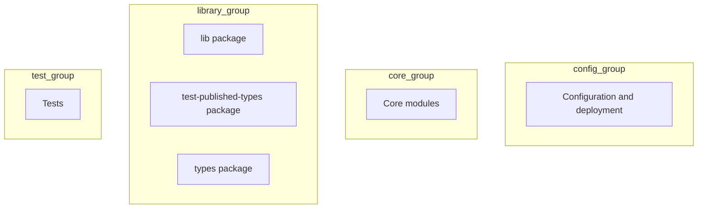

# Architecture report: jsx-eslint/eslint-plugin-react

> Automated static analysis. **Observed** = directly seen in files/imports/AST; **Inferred** = interpretation from that evidence. Repository code was not executed.

## 1. Repository at a glance

| Item | Value |
| --- | --- |
| Repository | jsx-eslint/eslint-plugin-react |
| Description | React-specific linting rules for ESLint |
| Language | JavaScript |
| Stars | 9291 |
| Licence | MIT |
| Analysed commit / branch | 61b91b612eed65386e1d2bda39b9afeb7c92c708 / master |
| Framework(s) | None detected |
| Files analysed | 412 |
| Components | 6 |

## 2. Architecture in one minute

jsx-eslint/eslint-plugin-react - React-specific linting rules for ESLint. This repository was analysed statically from 412 file(s) (0 Python). Detected technologies (observed from imports/manifests): GitHub Actions, TypeScript. Files are grouped into 6 component(s): Configuration and deployment, Core modules, lib package, test-published-types package, Tests, types package. Findings below distinguish observed facts from inferred interpretation.

## 3. High-level block diagram

## 4. Main components

### Configuration and deployment (`config`)

- **Kind:** config
- **Status:** Observed
- **Confidence:** 0.85
- **Responsibility:** Groups 8 file(s) under configuration and deployment (observed from repository paths and static analysis).
- **Paths:** `build.tsconfig.json`, `configs/all.js`, `configs/jsx-runtime.js`, `configs/recommended.js`, `package.json`, `test-published-types/package.json`, `test-published-types/tsconfig.json`, `tsconfig.json`
- **Evidence:** [build.tsconfig.json](https://github.com/jsx-eslint/eslint-plugin-react/blob/61b91b612eed65386e1d2bda39b9afeb7c92c708/build.tsconfig.json); [configs/all.js](https://github.com/jsx-eslint/eslint-plugin-react/blob/61b91b612eed65386e1d2bda39b9afeb7c92c708/configs/all.js); [configs/jsx-runtime.js](https://github.com/jsx-eslint/eslint-plugin-react/blob/61b91b612eed65386e1d2bda39b9afeb7c92c708/configs/jsx-runtime.js); [configs/recommended.js](https://github.com/jsx-eslint/eslint-plugin-react/blob/61b91b612eed65386e1d2bda39b9afeb7c92c708/configs/recommended.js); [package.json](https://github.com/jsx-eslint/eslint-plugin-react/blob/61b91b612eed65386e1d2bda39b9afeb7c92c708/package.json); [test-published-types/package.json](https://github.com/jsx-eslint/eslint-plugin-react/blob/61b91b612eed65386e1d2bda39b9afeb7c92c708/test-published-types/package.json); [test-published-types/tsconfig.json](https://github.com/jsx-eslint/eslint-plugin-react/blob/61b91b612eed65386e1d2bda39b9afeb7c92c708/test-published-types/tsconfig.json); [tsconfig.json](https://github.com/jsx-eslint/eslint-plugin-react/blob/61b91b612eed65386e1d2bda39b9afeb7c92c708/tsconfig.json)

### Core modules (`core`)

- **Kind:** core
- **Status:** Observed
- **Confidence:** 0.85
- **Responsibility:** Groups 1 file(s) under core modules (observed from repository paths and static analysis).
- **Paths:** `index.js`
- **Evidence:** [index.js](https://github.com/jsx-eslint/eslint-plugin-react/blob/61b91b612eed65386e1d2bda39b9afeb7c92c708/index.js)

### lib package (`lib`)

- **Kind:** library
- **Status:** Observed
- **Confidence:** 0.85
- **Responsibility:** Groups 134 file(s) under lib package (observed from repository paths and static analysis).
- **Paths:** `lib/rules/async-server-action.js`, `lib/rules/boolean-prop-naming.js`, `lib/rules/button-has-type.js`, `lib/rules/checked-requires-onchange-or-readonly.js`, `lib/rules/default-props-match-prop-types.js`, `lib/rules/destructuring-assignment.js`, `lib/rules/display-name.js`, `lib/rules/forbid-component-props.js`, `lib/rules/forbid-dom-props.js`, `lib/rules/forbid-elements.js`, `lib/rules/forbid-foreign-prop-types.js`, `lib/rules/forbid-prop-types.js`, `lib/rules/forward-ref-uses-ref.js`, `lib/rules/function-component-definition.js`, `lib/rules/hook-use-state.js`, `lib/rules/iframe-missing-sandbox.js`, `lib/rules/index.js`, `lib/rules/jsx-boolean-value.js`, `lib/rules/jsx-child-element-spacing.js`, `lib/rules/jsx-closing-bracket-location.js`, `lib/rules/jsx-closing-tag-location.js`, `lib/rules/jsx-curly-brace-presence.js`, `lib/rules/jsx-curly-newline.js`, `lib/rules/jsx-curly-spacing.js`, `lib/rules/jsx-equals-spacing.js`, `lib/rules/jsx-filename-extension.js`, `lib/rules/jsx-first-prop-new-line.js`, `lib/rules/jsx-fragments.js`, `lib/rules/jsx-handler-names.js`, `lib/rules/jsx-indent-props.js`, `lib/rules/jsx-indent.js`, `lib/rules/jsx-key.js`, `lib/rules/jsx-max-depth.js`, `lib/rules/jsx-max-props-per-line.js`, `lib/rules/jsx-newline.js`, `lib/rules/jsx-no-bind.js`, `lib/rules/jsx-no-comment-textnodes.js`, `lib/rules/jsx-no-constructed-context-values.js`, `lib/rules/jsx-no-duplicate-props.js`, `lib/rules/jsx-no-leaked-render.js`, `lib/rules/jsx-no-literals.js`, `lib/rules/jsx-no-script-url.js`, `lib/rules/jsx-no-target-blank.js`, `lib/rules/jsx-no-undef.js`, `lib/rules/jsx-no-useless-fragment.js`, `lib/rules/jsx-one-expression-per-line.js`, `lib/rules/jsx-pascal-case.js`, `lib/rules/jsx-props-no-multi-spaces.js`, `lib/rules/jsx-props-no-spread-multi.js`, `lib/rules/jsx-props-no-spreading.js`, `lib/rules/jsx-sort-default-props.js`, `lib/rules/jsx-sort-props.js`, `lib/rules/jsx-space-before-closing.js`, `lib/rules/jsx-tag-spacing.js`, `lib/rules/jsx-uses-react.js`, `lib/rules/jsx-uses-vars.js`, `lib/rules/jsx-wrap-multilines.js`, `lib/rules/no-access-state-in-setstate.js`, `lib/rules/no-adjacent-inline-elements.js`, `lib/rules/no-array-index-key.js`, `lib/rules/no-arrow-function-lifecycle.js`, `lib/rules/no-children-prop.js`, `lib/rules/no-danger-with-children.js`, `lib/rules/no-danger.js`, `lib/rules/no-deprecated.js`, `lib/rules/no-did-mount-set-state.js`, `lib/rules/no-did-update-set-state.js`, `lib/rules/no-direct-mutation-state.js`, `lib/rules/no-find-dom-node.js`, `lib/rules/no-invalid-html-attribute.js`, `lib/rules/no-is-mounted.js`, `lib/rules/no-multi-comp.js`, `lib/rules/no-namespace.js`, `lib/rules/no-object-type-as-default-prop.js`, `lib/rules/no-redundant-should-component-update.js`, `lib/rules/no-render-return-value.js`, `lib/rules/no-set-state.js`, `lib/rules/no-string-refs.js`, `lib/rules/no-this-in-sfc.js`, `lib/rules/no-typos.js`, `lib/rules/no-unescaped-entities.js`, `lib/rules/no-unknown-property.js`, `lib/rules/no-unsafe.js`, `lib/rules/no-unstable-nested-components.js`, `lib/rules/no-unused-class-component-methods.js`, `lib/rules/no-unused-prop-types.js`, `lib/rules/no-unused-state.js`, `lib/rules/no-will-update-set-state.js`, `lib/rules/prefer-es6-class.js`, `lib/rules/prefer-exact-props.js`, `lib/rules/prefer-read-only-props.js`, `lib/rules/prefer-stateless-function.js`, `lib/rules/prop-types.js`, `lib/rules/react-in-jsx-scope.js`, `lib/rules/require-default-props.js`, `lib/rules/require-optimization.js`, `lib/rules/require-render-return.js`, `lib/rules/self-closing-comp.js`, `lib/rules/sort-comp.js`, `lib/rules/sort-default-props.js`, `lib/rules/sort-prop-types.js`, `lib/rules/state-in-constructor.js`, `lib/rules/static-property-placement.js`, `lib/rules/style-prop-object.js`, `lib/rules/void-dom-elements-no-children.js`, `lib/types.d.ts`, `lib/util/Components.js`, `lib/util/annotations.js`, `lib/util/ast.js`, `lib/util/componentUtil.js`, `lib/util/defaultProps.js`, `lib/util/docsUrl.js`, `lib/util/error.js`, `lib/util/eslint.js`, `lib/util/getTokenBeforeClosingBracket.js`, `lib/util/isCreateContext.js`, `lib/util/isCreateElement.js`, `lib/util/isDestructuredFromPragmaImport.js`, `lib/util/isFirstLetterCapitalized.js`, `lib/util/jsx.js`, `lib/util/lifecycleMethods.js`, `lib/util/linkComponents.js`, `lib/util/log.js`, `lib/util/makeNoMethodSetStateRule.js`, `lib/util/message.js`, `lib/util/pragma.js`, `lib/util/propTypes.js`, `lib/util/propTypesSort.js`, `lib/util/propWrapper.js`, `lib/util/props.js`, `lib/util/report.js`, `lib/util/usedPropTypes.js`, `lib/util/variable.js`, `lib/util/version.js`
- **Evidence:** [lib/rules/async-server-action.js](https://github.com/jsx-eslint/eslint-plugin-react/blob/61b91b612eed65386e1d2bda39b9afeb7c92c708/lib/rules/async-server-action.js); [lib/rules/boolean-prop-naming.js](https://github.com/jsx-eslint/eslint-plugin-react/blob/61b91b612eed65386e1d2bda39b9afeb7c92c708/lib/rules/boolean-prop-naming.js); [lib/rules/button-has-type.js](https://github.com/jsx-eslint/eslint-plugin-react/blob/61b91b612eed65386e1d2bda39b9afeb7c92c708/lib/rules/button-has-type.js); [lib/rules/checked-requires-onchange-or-readonly.js](https://github.com/jsx-eslint/eslint-plugin-react/blob/61b91b612eed65386e1d2bda39b9afeb7c92c708/lib/rules/checked-requires-onchange-or-readonly.js); [lib/rules/default-props-match-prop-types.js](https://github.com/jsx-eslint/eslint-plugin-react/blob/61b91b612eed65386e1d2bda39b9afeb7c92c708/lib/rules/default-props-match-prop-types.js); [lib/rules/destructuring-assignment.js](https://github.com/jsx-eslint/eslint-plugin-react/blob/61b91b612eed65386e1d2bda39b9afeb7c92c708/lib/rules/destructuring-assignment.js); [lib/rules/display-name.js](https://github.com/jsx-eslint/eslint-plugin-react/blob/61b91b612eed65386e1d2bda39b9afeb7c92c708/lib/rules/display-name.js); [lib/rules/forbid-component-props.js](https://github.com/jsx-eslint/eslint-plugin-react/blob/61b91b612eed65386e1d2bda39b9afeb7c92c708/lib/rules/forbid-component-props.js)

### test-published-types package (`test_published_types`)

- **Kind:** library
- **Status:** Observed
- **Confidence:** 0.85
- **Responsibility:** Groups 1 file(s) under test-published-types package (observed from repository paths and static analysis).
- **Paths:** `test-published-types/index.js`
- **Evidence:** [test-published-types/index.js](https://github.com/jsx-eslint/eslint-plugin-react/blob/61b91b612eed65386e1d2bda39b9afeb7c92c708/test-published-types/index.js)

### Tests (`tests`)

- **Kind:** test
- **Status:** Observed
- **Confidence:** 0.85
- **Responsibility:** Groups 139 file(s) under tests (observed from repository paths and static analysis).
- **Paths:** `test/eslint-remote-tester.config.js`, `test/mocha.opts`, `tests/fixtures/flat-config/config-all/eslint.config-deep.js`, `tests/fixtures/flat-config/config-all/eslint.config-root.js`, `tests/fixtures/flat-config/config-all/test.jsx`, `tests/fixtures/flat-config/config-jsx-runtime/eslint.config-deep.js`, `tests/fixtures/flat-config/config-jsx-runtime/eslint.config-root.js`, `tests/fixtures/flat-config/config-jsx-runtime/test.jsx`, `tests/fixtures/flat-config/config-recommended/eslint.config-deep.js`, `tests/fixtures/flat-config/config-recommended/eslint.config-root.js`, `tests/fixtures/flat-config/config-recommended/test.jsx`, `tests/fixtures/flat-config/plugin-and-config/eslint.config-deep.js`, `tests/fixtures/flat-config/plugin-and-config/eslint.config-root.js`, `tests/fixtures/flat-config/plugin-and-config/test.jsx`, `tests/fixtures/flat-config/plugin/eslint.config.js`, `tests/fixtures/flat-config/plugin/test.jsx`, `tests/fixtures/version/detect-version-missing/test.js`, `tests/fixtures/version/detect-version-sibling/test.js`, `tests/fixtures/version/detect-version/detect-version-child/test.js`, `tests/fixtures/version/detect-version/test.js`, `tests/flat-config.js`, `tests/helpers/getESLintCoreRule.js`, `tests/helpers/getRuleDefiner.js`, `tests/helpers/parsers.js`, `tests/helpers/ruleTester.js`, `tests/index.js`, `tests/lib/rules/async-server-action.js`, `tests/lib/rules/boolean-prop-naming.js`, `tests/lib/rules/button-has-type.js`, `tests/lib/rules/checked-requires-onchange-or-readonly.js`, `tests/lib/rules/default-props-match-prop-types.js`, `tests/lib/rules/destructuring-assignment.js`, `tests/lib/rules/display-name.js`, `tests/lib/rules/forbid-component-props.js`, `tests/lib/rules/forbid-dom-props.js`, `tests/lib/rules/forbid-elements.js`, `tests/lib/rules/forbid-foreign-prop-types.js`, `tests/lib/rules/forbid-prop-types.js`, `tests/lib/rules/forward-ref-uses-ref.js`, `tests/lib/rules/function-component-definition.js`, `tests/lib/rules/hook-use-state.js`, `tests/lib/rules/iframe-missing-sandbox.js`, `tests/lib/rules/jsx-boolean-value.js`, `tests/lib/rules/jsx-child-element-spacing.js`, `tests/lib/rules/jsx-closing-bracket-location.js`, `tests/lib/rules/jsx-closing-tag-location.js`, `tests/lib/rules/jsx-curly-brace-presence.js`, `tests/lib/rules/jsx-curly-newline.js`, `tests/lib/rules/jsx-curly-spacing.js`, `tests/lib/rules/jsx-equals-spacing.js`, `tests/lib/rules/jsx-filename-extension.js`, `tests/lib/rules/jsx-first-prop-new-line.js`, `tests/lib/rules/jsx-fragments.js`, `tests/lib/rules/jsx-handler-names.js`, `tests/lib/rules/jsx-indent-props.js`, `tests/lib/rules/jsx-indent.js`, `tests/lib/rules/jsx-key.js`, `tests/lib/rules/jsx-max-depth.js`, `tests/lib/rules/jsx-max-props-per-line.js`, `tests/lib/rules/jsx-newline.js`, `tests/lib/rules/jsx-no-bind.js`, `tests/lib/rules/jsx-no-comment-textnodes.js`, `tests/lib/rules/jsx-no-constructed-context-values.js`, `tests/lib/rules/jsx-no-duplicate-props.js`, `tests/lib/rules/jsx-no-leaked-render.js`, `tests/lib/rules/jsx-no-literals.js`, `tests/lib/rules/jsx-no-script-url.js`, `tests/lib/rules/jsx-no-target-blank.js`, `tests/lib/rules/jsx-no-undef.js`, `tests/lib/rules/jsx-no-useless-fragment.js`, `tests/lib/rules/jsx-one-expression-per-line.js`, `tests/lib/rules/jsx-pascal-case.js`, `tests/lib/rules/jsx-props-no-multi-spaces.js`, `tests/lib/rules/jsx-props-no-spread-multi.js`, `tests/lib/rules/jsx-props-no-spreading.js`, `tests/lib/rules/jsx-sort-default-props.js`, `tests/lib/rules/jsx-sort-props.js`, `tests/lib/rules/jsx-space-before-closing.js`, `tests/lib/rules/jsx-tag-spacing.js`, `tests/lib/rules/jsx-uses-react.js`, `tests/lib/rules/jsx-uses-vars.js`, `tests/lib/rules/jsx-wrap-multilines.js`, `tests/lib/rules/no-access-state-in-setstate.js`, `tests/lib/rules/no-adjacent-inline-elements.js`, `tests/lib/rules/no-array-index-key.js`, `tests/lib/rules/no-arrow-function-lifecycle.js`, `tests/lib/rules/no-children-prop.js`, `tests/lib/rules/no-danger-with-children.js`, `tests/lib/rules/no-danger.js`, `tests/lib/rules/no-deprecated.js`, `tests/lib/rules/no-did-mount-set-state.js`, `tests/lib/rules/no-did-update-set-state.js`, `tests/lib/rules/no-direct-mutation-state.js`, `tests/lib/rules/no-find-dom-node.js`, `tests/lib/rules/no-invalid-html-attribute.js`, `tests/lib/rules/no-is-mounted.js`, `tests/lib/rules/no-multi-comp.js`, `tests/lib/rules/no-namespace.js`, `tests/lib/rules/no-object-type-as-default-prop.js`, `tests/lib/rules/no-redundant-should-component-update.js`, `tests/lib/rules/no-render-return-value.js`, `tests/lib/rules/no-set-state.js`, `tests/lib/rules/no-string-refs.js`, `tests/lib/rules/no-this-in-sfc.js`, `tests/lib/rules/no-typos.js`, `tests/lib/rules/no-unescaped-entities.js`, `tests/lib/rules/no-unknown-property.js`, `tests/lib/rules/no-unsafe.js`, `tests/lib/rules/no-unstable-nested-components.js`, `tests/lib/rules/no-unused-class-component-methods.js`, `tests/lib/rules/no-unused-prop-types.js`, `tests/lib/rules/no-unused-state.js`, `tests/lib/rules/no-will-update-set-state.js`, `tests/lib/rules/prefer-es6-class.js`, `tests/lib/rules/prefer-exact-props.js`, `tests/lib/rules/prefer-read-only-props.js`, `tests/lib/rules/prefer-stateless-function.js`, `tests/lib/rules/react-in-jsx-scope.js`, `tests/lib/rules/require-default-props.js`, `tests/lib/rules/require-optimization.js`, `tests/lib/rules/require-render-return.js`, `tests/lib/rules/self-closing-comp.js`, `tests/lib/rules/sort-comp.js`, `tests/lib/rules/sort-default-props.js`, `tests/lib/rules/sort-prop-types.js`, `tests/lib/rules/state-in-constructor.js`, `tests/lib/rules/static-property-placement.js`, `tests/lib/rules/style-prop-object.js`, `tests/lib/rules/void-dom-elements-no-children.js`, `tests/util/.eslintrc`, `tests/util/Components.js`, `tests/util/ast.js`, `tests/util/isFirstLetterCapitalized.js`, `tests/util/jsx.js`, `tests/util/linkComponents.js`, `tests/util/pragma.js`, `tests/util/propWrapper.js`, `tests/util/variable.js`, `tests/util/version.js`
- **Evidence:** [test/eslint-remote-tester.config.js](https://github.com/jsx-eslint/eslint-plugin-react/blob/61b91b612eed65386e1d2bda39b9afeb7c92c708/test/eslint-remote-tester.config.js); [test/mocha.opts](https://github.com/jsx-eslint/eslint-plugin-react/blob/61b91b612eed65386e1d2bda39b9afeb7c92c708/test/mocha.opts); [tests/fixtures/flat-config/config-all/eslint.config-deep.js](https://github.com/jsx-eslint/eslint-plugin-react/blob/61b91b612eed65386e1d2bda39b9afeb7c92c708/tests/fixtures/flat-config/config-all/eslint.config-deep.js); [tests/fixtures/flat-config/config-all/eslint.config-root.js](https://github.com/jsx-eslint/eslint-plugin-react/blob/61b91b612eed65386e1d2bda39b9afeb7c92c708/tests/fixtures/flat-config/config-all/eslint.config-root.js); [tests/fixtures/flat-config/config-all/test.jsx](https://github.com/jsx-eslint/eslint-plugin-react/blob/61b91b612eed65386e1d2bda39b9afeb7c92c708/tests/fixtures/flat-config/config-all/test.jsx); [tests/fixtures/flat-config/config-jsx-runtime/eslint.config-deep.js](https://github.com/jsx-eslint/eslint-plugin-react/blob/61b91b612eed65386e1d2bda39b9afeb7c92c708/tests/fixtures/flat-config/config-jsx-runtime/eslint.config-deep.js); [tests/fixtures/flat-config/config-jsx-runtime/eslint.config-root.js](https://github.com/jsx-eslint/eslint-plugin-react/blob/61b91b612eed65386e1d2bda39b9afeb7c92c708/tests/fixtures/flat-config/config-jsx-runtime/eslint.config-root.js); [tests/fixtures/flat-config/config-jsx-runtime/test.jsx](https://github.com/jsx-eslint/eslint-plugin-react/blob/61b91b612eed65386e1d2bda39b9afeb7c92c708/tests/fixtures/flat-config/config-jsx-runtime/test.jsx)

### types package (`types`)

- **Kind:** library
- **Status:** Observed
- **Confidence:** 0.85
- **Responsibility:** Groups 3 file(s) under types package (observed from repository paths and static analysis).
- **Paths:** `types/eslint-core-augment.d.ts`, `types/rules/jsx-no-literals.d.ts`, `types/string.prototype.repeat/index.d.ts`
- **Evidence:** [types/eslint-core-augment.d.ts](https://github.com/jsx-eslint/eslint-plugin-react/blob/61b91b612eed65386e1d2bda39b9afeb7c92c708/types/eslint-core-augment.d.ts); [types/rules/jsx-no-literals.d.ts](https://github.com/jsx-eslint/eslint-plugin-react/blob/61b91b612eed65386e1d2bda39b9afeb7c92c708/types/rules/jsx-no-literals.d.ts); [types/string.prototype.repeat/index.d.ts](https://github.com/jsx-eslint/eslint-plugin-react/blob/61b91b612eed65386e1d2bda39b9afeb7c92c708/types/string.prototype.repeat/index.d.ts)

## 5. Execution flow

**Observed** entry point(s):

- [index.js](https://github.com/jsx-eslint/eslint-plugin-react/blob/61b91b612eed65386e1d2bda39b9afeb7c92c708/index.js)
- [lib/rules/index.js](https://github.com/jsx-eslint/eslint-plugin-react/blob/61b91b612eed65386e1d2bda39b9afeb7c92c708/lib/rules/index.js)
- [test-published-types/index.js](https://github.com/jsx-eslint/eslint-plugin-react/blob/61b91b612eed65386e1d2bda39b9afeb7c92c708/test-published-types/index.js)

Representative flow (derived from observed entry points and the import graph; steps beyond the entry point are **Inferred**):

1. Execution starts at an observed entry point listed above, if present.
2. No internal import relationships between components were observed.

## 6. Project structure

### `(root)`

- `.editorconfig` - config (208 bytes)
- `.eslint-doc-generatorrc.js` - source, JavaScript (309 bytes)
- `.eslintrc` - other (2227 bytes)
- `.gitignore` - other (420 bytes)
- `.markdownlint.json` - config (132 bytes)
- `.markdownlintignore` - other (34 bytes)
- `CONTRIBUTING.md` - docs (491 bytes)
- `LICENSE` - docs (1085 bytes)
- `README.md` - docs (39677 bytes)
- `SECURITY.md` - docs (491 bytes)
- `build.tsconfig.json` - config (197 bytes)
- `index.js` - source, JavaScript (3768 bytes)
- `package.json` - manifest (4043 bytes)
- `tsconfig.json` - config (1743 bytes)

### `.github`

- `.github/FUNDING.yml` - config (613 bytes)
- `.github/ISSUE_TEMPLATE/bug_report.yml` - config (2357 bytes)
- `.github/workflows/eslint-8-.yml` - ci, YAML (3193 bytes)
- `.github/workflows/eslint-9+.yml` - ci, YAML (1436 bytes)
- `.github/workflows/node-minors.yml` - ci, YAML (3618 bytes)
- `.github/workflows/node-pretest.yml` - ci, YAML (715 bytes)
- `.github/workflows/npm-publish.yml` - ci, YAML (4247 bytes)
- `.github/workflows/rebase.yml` - ci, YAML (327 bytes)
- `.github/workflows/release.yml` - ci, YAML (2131 bytes)
- `.github/workflows/require-allow-edits.yml` - ci, YAML (193 bytes)
- `.github/workflows/smoke-test.yml` - ci, YAML (781 bytes)
- `.github/workflows/type-check.yml` - ci, YAML (3626 bytes)

### `configs`

- `configs/all.js` - source, JavaScript (317 bytes)
- `configs/jsx-runtime.js` - source, JavaScript (328 bytes)
- `configs/recommended.js` - source, JavaScript (325 bytes)

### `docs`

- `docs/rules/async-server-action.md` - docs (990 bytes)
- `docs/rules/boolean-prop-naming.md` - docs (3128 bytes)
- `docs/rules/button-has-type.md` - docs (2324 bytes)
- `docs/rules/checked-requires-onchange-or-readonly.md` - docs (1518 bytes)
- `docs/rules/default-props-match-prop-types.md` - docs (4084 bytes)
- `docs/rules/destructuring-assignment.md` - docs (2820 bytes)
- `docs/rules/display-name.md` - docs (3605 bytes)
- `docs/rules/forbid-component-props.md` - docs (2936 bytes)
- `docs/rules/forbid-dom-props.md` - docs (2553 bytes)
- `docs/rules/forbid-elements.md` - docs (1725 bytes)
- `docs/rules/forbid-foreign-prop-types.md` - docs (1731 bytes)
- `docs/rules/forbid-prop-types.md` - docs (1904 bytes)
- `docs/rules/forward-ref-uses-ref.md` - docs (1200 bytes)
- `docs/rules/function-component-definition.md` - docs (8271 bytes)
- `docs/rules/hook-use-state.md` - docs (2101 bytes)
- `docs/rules/iframe-missing-sandbox.md` - docs (1327 bytes)
- `docs/rules/jsx-boolean-value.md` - docs (2735 bytes)
- `docs/rules/jsx-child-element-spacing.md` - docs (1010 bytes)
- `docs/rules/jsx-closing-bracket-location.md` - docs (4452 bytes)
- `docs/rules/jsx-closing-tag-location.md` - docs (2758 bytes)
- `docs/rules/jsx-curly-brace-presence.md` - docs (6312 bytes)
- `docs/rules/jsx-curly-newline.md` - docs (2645 bytes)
- `docs/rules/jsx-curly-spacing.md` - docs (6957 bytes)
- `docs/rules/jsx-equals-spacing.md` - docs (1687 bytes)
- `docs/rules/jsx-filename-extension.md` - docs (1516 bytes)
- `docs/rules/jsx-first-prop-new-line.md` - docs (2594 bytes)
- `docs/rules/jsx-fragments.md` - docs (1709 bytes)
- `docs/rules/jsx-handler-names.md` - docs (1617 bytes)
- `docs/rules/jsx-indent-props.md` - docs (2521 bytes)
- `docs/rules/jsx-indent.md` - docs (2085 bytes)
- `docs/rules/jsx-key.md` - docs (2465 bytes)
- `docs/rules/jsx-max-depth.md` - docs (1096 bytes)
- `docs/rules/jsx-max-props-per-line.md` - docs (2520 bytes)
- `docs/rules/jsx-newline.md` - docs (3330 bytes)
- `docs/rules/jsx-no-bind.md` - docs (7025 bytes)
- `docs/rules/jsx-no-comment-textnodes.md` - docs (1510 bytes)
- `docs/rules/jsx-no-constructed-context-values.md` - docs (1922 bytes)
- `docs/rules/jsx-no-duplicate-props.md` - docs (838 bytes)
- `docs/rules/jsx-no-leaked-render.md` - docs (8533 bytes)
- `docs/rules/jsx-no-literals.md` - docs (5927 bytes)
- `docs/rules/jsx-no-script-url.md` - docs (2450 bytes)
- `docs/rules/jsx-no-target-blank.md` - docs (6456 bytes)
- `docs/rules/jsx-no-undef.md` - docs (1264 bytes)
- `docs/rules/jsx-no-useless-fragment.md` - docs (1477 bytes)
- `docs/rules/jsx-one-expression-per-line.md` - docs (1834 bytes)
- `docs/rules/jsx-pascal-case.md` - docs (2300 bytes)
- `docs/rules/jsx-props-no-multi-spaces.md` - docs (931 bytes)
- `docs/rules/jsx-props-no-spread-multi.md` - docs (789 bytes)
- `docs/rules/jsx-props-no-spreading.md` - docs (3092 bytes)
- `docs/rules/jsx-sort-default-props.md` - docs (3757 bytes)
- `docs/rules/jsx-sort-props.md` - docs (5737 bytes)
- `docs/rules/jsx-space-before-closing.md` - docs (1746 bytes)
- `docs/rules/jsx-tag-spacing.md` - docs (7030 bytes)
- `docs/rules/jsx-uses-react.md` - docs (1936 bytes)
- `docs/rules/jsx-uses-vars.md` - docs (946 bytes)
- `docs/rules/jsx-wrap-multilines.md` - docs (11028 bytes)
- `docs/rules/no-access-state-in-setstate.md` - docs (1217 bytes)
- `docs/rules/no-adjacent-inline-elements.md` - docs (746 bytes)
- `docs/rules/no-array-index-key.md` - docs (3252 bytes)
- `docs/rules/no-arrow-function-lifecycle.md` - docs (1205 bytes)
- `docs/rules/no-children-prop.md` - docs (1615 bytes)
- `docs/rules/no-danger-with-children.md` - docs (1353 bytes)
- `docs/rules/no-danger.md` - docs (1200 bytes)
- `docs/rules/no-deprecated.md` - docs (1956 bytes)
- `docs/rules/no-did-mount-set-state.md` - docs (2050 bytes)
- `docs/rules/no-did-update-set-state.md` - docs (1956 bytes)
- `docs/rules/no-direct-mutation-state.md` - docs (1467 bytes)
- `docs/rules/no-find-dom-node.md` - docs (958 bytes)
- `docs/rules/no-invalid-html-attribute.md` - docs (935 bytes)
- `docs/rules/no-is-mounted.md` - docs (972 bytes)
- `docs/rules/no-multi-comp.md` - docs (1517 bytes)
- `docs/rules/no-namespace.md` - docs (544 bytes)
- `docs/rules/no-object-type-as-default-prop.md` - docs (2688 bytes)
- `docs/rules/no-redundant-should-component-update.md` - docs (1235 bytes)
- `docs/rules/no-render-return-value.md` - docs (1230 bytes)
- `docs/rules/no-set-state.md` - docs (1025 bytes)
- `docs/rules/no-string-refs.md` - docs (1762 bytes)
- `docs/rules/no-this-in-sfc.md` - docs (2548 bytes)
- `docs/rules/no-typos.md` - docs (2731 bytes)
- `docs/rules/no-unescaped-entities.md` - docs (2615 bytes)
- `docs/rules/no-unknown-property.md` - docs (2829 bytes)
- `docs/rules/no-unsafe.md` - docs (2778 bytes)
- `docs/rules/no-unstable-nested-components.md` - docs (4213 bytes)
- `docs/rules/no-unused-class-component-methods.md` - docs (685 bytes)
- `docs/rules/no-unused-prop-types.md` - docs (3460 bytes)
- `docs/rules/no-unused-state.md` - docs (949 bytes)
- `docs/rules/no-will-update-set-state.md` - docs (1975 bytes)
- `docs/rules/prefer-es6-class.md` - docs (1220 bytes)
- `docs/rules/prefer-exact-props.md` - docs (2990 bytes)
- `docs/rules/prefer-read-only-props.md` - docs (1798 bytes)
- `docs/rules/prefer-stateless-function.md` - docs (2484 bytes)
- `docs/rules/prop-types.md` - docs (4800 bytes)
- `docs/rules/react-in-jsx-scope.md` - docs (1825 bytes)
- `docs/rules/require-default-props.md` - docs (9505 bytes)
- `docs/rules/require-optimization.md` - docs (1425 bytes)
- `docs/rules/require-render-return.md` - docs (887 bytes)
- `docs/rules/self-closing-comp.md` - docs (2356 bytes)
- `docs/rules/sort-comp.md` - docs (7210 bytes)
- `docs/rules/sort-default-props.md` - docs (3676 bytes)
- `docs/rules/sort-prop-types.md` - docs (3739 bytes)
- `docs/rules/state-in-constructor.md` - docs (1382 bytes)
- `docs/rules/static-property-placement.md` - docs (5010 bytes)
- `docs/rules/style-prop-object.md` - docs (1594 bytes)
- `docs/rules/void-dom-elements-no-children.md` - docs (1173 bytes)

### `lib`

- `lib/rules/async-server-action.js` - source, JavaScript (2175 bytes)
- `lib/rules/boolean-prop-naming.js` - source, JavaScript (14783 bytes)
- `lib/rules/button-has-type.js` - source, JavaScript (4528 bytes)
- `lib/rules/checked-requires-onchange-or-readonly.js` - source, JavaScript (3547 bytes)
- `lib/rules/default-props-match-prop-types.js` - source, JavaScript (3468 bytes)
- `lib/rules/destructuring-assignment.js` - source, JavaScript (11245 bytes)
- `lib/rules/display-name.js` - source, JavaScript (12805 bytes)
- `lib/rules/forbid-component-props.js` - source, JavaScript (7769 bytes)
- `lib/rules/forbid-dom-props.js` - source, JavaScript (5146 bytes)
- `lib/rules/forbid-elements.js` - source, JavaScript (3200 bytes)
- `lib/rules/forbid-foreign-prop-types.js` - source, JavaScript (3714 bytes)
- `lib/rules/forbid-prop-types.js` - source, JavaScript (8859 bytes)
- `lib/rules/forward-ref-uses-ref.js` - source, JavaScript (3195 bytes)
- `lib/rules/function-component-definition.js` - source, JavaScript (19106 bytes)
- `lib/rules/hook-use-state.js` - source, JavaScript (7365 bytes)
- `lib/rules/iframe-missing-sandbox.js` - source, JavaScript (4022 bytes)
- `lib/rules/index.js` - source, JavaScript (6396 bytes)
- `lib/rules/jsx-boolean-value.js` - source, JavaScript (4515 bytes)
- `lib/rules/jsx-child-element-spacing.js` - source, JavaScript (2915 bytes)
- `lib/rules/jsx-closing-bracket-location.js` - source, JavaScript (12783 bytes)
- `lib/rules/jsx-closing-tag-location.js` - source, JavaScript (3766 bytes)
- `lib/rules/jsx-curly-brace-presence.js` - source, JavaScript (16279 bytes)
- `lib/rules/jsx-curly-newline.js` - source, JavaScript (6128 bytes)
- `lib/rules/jsx-curly-spacing.js` - source, JavaScript (14257 bytes)
- `lib/rules/jsx-equals-spacing.js` - source, JavaScript (3621 bytes)
- `lib/rules/jsx-filename-extension.js` - source, JavaScript (3417 bytes)
- `lib/rules/jsx-first-prop-new-line.js` - source, JavaScript (2734 bytes)
- `lib/rules/jsx-fragments.js` - source, JavaScript (7578 bytes)
- `lib/rules/jsx-handler-names.js` - source, JavaScript (6682 bytes)
- `lib/rules/jsx-indent-props.js` - source, JavaScript (6579 bytes)
- `lib/rules/jsx-indent.js` - source, JavaScript (14681 bytes)
- `lib/rules/jsx-key.js` - source, JavaScript (10626 bytes)
- `lib/rules/jsx-max-depth.js` - source, JavaScript (4133 bytes)
- `lib/rules/jsx-max-props-per-line.js` - source, JavaScript (4162 bytes)
- `lib/rules/jsx-newline.js` - source, JavaScript (5044 bytes)
- `lib/rules/jsx-no-bind.js` - source, JavaScript (6172 bytes)
- `lib/rules/jsx-no-comment-textnodes.js` - source, JavaScript (1847 bytes)
- `lib/rules/jsx-no-constructed-context-values.js` - source, JavaScript (8658 bytes)
- `lib/rules/jsx-no-duplicate-props.js` - source, JavaScript (1697 bytes)
- `lib/rules/jsx-no-leaked-render.js` - source, JavaScript (10481 bytes)
- `lib/rules/jsx-no-literals.js` - source, JavaScript (18375 bytes)
- `lib/rules/jsx-no-script-url.js` - source, JavaScript (4156 bytes)
- `lib/rules/jsx-no-target-blank.js` - source, JavaScript (11018 bytes)
- `lib/rules/jsx-no-undef.js` - source, JavaScript (3157 bytes)
- `lib/rules/jsx-no-useless-fragment.js` - source, JavaScript (7018 bytes)
- `lib/rules/jsx-one-expression-per-line.js` - source, JavaScript (7949 bytes)
- `lib/rules/jsx-pascal-case.js` - source, JavaScript (4594 bytes)
- `lib/rules/jsx-props-no-multi-spaces.js` - source, JavaScript (4509 bytes)
- `lib/rules/jsx-props-no-spread-multi.js` - source, JavaScript (1527 bytes)
- `lib/rules/jsx-props-no-spreading.js` - source, JavaScript (4174 bytes)
- `lib/rules/jsx-sort-default-props.js` - source, JavaScript (5635 bytes)
- `lib/rules/jsx-sort-props.js` - source, JavaScript (21538 bytes)
- `lib/rules/jsx-space-before-closing.js` - source, JavaScript (3049 bytes)
- `lib/rules/jsx-tag-spacing.js` - source, JavaScript (10677 bytes)
- `lib/rules/jsx-uses-react.js` - source, JavaScript (1716 bytes)
- `lib/rules/jsx-uses-vars.js` - source, JavaScript (1655 bytes)
- `lib/rules/jsx-wrap-multilines.js` - source, JavaScript (8442 bytes)
- `lib/rules/no-access-state-in-setstate.js` - source, JavaScript (6790 bytes)
- `lib/rules/no-adjacent-inline-elements.js` - source, JavaScript (3139 bytes)
- `lib/rules/no-array-index-key.js` - source, JavaScript (7509 bytes)
- `lib/rules/no-arrow-function-lifecycle.js` - source, JavaScript (9159 bytes)
- `lib/rules/no-children-prop.js` - source, JavaScript (4193 bytes)
- `lib/rules/no-danger-with-children.js` - source, JavaScript (4712 bytes)
- `lib/rules/no-danger.js` - source, JavaScript (2695 bytes)
- `lib/rules/no-deprecated.js` - source, JavaScript (9961 bytes)
- `lib/rules/no-did-mount-set-state.js` - source, JavaScript (308 bytes)
- `lib/rules/no-did-update-set-state.js` - source, JavaScript (310 bytes)
- `lib/rules/no-direct-mutation-state.js` - source, JavaScript (4591 bytes)
- `lib/rules/no-find-dom-node.js` - source, JavaScript (1389 bytes)
- `lib/rules/no-invalid-html-attribute.js` - source, JavaScript (16601 bytes)
- `lib/rules/no-is-mounted.js` - source, JavaScript (1522 bytes)
- `lib/rules/no-multi-comp.js` - source, JavaScript (2066 bytes)
- `lib/rules/no-namespace.js` - source, JavaScript (1744 bytes)
- `lib/rules/no-object-type-as-default-prop.js` - source, JavaScript (3285 bytes)
- `lib/rules/no-redundant-should-component-update.js` - source, JavaScript (2437 bytes)
- `lib/rules/no-render-return-value.js` - source, JavaScript (2308 bytes)
- `lib/rules/no-set-state.js` - source, JavaScript (2374 bytes)
- `lib/rules/no-string-refs.js` - source, JavaScript (3770 bytes)
- `lib/rules/no-this-in-sfc.js` - source, JavaScript (1326 bytes)
- `lib/rules/no-typos.js` - source, JavaScript (8930 bytes)
- `lib/rules/no-unescaped-entities.js` - source, JavaScript (4773 bytes)
- `lib/rules/no-unknown-property.js` - source, JavaScript (28843 bytes)
- `lib/rules/no-unsafe.js` - source, JavaScript (4442 bytes)
- `lib/rules/no-unstable-nested-components.js` - source, JavaScript (15517 bytes)
- `lib/rules/no-unused-class-component-methods.js` - source, JavaScript (6795 bytes)
- `lib/rules/no-unused-prop-types.js` - source, JavaScript (4897 bytes)
- `lib/rules/no-unused-state.js` - source, JavaScript (15958 bytes)
- `lib/rules/no-will-update-set-state.js` - source, JavaScript (441 bytes)
- `lib/rules/prefer-es6-class.js` - source, JavaScript (1572 bytes)
- `lib/rules/prefer-exact-props.js` - source, JavaScript (5045 bytes)
- `lib/rules/prefer-read-only-props.js` - source, JavaScript (3069 bytes)
- `lib/rules/prefer-stateless-function.js` - source, JavaScript (12952 bytes)
- `lib/rules/prop-types.js` - source, JavaScript (7417 bytes)
- `lib/rules/react-in-jsx-scope.js` - source, JavaScript (1472 bytes)
- `lib/rules/require-default-props.js` - source, JavaScript (7402 bytes)
- `lib/rules/require-optimization.js` - source, JavaScript (7076 bytes)
- `lib/rules/require-render-return.js` - source, JavaScript (3237 bytes)
- `lib/rules/self-closing-comp.js` - source, JavaScript (2930 bytes)
- `lib/rules/sort-comp.js` - source, JavaScript (13733 bytes)
- `lib/rules/sort-default-props.js` - source, JavaScript (5233 bytes)
- `lib/rules/sort-prop-types.js` - source, JavaScript (10133 bytes)
- `lib/rules/state-in-constructor.js` - source, JavaScript (1921 bytes)
- `lib/rules/static-property-placement.js` - source, JavaScript (6861 bytes)
- `lib/rules/style-prop-object.js` - source, JavaScript (4134 bytes)
- `lib/rules/void-dom-elements-no-children.js` - source, JavaScript (4133 bytes)
- `lib/types.d.ts` - source, TypeScript (768 bytes)
- `lib/util/Components.js` - source, JavaScript (30647 bytes)
- `lib/util/annotations.js` - source, JavaScript (1090 bytes)
- `lib/util/ast.js` - source, JavaScript (12646 bytes)
- `lib/util/componentUtil.js` - source, JavaScript (4824 bytes)
- `lib/util/defaultProps.js` - source, JavaScript (8501 bytes)
- `lib/util/docsUrl.js` - source, JavaScript (173 bytes)
- `lib/util/error.js` - source, JavaScript (308 bytes)
- `lib/util/eslint.js` - source, JavaScript (3169 bytes)
- `lib/util/getTokenBeforeClosingBracket.js` - source, JavaScript (428 bytes)
- `lib/util/isCreateContext.js` - source, JavaScript (1213 bytes)
- `lib/util/isCreateElement.js` - source, JavaScript (894 bytes)
- `lib/util/isDestructuredFromPragmaImport.js` - source, JavaScript (2708 bytes)
- `lib/util/isFirstLetterCapitalized.js` - source, JavaScript (387 bytes)
- `lib/util/jsx.js` - source, JavaScript (6123 bytes)
- `lib/util/lifecycleMethods.js` - source, JavaScript (611 bytes)
- `lib/util/linkComponents.js` - source, JavaScript (1520 bytes)
- `lib/util/log.js` - source, JavaScript (302 bytes)
- `lib/util/makeNoMethodSetStateRule.js` - source, JavaScript (3747 bytes)
- `lib/util/message.js` - source, JavaScript (266 bytes)
- `lib/util/pragma.js` - source, JavaScript (2218 bytes)
- `lib/util/propTypes.js` - source, JavaScript (50718 bytes)
- `lib/util/propTypesSort.js` - source, JavaScript (10633 bytes)
- `lib/util/propWrapper.js` - source, JavaScript (1851 bytes)
- `lib/util/props.js` - source, JavaScript (4044 bytes)
- `lib/util/report.js` - source, JavaScript (235 bytes)
- `lib/util/usedPropTypes.js` - source, JavaScript (20466 bytes)
- `lib/util/variable.js` - source, JavaScript (3392 bytes)
- `lib/util/version.js` - source, JavaScript (7309 bytes)

### `test`

- `test/eslint-remote-tester.config.js` - test, JavaScript (973 bytes)
- `test/mocha.opts` - test (15 bytes)

### `test-published-types`

- `test-published-types/index.js` - source, JavaScript (200 bytes)
- `test-published-types/package.json` - manifest (147 bytes)
- `test-published-types/tsconfig.json` - config (170 bytes)

### `tests`

- `tests/fixtures/flat-config/config-all/eslint.config-deep.js` - test, JavaScript (188 bytes)
- `tests/fixtures/flat-config/config-all/eslint.config-root.js` - test, JavaScript (141 bytes)
- `tests/fixtures/flat-config/config-all/test.jsx` - test, JavaScript (34 bytes)
- `tests/fixtures/flat-config/config-jsx-runtime/eslint.config-deep.js` - test, JavaScript (323 bytes)
- `tests/fixtures/flat-config/config-jsx-runtime/eslint.config-root.js` - test, JavaScript (202 bytes)
- `tests/fixtures/flat-config/config-jsx-runtime/test.jsx` - test, JavaScript (34 bytes)
- `tests/fixtures/flat-config/config-recommended/eslint.config-deep.js` - test, JavaScript (220 bytes)
- `tests/fixtures/flat-config/config-recommended/eslint.config-root.js` - test, JavaScript (149 bytes)
- `tests/fixtures/flat-config/config-recommended/test.jsx` - test, JavaScript (34 bytes)
- `tests/fixtures/flat-config/plugin-and-config/eslint.config-deep.js` - test, JavaScript (331 bytes)
- `tests/fixtures/flat-config/plugin-and-config/eslint.config-root.js` - test, JavaScript (273 bytes)
- `tests/fixtures/flat-config/plugin-and-config/test.jsx` - test, JavaScript (34 bytes)
- `tests/fixtures/flat-config/plugin/eslint.config.js` - test, JavaScript (282 bytes)
- `tests/fixtures/flat-config/plugin/test.jsx` - test, JavaScript (34 bytes)
- `tests/fixtures/version/detect-version-missing/test.js` - test, JavaScript (0 bytes)
- `tests/fixtures/version/detect-version-sibling/test.js` - test, JavaScript (0 bytes)
- `tests/fixtures/version/detect-version/detect-version-child/test.js` - test, JavaScript (0 bytes)
- `tests/fixtures/version/detect-version/test.js` - test, JavaScript (0 bytes)
- `tests/flat-config.js` - test, JavaScript (4059 bytes)
- `tests/helpers/getESLintCoreRule.js` - test, JavaScript (441 bytes)
- `tests/helpers/getRuleDefiner.js` - test, JavaScript (336 bytes)
- `tests/helpers/parsers.js` - test, JavaScript (6895 bytes)
- `tests/helpers/ruleTester.js` - test, JavaScript (3600 bytes)
- `tests/index.js` - test, JavaScript (3471 bytes)
- `tests/lib/rules/async-server-action.js` - test, JavaScript (18552 bytes)
- `tests/lib/rules/boolean-prop-naming.js` - test, JavaScript (44008 bytes)
- `tests/lib/rules/button-has-type.js` - test, JavaScript (8453 bytes)
- `tests/lib/rules/checked-requires-onchange-or-readonly.js` - test, JavaScript (4169 bytes)
- `tests/lib/rules/default-props-match-prop-types.js` - test, JavaScript (41248 bytes)
- `tests/lib/rules/destructuring-assignment.js` - test, JavaScript (25178 bytes)
- `tests/lib/rules/display-name.js` - test, JavaScript (34824 bytes)
- `tests/lib/rules/forbid-component-props.js` - test, JavaScript (19221 bytes)
- `tests/lib/rules/forbid-dom-props.js` - test, JavaScript (16719 bytes)
- `tests/lib/rules/forbid-elements.js` - test, JavaScript (7469 bytes)
- `tests/lib/rules/forbid-foreign-prop-types.js` - test, JavaScript (5156 bytes)
- `tests/lib/rules/forbid-prop-types.js` - test, JavaScript (42615 bytes)
- `tests/lib/rules/forward-ref-uses-ref.js` - test, JavaScript (6065 bytes)
- `tests/lib/rules/function-component-definition.js` - test, JavaScript (41148 bytes)
- `tests/lib/rules/hook-use-state.js` - test, JavaScript (16155 bytes)
- `tests/lib/rules/iframe-missing-sandbox.js` - test, JavaScript (5048 bytes)
- `tests/lib/rules/jsx-boolean-value.js` - test, JavaScript (4901 bytes)
- `tests/lib/rules/jsx-child-element-spacing.js` - test, JavaScript (4942 bytes)
- `tests/lib/rules/jsx-closing-bracket-location.js` - test, JavaScript (41511 bytes)
- `tests/lib/rules/jsx-closing-tag-location.js` - test, JavaScript (3758 bytes)
- `tests/lib/rules/jsx-curly-brace-presence.js` - test, JavaScript (26727 bytes)
- `tests/lib/rules/jsx-curly-newline.js` - test, JavaScript (5863 bytes)
- `tests/lib/rules/jsx-curly-spacing.js` - test, JavaScript (77823 bytes)
- `tests/lib/rules/jsx-equals-spacing.js` - test, JavaScript (4236 bytes)
- `tests/lib/rules/jsx-filename-extension.js` - test, JavaScript (4572 bytes)
- `tests/lib/rules/jsx-first-prop-new-line.js` - test, JavaScript (5306 bytes)
- `tests/lib/rules/jsx-fragments.js` - test, JavaScript (6743 bytes)
- `tests/lib/rules/jsx-handler-names.js` - test, JavaScript (11877 bytes)
- `tests/lib/rules/jsx-indent-props.js` - test, JavaScript (16299 bytes)
- `tests/lib/rules/jsx-indent.js` - test, JavaScript (58994 bytes)
- `tests/lib/rules/jsx-key.js` - test, JavaScript (13545 bytes)
- `tests/lib/rules/jsx-max-depth.js` - test, JavaScript (7293 bytes)
- `tests/lib/rules/jsx-max-props-per-line.js` - test, JavaScript (10353 bytes)
- `tests/lib/rules/jsx-newline.js` - test, JavaScript (16509 bytes)
- `tests/lib/rules/jsx-no-bind.js` - test, JavaScript (21513 bytes)
- `tests/lib/rules/jsx-no-comment-textnodes.js` - test, JavaScript (5678 bytes)
- `tests/lib/rules/jsx-no-constructed-context-values.js` - test, JavaScript (15755 bytes)
- `tests/lib/rules/jsx-no-duplicate-props.js` - test, JavaScript (2209 bytes)
- `tests/lib/rules/jsx-no-leaked-render.js` - test, JavaScript (47622 bytes)
- `tests/lib/rules/jsx-no-literals.js` - test, JavaScript (33831 bytes)
- `tests/lib/rules/jsx-no-script-url.js` - test, JavaScript (4338 bytes)
- `tests/lib/rules/jsx-no-target-blank.js` - test, JavaScript (17187 bytes)
- `tests/lib/rules/jsx-no-undef.js` - test, JavaScript (4257 bytes)
- `tests/lib/rules/jsx-no-useless-fragment.js` - test, JavaScript (7730 bytes)
- `tests/lib/rules/jsx-one-expression-per-line.js` - test, JavaScript (28622 bytes)
- `tests/lib/rules/jsx-pascal-case.js` - test, JavaScript (5461 bytes)
- `tests/lib/rules/jsx-props-no-multi-spaces.js` - test, JavaScript (8763 bytes)
- `tests/lib/rules/jsx-props-no-spread-multi.js` - test, JavaScript (1562 bytes)
- `tests/lib/rules/jsx-props-no-spreading.js` - test, JavaScript (6194 bytes)
- `tests/lib/rules/jsx-sort-default-props.js` - test, JavaScript (21573 bytes)
- `tests/lib/rules/jsx-sort-props.js` - test, JavaScript (34618 bytes)
- `tests/lib/rules/jsx-space-before-closing.js` - test, JavaScript (2764 bytes)
- `tests/lib/rules/jsx-tag-spacing.js` - test, JavaScript (13485 bytes)
- `tests/lib/rules/jsx-uses-react.js` - test, JavaScript (4281 bytes)
- `tests/lib/rules/jsx-uses-vars.js` - test, JavaScript (8897 bytes)
- `tests/lib/rules/jsx-wrap-multilines.js` - test, JavaScript (36126 bytes)
- `tests/lib/rules/no-access-state-in-setstate.js` - test, JavaScript (6358 bytes)
- `tests/lib/rules/no-adjacent-inline-elements.js` - test, JavaScript (2745 bytes)
- `tests/lib/rules/no-array-index-key.js` - test, JavaScript (10497 bytes)
- `tests/lib/rules/no-arrow-function-lifecycle.js` - test, JavaScript (45774 bytes)
- `tests/lib/rules/no-children-prop.js` - test, JavaScript (9586 bytes)
- `tests/lib/rules/no-danger-with-children.js` - test, JavaScript (6425 bytes)
- `tests/lib/rules/no-danger.js` - test, JavaScript (4615 bytes)
- `tests/lib/rules/no-deprecated.js` - test, JavaScript (20917 bytes)
- `tests/lib/rules/no-did-mount-set-state.js` - test, JavaScript (6223 bytes)
- `tests/lib/rules/no-did-update-set-state.js` - test, JavaScript (6237 bytes)
- `tests/lib/rules/no-direct-mutation-state.js` - test, JavaScript (6385 bytes)
- `tests/lib/rules/no-find-dom-node.js` - test, JavaScript (2939 bytes)
- `tests/lib/rules/no-invalid-html-attribute.js` - test, JavaScript (55250 bytes)
- `tests/lib/rules/no-is-mounted.js` - test, JavaScript (2730 bytes)
- `tests/lib/rules/no-multi-comp.js` - test, JavaScript (15115 bytes)
- `tests/lib/rules/no-namespace.js` - test, JavaScript (5979 bytes)
- `tests/lib/rules/no-object-type-as-default-prop.js` - test, JavaScript (4068 bytes)
- `tests/lib/rules/no-redundant-should-component-update.js` - test, JavaScript (3549 bytes)
- `tests/lib/rules/no-render-return-value.js` - test, JavaScript (3821 bytes)
- `tests/lib/rules/no-set-state.js` - test, JavaScript (3433 bytes)
- `tests/lib/rules/no-string-refs.js` - test, JavaScript (4959 bytes)
- `tests/lib/rules/no-this-in-sfc.js` - test, JavaScript (6089 bytes)
- `tests/lib/rules/no-typos.js` - test, JavaScript (48764 bytes)
- `tests/lib/rules/no-unescaped-entities.js` - test, JavaScript (15311 bytes)
- `tests/lib/rules/no-unknown-property.js` - test, JavaScript (24413 bytes)
- `tests/lib/rules/no-unsafe.js` - test, JavaScript (9069 bytes)
- `tests/lib/rules/no-unstable-nested-components.js` - test, JavaScript (30274 bytes)
- `tests/lib/rules/no-unused-class-component-methods.js` - test, JavaScript (19669 bytes)
- `tests/lib/rules/no-unused-prop-types.js` - test, JavaScript (172055 bytes)
- `tests/lib/rules/no-unused-state.js` - test, JavaScript (41962 bytes)
- `tests/lib/rules/no-will-update-set-state.js` - test, JavaScript (7012 bytes)
- `tests/lib/rules/prefer-es6-class.js` - test, JavaScript (2673 bytes)
- `tests/lib/rules/prefer-exact-props.js` - test, JavaScript (10128 bytes)
- `tests/lib/rules/prefer-read-only-props.js` - test, JavaScript (16861 bytes)
- `tests/lib/rules/prefer-stateless-function.js` - test, JavaScript (15919 bytes)
- `tests/lib/rules/react-in-jsx-scope.js` - test, JavaScript (3546 bytes)
- `tests/lib/rules/require-default-props.js` - test, JavaScript (75231 bytes)
- `tests/lib/rules/require-optimization.js` - test, JavaScript (5167 bytes)
- `tests/lib/rules/require-render-return.js` - test, JavaScript (4948 bytes)
- `tests/lib/rules/self-closing-comp.js` - test, JavaScript (7047 bytes)
- `tests/lib/rules/sort-comp.js` - test, JavaScript (29010 bytes)
- `tests/lib/rules/sort-default-props.js` - test, JavaScript (21561 bytes)
- `tests/lib/rules/sort-prop-types.js` - test, JavaScript (63657 bytes)
- `tests/lib/rules/state-in-constructor.js` - test, JavaScript (8308 bytes)
- `tests/lib/rules/static-property-placement.js` - test, JavaScript (60712 bytes)
- `tests/lib/rules/style-prop-object.js` - test, JavaScript (6403 bytes)
- `tests/lib/rules/void-dom-elements-no-children.js` - test, JavaScript (4396 bytes)
- `tests/util/.eslintrc` - test (38 bytes)
- `tests/util/Components.js` - test, JavaScript (13198 bytes)
- `tests/util/ast.js` - test, JavaScript (4132 bytes)
- `tests/util/isFirstLetterCapitalized.js` - test, JavaScript (1261 bytes)
- `tests/util/jsx.js` - test, JavaScript (3951 bytes)
- `tests/util/linkComponents.js` - test, JavaScript (1896 bytes)
- `tests/util/pragma.js` - test, JavaScript (1565 bytes)
- `tests/util/propWrapper.js` - test, JavaScript (4666 bytes)
- `tests/util/variable.js` - test, JavaScript (1491 bytes)
- `tests/util/version.js` - test, JavaScript (9813 bytes)

### `types`

- `types/eslint-core-augment.d.ts` - source, TypeScript (200 bytes)
- `types/rules/jsx-no-literals.d.ts` - source, TypeScript (1149 bytes)
- `types/string.prototype.repeat/index.d.ts` - source, TypeScript (120 bytes)

## 7. Key dependencies and integrations

| Name | Category | Status | Confidence | Evidence |
| --- | --- | --- | --- | --- |
| GitHub Actions | ci | Observed | 0.90 | [.github/workflows/eslint-8-.yml](https://github.com/jsx-eslint/eslint-plugin-react/blob/61b91b612eed65386e1d2bda39b9afeb7c92c708/.github/workflows/eslint-8-.yml); [.github/workflows/eslint-9+.yml](https://github.com/jsx-eslint/eslint-plugin-react/blob/61b91b612eed65386e1d2bda39b9afeb7c92c708/.github/workflows/eslint-9%2B.yml); [.github/workflows/node-minors.yml](https://github.com/jsx-eslint/eslint-plugin-react/blob/61b91b612eed65386e1d2bda39b9afeb7c92c708/.github/workflows/node-minors.yml); [.github/workflows/node-pretest.yml](https://github.com/jsx-eslint/eslint-plugin-react/blob/61b91b612eed65386e1d2bda39b9afeb7c92c708/.github/workflows/node-pretest.yml) |
| TypeScript | tooling | Observed | 0.85 | [package.json:68](https://github.com/jsx-eslint/eslint-plugin-react/blob/61b91b612eed65386e1d2bda39b9afeb7c92c708/package.json#L68) |

## 8. Data and state

No database, cache, queue, or persistent-state usage was observed in the analysed files. State handling, if any, may be in-memory or in files that were not analysed.

## 9. Configuration and deployment clues

- `.editorconfig` (config)
- `.github/FUNDING.yml` (config)
- `.github/ISSUE_TEMPLATE/bug_report.yml` (config)
- `.github/workflows/eslint-8-.yml` (ci)
- `.github/workflows/eslint-9+.yml` (ci)
- `.github/workflows/node-minors.yml` (ci)
- `.github/workflows/node-pretest.yml` (ci)
- `.github/workflows/npm-publish.yml` (ci)
- `.github/workflows/rebase.yml` (ci)
- `.github/workflows/release.yml` (ci)
- `.github/workflows/require-allow-edits.yml` (ci)
- `.github/workflows/smoke-test.yml` (ci)
- `.github/workflows/type-check.yml` (ci)
- `.markdownlint.json` (config)
- `build.tsconfig.json` (config)
- `package.json` (manifest)
- `test-published-types/package.json` (manifest)
- `test-published-types/tsconfig.json` (config)
- `tsconfig.json` (config)

## 10. Design observations

- Tests are present alongside source code (Observed from test file paths).

These observations are interpretations (**Inferred**) of the observed structure, not guarantees about runtime design.

## 11. Limitations and unknowns

- Static analysis only: repository code was not executed, installed, or imported at runtime.
- Components and relationships are inferred from file paths, imports, and AST structure; runtime behaviour, dynamic imports, and reflection may not be visible.
- 13 file(s) were skipped during inventory (2 x likely secret file excluded; 11 x vendored/generated directory excluded).
- No clear application entry point was observed in the analysed files.
- Repository text was treated as untrusted data; no instructions found in repository files were followed, and likely secret values were redacted/excluded.
- JavaScript and TypeScript files were inventoried from paths and package manifests. They were not parsed with a full language AST, and repository code was not executed.

## 12. Source references

- [.github/workflows/eslint-8-.yml](https://github.com/jsx-eslint/eslint-plugin-react/blob/61b91b612eed65386e1d2bda39b9afeb7c92c708/.github/workflows/eslint-8-.yml)
- [.github/workflows/eslint-9+.yml](https://github.com/jsx-eslint/eslint-plugin-react/blob/61b91b612eed65386e1d2bda39b9afeb7c92c708/.github/workflows/eslint-9%2B.yml)
- [.github/workflows/node-minors.yml](https://github.com/jsx-eslint/eslint-plugin-react/blob/61b91b612eed65386e1d2bda39b9afeb7c92c708/.github/workflows/node-minors.yml)
- [.github/workflows/node-pretest.yml](https://github.com/jsx-eslint/eslint-plugin-react/blob/61b91b612eed65386e1d2bda39b9afeb7c92c708/.github/workflows/node-pretest.yml)
- [.github/workflows/npm-publish.yml](https://github.com/jsx-eslint/eslint-plugin-react/blob/61b91b612eed65386e1d2bda39b9afeb7c92c708/.github/workflows/npm-publish.yml)
- [.github/workflows/rebase.yml](https://github.com/jsx-eslint/eslint-plugin-react/blob/61b91b612eed65386e1d2bda39b9afeb7c92c708/.github/workflows/rebase.yml)
- [.github/workflows/release.yml](https://github.com/jsx-eslint/eslint-plugin-react/blob/61b91b612eed65386e1d2bda39b9afeb7c92c708/.github/workflows/release.yml)
- [.github/workflows/require-allow-edits.yml](https://github.com/jsx-eslint/eslint-plugin-react/blob/61b91b612eed65386e1d2bda39b9afeb7c92c708/.github/workflows/require-allow-edits.yml)
- [build.tsconfig.json](https://github.com/jsx-eslint/eslint-plugin-react/blob/61b91b612eed65386e1d2bda39b9afeb7c92c708/build.tsconfig.json)
- [configs/all.js](https://github.com/jsx-eslint/eslint-plugin-react/blob/61b91b612eed65386e1d2bda39b9afeb7c92c708/configs/all.js)
- [configs/jsx-runtime.js](https://github.com/jsx-eslint/eslint-plugin-react/blob/61b91b612eed65386e1d2bda39b9afeb7c92c708/configs/jsx-runtime.js)
- [configs/recommended.js](https://github.com/jsx-eslint/eslint-plugin-react/blob/61b91b612eed65386e1d2bda39b9afeb7c92c708/configs/recommended.js)
- [index.js](https://github.com/jsx-eslint/eslint-plugin-react/blob/61b91b612eed65386e1d2bda39b9afeb7c92c708/index.js)
- [lib/rules/async-server-action.js](https://github.com/jsx-eslint/eslint-plugin-react/blob/61b91b612eed65386e1d2bda39b9afeb7c92c708/lib/rules/async-server-action.js)
- [lib/rules/boolean-prop-naming.js](https://github.com/jsx-eslint/eslint-plugin-react/blob/61b91b612eed65386e1d2bda39b9afeb7c92c708/lib/rules/boolean-prop-naming.js)
- [lib/rules/button-has-type.js](https://github.com/jsx-eslint/eslint-plugin-react/blob/61b91b612eed65386e1d2bda39b9afeb7c92c708/lib/rules/button-has-type.js)
- [lib/rules/checked-requires-onchange-or-readonly.js](https://github.com/jsx-eslint/eslint-plugin-react/blob/61b91b612eed65386e1d2bda39b9afeb7c92c708/lib/rules/checked-requires-onchange-or-readonly.js)
- [lib/rules/default-props-match-prop-types.js](https://github.com/jsx-eslint/eslint-plugin-react/blob/61b91b612eed65386e1d2bda39b9afeb7c92c708/lib/rules/default-props-match-prop-types.js)
- [lib/rules/destructuring-assignment.js](https://github.com/jsx-eslint/eslint-plugin-react/blob/61b91b612eed65386e1d2bda39b9afeb7c92c708/lib/rules/destructuring-assignment.js)
- [lib/rules/display-name.js](https://github.com/jsx-eslint/eslint-plugin-react/blob/61b91b612eed65386e1d2bda39b9afeb7c92c708/lib/rules/display-name.js)
- [lib/rules/forbid-component-props.js](https://github.com/jsx-eslint/eslint-plugin-react/blob/61b91b612eed65386e1d2bda39b9afeb7c92c708/lib/rules/forbid-component-props.js)
- [lib/rules/index.js](https://github.com/jsx-eslint/eslint-plugin-react/blob/61b91b612eed65386e1d2bda39b9afeb7c92c708/lib/rules/index.js)
- [package.json](https://github.com/jsx-eslint/eslint-plugin-react/blob/61b91b612eed65386e1d2bda39b9afeb7c92c708/package.json)
- [package.json:68](https://github.com/jsx-eslint/eslint-plugin-react/blob/61b91b612eed65386e1d2bda39b9afeb7c92c708/package.json#L68)
- [test-published-types/index.js](https://github.com/jsx-eslint/eslint-plugin-react/blob/61b91b612eed65386e1d2bda39b9afeb7c92c708/test-published-types/index.js)
- [test-published-types/package.json](https://github.com/jsx-eslint/eslint-plugin-react/blob/61b91b612eed65386e1d2bda39b9afeb7c92c708/test-published-types/package.json)
- [test-published-types/tsconfig.json](https://github.com/jsx-eslint/eslint-plugin-react/blob/61b91b612eed65386e1d2bda39b9afeb7c92c708/test-published-types/tsconfig.json)
- [test/eslint-remote-tester.config.js](https://github.com/jsx-eslint/eslint-plugin-react/blob/61b91b612eed65386e1d2bda39b9afeb7c92c708/test/eslint-remote-tester.config.js)
- [test/mocha.opts](https://github.com/jsx-eslint/eslint-plugin-react/blob/61b91b612eed65386e1d2bda39b9afeb7c92c708/test/mocha.opts)
- [tests/fixtures/flat-config/config-all/eslint.config-deep.js](https://github.com/jsx-eslint/eslint-plugin-react/blob/61b91b612eed65386e1d2bda39b9afeb7c92c708/tests/fixtures/flat-config/config-all/eslint.config-deep.js)
- [tests/fixtures/flat-config/config-all/eslint.config-root.js](https://github.com/jsx-eslint/eslint-plugin-react/blob/61b91b612eed65386e1d2bda39b9afeb7c92c708/tests/fixtures/flat-config/config-all/eslint.config-root.js)
- [tests/fixtures/flat-config/config-all/test.jsx](https://github.com/jsx-eslint/eslint-plugin-react/blob/61b91b612eed65386e1d2bda39b9afeb7c92c708/tests/fixtures/flat-config/config-all/test.jsx)
- [tests/fixtures/flat-config/config-jsx-runtime/eslint.config-deep.js](https://github.com/jsx-eslint/eslint-plugin-react/blob/61b91b612eed65386e1d2bda39b9afeb7c92c708/tests/fixtures/flat-config/config-jsx-runtime/eslint.config-deep.js)
- [tests/fixtures/flat-config/config-jsx-runtime/eslint.config-root.js](https://github.com/jsx-eslint/eslint-plugin-react/blob/61b91b612eed65386e1d2bda39b9afeb7c92c708/tests/fixtures/flat-config/config-jsx-runtime/eslint.config-root.js)
- [tests/fixtures/flat-config/config-jsx-runtime/test.jsx](https://github.com/jsx-eslint/eslint-plugin-react/blob/61b91b612eed65386e1d2bda39b9afeb7c92c708/tests/fixtures/flat-config/config-jsx-runtime/test.jsx)
- [tsconfig.json](https://github.com/jsx-eslint/eslint-plugin-react/blob/61b91b612eed65386e1d2bda39b9afeb7c92c708/tsconfig.json)
- [types/eslint-core-augment.d.ts](https://github.com/jsx-eslint/eslint-plugin-react/blob/61b91b612eed65386e1d2bda39b9afeb7c92c708/types/eslint-core-augment.d.ts)
- [types/rules/jsx-no-literals.d.ts](https://github.com/jsx-eslint/eslint-plugin-react/blob/61b91b612eed65386e1d2bda39b9afeb7c92c708/types/rules/jsx-no-literals.d.ts)
- [types/string.prototype.repeat/index.d.ts](https://github.com/jsx-eslint/eslint-plugin-react/blob/61b91b612eed65386e1d2bda39b9afeb7c92c708/types/string.prototype.repeat/index.d.ts)
