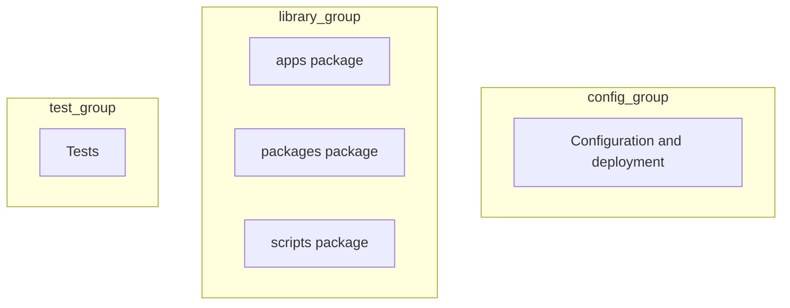

# Architecture report: juliencrn/usehooks-ts

> Automated static analysis. **Observed** = directly seen in files/imports/AST; **Inferred** = interpretation from that evidence. Repository code was not executed.

## 1. Repository at a glance

| Item | Value |
| --- | --- |
| Repository | juliencrn/usehooks-ts |
| Description | React hook library, ready to use, written in Typescript. |
| Language | TypeScript |
| Stars | 7866 |
| Licence | MIT |
| Analysed commit / branch | 61949134144d3690fe9f521260a16c779a6d3797 / master |
| Framework(s) | Next.js, React |
| Files analysed | 271 |
| Components | 5 |

## 2. Architecture in one minute

juliencrn/usehooks-ts - React hook library, ready to use, written in Typescript.. This repository was analysed statically from 271 file(s) (0 Python). Detected technologies (observed from imports/manifests): GitHub Actions, Next.js, React, Tailwind CSS, TypeScript, Vitest. Files are grouped into 5 component(s): apps package, Configuration and deployment, packages package, scripts package, Tests. Findings below distinguish observed facts from inferred interpretation.

## 3. High-level block diagram

## 4. Main components

### apps package (`apps`)

- **Kind:** library
- **Status:** Observed
- **Confidence:** 0.85
- **Responsibility:** Groups 39 file(s) under apps package (observed from repository paths and static analysis).
- **Paths:** `apps/www/.eslintrc.cjs`, `apps/www/env.js`, `apps/www/next-sitemap.config.js`, `apps/www/next.config.js`, `apps/www/postcss.config.cjs`, `apps/www/src/app/(docs)/introduction/page.tsx`, `apps/www/src/app/(docs)/layout.tsx`, `apps/www/src/app/(docs)/migrate-to-v3/page.tsx`, `apps/www/src/app/(docs)/react-hook/[slug]/page.tsx`, `apps/www/src/app/(marketing)/layout.tsx`, `apps/www/src/app/(marketing)/page.tsx`, `apps/www/src/app/layout.tsx`, `apps/www/src/components/buy-me-a-coffee.tsx`, `apps/www/src/components/carbon-ads/ads.tsx`, `apps/www/src/components/carbon-ads/index.ts`, `apps/www/src/components/carbon-ads/use-script.ts`, `apps/www/src/components/command-copy.tsx`, `apps/www/src/components/doc-search/command-menu.tsx`, `apps/www/src/components/doc-search/doc-search.tsx`, `apps/www/src/components/doc-search/footer.tsx`, `apps/www/src/components/doc-search/hits.tsx`, `apps/www/src/components/doc-search/index.ts`, `apps/www/src/components/doc-search/input.tsx`, `apps/www/src/components/doc-search/modal.context.tsx`, `apps/www/src/components/doc-search/open-button.tsx`, `apps/www/src/components/doc-search/types.ts`, `apps/www/src/components/doc-search/use-cmd-k.ts`, `apps/www/src/components/main-nav.tsx`, `apps/www/src/components/mobile-nav.tsx`, `apps/www/src/components/ui/button.tsx`, `apps/www/src/components/ui/command.tsx`, `apps/www/src/components/ui/components.tsx`, `apps/www/src/components/ui/dialog.tsx`, `apps/www/src/components/ui/dropdown-menu.tsx`, `apps/www/src/components/ui/icons.tsx`, `apps/www/src/lib/api.ts`, `apps/www/src/lib/utils.ts`, `apps/www/src/types/index.ts`, `apps/www/tailwind.config.js`
- **Evidence:** [apps/www/.eslintrc.cjs](https://github.com/juliencrn/usehooks-ts/blob/61949134144d3690fe9f521260a16c779a6d3797/apps/www/.eslintrc.cjs); [apps/www/env.js](https://github.com/juliencrn/usehooks-ts/blob/61949134144d3690fe9f521260a16c779a6d3797/apps/www/env.js); [apps/www/next-sitemap.config.js](https://github.com/juliencrn/usehooks-ts/blob/61949134144d3690fe9f521260a16c779a6d3797/apps/www/next-sitemap.config.js); [apps/www/next.config.js](https://github.com/juliencrn/usehooks-ts/blob/61949134144d3690fe9f521260a16c779a6d3797/apps/www/next.config.js); [apps/www/postcss.config.cjs](https://github.com/juliencrn/usehooks-ts/blob/61949134144d3690fe9f521260a16c779a6d3797/apps/www/postcss.config.cjs); [apps/www/src/app/(docs)/introduction/page.tsx](https://github.com/juliencrn/usehooks-ts/blob/61949134144d3690fe9f521260a16c779a6d3797/apps/www/src/app/%28docs%29/introduction/page.tsx); [apps/www/src/app/(docs)/layout.tsx](https://github.com/juliencrn/usehooks-ts/blob/61949134144d3690fe9f521260a16c779a6d3797/apps/www/src/app/%28docs%29/layout.tsx); [apps/www/src/app/(docs)/migrate-to-v3/page.tsx](https://github.com/juliencrn/usehooks-ts/blob/61949134144d3690fe9f521260a16c779a6d3797/apps/www/src/app/%28docs%29/migrate-to-v3/page.tsx)

### Configuration and deployment (`config`)

- **Kind:** config
- **Status:** Observed
- **Confidence:** 0.85
- **Responsibility:** Groups 13 file(s) under configuration and deployment (observed from repository paths and static analysis).
- **Paths:** `apps/www/package.json`, `apps/www/src/config/docs.ts`, `apps/www/src/config/marketing.ts`, `apps/www/src/config/site.ts`, `apps/www/tsconfig.json`, `package.json`, `packages/eslint-config-custom/package.json`, `packages/usehooks-ts/package.json`, `packages/usehooks-ts/tsconfig.json`, `pnpm-workspace.yaml`, `renovate.json`, `turbo.json`, `typedoc.json`
- **Evidence:** [apps/www/package.json](https://github.com/juliencrn/usehooks-ts/blob/61949134144d3690fe9f521260a16c779a6d3797/apps/www/package.json); [apps/www/src/config/docs.ts](https://github.com/juliencrn/usehooks-ts/blob/61949134144d3690fe9f521260a16c779a6d3797/apps/www/src/config/docs.ts); [apps/www/src/config/marketing.ts](https://github.com/juliencrn/usehooks-ts/blob/61949134144d3690fe9f521260a16c779a6d3797/apps/www/src/config/marketing.ts); [apps/www/src/config/site.ts](https://github.com/juliencrn/usehooks-ts/blob/61949134144d3690fe9f521260a16c779a6d3797/apps/www/src/config/site.ts); [apps/www/tsconfig.json](https://github.com/juliencrn/usehooks-ts/blob/61949134144d3690fe9f521260a16c779a6d3797/apps/www/tsconfig.json); [package.json](https://github.com/juliencrn/usehooks-ts/blob/61949134144d3690fe9f521260a16c779a6d3797/package.json); [packages/eslint-config-custom/package.json](https://github.com/juliencrn/usehooks-ts/blob/61949134144d3690fe9f521260a16c779a6d3797/packages/eslint-config-custom/package.json); [packages/usehooks-ts/package.json](https://github.com/juliencrn/usehooks-ts/blob/61949134144d3690fe9f521260a16c779a6d3797/packages/usehooks-ts/package.json)

### packages package (`packages`)

- **Kind:** library
- **Status:** Observed
- **Confidence:** 0.85
- **Responsibility:** Groups 134 file(s) under packages package (observed from repository paths and static analysis).
- **Paths:** `packages/eslint-config-custom/.eslintrc.cjs`, `packages/eslint-config-custom/index.cjs`, `packages/usehooks-ts/.eslintrc.cjs`, `packages/usehooks-ts/src/index.ts`, `packages/usehooks-ts/src/useBoolean/index.ts`, `packages/usehooks-ts/src/useBoolean/useBoolean.demo.tsx`, `packages/usehooks-ts/src/useBoolean/useBoolean.test.ts`, `packages/usehooks-ts/src/useBoolean/useBoolean.ts`, `packages/usehooks-ts/src/useClickAnyWhere/index.ts`, `packages/usehooks-ts/src/useClickAnyWhere/useClickAnyWhere.demo.tsx`, `packages/usehooks-ts/src/useClickAnyWhere/useClickAnyWhere.test.ts`, `packages/usehooks-ts/src/useClickAnyWhere/useClickAnyWhere.ts`, `packages/usehooks-ts/src/useCopyToClipboard/index.ts`, `packages/usehooks-ts/src/useCopyToClipboard/useCopyToClipboard.demo.tsx`, `packages/usehooks-ts/src/useCopyToClipboard/useCopyToClipboard.test.ts`, `packages/usehooks-ts/src/useCopyToClipboard/useCopyToClipboard.ts`, `packages/usehooks-ts/src/useCountdown/index.ts`, `packages/usehooks-ts/src/useCountdown/useCountdown.demo.tsx`, `packages/usehooks-ts/src/useCountdown/useCountdown.test.ts`, `packages/usehooks-ts/src/useCountdown/useCountdown.ts`, `packages/usehooks-ts/src/useCounter/index.ts`, `packages/usehooks-ts/src/useCounter/useCounter.demo.tsx`, `packages/usehooks-ts/src/useCounter/useCounter.test.ts`, `packages/usehooks-ts/src/useCounter/useCounter.ts`, `packages/usehooks-ts/src/useDarkMode/index.ts`, `packages/usehooks-ts/src/useDarkMode/useDarkMode.demo.tsx`, `packages/usehooks-ts/src/useDarkMode/useDarkMode.test.ts`, `packages/usehooks-ts/src/useDarkMode/useDarkMode.ts`, `packages/usehooks-ts/src/useDebounceCallback/index.ts`, `packages/usehooks-ts/src/useDebounceCallback/useDebounceCallback.demo.tsx`, `packages/usehooks-ts/src/useDebounceCallback/useDebounceCallback.test.ts`, `packages/usehooks-ts/src/useDebounceCallback/useDebounceCallback.ts`, `packages/usehooks-ts/src/useDebounceValue/index.ts`, `packages/usehooks-ts/src/useDebounceValue/useDebounceValue.demo.tsx`, `packages/usehooks-ts/src/useDebounceValue/useDebounceValue.test.ts`, `packages/usehooks-ts/src/useDebounceValue/useDebounceValue.ts`, `packages/usehooks-ts/src/useDocumentTitle/index.ts`, `packages/usehooks-ts/src/useDocumentTitle/useDocumentTitle.demo.tsx`, `packages/usehooks-ts/src/useDocumentTitle/useDocumentTitle.test.ts`, `packages/usehooks-ts/src/useDocumentTitle/useDocumentTitle.ts`, `packages/usehooks-ts/src/useEventCallback/index.ts`, `packages/usehooks-ts/src/useEventCallback/useEventCallback.demo.tsx`, `packages/usehooks-ts/src/useEventCallback/useEventCallback.test.tsx`, `packages/usehooks-ts/src/useEventCallback/useEventCallback.ts`, `packages/usehooks-ts/src/useEventListener/index.ts`, `packages/usehooks-ts/src/useEventListener/useEventListener.demo.tsx`, `packages/usehooks-ts/src/useEventListener/useEventListener.test.ts`, `packages/usehooks-ts/src/useEventListener/useEventListener.ts`, `packages/usehooks-ts/src/useHover/index.ts`, `packages/usehooks-ts/src/useHover/useHover.demo.tsx`, `packages/usehooks-ts/src/useHover/useHover.test.ts`, `packages/usehooks-ts/src/useHover/useHover.ts`, `packages/usehooks-ts/src/useIntersectionObserver/index.ts`, `packages/usehooks-ts/src/useIntersectionObserver/useIntersectionObserver.demo.tsx`, `packages/usehooks-ts/src/useIntersectionObserver/useIntersectionObserver.ts`, `packages/usehooks-ts/src/useInterval/index.ts`, `packages/usehooks-ts/src/useInterval/useInterval.demo.tsx`, `packages/usehooks-ts/src/useInterval/useInterval.test.ts`, `packages/usehooks-ts/src/useInterval/useInterval.ts`, `packages/usehooks-ts/src/useIsClient/index.ts`, `packages/usehooks-ts/src/useIsClient/useIsClient.demo.tsx`, `packages/usehooks-ts/src/useIsClient/useIsClient.test.ts`, `packages/usehooks-ts/src/useIsClient/useIsClient.ts`, `packages/usehooks-ts/src/useIsMounted/index.ts`, `packages/usehooks-ts/src/useIsMounted/useIsMounted.demo.tsx`, `packages/usehooks-ts/src/useIsMounted/useIsMounted.test.ts`, `packages/usehooks-ts/src/useIsMounted/useIsMounted.ts`, `packages/usehooks-ts/src/useIsomorphicLayoutEffect/index.ts`, `packages/usehooks-ts/src/useIsomorphicLayoutEffect/useIsomorphicLayoutEffect.demo.tsx`, `packages/usehooks-ts/src/useIsomorphicLayoutEffect/useIsomorphicLayoutEffect.ts`, `packages/usehooks-ts/src/useLocalStorage/index.ts`, `packages/usehooks-ts/src/useLocalStorage/useLocalStorage.demo.tsx`, `packages/usehooks-ts/src/useLocalStorage/useLocalStorage.test.ts`, `packages/usehooks-ts/src/useLocalStorage/useLocalStorage.ts`, `packages/usehooks-ts/src/useMap/index.ts`, `packages/usehooks-ts/src/useMap/useMap.demo.tsx`, `packages/usehooks-ts/src/useMap/useMap.test.ts`, `packages/usehooks-ts/src/useMap/useMap.ts`, `packages/usehooks-ts/src/useMediaQuery/index.ts`, `packages/usehooks-ts/src/useMediaQuery/useMediaQuery.demo.tsx`, `packages/usehooks-ts/src/useMediaQuery/useMediaQuery.ts`, `packages/usehooks-ts/src/useOnClickOutside/index.ts`, `packages/usehooks-ts/src/useOnClickOutside/useOnClickOuside.test.ts`, `packages/usehooks-ts/src/useOnClickOutside/useOnClickOutside.demo.tsx`, `packages/usehooks-ts/src/useOnClickOutside/useOnClickOutside.ts`, `packages/usehooks-ts/src/useReadLocalStorage/index.ts`, `packages/usehooks-ts/src/useReadLocalStorage/useReadLocalStorage.demo.tsx`, `packages/usehooks-ts/src/useReadLocalStorage/useReadLocalStorage.test.ts`, `packages/usehooks-ts/src/useReadLocalStorage/useReadLocalStorage.ts`, `packages/usehooks-ts/src/useResizeObserver/index.ts`, `packages/usehooks-ts/src/useResizeObserver/useResizeObserver.demo.tsx`, `packages/usehooks-ts/src/useResizeObserver/useResizeObserver.test.tsx`, `packages/usehooks-ts/src/useResizeObserver/useResizeObserver.ts`, `packages/usehooks-ts/src/useScreen/index.ts`, `packages/usehooks-ts/src/useScreen/useScreen.demo.tsx`, `packages/usehooks-ts/src/useScreen/useScreen.ts`, `packages/usehooks-ts/src/useScript/index.ts`, `packages/usehooks-ts/src/useScript/useScript.demo.tsx`, `packages/usehooks-ts/src/useScript/useScript.test.ts`, `packages/usehooks-ts/src/useScript/useScript.ts`, `packages/usehooks-ts/src/useScrollLock/index.ts`, `packages/usehooks-ts/src/useScrollLock/useScrollLock.demo.tsx`, `packages/usehooks-ts/src/useScrollLock/useScrollLock.test.ts`, `packages/usehooks-ts/src/useScrollLock/useScrollLock.ts`, `packages/usehooks-ts/src/useSessionStorage/index.ts`, `packages/usehooks-ts/src/useSessionStorage/useSessionStorage.demo.tsx`, `packages/usehooks-ts/src/useSessionStorage/useSessionStorage.test.ts`, `packages/usehooks-ts/src/useSessionStorage/useSessionStorage.ts`, `packages/usehooks-ts/src/useStep/index.ts`, `packages/usehooks-ts/src/useStep/useStep.demo.tsx`, `packages/usehooks-ts/src/useStep/useStep.test.ts`, `packages/usehooks-ts/src/useStep/useStep.ts`, `packages/usehooks-ts/src/useTernaryDarkMode/index.ts`, `packages/usehooks-ts/src/useTernaryDarkMode/useTernaryDarkMode.demo.tsx`, `packages/usehooks-ts/src/useTernaryDarkMode/useTernaryDarkMode.test.ts`, `packages/usehooks-ts/src/useTernaryDarkMode/useTernaryDarkMode.ts`, `packages/usehooks-ts/src/useTimeout/index.ts`, `packages/usehooks-ts/src/useTimeout/useTimeout.demo.tsx`, `packages/usehooks-ts/src/useTimeout/useTimeout.test.ts`, `packages/usehooks-ts/src/useTimeout/useTimeout.ts`, `packages/usehooks-ts/src/useToggle/index.ts`, `packages/usehooks-ts/src/useToggle/useToggle.demo.tsx`, `packages/usehooks-ts/src/useToggle/useToggle.test.ts`, `packages/usehooks-ts/src/useToggle/useToggle.ts`, `packages/usehooks-ts/src/useUnmount/index.ts`, `packages/usehooks-ts/src/useUnmount/useUnmount.demo.tsx`, `packages/usehooks-ts/src/useUnmount/useUnmount.test.ts`, `packages/usehooks-ts/src/useUnmount/useUnmount.ts`, `packages/usehooks-ts/src/useWindowSize/index.ts`, `packages/usehooks-ts/src/useWindowSize/useWindowSize.demo.tsx`, `packages/usehooks-ts/src/useWindowSize/useWindowSize.test.ts`, `packages/usehooks-ts/src/useWindowSize/useWindowSize.ts`, `packages/usehooks-ts/tsup.config.ts`, `packages/usehooks-ts/vitest.config.ts`
- **Evidence:** [packages/eslint-config-custom/.eslintrc.cjs](https://github.com/juliencrn/usehooks-ts/blob/61949134144d3690fe9f521260a16c779a6d3797/packages/eslint-config-custom/.eslintrc.cjs); [packages/eslint-config-custom/index.cjs](https://github.com/juliencrn/usehooks-ts/blob/61949134144d3690fe9f521260a16c779a6d3797/packages/eslint-config-custom/index.cjs); [packages/usehooks-ts/.eslintrc.cjs](https://github.com/juliencrn/usehooks-ts/blob/61949134144d3690fe9f521260a16c779a6d3797/packages/usehooks-ts/.eslintrc.cjs); [packages/usehooks-ts/src/index.ts](https://github.com/juliencrn/usehooks-ts/blob/61949134144d3690fe9f521260a16c779a6d3797/packages/usehooks-ts/src/index.ts); [packages/usehooks-ts/src/useBoolean/index.ts](https://github.com/juliencrn/usehooks-ts/blob/61949134144d3690fe9f521260a16c779a6d3797/packages/usehooks-ts/src/useBoolean/index.ts); [packages/usehooks-ts/src/useBoolean/useBoolean.demo.tsx](https://github.com/juliencrn/usehooks-ts/blob/61949134144d3690fe9f521260a16c779a6d3797/packages/usehooks-ts/src/useBoolean/useBoolean.demo.tsx); [packages/usehooks-ts/src/useBoolean/useBoolean.test.ts](https://github.com/juliencrn/usehooks-ts/blob/61949134144d3690fe9f521260a16c779a6d3797/packages/usehooks-ts/src/useBoolean/useBoolean.test.ts); [packages/usehooks-ts/src/useBoolean/useBoolean.ts](https://github.com/juliencrn/usehooks-ts/blob/61949134144d3690fe9f521260a16c779a6d3797/packages/usehooks-ts/src/useBoolean/useBoolean.ts)

### scripts package (`scripts`)

- **Kind:** library
- **Status:** Observed
- **Confidence:** 0.85
- **Responsibility:** Groups 9 file(s) under scripts package (observed from repository paths and static analysis).
- **Paths:** `scripts/env.js`, `scripts/generate-doc.js`, `scripts/update-algolia-index.js`, `scripts/update-testing-issue.js`, `scripts/utils/data-transform.js`, `scripts/utils/generate-doc-files.js`, `scripts/utils/get-hooks.js`, `scripts/utils/get-markdown-data.js`, `scripts/utils/update-readme.js`
- **Evidence:** [scripts/env.js](https://github.com/juliencrn/usehooks-ts/blob/61949134144d3690fe9f521260a16c779a6d3797/scripts/env.js); [scripts/generate-doc.js](https://github.com/juliencrn/usehooks-ts/blob/61949134144d3690fe9f521260a16c779a6d3797/scripts/generate-doc.js); [scripts/update-algolia-index.js](https://github.com/juliencrn/usehooks-ts/blob/61949134144d3690fe9f521260a16c779a6d3797/scripts/update-algolia-index.js); [scripts/update-testing-issue.js](https://github.com/juliencrn/usehooks-ts/blob/61949134144d3690fe9f521260a16c779a6d3797/scripts/update-testing-issue.js); [scripts/utils/data-transform.js](https://github.com/juliencrn/usehooks-ts/blob/61949134144d3690fe9f521260a16c779a6d3797/scripts/utils/data-transform.js); [scripts/utils/generate-doc-files.js](https://github.com/juliencrn/usehooks-ts/blob/61949134144d3690fe9f521260a16c779a6d3797/scripts/utils/generate-doc-files.js); [scripts/utils/get-hooks.js](https://github.com/juliencrn/usehooks-ts/blob/61949134144d3690fe9f521260a16c779a6d3797/scripts/utils/get-hooks.js); [scripts/utils/get-markdown-data.js](https://github.com/juliencrn/usehooks-ts/blob/61949134144d3690fe9f521260a16c779a6d3797/scripts/utils/get-markdown-data.js)

### Tests (`tests`)

- **Kind:** test
- **Status:** Observed
- **Confidence:** 0.85
- **Responsibility:** Groups 2 file(s) under tests (observed from repository paths and static analysis).
- **Paths:** `packages/usehooks-ts/tests/mocks.ts`, `packages/usehooks-ts/tests/setup.ts`
- **Evidence:** [packages/usehooks-ts/tests/mocks.ts](https://github.com/juliencrn/usehooks-ts/blob/61949134144d3690fe9f521260a16c779a6d3797/packages/usehooks-ts/tests/mocks.ts); [packages/usehooks-ts/tests/setup.ts](https://github.com/juliencrn/usehooks-ts/blob/61949134144d3690fe9f521260a16c779a6d3797/packages/usehooks-ts/tests/setup.ts)

## 5. Execution flow

**Observed** entry point(s):

- [packages/eslint-config-custom/index.cjs](https://github.com/juliencrn/usehooks-ts/blob/61949134144d3690fe9f521260a16c779a6d3797/packages/eslint-config-custom/index.cjs)
- [packages/usehooks-ts/src/index.ts](https://github.com/juliencrn/usehooks-ts/blob/61949134144d3690fe9f521260a16c779a6d3797/packages/usehooks-ts/src/index.ts)

Representative flow (derived from observed entry points and the import graph; steps beyond the entry point are **Inferred**):

1. Execution starts at an observed entry point listed above, if present.
2. No internal import relationships between components were observed.

## 6. Project structure

### `(root)`

- `.all-contributorsrc` - other (58108 bytes)
- `.editorconfig` - config (150 bytes)
- `.gitignore` - other (346 bytes)
- `.prettierignore` - other (98 bytes)
- `.prettierrc` - other (132 bytes)
- `LICENSE` - docs (1080 bytes)
- `README.md` - docs (102617 bytes)
- `package.json` - manifest (1913 bytes)
- `pnpm-workspace.yaml` - config (40 bytes)
- `renovate.json` - config (250 bytes)
- `turbo.json` - config (678 bytes)
- `typedoc.json` - config (1660 bytes)

### `.changeset`

- `.changeset/README.md` - docs (510 bytes)
- `.changeset/config.json` - config (273 bytes)

### `.github`

- `.github/CODE_OF_CONDUCT.md` - docs (5492 bytes)
- `.github/CONTRIBUTING.md` - docs (97801 bytes)
- `.github/FUNDING.yml` - config (873 bytes)
- `.github/ISSUE_TEMPLATE/bug-report.yml` - config (1006 bytes)
- `.github/ISSUE_TEMPLATE/config.yml` - config (651 bytes)
- `.github/ISSUE_TEMPLATE/update-docs.yml` - config (621 bytes)
- `.github/workflows/ci.yml` - ci, YAML (847 bytes)
- `.github/workflows/update-algolia-index.yml` - ci, YAML (1034 bytes)

### `.vscode`

- `.vscode/settings.json` - config (1723 bytes)

### `apps`

- `apps/www/.eslintrc.cjs` - source, JavaScript (131 bytes)
- `apps/www/.gitignore` - other (405 bytes)
- `apps/www/CHANGELOG.md` - docs (4050 bytes)
- `apps/www/env.js` - source, JavaScript (857 bytes)
- `apps/www/next-sitemap.config.js` - source, JavaScript (456 bytes)
- `apps/www/next.config.js` - source, JavaScript (489 bytes)
- `apps/www/package.json` - manifest (1759 bytes)
- `apps/www/postcss.config.cjs` - source, JavaScript (82 bytes)
- `apps/www/public/site.webmanifest` - other (263 bytes)
- `apps/www/src/app/(docs)/introduction/page.tsx` - source, TypeScript (2392 bytes)
- `apps/www/src/app/(docs)/layout.tsx` - source, TypeScript (1685 bytes)
- `apps/www/src/app/(docs)/migrate-to-v3/page.tsx` - source, TypeScript (5311 bytes)
- `apps/www/src/app/(docs)/react-hook/[slug]/page.tsx` - source, TypeScript (3147 bytes)
- `apps/www/src/app/(marketing)/layout.tsx` - source, TypeScript (1126 bytes)
- `apps/www/src/app/(marketing)/page.tsx` - source, TypeScript (9498 bytes)
- `apps/www/src/app/globals.css` - other (2269 bytes)
- `apps/www/src/app/layout.tsx` - source, TypeScript (2623 bytes)
- `apps/www/src/app/prism.css` - other (2695 bytes)
- `apps/www/src/components/buy-me-a-coffee.tsx` - source, TypeScript (9163 bytes)
- `apps/www/src/components/carbon-ads/ads.tsx` - source, TypeScript (686 bytes)
- `apps/www/src/components/carbon-ads/index.ts` - source, TypeScript (36 bytes)
- `apps/www/src/components/carbon-ads/use-script.ts` - source, TypeScript (825 bytes)
- `apps/www/src/components/command-copy.tsx` - source, TypeScript (2491 bytes)
- `apps/www/src/components/doc-search/command-menu.tsx` - source, TypeScript (935 bytes)
- `apps/www/src/components/doc-search/doc-search.tsx` - source, TypeScript (714 bytes)
- `apps/www/src/components/doc-search/footer.tsx` - source, TypeScript (8790 bytes)
- `apps/www/src/components/doc-search/hits.tsx` - source, TypeScript (1570 bytes)
- `apps/www/src/components/doc-search/index.ts` - source, TypeScript (29 bytes)
- `apps/www/src/components/doc-search/input.tsx` - source, TypeScript (1173 bytes)
- `apps/www/src/components/doc-search/modal.context.tsx` - source, TypeScript (1284 bytes)
- `apps/www/src/components/doc-search/open-button.tsx` - source, TypeScript (1122 bytes)
- `apps/www/src/components/doc-search/types.ts` - source, TypeScript (242 bytes)
- `apps/www/src/components/doc-search/use-cmd-k.ts` - source, TypeScript (261 bytes)
- `apps/www/src/components/docs/left-sidebar.tsx` - docs (2006 bytes)
- `apps/www/src/components/docs/page-header.tsx` - docs (554 bytes)
- `apps/www/src/components/docs/pager.tsx` - docs (1371 bytes)
- `apps/www/src/components/docs/right-sidebar.tsx` - docs (524 bytes)
- `apps/www/src/components/docs/table-of-content.tsx` - docs (2702 bytes)
- `apps/www/src/components/main-nav.tsx` - source, TypeScript (1944 bytes)
- `apps/www/src/components/mobile-nav.tsx` - source, TypeScript (1481 bytes)
- `apps/www/src/components/ui/button.tsx` - source, TypeScript (1836 bytes)
- `apps/www/src/components/ui/command.tsx` - source, TypeScript (5010 bytes)
- `apps/www/src/components/ui/components.tsx` - source, TypeScript (4758 bytes)
- `apps/www/src/components/ui/dialog.tsx` - source, TypeScript (3912 bytes)
- `apps/www/src/components/ui/dropdown-menu.tsx` - source, TypeScript (6977 bytes)
- `apps/www/src/components/ui/icons.tsx` - source, TypeScript (3186 bytes)
- `apps/www/src/config/docs.ts` - source, TypeScript (487 bytes)
- `apps/www/src/config/marketing.ts` - source, TypeScript (254 bytes)
- `apps/www/src/config/site.ts` - source, TypeScript (431 bytes)
- `apps/www/src/lib/api.ts` - source, TypeScript (1575 bytes)
- `apps/www/src/lib/utils.ts` - source, TypeScript (359 bytes)
- `apps/www/src/types/index.ts` - source, TypeScript (773 bytes)
- `apps/www/tailwind.config.js` - source, JavaScript (2267 bytes)
- `apps/www/tsconfig.json` - config (677 bytes)

### `packages`

- `packages/eslint-config-custom/.eslintrc.cjs` - source, JavaScript (3163 bytes)
- `packages/eslint-config-custom/.gitignore` - other (13 bytes)
- `packages/eslint-config-custom/CHANGELOG.md` - docs (550 bytes)
- `packages/eslint-config-custom/README.md` - docs (100 bytes)
- `packages/eslint-config-custom/index.cjs` - source, JavaScript (71 bytes)
- `packages/eslint-config-custom/package.json` - manifest (725 bytes)
- `packages/usehooks-ts/.eslintrc.cjs` - source, JavaScript (3108 bytes)
- `packages/usehooks-ts/.gitignore` - other (25 bytes)
- `packages/usehooks-ts/CHANGELOG.md` - docs (13918 bytes)
- `packages/usehooks-ts/README.md` - docs (102617 bytes)
- `packages/usehooks-ts/package.json` - manifest (1841 bytes)
- `packages/usehooks-ts/src/index.ts` - source, TypeScript (1079 bytes)
- `packages/usehooks-ts/src/useBoolean/index.ts` - source, TypeScript (29 bytes)
- `packages/usehooks-ts/src/useBoolean/useBoolean.demo.tsx` - source, TypeScript (576 bytes)
- `packages/usehooks-ts/src/useBoolean/useBoolean.md` - docs (127 bytes)
- `packages/usehooks-ts/src/useBoolean/useBoolean.test.ts` - source, TypeScript (2440 bytes)
- `packages/usehooks-ts/src/useBoolean/useBoolean.ts` - source, TypeScript (1598 bytes)
- `packages/usehooks-ts/src/useClickAnyWhere/index.ts` - source, TypeScript (35 bytes)
- `packages/usehooks-ts/src/useClickAnyWhere/useClickAnyWhere.demo.tsx` - source, TypeScript (271 bytes)
- `packages/usehooks-ts/src/useClickAnyWhere/useClickAnyWhere.md` - docs (170 bytes)
- `packages/usehooks-ts/src/useClickAnyWhere/useClickAnyWhere.test.ts` - source, TypeScript (1130 bytes)
- `packages/usehooks-ts/src/useClickAnyWhere/useClickAnyWhere.ts` - source, TypeScript (673 bytes)
- `packages/usehooks-ts/src/useCopyToClipboard/index.ts` - source, TypeScript (37 bytes)
- `packages/usehooks-ts/src/useCopyToClipboard/useCopyToClipboard.demo.tsx` - source, TypeScript (708 bytes)
- `packages/usehooks-ts/src/useCopyToClipboard/useCopyToClipboard.md` - docs (342 bytes)
- `packages/usehooks-ts/src/useCopyToClipboard/useCopyToClipboard.test.ts` - source, TypeScript (1159 bytes)
- `packages/usehooks-ts/src/useCopyToClipboard/useCopyToClipboard.ts` - source, TypeScript (1839 bytes)
- `packages/usehooks-ts/src/useCountdown/index.ts` - source, TypeScript (31 bytes)
- `packages/usehooks-ts/src/useCountdown/useCountdown.demo.tsx` - source, TypeScript (858 bytes)
- `packages/usehooks-ts/src/useCountdown/useCountdown.md` - docs (598 bytes)
- `packages/usehooks-ts/src/useCountdown/useCountdown.test.ts` - source, TypeScript (4960 bytes)
- `packages/usehooks-ts/src/useCountdown/useCountdown.ts` - source, TypeScript (2590 bytes)
- `packages/usehooks-ts/src/useCounter/index.ts` - source, TypeScript (29 bytes)
- `packages/usehooks-ts/src/useCounter/useCounter.demo.tsx` - source, TypeScript (497 bytes)
- `packages/usehooks-ts/src/useCounter/useCounter.md` - docs (68 bytes)
- `packages/usehooks-ts/src/useCounter/useCounter.test.ts` - source, TypeScript (1919 bytes)
- `packages/usehooks-ts/src/useCounter/useCounter.ts` - source, TypeScript (1472 bytes)
- `packages/usehooks-ts/src/useDarkMode/index.ts` - source, TypeScript (30 bytes)
- `packages/usehooks-ts/src/useDarkMode/useDarkMode.demo.tsx` - source, TypeScript (389 bytes)
- `packages/usehooks-ts/src/useDarkMode/useDarkMode.md` - docs (431 bytes)
- `packages/usehooks-ts/src/useDarkMode/useDarkMode.test.ts` - source, TypeScript (3565 bytes)
- `packages/usehooks-ts/src/useDarkMode/useDarkMode.ts` - source, TypeScript (2529 bytes)
- `packages/usehooks-ts/src/useDebounceCallback/index.ts` - source, TypeScript (38 bytes)
- `packages/usehooks-ts/src/useDebounceCallback/useDebounceCallback.demo.tsx` - source, TypeScript (437 bytes)
- `packages/usehooks-ts/src/useDebounceCallback/useDebounceCallback.md` - docs (662 bytes)
- `packages/usehooks-ts/src/useDebounceCallback/useDebounceCallback.test.ts` - source, TypeScript (2946 bytes)
- `packages/usehooks-ts/src/useDebounceCallback/useDebounceCallback.ts` - source, TypeScript (3644 bytes)
- `packages/usehooks-ts/src/useDebounceValue/index.ts` - source, TypeScript (35 bytes)
- `packages/usehooks-ts/src/useDebounceValue/useDebounceValue.demo.tsx` - source, TypeScript (413 bytes)
- `packages/usehooks-ts/src/useDebounceValue/useDebounceValue.md` - docs (1093 bytes)
- `packages/usehooks-ts/src/useDebounceValue/useDebounceValue.test.ts` - source, TypeScript (1451 bytes)
- `packages/usehooks-ts/src/useDebounceValue/useDebounceValue.ts` - source, TypeScript (2519 bytes)
- `packages/usehooks-ts/src/useDocumentTitle/index.ts` - source, TypeScript (35 bytes)
- `packages/usehooks-ts/src/useDocumentTitle/useDocumentTitle.demo.tsx` - source, TypeScript (125 bytes)
- `packages/usehooks-ts/src/useDocumentTitle/useDocumentTitle.md` - docs (222 bytes)
- `packages/usehooks-ts/src/useDocumentTitle/useDocumentTitle.test.ts` - source, TypeScript (1045 bytes)
- `packages/usehooks-ts/src/useDocumentTitle/useDocumentTitle.ts` - source, TypeScript (1174 bytes)
- `packages/usehooks-ts/src/useEventCallback/index.ts` - source, TypeScript (35 bytes)
- `packages/usehooks-ts/src/useEventCallback/useEventCallback.demo.tsx` - source, TypeScript (271 bytes)
- `packages/usehooks-ts/src/useEventCallback/useEventCallback.md` - docs (1152 bytes)
- `packages/usehooks-ts/src/useEventCallback/useEventCallback.test.tsx` - source, TypeScript (1774 bytes)
- `packages/usehooks-ts/src/useEventCallback/useEventCallback.ts` - source, TypeScript (1336 bytes)
- `packages/usehooks-ts/src/useEventListener/index.ts` - source, TypeScript (35 bytes)
- `packages/usehooks-ts/src/useEventListener/useEventListener.demo.tsx` - source, TypeScript (969 bytes)
- `packages/usehooks-ts/src/useEventListener/useEventListener.md` - docs (680 bytes)
- `packages/usehooks-ts/src/useEventListener/useEventListener.test.ts` - source, TypeScript (4267 bytes)
- `packages/usehooks-ts/src/useEventListener/useEventListener.ts` - source, TypeScript (4228 bytes)
- `packages/usehooks-ts/src/useHover/index.ts` - source, TypeScript (27 bytes)
- `packages/usehooks-ts/src/useHover/useHover.demo.tsx` - source, TypeScript (298 bytes)
- `packages/usehooks-ts/src/useHover/useHover.md` - docs (160 bytes)
- `packages/usehooks-ts/src/useHover/useHover.test.ts` - source, TypeScript (988 bytes)
- `packages/usehooks-ts/src/useHover/useHover.ts` - source, TypeScript (1170 bytes)
- `packages/usehooks-ts/src/useIntersectionObserver/index.ts` - source, TypeScript (42 bytes)
- `packages/usehooks-ts/src/useIntersectionObserver/useIntersectionObserver.demo.tsx` - source, TypeScript (726 bytes)
- `packages/usehooks-ts/src/useIntersectionObserver/useIntersectionObserver.md` - docs (2320 bytes)
- `packages/usehooks-ts/src/useIntersectionObserver/useIntersectionObserver.ts` - source, TypeScript (5565 bytes)
- `packages/usehooks-ts/src/useInterval/index.ts` - source, TypeScript (30 bytes)
- `packages/usehooks-ts/src/useInterval/useInterval.demo.tsx` - source, TypeScript (1054 bytes)
- `packages/usehooks-ts/src/useInterval/useInterval.md` - docs (622 bytes)
- `packages/usehooks-ts/src/useInterval/useInterval.test.ts` - source, TypeScript (1523 bytes)
- `packages/usehooks-ts/src/useInterval/useInterval.ts` - source, TypeScript (1373 bytes)
- `packages/usehooks-ts/src/useIsClient/index.ts` - source, TypeScript (30 bytes)
- `packages/usehooks-ts/src/useIsClient/useIsClient.demo.tsx` - source, TypeScript (172 bytes)
- `packages/usehooks-ts/src/useIsClient/useIsClient.md` - docs (110 bytes)
- `packages/usehooks-ts/src/useIsClient/useIsClient.test.ts` - source, TypeScript (632 bytes)
- `packages/usehooks-ts/src/useIsClient/useIsClient.ts` - source, TypeScript (629 bytes)
- `packages/usehooks-ts/src/useIsMounted/index.ts` - source, TypeScript (31 bytes)
- `packages/usehooks-ts/src/useIsMounted/useIsMounted.demo.tsx` - source, TypeScript (772 bytes)
- `packages/usehooks-ts/src/useIsMounted/useIsMounted.md` - docs (903 bytes)
- `packages/usehooks-ts/src/useIsMounted/useIsMounted.test.ts` - source, TypeScript (559 bytes)
- `packages/usehooks-ts/src/useIsMounted/useIsMounted.ts` - source, TypeScript (773 bytes)
- `packages/usehooks-ts/src/useIsomorphicLayoutEffect/index.ts` - source, TypeScript (44 bytes)
- `packages/usehooks-ts/src/useIsomorphicLayoutEffect/useIsomorphicLayoutEffect.demo.tsx` - source, TypeScript (294 bytes)
- `packages/usehooks-ts/src/useIsomorphicLayoutEffect/useIsomorphicLayoutEffect.md` - docs (837 bytes)
- `packages/usehooks-ts/src/useIsomorphicLayoutEffect/useIsomorphicLayoutEffect.ts` - source, TypeScript (713 bytes)
- `packages/usehooks-ts/src/useLocalStorage/index.ts` - source, TypeScript (34 bytes)
- `packages/usehooks-ts/src/useLocalStorage/useLocalStorage.demo.tsx` - source, TypeScript (608 bytes)
- `packages/usehooks-ts/src/useLocalStorage/useLocalStorage.md` - docs (999 bytes)
- `packages/usehooks-ts/src/useLocalStorage/useLocalStorage.test.ts` - source, TypeScript (7097 bytes)
- `packages/usehooks-ts/src/useLocalStorage/useLocalStorage.ts` - source, TypeScript (6421 bytes)
- `packages/usehooks-ts/src/useMap/index.ts` - source, TypeScript (25 bytes)
- `packages/usehooks-ts/src/useMap/useMap.demo.tsx` - source, TypeScript (931 bytes)
- `packages/usehooks-ts/src/useMap/useMap.md` - docs (728 bytes)
- `packages/usehooks-ts/src/useMap/useMap.test.ts` - source, TypeScript (3375 bytes)
- `packages/usehooks-ts/src/useMap/useMap.ts` - source, TypeScript (2556 bytes)
- `packages/usehooks-ts/src/useMediaQuery/index.ts` - source, TypeScript (32 bytes)
- `packages/usehooks-ts/src/useMediaQuery/useMediaQuery.demo.tsx` - source, TypeScript (261 bytes)
- `packages/usehooks-ts/src/useMediaQuery/useMediaQuery.md` - docs (488 bytes)
- `packages/usehooks-ts/src/useMediaQuery/useMediaQuery.ts` - source, TypeScript (2500 bytes)
- `packages/usehooks-ts/src/useOnClickOutside/index.ts` - source, TypeScript (36 bytes)
- `packages/usehooks-ts/src/useOnClickOutside/useOnClickOuside.test.ts` - source, TypeScript (2727 bytes)
- `packages/usehooks-ts/src/useOnClickOutside/useOnClickOutside.demo.tsx` - source, TypeScript (561 bytes)
- `packages/usehooks-ts/src/useOnClickOutside/useOnClickOutside.md` - docs (145 bytes)
- `packages/usehooks-ts/src/useOnClickOutside/useOnClickOutside.ts` - source, TypeScript (2009 bytes)
- `packages/usehooks-ts/src/useReadLocalStorage/index.ts` - source, TypeScript (38 bytes)
- `packages/usehooks-ts/src/useReadLocalStorage/useReadLocalStorage.demo.tsx` - source, TypeScript (277 bytes)
- `packages/usehooks-ts/src/useReadLocalStorage/useReadLocalStorage.md` - docs (477 bytes)
- `packages/usehooks-ts/src/useReadLocalStorage/useReadLocalStorage.test.ts` - source, TypeScript (318 bytes)
- `packages/usehooks-ts/src/useReadLocalStorage/useReadLocalStorage.ts` - source, TypeScript (3834 bytes)
- `packages/usehooks-ts/src/useResizeObserver/index.ts` - source, TypeScript (36 bytes)
- `packages/usehooks-ts/src/useResizeObserver/useResizeObserver.demo.tsx` - source, TypeScript (1071 bytes)
- `packages/usehooks-ts/src/useResizeObserver/useResizeObserver.md` - docs (986 bytes)
- `packages/usehooks-ts/src/useResizeObserver/useResizeObserver.test.tsx` - source, TypeScript (1837 bytes)
- `packages/usehooks-ts/src/useResizeObserver/useResizeObserver.ts` - source, TypeScript (3820 bytes)
- `packages/usehooks-ts/src/useScreen/index.ts` - source, TypeScript (28 bytes)
- `packages/usehooks-ts/src/useScreen/useScreen.demo.tsx` - source, TypeScript (246 bytes)
- `packages/usehooks-ts/src/useScreen/useScreen.md` - docs (384 bytes)
- `packages/usehooks-ts/src/useScreen/useScreen.ts` - source, TypeScript (3127 bytes)
- `packages/usehooks-ts/src/useScript/index.ts` - source, TypeScript (28 bytes)
- `packages/usehooks-ts/src/useScript/useScript.demo.tsx` - source, TypeScript (796 bytes)
- `packages/usehooks-ts/src/useScript/useScript.md` - docs (256 bytes)
- `packages/usehooks-ts/src/useScript/useScript.test.ts` - source, TypeScript (2132 bytes)
- `packages/usehooks-ts/src/useScript/useScript.ts` - source, TypeScript (4775 bytes)
- `packages/usehooks-ts/src/useScrollLock/index.ts` - source, TypeScript (32 bytes)
- `packages/usehooks-ts/src/useScrollLock/useScrollLock.demo.tsx` - source, TypeScript (826 bytes)
- `packages/usehooks-ts/src/useScrollLock/useScrollLock.md` - docs (239 bytes)
- `packages/usehooks-ts/src/useScrollLock/useScrollLock.test.ts` - source, TypeScript (3354 bytes)
- `packages/usehooks-ts/src/useScrollLock/useScrollLock.ts` - source, TypeScript (3816 bytes)
- `packages/usehooks-ts/src/useSessionStorage/index.ts` - source, TypeScript (36 bytes)
- `packages/usehooks-ts/src/useSessionStorage/useSessionStorage.demo.tsx` - source, TypeScript (614 bytes)
- `packages/usehooks-ts/src/useSessionStorage/useSessionStorage.md` - docs (652 bytes)
- `packages/usehooks-ts/src/useSessionStorage/useSessionStorage.test.ts` - source, TypeScript (6922 bytes)
- `packages/usehooks-ts/src/useSessionStorage/useSessionStorage.ts` - source, TypeScript (6499 bytes)
- `packages/usehooks-ts/src/useStep/index.ts` - source, TypeScript (26 bytes)
- `packages/usehooks-ts/src/useStep/useStep.demo.tsx` - source, TypeScript (748 bytes)
- `packages/usehooks-ts/src/useStep/useStep.md` - docs (68 bytes)
- `packages/usehooks-ts/src/useStep/useStep.test.ts` - source, TypeScript (1918 bytes)
- `packages/usehooks-ts/src/useStep/useStep.ts` - source, TypeScript (2438 bytes)
- `packages/usehooks-ts/src/useTernaryDarkMode/index.ts` - source, TypeScript (37 bytes)
- `packages/usehooks-ts/src/useTernaryDarkMode/useTernaryDarkMode.demo.tsx` - source, TypeScript (1112 bytes)
- `packages/usehooks-ts/src/useTernaryDarkMode/useTernaryDarkMode.md` - docs (1136 bytes)
- `packages/usehooks-ts/src/useTernaryDarkMode/useTernaryDarkMode.test.ts` - source, TypeScript (3344 bytes)
- `packages/usehooks-ts/src/useTernaryDarkMode/useTernaryDarkMode.ts` - source, TypeScript (2847 bytes)
- `packages/usehooks-ts/src/useTimeout/index.ts` - source, TypeScript (29 bytes)
- `packages/usehooks-ts/src/useTimeout/useTimeout.demo.tsx` - source, TypeScript (402 bytes)
- `packages/usehooks-ts/src/useTimeout/useTimeout.md` - docs (364 bytes)
- `packages/usehooks-ts/src/useTimeout/useTimeout.test.ts` - source, TypeScript (856 bytes)
- `packages/usehooks-ts/src/useTimeout/useTimeout.ts` - source, TypeScript (1434 bytes)
- `packages/usehooks-ts/src/useToggle/index.ts` - source, TypeScript (28 bytes)
- `packages/usehooks-ts/src/useToggle/useToggle.demo.tsx` - source, TypeScript (679 bytes)
- `packages/usehooks-ts/src/useToggle/useToggle.md` - docs (129 bytes)
- `packages/usehooks-ts/src/useToggle/useToggle.test.ts` - source, TypeScript (1303 bytes)
- `packages/usehooks-ts/src/useToggle/useToggle.ts` - source, TypeScript (1113 bytes)
- `packages/usehooks-ts/src/useUnmount/index.ts` - source, TypeScript (29 bytes)
- `packages/usehooks-ts/src/useUnmount/useUnmount.demo.tsx` - source, TypeScript (168 bytes)
- `packages/usehooks-ts/src/useUnmount/useUnmount.md` - docs (142 bytes)
- `packages/usehooks-ts/src/useUnmount/useUnmount.test.ts` - source, TypeScript (451 bytes)
- `packages/usehooks-ts/src/useUnmount/useUnmount.ts` - source, TypeScript (555 bytes)
- `packages/usehooks-ts/src/useWindowSize/index.ts` - source, TypeScript (32 bytes)
- `packages/usehooks-ts/src/useWindowSize/useWindowSize.demo.tsx` - source, TypeScript (279 bytes)
- `packages/usehooks-ts/src/useWindowSize/useWindowSize.md` - docs (341 bytes)
- `packages/usehooks-ts/src/useWindowSize/useWindowSize.test.ts` - source, TypeScript (2129 bytes)
- `packages/usehooks-ts/src/useWindowSize/useWindowSize.ts` - source, TypeScript (2934 bytes)
- `packages/usehooks-ts/tests/mocks.ts` - test, TypeScript (1257 bytes)
- `packages/usehooks-ts/tests/setup.ts` - test, TypeScript (214 bytes)
- `packages/usehooks-ts/tsconfig.json` - config (500 bytes)
- `packages/usehooks-ts/tsup.config.ts` - source, TypeScript (228 bytes)
- `packages/usehooks-ts/vitest.config.ts` - source, TypeScript (175 bytes)

### `scripts`

- `scripts/env.js` - source, JavaScript (253 bytes)
- `scripts/generate-doc.js` - source, JavaScript (943 bytes)
- `scripts/update-algolia-index.js` - source, JavaScript (1780 bytes)
- `scripts/update-testing-issue.js` - source, JavaScript (2574 bytes)
- `scripts/utils/data-transform.js` - source, JavaScript (3639 bytes)
- `scripts/utils/generate-doc-files.js` - source, JavaScript (1784 bytes)
- `scripts/utils/get-hooks.js` - source, JavaScript (1596 bytes)
- `scripts/utils/get-markdown-data.js` - source, JavaScript (1279 bytes)
- `scripts/utils/update-readme.js` - source, JavaScript (721 bytes)

### `turbo`

- `turbo/generators/config.cts` - other (1789 bytes)
- `turbo/generators/templates/hook/hook.demo.tsx.hbs` - other (165 bytes)
- `turbo/generators/templates/hook/hook.mdx.hbs` - other (37 bytes)
- `turbo/generators/templates/hook/hook.test.ts.hbs` - other (381 bytes)
- `turbo/generators/templates/hook/hook.ts.hbs` - other (868 bytes)
- `turbo/generators/templates/hook/index.ts.hbs` - other (37 bytes)
- `turbo/generators/templates/index.ts.hbs` - other (37 bytes)

## 7. Key dependencies and integrations

| Name | Category | Status | Confidence | Evidence |
| --- | --- | --- | --- | --- |
| GitHub Actions | ci | Observed | 0.90 | [.github/workflows/ci.yml](https://github.com/juliencrn/usehooks-ts/blob/61949134144d3690fe9f521260a16c779a6d3797/.github/workflows/ci.yml); [.github/workflows/update-algolia-index.yml](https://github.com/juliencrn/usehooks-ts/blob/61949134144d3690fe9f521260a16c779a6d3797/.github/workflows/update-algolia-index.yml) |
| Next.js | framework | Observed | 0.85 | [apps/www/package.json:7](https://github.com/juliencrn/usehooks-ts/blob/61949134144d3690fe9f521260a16c779a6d3797/apps/www/package.json#L7) |
| React | framework | Observed | 0.90 | [apps/www/package.json:17](https://github.com/juliencrn/usehooks-ts/blob/61949134144d3690fe9f521260a16c779a6d3797/apps/www/package.json#L17); [apps/www/package.json:32](https://github.com/juliencrn/usehooks-ts/blob/61949134144d3690fe9f521260a16c779a6d3797/apps/www/package.json#L32); [packages/usehooks-ts/package.json:5](https://github.com/juliencrn/usehooks-ts/blob/61949134144d3690fe9f521260a16c779a6d3797/packages/usehooks-ts/package.json#L5) |
| Tailwind CSS | library | Observed | 0.85 | [apps/www/package.json:38](https://github.com/juliencrn/usehooks-ts/blob/61949134144d3690fe9f521260a16c779a6d3797/apps/www/package.json#L38) |
| TypeScript | tooling | Observed | 0.90 | [apps/www/package.json:55](https://github.com/juliencrn/usehooks-ts/blob/61949134144d3690fe9f521260a16c779a6d3797/apps/www/package.json#L55); [packages/eslint-config-custom/package.json:11](https://github.com/juliencrn/usehooks-ts/blob/61949134144d3690fe9f521260a16c779a6d3797/packages/eslint-config-custom/package.json#L11); [packages/usehooks-ts/package.json:5](https://github.com/juliencrn/usehooks-ts/blob/61949134144d3690fe9f521260a16c779a6d3797/packages/usehooks-ts/package.json#L5) |
| Vitest | tooling | Observed | 0.85 | [packages/usehooks-ts/package.json:34](https://github.com/juliencrn/usehooks-ts/blob/61949134144d3690fe9f521260a16c779a6d3797/packages/usehooks-ts/package.json#L34) |

## 8. Data and state

No database, cache, queue, or persistent-state usage was observed in the analysed files. State handling, if any, may be in-memory or in files that were not analysed.

## 9. Configuration and deployment clues

- `.changeset/config.json` (config)
- `.editorconfig` (config)
- `.github/FUNDING.yml` (config)
- `.github/ISSUE_TEMPLATE/bug-report.yml` (config)
- `.github/ISSUE_TEMPLATE/config.yml` (config)
- `.github/ISSUE_TEMPLATE/update-docs.yml` (config)
- `.github/workflows/ci.yml` (ci)
- `.github/workflows/update-algolia-index.yml` (ci)
- `.vscode/settings.json` (config)
- `apps/www/package.json` (manifest)
- `apps/www/tsconfig.json` (config)
- `package.json` (manifest)
- `packages/eslint-config-custom/package.json` (manifest)
- `packages/usehooks-ts/package.json` (manifest)
- `packages/usehooks-ts/tsconfig.json` (config)
- `pnpm-workspace.yaml` (config)
- `renovate.json` (config)
- `turbo.json` (config)
- `typedoc.json` (config)

## 10. Design observations

- Tests are present alongside source code (Observed from test file paths).

These observations are interpretations (**Inferred**) of the observed structure, not guarantees about runtime design.

## 11. Limitations and unknowns

- Static analysis only: repository code was not executed, installed, or imported at runtime.
- Components and relationships are inferred from file paths, imports, and AST structure; runtime behaviour, dynamic imports, and reflection may not be visible.
- No clear application entry point was observed in the analysed files.
- Repository text was treated as untrusted data; no instructions found in repository files were followed, and likely secret values were redacted/excluded.
- JavaScript and TypeScript files were inventoried from paths and package manifests. They were not parsed with a full language AST, and repository code was not executed.

## 12. Source references

- [.github/workflows/ci.yml](https://github.com/juliencrn/usehooks-ts/blob/61949134144d3690fe9f521260a16c779a6d3797/.github/workflows/ci.yml)
- [.github/workflows/update-algolia-index.yml](https://github.com/juliencrn/usehooks-ts/blob/61949134144d3690fe9f521260a16c779a6d3797/.github/workflows/update-algolia-index.yml)
- [apps/www/.eslintrc.cjs](https://github.com/juliencrn/usehooks-ts/blob/61949134144d3690fe9f521260a16c779a6d3797/apps/www/.eslintrc.cjs)
- [apps/www/env.js](https://github.com/juliencrn/usehooks-ts/blob/61949134144d3690fe9f521260a16c779a6d3797/apps/www/env.js)
- [apps/www/next-sitemap.config.js](https://github.com/juliencrn/usehooks-ts/blob/61949134144d3690fe9f521260a16c779a6d3797/apps/www/next-sitemap.config.js)
- [apps/www/next.config.js](https://github.com/juliencrn/usehooks-ts/blob/61949134144d3690fe9f521260a16c779a6d3797/apps/www/next.config.js)
- [apps/www/package.json](https://github.com/juliencrn/usehooks-ts/blob/61949134144d3690fe9f521260a16c779a6d3797/apps/www/package.json)
- [apps/www/package.json:7](https://github.com/juliencrn/usehooks-ts/blob/61949134144d3690fe9f521260a16c779a6d3797/apps/www/package.json#L7)
- [apps/www/package.json:17](https://github.com/juliencrn/usehooks-ts/blob/61949134144d3690fe9f521260a16c779a6d3797/apps/www/package.json#L17)
- [apps/www/package.json:32](https://github.com/juliencrn/usehooks-ts/blob/61949134144d3690fe9f521260a16c779a6d3797/apps/www/package.json#L32)
- [apps/www/package.json:38](https://github.com/juliencrn/usehooks-ts/blob/61949134144d3690fe9f521260a16c779a6d3797/apps/www/package.json#L38)
- [apps/www/package.json:55](https://github.com/juliencrn/usehooks-ts/blob/61949134144d3690fe9f521260a16c779a6d3797/apps/www/package.json#L55)
- [apps/www/postcss.config.cjs](https://github.com/juliencrn/usehooks-ts/blob/61949134144d3690fe9f521260a16c779a6d3797/apps/www/postcss.config.cjs)
- [apps/www/src/app/(docs)/introduction/page.tsx](https://github.com/juliencrn/usehooks-ts/blob/61949134144d3690fe9f521260a16c779a6d3797/apps/www/src/app/%28docs%29/introduction/page.tsx)
- [apps/www/src/app/(docs)/layout.tsx](https://github.com/juliencrn/usehooks-ts/blob/61949134144d3690fe9f521260a16c779a6d3797/apps/www/src/app/%28docs%29/layout.tsx)
- [apps/www/src/app/(docs)/migrate-to-v3/page.tsx](https://github.com/juliencrn/usehooks-ts/blob/61949134144d3690fe9f521260a16c779a6d3797/apps/www/src/app/%28docs%29/migrate-to-v3/page.tsx)
- [apps/www/src/config/docs.ts](https://github.com/juliencrn/usehooks-ts/blob/61949134144d3690fe9f521260a16c779a6d3797/apps/www/src/config/docs.ts)
- [apps/www/src/config/marketing.ts](https://github.com/juliencrn/usehooks-ts/blob/61949134144d3690fe9f521260a16c779a6d3797/apps/www/src/config/marketing.ts)
- [apps/www/src/config/site.ts](https://github.com/juliencrn/usehooks-ts/blob/61949134144d3690fe9f521260a16c779a6d3797/apps/www/src/config/site.ts)
- [apps/www/tsconfig.json](https://github.com/juliencrn/usehooks-ts/blob/61949134144d3690fe9f521260a16c779a6d3797/apps/www/tsconfig.json)
- [package.json](https://github.com/juliencrn/usehooks-ts/blob/61949134144d3690fe9f521260a16c779a6d3797/package.json)
- [packages/eslint-config-custom/.eslintrc.cjs](https://github.com/juliencrn/usehooks-ts/blob/61949134144d3690fe9f521260a16c779a6d3797/packages/eslint-config-custom/.eslintrc.cjs)
- [packages/eslint-config-custom/index.cjs](https://github.com/juliencrn/usehooks-ts/blob/61949134144d3690fe9f521260a16c779a6d3797/packages/eslint-config-custom/index.cjs)
- [packages/eslint-config-custom/package.json](https://github.com/juliencrn/usehooks-ts/blob/61949134144d3690fe9f521260a16c779a6d3797/packages/eslint-config-custom/package.json)
- [packages/eslint-config-custom/package.json:11](https://github.com/juliencrn/usehooks-ts/blob/61949134144d3690fe9f521260a16c779a6d3797/packages/eslint-config-custom/package.json#L11)
- [packages/usehooks-ts/.eslintrc.cjs](https://github.com/juliencrn/usehooks-ts/blob/61949134144d3690fe9f521260a16c779a6d3797/packages/usehooks-ts/.eslintrc.cjs)
- [packages/usehooks-ts/package.json](https://github.com/juliencrn/usehooks-ts/blob/61949134144d3690fe9f521260a16c779a6d3797/packages/usehooks-ts/package.json)
- [packages/usehooks-ts/package.json:5](https://github.com/juliencrn/usehooks-ts/blob/61949134144d3690fe9f521260a16c779a6d3797/packages/usehooks-ts/package.json#L5)
- [packages/usehooks-ts/package.json:34](https://github.com/juliencrn/usehooks-ts/blob/61949134144d3690fe9f521260a16c779a6d3797/packages/usehooks-ts/package.json#L34)
- [packages/usehooks-ts/src/index.ts](https://github.com/juliencrn/usehooks-ts/blob/61949134144d3690fe9f521260a16c779a6d3797/packages/usehooks-ts/src/index.ts)
- [packages/usehooks-ts/src/useBoolean/index.ts](https://github.com/juliencrn/usehooks-ts/blob/61949134144d3690fe9f521260a16c779a6d3797/packages/usehooks-ts/src/useBoolean/index.ts)
- [packages/usehooks-ts/src/useBoolean/useBoolean.demo.tsx](https://github.com/juliencrn/usehooks-ts/blob/61949134144d3690fe9f521260a16c779a6d3797/packages/usehooks-ts/src/useBoolean/useBoolean.demo.tsx)
- [packages/usehooks-ts/src/useBoolean/useBoolean.test.ts](https://github.com/juliencrn/usehooks-ts/blob/61949134144d3690fe9f521260a16c779a6d3797/packages/usehooks-ts/src/useBoolean/useBoolean.test.ts)
- [packages/usehooks-ts/src/useBoolean/useBoolean.ts](https://github.com/juliencrn/usehooks-ts/blob/61949134144d3690fe9f521260a16c779a6d3797/packages/usehooks-ts/src/useBoolean/useBoolean.ts)
- [packages/usehooks-ts/tests/mocks.ts](https://github.com/juliencrn/usehooks-ts/blob/61949134144d3690fe9f521260a16c779a6d3797/packages/usehooks-ts/tests/mocks.ts)
- [packages/usehooks-ts/tests/setup.ts](https://github.com/juliencrn/usehooks-ts/blob/61949134144d3690fe9f521260a16c779a6d3797/packages/usehooks-ts/tests/setup.ts)
- [scripts/env.js](https://github.com/juliencrn/usehooks-ts/blob/61949134144d3690fe9f521260a16c779a6d3797/scripts/env.js)
- [scripts/generate-doc.js](https://github.com/juliencrn/usehooks-ts/blob/61949134144d3690fe9f521260a16c779a6d3797/scripts/generate-doc.js)
- [scripts/update-algolia-index.js](https://github.com/juliencrn/usehooks-ts/blob/61949134144d3690fe9f521260a16c779a6d3797/scripts/update-algolia-index.js)
- [scripts/update-testing-issue.js](https://github.com/juliencrn/usehooks-ts/blob/61949134144d3690fe9f521260a16c779a6d3797/scripts/update-testing-issue.js)
- [scripts/utils/data-transform.js](https://github.com/juliencrn/usehooks-ts/blob/61949134144d3690fe9f521260a16c779a6d3797/scripts/utils/data-transform.js)
- [scripts/utils/generate-doc-files.js](https://github.com/juliencrn/usehooks-ts/blob/61949134144d3690fe9f521260a16c779a6d3797/scripts/utils/generate-doc-files.js)
- [scripts/utils/get-hooks.js](https://github.com/juliencrn/usehooks-ts/blob/61949134144d3690fe9f521260a16c779a6d3797/scripts/utils/get-hooks.js)
- [scripts/utils/get-markdown-data.js](https://github.com/juliencrn/usehooks-ts/blob/61949134144d3690fe9f521260a16c779a6d3797/scripts/utils/get-markdown-data.js)
