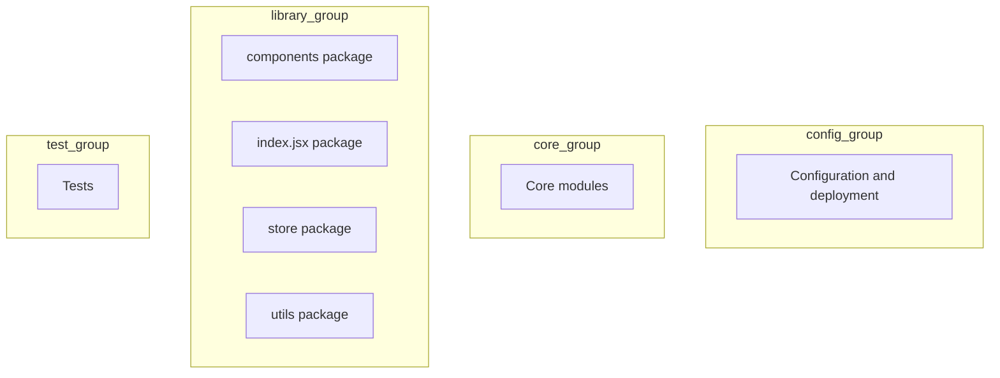

# Architecture report: jvalen/pixel-art-react

> Automated static analysis. **Observed** = directly seen in files/imports/AST; **Inferred** = interpretation from that evidence. Repository code was not executed.

## 1. Repository at a glance

| Item | Value |
| --- | --- |
| Repository | jvalen/pixel-art-react |
| Description | Pixel art animation and drawing web app powered by React |
| Language | JavaScript |
| Stars | 6062 |
| Licence | MIT |
| Analysed commit / branch | 73b57b6b2305146b5a9f94ec9786ea701749c356 / master |
| Framework(s) | React |
| Files analysed | 155 |
| Components | 7 |

## 2. Architecture in one minute

jvalen/pixel-art-react - Pixel art animation and drawing web app powered by React. This repository was analysed statically from 155 file(s) (0 Python). Detected technologies (observed from imports/manifests): React, React Router, Redux, Jest, webpack. Files are grouped into 7 component(s): components package, Configuration and deployment, Core modules, index.jsx package, store package, Tests, utils package. Findings below distinguish observed facts from inferred interpretation.

## 3. High-level block diagram

## 4. Main components

### components package (`components`)

- **Kind:** library
- **Status:** Observed
- **Confidence:** 0.85
- **Responsibility:** Groups 50 file(s) under components package (observed from repository paths and static analysis).
- **Paths:** `src/components/About/About.jsx`, `src/components/Animation.jsx`, `src/components/App.jsx`, `src/components/Bucket.jsx`, `src/components/CellSize.jsx`, `src/components/CellsInfo.jsx`, `src/components/Checkbox.jsx`, `src/components/ColorPicker.jsx`, `src/components/Cookies.jsx`, `src/components/CopyCSS.jsx`, `src/components/CssDisplay.jsx`, `src/components/Dimensions.jsx`, `src/components/DownloadDrawing.jsx`, `src/components/Duration.jsx`, `src/components/Eraser.jsx`, `src/components/Eyedropper.jsx`, `src/components/Frame.jsx`, `src/components/FramesHandler.jsx`, `src/components/GridWrapper.jsx`, `src/components/KeyBindings.jsx`, `src/components/KeyBindingsLegend.jsx`, `src/components/LoadDrawing.jsx`, `src/components/Mentions/Mentions.jsx`, `src/components/Modal.jsx`, `src/components/Move.jsx`, `src/components/NewProject.jsx`, `src/components/NotFound.jsx`, `src/components/Output.jsx`, `src/components/PaletteColor.jsx`, `src/components/PaletteGrid.jsx`, `src/components/Picker.jsx`, `src/components/PixelCanvas.jsx`, `src/components/PixelCell.jsx`, `src/components/PixelGrid.jsx`, `src/components/Preview.jsx`, `src/components/PreviewBox.jsx`, `src/components/RadioSelector.jsx`, `src/components/Reset.jsx`, `src/components/Root.jsx`, `src/components/SaveDrawing.jsx`, `src/components/SimpleNotification.jsx`, `src/components/SimpleSpinner.jsx`, `src/components/UndoRedo.jsx`, `src/components/UsefulData.jsx`, `src/components/common/Button.jsx`, `src/components/loadFromFile/ImageDimensions.jsx`, `src/components/loadFromFile/ImageSetup.jsx`, `src/components/loadFromFile/ImageSizeDisplay.jsx`, `src/components/loadFromFile/ValidationMessage.jsx`, `src/components/loadFromFile/index.jsx`
- **Evidence:** [src/components/About/About.jsx](https://github.com/jvalen/pixel-art-react/blob/73b57b6b2305146b5a9f94ec9786ea701749c356/src/components/About/About.jsx); [src/components/Animation.jsx](https://github.com/jvalen/pixel-art-react/blob/73b57b6b2305146b5a9f94ec9786ea701749c356/src/components/Animation.jsx); [src/components/App.jsx](https://github.com/jvalen/pixel-art-react/blob/73b57b6b2305146b5a9f94ec9786ea701749c356/src/components/App.jsx); [src/components/Bucket.jsx](https://github.com/jvalen/pixel-art-react/blob/73b57b6b2305146b5a9f94ec9786ea701749c356/src/components/Bucket.jsx); [src/components/CellSize.jsx](https://github.com/jvalen/pixel-art-react/blob/73b57b6b2305146b5a9f94ec9786ea701749c356/src/components/CellSize.jsx); [src/components/CellsInfo.jsx](https://github.com/jvalen/pixel-art-react/blob/73b57b6b2305146b5a9f94ec9786ea701749c356/src/components/CellsInfo.jsx); [src/components/Checkbox.jsx](https://github.com/jvalen/pixel-art-react/blob/73b57b6b2305146b5a9f94ec9786ea701749c356/src/components/Checkbox.jsx); [src/components/ColorPicker.jsx](https://github.com/jvalen/pixel-art-react/blob/73b57b6b2305146b5a9f94ec9786ea701749c356/src/components/ColorPicker.jsx)

### Configuration and deployment (`config`)

- **Kind:** config
- **Status:** Observed
- **Confidence:** 0.85
- **Responsibility:** Groups 1 file(s) under configuration and deployment (observed from repository paths and static analysis).
- **Paths:** `package.json`
- **Evidence:** [package.json](https://github.com/jvalen/pixel-art-react/blob/73b57b6b2305146b5a9f94ec9786ea701749c356/package.json)

### Core modules (`core`)

- **Kind:** core
- **Status:** Observed
- **Confidence:** 0.85
- **Responsibility:** Groups 3 file(s) under core modules (observed from repository paths and static analysis).
- **Paths:** `postcss.config.js`, `webpack.config.js`, `webpack.production.config.js`
- **Evidence:** [postcss.config.js](https://github.com/jvalen/pixel-art-react/blob/73b57b6b2305146b5a9f94ec9786ea701749c356/postcss.config.js); [webpack.config.js](https://github.com/jvalen/pixel-art-react/blob/73b57b6b2305146b5a9f94ec9786ea701749c356/webpack.config.js); [webpack.production.config.js](https://github.com/jvalen/pixel-art-react/blob/73b57b6b2305146b5a9f94ec9786ea701749c356/webpack.production.config.js)

### index.jsx package (`index_jsx`)

- **Kind:** library
- **Status:** Observed
- **Confidence:** 0.85
- **Responsibility:** Groups 1 file(s) under index.jsx package (observed from repository paths and static analysis).
- **Paths:** `src/index.jsx`
- **Evidence:** [src/index.jsx](https://github.com/jvalen/pixel-art-react/blob/73b57b6b2305146b5a9f94ec9786ea701749c356/src/index.jsx)

### store package (`store`)

- **Kind:** library
- **Status:** Observed
- **Confidence:** 0.85
- **Responsibility:** Groups 9 file(s) under store package (observed from repository paths and static analysis).
- **Paths:** `src/store/actions/actionCreators.js`, `src/store/actions/actionTypes.js`, `src/store/configureStore.js`, `src/store/reducers/activeFrameReducer.js`, `src/store/reducers/drawingToolReducer.js`, `src/store/reducers/drawingToolStates.js`, `src/store/reducers/framesReducer.js`, `src/store/reducers/paletteReducer.js`, `src/store/reducers/reducer.js`
- **Evidence:** [src/store/actions/actionCreators.js](https://github.com/jvalen/pixel-art-react/blob/73b57b6b2305146b5a9f94ec9786ea701749c356/src/store/actions/actionCreators.js); [src/store/actions/actionTypes.js](https://github.com/jvalen/pixel-art-react/blob/73b57b6b2305146b5a9f94ec9786ea701749c356/src/store/actions/actionTypes.js); [src/store/configureStore.js](https://github.com/jvalen/pixel-art-react/blob/73b57b6b2305146b5a9f94ec9786ea701749c356/src/store/configureStore.js); [src/store/reducers/activeFrameReducer.js](https://github.com/jvalen/pixel-art-react/blob/73b57b6b2305146b5a9f94ec9786ea701749c356/src/store/reducers/activeFrameReducer.js); [src/store/reducers/drawingToolReducer.js](https://github.com/jvalen/pixel-art-react/blob/73b57b6b2305146b5a9f94ec9786ea701749c356/src/store/reducers/drawingToolReducer.js); [src/store/reducers/drawingToolStates.js](https://github.com/jvalen/pixel-art-react/blob/73b57b6b2305146b5a9f94ec9786ea701749c356/src/store/reducers/drawingToolStates.js); [src/store/reducers/framesReducer.js](https://github.com/jvalen/pixel-art-react/blob/73b57b6b2305146b5a9f94ec9786ea701749c356/src/store/reducers/framesReducer.js); [src/store/reducers/paletteReducer.js](https://github.com/jvalen/pixel-art-react/blob/73b57b6b2305146b5a9f94ec9786ea701749c356/src/store/reducers/paletteReducer.js)

### Tests (`tests`)

- **Kind:** test
- **Status:** Observed
- **Confidence:** 0.85
- **Responsibility:** Groups 10 file(s) under tests (observed from repository paths and static analysis).
- **Paths:** `test/actions.test.js`, `test/activeFrameReducer.test.js`, `test/drawingToolReducer.test.js`, `test/framesReducer.test.js`, `test/paletteReducer.test.js`, `test/reducer.test.js`, `test/utils/color.test.js`, `test/utils/intervals.test.js`, `test/utils/loadFromCanvas.test.js`, `test/utils/outputParse.test.js`
- **Evidence:** [test/actions.test.js](https://github.com/jvalen/pixel-art-react/blob/73b57b6b2305146b5a9f94ec9786ea701749c356/test/actions.test.js); [test/activeFrameReducer.test.js](https://github.com/jvalen/pixel-art-react/blob/73b57b6b2305146b5a9f94ec9786ea701749c356/test/activeFrameReducer.test.js); [test/drawingToolReducer.test.js](https://github.com/jvalen/pixel-art-react/blob/73b57b6b2305146b5a9f94ec9786ea701749c356/test/drawingToolReducer.test.js); [test/framesReducer.test.js](https://github.com/jvalen/pixel-art-react/blob/73b57b6b2305146b5a9f94ec9786ea701749c356/test/framesReducer.test.js); [test/paletteReducer.test.js](https://github.com/jvalen/pixel-art-react/blob/73b57b6b2305146b5a9f94ec9786ea701749c356/test/paletteReducer.test.js); [test/reducer.test.js](https://github.com/jvalen/pixel-art-react/blob/73b57b6b2305146b5a9f94ec9786ea701749c356/test/reducer.test.js); [test/utils/color.test.js](https://github.com/jvalen/pixel-art-react/blob/73b57b6b2305146b5a9f94ec9786ea701749c356/test/utils/color.test.js); [test/utils/intervals.test.js](https://github.com/jvalen/pixel-art-react/blob/73b57b6b2305146b5a9f94ec9786ea701749c356/test/utils/intervals.test.js)

### utils package (`utils`)

- **Kind:** library
- **Status:** Observed
- **Confidence:** 0.85
- **Responsibility:** Groups 14 file(s) under utils package (observed from repository paths and static analysis).
- **Paths:** `src/utils/ImageToCanvas.js`, `src/utils/breakpoints.js`, `src/utils/canvasGIF.js`, `src/utils/color.js`, `src/utils/cssParse.js`, `src/utils/drawHandlersProvider.js`, `src/utils/intervals.js`, `src/utils/loadFromCanvas.js`, `src/utils/outputParse.js`, `src/utils/polyfills.js`, `src/utils/random.js`, `src/utils/startup.js`, `src/utils/storage.js`, `src/utils/throttle.js`
- **Evidence:** [src/utils/ImageToCanvas.js](https://github.com/jvalen/pixel-art-react/blob/73b57b6b2305146b5a9f94ec9786ea701749c356/src/utils/ImageToCanvas.js); [src/utils/breakpoints.js](https://github.com/jvalen/pixel-art-react/blob/73b57b6b2305146b5a9f94ec9786ea701749c356/src/utils/breakpoints.js); [src/utils/canvasGIF.js](https://github.com/jvalen/pixel-art-react/blob/73b57b6b2305146b5a9f94ec9786ea701749c356/src/utils/canvasGIF.js); [src/utils/color.js](https://github.com/jvalen/pixel-art-react/blob/73b57b6b2305146b5a9f94ec9786ea701749c356/src/utils/color.js); [src/utils/cssParse.js](https://github.com/jvalen/pixel-art-react/blob/73b57b6b2305146b5a9f94ec9786ea701749c356/src/utils/cssParse.js); [src/utils/drawHandlersProvider.js](https://github.com/jvalen/pixel-art-react/blob/73b57b6b2305146b5a9f94ec9786ea701749c356/src/utils/drawHandlersProvider.js); [src/utils/intervals.js](https://github.com/jvalen/pixel-art-react/blob/73b57b6b2305146b5a9f94ec9786ea701749c356/src/utils/intervals.js); [src/utils/loadFromCanvas.js](https://github.com/jvalen/pixel-art-react/blob/73b57b6b2305146b5a9f94ec9786ea701749c356/src/utils/loadFromCanvas.js)

## 5. Execution flow

**Observed** entry point(s):

- [src/components/App.jsx](https://github.com/jvalen/pixel-art-react/blob/73b57b6b2305146b5a9f94ec9786ea701749c356/src/components/App.jsx)
- [src/components/loadFromFile/index.jsx](https://github.com/jvalen/pixel-art-react/blob/73b57b6b2305146b5a9f94ec9786ea701749c356/src/components/loadFromFile/index.jsx)
- [src/index.jsx](https://github.com/jvalen/pixel-art-react/blob/73b57b6b2305146b5a9f94ec9786ea701749c356/src/index.jsx)

Representative flow (derived from observed entry points and the import graph; steps beyond the entry point are **Inferred**):

1. Execution starts at an observed entry point listed above, if present.
2. No internal import relationships between components were observed.

## 6. Project structure

### `(root)`

- `.babelrc` - other (74 bytes)
- `.browserslistrc` - other (22 bytes)
- `.eslintignore` - other (70 bytes)
- `.eslintrc` - other (1422 bytes)
- `.gitignore` - other (98 bytes)
- `.huskyrc` - other (52 bytes)
- `.lintstagedrc` - other (147 bytes)
- `.prettierignore` - other (69 bytes)
- `.prettierrc` - other (351 bytes)
- `.stylelintrc` - other (329 bytes)
- `.travis.yml` - ci, YAML (134 bytes)
- `LICENSE.md` - docs (1089 bytes)
- `README.md` - docs (3971 bytes)
- `package.json` - manifest (3880 bytes)
- `postcss.config.js` - source, JavaScript (174 bytes)
- `webpack.config.js` - source, JavaScript (2110 bytes)
- `webpack.production.config.js` - source, JavaScript (2192 bytes)

### `examples`

- `examples/import-export/cat.txt` - docs (11328 bytes)
- `examples/import-export/json-cat.js` - source, JavaScript (12561 bytes)

### `public`

- `public/_redirects` - other (147 bytes)
- `public/index.dev.html` - other (973 bytes)
- `public/index.html` - other (2145 bytes)

### `src`

- `src/components/About/About.jsx` - source, JavaScript (8209 bytes)
- `src/components/Animation.jsx` - source, JavaScript (706 bytes)
- `src/components/App.jsx` - source, JavaScript (10876 bytes)
- `src/components/Bucket.jsx` - source, JavaScript (746 bytes)
- `src/components/CellSize.jsx` - source, JavaScript (976 bytes)
- `src/components/CellsInfo.jsx` - source, JavaScript (552 bytes)
- `src/components/Checkbox.jsx` - source, JavaScript (449 bytes)
- `src/components/ColorPicker.jsx` - source, JavaScript (2251 bytes)
- `src/components/Cookies.jsx` - source, JavaScript (1696 bytes)
- `src/components/CopyCSS.jsx` - source, JavaScript (1259 bytes)
- `src/components/CssDisplay.jsx` - source, JavaScript (861 bytes)
- `src/components/Dimensions.jsx` - source, JavaScript (1176 bytes)
- `src/components/DownloadDrawing.jsx` - source, JavaScript (678 bytes)
- `src/components/Duration.jsx` - source, JavaScript (935 bytes)
- `src/components/Eraser.jsx` - source, JavaScript (740 bytes)
- `src/components/Eyedropper.jsx` - source, JavaScript (814 bytes)
- `src/components/Frame.jsx` - source, JavaScript (2530 bytes)
- `src/components/FramesHandler.jsx` - source, JavaScript (3222 bytes)
- `src/components/GridWrapper.jsx` - source, JavaScript (1428 bytes)
- `src/components/KeyBindings.jsx` - source, JavaScript (2112 bytes)
- `src/components/KeyBindingsLegend.jsx` - source, JavaScript (2487 bytes)
- `src/components/LoadDrawing.jsx` - source, JavaScript (6508 bytes)
- `src/components/Mentions/Mentions.jsx` - source, JavaScript (3396 bytes)
- `src/components/Modal.jsx` - source, JavaScript (7589 bytes)
- `src/components/Move.jsx` - source, JavaScript (706 bytes)
- `src/components/NewProject.jsx` - source, JavaScript (692 bytes)
- `src/components/NotFound.jsx` - source, JavaScript (294 bytes)
- `src/components/Output.jsx` - source, JavaScript (1167 bytes)
- `src/components/PaletteColor.jsx` - source, JavaScript (615 bytes)
- `src/components/PaletteGrid.jsx` - source, JavaScript (1033 bytes)
- `src/components/Picker.jsx` - source, JavaScript (1140 bytes)
- `src/components/PixelCanvas.jsx` - source, JavaScript (3132 bytes)
- `src/components/PixelCell.jsx` - source, JavaScript (873 bytes)
- `src/components/PixelGrid.jsx` - source, JavaScript (550 bytes)
- `src/components/Preview.jsx` - source, JavaScript (1660 bytes)
- `src/components/PreviewBox.jsx` - source, JavaScript (2210 bytes)
- `src/components/RadioSelector.jsx` - source, JavaScript (752 bytes)
- `src/components/Reset.jsx` - source, JavaScript (466 bytes)
- `src/components/Root.jsx` - source, JavaScript (762 bytes)
- `src/components/SaveDrawing.jsx` - source, JavaScript (1444 bytes)
- `src/components/SimpleNotification.jsx` - source, JavaScript (1305 bytes)
- `src/components/SimpleSpinner.jsx` - source, JavaScript (409 bytes)
- `src/components/UndoRedo.jsx` - source, JavaScript (923 bytes)
- `src/components/UsefulData.jsx` - source, JavaScript (3033 bytes)
- `src/components/common/Button.jsx` - source, JavaScript (4124 bytes)
- `src/components/loadFromFile/ImageDimensions.jsx` - source, JavaScript (796 bytes)
- `src/components/loadFromFile/ImageSetup.jsx` - source, JavaScript (3030 bytes)
- `src/components/loadFromFile/ImageSizeDisplay.jsx` - source, JavaScript (970 bytes)
- `src/components/loadFromFile/ValidationMessage.jsx` - source, JavaScript (685 bytes)
- `src/components/loadFromFile/index.jsx` - source, JavaScript (6876 bytes)
- `src/css/_base.css` - other (1687 bytes)
- `src/css/_normalize.css` - other (7341 bytes)
- `src/css/_utils.css` - other (1077 bytes)
- `src/css/_variables.css` - other (929 bytes)
- `src/css/components/_App.css` - other (2076 bytes)
- `src/css/components/_Bucket.css` - other (72 bytes)
- `src/css/components/_CellInfo.css` - other (79 bytes)
- `src/css/components/_CellSize.css` - other (218 bytes)
- `src/css/components/_Checkbox.css` - other (448 bytes)
- `src/css/components/_ColorPicker.css` - other (136 bytes)
- `src/css/components/_CopyCss.css` - other (343 bytes)
- `src/css/components/_CssDisplay.css` - other (188 bytes)
- `src/css/components/_Dimensions.css` - other (55 bytes)
- `src/css/components/_DownloadDrawing.css` - other (82 bytes)
- `src/css/components/_Duration.css` - other (236 bytes)
- `src/css/components/_Eraser.css` - other (72 bytes)
- `src/css/components/_EyeDropper.css` - other (80 bytes)
- `src/css/components/_Frame.css` - other (1061 bytes)
- `src/css/components/_FramesHandler.css` - other (372 bytes)
- `src/css/components/_LoadDrawing.css` - other (1545 bytes)
- `src/css/components/_Modal.css` - other (631 bytes)
- `src/css/components/_Move.css` - other (68 bytes)
- `src/css/components/_NewProject.css` - other (120 bytes)
- `src/css/components/_Output.css` - other (754 bytes)
- `src/css/components/_PaletteColor.css` - other (137 bytes)
- `src/css/components/_PaletteGrid.css` - other (85 bytes)
- `src/css/components/_Picker.css` - other (1288 bytes)
- `src/css/components/_PixelGrid.css` - other (401 bytes)
- `src/css/components/_PreviewBox.css` - other (659 bytes)
- `src/css/components/_RadioSelector.css` - other (477 bytes)
- `src/css/components/_Reset.css` - other (89 bytes)
- `src/css/components/_SaveDrawing.css` - other (75 bytes)
- `src/css/components/_SimpleNotification.css` - other (615 bytes)
- `src/css/components/_SimpleSpinner.css` - other (838 bytes)
- `src/css/components/_UndoRedo.css` - other (284 bytes)
- `src/css/components/_UsefulData.css` - other (1214 bytes)
- `src/css/fonts/_fonts.css` - other (2320 bytes)
- `src/css/fonts/files/minecraftia-regular-webfont.svg` - other (35357 bytes)
- `src/css/fonts/files/webfont-icons.svg` - other (10289 bytes)
- `src/css/imports.css` - other (1601 bytes)
- `src/css/input/_button.css` - other (1427 bytes)
- `src/css/input/_inputText.css` - other (600 bytes)
- `src/css/layout/_flex.css` - other (103 bytes)
- `src/css/layout/_grid.css` - other (717 bytes)
- `src/css/layout/_header.css` - other (524 bytes)
- `src/css/layout/_queries.css` - other (2015 bytes)
- `src/css/views/_cookies.css` - other (699 bytes)
- `src/css/views/_description.css` - other (64014 bytes)
- `src/css/views/_notFound.css` - other (6121 bytes)
- `src/index.jsx` - source, JavaScript (350 bytes)
- `src/store/actions/actionCreators.js` - source, JavaScript (3034 bytes)
- `src/store/actions/actionTypes.js` - source, JavaScript (1485 bytes)
- `src/store/configureStore.js` - source, JavaScript (904 bytes)
- `src/store/reducers/activeFrameReducer.js` - source, JavaScript (6076 bytes)
- `src/store/reducers/drawingToolReducer.js` - source, JavaScript (822 bytes)
- `src/store/reducers/drawingToolStates.js` - source, JavaScript (208 bytes)
- `src/store/reducers/framesReducer.js` - source, JavaScript (5575 bytes)
- `src/store/reducers/paletteReducer.js` - source, JavaScript (4054 bytes)
- `src/store/reducers/reducer.js` - source, JavaScript (2628 bytes)
- `src/utils/ImageToCanvas.js` - source, JavaScript (780 bytes)
- `src/utils/breakpoints.js` - source, JavaScript (255 bytes)
- `src/utils/canvasGIF.js` - source, JavaScript (3636 bytes)
- `src/utils/color.js` - source, JavaScript (3419 bytes)
- `src/utils/cssParse.js` - source, JavaScript (971 bytes)
- `src/utils/drawHandlersProvider.js` - source, JavaScript (4596 bytes)
- `src/utils/intervals.js` - source, JavaScript (271 bytes)
- `src/utils/loadFromCanvas.js` - source, JavaScript (1897 bytes)
- `src/utils/outputParse.js` - source, JavaScript (1979 bytes)
- `src/utils/polyfills.js` - source, JavaScript (47 bytes)
- `src/utils/random.js` - source, JavaScript (132 bytes)
- `src/utils/startup.js` - source, JavaScript (962 bytes)
- `src/utils/storage.js` - source, JavaScript (2678 bytes)
- `src/utils/throttle.js` - source, JavaScript (389 bytes)

### `test`

- `test/actions.test.js` - test, JavaScript (6809 bytes)
- `test/activeFrameReducer.test.js` - test, JavaScript (7060 bytes)
- `test/drawingToolReducer.test.js` - test, JavaScript (3186 bytes)
- `test/framesReducer.test.js` - test, JavaScript (10415 bytes)
- `test/paletteReducer.test.js` - test, JavaScript (6376 bytes)
- `test/reducer.test.js` - test, JavaScript (1243 bytes)
- `test/utils/color.test.js` - test, JavaScript (1882 bytes)
- `test/utils/intervals.test.js` - test, JavaScript (1089 bytes)
- `test/utils/loadFromCanvas.test.js` - test, JavaScript (2890 bytes)
- `test/utils/outputParse.test.js` - test, JavaScript (2820 bytes)

## 7. Key dependencies and integrations

| Name | Category | Status | Confidence | Evidence |
| --- | --- | --- | --- | --- |
| React | framework | Observed | 0.90 | [package.json:2](https://github.com/jvalen/pixel-art-react/blob/73b57b6b2305146b5a9f94ec9786ea701749c356/package.json#L2); [package.json:67](https://github.com/jvalen/pixel-art-react/blob/73b57b6b2305146b5a9f94ec9786ea701749c356/package.json#L67) |
| React Router | library | Observed | 0.85 | [package.json:71](https://github.com/jvalen/pixel-art-react/blob/73b57b6b2305146b5a9f94ec9786ea701749c356/package.json#L71) |
| Redux | library | Observed | 0.85 | [package.json:28](https://github.com/jvalen/pixel-art-react/blob/73b57b6b2305146b5a9f94ec9786ea701749c356/package.json#L28) |
| Jest | tooling | Observed | 0.85 | [package.json:11](https://github.com/jvalen/pixel-art-react/blob/73b57b6b2305146b5a9f94ec9786ea701749c356/package.json#L11) |
| webpack | tooling | Observed | 0.85 | [package.json:14](https://github.com/jvalen/pixel-art-react/blob/73b57b6b2305146b5a9f94ec9786ea701749c356/package.json#L14) |

## 8. Data and state

No database, cache, queue, or persistent-state usage was observed in the analysed files. State handling, if any, may be in-memory or in files that were not analysed.

## 9. Configuration and deployment clues

- `.travis.yml` (ci)
- `package.json` (manifest)

## 10. Design observations

- Tests are present alongside source code (Observed from test file paths).

These observations are interpretations (**Inferred**) of the observed structure, not guarantees about runtime design.

## 11. Limitations and unknowns

- Static analysis only: repository code was not executed, installed, or imported at runtime.
- Components and relationships are inferred from file paths, imports, and AST structure; runtime behaviour, dynamic imports, and reflection may not be visible.
- 1 file(s) were skipped during inventory (1 x likely secret file excluded).
- No clear application entry point was observed in the analysed files.
- Repository text was treated as untrusted data; no instructions found in repository files were followed, and likely secret values were redacted/excluded.
- JavaScript and TypeScript files were inventoried from paths and package manifests. They were not parsed with a full language AST, and repository code was not executed.

## 12. Source references

- [package.json](https://github.com/jvalen/pixel-art-react/blob/73b57b6b2305146b5a9f94ec9786ea701749c356/package.json)
- [package.json:2](https://github.com/jvalen/pixel-art-react/blob/73b57b6b2305146b5a9f94ec9786ea701749c356/package.json#L2)
- [package.json:11](https://github.com/jvalen/pixel-art-react/blob/73b57b6b2305146b5a9f94ec9786ea701749c356/package.json#L11)
- [package.json:14](https://github.com/jvalen/pixel-art-react/blob/73b57b6b2305146b5a9f94ec9786ea701749c356/package.json#L14)
- [package.json:28](https://github.com/jvalen/pixel-art-react/blob/73b57b6b2305146b5a9f94ec9786ea701749c356/package.json#L28)
- [package.json:67](https://github.com/jvalen/pixel-art-react/blob/73b57b6b2305146b5a9f94ec9786ea701749c356/package.json#L67)
- [package.json:71](https://github.com/jvalen/pixel-art-react/blob/73b57b6b2305146b5a9f94ec9786ea701749c356/package.json#L71)
- [postcss.config.js](https://github.com/jvalen/pixel-art-react/blob/73b57b6b2305146b5a9f94ec9786ea701749c356/postcss.config.js)
- [src/components/About/About.jsx](https://github.com/jvalen/pixel-art-react/blob/73b57b6b2305146b5a9f94ec9786ea701749c356/src/components/About/About.jsx)
- [src/components/Animation.jsx](https://github.com/jvalen/pixel-art-react/blob/73b57b6b2305146b5a9f94ec9786ea701749c356/src/components/Animation.jsx)
- [src/components/App.jsx](https://github.com/jvalen/pixel-art-react/blob/73b57b6b2305146b5a9f94ec9786ea701749c356/src/components/App.jsx)
- [src/components/Bucket.jsx](https://github.com/jvalen/pixel-art-react/blob/73b57b6b2305146b5a9f94ec9786ea701749c356/src/components/Bucket.jsx)
- [src/components/CellSize.jsx](https://github.com/jvalen/pixel-art-react/blob/73b57b6b2305146b5a9f94ec9786ea701749c356/src/components/CellSize.jsx)
- [src/components/CellsInfo.jsx](https://github.com/jvalen/pixel-art-react/blob/73b57b6b2305146b5a9f94ec9786ea701749c356/src/components/CellsInfo.jsx)
- [src/components/Checkbox.jsx](https://github.com/jvalen/pixel-art-react/blob/73b57b6b2305146b5a9f94ec9786ea701749c356/src/components/Checkbox.jsx)
- [src/components/ColorPicker.jsx](https://github.com/jvalen/pixel-art-react/blob/73b57b6b2305146b5a9f94ec9786ea701749c356/src/components/ColorPicker.jsx)
- [src/components/loadFromFile/index.jsx](https://github.com/jvalen/pixel-art-react/blob/73b57b6b2305146b5a9f94ec9786ea701749c356/src/components/loadFromFile/index.jsx)
- [src/index.jsx](https://github.com/jvalen/pixel-art-react/blob/73b57b6b2305146b5a9f94ec9786ea701749c356/src/index.jsx)
- [src/store/actions/actionCreators.js](https://github.com/jvalen/pixel-art-react/blob/73b57b6b2305146b5a9f94ec9786ea701749c356/src/store/actions/actionCreators.js)
- [src/store/actions/actionTypes.js](https://github.com/jvalen/pixel-art-react/blob/73b57b6b2305146b5a9f94ec9786ea701749c356/src/store/actions/actionTypes.js)
- [src/store/configureStore.js](https://github.com/jvalen/pixel-art-react/blob/73b57b6b2305146b5a9f94ec9786ea701749c356/src/store/configureStore.js)
- [src/store/reducers/activeFrameReducer.js](https://github.com/jvalen/pixel-art-react/blob/73b57b6b2305146b5a9f94ec9786ea701749c356/src/store/reducers/activeFrameReducer.js)
- [src/store/reducers/drawingToolReducer.js](https://github.com/jvalen/pixel-art-react/blob/73b57b6b2305146b5a9f94ec9786ea701749c356/src/store/reducers/drawingToolReducer.js)
- [src/store/reducers/drawingToolStates.js](https://github.com/jvalen/pixel-art-react/blob/73b57b6b2305146b5a9f94ec9786ea701749c356/src/store/reducers/drawingToolStates.js)
- [src/store/reducers/framesReducer.js](https://github.com/jvalen/pixel-art-react/blob/73b57b6b2305146b5a9f94ec9786ea701749c356/src/store/reducers/framesReducer.js)
- [src/store/reducers/paletteReducer.js](https://github.com/jvalen/pixel-art-react/blob/73b57b6b2305146b5a9f94ec9786ea701749c356/src/store/reducers/paletteReducer.js)
- [src/utils/ImageToCanvas.js](https://github.com/jvalen/pixel-art-react/blob/73b57b6b2305146b5a9f94ec9786ea701749c356/src/utils/ImageToCanvas.js)
- [src/utils/breakpoints.js](https://github.com/jvalen/pixel-art-react/blob/73b57b6b2305146b5a9f94ec9786ea701749c356/src/utils/breakpoints.js)
- [src/utils/canvasGIF.js](https://github.com/jvalen/pixel-art-react/blob/73b57b6b2305146b5a9f94ec9786ea701749c356/src/utils/canvasGIF.js)
- [src/utils/color.js](https://github.com/jvalen/pixel-art-react/blob/73b57b6b2305146b5a9f94ec9786ea701749c356/src/utils/color.js)
- [src/utils/cssParse.js](https://github.com/jvalen/pixel-art-react/blob/73b57b6b2305146b5a9f94ec9786ea701749c356/src/utils/cssParse.js)
- [src/utils/drawHandlersProvider.js](https://github.com/jvalen/pixel-art-react/blob/73b57b6b2305146b5a9f94ec9786ea701749c356/src/utils/drawHandlersProvider.js)
- [src/utils/intervals.js](https://github.com/jvalen/pixel-art-react/blob/73b57b6b2305146b5a9f94ec9786ea701749c356/src/utils/intervals.js)
- [src/utils/loadFromCanvas.js](https://github.com/jvalen/pixel-art-react/blob/73b57b6b2305146b5a9f94ec9786ea701749c356/src/utils/loadFromCanvas.js)
- [test/actions.test.js](https://github.com/jvalen/pixel-art-react/blob/73b57b6b2305146b5a9f94ec9786ea701749c356/test/actions.test.js)
- [test/activeFrameReducer.test.js](https://github.com/jvalen/pixel-art-react/blob/73b57b6b2305146b5a9f94ec9786ea701749c356/test/activeFrameReducer.test.js)
- [test/drawingToolReducer.test.js](https://github.com/jvalen/pixel-art-react/blob/73b57b6b2305146b5a9f94ec9786ea701749c356/test/drawingToolReducer.test.js)
- [test/framesReducer.test.js](https://github.com/jvalen/pixel-art-react/blob/73b57b6b2305146b5a9f94ec9786ea701749c356/test/framesReducer.test.js)
- [test/paletteReducer.test.js](https://github.com/jvalen/pixel-art-react/blob/73b57b6b2305146b5a9f94ec9786ea701749c356/test/paletteReducer.test.js)
- [test/reducer.test.js](https://github.com/jvalen/pixel-art-react/blob/73b57b6b2305146b5a9f94ec9786ea701749c356/test/reducer.test.js)
- [test/utils/color.test.js](https://github.com/jvalen/pixel-art-react/blob/73b57b6b2305146b5a9f94ec9786ea701749c356/test/utils/color.test.js)
- [test/utils/intervals.test.js](https://github.com/jvalen/pixel-art-react/blob/73b57b6b2305146b5a9f94ec9786ea701749c356/test/utils/intervals.test.js)
- [webpack.config.js](https://github.com/jvalen/pixel-art-react/blob/73b57b6b2305146b5a9f94ec9786ea701749c356/webpack.config.js)
- [webpack.production.config.js](https://github.com/jvalen/pixel-art-react/blob/73b57b6b2305146b5a9f94ec9786ea701749c356/webpack.production.config.js)
