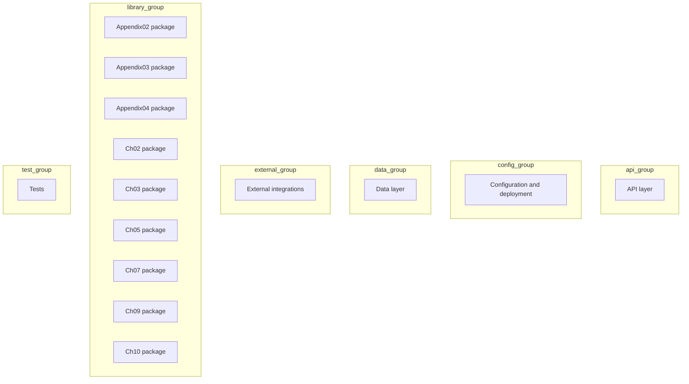

# Architecture report: kdchang/reactjs101

> Automated static analysis. **Observed** = directly seen in files/imports/AST; **Inferred** = interpretation from that evidence. Repository code was not executed.

## 1. Repository at a glance

| Item | Value |
| --- | --- |
| Repository | kdchang/reactjs101 |
| Description | 從零開始學 ReactJS（ReactJS 101）是一本希望讓初學者一看就懂的 React 中文入門教學書，由淺入深學習 React.js 生態系 (Flux, Redux, React Router, ImmutableJS, React Native, Relay/GraphQL etc.)。 |
| Language | JavaScript |
| Stars | 4346 |
| Licence | Other |
| Analysed commit / branch | 9a6f238b65cdcecf9f631a1fa485022840b00cc0 / master |
| Framework(s) | Express, React |
| Files analysed | 399 |
| Components | 14 |

## 2. Architecture in one minute

kdchang/reactjs101 - 從零開始學 ReactJS（ReactJS 101）是一本希望讓初學者一看就懂的 React 中文入門教學書，由淺入深學習 React.js 生態系 (Flux, Redux, React Router, ImmutableJS, React Native, Relay/GraphQL etc.)。. This repository was analysed statically from 399 file(s) (0 Python). Detected technologies (observed from imports/manifests): MongoDB, Express, React, axios, React Router, Redux. Files are grouped into 14 component(s): API layer, Appendix02 package, Appendix03 package, Appendix04 package, Ch02 package, Ch03 package, Ch05 package, Ch07 package. Findings below distinguish observed facts from inferred interpretation.

## 3. High-level block diagram

## 4. Main components

### API layer (`api_layer`)

- **Kind:** api
- **Status:** Observed
- **Confidence:** 0.85
- **Responsibility:** Groups 3 file(s) under api layer (observed from repository paths and static analysis).
- **Paths:** `Ch10/react-redux-server-rendering/common/api/counter.js`, `Ch10/react-router-redux-node-isomorphic-open-cook/src/common/routes/index.js`, `Ch10/react-router-redux-node-isomorphic-open-cook/src/server/controllers/api.js`
- **Evidence:** [Ch10/react-redux-server-rendering/common/api/counter.js](https://github.com/kdchang/reactjs101/blob/9a6f238b65cdcecf9f631a1fa485022840b00cc0/Ch10/react-redux-server-rendering/common/api/counter.js); [Ch10/react-router-redux-node-isomorphic-open-cook/src/common/routes/index.js](https://github.com/kdchang/reactjs101/blob/9a6f238b65cdcecf9f631a1fa485022840b00cc0/Ch10/react-router-redux-node-isomorphic-open-cook/src/common/routes/index.js); [Ch10/react-router-redux-node-isomorphic-open-cook/src/server/controllers/api.js](https://github.com/kdchang/reactjs101/blob/9a6f238b65cdcecf9f631a1fa485022840b00cc0/Ch10/react-router-redux-node-isomorphic-open-cook/src/server/controllers/api.js)

### Appendix02 package (`appendix02`)

- **Kind:** library
- **Status:** Observed
- **Confidence:** 0.85
- **Responsibility:** Groups 43 file(s) under appendix02 package (observed from repository paths and static analysis).
- **Paths:** `Appendix02/HelloWorldApp/android/app/src/main/java/com/helloworldapp/MainActivity.java`, `Appendix02/HelloWorldApp/android/app/src/main/java/com/helloworldapp/MainApplication.java`, `Appendix02/HelloWorldApp/index.android.js`, `Appendix02/HelloWorldApp/index.ios.js`, `Appendix02/HelloWorldApp/ios/HelloWorldApp/AppDelegate.h`, `Appendix02/ReactNativeFirebaseMotto/android/app/src/main/java/com/reactnativefirebasemotto/MainActivity.java`, `Appendix02/ReactNativeFirebaseMotto/android/app/src/main/java/com/reactnativefirebasemotto/MainApplication.java`, `Appendix02/ReactNativeFirebaseMotto/index.android.js`, `Appendix02/ReactNativeFirebaseMotto/index.ios.js`, `Appendix02/ReactNativeFirebaseMotto/ios/ReactNativeFirebaseMotto/AppDelegate.h`, `Appendix02/ReactNativeFirebaseMotto/src/actions/index.js`, `Appendix02/ReactNativeFirebaseMotto/src/actions/mottoActions.js`, `Appendix02/ReactNativeFirebaseMotto/src/actions/uiActions.js`, `Appendix02/ReactNativeFirebaseMotto/src/components/ActionButton/ActionButton.js`, `Appendix02/ReactNativeFirebaseMotto/src/components/ActionButton/actionButtonStyles.js`, `Appendix02/ReactNativeFirebaseMotto/src/components/ActionButton/index.js`, `Appendix02/ReactNativeFirebaseMotto/src/components/InputModal/InputModal.js`, `Appendix02/ReactNativeFirebaseMotto/src/components/InputModal/index.js`, `Appendix02/ReactNativeFirebaseMotto/src/components/InputModal/inputModelStyles.js`, `Appendix02/ReactNativeFirebaseMotto/src/components/ListItem/ListItem.js`, `Appendix02/ReactNativeFirebaseMotto/src/components/ListItem/index.js`, `Appendix02/ReactNativeFirebaseMotto/src/components/ListItem/listItemStyles.js`, `Appendix02/ReactNativeFirebaseMotto/src/components/Main/Main.js`, `Appendix02/ReactNativeFirebaseMotto/src/components/Main/index.js`, `Appendix02/ReactNativeFirebaseMotto/src/components/MottoList/MottoList.js`, `Appendix02/ReactNativeFirebaseMotto/src/components/MottoList/index.js`, `Appendix02/ReactNativeFirebaseMotto/src/components/MottoList/mottoStyles.js`, `Appendix02/ReactNativeFirebaseMotto/src/components/ToolBar/ToolBar.js`, `Appendix02/ReactNativeFirebaseMotto/src/components/ToolBar/index.js`, `Appendix02/ReactNativeFirebaseMotto/src/components/ToolBar/toolBarStyles.js`, `Appendix02/ReactNativeFirebaseMotto/src/constants/actionTypes.js`, `Appendix02/ReactNativeFirebaseMotto/src/constants/config.js`, `Appendix02/ReactNativeFirebaseMotto/src/constants/models.js`, `Appendix02/ReactNativeFirebaseMotto/src/containers/ActionButtonContainer/ActionButtonContainer.js`, `Appendix02/ReactNativeFirebaseMotto/src/containers/ActionButtonContainer/index.js`, `Appendix02/ReactNativeFirebaseMotto/src/containers/InputModalContainer/InputModalContainer.js`, `Appendix02/ReactNativeFirebaseMotto/src/containers/InputModalContainer/index.js`, `Appendix02/ReactNativeFirebaseMotto/src/containers/MottoListContainer/MottoListContainer.js`, `Appendix02/ReactNativeFirebaseMotto/src/containers/MottoListContainer/index.js`, `Appendix02/ReactNativeFirebaseMotto/src/reducers/index.js`, `Appendix02/ReactNativeFirebaseMotto/src/reducers/ui/uiReducers.js`, `Appendix02/ReactNativeFirebaseMotto/src/store/configureStore.js`, `Appendix02/ReactNativeFirebaseMotto/src/store/index.js`
- **Evidence:** [Appendix02/HelloWorldApp/android/app/src/main/java/com/helloworldapp/MainActivity.java](https://github.com/kdchang/reactjs101/blob/9a6f238b65cdcecf9f631a1fa485022840b00cc0/Appendix02/HelloWorldApp/android/app/src/main/java/com/helloworldapp/MainActivity.java); [Appendix02/HelloWorldApp/android/app/src/main/java/com/helloworldapp/MainApplication.java](https://github.com/kdchang/reactjs101/blob/9a6f238b65cdcecf9f631a1fa485022840b00cc0/Appendix02/HelloWorldApp/android/app/src/main/java/com/helloworldapp/MainApplication.java); [Appendix02/HelloWorldApp/index.android.js](https://github.com/kdchang/reactjs101/blob/9a6f238b65cdcecf9f631a1fa485022840b00cc0/Appendix02/HelloWorldApp/index.android.js); [Appendix02/HelloWorldApp/index.ios.js](https://github.com/kdchang/reactjs101/blob/9a6f238b65cdcecf9f631a1fa485022840b00cc0/Appendix02/HelloWorldApp/index.ios.js); [Appendix02/HelloWorldApp/ios/HelloWorldApp/AppDelegate.h](https://github.com/kdchang/reactjs101/blob/9a6f238b65cdcecf9f631a1fa485022840b00cc0/Appendix02/HelloWorldApp/ios/HelloWorldApp/AppDelegate.h); [Appendix02/ReactNativeFirebaseMotto/android/app/src/main/java/com/reactnativefirebasemotto/MainActivity.java](https://github.com/kdchang/reactjs101/blob/9a6f238b65cdcecf9f631a1fa485022840b00cc0/Appendix02/ReactNativeFirebaseMotto/android/app/src/main/java/com/reactnativefirebasemotto/MainActivity.java); [Appendix02/ReactNativeFirebaseMotto/android/app/src/main/java/com/reactnativefirebasemotto/MainApplication.java](https://github.com/kdchang/reactjs101/blob/9a6f238b65cdcecf9f631a1fa485022840b00cc0/Appendix02/ReactNativeFirebaseMotto/android/app/src/main/java/com/reactnativefirebasemotto/MainApplication.java); [Appendix02/ReactNativeFirebaseMotto/index.android.js](https://github.com/kdchang/reactjs101/blob/9a6f238b65cdcecf9f631a1fa485022840b00cc0/Appendix02/ReactNativeFirebaseMotto/index.android.js)

### Appendix03 package (`appendix03`)

- **Kind:** library
- **Status:** Observed
- **Confidence:** 0.85
- **Responsibility:** Groups 33 file(s) under appendix03 package (observed from repository paths and static analysis).
- **Paths:** `Appendix03/react-addons-test-utils-example/src/components/Main/Main.js`, `Appendix03/react-addons-test-utils-example/src/components/Main/index.js`, `Appendix03/react-addons-test-utils-example/src/components/TodoHeader/TodoHeader.js`, `Appendix03/react-addons-test-utils-example/src/components/TodoHeader/index.js`, `Appendix03/react-addons-test-utils-example/src/components/TodoList/TodoList.js`, `Appendix03/react-addons-test-utils-example/src/components/TodoList/index.js`, `Appendix03/react-addons-test-utils-example/src/index.js`, `Appendix03/react-addons-test-utils-example/webpack.config.js`, `Appendix03/react-mocha-test-example/src/components/Main/Main.js`, `Appendix03/react-mocha-test-example/src/components/Main/index.js`, `Appendix03/react-mocha-test-example/src/index.js`, `Appendix03/react-mocha-test-example/src/modules/add.js`, `Appendix03/react-mocha-test-example/webpack.config.js`, `Appendix03/react-redux-test-example/src/actions/index.js`, `Appendix03/react-redux-test-example/src/actions/todoActions.js`, `Appendix03/react-redux-test-example/src/components/Main/Main.js`, `Appendix03/react-redux-test-example/src/components/Main/index.js`, `Appendix03/react-redux-test-example/src/components/TodoHeader/TodoHeader.js`, `Appendix03/react-redux-test-example/src/components/TodoHeader/index.js`, `Appendix03/react-redux-test-example/src/components/TodoList/TodoList.js`, `Appendix03/react-redux-test-example/src/components/TodoList/index.js`, `Appendix03/react-redux-test-example/src/constants/actionTypes.js`, `Appendix03/react-redux-test-example/src/constants/models.js`, `Appendix03/react-redux-test-example/src/containers/TodoHeaderContainer/TodoHeaderContainer.js`, `Appendix03/react-redux-test-example/src/containers/TodoHeaderContainer/index.js`, `Appendix03/react-redux-test-example/src/containers/TodoListContainer/TodoListContainer.js`, `Appendix03/react-redux-test-example/src/containers/TodoListContainer/index.js`, `Appendix03/react-redux-test-example/src/index.js`, `Appendix03/react-redux-test-example/src/reducers/index.js`, `Appendix03/react-redux-test-example/src/reducers/ui/uiReducers.js`, `Appendix03/react-redux-test-example/src/store/configureStore.js`, `Appendix03/react-redux-test-example/src/store/index.js`, `Appendix03/react-redux-test-example/webpack.config.js`
- **Evidence:** [Appendix03/react-addons-test-utils-example/src/components/Main/Main.js](https://github.com/kdchang/reactjs101/blob/9a6f238b65cdcecf9f631a1fa485022840b00cc0/Appendix03/react-addons-test-utils-example/src/components/Main/Main.js); [Appendix03/react-addons-test-utils-example/src/components/Main/index.js](https://github.com/kdchang/reactjs101/blob/9a6f238b65cdcecf9f631a1fa485022840b00cc0/Appendix03/react-addons-test-utils-example/src/components/Main/index.js); [Appendix03/react-addons-test-utils-example/src/components/TodoHeader/TodoHeader.js](https://github.com/kdchang/reactjs101/blob/9a6f238b65cdcecf9f631a1fa485022840b00cc0/Appendix03/react-addons-test-utils-example/src/components/TodoHeader/TodoHeader.js); [Appendix03/react-addons-test-utils-example/src/components/TodoHeader/index.js](https://github.com/kdchang/reactjs101/blob/9a6f238b65cdcecf9f631a1fa485022840b00cc0/Appendix03/react-addons-test-utils-example/src/components/TodoHeader/index.js); [Appendix03/react-addons-test-utils-example/src/components/TodoList/TodoList.js](https://github.com/kdchang/reactjs101/blob/9a6f238b65cdcecf9f631a1fa485022840b00cc0/Appendix03/react-addons-test-utils-example/src/components/TodoList/TodoList.js); [Appendix03/react-addons-test-utils-example/src/components/TodoList/index.js](https://github.com/kdchang/reactjs101/blob/9a6f238b65cdcecf9f631a1fa485022840b00cc0/Appendix03/react-addons-test-utils-example/src/components/TodoList/index.js); [Appendix03/react-addons-test-utils-example/src/index.js](https://github.com/kdchang/reactjs101/blob/9a6f238b65cdcecf9f631a1fa485022840b00cc0/Appendix03/react-addons-test-utils-example/src/index.js); [Appendix03/react-addons-test-utils-example/webpack.config.js](https://github.com/kdchang/reactjs101/blob/9a6f238b65cdcecf9f631a1fa485022840b00cc0/Appendix03/react-addons-test-utils-example/webpack.config.js)

### Appendix04 package (`appendix04`)

- **Kind:** library
- **Status:** Observed
- **Confidence:** 0.85
- **Responsibility:** Groups 2 file(s) under appendix04 package (observed from repository paths and static analysis).
- **Paths:** `Appendix04/graphql-example/index.js`, `Appendix04/graphql-example/server.js`
- **Evidence:** [Appendix04/graphql-example/index.js](https://github.com/kdchang/reactjs101/blob/9a6f238b65cdcecf9f631a1fa485022840b00cc0/Appendix04/graphql-example/index.js); [Appendix04/graphql-example/server.js](https://github.com/kdchang/reactjs101/blob/9a6f238b65cdcecf9f631a1fa485022840b00cc0/Appendix04/graphql-example/server.js)

### Ch02 package (`ch02`)

- **Kind:** library
- **Status:** Observed
- **Confidence:** 0.85
- **Responsibility:** Groups 4 file(s) under ch02 package (observed from repository paths and static analysis).
- **Paths:** `Ch02/browserify-example/app/index.js`, `Ch02/browserify-example/gulpfile.js`, `Ch02/webpack-example/app/index.js`, `Ch02/webpack-example/webpack.config.js`
- **Evidence:** [Ch02/browserify-example/app/index.js](https://github.com/kdchang/reactjs101/blob/9a6f238b65cdcecf9f631a1fa485022840b00cc0/Ch02/browserify-example/app/index.js); [Ch02/browserify-example/gulpfile.js](https://github.com/kdchang/reactjs101/blob/9a6f238b65cdcecf9f631a1fa485022840b00cc0/Ch02/browserify-example/gulpfile.js); [Ch02/webpack-example/app/index.js](https://github.com/kdchang/reactjs101/blob/9a6f238b65cdcecf9f631a1fa485022840b00cc0/Ch02/webpack-example/app/index.js); [Ch02/webpack-example/webpack.config.js](https://github.com/kdchang/reactjs101/blob/9a6f238b65cdcecf9f631a1fa485022840b00cc0/Ch02/webpack-example/webpack.config.js)

### Ch03 package (`ch03`)

- **Kind:** library
- **Status:** Observed
- **Confidence:** 0.85
- **Responsibility:** Groups 10 file(s) under ch03 package (observed from repository paths and static analysis).
- **Paths:** `Ch03/todo-examples/.eslintrc.js`, `Ch03/todo-examples/app/components/TodoHeader/TodoHeader.js`, `Ch03/todo-examples/app/components/TodoHeader/index.js`, `Ch03/todo-examples/app/components/TodoHeader/todoHeaderStyles.js`, `Ch03/todo-examples/app/components/TodoList/TodoList.js`, `Ch03/todo-examples/app/components/TodoList/index.js`, `Ch03/todo-examples/app/components/TodoList/todoListStyles.js`, `Ch03/todo-examples/app/index.js`, `Ch03/todo-examples/gulpfile.js`, `Ch03/todo-examples/webpack.config.js`
- **Evidence:** [Ch03/todo-examples/.eslintrc.js](https://github.com/kdchang/reactjs101/blob/9a6f238b65cdcecf9f631a1fa485022840b00cc0/Ch03/todo-examples/.eslintrc.js); [Ch03/todo-examples/app/components/TodoHeader/TodoHeader.js](https://github.com/kdchang/reactjs101/blob/9a6f238b65cdcecf9f631a1fa485022840b00cc0/Ch03/todo-examples/app/components/TodoHeader/TodoHeader.js); [Ch03/todo-examples/app/components/TodoHeader/index.js](https://github.com/kdchang/reactjs101/blob/9a6f238b65cdcecf9f631a1fa485022840b00cc0/Ch03/todo-examples/app/components/TodoHeader/index.js); [Ch03/todo-examples/app/components/TodoHeader/todoHeaderStyles.js](https://github.com/kdchang/reactjs101/blob/9a6f238b65cdcecf9f631a1fa485022840b00cc0/Ch03/todo-examples/app/components/TodoHeader/todoHeaderStyles.js); [Ch03/todo-examples/app/components/TodoList/TodoList.js](https://github.com/kdchang/reactjs101/blob/9a6f238b65cdcecf9f631a1fa485022840b00cc0/Ch03/todo-examples/app/components/TodoList/TodoList.js); [Ch03/todo-examples/app/components/TodoList/index.js](https://github.com/kdchang/reactjs101/blob/9a6f238b65cdcecf9f631a1fa485022840b00cc0/Ch03/todo-examples/app/components/TodoList/index.js); [Ch03/todo-examples/app/components/TodoList/todoListStyles.js](https://github.com/kdchang/reactjs101/blob/9a6f238b65cdcecf9f631a1fa485022840b00cc0/Ch03/todo-examples/app/components/TodoList/todoListStyles.js); [Ch03/todo-examples/app/index.js](https://github.com/kdchang/reactjs101/blob/9a6f238b65cdcecf9f631a1fa485022840b00cc0/Ch03/todo-examples/app/index.js)

### Ch05 package (`ch05`)

- **Kind:** library
- **Status:** Observed
- **Confidence:** 0.85
- **Responsibility:** Groups 17 file(s) under ch05 package (observed from repository paths and static analysis).
- **Paths:** `Ch05/react-router-example/src/components/About/About.js`, `Ch05/react-router-example/src/components/About/index.js`, `Ch05/react-router-example/src/components/App/App.js`, `Ch05/react-router-example/src/components/App/appStyles.js`, `Ch05/react-router-example/src/components/App/index.js`, `Ch05/react-router-example/src/components/Contacts/Contacts.js`, `Ch05/react-router-example/src/components/Contacts/index.js`, `Ch05/react-router-example/src/components/Home/Home.js`, `Ch05/react-router-example/src/components/Home/index.js`, `Ch05/react-router-example/src/components/NavLink/NavLink.js`, `Ch05/react-router-example/src/components/NavLink/index.js`, `Ch05/react-router-example/src/components/Repos/Repos.js`, `Ch05/react-router-example/src/components/Repos/index.js`, `Ch05/react-router-example/src/components/User/User.js`, `Ch05/react-router-example/src/components/User/index.js`, `Ch05/react-router-example/src/index.js`, `Ch05/react-router-example/webpack.config.js`
- **Evidence:** [Ch05/react-router-example/src/components/About/About.js](https://github.com/kdchang/reactjs101/blob/9a6f238b65cdcecf9f631a1fa485022840b00cc0/Ch05/react-router-example/src/components/About/About.js); [Ch05/react-router-example/src/components/About/index.js](https://github.com/kdchang/reactjs101/blob/9a6f238b65cdcecf9f631a1fa485022840b00cc0/Ch05/react-router-example/src/components/About/index.js); [Ch05/react-router-example/src/components/App/App.js](https://github.com/kdchang/reactjs101/blob/9a6f238b65cdcecf9f631a1fa485022840b00cc0/Ch05/react-router-example/src/components/App/App.js); [Ch05/react-router-example/src/components/App/appStyles.js](https://github.com/kdchang/reactjs101/blob/9a6f238b65cdcecf9f631a1fa485022840b00cc0/Ch05/react-router-example/src/components/App/appStyles.js); [Ch05/react-router-example/src/components/App/index.js](https://github.com/kdchang/reactjs101/blob/9a6f238b65cdcecf9f631a1fa485022840b00cc0/Ch05/react-router-example/src/components/App/index.js); [Ch05/react-router-example/src/components/Contacts/Contacts.js](https://github.com/kdchang/reactjs101/blob/9a6f238b65cdcecf9f631a1fa485022840b00cc0/Ch05/react-router-example/src/components/Contacts/Contacts.js); [Ch05/react-router-example/src/components/Contacts/index.js](https://github.com/kdchang/reactjs101/blob/9a6f238b65cdcecf9f631a1fa485022840b00cc0/Ch05/react-router-example/src/components/Contacts/index.js); [Ch05/react-router-example/src/components/Home/Home.js](https://github.com/kdchang/reactjs101/blob/9a6f238b65cdcecf9f631a1fa485022840b00cc0/Ch05/react-router-example/src/components/Home/Home.js)

### Ch07 package (`ch07`)

- **Kind:** library
- **Status:** Observed
- **Confidence:** 0.85
- **Responsibility:** Groups 30 file(s) under ch07 package (observed from repository paths and static analysis).
- **Paths:** `Ch07/react-flux-example/src/actions/todoActions.js`, `Ch07/react-flux-example/src/components/TodoHeader/TodoHeader.js`, `Ch07/react-flux-example/src/components/TodoHeader/index.js`, `Ch07/react-flux-example/src/components/TodoList/TodoList.js`, `Ch07/react-flux-example/src/components/TodoList/index.js`, `Ch07/react-flux-example/src/constants/actionTypes.js`, `Ch07/react-flux-example/src/dispatcher/AppDispatcher.js`, `Ch07/react-flux-example/src/index.js`, `Ch07/react-flux-example/src/stores/TodoStore.js`, `Ch07/react-flux-example/webpack.config.js`, `Ch07/react-redux-example/src/actions/index.js`, `Ch07/react-redux-example/src/actions/todoActions.js`, `Ch07/react-redux-example/src/components/Main/Main.js`, `Ch07/react-redux-example/src/components/Main/index.js`, `Ch07/react-redux-example/src/components/TodoHeader/TodoHeader.js`, `Ch07/react-redux-example/src/components/TodoHeader/index.js`, `Ch07/react-redux-example/src/components/TodoList/TodoList.js`, `Ch07/react-redux-example/src/components/TodoList/index.js`, `Ch07/react-redux-example/src/constants/actionTypes.js`, `Ch07/react-redux-example/src/constants/models.js`, `Ch07/react-redux-example/src/containers/TodoHeaderContainer/TodoHeaderContainer.js`, `Ch07/react-redux-example/src/containers/TodoHeaderContainer/index.js`, `Ch07/react-redux-example/src/containers/TodoListContainer/TodoListContainer.js`, `Ch07/react-redux-example/src/containers/TodoListContainer/index.js`, `Ch07/react-redux-example/src/index.js`, `Ch07/react-redux-example/src/reducers/index.js`, `Ch07/react-redux-example/src/reducers/ui/uiReducers.js`, `Ch07/react-redux-example/src/store/configureStore.js`, `Ch07/react-redux-example/src/store/index.js`, `Ch07/react-redux-example/webpack.config.js`
- **Evidence:** [Ch07/react-flux-example/src/actions/todoActions.js](https://github.com/kdchang/reactjs101/blob/9a6f238b65cdcecf9f631a1fa485022840b00cc0/Ch07/react-flux-example/src/actions/todoActions.js); [Ch07/react-flux-example/src/components/TodoHeader/TodoHeader.js](https://github.com/kdchang/reactjs101/blob/9a6f238b65cdcecf9f631a1fa485022840b00cc0/Ch07/react-flux-example/src/components/TodoHeader/TodoHeader.js); [Ch07/react-flux-example/src/components/TodoHeader/index.js](https://github.com/kdchang/reactjs101/blob/9a6f238b65cdcecf9f631a1fa485022840b00cc0/Ch07/react-flux-example/src/components/TodoHeader/index.js); [Ch07/react-flux-example/src/components/TodoList/TodoList.js](https://github.com/kdchang/reactjs101/blob/9a6f238b65cdcecf9f631a1fa485022840b00cc0/Ch07/react-flux-example/src/components/TodoList/TodoList.js); [Ch07/react-flux-example/src/components/TodoList/index.js](https://github.com/kdchang/reactjs101/blob/9a6f238b65cdcecf9f631a1fa485022840b00cc0/Ch07/react-flux-example/src/components/TodoList/index.js); [Ch07/react-flux-example/src/constants/actionTypes.js](https://github.com/kdchang/reactjs101/blob/9a6f238b65cdcecf9f631a1fa485022840b00cc0/Ch07/react-flux-example/src/constants/actionTypes.js); [Ch07/react-flux-example/src/dispatcher/AppDispatcher.js](https://github.com/kdchang/reactjs101/blob/9a6f238b65cdcecf9f631a1fa485022840b00cc0/Ch07/react-flux-example/src/dispatcher/AppDispatcher.js); [Ch07/react-flux-example/src/index.js](https://github.com/kdchang/reactjs101/blob/9a6f238b65cdcecf9f631a1fa485022840b00cc0/Ch07/react-flux-example/src/index.js)

### Ch09 package (`ch09`)

- **Kind:** library
- **Status:** Observed
- **Confidence:** 0.85
- **Responsibility:** Groups 23 file(s) under ch09 package (observed from repository paths and static analysis).
- **Paths:** `Ch09/react-router-redux-github-finder/src/actions/githubActions.js`, `Ch09/react-router-redux-github-finder/src/actions/index.js`, `Ch09/react-router-redux-github-finder/src/actions/uiActions.js`, `Ch09/react-router-redux-github-finder/src/components/GithubBox/GithubBox.js`, `Ch09/react-router-redux-github-finder/src/components/GithubBox/index.js`, `Ch09/react-router-redux-github-finder/src/components/HomePage/HomePage.js`, `Ch09/react-router-redux-github-finder/src/components/HomePage/index.js`, `Ch09/react-router-redux-github-finder/src/components/Main/Main.js`, `Ch09/react-router-redux-github-finder/src/components/Main/index.js`, `Ch09/react-router-redux-github-finder/src/components/ResultPage/ResultPage.js`, `Ch09/react-router-redux-github-finder/src/components/ResultPage/index.js`, `Ch09/react-router-redux-github-finder/src/constants/actionTypes.js`, `Ch09/react-router-redux-github-finder/src/constants/models.js`, `Ch09/react-router-redux-github-finder/src/containers/HomePageContainer/HomePageContainer.js`, `Ch09/react-router-redux-github-finder/src/containers/HomePageContainer/index.js`, `Ch09/react-router-redux-github-finder/src/containers/ResultPageContainer/ResultPageContainer.js`, `Ch09/react-router-redux-github-finder/src/containers/ResultPageContainer/index.js`, `Ch09/react-router-redux-github-finder/src/index.js`, `Ch09/react-router-redux-github-finder/src/reducers/index.js`, `Ch09/react-router-redux-github-finder/src/reducers/ui/uiReducers.js`, `Ch09/react-router-redux-github-finder/src/store/configureStore.js`, `Ch09/react-router-redux-github-finder/src/store/index.js`, `Ch09/react-router-redux-github-finder/webpack.config.js`
- **Evidence:** [Ch09/react-router-redux-github-finder/src/actions/githubActions.js](https://github.com/kdchang/reactjs101/blob/9a6f238b65cdcecf9f631a1fa485022840b00cc0/Ch09/react-router-redux-github-finder/src/actions/githubActions.js); [Ch09/react-router-redux-github-finder/src/actions/index.js](https://github.com/kdchang/reactjs101/blob/9a6f238b65cdcecf9f631a1fa485022840b00cc0/Ch09/react-router-redux-github-finder/src/actions/index.js); [Ch09/react-router-redux-github-finder/src/actions/uiActions.js](https://github.com/kdchang/reactjs101/blob/9a6f238b65cdcecf9f631a1fa485022840b00cc0/Ch09/react-router-redux-github-finder/src/actions/uiActions.js); [Ch09/react-router-redux-github-finder/src/components/GithubBox/GithubBox.js](https://github.com/kdchang/reactjs101/blob/9a6f238b65cdcecf9f631a1fa485022840b00cc0/Ch09/react-router-redux-github-finder/src/components/GithubBox/GithubBox.js); [Ch09/react-router-redux-github-finder/src/components/GithubBox/index.js](https://github.com/kdchang/reactjs101/blob/9a6f238b65cdcecf9f631a1fa485022840b00cc0/Ch09/react-router-redux-github-finder/src/components/GithubBox/index.js); [Ch09/react-router-redux-github-finder/src/components/HomePage/HomePage.js](https://github.com/kdchang/reactjs101/blob/9a6f238b65cdcecf9f631a1fa485022840b00cc0/Ch09/react-router-redux-github-finder/src/components/HomePage/HomePage.js); [Ch09/react-router-redux-github-finder/src/components/HomePage/index.js](https://github.com/kdchang/reactjs101/blob/9a6f238b65cdcecf9f631a1fa485022840b00cc0/Ch09/react-router-redux-github-finder/src/components/HomePage/index.js); [Ch09/react-router-redux-github-finder/src/components/Main/Main.js](https://github.com/kdchang/reactjs101/blob/9a6f238b65cdcecf9f631a1fa485022840b00cc0/Ch09/react-router-redux-github-finder/src/components/Main/Main.js)

### Ch10 package (`ch10`)

- **Kind:** library
- **Status:** Observed
- **Confidence:** 0.85
- **Responsibility:** Groups 62 file(s) under ch10 package (observed from repository paths and static analysis).
- **Paths:** `Ch10/react-redux-server-rendering/common/actions/counterActions.js`, `Ch10/react-redux-server-rendering/common/actions/index.js`, `Ch10/react-redux-server-rendering/common/components/Counter/Counter.js`, `Ch10/react-redux-server-rendering/common/components/Counter/index.js`, `Ch10/react-redux-server-rendering/common/constants/actionTypes.js`, `Ch10/react-redux-server-rendering/common/constants/models.js`, `Ch10/react-redux-server-rendering/common/containers/CounterContainer/CounterContainer.js`, `Ch10/react-redux-server-rendering/common/containers/CounterContainer/index.js`, `Ch10/react-redux-server-rendering/common/reducers/counterReducers.js`, `Ch10/react-redux-server-rendering/common/reducers/index.js`, `Ch10/react-redux-server-rendering/common/store/configureStore.js`, `Ch10/react-redux-server-rendering/common/store/index.js`, `Ch10/react-redux-server-rendering/server/index.js`, `Ch10/react-redux-server-rendering/server/server.js`, `Ch10/react-redux-server-rendering/webpack.config.js`, `Ch10/react-router-redux-node-isomorphic-open-cook/src/common/actions/index.js`, `Ch10/react-router-redux-node-isomorphic-open-cook/src/common/actions/recipeActions.js`, `Ch10/react-router-redux-node-isomorphic-open-cook/src/common/actions/uiActions.js`, `Ch10/react-router-redux-node-isomorphic-open-cook/src/common/actions/userActions.js`, `Ch10/react-router-redux-node-isomorphic-open-cook/src/common/components/AppBar/AppBar.js`, `Ch10/react-router-redux-node-isomorphic-open-cook/src/common/components/AppBar/index.js`, `Ch10/react-router-redux-node-isomorphic-open-cook/src/common/components/CheckAuth/CheckAuth.js`, `Ch10/react-router-redux-node-isomorphic-open-cook/src/common/components/CheckAuth/index.js`, `Ch10/react-router-redux-node-isomorphic-open-cook/src/common/components/HomePage/HomePage.js`, `Ch10/react-router-redux-node-isomorphic-open-cook/src/common/components/HomePage/index.js`, `Ch10/react-router-redux-node-isomorphic-open-cook/src/common/components/LoginBox/LoginBox.js`, `Ch10/react-router-redux-node-isomorphic-open-cook/src/common/components/LoginBox/index.js`, `Ch10/react-router-redux-node-isomorphic-open-cook/src/common/components/LoginPage/LoginPage.js`, `Ch10/react-router-redux-node-isomorphic-open-cook/src/common/components/LoginPage/index.js`, `Ch10/react-router-redux-node-isomorphic-open-cook/src/common/components/Main/Main.js`, `Ch10/react-router-redux-node-isomorphic-open-cook/src/common/components/Main/index.js`, `Ch10/react-router-redux-node-isomorphic-open-cook/src/common/components/RecipeBox/RecipeBox.js`, `Ch10/react-router-redux-node-isomorphic-open-cook/src/common/components/RecipeBox/index.js`, `Ch10/react-router-redux-node-isomorphic-open-cook/src/common/components/ShareBox/ShareBox.js`, `Ch10/react-router-redux-node-isomorphic-open-cook/src/common/components/ShareBox/index.js`, `Ch10/react-router-redux-node-isomorphic-open-cook/src/common/components/SharePage/SharePage.js`, `Ch10/react-router-redux-node-isomorphic-open-cook/src/common/components/SharePage/index.js`, `Ch10/react-router-redux-node-isomorphic-open-cook/src/common/constants/actionTypes.js`, `Ch10/react-router-redux-node-isomorphic-open-cook/src/common/constants/models.js`, `Ch10/react-router-redux-node-isomorphic-open-cook/src/common/containers/AppBarContainer/AppBarContainer.js`, `Ch10/react-router-redux-node-isomorphic-open-cook/src/common/containers/AppBarContainer/index.js`, `Ch10/react-router-redux-node-isomorphic-open-cook/src/common/containers/HomePageContainer/HomePageContainer.js`, `Ch10/react-router-redux-node-isomorphic-open-cook/src/common/containers/HomePageContainer/index.js`, `Ch10/react-router-redux-node-isomorphic-open-cook/src/common/containers/LoginBoxContainer/LoginBoxContainer.js`, `Ch10/react-router-redux-node-isomorphic-open-cook/src/common/containers/LoginBoxContainer/index.js`, `Ch10/react-router-redux-node-isomorphic-open-cook/src/common/containers/LoginPageContainer/LoginPageContainer.js`, `Ch10/react-router-redux-node-isomorphic-open-cook/src/common/containers/LoginPageContainer/index.js`, `Ch10/react-router-redux-node-isomorphic-open-cook/src/common/containers/RecipeBoxContainer/RecipeBoxContainer.js`, `Ch10/react-router-redux-node-isomorphic-open-cook/src/common/containers/RecipeBoxContainer/index.js`, `Ch10/react-router-redux-node-isomorphic-open-cook/src/common/containers/ShareBoxContainer/ShareBoxContainer.js`, `Ch10/react-router-redux-node-isomorphic-open-cook/src/common/containers/ShareBoxContainer/index.js`, `Ch10/react-router-redux-node-isomorphic-open-cook/src/common/containers/SharePageContainer/SharePageContainer.js`, `Ch10/react-router-redux-node-isomorphic-open-cook/src/common/containers/SharePageContainer/index.js`, `Ch10/react-router-redux-node-isomorphic-open-cook/src/common/reducers/index.js`, `Ch10/react-router-redux-node-isomorphic-open-cook/src/common/reducers/ui/uiReducers.js`, `Ch10/react-router-redux-node-isomorphic-open-cook/src/common/store/configureStore.js`, `Ch10/react-router-redux-node-isomorphic-open-cook/src/common/store/index.js`, `Ch10/react-router-redux-node-isomorphic-open-cook/src/common/utils/WebAPI.js`, `Ch10/react-router-redux-node-isomorphic-open-cook/src/common/utils/fetchComponentData.js`, `Ch10/react-router-redux-node-isomorphic-open-cook/src/server/index.js`, `Ch10/react-router-redux-node-isomorphic-open-cook/src/server/server.js`, `Ch10/react-router-redux-node-isomorphic-open-cook/webpack.config.js`
- **Evidence:** [Ch10/react-redux-server-rendering/common/actions/counterActions.js](https://github.com/kdchang/reactjs101/blob/9a6f238b65cdcecf9f631a1fa485022840b00cc0/Ch10/react-redux-server-rendering/common/actions/counterActions.js); [Ch10/react-redux-server-rendering/common/actions/index.js](https://github.com/kdchang/reactjs101/blob/9a6f238b65cdcecf9f631a1fa485022840b00cc0/Ch10/react-redux-server-rendering/common/actions/index.js); [Ch10/react-redux-server-rendering/common/components/Counter/Counter.js](https://github.com/kdchang/reactjs101/blob/9a6f238b65cdcecf9f631a1fa485022840b00cc0/Ch10/react-redux-server-rendering/common/components/Counter/Counter.js); [Ch10/react-redux-server-rendering/common/components/Counter/index.js](https://github.com/kdchang/reactjs101/blob/9a6f238b65cdcecf9f631a1fa485022840b00cc0/Ch10/react-redux-server-rendering/common/components/Counter/index.js); [Ch10/react-redux-server-rendering/common/constants/actionTypes.js](https://github.com/kdchang/reactjs101/blob/9a6f238b65cdcecf9f631a1fa485022840b00cc0/Ch10/react-redux-server-rendering/common/constants/actionTypes.js); [Ch10/react-redux-server-rendering/common/constants/models.js](https://github.com/kdchang/reactjs101/blob/9a6f238b65cdcecf9f631a1fa485022840b00cc0/Ch10/react-redux-server-rendering/common/constants/models.js); [Ch10/react-redux-server-rendering/common/containers/CounterContainer/CounterContainer.js](https://github.com/kdchang/reactjs101/blob/9a6f238b65cdcecf9f631a1fa485022840b00cc0/Ch10/react-redux-server-rendering/common/containers/CounterContainer/CounterContainer.js); [Ch10/react-redux-server-rendering/common/containers/CounterContainer/index.js](https://github.com/kdchang/reactjs101/blob/9a6f238b65cdcecf9f631a1fa485022840b00cc0/Ch10/react-redux-server-rendering/common/containers/CounterContainer/index.js)

### Configuration and deployment (`config`)

- **Kind:** config
- **Status:** Observed
- **Confidence:** 0.85
- **Responsibility:** Groups 23 file(s) under configuration and deployment (observed from repository paths and static analysis).
- **Paths:** `Appendix02/HelloWorldApp/android/app/build.gradle`, `Appendix02/HelloWorldApp/android/build.gradle`, `Appendix02/HelloWorldApp/ios/HelloWorldApp/Images.xcassets/AppIcon.appiconset/Contents.json`, `Appendix02/HelloWorldApp/package.json`, `Appendix02/ReactNativeFirebaseMotto/android/app/build.gradle`, `Appendix02/ReactNativeFirebaseMotto/android/build.gradle`, `Appendix02/ReactNativeFirebaseMotto/ios/ReactNativeFirebaseMotto/Images.xcassets/AppIcon.appiconset/Contents.json`, `Appendix02/ReactNativeFirebaseMotto/package.json`, `Appendix03/react-addons-test-utils-example/package.json`, `Appendix03/react-mocha-test-example/package.json`, `Appendix03/react-redux-test-example/package.json`, `Appendix04/graphql-example/data.json`, `Appendix04/graphql-example/package.json`, `Ch02/browserify-example/package.json`, `Ch02/webpack-example/package.json`, `Ch03/todo-examples/package.json`, `Ch05/react-router-example/package.json`, `Ch07/react-flux-example/package.json`, `Ch07/react-redux-example/package.json`, `Ch09/react-router-redux-github-finder/package.json`, `Ch10/react-redux-server-rendering/package.json`, `Ch10/react-router-redux-node-isomorphic-open-cook/package.json`, `Ch10/react-router-redux-node-isomorphic-open-cook/src/server/config/index.js`
- **Evidence:** [Appendix02/HelloWorldApp/android/app/build.gradle](https://github.com/kdchang/reactjs101/blob/9a6f238b65cdcecf9f631a1fa485022840b00cc0/Appendix02/HelloWorldApp/android/app/build.gradle); [Appendix02/HelloWorldApp/android/build.gradle](https://github.com/kdchang/reactjs101/blob/9a6f238b65cdcecf9f631a1fa485022840b00cc0/Appendix02/HelloWorldApp/android/build.gradle); [Appendix02/HelloWorldApp/ios/HelloWorldApp/Images.xcassets/AppIcon.appiconset/Contents.json](https://github.com/kdchang/reactjs101/blob/9a6f238b65cdcecf9f631a1fa485022840b00cc0/Appendix02/HelloWorldApp/ios/HelloWorldApp/Images.xcassets/AppIcon.appiconset/Contents.json); [Appendix02/HelloWorldApp/package.json](https://github.com/kdchang/reactjs101/blob/9a6f238b65cdcecf9f631a1fa485022840b00cc0/Appendix02/HelloWorldApp/package.json); [Appendix02/ReactNativeFirebaseMotto/android/app/build.gradle](https://github.com/kdchang/reactjs101/blob/9a6f238b65cdcecf9f631a1fa485022840b00cc0/Appendix02/ReactNativeFirebaseMotto/android/app/build.gradle); [Appendix02/ReactNativeFirebaseMotto/android/build.gradle](https://github.com/kdchang/reactjs101/blob/9a6f238b65cdcecf9f631a1fa485022840b00cc0/Appendix02/ReactNativeFirebaseMotto/android/build.gradle); [Appendix02/ReactNativeFirebaseMotto/ios/ReactNativeFirebaseMotto/Images.xcassets/AppIcon.appiconset/Contents.json](https://github.com/kdchang/reactjs101/blob/9a6f238b65cdcecf9f631a1fa485022840b00cc0/Appendix02/ReactNativeFirebaseMotto/ios/ReactNativeFirebaseMotto/Images.xcassets/AppIcon.appiconset/Contents.json); [Appendix02/ReactNativeFirebaseMotto/package.json](https://github.com/kdchang/reactjs101/blob/9a6f238b65cdcecf9f631a1fa485022840b00cc0/Appendix02/ReactNativeFirebaseMotto/package.json)

### Data layer (`data_layer`)

- **Kind:** data
- **Status:** Observed
- **Confidence:** 0.85
- **Responsibility:** Groups 8 file(s) under data layer (observed from repository paths and static analysis).
- **Paths:** `Appendix02/ReactNativeFirebaseMotto/src/reducers/data/mottoReducers.js`, `Appendix03/react-redux-test-example/src/reducers/data/todoReducers.js`, `Ch07/react-redux-example/src/reducers/data/todoReducers.js`, `Ch09/react-router-redux-github-finder/src/reducers/data/githubReducers.js`, `Ch10/react-router-redux-node-isomorphic-open-cook/src/common/reducers/data/recipeReducers.js`, `Ch10/react-router-redux-node-isomorphic-open-cook/src/common/reducers/data/userReducers.js`, `Ch10/react-router-redux-node-isomorphic-open-cook/src/server/models/recipe.js`, `Ch10/react-router-redux-node-isomorphic-open-cook/src/server/models/user.js`
- **Evidence:** [Appendix02/ReactNativeFirebaseMotto/src/reducers/data/mottoReducers.js](https://github.com/kdchang/reactjs101/blob/9a6f238b65cdcecf9f631a1fa485022840b00cc0/Appendix02/ReactNativeFirebaseMotto/src/reducers/data/mottoReducers.js); [Appendix03/react-redux-test-example/src/reducers/data/todoReducers.js](https://github.com/kdchang/reactjs101/blob/9a6f238b65cdcecf9f631a1fa485022840b00cc0/Appendix03/react-redux-test-example/src/reducers/data/todoReducers.js); [Ch07/react-redux-example/src/reducers/data/todoReducers.js](https://github.com/kdchang/reactjs101/blob/9a6f238b65cdcecf9f631a1fa485022840b00cc0/Ch07/react-redux-example/src/reducers/data/todoReducers.js); [Ch09/react-router-redux-github-finder/src/reducers/data/githubReducers.js](https://github.com/kdchang/reactjs101/blob/9a6f238b65cdcecf9f631a1fa485022840b00cc0/Ch09/react-router-redux-github-finder/src/reducers/data/githubReducers.js); [Ch10/react-router-redux-node-isomorphic-open-cook/src/common/reducers/data/recipeReducers.js](https://github.com/kdchang/reactjs101/blob/9a6f238b65cdcecf9f631a1fa485022840b00cc0/Ch10/react-router-redux-node-isomorphic-open-cook/src/common/reducers/data/recipeReducers.js); [Ch10/react-router-redux-node-isomorphic-open-cook/src/common/reducers/data/userReducers.js](https://github.com/kdchang/reactjs101/blob/9a6f238b65cdcecf9f631a1fa485022840b00cc0/Ch10/react-router-redux-node-isomorphic-open-cook/src/common/reducers/data/userReducers.js); [Ch10/react-router-redux-node-isomorphic-open-cook/src/server/models/recipe.js](https://github.com/kdchang/reactjs101/blob/9a6f238b65cdcecf9f631a1fa485022840b00cc0/Ch10/react-router-redux-node-isomorphic-open-cook/src/server/models/recipe.js); [Ch10/react-router-redux-node-isomorphic-open-cook/src/server/models/user.js](https://github.com/kdchang/reactjs101/blob/9a6f238b65cdcecf9f631a1fa485022840b00cc0/Ch10/react-router-redux-node-isomorphic-open-cook/src/server/models/user.js)

### External integrations (`external_integrations`)

- **Kind:** external
- **Status:** Observed
- **Confidence:** 0.85
- **Responsibility:** Groups 2 file(s) under external integrations (observed from repository paths and static analysis).
- **Paths:** `Ch10/react-redux-server-rendering/client/index.js`, `Ch10/react-router-redux-node-isomorphic-open-cook/src/client/index.js`
- **Evidence:** [Ch10/react-redux-server-rendering/client/index.js](https://github.com/kdchang/reactjs101/blob/9a6f238b65cdcecf9f631a1fa485022840b00cc0/Ch10/react-redux-server-rendering/client/index.js); [Ch10/react-router-redux-node-isomorphic-open-cook/src/client/index.js](https://github.com/kdchang/reactjs101/blob/9a6f238b65cdcecf9f631a1fa485022840b00cc0/Ch10/react-router-redux-node-isomorphic-open-cook/src/client/index.js)

### Tests (`tests`)

- **Kind:** test
- **Status:** Observed
- **Confidence:** 0.85
- **Responsibility:** Groups 13 file(s) under tests (observed from repository paths and static analysis).
- **Paths:** `Appendix03/react-addons-test-utils-example/test/enzyme/mount.test.js`, `Appendix03/react-addons-test-utils-example/test/enzyme/shallowRender.test.js`, `Appendix03/react-addons-test-utils-example/test/enzyme/staticRender.test.js`, `Appendix03/react-addons-test-utils-example/test/renderIntoDocument.test.js`, `Appendix03/react-addons-test-utils-example/test/setup.js`, `Appendix03/react-addons-test-utils-example/test/shallowRender.test.js`, `Appendix03/react-addons-test-utils-example/test/shallowRenderProps.test.js`, `Appendix03/react-mocha-test-example/test/add.test.js`, `Appendix03/react-mocha-test-example/test/async.test.js`, `Appendix03/react-mocha-test-example/test/mocha.opts`, `Appendix03/react-mocha-test-example/test/promise.test.js`, `Appendix03/react-redux-test-example/test/actionTest.js`, `Appendix03/react-redux-test-example/test/reducerTest.test.js`
- **Evidence:** [Appendix03/react-addons-test-utils-example/test/enzyme/mount.test.js](https://github.com/kdchang/reactjs101/blob/9a6f238b65cdcecf9f631a1fa485022840b00cc0/Appendix03/react-addons-test-utils-example/test/enzyme/mount.test.js); [Appendix03/react-addons-test-utils-example/test/enzyme/shallowRender.test.js](https://github.com/kdchang/reactjs101/blob/9a6f238b65cdcecf9f631a1fa485022840b00cc0/Appendix03/react-addons-test-utils-example/test/enzyme/shallowRender.test.js); [Appendix03/react-addons-test-utils-example/test/enzyme/staticRender.test.js](https://github.com/kdchang/reactjs101/blob/9a6f238b65cdcecf9f631a1fa485022840b00cc0/Appendix03/react-addons-test-utils-example/test/enzyme/staticRender.test.js); [Appendix03/react-addons-test-utils-example/test/renderIntoDocument.test.js](https://github.com/kdchang/reactjs101/blob/9a6f238b65cdcecf9f631a1fa485022840b00cc0/Appendix03/react-addons-test-utils-example/test/renderIntoDocument.test.js); [Appendix03/react-addons-test-utils-example/test/setup.js](https://github.com/kdchang/reactjs101/blob/9a6f238b65cdcecf9f631a1fa485022840b00cc0/Appendix03/react-addons-test-utils-example/test/setup.js); [Appendix03/react-addons-test-utils-example/test/shallowRender.test.js](https://github.com/kdchang/reactjs101/blob/9a6f238b65cdcecf9f631a1fa485022840b00cc0/Appendix03/react-addons-test-utils-example/test/shallowRender.test.js); [Appendix03/react-addons-test-utils-example/test/shallowRenderProps.test.js](https://github.com/kdchang/reactjs101/blob/9a6f238b65cdcecf9f631a1fa485022840b00cc0/Appendix03/react-addons-test-utils-example/test/shallowRenderProps.test.js); [Appendix03/react-mocha-test-example/test/add.test.js](https://github.com/kdchang/reactjs101/blob/9a6f238b65cdcecf9f631a1fa485022840b00cc0/Appendix03/react-mocha-test-example/test/add.test.js)

## 5. Execution flow

**Observed** entry point(s):

- [Appendix03/react-addons-test-utils-example/src/index.js](https://github.com/kdchang/reactjs101/blob/9a6f238b65cdcecf9f631a1fa485022840b00cc0/Appendix03/react-addons-test-utils-example/src/index.js)
- [Appendix03/react-addons-test-utils-example/webpack.config.js](https://github.com/kdchang/reactjs101/blob/9a6f238b65cdcecf9f631a1fa485022840b00cc0/Appendix03/react-addons-test-utils-example/webpack.config.js)
- [Appendix03/react-mocha-test-example/src/index.js](https://github.com/kdchang/reactjs101/blob/9a6f238b65cdcecf9f631a1fa485022840b00cc0/Appendix03/react-mocha-test-example/src/index.js)
- [Appendix03/react-mocha-test-example/webpack.config.js](https://github.com/kdchang/reactjs101/blob/9a6f238b65cdcecf9f631a1fa485022840b00cc0/Appendix03/react-mocha-test-example/webpack.config.js)
- [Appendix03/react-redux-test-example/src/index.js](https://github.com/kdchang/reactjs101/blob/9a6f238b65cdcecf9f631a1fa485022840b00cc0/Appendix03/react-redux-test-example/src/index.js)
- [Appendix03/react-redux-test-example/webpack.config.js](https://github.com/kdchang/reactjs101/blob/9a6f238b65cdcecf9f631a1fa485022840b00cc0/Appendix03/react-redux-test-example/webpack.config.js)
- [Appendix04/graphql-example/index.js](https://github.com/kdchang/reactjs101/blob/9a6f238b65cdcecf9f631a1fa485022840b00cc0/Appendix04/graphql-example/index.js)
- [Appendix04/graphql-example/server.js](https://github.com/kdchang/reactjs101/blob/9a6f238b65cdcecf9f631a1fa485022840b00cc0/Appendix04/graphql-example/server.js)
- [Ch02/webpack-example/webpack.config.js](https://github.com/kdchang/reactjs101/blob/9a6f238b65cdcecf9f631a1fa485022840b00cc0/Ch02/webpack-example/webpack.config.js)
- [Ch05/react-router-example/webpack.config.js](https://github.com/kdchang/reactjs101/blob/9a6f238b65cdcecf9f631a1fa485022840b00cc0/Ch05/react-router-example/webpack.config.js)
- [Ch07/react-redux-example/webpack.config.js](https://github.com/kdchang/reactjs101/blob/9a6f238b65cdcecf9f631a1fa485022840b00cc0/Ch07/react-redux-example/webpack.config.js)
- [Ch09/react-router-redux-github-finder/webpack.config.js](https://github.com/kdchang/reactjs101/blob/9a6f238b65cdcecf9f631a1fa485022840b00cc0/Ch09/react-router-redux-github-finder/webpack.config.js)

Representative flow (derived from observed entry points and the import graph; steps beyond the entry point are **Inferred**):

1. Execution starts at an observed entry point listed above, if present.
2. No internal import relationships between components were observed.

## 6. Project structure

### `(root)`

- `.gitignore` - other (31 bytes)
- `LICENSE.md` - docs (18244 bytes)
- `README.md` - docs (4764 bytes)
- `SUMMARY.md` - docs (11 bytes)

### `Appendix01`

- `Appendix01/README.md` - docs (15733 bytes)

### `Appendix02`

- `Appendix02/HelloWorldApp/.buckconfig` - other (114 bytes)
- `Appendix02/HelloWorldApp/.flowconfig` - other (1734 bytes)
- `Appendix02/HelloWorldApp/.gitignore` - other (424 bytes)
- `Appendix02/HelloWorldApp/.watchmanconfig` - other (2 bytes)
- `Appendix02/HelloWorldApp/android/app/BUCK` - other (1513 bytes)
- `Appendix02/HelloWorldApp/android/app/build.gradle` - manifest (5408 bytes)
- `Appendix02/HelloWorldApp/android/app/proguard-rules.pro` - other (2480 bytes)
- `Appendix02/HelloWorldApp/android/app/src/main/AndroidManifest.xml` - other (1099 bytes)
- `Appendix02/HelloWorldApp/android/app/src/main/java/com/helloworldapp/MainActivity.java` - source, Java (371 bytes)
- `Appendix02/HelloWorldApp/android/app/src/main/java/com/helloworldapp/MainApplication.java` - source, Java (878 bytes)
- `Appendix02/HelloWorldApp/android/app/src/main/res/values/strings.xml` - other (76 bytes)
- `Appendix02/HelloWorldApp/android/app/src/main/res/values/styles.xml` - other (192 bytes)
- `Appendix02/HelloWorldApp/android/build.gradle` - manifest (642 bytes)
- `Appendix02/HelloWorldApp/android/gradle.properties` - other (887 bytes)
- `Appendix02/HelloWorldApp/android/gradle/wrapper/gradle-wrapper.properties` - other (200 bytes)
- `Appendix02/HelloWorldApp/android/gradlew` - other (5080 bytes)
- `Appendix02/HelloWorldApp/android/gradlew.bat` - other (2314 bytes)
- `Appendix02/HelloWorldApp/android/keystores/BUCK` - other (138 bytes)
- `Appendix02/HelloWorldApp/android/keystores/debug.keystore.properties` - other (105 bytes)
- `Appendix02/HelloWorldApp/android/settings.gradle` - other (51 bytes)
- `Appendix02/HelloWorldApp/index.android.js` - source, JavaScript (1108 bytes)
- `Appendix02/HelloWorldApp/index.ios.js` - source, JavaScript (1066 bytes)
- `Appendix02/HelloWorldApp/ios/HelloWorldApp.xcodeproj/project.pbxproj` - other (30988 bytes)
- `Appendix02/HelloWorldApp/ios/HelloWorldApp.xcodeproj/xcshareddata/xcschemes/HelloWorldApp.xcscheme` - other (4332 bytes)
- `Appendix02/HelloWorldApp/ios/HelloWorldApp/AppDelegate.h` - source, C/C++ (451 bytes)
- `Appendix02/HelloWorldApp/ios/HelloWorldApp/AppDelegate.m` - other (1380 bytes)
- `Appendix02/HelloWorldApp/ios/HelloWorldApp/Base.lproj/LaunchScreen.xib` - other (3716 bytes)
- `Appendix02/HelloWorldApp/ios/HelloWorldApp/Images.xcassets/AppIcon.appiconset/Contents.json` - config (585 bytes)
- `Appendix02/HelloWorldApp/ios/HelloWorldApp/Info.plist` - other (1620 bytes)
- `Appendix02/HelloWorldApp/ios/HelloWorldApp/main.m` - other (510 bytes)
- `Appendix02/HelloWorldApp/ios/HelloWorldAppTests/HelloWorldAppTests.m` - other (2072 bytes)
- `Appendix02/HelloWorldApp/ios/HelloWorldAppTests/Info.plist` - other (765 bytes)
- `Appendix02/HelloWorldApp/package.json` - manifest (237 bytes)
- `Appendix02/README.md` - docs (34264 bytes)
- `Appendix02/ReactNativeFirebaseMotto/.babelrc` - other (80 bytes)
- `Appendix02/ReactNativeFirebaseMotto/.buckconfig` - other (114 bytes)
- `Appendix02/ReactNativeFirebaseMotto/.eslintrc` - other (156 bytes)
- `Appendix02/ReactNativeFirebaseMotto/.flowconfig` - other (1734 bytes)
- `Appendix02/ReactNativeFirebaseMotto/.gitignore` - other (424 bytes)
- `Appendix02/ReactNativeFirebaseMotto/.watchmanconfig` - other (2 bytes)
- `Appendix02/ReactNativeFirebaseMotto/android/app/BUCK` - other (1535 bytes)
- `Appendix02/ReactNativeFirebaseMotto/android/app/build.gradle` - manifest (5419 bytes)
- `Appendix02/ReactNativeFirebaseMotto/android/app/proguard-rules.pro` - other (2480 bytes)
- `Appendix02/ReactNativeFirebaseMotto/android/app/src/main/AndroidManifest.xml` - other (1110 bytes)
- `Appendix02/ReactNativeFirebaseMotto/android/app/src/main/java/com/reactnativefirebasemotto/MainActivity.java` - source, Java (393 bytes)
- `Appendix02/ReactNativeFirebaseMotto/android/app/src/main/java/com/reactnativefirebasemotto/MainApplication.java` - source, Java (889 bytes)
- `Appendix02/ReactNativeFirebaseMotto/android/app/src/main/res/values/strings.xml` - other (87 bytes)
- `Appendix02/ReactNativeFirebaseMotto/android/app/src/main/res/values/styles.xml` - other (192 bytes)
- `Appendix02/ReactNativeFirebaseMotto/android/build.gradle` - manifest (642 bytes)
- `Appendix02/ReactNativeFirebaseMotto/android/gradle.properties` - other (887 bytes)
- `Appendix02/ReactNativeFirebaseMotto/android/gradle/wrapper/gradle-wrapper.properties` - other (200 bytes)
- `Appendix02/ReactNativeFirebaseMotto/android/gradlew` - other (5080 bytes)
- `Appendix02/ReactNativeFirebaseMotto/android/gradlew.bat` - other (2314 bytes)
- `Appendix02/ReactNativeFirebaseMotto/android/keystores/BUCK` - other (138 bytes)
- `Appendix02/ReactNativeFirebaseMotto/android/keystores/debug.keystore.properties` - other (105 bytes)
- `Appendix02/ReactNativeFirebaseMotto/android/settings.gradle` - other (62 bytes)
- `Appendix02/ReactNativeFirebaseMotto/index.android.js` - source, JavaScript (433 bytes)
- `Appendix02/ReactNativeFirebaseMotto/index.ios.js` - source, JavaScript (447 bytes)
- `Appendix02/ReactNativeFirebaseMotto/ios/ReactNativeFirebaseMotto.xcodeproj/project.pbxproj` - other (31549 bytes)
- `Appendix02/ReactNativeFirebaseMotto/ios/ReactNativeFirebaseMotto.xcodeproj/xcshareddata/xcschemes/ReactNativeFirebaseMotto.xcscheme` - other (4530 bytes)
- `Appendix02/ReactNativeFirebaseMotto/ios/ReactNativeFirebaseMotto/AppDelegate.h` - source, C/C++ (451 bytes)
- `Appendix02/ReactNativeFirebaseMotto/ios/ReactNativeFirebaseMotto/AppDelegate.m` - other (1391 bytes)
- `Appendix02/ReactNativeFirebaseMotto/ios/ReactNativeFirebaseMotto/Base.lproj/LaunchScreen.xib` - other (3727 bytes)
- `Appendix02/ReactNativeFirebaseMotto/ios/ReactNativeFirebaseMotto/Images.xcassets/AppIcon.appiconset/Contents.json` - config (585 bytes)
- `Appendix02/ReactNativeFirebaseMotto/ios/ReactNativeFirebaseMotto/Info.plist` - other (1620 bytes)
- `Appendix02/ReactNativeFirebaseMotto/ios/ReactNativeFirebaseMotto/main.m` - other (510 bytes)
- `Appendix02/ReactNativeFirebaseMotto/ios/ReactNativeFirebaseMottoTests/Info.plist` - other (765 bytes)
- `Appendix02/ReactNativeFirebaseMotto/ios/ReactNativeFirebaseMottoTests/ReactNativeFirebaseMottoTests.m` - other (2094 bytes)
- `Appendix02/ReactNativeFirebaseMotto/package.json` - manifest (830 bytes)
- `Appendix02/ReactNativeFirebaseMotto/src/actions/index.js` - source, JavaScript (60 bytes)
- `Appendix02/ReactNativeFirebaseMotto/src/actions/mottoActions.js` - source, JavaScript (303 bytes)
- `Appendix02/ReactNativeFirebaseMotto/src/actions/uiActions.js` - source, JavaScript (164 bytes)
- `Appendix02/ReactNativeFirebaseMotto/src/components/ActionButton/ActionButton.js` - source, JavaScript (442 bytes)
- `Appendix02/ReactNativeFirebaseMotto/src/components/ActionButton/actionButtonStyles.js` - source, JavaScript (300 bytes)
- `Appendix02/ReactNativeFirebaseMotto/src/components/ActionButton/index.js` - source, JavaScript (41 bytes)
- `Appendix02/ReactNativeFirebaseMotto/src/components/InputModal/InputModal.js` - source, JavaScript (1265 bytes)
- `Appendix02/ReactNativeFirebaseMotto/src/components/InputModal/index.js` - source, JavaScript (39 bytes)
- `Appendix02/ReactNativeFirebaseMotto/src/components/InputModal/inputModelStyles.js` - source, JavaScript (678 bytes)
- `Appendix02/ReactNativeFirebaseMotto/src/components/ListItem/ListItem.js` - source, JavaScript (515 bytes)
- `Appendix02/ReactNativeFirebaseMotto/src/components/ListItem/index.js` - source, JavaScript (37 bytes)
- `Appendix02/ReactNativeFirebaseMotto/src/components/ListItem/listItemStyles.js` - source, JavaScript (257 bytes)
- `Appendix02/ReactNativeFirebaseMotto/src/components/Main/Main.js` - source, JavaScript (1077 bytes)
- `Appendix02/ReactNativeFirebaseMotto/src/components/Main/index.js` - source, JavaScript (34 bytes)
- `Appendix02/ReactNativeFirebaseMotto/src/components/MottoList/MottoList.js` - source, JavaScript (1380 bytes)
- `Appendix02/ReactNativeFirebaseMotto/src/components/MottoList/index.js` - source, JavaScript (39 bytes)
- `Appendix02/ReactNativeFirebaseMotto/src/components/MottoList/mottoStyles.js` - source, JavaScript (225 bytes)
- `Appendix02/ReactNativeFirebaseMotto/src/components/ToolBar/ToolBar.js` - source, JavaScript (304 bytes)
- `Appendix02/ReactNativeFirebaseMotto/src/components/ToolBar/index.js` - source, JavaScript (36 bytes)
- `Appendix02/ReactNativeFirebaseMotto/src/components/ToolBar/toolBarStyles.js` - source, JavaScript (302 bytes)
- `Appendix02/ReactNativeFirebaseMotto/src/constants/actionTypes.js` - source, JavaScript (172 bytes)
- `Appendix02/ReactNativeFirebaseMotto/src/constants/config.js` - source, JavaScript (146 bytes)
- `Appendix02/ReactNativeFirebaseMotto/src/constants/models.js` - source, JavaScript (231 bytes)
- `Appendix02/ReactNativeFirebaseMotto/src/containers/ActionButtonContainer/ActionButtonContainer.js` - source, JavaScript (294 bytes)
- `Appendix02/ReactNativeFirebaseMotto/src/containers/ActionButtonContainer/index.js` - source, JavaScript (50 bytes)
- `Appendix02/ReactNativeFirebaseMotto/src/containers/InputModalContainer/InputModalContainer.js` - source, JavaScript (1144 bytes)
- `Appendix02/ReactNativeFirebaseMotto/src/containers/InputModalContainer/index.js` - source, JavaScript (48 bytes)
- `Appendix02/ReactNativeFirebaseMotto/src/containers/MottoListContainer/MottoListContainer.js` - source, JavaScript (1059 bytes)
- `Appendix02/ReactNativeFirebaseMotto/src/containers/MottoListContainer/index.js` - source, JavaScript (47 bytes)
- `Appendix02/ReactNativeFirebaseMotto/src/reducers/data/mottoReducers.js` - source, JavaScript (618 bytes)
- `Appendix02/ReactNativeFirebaseMotto/src/reducers/index.js` - source, JavaScript (214 bytes)
- `Appendix02/ReactNativeFirebaseMotto/src/reducers/ui/uiReducers.js` - source, JavaScript (357 bytes)
- `Appendix02/ReactNativeFirebaseMotto/src/store/configureStore.js` - source, JavaScript (348 bytes)
- `Appendix02/ReactNativeFirebaseMotto/src/store/index.js` - source, JavaScript (43 bytes)

### `Appendix03`

- `Appendix03/README.md` - docs (19855 bytes)
- `Appendix03/react-addons-test-utils-example/.babelrc` - other (62 bytes)
- `Appendix03/react-addons-test-utils-example/.eslint` - other (172 bytes)
- `Appendix03/react-addons-test-utils-example/package.json` - manifest (1067 bytes)
- `Appendix03/react-addons-test-utils-example/src/components/Main/Main.js` - source, JavaScript (246 bytes)
- `Appendix03/react-addons-test-utils-example/src/components/Main/index.js` - source, JavaScript (33 bytes)
- `Appendix03/react-addons-test-utils-example/src/components/TodoHeader/TodoHeader.js` - source, JavaScript (505 bytes)
- `Appendix03/react-addons-test-utils-example/src/components/TodoHeader/index.js` - source, JavaScript (39 bytes)
- `Appendix03/react-addons-test-utils-example/src/components/TodoList/TodoList.js` - source, JavaScript (235 bytes)
- `Appendix03/react-addons-test-utils-example/src/components/TodoList/index.js` - source, JavaScript (37 bytes)
- `Appendix03/react-addons-test-utils-example/src/index.html` - other (137 bytes)
- `Appendix03/react-addons-test-utils-example/src/index.js` - source, JavaScript (164 bytes)
- `Appendix03/react-addons-test-utils-example/test/enzyme/mount.test.js` - test, JavaScript (492 bytes)
- `Appendix03/react-addons-test-utils-example/test/enzyme/shallowRender.test.js` - test, JavaScript (375 bytes)
- `Appendix03/react-addons-test-utils-example/test/enzyme/staticRender.test.js` - test, JavaScript (458 bytes)
- `Appendix03/react-addons-test-utils-example/test/renderIntoDocument.test.js` - test, JavaScript (667 bytes)
- `Appendix03/react-addons-test-utils-example/test/setup.js` - test, JavaScript (246 bytes)
- `Appendix03/react-addons-test-utils-example/test/shallowRender.test.js` - test, JavaScript (572 bytes)
- `Appendix03/react-addons-test-utils-example/test/shallowRenderProps.test.js` - test, JavaScript (797 bytes)
- `Appendix03/react-addons-test-utils-example/webpack.config.js` - source, JavaScript (796 bytes)
- `Appendix03/react-mocha-test-example/.babelrc` - other (62 bytes)
- `Appendix03/react-mocha-test-example/.eslintrc` - other (156 bytes)
- `Appendix03/react-mocha-test-example/package.json` - manifest (1029 bytes)
- `Appendix03/react-mocha-test-example/src/components/Main/Main.js` - source, JavaScript (171 bytes)
- `Appendix03/react-mocha-test-example/src/components/Main/index.js` - source, JavaScript (34 bytes)
- `Appendix03/react-mocha-test-example/src/index.html` - other (149 bytes)
- `Appendix03/react-mocha-test-example/src/index.js` - source, JavaScript (193 bytes)
- `Appendix03/react-mocha-test-example/src/modules/add.js` - source, JavaScript (55 bytes)
- `Appendix03/react-mocha-test-example/test/add.test.js` - test, JavaScript (237 bytes)
- `Appendix03/react-mocha-test-example/test/async.test.js` - test, JavaScript (330 bytes)
- `Appendix03/react-mocha-test-example/test/mocha.opts` - test (24 bytes)
- `Appendix03/react-mocha-test-example/test/promise.test.js` - test, JavaScript (299 bytes)
- `Appendix03/react-mocha-test-example/webpack.config.js` - source, JavaScript (796 bytes)
- `Appendix03/react-redux-test-example/.babelrc` - other (62 bytes)
- `Appendix03/react-redux-test-example/.eslintrc` - other (172 bytes)
- `Appendix03/react-redux-test-example/README.md` - docs (245 bytes)
- `Appendix03/react-redux-test-example/package.json` - manifest (1259 bytes)
- `Appendix03/react-redux-test-example/src/actions/index.js` - source, JavaScript (30 bytes)
- `Appendix03/react-redux-test-example/src/actions/todoActions.js` - source, JavaScript (300 bytes)
- `Appendix03/react-redux-test-example/src/components/Main/Main.js` - source, JavaScript (318 bytes)
- `Appendix03/react-redux-test-example/src/components/Main/index.js` - source, JavaScript (33 bytes)
- `Appendix03/react-redux-test-example/src/components/TodoHeader/TodoHeader.js` - source, JavaScript (329 bytes)
- `Appendix03/react-redux-test-example/src/components/TodoHeader/index.js` - source, JavaScript (39 bytes)
- `Appendix03/react-redux-test-example/src/components/TodoList/TodoList.js` - source, JavaScript (369 bytes)
- `Appendix03/react-redux-test-example/src/components/TodoList/index.js` - source, JavaScript (37 bytes)
- `Appendix03/react-redux-test-example/src/constants/actionTypes.js` - source, JavaScript (125 bytes)
- `Appendix03/react-redux-test-example/src/constants/models.js` - source, JavaScript (183 bytes)
- `Appendix03/react-redux-test-example/src/containers/TodoHeaderContainer/TodoHeaderContainer.js` - source, JavaScript (480 bytes)
- `Appendix03/react-redux-test-example/src/containers/TodoHeaderContainer/index.js` - source, JavaScript (48 bytes)
- `Appendix03/react-redux-test-example/src/containers/TodoListContainer/TodoListContainer.js` - source, JavaScript (343 bytes)
- `Appendix03/react-redux-test-example/src/containers/TodoListContainer/index.js` - source, JavaScript (46 bytes)
- `Appendix03/react-redux-test-example/src/index.html` - other (143 bytes)
- `Appendix03/react-redux-test-example/src/index.js` - source, JavaScript (276 bytes)
- `Appendix03/react-redux-test-example/src/reducers/data/todoReducers.js` - source, JavaScript (602 bytes)
- `Appendix03/react-redux-test-example/src/reducers/index.js` - source, JavaScript (271 bytes)
- `Appendix03/react-redux-test-example/src/reducers/ui/uiReducers.js` - source, JavaScript (214 bytes)
- `Appendix03/react-redux-test-example/src/store/configureStore.js` - source, JavaScript (348 bytes)
- `Appendix03/react-redux-test-example/src/store/index.js` - source, JavaScript (43 bytes)
- `Appendix03/react-redux-test-example/test/actionTest.js` - test, JavaScript (0 bytes)
- `Appendix03/react-redux-test-example/test/reducerTest.test.js` - test, JavaScript (0 bytes)
- `Appendix03/react-redux-test-example/webpack.config.js` - source, JavaScript (796 bytes)

### `Appendix04`

- `Appendix04/README.md` - docs (11984 bytes)
- `Appendix04/graphql-example/.babelrc` - other (62 bytes)
- `Appendix04/graphql-example/.eslintrc` - other (151 bytes)
- `Appendix04/graphql-example/data.json` - config (148 bytes)
- `Appendix04/graphql-example/index.js` - source, JavaScript (115 bytes)
- `Appendix04/graphql-example/package.json` - manifest (326 bytes)
- `Appendix04/graphql-example/server.js` - source, JavaScript (1617 bytes)

### `Ch01`

- `Ch01/README.md` - docs (364 bytes)
- `Ch01/front-end-introduction.md` - docs (3718 bytes)
- `Ch01/react-ecosystem-introduction.md` - docs (13683 bytes)

### `Ch02`

- `Ch02/README.md` - docs (256 bytes)
- `Ch02/browserify-example/.babelrc` - other (61 bytes)
- `Ch02/browserify-example/app/index.js` - source, JavaScript (323 bytes)
- `Ch02/browserify-example/gulpfile.js` - source, JavaScript (1673 bytes)
- `Ch02/browserify-example/index.html` - other (229 bytes)
- `Ch02/browserify-example/package.json` - manifest (685 bytes)
- `Ch02/browserify-gulp-dev-enviroment.md` - docs (8602 bytes)
- `Ch02/cdn-example/hello.html` - other (1006 bytes)
- `Ch02/webpack-dev-enviroment.md` - docs (11988 bytes)
- `Ch02/webpack-example/.babelrc` - other (66 bytes)
- `Ch02/webpack-example/app/index.html` - other (256 bytes)
- `Ch02/webpack-example/app/index.js` - source, JavaScript (323 bytes)
- `Ch02/webpack-example/package.json` - manifest (684 bytes)
- `Ch02/webpack-example/webpack.config.js` - source, JavaScript (652 bytes)

### `Ch03`

- `Ch03/README.md` - docs (346 bytes)
- `Ch03/react-jsx-introduction.md` - docs (11853 bytes)
- `Ch03/reactjs-introduction.md` - docs (8760 bytes)
- `Ch03/todo-examples/.babelrc` - other (79 bytes)
- `Ch03/todo-examples/.eslintrc.js` - source, JavaScript (461 bytes)
- `Ch03/todo-examples/.gitignore ` - other (588 bytes)
- `Ch03/todo-examples/app/components/TodoHeader/TodoHeader.js` - source, JavaScript (658 bytes)
- `Ch03/todo-examples/app/components/TodoHeader/index.js` - source, JavaScript (40 bytes)
- `Ch03/todo-examples/app/components/TodoHeader/todoHeaderStyles.js` - source, JavaScript (60 bytes)
- `Ch03/todo-examples/app/components/TodoList/TodoList.js` - source, JavaScript (401 bytes)
- `Ch03/todo-examples/app/components/TodoList/index.js` - source, JavaScript (38 bytes)
- `Ch03/todo-examples/app/components/TodoList/todoListStyles.js` - source, JavaScript (60 bytes)
- `Ch03/todo-examples/app/index.html` - other (256 bytes)
- `Ch03/todo-examples/app/index.js` - source, JavaScript (1225 bytes)
- `Ch03/todo-examples/gulpfile.js` - source, JavaScript (515 bytes)
- `Ch03/todo-examples/package.json` - manifest (863 bytes)
- `Ch03/todo-examples/webpack.config.js` - source, JavaScript (584 bytes)

### `Ch04`

- `Ch04/README.md` - docs (399 bytes)
- `Ch04/props-state-introduction.md` - docs (12512 bytes)
- `Ch04/react-component-life-cycle.md` - docs (8591 bytes)

### `Ch05`

- `Ch05/README.md` - docs (218 bytes)
- `Ch05/react-router-example/.babelrc` - other (62 bytes)
- `Ch05/react-router-example/.eslintrc` - other (156 bytes)
- `Ch05/react-router-example/package.json` - manifest (851 bytes)
- `Ch05/react-router-example/res/styles/main.css` - other (28 bytes)
- `Ch05/react-router-example/src/components/About/About.js` - source, JavaScript (95 bytes)
- `Ch05/react-router-example/src/components/About/index.js` - source, JavaScript (35 bytes)
- `Ch05/react-router-example/src/components/App/App.js` - source, JavaScript (711 bytes)
- `Ch05/react-router-example/src/components/App/appStyles.js` - source, JavaScript (55 bytes)
- `Ch05/react-router-example/src/components/App/index.js` - source, JavaScript (33 bytes)
- `Ch05/react-router-example/src/components/Contacts/Contacts.js` - source, JavaScript (104 bytes)
- `Ch05/react-router-example/src/components/Contacts/index.js` - source, JavaScript (38 bytes)
- `Ch05/react-router-example/src/components/Home/Home.js` - source, JavaScript (92 bytes)
- `Ch05/react-router-example/src/components/Home/index.js` - source, JavaScript (34 bytes)
- `Ch05/react-router-example/src/components/NavLink/NavLink.js` - source, JavaScript (169 bytes)
- `Ch05/react-router-example/src/components/NavLink/index.js` - source, JavaScript (37 bytes)
- `Ch05/react-router-example/src/components/Repos/Repos.js` - source, JavaScript (208 bytes)
- `Ch05/react-router-example/src/components/Repos/index.js` - source, JavaScript (35 bytes)
- `Ch05/react-router-example/src/components/User/User.js` - source, JavaScript (92 bytes)
- `Ch05/react-router-example/src/components/User/index.js` - source, JavaScript (34 bytes)
- `Ch05/react-router-example/src/index.html` - other (219 bytes)
- `Ch05/react-router-example/src/index.js` - source, JavaScript (759 bytes)
- `Ch05/react-router-example/webpack.config.js` - source, JavaScript (734 bytes)
- `Ch05/react-router-introduction.md` - docs (11652 bytes)

### `Ch06`

- `Ch06/README.md` - docs (213 bytes)
- `Ch06/react-immutable-introduction.md` - docs (9683 bytes)

### `Ch07`

- `Ch07/README.md` - docs (437 bytes)
- `Ch07/react-flux-example/.babelrc` - other (63 bytes)
- `Ch07/react-flux-example/.eslintrc` - other (103 bytes)
- `Ch07/react-flux-example/package.json` - manifest (828 bytes)
- `Ch07/react-flux-example/src/actions/todoActions.js` - source, JavaScript (269 bytes)
- `Ch07/react-flux-example/src/components/TodoHeader/TodoHeader.js` - source, JavaScript (946 bytes)
- `Ch07/react-flux-example/src/components/TodoHeader/index.js` - source, JavaScript (40 bytes)
- `Ch07/react-flux-example/src/components/TodoList/TodoList.js` - source, JavaScript (711 bytes)
- `Ch07/react-flux-example/src/components/TodoList/index.js` - source, JavaScript (38 bytes)
- `Ch07/react-flux-example/src/constants/actionTypes.js` - source, JavaScript (36 bytes)
- `Ch07/react-flux-example/src/dispatcher/AppDispatcher.js` - source, JavaScript (355 bytes)
- `Ch07/react-flux-example/src/index.html` - other (151 bytes)
- `Ch07/react-flux-example/src/index.js` - source, JavaScript (427 bytes)
- `Ch07/react-flux-example/src/stores/TodoStore.js` - source, JavaScript (776 bytes)
- `Ch07/react-flux-example/webpack.config.js` - source, JavaScript (737 bytes)
- `Ch07/react-flux-introduction.md` - docs (14234 bytes)
- `Ch07/react-redux-example/.babelrc` - other (62 bytes)
- `Ch07/react-redux-example/.eslintrc` - other (554 bytes)
- `Ch07/react-redux-example/README.md` - docs (245 bytes)
- `Ch07/react-redux-example/package.json` - manifest (1035 bytes)
- `Ch07/react-redux-example/src/actions/index.js` - source, JavaScript (30 bytes)
- `Ch07/react-redux-example/src/actions/todoActions.js` - source, JavaScript (300 bytes)
- `Ch07/react-redux-example/src/components/Main/Main.js` - source, JavaScript (318 bytes)
- `Ch07/react-redux-example/src/components/Main/index.js` - source, JavaScript (33 bytes)
- `Ch07/react-redux-example/src/components/TodoHeader/TodoHeader.js` - source, JavaScript (329 bytes)
- `Ch07/react-redux-example/src/components/TodoHeader/index.js` - source, JavaScript (39 bytes)
- `Ch07/react-redux-example/src/components/TodoList/TodoList.js` - source, JavaScript (369 bytes)
- `Ch07/react-redux-example/src/components/TodoList/index.js` - source, JavaScript (37 bytes)
- `Ch07/react-redux-example/src/constants/actionTypes.js` - source, JavaScript (125 bytes)
- `Ch07/react-redux-example/src/constants/models.js` - source, JavaScript (183 bytes)
- `Ch07/react-redux-example/src/containers/TodoHeaderContainer/TodoHeaderContainer.js` - source, JavaScript (480 bytes)
- `Ch07/react-redux-example/src/containers/TodoHeaderContainer/index.js` - source, JavaScript (48 bytes)
- `Ch07/react-redux-example/src/containers/TodoListContainer/TodoListContainer.js` - source, JavaScript (343 bytes)
- `Ch07/react-redux-example/src/containers/TodoListContainer/index.js` - source, JavaScript (46 bytes)
- `Ch07/react-redux-example/src/index.html` - other (143 bytes)
- `Ch07/react-redux-example/src/index.js` - source, JavaScript (276 bytes)
- `Ch07/react-redux-example/src/reducers/data/todoReducers.js` - source, JavaScript (602 bytes)
- `Ch07/react-redux-example/src/reducers/index.js` - source, JavaScript (271 bytes)
- `Ch07/react-redux-example/src/reducers/ui/uiReducers.js` - source, JavaScript (214 bytes)
- `Ch07/react-redux-example/src/store/configureStore.js` - source, JavaScript (348 bytes)
- `Ch07/react-redux-example/src/store/index.js` - source, JavaScript (43 bytes)
- `Ch07/react-redux-example/webpack.config.js` - source, JavaScript (737 bytes)
- `Ch07/react-redux-introduction.md` - docs (8797 bytes)
- `Ch07/react-redux-real-world-example.md` - docs (13958 bytes)

### `Ch08`

- `Ch08/README.md` - docs (270 bytes)
- `Ch08/container-presentational-component-.md` - docs (5554 bytes)

### `Ch09`

- `Ch09/README.md` - docs (322 bytes)
- `Ch09/react-router-redux-github-finder.md` - docs (17039 bytes)
- `Ch09/react-router-redux-github-finder/.babelrc` - other (89 bytes)
- `Ch09/react-router-redux-github-finder/.eslintrc` - other (334 bytes)
- `Ch09/react-router-redux-github-finder/README.md` - docs (34 bytes)
- `Ch09/react-router-redux-github-finder/package.json` - manifest (1205 bytes)
- `Ch09/react-router-redux-github-finder/src/actions/githubActions.js` - source, JavaScript (742 bytes)
- `Ch09/react-router-redux-github-finder/src/actions/index.js` - source, JavaScript (62 bytes)
- `Ch09/react-router-redux-github-finder/src/actions/uiActions.js` - source, JavaScript (233 bytes)
- `Ch09/react-router-redux-github-finder/src/components/GithubBox/GithubBox.js` - source, JavaScript (958 bytes)
- `Ch09/react-router-redux-github-finder/src/components/GithubBox/index.js` - source, JavaScript (39 bytes)
- `Ch09/react-router-redux-github-finder/src/components/HomePage/HomePage.js` - source, JavaScript (716 bytes)
- `Ch09/react-router-redux-github-finder/src/components/HomePage/index.js` - source, JavaScript (38 bytes)
- `Ch09/react-router-redux-github-finder/src/components/Main/Main.js` - source, JavaScript (318 bytes)
- `Ch09/react-router-redux-github-finder/src/components/Main/index.js` - source, JavaScript (34 bytes)
- `Ch09/react-router-redux-github-finder/src/components/ResultPage/ResultPage.js` - source, JavaScript (328 bytes)
- `Ch09/react-router-redux-github-finder/src/components/ResultPage/index.js` - source, JavaScript (40 bytes)
- `Ch09/react-router-redux-github-finder/src/constants/actionTypes.js` - source, JavaScript (298 bytes)
- `Ch09/react-router-redux-github-finder/src/constants/models.js` - source, JavaScript (184 bytes)
- `Ch09/react-router-redux-github-finder/src/containers/HomePageContainer/HomePageContainer.js` - source, JavaScript (698 bytes)
- `Ch09/react-router-redux-github-finder/src/containers/HomePageContainer/index.js` - source, JavaScript (48 bytes)
- `Ch09/react-router-redux-github-finder/src/containers/ResultPageContainer/ResultPageContainer.js` - source, JavaScript (195 bytes)
- `Ch09/react-router-redux-github-finder/src/containers/ResultPageContainer/index.js` - source, JavaScript (49 bytes)
- `Ch09/react-router-redux-github-finder/src/index.html` - other (238 bytes)
- `Ch09/react-router-redux-github-finder/src/index.js` - source, JavaScript (977 bytes)
- `Ch09/react-router-redux-github-finder/src/reducers/data/githubReducers.js` - source, JavaScript (403 bytes)
- `Ch09/react-router-redux-github-finder/src/reducers/index.js` - source, JavaScript (283 bytes)
- `Ch09/react-router-redux-github-finder/src/reducers/ui/uiReducers.js` - source, JavaScript (351 bytes)
- `Ch09/react-router-redux-github-finder/src/store/configureStore.js` - source, JavaScript (398 bytes)
- `Ch09/react-router-redux-github-finder/src/store/index.js` - source, JavaScript (44 bytes)
- `Ch09/react-router-redux-github-finder/webpack.config.js` - source, JavaScript (734 bytes)

### `Ch10`

- `Ch10/README.md` - docs (552 bytes)
- `Ch10/react-redux-server-rendering-isomorphic-javascript.md` - docs (19746 bytes)
- `Ch10/react-redux-server-rendering/.babelrc` - other (62 bytes)
- `Ch10/react-redux-server-rendering/.eslintrc` - other (156 bytes)
- `Ch10/react-redux-server-rendering/README.md` - docs (541 bytes)
- `Ch10/react-redux-server-rendering/client/index.js` - source, JavaScript (612 bytes)
- `Ch10/react-redux-server-rendering/common/actions/counterActions.js` - source, JavaScript (253 bytes)
- `Ch10/react-redux-server-rendering/common/actions/index.js` - source, JavaScript (34 bytes)
- `Ch10/react-redux-server-rendering/common/api/counter.js` - source, JavaScript (201 bytes)
- `Ch10/react-redux-server-rendering/common/components/Counter/Counter.js` - source, JavaScript (565 bytes)
- `Ch10/react-redux-server-rendering/common/components/Counter/index.js` - source, JavaScript (36 bytes)
- `Ch10/react-redux-server-rendering/common/constants/actionTypes.js` - source, JavaScript (104 bytes)
- `Ch10/react-redux-server-rendering/common/constants/models.js` - source, JavaScript (119 bytes)
- `Ch10/react-redux-server-rendering/common/containers/CounterContainer/CounterContainer.js` - source, JavaScript (449 bytes)
- `Ch10/react-redux-server-rendering/common/containers/CounterContainer/index.js` - source, JavaScript (45 bytes)
- `Ch10/react-redux-server-rendering/common/reducers/counterReducers.js` - source, JavaScript (514 bytes)
- `Ch10/react-redux-server-rendering/common/reducers/index.js` - source, JavaScript (189 bytes)
- `Ch10/react-redux-server-rendering/common/store/configureStore.js` - source, JavaScript (639 bytes)
- `Ch10/react-redux-server-rendering/common/store/index.js` - source, JavaScript (43 bytes)
- `Ch10/react-redux-server-rendering/package.json` - manifest (1302 bytes)
- `Ch10/react-redux-server-rendering/server/index.js` - source, JavaScript (95 bytes)
- `Ch10/react-redux-server-rendering/server/server.js` - source, JavaScript (2464 bytes)
- `Ch10/react-redux-server-rendering/webpack.config.js` - source, JavaScript (751 bytes)
- `Ch10/react-router-redux-node-isomorphic-javascript-open-cook.md` - docs (48505 bytes)
- `Ch10/react-router-redux-node-isomorphic-open-cook/.babelrc` - other (62 bytes)
- `Ch10/react-router-redux-node-isomorphic-open-cook/.eslintrc` - other (156 bytes)
- `Ch10/react-router-redux-node-isomorphic-open-cook/README.md` - docs (2078 bytes)
- `Ch10/react-router-redux-node-isomorphic-open-cook/package.json` - manifest (1540 bytes)
- `Ch10/react-router-redux-node-isomorphic-open-cook/src/client/index.js` - source, JavaScript (691 bytes)
- `Ch10/react-router-redux-node-isomorphic-open-cook/src/common/actions/index.js` - source, JavaScript (92 bytes)
- `Ch10/react-router-redux-node-isomorphic-open-cook/src/common/actions/recipeActions.js` - source, JavaScript (565 bytes)
- `Ch10/react-router-redux-node-isomorphic-open-cook/src/common/actions/uiActions.js` - source, JavaScript (330 bytes)
- `Ch10/react-router-redux-node-isomorphic-open-cook/src/common/actions/userActions.js` - source, JavaScript (569 bytes)
- `Ch10/react-router-redux-node-isomorphic-open-cook/src/common/components/AppBar/AppBar.js` - source, JavaScript (966 bytes)
- `Ch10/react-router-redux-node-isomorphic-open-cook/src/common/components/AppBar/index.js` - source, JavaScript (35 bytes)
- `Ch10/react-router-redux-node-isomorphic-open-cook/src/common/components/CheckAuth/CheckAuth.js` - source, JavaScript (1141 bytes)
- `Ch10/react-router-redux-node-isomorphic-open-cook/src/common/components/CheckAuth/index.js` - source, JavaScript (38 bytes)
- `Ch10/react-router-redux-node-isomorphic-open-cook/src/common/components/HomePage/HomePage.js` - source, JavaScript (306 bytes)
- `Ch10/react-router-redux-node-isomorphic-open-cook/src/common/components/HomePage/index.js` - source, JavaScript (37 bytes)
- `Ch10/react-router-redux-node-isomorphic-open-cook/src/common/components/LoginBox/LoginBox.js` - source, JavaScript (1073 bytes)
- `Ch10/react-router-redux-node-isomorphic-open-cook/src/common/components/LoginBox/index.js` - source, JavaScript (37 bytes)
- `Ch10/react-router-redux-node-isomorphic-open-cook/src/common/components/LoginPage/LoginPage.js` - source, JavaScript (480 bytes)
- `Ch10/react-router-redux-node-isomorphic-open-cook/src/common/components/LoginPage/index.js` - source, JavaScript (38 bytes)
- `Ch10/react-router-redux-node-isomorphic-open-cook/src/common/components/Main/Main.js` - source, JavaScript (227 bytes)
- `Ch10/react-router-redux-node-isomorphic-open-cook/src/common/components/Main/index.js` - source, JavaScript (33 bytes)
- `Ch10/react-router-redux-node-isomorphic-open-cook/src/common/components/RecipeBox/RecipeBox.js` - source, JavaScript (771 bytes)
- `Ch10/react-router-redux-node-isomorphic-open-cook/src/common/components/RecipeBox/index.js` - source, JavaScript (38 bytes)
- `Ch10/react-router-redux-node-isomorphic-open-cook/src/common/components/ShareBox/ShareBox.js` - source, JavaScript (1467 bytes)
- `Ch10/react-router-redux-node-isomorphic-open-cook/src/common/components/ShareBox/index.js` - source, JavaScript (37 bytes)
- `Ch10/react-router-redux-node-isomorphic-open-cook/src/common/components/SharePage/SharePage.js` - source, JavaScript (336 bytes)
- `Ch10/react-router-redux-node-isomorphic-open-cook/src/common/components/SharePage/index.js` - source, JavaScript (38 bytes)
- `Ch10/react-router-redux-node-isomorphic-open-cook/src/common/constants/actionTypes.js` - source, JavaScript (604 bytes)
- `Ch10/react-router-redux-node-isomorphic-open-cook/src/common/constants/models.js` - source, JavaScript (418 bytes)
- `Ch10/react-router-redux-node-isomorphic-open-cook/src/common/containers/AppBarContainer/AppBarContainer.js` - source, JavaScript (660 bytes)
- `Ch10/react-router-redux-node-isomorphic-open-cook/src/common/containers/AppBarContainer/index.js` - source, JavaScript (44 bytes)
- `Ch10/react-router-redux-node-isomorphic-open-cook/src/common/containers/HomePageContainer/HomePageContainer.js` - source, JavaScript (254 bytes)
- `Ch10/react-router-redux-node-isomorphic-open-cook/src/common/containers/HomePageContainer/index.js` - source, JavaScript (46 bytes)
- `Ch10/react-router-redux-node-isomorphic-open-cook/src/common/containers/LoginBoxContainer/LoginBoxContainer.js` - source, JavaScript (1007 bytes)
- `Ch10/react-router-redux-node-isomorphic-open-cook/src/common/containers/LoginBoxContainer/index.js` - source, JavaScript (46 bytes)
- `Ch10/react-router-redux-node-isomorphic-open-cook/src/common/containers/LoginPageContainer/LoginPageContainer.js` - source, JavaScript (263 bytes)
- `Ch10/react-router-redux-node-isomorphic-open-cook/src/common/containers/LoginPageContainer/index.js` - source, JavaScript (47 bytes)
- `Ch10/react-router-redux-node-isomorphic-open-cook/src/common/containers/RecipeBoxContainer/RecipeBoxContainer.js` - source, JavaScript (1278 bytes)
- `Ch10/react-router-redux-node-isomorphic-open-cook/src/common/containers/RecipeBoxContainer/index.js` - source, JavaScript (47 bytes)
- `Ch10/react-router-redux-node-isomorphic-open-cook/src/common/containers/ShareBoxContainer/ShareBoxContainer.js` - source, JavaScript (1754 bytes)
- `Ch10/react-router-redux-node-isomorphic-open-cook/src/common/containers/ShareBoxContainer/index.js` - source, JavaScript (46 bytes)
- `Ch10/react-router-redux-node-isomorphic-open-cook/src/common/containers/SharePageContainer/SharePageContainer.js` - source, JavaScript (204 bytes)
- `Ch10/react-router-redux-node-isomorphic-open-cook/src/common/containers/SharePageContainer/index.js` - source, JavaScript (47 bytes)
- `Ch10/react-router-redux-node-isomorphic-open-cook/src/common/reducers/data/recipeReducers.js` - source, JavaScript (468 bytes)
- `Ch10/react-router-redux-node-isomorphic-open-cook/src/common/reducers/data/userReducers.js` - source, JavaScript (909 bytes)
- `Ch10/react-router-redux-node-isomorphic-open-cook/src/common/reducers/index.js` - source, JavaScript (299 bytes)
- `Ch10/react-router-redux-node-isomorphic-open-cook/src/common/reducers/ui/uiReducers.js` - source, JavaScript (532 bytes)
- `Ch10/react-router-redux-node-isomorphic-open-cook/src/common/routes/index.js` - source, JavaScript (636 bytes)
- `Ch10/react-router-redux-node-isomorphic-open-cook/src/common/store/configureStore.js` - source, JavaScript (516 bytes)
- `Ch10/react-router-redux-node-isomorphic-open-cook/src/common/store/index.js` - source, JavaScript (43 bytes)
- `Ch10/react-router-redux-node-isomorphic-open-cook/src/common/utils/WebAPI.js` - source, JavaScript (3981 bytes)
- `Ch10/react-router-redux-node-isomorphic-open-cook/src/common/utils/fetchComponentData.js` - source, JavaScript (261 bytes)
- `Ch10/react-router-redux-node-isomorphic-open-cook/src/server/config/index.js` - source, JavaScript (94 bytes)
- `Ch10/react-router-redux-node-isomorphic-open-cook/src/server/controllers/api.js` - source, JavaScript (4496 bytes)
- `Ch10/react-router-redux-node-isomorphic-open-cook/src/server/index.js` - source, JavaScript (95 bytes)
- `Ch10/react-router-redux-node-isomorphic-open-cook/src/server/models/recipe.js` - source, JavaScript (415 bytes)
- `Ch10/react-router-redux-node-isomorphic-open-cook/src/server/models/user.js` - source, JavaScript (390 bytes)
- `Ch10/react-router-redux-node-isomorphic-open-cook/src/server/server.js` - source, JavaScript (4330 bytes)
- `Ch10/react-router-redux-node-isomorphic-open-cook/webpack.config.js` - source, JavaScript (623 bytes)

## 7. Key dependencies and integrations

| Name | Category | Status | Confidence | Evidence |
| --- | --- | --- | --- | --- |
| MongoDB | database | Observed | 0.85 | [Ch10/react-router-redux-node-isomorphic-open-cook/package.json:18](https://github.com/kdchang/reactjs101/blob/9a6f238b65cdcecf9f631a1fa485022840b00cc0/Ch10/react-router-redux-node-isomorphic-open-cook/package.json#L18) |
| Express | framework | Observed | 0.90 | [Appendix04/graphql-example/package.json:12](https://github.com/kdchang/reactjs101/blob/9a6f238b65cdcecf9f631a1fa485022840b00cc0/Appendix04/graphql-example/package.json#L12); [Ch10/react-redux-server-rendering/package.json:15](https://github.com/kdchang/reactjs101/blob/9a6f238b65cdcecf9f631a1fa485022840b00cc0/Ch10/react-redux-server-rendering/package.json#L15); [Ch10/react-router-redux-node-isomorphic-open-cook/package.json:15](https://github.com/kdchang/reactjs101/blob/9a6f238b65cdcecf9f631a1fa485022840b00cc0/Ch10/react-router-redux-node-isomorphic-open-cook/package.json#L15) |
| React | framework | Observed | 0.90 | [Appendix02/HelloWorldApp/package.json:6](https://github.com/kdchang/reactjs101/blob/9a6f238b65cdcecf9f631a1fa485022840b00cc0/Appendix02/HelloWorldApp/package.json#L6); [Appendix02/ReactNativeFirebaseMotto/package.json:2](https://github.com/kdchang/reactjs101/blob/9a6f238b65cdcecf9f631a1fa485022840b00cc0/Appendix02/ReactNativeFirebaseMotto/package.json#L2); [Appendix03/react-addons-test-utils-example/package.json:2](https://github.com/kdchang/reactjs101/blob/9a6f238b65cdcecf9f631a1fa485022840b00cc0/Appendix03/react-addons-test-utils-example/package.json#L2); [Appendix03/react-addons-test-utils-example/package.json:14](https://github.com/kdchang/reactjs101/blob/9a6f238b65cdcecf9f631a1fa485022840b00cc0/Appendix03/react-addons-test-utils-example/package.json#L14) |
| axios | library | Observed | 0.90 | [Appendix03/react-mocha-test-example/package.json:34](https://github.com/kdchang/reactjs101/blob/9a6f238b65cdcecf9f631a1fa485022840b00cc0/Appendix03/react-mocha-test-example/package.json#L34); [Ch10/react-router-redux-node-isomorphic-open-cook/package.json:9](https://github.com/kdchang/reactjs101/blob/9a6f238b65cdcecf9f631a1fa485022840b00cc0/Ch10/react-router-redux-node-isomorphic-open-cook/package.json#L9) |
| React Router | library | Observed | 0.90 | [Ch05/react-router-example/package.json:2](https://github.com/kdchang/reactjs101/blob/9a6f238b65cdcecf9f631a1fa485022840b00cc0/Ch05/react-router-example/package.json#L2); [Ch09/react-router-redux-github-finder/package.json:2](https://github.com/kdchang/reactjs101/blob/9a6f238b65cdcecf9f631a1fa485022840b00cc0/Ch09/react-router-redux-github-finder/package.json#L2); [Ch10/react-redux-server-rendering/package.json:22](https://github.com/kdchang/reactjs101/blob/9a6f238b65cdcecf9f631a1fa485022840b00cc0/Ch10/react-redux-server-rendering/package.json#L22); [Ch10/react-router-redux-node-isomorphic-open-cook/package.json:2](https://github.com/kdchang/reactjs101/blob/9a6f238b65cdcecf9f631a1fa485022840b00cc0/Ch10/react-router-redux-node-isomorphic-open-cook/package.json#L2) |
| Redux | library | Observed | 0.90 | [Appendix02/ReactNativeFirebaseMotto/package.json:14](https://github.com/kdchang/reactjs101/blob/9a6f238b65cdcecf9f631a1fa485022840b00cc0/Appendix02/ReactNativeFirebaseMotto/package.json#L14); [Appendix03/react-redux-test-example/package.json:2](https://github.com/kdchang/reactjs101/blob/9a6f238b65cdcecf9f631a1fa485022840b00cc0/Appendix03/react-redux-test-example/package.json#L2); [Ch07/react-redux-example/package.json:2](https://github.com/kdchang/reactjs101/blob/9a6f238b65cdcecf9f631a1fa485022840b00cc0/Ch07/react-redux-example/package.json#L2); [Ch09/react-router-redux-github-finder/package.json:2](https://github.com/kdchang/reactjs101/blob/9a6f238b65cdcecf9f631a1fa485022840b00cc0/Ch09/react-router-redux-github-finder/package.json#L2) |
| webpack | tooling | Observed | 0.90 | [Appendix03/react-addons-test-utils-example/package.json:5](https://github.com/kdchang/reactjs101/blob/9a6f238b65cdcecf9f631a1fa485022840b00cc0/Appendix03/react-addons-test-utils-example/package.json#L5); [Appendix03/react-mocha-test-example/package.json:5](https://github.com/kdchang/reactjs101/blob/9a6f238b65cdcecf9f631a1fa485022840b00cc0/Appendix03/react-mocha-test-example/package.json#L5); [Appendix03/react-redux-test-example/package.json:5](https://github.com/kdchang/reactjs101/blob/9a6f238b65cdcecf9f631a1fa485022840b00cc0/Appendix03/react-redux-test-example/package.json#L5); [Ch02/webpack-example/package.json:2](https://github.com/kdchang/reactjs101/blob/9a6f238b65cdcecf9f631a1fa485022840b00cc0/Ch02/webpack-example/package.json#L2) |

## 8. Data and state

- **MongoDB** (Observed, confidence 0.85) - evidence: [Ch10/react-router-redux-node-isomorphic-open-cook/package.json:18](https://github.com/kdchang/reactjs101/blob/9a6f238b65cdcecf9f631a1fa485022840b00cc0/Ch10/react-router-redux-node-isomorphic-open-cook/package.json#L18)
- Data component `data_layer` (Observed): Groups 8 file(s) under data layer (observed from repository paths and static analysis).

## 9. Configuration and deployment clues

- `Appendix02/HelloWorldApp/android/app/build.gradle` (manifest)
- `Appendix02/HelloWorldApp/android/build.gradle` (manifest)
- `Appendix02/HelloWorldApp/ios/HelloWorldApp/Images.xcassets/AppIcon.appiconset/Contents.json` (config)
- `Appendix02/HelloWorldApp/package.json` (manifest)
- `Appendix02/ReactNativeFirebaseMotto/android/app/build.gradle` (manifest)
- `Appendix02/ReactNativeFirebaseMotto/android/build.gradle` (manifest)
- `Appendix02/ReactNativeFirebaseMotto/ios/ReactNativeFirebaseMotto/Images.xcassets/AppIcon.appiconset/Contents.json` (config)
- `Appendix02/ReactNativeFirebaseMotto/package.json` (manifest)
- `Appendix03/react-addons-test-utils-example/package.json` (manifest)
- `Appendix03/react-mocha-test-example/package.json` (manifest)
- `Appendix03/react-redux-test-example/package.json` (manifest)
- `Appendix04/graphql-example/data.json` (config)
- `Appendix04/graphql-example/package.json` (manifest)
- `Ch02/browserify-example/package.json` (manifest)
- `Ch02/webpack-example/package.json` (manifest)
- `Ch03/todo-examples/package.json` (manifest)
- `Ch05/react-router-example/package.json` (manifest)
- `Ch07/react-flux-example/package.json` (manifest)
- `Ch07/react-redux-example/package.json` (manifest)
- `Ch09/react-router-redux-github-finder/package.json` (manifest)
- `Ch10/react-redux-server-rendering/package.json` (manifest)
- `Ch10/react-router-redux-node-isomorphic-open-cook/package.json` (manifest)

## 10. Design observations

- An entry/API layer is separated from other code (Inferred from paths and decorators).
- Data-related code is grouped separately, suggesting a data-layer boundary (Inferred).
- Tests are present alongside source code (Observed from test file paths).
- External integrations appear isolated behind a boundary component (Inferred from imports/paths).

These observations are interpretations (**Inferred**) of the observed structure, not guarantees about runtime design.

## 11. Limitations and unknowns

- Static analysis only: repository code was not executed, installed, or imported at runtime.
- Components and relationships are inferred from file paths, imports, and AST structure; runtime behaviour, dynamic imports, and reflection may not be visible.
- 7 file(s) were skipped during inventory (7 x vendored/generated directory excluded).
- No clear application entry point was observed in the analysed files.
- Repository text was treated as untrusted data; no instructions found in repository files were followed, and likely secret values were redacted/excluded.
- JavaScript and TypeScript files were inventoried from paths and package manifests. They were not parsed with a full language AST, and repository code was not executed.

## 12. Source references

- [Appendix02/HelloWorldApp/android/app/build.gradle](https://github.com/kdchang/reactjs101/blob/9a6f238b65cdcecf9f631a1fa485022840b00cc0/Appendix02/HelloWorldApp/android/app/build.gradle)
- [Appendix02/HelloWorldApp/android/app/src/main/java/com/helloworldapp/MainActivity.java](https://github.com/kdchang/reactjs101/blob/9a6f238b65cdcecf9f631a1fa485022840b00cc0/Appendix02/HelloWorldApp/android/app/src/main/java/com/helloworldapp/MainActivity.java)
- [Appendix02/HelloWorldApp/android/app/src/main/java/com/helloworldapp/MainApplication.java](https://github.com/kdchang/reactjs101/blob/9a6f238b65cdcecf9f631a1fa485022840b00cc0/Appendix02/HelloWorldApp/android/app/src/main/java/com/helloworldapp/MainApplication.java)
- [Appendix02/HelloWorldApp/android/build.gradle](https://github.com/kdchang/reactjs101/blob/9a6f238b65cdcecf9f631a1fa485022840b00cc0/Appendix02/HelloWorldApp/android/build.gradle)
- [Appendix02/HelloWorldApp/index.android.js](https://github.com/kdchang/reactjs101/blob/9a6f238b65cdcecf9f631a1fa485022840b00cc0/Appendix02/HelloWorldApp/index.android.js)
- [Appendix02/HelloWorldApp/index.ios.js](https://github.com/kdchang/reactjs101/blob/9a6f238b65cdcecf9f631a1fa485022840b00cc0/Appendix02/HelloWorldApp/index.ios.js)
- [Appendix02/HelloWorldApp/ios/HelloWorldApp/AppDelegate.h](https://github.com/kdchang/reactjs101/blob/9a6f238b65cdcecf9f631a1fa485022840b00cc0/Appendix02/HelloWorldApp/ios/HelloWorldApp/AppDelegate.h)
- [Appendix02/HelloWorldApp/ios/HelloWorldApp/Images.xcassets/AppIcon.appiconset/Contents.json](https://github.com/kdchang/reactjs101/blob/9a6f238b65cdcecf9f631a1fa485022840b00cc0/Appendix02/HelloWorldApp/ios/HelloWorldApp/Images.xcassets/AppIcon.appiconset/Contents.json)
- [Appendix02/HelloWorldApp/package.json](https://github.com/kdchang/reactjs101/blob/9a6f238b65cdcecf9f631a1fa485022840b00cc0/Appendix02/HelloWorldApp/package.json)
- [Appendix02/HelloWorldApp/package.json:6](https://github.com/kdchang/reactjs101/blob/9a6f238b65cdcecf9f631a1fa485022840b00cc0/Appendix02/HelloWorldApp/package.json#L6)
- [Appendix02/ReactNativeFirebaseMotto/android/app/build.gradle](https://github.com/kdchang/reactjs101/blob/9a6f238b65cdcecf9f631a1fa485022840b00cc0/Appendix02/ReactNativeFirebaseMotto/android/app/build.gradle)
- [Appendix02/ReactNativeFirebaseMotto/android/app/src/main/java/com/reactnativefirebasemotto/MainActivity.java](https://github.com/kdchang/reactjs101/blob/9a6f238b65cdcecf9f631a1fa485022840b00cc0/Appendix02/ReactNativeFirebaseMotto/android/app/src/main/java/com/reactnativefirebasemotto/MainActivity.java)
- [Appendix02/ReactNativeFirebaseMotto/android/app/src/main/java/com/reactnativefirebasemotto/MainApplication.java](https://github.com/kdchang/reactjs101/blob/9a6f238b65cdcecf9f631a1fa485022840b00cc0/Appendix02/ReactNativeFirebaseMotto/android/app/src/main/java/com/reactnativefirebasemotto/MainApplication.java)
- [Appendix02/ReactNativeFirebaseMotto/android/build.gradle](https://github.com/kdchang/reactjs101/blob/9a6f238b65cdcecf9f631a1fa485022840b00cc0/Appendix02/ReactNativeFirebaseMotto/android/build.gradle)
- [Appendix02/ReactNativeFirebaseMotto/index.android.js](https://github.com/kdchang/reactjs101/blob/9a6f238b65cdcecf9f631a1fa485022840b00cc0/Appendix02/ReactNativeFirebaseMotto/index.android.js)
- [Appendix02/ReactNativeFirebaseMotto/ios/ReactNativeFirebaseMotto/Images.xcassets/AppIcon.appiconset/Contents.json](https://github.com/kdchang/reactjs101/blob/9a6f238b65cdcecf9f631a1fa485022840b00cc0/Appendix02/ReactNativeFirebaseMotto/ios/ReactNativeFirebaseMotto/Images.xcassets/AppIcon.appiconset/Contents.json)
- [Appendix02/ReactNativeFirebaseMotto/package.json](https://github.com/kdchang/reactjs101/blob/9a6f238b65cdcecf9f631a1fa485022840b00cc0/Appendix02/ReactNativeFirebaseMotto/package.json)
- [Appendix02/ReactNativeFirebaseMotto/package.json:2](https://github.com/kdchang/reactjs101/blob/9a6f238b65cdcecf9f631a1fa485022840b00cc0/Appendix02/ReactNativeFirebaseMotto/package.json#L2)
- [Appendix02/ReactNativeFirebaseMotto/package.json:14](https://github.com/kdchang/reactjs101/blob/9a6f238b65cdcecf9f631a1fa485022840b00cc0/Appendix02/ReactNativeFirebaseMotto/package.json#L14)
- [Appendix02/ReactNativeFirebaseMotto/src/reducers/data/mottoReducers.js](https://github.com/kdchang/reactjs101/blob/9a6f238b65cdcecf9f631a1fa485022840b00cc0/Appendix02/ReactNativeFirebaseMotto/src/reducers/data/mottoReducers.js)
- [Appendix03/react-addons-test-utils-example/package.json:2](https://github.com/kdchang/reactjs101/blob/9a6f238b65cdcecf9f631a1fa485022840b00cc0/Appendix03/react-addons-test-utils-example/package.json#L2)
- [Appendix03/react-addons-test-utils-example/package.json:5](https://github.com/kdchang/reactjs101/blob/9a6f238b65cdcecf9f631a1fa485022840b00cc0/Appendix03/react-addons-test-utils-example/package.json#L5)
- [Appendix03/react-addons-test-utils-example/package.json:14](https://github.com/kdchang/reactjs101/blob/9a6f238b65cdcecf9f631a1fa485022840b00cc0/Appendix03/react-addons-test-utils-example/package.json#L14)
- [Appendix03/react-addons-test-utils-example/src/components/Main/Main.js](https://github.com/kdchang/reactjs101/blob/9a6f238b65cdcecf9f631a1fa485022840b00cc0/Appendix03/react-addons-test-utils-example/src/components/Main/Main.js)
- [Appendix03/react-addons-test-utils-example/src/components/Main/index.js](https://github.com/kdchang/reactjs101/blob/9a6f238b65cdcecf9f631a1fa485022840b00cc0/Appendix03/react-addons-test-utils-example/src/components/Main/index.js)
- [Appendix03/react-addons-test-utils-example/src/components/TodoHeader/TodoHeader.js](https://github.com/kdchang/reactjs101/blob/9a6f238b65cdcecf9f631a1fa485022840b00cc0/Appendix03/react-addons-test-utils-example/src/components/TodoHeader/TodoHeader.js)
- [Appendix03/react-addons-test-utils-example/src/components/TodoHeader/index.js](https://github.com/kdchang/reactjs101/blob/9a6f238b65cdcecf9f631a1fa485022840b00cc0/Appendix03/react-addons-test-utils-example/src/components/TodoHeader/index.js)
- [Appendix03/react-addons-test-utils-example/src/components/TodoList/TodoList.js](https://github.com/kdchang/reactjs101/blob/9a6f238b65cdcecf9f631a1fa485022840b00cc0/Appendix03/react-addons-test-utils-example/src/components/TodoList/TodoList.js)
- [Appendix03/react-addons-test-utils-example/src/components/TodoList/index.js](https://github.com/kdchang/reactjs101/blob/9a6f238b65cdcecf9f631a1fa485022840b00cc0/Appendix03/react-addons-test-utils-example/src/components/TodoList/index.js)
- [Appendix03/react-addons-test-utils-example/src/index.js](https://github.com/kdchang/reactjs101/blob/9a6f238b65cdcecf9f631a1fa485022840b00cc0/Appendix03/react-addons-test-utils-example/src/index.js)
- [Appendix03/react-addons-test-utils-example/test/enzyme/mount.test.js](https://github.com/kdchang/reactjs101/blob/9a6f238b65cdcecf9f631a1fa485022840b00cc0/Appendix03/react-addons-test-utils-example/test/enzyme/mount.test.js)
- [Appendix03/react-addons-test-utils-example/test/enzyme/shallowRender.test.js](https://github.com/kdchang/reactjs101/blob/9a6f238b65cdcecf9f631a1fa485022840b00cc0/Appendix03/react-addons-test-utils-example/test/enzyme/shallowRender.test.js)
- [Appendix03/react-addons-test-utils-example/test/enzyme/staticRender.test.js](https://github.com/kdchang/reactjs101/blob/9a6f238b65cdcecf9f631a1fa485022840b00cc0/Appendix03/react-addons-test-utils-example/test/enzyme/staticRender.test.js)
- [Appendix03/react-addons-test-utils-example/test/renderIntoDocument.test.js](https://github.com/kdchang/reactjs101/blob/9a6f238b65cdcecf9f631a1fa485022840b00cc0/Appendix03/react-addons-test-utils-example/test/renderIntoDocument.test.js)
- [Appendix03/react-addons-test-utils-example/test/setup.js](https://github.com/kdchang/reactjs101/blob/9a6f238b65cdcecf9f631a1fa485022840b00cc0/Appendix03/react-addons-test-utils-example/test/setup.js)
- [Appendix03/react-addons-test-utils-example/test/shallowRender.test.js](https://github.com/kdchang/reactjs101/blob/9a6f238b65cdcecf9f631a1fa485022840b00cc0/Appendix03/react-addons-test-utils-example/test/shallowRender.test.js)
- [Appendix03/react-addons-test-utils-example/test/shallowRenderProps.test.js](https://github.com/kdchang/reactjs101/blob/9a6f238b65cdcecf9f631a1fa485022840b00cc0/Appendix03/react-addons-test-utils-example/test/shallowRenderProps.test.js)
- [Appendix03/react-addons-test-utils-example/webpack.config.js](https://github.com/kdchang/reactjs101/blob/9a6f238b65cdcecf9f631a1fa485022840b00cc0/Appendix03/react-addons-test-utils-example/webpack.config.js)
- [Appendix03/react-mocha-test-example/package.json:2](https://github.com/kdchang/reactjs101/blob/9a6f238b65cdcecf9f631a1fa485022840b00cc0/Appendix03/react-mocha-test-example/package.json#L2)
- [Appendix03/react-mocha-test-example/package.json:5](https://github.com/kdchang/reactjs101/blob/9a6f238b65cdcecf9f631a1fa485022840b00cc0/Appendix03/react-mocha-test-example/package.json#L5)
- [Appendix03/react-mocha-test-example/package.json:34](https://github.com/kdchang/reactjs101/blob/9a6f238b65cdcecf9f631a1fa485022840b00cc0/Appendix03/react-mocha-test-example/package.json#L34)
- [Appendix03/react-mocha-test-example/package.json:37](https://github.com/kdchang/reactjs101/blob/9a6f238b65cdcecf9f631a1fa485022840b00cc0/Appendix03/react-mocha-test-example/package.json#L37)
- [Appendix03/react-mocha-test-example/src/index.js](https://github.com/kdchang/reactjs101/blob/9a6f238b65cdcecf9f631a1fa485022840b00cc0/Appendix03/react-mocha-test-example/src/index.js)
- [Appendix03/react-mocha-test-example/test/add.test.js](https://github.com/kdchang/reactjs101/blob/9a6f238b65cdcecf9f631a1fa485022840b00cc0/Appendix03/react-mocha-test-example/test/add.test.js)
- [Appendix03/react-mocha-test-example/webpack.config.js](https://github.com/kdchang/reactjs101/blob/9a6f238b65cdcecf9f631a1fa485022840b00cc0/Appendix03/react-mocha-test-example/webpack.config.js)
- [Appendix03/react-redux-test-example/package.json:2](https://github.com/kdchang/reactjs101/blob/9a6f238b65cdcecf9f631a1fa485022840b00cc0/Appendix03/react-redux-test-example/package.json#L2)
- [Appendix03/react-redux-test-example/package.json:5](https://github.com/kdchang/reactjs101/blob/9a6f238b65cdcecf9f631a1fa485022840b00cc0/Appendix03/react-redux-test-example/package.json#L5)
- [Appendix03/react-redux-test-example/package.json:15](https://github.com/kdchang/reactjs101/blob/9a6f238b65cdcecf9f631a1fa485022840b00cc0/Appendix03/react-redux-test-example/package.json#L15)
- [Appendix03/react-redux-test-example/src/index.js](https://github.com/kdchang/reactjs101/blob/9a6f238b65cdcecf9f631a1fa485022840b00cc0/Appendix03/react-redux-test-example/src/index.js)
- [Appendix03/react-redux-test-example/src/reducers/data/todoReducers.js](https://github.com/kdchang/reactjs101/blob/9a6f238b65cdcecf9f631a1fa485022840b00cc0/Appendix03/react-redux-test-example/src/reducers/data/todoReducers.js)
- [Appendix03/react-redux-test-example/webpack.config.js](https://github.com/kdchang/reactjs101/blob/9a6f238b65cdcecf9f631a1fa485022840b00cc0/Appendix03/react-redux-test-example/webpack.config.js)
- [Appendix04/graphql-example/index.js](https://github.com/kdchang/reactjs101/blob/9a6f238b65cdcecf9f631a1fa485022840b00cc0/Appendix04/graphql-example/index.js)
- [Appendix04/graphql-example/package.json:12](https://github.com/kdchang/reactjs101/blob/9a6f238b65cdcecf9f631a1fa485022840b00cc0/Appendix04/graphql-example/package.json#L12)
- [Appendix04/graphql-example/server.js](https://github.com/kdchang/reactjs101/blob/9a6f238b65cdcecf9f631a1fa485022840b00cc0/Appendix04/graphql-example/server.js)
- [Ch02/browserify-example/app/index.js](https://github.com/kdchang/reactjs101/blob/9a6f238b65cdcecf9f631a1fa485022840b00cc0/Ch02/browserify-example/app/index.js)
- [Ch02/browserify-example/gulpfile.js](https://github.com/kdchang/reactjs101/blob/9a6f238b65cdcecf9f631a1fa485022840b00cc0/Ch02/browserify-example/gulpfile.js)
- [Ch02/webpack-example/app/index.js](https://github.com/kdchang/reactjs101/blob/9a6f238b65cdcecf9f631a1fa485022840b00cc0/Ch02/webpack-example/app/index.js)
- [Ch02/webpack-example/package.json:2](https://github.com/kdchang/reactjs101/blob/9a6f238b65cdcecf9f631a1fa485022840b00cc0/Ch02/webpack-example/package.json#L2)
- [Ch02/webpack-example/webpack.config.js](https://github.com/kdchang/reactjs101/blob/9a6f238b65cdcecf9f631a1fa485022840b00cc0/Ch02/webpack-example/webpack.config.js)
- [Ch03/todo-examples/.eslintrc.js](https://github.com/kdchang/reactjs101/blob/9a6f238b65cdcecf9f631a1fa485022840b00cc0/Ch03/todo-examples/.eslintrc.js)
- [Ch03/todo-examples/app/components/TodoHeader/TodoHeader.js](https://github.com/kdchang/reactjs101/blob/9a6f238b65cdcecf9f631a1fa485022840b00cc0/Ch03/todo-examples/app/components/TodoHeader/TodoHeader.js)
- [Ch03/todo-examples/app/components/TodoHeader/index.js](https://github.com/kdchang/reactjs101/blob/9a6f238b65cdcecf9f631a1fa485022840b00cc0/Ch03/todo-examples/app/components/TodoHeader/index.js)
- [Ch03/todo-examples/app/components/TodoHeader/todoHeaderStyles.js](https://github.com/kdchang/reactjs101/blob/9a6f238b65cdcecf9f631a1fa485022840b00cc0/Ch03/todo-examples/app/components/TodoHeader/todoHeaderStyles.js)
- [Ch03/todo-examples/app/components/TodoList/TodoList.js](https://github.com/kdchang/reactjs101/blob/9a6f238b65cdcecf9f631a1fa485022840b00cc0/Ch03/todo-examples/app/components/TodoList/TodoList.js)
- [Ch03/todo-examples/app/components/TodoList/index.js](https://github.com/kdchang/reactjs101/blob/9a6f238b65cdcecf9f631a1fa485022840b00cc0/Ch03/todo-examples/app/components/TodoList/index.js)
- [Ch03/todo-examples/app/components/TodoList/todoListStyles.js](https://github.com/kdchang/reactjs101/blob/9a6f238b65cdcecf9f631a1fa485022840b00cc0/Ch03/todo-examples/app/components/TodoList/todoListStyles.js)
- [Ch03/todo-examples/app/index.js](https://github.com/kdchang/reactjs101/blob/9a6f238b65cdcecf9f631a1fa485022840b00cc0/Ch03/todo-examples/app/index.js)
- [Ch03/todo-examples/package.json:10](https://github.com/kdchang/reactjs101/blob/9a6f238b65cdcecf9f631a1fa485022840b00cc0/Ch03/todo-examples/package.json#L10)
- [Ch05/react-router-example/package.json:2](https://github.com/kdchang/reactjs101/blob/9a6f238b65cdcecf9f631a1fa485022840b00cc0/Ch05/react-router-example/package.json#L2)
- [Ch05/react-router-example/package.json:5](https://github.com/kdchang/reactjs101/blob/9a6f238b65cdcecf9f631a1fa485022840b00cc0/Ch05/react-router-example/package.json#L5)
- [Ch05/react-router-example/src/components/About/About.js](https://github.com/kdchang/reactjs101/blob/9a6f238b65cdcecf9f631a1fa485022840b00cc0/Ch05/react-router-example/src/components/About/About.js)
- [Ch05/react-router-example/src/components/About/index.js](https://github.com/kdchang/reactjs101/blob/9a6f238b65cdcecf9f631a1fa485022840b00cc0/Ch05/react-router-example/src/components/About/index.js)
- [Ch05/react-router-example/src/components/App/App.js](https://github.com/kdchang/reactjs101/blob/9a6f238b65cdcecf9f631a1fa485022840b00cc0/Ch05/react-router-example/src/components/App/App.js)
- [Ch05/react-router-example/src/components/App/appStyles.js](https://github.com/kdchang/reactjs101/blob/9a6f238b65cdcecf9f631a1fa485022840b00cc0/Ch05/react-router-example/src/components/App/appStyles.js)
- [Ch05/react-router-example/src/components/App/index.js](https://github.com/kdchang/reactjs101/blob/9a6f238b65cdcecf9f631a1fa485022840b00cc0/Ch05/react-router-example/src/components/App/index.js)
- [Ch05/react-router-example/src/components/Contacts/Contacts.js](https://github.com/kdchang/reactjs101/blob/9a6f238b65cdcecf9f631a1fa485022840b00cc0/Ch05/react-router-example/src/components/Contacts/Contacts.js)
- [Ch05/react-router-example/src/components/Contacts/index.js](https://github.com/kdchang/reactjs101/blob/9a6f238b65cdcecf9f631a1fa485022840b00cc0/Ch05/react-router-example/src/components/Contacts/index.js)
- [Ch05/react-router-example/src/components/Home/Home.js](https://github.com/kdchang/reactjs101/blob/9a6f238b65cdcecf9f631a1fa485022840b00cc0/Ch05/react-router-example/src/components/Home/Home.js)
- [Ch05/react-router-example/webpack.config.js](https://github.com/kdchang/reactjs101/blob/9a6f238b65cdcecf9f631a1fa485022840b00cc0/Ch05/react-router-example/webpack.config.js)
- [Ch07/react-flux-example/package.json:7](https://github.com/kdchang/reactjs101/blob/9a6f238b65cdcecf9f631a1fa485022840b00cc0/Ch07/react-flux-example/package.json#L7)
- [Ch07/react-flux-example/src/actions/todoActions.js](https://github.com/kdchang/reactjs101/blob/9a6f238b65cdcecf9f631a1fa485022840b00cc0/Ch07/react-flux-example/src/actions/todoActions.js)
- [Ch07/react-flux-example/src/components/TodoHeader/TodoHeader.js](https://github.com/kdchang/reactjs101/blob/9a6f238b65cdcecf9f631a1fa485022840b00cc0/Ch07/react-flux-example/src/components/TodoHeader/TodoHeader.js)
- [Ch07/react-flux-example/src/components/TodoHeader/index.js](https://github.com/kdchang/reactjs101/blob/9a6f238b65cdcecf9f631a1fa485022840b00cc0/Ch07/react-flux-example/src/components/TodoHeader/index.js)
- [Ch07/react-flux-example/src/components/TodoList/TodoList.js](https://github.com/kdchang/reactjs101/blob/9a6f238b65cdcecf9f631a1fa485022840b00cc0/Ch07/react-flux-example/src/components/TodoList/TodoList.js)
- [Ch07/react-flux-example/src/components/TodoList/index.js](https://github.com/kdchang/reactjs101/blob/9a6f238b65cdcecf9f631a1fa485022840b00cc0/Ch07/react-flux-example/src/components/TodoList/index.js)
- [Ch07/react-flux-example/src/constants/actionTypes.js](https://github.com/kdchang/reactjs101/blob/9a6f238b65cdcecf9f631a1fa485022840b00cc0/Ch07/react-flux-example/src/constants/actionTypes.js)
- [Ch07/react-flux-example/src/dispatcher/AppDispatcher.js](https://github.com/kdchang/reactjs101/blob/9a6f238b65cdcecf9f631a1fa485022840b00cc0/Ch07/react-flux-example/src/dispatcher/AppDispatcher.js)
- [Ch07/react-flux-example/src/index.js](https://github.com/kdchang/reactjs101/blob/9a6f238b65cdcecf9f631a1fa485022840b00cc0/Ch07/react-flux-example/src/index.js)
- [Ch07/react-redux-example/package.json:2](https://github.com/kdchang/reactjs101/blob/9a6f238b65cdcecf9f631a1fa485022840b00cc0/Ch07/react-redux-example/package.json#L2)
- [Ch07/react-redux-example/package.json:5](https://github.com/kdchang/reactjs101/blob/9a6f238b65cdcecf9f631a1fa485022840b00cc0/Ch07/react-redux-example/package.json#L5)
- [Ch07/react-redux-example/src/reducers/data/todoReducers.js](https://github.com/kdchang/reactjs101/blob/9a6f238b65cdcecf9f631a1fa485022840b00cc0/Ch07/react-redux-example/src/reducers/data/todoReducers.js)
- [Ch07/react-redux-example/webpack.config.js](https://github.com/kdchang/reactjs101/blob/9a6f238b65cdcecf9f631a1fa485022840b00cc0/Ch07/react-redux-example/webpack.config.js)
- [Ch09/react-router-redux-github-finder/package.json:2](https://github.com/kdchang/reactjs101/blob/9a6f238b65cdcecf9f631a1fa485022840b00cc0/Ch09/react-router-redux-github-finder/package.json#L2)
- [Ch09/react-router-redux-github-finder/src/actions/githubActions.js](https://github.com/kdchang/reactjs101/blob/9a6f238b65cdcecf9f631a1fa485022840b00cc0/Ch09/react-router-redux-github-finder/src/actions/githubActions.js)
- [Ch09/react-router-redux-github-finder/src/actions/index.js](https://github.com/kdchang/reactjs101/blob/9a6f238b65cdcecf9f631a1fa485022840b00cc0/Ch09/react-router-redux-github-finder/src/actions/index.js)
- [Ch09/react-router-redux-github-finder/src/actions/uiActions.js](https://github.com/kdchang/reactjs101/blob/9a6f238b65cdcecf9f631a1fa485022840b00cc0/Ch09/react-router-redux-github-finder/src/actions/uiActions.js)
- [Ch09/react-router-redux-github-finder/src/components/GithubBox/GithubBox.js](https://github.com/kdchang/reactjs101/blob/9a6f238b65cdcecf9f631a1fa485022840b00cc0/Ch09/react-router-redux-github-finder/src/components/GithubBox/GithubBox.js)
- [Ch09/react-router-redux-github-finder/src/components/GithubBox/index.js](https://github.com/kdchang/reactjs101/blob/9a6f238b65cdcecf9f631a1fa485022840b00cc0/Ch09/react-router-redux-github-finder/src/components/GithubBox/index.js)
- [Ch09/react-router-redux-github-finder/src/components/HomePage/HomePage.js](https://github.com/kdchang/reactjs101/blob/9a6f238b65cdcecf9f631a1fa485022840b00cc0/Ch09/react-router-redux-github-finder/src/components/HomePage/HomePage.js)
- [Ch09/react-router-redux-github-finder/src/components/HomePage/index.js](https://github.com/kdchang/reactjs101/blob/9a6f238b65cdcecf9f631a1fa485022840b00cc0/Ch09/react-router-redux-github-finder/src/components/HomePage/index.js)
- [Ch09/react-router-redux-github-finder/src/components/Main/Main.js](https://github.com/kdchang/reactjs101/blob/9a6f238b65cdcecf9f631a1fa485022840b00cc0/Ch09/react-router-redux-github-finder/src/components/Main/Main.js)
- [Ch09/react-router-redux-github-finder/src/reducers/data/githubReducers.js](https://github.com/kdchang/reactjs101/blob/9a6f238b65cdcecf9f631a1fa485022840b00cc0/Ch09/react-router-redux-github-finder/src/reducers/data/githubReducers.js)
- [Ch09/react-router-redux-github-finder/webpack.config.js](https://github.com/kdchang/reactjs101/blob/9a6f238b65cdcecf9f631a1fa485022840b00cc0/Ch09/react-router-redux-github-finder/webpack.config.js)
- [Ch10/react-redux-server-rendering/client/index.js](https://github.com/kdchang/reactjs101/blob/9a6f238b65cdcecf9f631a1fa485022840b00cc0/Ch10/react-redux-server-rendering/client/index.js)
- [Ch10/react-redux-server-rendering/common/actions/counterActions.js](https://github.com/kdchang/reactjs101/blob/9a6f238b65cdcecf9f631a1fa485022840b00cc0/Ch10/react-redux-server-rendering/common/actions/counterActions.js)
- [Ch10/react-redux-server-rendering/common/actions/index.js](https://github.com/kdchang/reactjs101/blob/9a6f238b65cdcecf9f631a1fa485022840b00cc0/Ch10/react-redux-server-rendering/common/actions/index.js)
- [Ch10/react-redux-server-rendering/common/api/counter.js](https://github.com/kdchang/reactjs101/blob/9a6f238b65cdcecf9f631a1fa485022840b00cc0/Ch10/react-redux-server-rendering/common/api/counter.js)
- [Ch10/react-redux-server-rendering/common/components/Counter/Counter.js](https://github.com/kdchang/reactjs101/blob/9a6f238b65cdcecf9f631a1fa485022840b00cc0/Ch10/react-redux-server-rendering/common/components/Counter/Counter.js)
- [Ch10/react-redux-server-rendering/common/components/Counter/index.js](https://github.com/kdchang/reactjs101/blob/9a6f238b65cdcecf9f631a1fa485022840b00cc0/Ch10/react-redux-server-rendering/common/components/Counter/index.js)
- [Ch10/react-redux-server-rendering/common/constants/actionTypes.js](https://github.com/kdchang/reactjs101/blob/9a6f238b65cdcecf9f631a1fa485022840b00cc0/Ch10/react-redux-server-rendering/common/constants/actionTypes.js)
- [Ch10/react-redux-server-rendering/common/constants/models.js](https://github.com/kdchang/reactjs101/blob/9a6f238b65cdcecf9f631a1fa485022840b00cc0/Ch10/react-redux-server-rendering/common/constants/models.js)
- [Ch10/react-redux-server-rendering/common/containers/CounterContainer/CounterContainer.js](https://github.com/kdchang/reactjs101/blob/9a6f238b65cdcecf9f631a1fa485022840b00cc0/Ch10/react-redux-server-rendering/common/containers/CounterContainer/CounterContainer.js)
- [Ch10/react-redux-server-rendering/common/containers/CounterContainer/index.js](https://github.com/kdchang/reactjs101/blob/9a6f238b65cdcecf9f631a1fa485022840b00cc0/Ch10/react-redux-server-rendering/common/containers/CounterContainer/index.js)
- [Ch10/react-redux-server-rendering/package.json:2](https://github.com/kdchang/reactjs101/blob/9a6f238b65cdcecf9f631a1fa485022840b00cc0/Ch10/react-redux-server-rendering/package.json#L2)
- [Ch10/react-redux-server-rendering/package.json:15](https://github.com/kdchang/reactjs101/blob/9a6f238b65cdcecf9f631a1fa485022840b00cc0/Ch10/react-redux-server-rendering/package.json#L15)
- [Ch10/react-redux-server-rendering/package.json:22](https://github.com/kdchang/reactjs101/blob/9a6f238b65cdcecf9f631a1fa485022840b00cc0/Ch10/react-redux-server-rendering/package.json#L22)
- [Ch10/react-router-redux-node-isomorphic-open-cook/package.json:2](https://github.com/kdchang/reactjs101/blob/9a6f238b65cdcecf9f631a1fa485022840b00cc0/Ch10/react-router-redux-node-isomorphic-open-cook/package.json#L2)
- [Ch10/react-router-redux-node-isomorphic-open-cook/package.json:9](https://github.com/kdchang/reactjs101/blob/9a6f238b65cdcecf9f631a1fa485022840b00cc0/Ch10/react-router-redux-node-isomorphic-open-cook/package.json#L9)
- [Ch10/react-router-redux-node-isomorphic-open-cook/package.json:15](https://github.com/kdchang/reactjs101/blob/9a6f238b65cdcecf9f631a1fa485022840b00cc0/Ch10/react-router-redux-node-isomorphic-open-cook/package.json#L15)
- [Ch10/react-router-redux-node-isomorphic-open-cook/package.json:18](https://github.com/kdchang/reactjs101/blob/9a6f238b65cdcecf9f631a1fa485022840b00cc0/Ch10/react-router-redux-node-isomorphic-open-cook/package.json#L18)
- [Ch10/react-router-redux-node-isomorphic-open-cook/src/client/index.js](https://github.com/kdchang/reactjs101/blob/9a6f238b65cdcecf9f631a1fa485022840b00cc0/Ch10/react-router-redux-node-isomorphic-open-cook/src/client/index.js)
- [Ch10/react-router-redux-node-isomorphic-open-cook/src/common/reducers/data/recipeReducers.js](https://github.com/kdchang/reactjs101/blob/9a6f238b65cdcecf9f631a1fa485022840b00cc0/Ch10/react-router-redux-node-isomorphic-open-cook/src/common/reducers/data/recipeReducers.js)
- [Ch10/react-router-redux-node-isomorphic-open-cook/src/common/reducers/data/userReducers.js](https://github.com/kdchang/reactjs101/blob/9a6f238b65cdcecf9f631a1fa485022840b00cc0/Ch10/react-router-redux-node-isomorphic-open-cook/src/common/reducers/data/userReducers.js)
- [Ch10/react-router-redux-node-isomorphic-open-cook/src/common/routes/index.js](https://github.com/kdchang/reactjs101/blob/9a6f238b65cdcecf9f631a1fa485022840b00cc0/Ch10/react-router-redux-node-isomorphic-open-cook/src/common/routes/index.js)
- [Ch10/react-router-redux-node-isomorphic-open-cook/src/server/controllers/api.js](https://github.com/kdchang/reactjs101/blob/9a6f238b65cdcecf9f631a1fa485022840b00cc0/Ch10/react-router-redux-node-isomorphic-open-cook/src/server/controllers/api.js)
- [Ch10/react-router-redux-node-isomorphic-open-cook/src/server/models/recipe.js](https://github.com/kdchang/reactjs101/blob/9a6f238b65cdcecf9f631a1fa485022840b00cc0/Ch10/react-router-redux-node-isomorphic-open-cook/src/server/models/recipe.js)
- [Ch10/react-router-redux-node-isomorphic-open-cook/src/server/models/user.js](https://github.com/kdchang/reactjs101/blob/9a6f238b65cdcecf9f631a1fa485022840b00cc0/Ch10/react-router-redux-node-isomorphic-open-cook/src/server/models/user.js)
