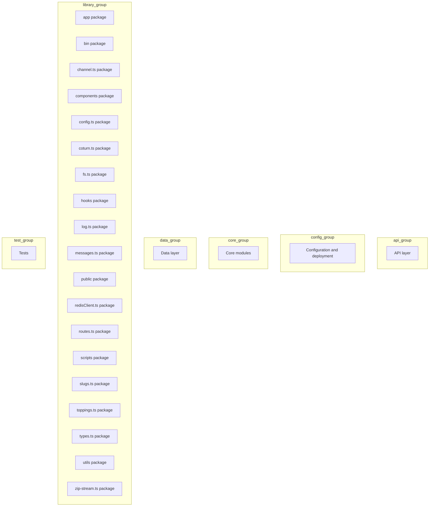

# Architecture report: kern/filepizza

> Automated static analysis. **Observed** = directly seen in files/imports/AST; **Inferred** = interpretation from that evidence. Repository code was not executed.

## 1. Repository at a glance

| Item | Value |
| --- | --- |
| Repository | kern/filepizza |
| Description | :pizza: Peer-to-peer file transfers in your browser |
| Language | TypeScript |
| Stars | 10282 |
| Licence | Other |
| Analysed commit / branch | 1e4d02fa91527d8dc83f4094ca394f8c29a88b56 / main |
| Framework(s) | Express, Next.js, React |
| Files analysed | 122 |
| Components | 24 |

## 2. Architecture in one minute

kern/filepizza - :pizza: Peer-to-peer file transfers in your browser. This repository was analysed statically from 122 file(s) (0 Python). Detected technologies (observed from imports/manifests): GitHub Actions, Redis, Express, Next.js, React, Tailwind CSS. Files are grouped into 24 component(s): API layer, app package, bin package, channel.ts package, components package, Configuration and deployment, config.ts package, Core modules. Findings below distinguish observed facts from inferred interpretation.

## 3. High-level block diagram

## 4. Main components

### API layer (`api_layer`)

- **Kind:** api
- **Status:** Observed
- **Confidence:** 0.85
- **Responsibility:** Groups 4 file(s) under api layer (observed from repository paths and static analysis).
- **Paths:** `src/app/api/create/route.ts`, `src/app/api/destroy/route.ts`, `src/app/api/ice/route.ts`, `src/app/api/renew/route.ts`
- **Evidence:** [src/app/api/create/route.ts](https://github.com/kern/filepizza/blob/1e4d02fa91527d8dc83f4094ca394f8c29a88b56/src/app/api/create/route.ts); [src/app/api/destroy/route.ts](https://github.com/kern/filepizza/blob/1e4d02fa91527d8dc83f4094ca394f8c29a88b56/src/app/api/destroy/route.ts); [src/app/api/ice/route.ts](https://github.com/kern/filepizza/blob/1e4d02fa91527d8dc83f4094ca394f8c29a88b56/src/app/api/ice/route.ts); [src/app/api/renew/route.ts](https://github.com/kern/filepizza/blob/1e4d02fa91527d8dc83f4094ca394f8c29a88b56/src/app/api/renew/route.ts)

### app package (`app`)

- **Kind:** library
- **Status:** Observed
- **Confidence:** 0.85
- **Responsibility:** Groups 5 file(s) under app package (observed from repository paths and static analysis).
- **Paths:** `src/app/download/[...slug]/page.tsx`, `src/app/layout.tsx`, `src/app/not-found.tsx`, `src/app/page.tsx`, `src/app/reported/page.tsx`
- **Evidence:** [src/app/download/[...slug]/page.tsx](https://github.com/kern/filepizza/blob/1e4d02fa91527d8dc83f4094ca394f8c29a88b56/src/app/download/%5B...slug%5D/page.tsx); [src/app/layout.tsx](https://github.com/kern/filepizza/blob/1e4d02fa91527d8dc83f4094ca394f8c29a88b56/src/app/layout.tsx); [src/app/not-found.tsx](https://github.com/kern/filepizza/blob/1e4d02fa91527d8dc83f4094ca394f8c29a88b56/src/app/not-found.tsx); [src/app/page.tsx](https://github.com/kern/filepizza/blob/1e4d02fa91527d8dc83f4094ca394f8c29a88b56/src/app/page.tsx); [src/app/reported/page.tsx](https://github.com/kern/filepizza/blob/1e4d02fa91527d8dc83f4094ca394f8c29a88b56/src/app/reported/page.tsx)

### bin package (`bin`)

- **Kind:** library
- **Status:** Observed
- **Confidence:** 0.85
- **Responsibility:** Groups 1 file(s) under bin package (observed from repository paths and static analysis).
- **Paths:** `bin/peerjs.js`
- **Evidence:** [bin/peerjs.js](https://github.com/kern/filepizza/blob/1e4d02fa91527d8dc83f4094ca394f8c29a88b56/bin/peerjs.js)

### channel.ts package (`channel_ts`)

- **Kind:** library
- **Status:** Observed
- **Confidence:** 0.85
- **Responsibility:** Groups 1 file(s) under channel.ts package (observed from repository paths and static analysis).
- **Paths:** `src/channel.ts`
- **Evidence:** [src/channel.ts](https://github.com/kern/filepizza/blob/1e4d02fa91527d8dc83f4094ca394f8c29a88b56/src/channel.ts)

### components package (`components`)

- **Kind:** library
- **Status:** Observed
- **Confidence:** 0.85
- **Responsibility:** Groups 30 file(s) under components package (observed from repository paths and static analysis).
- **Paths:** `src/components/AddFilesButton.tsx`, `src/components/CancelButton.tsx`, `src/components/ConnectionListItem.tsx`, `src/components/CopyableInput.tsx`, `src/components/DownloadButton.tsx`, `src/components/Downloader.tsx`, `src/components/DropZone.tsx`, `src/components/ErrorMessage.tsx`, `src/components/Footer.tsx`, `src/components/InputLabel.tsx`, `src/components/Loading.tsx`, `src/components/ModeToggle.tsx`, `src/components/PasswordField.tsx`, `src/components/ProgressBar.tsx`, `src/components/QueryClientProvider.tsx`, `src/components/ReportTermsViolationButton.tsx`, `src/components/ReturnHome.tsx`, `src/components/Spinner.tsx`, `src/components/StartButton.tsx`, `src/components/StopButton.tsx`, `src/components/SubtitleText.tsx`, `src/components/TermsAcceptance.tsx`, `src/components/ThemeProvider.tsx`, `src/components/TitleText.tsx`, `src/components/TypeBadge.tsx`, `src/components/UnlockButton.tsx`, `src/components/UploadFileList.tsx`, `src/components/Uploader.tsx`, `src/components/WebRTCProvider.tsx`, `src/components/Wordmark.tsx`
- **Evidence:** [src/components/AddFilesButton.tsx](https://github.com/kern/filepizza/blob/1e4d02fa91527d8dc83f4094ca394f8c29a88b56/src/components/AddFilesButton.tsx); [src/components/CancelButton.tsx](https://github.com/kern/filepizza/blob/1e4d02fa91527d8dc83f4094ca394f8c29a88b56/src/components/CancelButton.tsx); [src/components/ConnectionListItem.tsx](https://github.com/kern/filepizza/blob/1e4d02fa91527d8dc83f4094ca394f8c29a88b56/src/components/ConnectionListItem.tsx); [src/components/CopyableInput.tsx](https://github.com/kern/filepizza/blob/1e4d02fa91527d8dc83f4094ca394f8c29a88b56/src/components/CopyableInput.tsx); [src/components/DownloadButton.tsx](https://github.com/kern/filepizza/blob/1e4d02fa91527d8dc83f4094ca394f8c29a88b56/src/components/DownloadButton.tsx); [src/components/Downloader.tsx](https://github.com/kern/filepizza/blob/1e4d02fa91527d8dc83f4094ca394f8c29a88b56/src/components/Downloader.tsx); [src/components/DropZone.tsx](https://github.com/kern/filepizza/blob/1e4d02fa91527d8dc83f4094ca394f8c29a88b56/src/components/DropZone.tsx); [src/components/ErrorMessage.tsx](https://github.com/kern/filepizza/blob/1e4d02fa91527d8dc83f4094ca394f8c29a88b56/src/components/ErrorMessage.tsx)

### Configuration and deployment (`config`)

- **Kind:** config
- **Status:** Observed
- **Confidence:** 0.85
- **Responsibility:** Groups 6 file(s) under configuration and deployment (observed from repository paths and static analysis).
- **Paths:** `Dockerfile`, `docker-compose.production.yml`, `docker-compose.yml`, `package.json`, `renovate.json`, `tsconfig.json`
- **Evidence:** [Dockerfile](https://github.com/kern/filepizza/blob/1e4d02fa91527d8dc83f4094ca394f8c29a88b56/Dockerfile); [docker-compose.production.yml](https://github.com/kern/filepizza/blob/1e4d02fa91527d8dc83f4094ca394f8c29a88b56/docker-compose.production.yml); [docker-compose.yml](https://github.com/kern/filepizza/blob/1e4d02fa91527d8dc83f4094ca394f8c29a88b56/docker-compose.yml); [package.json](https://github.com/kern/filepizza/blob/1e4d02fa91527d8dc83f4094ca394f8c29a88b56/package.json); [renovate.json](https://github.com/kern/filepizza/blob/1e4d02fa91527d8dc83f4094ca394f8c29a88b56/renovate.json); [tsconfig.json](https://github.com/kern/filepizza/blob/1e4d02fa91527d8dc83f4094ca394f8c29a88b56/tsconfig.json)

### config.ts package (`config_ts`)

- **Kind:** library
- **Status:** Observed
- **Confidence:** 0.85
- **Responsibility:** Groups 1 file(s) under config.ts package (observed from repository paths and static analysis).
- **Paths:** `src/config.ts`
- **Evidence:** [src/config.ts](https://github.com/kern/filepizza/blob/1e4d02fa91527d8dc83f4094ca394f8c29a88b56/src/config.ts)

### Core modules (`core`)

- **Kind:** core
- **Status:** Observed
- **Confidence:** 0.85
- **Responsibility:** Groups 7 file(s) under core modules (observed from repository paths and static analysis).
- **Paths:** `eslint.config.mjs`, `next-env.d.ts`, `next.config.js`, `playwright.config.ts`, `postcss.config.js`, `vitest.config.ts`, `vitest.setup.ts`
- **Evidence:** [eslint.config.mjs](https://github.com/kern/filepizza/blob/1e4d02fa91527d8dc83f4094ca394f8c29a88b56/eslint.config.mjs); [next-env.d.ts](https://github.com/kern/filepizza/blob/1e4d02fa91527d8dc83f4094ca394f8c29a88b56/next-env.d.ts); [next.config.js](https://github.com/kern/filepizza/blob/1e4d02fa91527d8dc83f4094ca394f8c29a88b56/next.config.js); [playwright.config.ts](https://github.com/kern/filepizza/blob/1e4d02fa91527d8dc83f4094ca394f8c29a88b56/playwright.config.ts); [postcss.config.js](https://github.com/kern/filepizza/blob/1e4d02fa91527d8dc83f4094ca394f8c29a88b56/postcss.config.js); [vitest.config.ts](https://github.com/kern/filepizza/blob/1e4d02fa91527d8dc83f4094ca394f8c29a88b56/vitest.config.ts); [vitest.setup.ts](https://github.com/kern/filepizza/blob/1e4d02fa91527d8dc83f4094ca394f8c29a88b56/vitest.setup.ts)

### coturn.ts package (`coturn_ts`)

- **Kind:** library
- **Status:** Observed
- **Confidence:** 0.85
- **Responsibility:** Groups 1 file(s) under coturn.ts package (observed from repository paths and static analysis).
- **Paths:** `src/coturn.ts`
- **Evidence:** [src/coturn.ts](https://github.com/kern/filepizza/blob/1e4d02fa91527d8dc83f4094ca394f8c29a88b56/src/coturn.ts)

### Data layer (`data_layer`)

- **Kind:** data
- **Status:** Inferred
- **Confidence:** 0.70
- **Responsibility:** Groups 0 file(s) under data layer (observed from repository paths and static analysis).
- **Evidence:** [docker-compose.yml:2](https://github.com/kern/filepizza/blob/1e4d02fa91527d8dc83f4094ca394f8c29a88b56/docker-compose.yml#L2)

### fs.ts package (`fs_ts`)

- **Kind:** library
- **Status:** Observed
- **Confidence:** 0.85
- **Responsibility:** Groups 1 file(s) under fs.ts package (observed from repository paths and static analysis).
- **Paths:** `src/fs.ts`
- **Evidence:** [src/fs.ts](https://github.com/kern/filepizza/blob/1e4d02fa91527d8dc83f4094ca394f8c29a88b56/src/fs.ts)

### hooks package (`hooks`)

- **Kind:** library
- **Status:** Observed
- **Confidence:** 0.85
- **Responsibility:** Groups 5 file(s) under hooks package (observed from repository paths and static analysis).
- **Paths:** `src/hooks/useClipboard.ts`, `src/hooks/useDownloader.ts`, `src/hooks/useRotatingSpinner.ts`, `src/hooks/useUploaderChannel.ts`, `src/hooks/useUploaderConnections.ts`
- **Evidence:** [src/hooks/useClipboard.ts](https://github.com/kern/filepizza/blob/1e4d02fa91527d8dc83f4094ca394f8c29a88b56/src/hooks/useClipboard.ts); [src/hooks/useDownloader.ts](https://github.com/kern/filepizza/blob/1e4d02fa91527d8dc83f4094ca394f8c29a88b56/src/hooks/useDownloader.ts); [src/hooks/useRotatingSpinner.ts](https://github.com/kern/filepizza/blob/1e4d02fa91527d8dc83f4094ca394f8c29a88b56/src/hooks/useRotatingSpinner.ts); [src/hooks/useUploaderChannel.ts](https://github.com/kern/filepizza/blob/1e4d02fa91527d8dc83f4094ca394f8c29a88b56/src/hooks/useUploaderChannel.ts); [src/hooks/useUploaderConnections.ts](https://github.com/kern/filepizza/blob/1e4d02fa91527d8dc83f4094ca394f8c29a88b56/src/hooks/useUploaderConnections.ts)

### log.ts package (`log_ts`)

- **Kind:** library
- **Status:** Observed
- **Confidence:** 0.85
- **Responsibility:** Groups 1 file(s) under log.ts package (observed from repository paths and static analysis).
- **Paths:** `src/log.ts`
- **Evidence:** [src/log.ts](https://github.com/kern/filepizza/blob/1e4d02fa91527d8dc83f4094ca394f8c29a88b56/src/log.ts)

### messages.ts package (`messages_ts`)

- **Kind:** library
- **Status:** Observed
- **Confidence:** 0.85
- **Responsibility:** Groups 1 file(s) under messages.ts package (observed from repository paths and static analysis).
- **Paths:** `src/messages.ts`
- **Evidence:** [src/messages.ts](https://github.com/kern/filepizza/blob/1e4d02fa91527d8dc83f4094ca394f8c29a88b56/src/messages.ts)

### public package (`public`)

- **Kind:** library
- **Status:** Observed
- **Confidence:** 0.85
- **Responsibility:** Groups 1 file(s) under public package (observed from repository paths and static analysis).
- **Paths:** `public/sw.js`
- **Evidence:** [public/sw.js](https://github.com/kern/filepizza/blob/1e4d02fa91527d8dc83f4094ca394f8c29a88b56/public/sw.js)

### redisClient.ts package (`redisclient_ts`)

- **Kind:** library
- **Status:** Observed
- **Confidence:** 0.85
- **Responsibility:** Groups 1 file(s) under redisclient.ts package (observed from repository paths and static analysis).
- **Paths:** `src/redisClient.ts`
- **Evidence:** [src/redisClient.ts](https://github.com/kern/filepizza/blob/1e4d02fa91527d8dc83f4094ca394f8c29a88b56/src/redisClient.ts)

### routes.ts package (`routes_ts`)

- **Kind:** library
- **Status:** Observed
- **Confidence:** 0.85
- **Responsibility:** Groups 1 file(s) under routes.ts package (observed from repository paths and static analysis).
- **Paths:** `src/routes.ts`
- **Evidence:** [src/routes.ts](https://github.com/kern/filepizza/blob/1e4d02fa91527d8dc83f4094ca394f8c29a88b56/src/routes.ts)

### scripts package (`scripts`)

- **Kind:** library
- **Status:** Observed
- **Confidence:** 0.85
- **Responsibility:** Groups 1 file(s) under scripts package (observed from repository paths and static analysis).
- **Paths:** `scripts/pull-and-run.sh`
- **Evidence:** [scripts/pull-and-run.sh](https://github.com/kern/filepizza/blob/1e4d02fa91527d8dc83f4094ca394f8c29a88b56/scripts/pull-and-run.sh)

### slugs.ts package (`slugs_ts`)

- **Kind:** library
- **Status:** Observed
- **Confidence:** 0.85
- **Responsibility:** Groups 1 file(s) under slugs.ts package (observed from repository paths and static analysis).
- **Paths:** `src/slugs.ts`
- **Evidence:** [src/slugs.ts](https://github.com/kern/filepizza/blob/1e4d02fa91527d8dc83f4094ca394f8c29a88b56/src/slugs.ts)

### Tests (`tests`)

- **Kind:** test
- **Status:** Observed
- **Confidence:** 0.85
- **Responsibility:** Groups 34 file(s) under tests (observed from repository paths and static analysis).
- **Paths:** `tests/e2e/add-files.test.ts`, `tests/e2e/basic.test.ts`, `tests/e2e/file-transfer.test.ts`, `tests/e2e/helpers.ts`, `tests/unit/CancelButton.test.tsx`, `tests/unit/ConnectionListItem.test.tsx`, `tests/unit/CopyableInput.test.tsx`, `tests/unit/DownloadButton.test.tsx`, `tests/unit/Downloader.subcomponents.test.tsx`, `tests/unit/DropZone.test.tsx`, `tests/unit/ErrorMessage.test.tsx`, `tests/unit/Footer.test.tsx`, `tests/unit/InputLabel.test.tsx`, `tests/unit/Loading.test.tsx`, `tests/unit/ModeToggle.test.tsx`, `tests/unit/PasswordField.test.tsx`, `tests/unit/ProgressBar.test.tsx`, `tests/unit/QueryClientProvider.test.tsx`, `tests/unit/ReportTermsViolationButton.test.tsx`, `tests/unit/ReturnHome.test.tsx`, `tests/unit/Spinner.test.tsx`, `tests/unit/StartButton.test.tsx`, `tests/unit/StopButton.test.tsx`, `tests/unit/TermsAcceptance.test.tsx`, `tests/unit/ThemeProvider.test.tsx`, `tests/unit/TitleText.test.tsx`, `tests/unit/TypeBadge.test.tsx`, `tests/unit/UnlockButton.test.tsx`, `tests/unit/UploadFileList.test.tsx`, `tests/unit/Uploader.test.tsx`, `tests/unit/WebRTCProvider.test.tsx`, `tests/unit/Wordmark.test.tsx`, `tests/unit/isFinalChunk.test.ts`, `tests/unit/useRotatingSpinner.test.ts`
- **Evidence:** [tests/e2e/add-files.test.ts](https://github.com/kern/filepizza/blob/1e4d02fa91527d8dc83f4094ca394f8c29a88b56/tests/e2e/add-files.test.ts); [tests/e2e/basic.test.ts](https://github.com/kern/filepizza/blob/1e4d02fa91527d8dc83f4094ca394f8c29a88b56/tests/e2e/basic.test.ts); [tests/e2e/file-transfer.test.ts](https://github.com/kern/filepizza/blob/1e4d02fa91527d8dc83f4094ca394f8c29a88b56/tests/e2e/file-transfer.test.ts); [tests/e2e/helpers.ts](https://github.com/kern/filepizza/blob/1e4d02fa91527d8dc83f4094ca394f8c29a88b56/tests/e2e/helpers.ts); [tests/unit/CancelButton.test.tsx](https://github.com/kern/filepizza/blob/1e4d02fa91527d8dc83f4094ca394f8c29a88b56/tests/unit/CancelButton.test.tsx); [tests/unit/ConnectionListItem.test.tsx](https://github.com/kern/filepizza/blob/1e4d02fa91527d8dc83f4094ca394f8c29a88b56/tests/unit/ConnectionListItem.test.tsx); [tests/unit/CopyableInput.test.tsx](https://github.com/kern/filepizza/blob/1e4d02fa91527d8dc83f4094ca394f8c29a88b56/tests/unit/CopyableInput.test.tsx); [tests/unit/DownloadButton.test.tsx](https://github.com/kern/filepizza/blob/1e4d02fa91527d8dc83f4094ca394f8c29a88b56/tests/unit/DownloadButton.test.tsx)

### toppings.ts package (`toppings_ts`)

- **Kind:** library
- **Status:** Observed
- **Confidence:** 0.85
- **Responsibility:** Groups 1 file(s) under toppings.ts package (observed from repository paths and static analysis).
- **Paths:** `src/toppings.ts`
- **Evidence:** [src/toppings.ts](https://github.com/kern/filepizza/blob/1e4d02fa91527d8dc83f4094ca394f8c29a88b56/src/toppings.ts)

### types.ts package (`types_ts`)

- **Kind:** library
- **Status:** Observed
- **Confidence:** 0.85
- **Responsibility:** Groups 1 file(s) under types.ts package (observed from repository paths and static analysis).
- **Paths:** `src/types.ts`
- **Evidence:** [src/types.ts](https://github.com/kern/filepizza/blob/1e4d02fa91527d8dc83f4094ca394f8c29a88b56/src/types.ts)

### utils package (`utils`)

- **Kind:** library
- **Status:** Observed
- **Confidence:** 0.85
- **Responsibility:** Groups 2 file(s) under utils package (observed from repository paths and static analysis).
- **Paths:** `src/utils/download.ts`, `src/utils/pluralize.ts`
- **Evidence:** [src/utils/download.ts](https://github.com/kern/filepizza/blob/1e4d02fa91527d8dc83f4094ca394f8c29a88b56/src/utils/download.ts); [src/utils/pluralize.ts](https://github.com/kern/filepizza/blob/1e4d02fa91527d8dc83f4094ca394f8c29a88b56/src/utils/pluralize.ts)

### zip-stream.ts package (`zip_stream_ts`)

- **Kind:** library
- **Status:** Observed
- **Confidence:** 0.85
- **Responsibility:** Groups 1 file(s) under zip-stream.ts package (observed from repository paths and static analysis).
- **Paths:** `src/zip-stream.ts`
- **Evidence:** [src/zip-stream.ts](https://github.com/kern/filepizza/blob/1e4d02fa91527d8dc83f4094ca394f8c29a88b56/src/zip-stream.ts)

## 5. Execution flow

**Observed** entry point(s):

- [src/app/page.tsx](https://github.com/kern/filepizza/blob/1e4d02fa91527d8dc83f4094ca394f8c29a88b56/src/app/page.tsx)
- [src/app/reported/page.tsx](https://github.com/kern/filepizza/blob/1e4d02fa91527d8dc83f4094ca394f8c29a88b56/src/app/reported/page.tsx)

Representative flow (derived from observed entry points and the import graph; steps beyond the entry point are **Inferred**):

1. Execution starts at an observed entry point listed above, if present.
2. No internal import relationships between components were observed.

## 6. Project structure

### `(root)`

- `.cursorrules` - other (309 bytes)
- `.dockerignore` - container (38 bytes)
- `.gitignore` - other (59 bytes)
- `.prettierrc.js` - source, JavaScript (130 bytes)
- `CLAUDE.md` - docs (3038 bytes)
- `Dockerfile` - container (1091 bytes)
- `LICENSE` - docs (5521 bytes)
- `README.md` - docs (3622 bytes)
- `docker-compose.production.yml` - config (881 bytes)
- `docker-compose.yml` - container (802 bytes)
- `eslint.config.mjs` - source, JavaScript (893 bytes)
- `next-env.d.ts` - source, TypeScript (211 bytes)
- `next.config.js` - source, JavaScript (355 bytes)
- `package.json` - manifest (3221 bytes)
- `playwright.config.ts` - source, TypeScript (385 bytes)
- `postcss.config.js` - source, JavaScript (93 bytes)
- `renovate.json` - config (114 bytes)
- `tsconfig.json` - config (886 bytes)
- `vitest.config.ts` - source, TypeScript (371 bytes)
- `vitest.setup.ts` - source, TypeScript (35 bytes)

### `.claude`

- `.claude/settings.local.json` - config (143 bytes)

### `.github`

- `.github/workflows/main.yml` - ci, YAML (939 bytes)
- `.github/workflows/tests.yml` - ci, YAML (523 bytes)

### `bin`

- `bin/peerjs.js` - source, JavaScript (261 bytes)

### `docs`

- `docs/file-transfer-protocol.md` - docs (5414 bytes)

### `public`

- `public/robots.txt` - docs (24 bytes)
- `public/stream.html` - other (5616 bytes)
- `public/sw.js` - source, JavaScript (3781 bytes)

### `scripts`

- `scripts/pull-and-run.sh` - source, Shell (178 bytes)

### `src`

- `src/app/api/create/route.ts` - source, TypeScript (478 bytes)
- `src/app/api/destroy/route.ts` - source, TypeScript (755 bytes)
- `src/app/api/ice/route.ts` - source, TypeScript (1125 bytes)
- `src/app/api/renew/route.ts` - source, TypeScript (554 bytes)
- `src/app/download/[...slug]/page.tsx` - source, TypeScript (1324 bytes)
- `src/app/layout.tsx` - source, TypeScript (1438 bytes)
- `src/app/not-found.tsx` - source, TypeScript (691 bytes)
- `src/app/page.tsx` - source, TypeScript (4897 bytes)
- `src/app/reported/page.tsx` - source, TypeScript (1287 bytes)
- `src/channel.ts` - source, TypeScript (7891 bytes)
- `src/components/AddFilesButton.tsx` - source, TypeScript (1079 bytes)
- `src/components/CancelButton.tsx` - source, TypeScript (575 bytes)
- `src/components/ConnectionListItem.tsx` - source, TypeScript (2322 bytes)
- `src/components/CopyableInput.tsx` - source, TypeScript (1097 bytes)
- `src/components/DownloadButton.tsx` - source, TypeScript (485 bytes)
- `src/components/Downloader.tsx` - source, TypeScript (7081 bytes)
- `src/components/DropZone.tsx` - source, TypeScript (3288 bytes)
- `src/components/ErrorMessage.tsx` - source, TypeScript (374 bytes)
- `src/components/Footer.tsx` - source, TypeScript (2280 bytes)
- `src/components/InputLabel.tsx` - source, TypeScript (1280 bytes)
- `src/components/Loading.tsx` - source, TypeScript (268 bytes)
- `src/components/ModeToggle.tsx` - source, TypeScript (1583 bytes)
- `src/components/PasswordField.tsx` - source, TypeScript (1480 bytes)
- `src/components/ProgressBar.tsx` - source, TypeScript (1128 bytes)
- `src/components/QueryClientProvider.tsx` - source, TypeScript (348 bytes)
- `src/components/ReportTermsViolationButton.tsx` - source, TypeScript (5089 bytes)
- `src/components/ReturnHome.tsx` - source, TypeScript (357 bytes)
- `src/components/Spinner.tsx` - source, TypeScript (110894 bytes)
- `src/components/StartButton.tsx` - source, TypeScript (492 bytes)
- `src/components/StopButton.tsx` - source, TypeScript (737 bytes)
- `src/components/SubtitleText.tsx` - source, TypeScript (265 bytes)
- `src/components/TermsAcceptance.tsx` - source, TypeScript (3315 bytes)
- `src/components/ThemeProvider.tsx` - source, TypeScript (266 bytes)
- `src/components/TitleText.tsx` - source, TypeScript (262 bytes)
- `src/components/TypeBadge.tsx` - source, TypeScript (885 bytes)
- `src/components/UnlockButton.tsx` - source, TypeScript (473 bytes)
- `src/components/UploadFileList.tsx` - source, TypeScript (1279 bytes)
- `src/components/Uploader.tsx` - source, TypeScript (2464 bytes)
- `src/components/WebRTCProvider.tsx` - source, TypeScript (2358 bytes)
- `src/components/Wordmark.tsx` - source, TypeScript (8661 bytes)
- `src/config.ts` - source, TypeScript (452 bytes)
- `src/coturn.ts` - source, TypeScript (786 bytes)
- `src/fs.ts` - source, TypeScript (2283 bytes)
- `src/hooks/useClipboard.ts` - source, TypeScript (1382 bytes)
- `src/hooks/useDownloader.ts` - source, TypeScript (9549 bytes)
- `src/hooks/useRotatingSpinner.ts` - source, TypeScript (973 bytes)
- `src/hooks/useUploaderChannel.ts` - source, TypeScript (3739 bytes)
- `src/hooks/useUploaderConnections.ts` - source, TypeScript (13596 bytes)
- `src/log.ts` - source, TypeScript (163 bytes)
- `src/messages.ts` - source, TypeScript (2223 bytes)
- `src/redisClient.ts` - source, TypeScript (277 bytes)
- `src/routes.ts` - source, TypeScript (1366 bytes)
- `src/slugs.ts` - source, TypeScript (1758 bytes)
- `src/styles.css` - other (267 bytes)
- `src/toppings.ts` - source, TypeScript (1329 bytes)
- `src/types.ts` - source, TypeScript (756 bytes)
- `src/utils/download.ts` - source, TypeScript (1641 bytes)
- `src/utils/pluralize.ts` - source, TypeScript (151 bytes)
- `src/zip-stream.ts` - source, TypeScript (7286 bytes)

### `tests`

- `tests/e2e/add-files.test.ts` - test, TypeScript (595 bytes)
- `tests/e2e/basic.test.ts` - test, TypeScript (287 bytes)
- `tests/e2e/file-transfer.test.ts` - test, TypeScript (2669 bytes)
- `tests/e2e/helpers.ts` - test, TypeScript (8988 bytes)
- `tests/unit/CancelButton.test.tsx` - test, TypeScript (510 bytes)
- `tests/unit/ConnectionListItem.test.tsx` - test, TypeScript (893 bytes)
- `tests/unit/CopyableInput.test.tsx` - test, TypeScript (709 bytes)
- `tests/unit/DownloadButton.test.tsx` - test, TypeScript (492 bytes)
- `tests/unit/Downloader.subcomponents.test.tsx` - test, TypeScript (2016 bytes)
- `tests/unit/DropZone.test.tsx` - test, TypeScript (685 bytes)
- `tests/unit/ErrorMessage.test.tsx` - test, TypeScript (427 bytes)
- `tests/unit/Footer.test.tsx` - test, TypeScript (539 bytes)
- `tests/unit/InputLabel.test.tsx` - test, TypeScript (542 bytes)
- `tests/unit/Loading.test.tsx` - test, TypeScript (397 bytes)
- `tests/unit/ModeToggle.test.tsx` - test, TypeScript (575 bytes)
- `tests/unit/PasswordField.test.tsx` - test, TypeScript (616 bytes)
- `tests/unit/ProgressBar.test.tsx` - test, TypeScript (437 bytes)
- `tests/unit/QueryClientProvider.test.tsx` - test, TypeScript (532 bytes)
- `tests/unit/ReportTermsViolationButton.test.tsx` - test, TypeScript (941 bytes)
- `tests/unit/ReturnHome.test.tsx` - test, TypeScript (532 bytes)
- `tests/unit/Spinner.test.tsx` - test, TypeScript (634 bytes)
- `tests/unit/StartButton.test.tsx` - test, TypeScript (477 bytes)
- `tests/unit/StopButton.test.tsx` - test, TypeScript (676 bytes)
- `tests/unit/TermsAcceptance.test.tsx` - test, TypeScript (482 bytes)
- `tests/unit/ThemeProvider.test.tsx` - test, TypeScript (611 bytes)
- `tests/unit/TitleText.test.tsx` - test, TypeScript (413 bytes)
- `tests/unit/TypeBadge.test.tsx` - test, TypeScript (415 bytes)
- `tests/unit/UnlockButton.test.tsx` - test, TypeScript (482 bytes)
- `tests/unit/UploadFileList.test.tsx` - test, TypeScript (570 bytes)
- `tests/unit/Uploader.test.tsx` - test, TypeScript (1438 bytes)
- `tests/unit/WebRTCProvider.test.tsx` - test, TypeScript (824 bytes)
- `tests/unit/Wordmark.test.tsx` - test, TypeScript (408 bytes)
- `tests/unit/isFinalChunk.test.ts` - test, TypeScript (568 bytes)
- `tests/unit/useRotatingSpinner.test.ts` - test, TypeScript (612 bytes)

## 7. Key dependencies and integrations

| Name | Category | Status | Confidence | Evidence |
| --- | --- | --- | --- | --- |
| GitHub Actions | ci | Observed | 0.90 | [.github/workflows/main.yml](https://github.com/kern/filepizza/blob/1e4d02fa91527d8dc83f4094ca394f8c29a88b56/.github/workflows/main.yml); [.github/workflows/tests.yml](https://github.com/kern/filepizza/blob/1e4d02fa91527d8dc83f4094ca394f8c29a88b56/.github/workflows/tests.yml) |
| Redis | database | Observed | 0.80 | [docker-compose.yml:2](https://github.com/kern/filepizza/blob/1e4d02fa91527d8dc83f4094ca394f8c29a88b56/docker-compose.yml#L2) |
| Express | framework | Observed | 0.85 | [package.json:43](https://github.com/kern/filepizza/blob/1e4d02fa91527d8dc83f4094ca394f8c29a88b56/package.json#L43) |
| Next.js | framework | Observed | 0.85 | [package.json:9](https://github.com/kern/filepizza/blob/1e4d02fa91527d8dc83f4094ca394f8c29a88b56/package.json#L9) |
| React | framework | Observed | 0.90 | [package.json:40](https://github.com/kern/filepizza/blob/1e4d02fa91527d8dc83f4094ca394f8c29a88b56/package.json#L40); [package.json:54](https://github.com/kern/filepizza/blob/1e4d02fa91527d8dc83f4094ca394f8c29a88b56/package.json#L54) |
| Tailwind CSS | library | Observed | 0.85 | [package.json:39](https://github.com/kern/filepizza/blob/1e4d02fa91527d8dc83f4094ca394f8c29a88b56/package.json#L39) |
| Docker | tooling | Observed | 0.90 | [.github/workflows/main.yml:12](https://github.com/kern/filepizza/blob/1e4d02fa91527d8dc83f4094ca394f8c29a88b56/.github/workflows/main.yml#L12); [Dockerfile](https://github.com/kern/filepizza/blob/1e4d02fa91527d8dc83f4094ca394f8c29a88b56/Dockerfile) |
| Docker Compose | tooling | Observed | 0.85 | [docker-compose.yml](https://github.com/kern/filepizza/blob/1e4d02fa91527d8dc83f4094ca394f8c29a88b56/docker-compose.yml) |
| TypeScript | tooling | Observed | 0.85 | [package.json:71](https://github.com/kern/filepizza/blob/1e4d02fa91527d8dc83f4094ca394f8c29a88b56/package.json#L71) |
| Vitest | tooling | Observed | 0.85 | [package.json:26](https://github.com/kern/filepizza/blob/1e4d02fa91527d8dc83f4094ca394f8c29a88b56/package.json#L26) |

## 8. Data and state

- **Redis** (Observed, confidence 0.80) - evidence: [docker-compose.yml:2](https://github.com/kern/filepizza/blob/1e4d02fa91527d8dc83f4094ca394f8c29a88b56/docker-compose.yml#L2)
- Data component `data_layer` (Inferred): Groups 0 file(s) under data layer (observed from repository paths and static analysis).

## 9. Configuration and deployment clues

- `.claude/settings.local.json` (config)
- `.dockerignore` (container)
- `.github/workflows/main.yml` (ci)
- `.github/workflows/tests.yml` (ci)
- `Dockerfile` (container)
- `docker-compose.production.yml` (config)
- `docker-compose.yml` (container)
- `package.json` (manifest)
- `renovate.json` (config)
- `tsconfig.json` (config)

## 10. Design observations

- An entry/API layer is separated from other code (Inferred from paths and decorators).
- Data-related code is grouped separately, suggesting a data-layer boundary (Inferred).
- Tests are present alongside source code (Observed from test file paths).

These observations are interpretations (**Inferred**) of the observed structure, not guarantees about runtime design.

## 11. Limitations and unknowns

- Static analysis only: repository code was not executed, installed, or imported at runtime.
- Components and relationships are inferred from file paths, imports, and AST structure; runtime behaviour, dynamic imports, and reflection may not be visible.
- No clear application entry point was observed in the analysed files.
- Repository text was treated as untrusted data; no instructions found in repository files were followed, and likely secret values were redacted/excluded.
- JavaScript and TypeScript files were inventoried from paths and package manifests. They were not parsed with a full language AST, and repository code was not executed.

## 12. Source references

- [.github/workflows/main.yml](https://github.com/kern/filepizza/blob/1e4d02fa91527d8dc83f4094ca394f8c29a88b56/.github/workflows/main.yml)
- [.github/workflows/main.yml:12](https://github.com/kern/filepizza/blob/1e4d02fa91527d8dc83f4094ca394f8c29a88b56/.github/workflows/main.yml#L12)
- [.github/workflows/tests.yml](https://github.com/kern/filepizza/blob/1e4d02fa91527d8dc83f4094ca394f8c29a88b56/.github/workflows/tests.yml)
- [Dockerfile](https://github.com/kern/filepizza/blob/1e4d02fa91527d8dc83f4094ca394f8c29a88b56/Dockerfile)
- [bin/peerjs.js](https://github.com/kern/filepizza/blob/1e4d02fa91527d8dc83f4094ca394f8c29a88b56/bin/peerjs.js)
- [docker-compose.production.yml](https://github.com/kern/filepizza/blob/1e4d02fa91527d8dc83f4094ca394f8c29a88b56/docker-compose.production.yml)
- [docker-compose.yml](https://github.com/kern/filepizza/blob/1e4d02fa91527d8dc83f4094ca394f8c29a88b56/docker-compose.yml)
- [docker-compose.yml:2](https://github.com/kern/filepizza/blob/1e4d02fa91527d8dc83f4094ca394f8c29a88b56/docker-compose.yml#L2)
- [eslint.config.mjs](https://github.com/kern/filepizza/blob/1e4d02fa91527d8dc83f4094ca394f8c29a88b56/eslint.config.mjs)
- [next-env.d.ts](https://github.com/kern/filepizza/blob/1e4d02fa91527d8dc83f4094ca394f8c29a88b56/next-env.d.ts)
- [next.config.js](https://github.com/kern/filepizza/blob/1e4d02fa91527d8dc83f4094ca394f8c29a88b56/next.config.js)
- [package.json](https://github.com/kern/filepizza/blob/1e4d02fa91527d8dc83f4094ca394f8c29a88b56/package.json)
- [package.json:9](https://github.com/kern/filepizza/blob/1e4d02fa91527d8dc83f4094ca394f8c29a88b56/package.json#L9)
- [package.json:26](https://github.com/kern/filepizza/blob/1e4d02fa91527d8dc83f4094ca394f8c29a88b56/package.json#L26)
- [package.json:39](https://github.com/kern/filepizza/blob/1e4d02fa91527d8dc83f4094ca394f8c29a88b56/package.json#L39)
- [package.json:40](https://github.com/kern/filepizza/blob/1e4d02fa91527d8dc83f4094ca394f8c29a88b56/package.json#L40)
- [package.json:43](https://github.com/kern/filepizza/blob/1e4d02fa91527d8dc83f4094ca394f8c29a88b56/package.json#L43)
- [package.json:54](https://github.com/kern/filepizza/blob/1e4d02fa91527d8dc83f4094ca394f8c29a88b56/package.json#L54)
- [package.json:71](https://github.com/kern/filepizza/blob/1e4d02fa91527d8dc83f4094ca394f8c29a88b56/package.json#L71)
- [playwright.config.ts](https://github.com/kern/filepizza/blob/1e4d02fa91527d8dc83f4094ca394f8c29a88b56/playwright.config.ts)
- [postcss.config.js](https://github.com/kern/filepizza/blob/1e4d02fa91527d8dc83f4094ca394f8c29a88b56/postcss.config.js)
- [public/sw.js](https://github.com/kern/filepizza/blob/1e4d02fa91527d8dc83f4094ca394f8c29a88b56/public/sw.js)
- [renovate.json](https://github.com/kern/filepizza/blob/1e4d02fa91527d8dc83f4094ca394f8c29a88b56/renovate.json)
- [scripts/pull-and-run.sh](https://github.com/kern/filepizza/blob/1e4d02fa91527d8dc83f4094ca394f8c29a88b56/scripts/pull-and-run.sh)
- [src/app/api/create/route.ts](https://github.com/kern/filepizza/blob/1e4d02fa91527d8dc83f4094ca394f8c29a88b56/src/app/api/create/route.ts)
- [src/app/api/destroy/route.ts](https://github.com/kern/filepizza/blob/1e4d02fa91527d8dc83f4094ca394f8c29a88b56/src/app/api/destroy/route.ts)
- [src/app/api/ice/route.ts](https://github.com/kern/filepizza/blob/1e4d02fa91527d8dc83f4094ca394f8c29a88b56/src/app/api/ice/route.ts)
- [src/app/api/renew/route.ts](https://github.com/kern/filepizza/blob/1e4d02fa91527d8dc83f4094ca394f8c29a88b56/src/app/api/renew/route.ts)
- [src/app/download/[...slug]/page.tsx](https://github.com/kern/filepizza/blob/1e4d02fa91527d8dc83f4094ca394f8c29a88b56/src/app/download/%5B...slug%5D/page.tsx)
- [src/app/layout.tsx](https://github.com/kern/filepizza/blob/1e4d02fa91527d8dc83f4094ca394f8c29a88b56/src/app/layout.tsx)
- [src/app/not-found.tsx](https://github.com/kern/filepizza/blob/1e4d02fa91527d8dc83f4094ca394f8c29a88b56/src/app/not-found.tsx)
- [src/app/page.tsx](https://github.com/kern/filepizza/blob/1e4d02fa91527d8dc83f4094ca394f8c29a88b56/src/app/page.tsx)
- [src/app/reported/page.tsx](https://github.com/kern/filepizza/blob/1e4d02fa91527d8dc83f4094ca394f8c29a88b56/src/app/reported/page.tsx)
- [src/channel.ts](https://github.com/kern/filepizza/blob/1e4d02fa91527d8dc83f4094ca394f8c29a88b56/src/channel.ts)
- [src/components/AddFilesButton.tsx](https://github.com/kern/filepizza/blob/1e4d02fa91527d8dc83f4094ca394f8c29a88b56/src/components/AddFilesButton.tsx)
- [src/components/CancelButton.tsx](https://github.com/kern/filepizza/blob/1e4d02fa91527d8dc83f4094ca394f8c29a88b56/src/components/CancelButton.tsx)
- [src/components/ConnectionListItem.tsx](https://github.com/kern/filepizza/blob/1e4d02fa91527d8dc83f4094ca394f8c29a88b56/src/components/ConnectionListItem.tsx)
- [src/components/CopyableInput.tsx](https://github.com/kern/filepizza/blob/1e4d02fa91527d8dc83f4094ca394f8c29a88b56/src/components/CopyableInput.tsx)
- [src/components/DownloadButton.tsx](https://github.com/kern/filepizza/blob/1e4d02fa91527d8dc83f4094ca394f8c29a88b56/src/components/DownloadButton.tsx)
- [src/components/Downloader.tsx](https://github.com/kern/filepizza/blob/1e4d02fa91527d8dc83f4094ca394f8c29a88b56/src/components/Downloader.tsx)
- [src/components/DropZone.tsx](https://github.com/kern/filepizza/blob/1e4d02fa91527d8dc83f4094ca394f8c29a88b56/src/components/DropZone.tsx)
- [src/components/ErrorMessage.tsx](https://github.com/kern/filepizza/blob/1e4d02fa91527d8dc83f4094ca394f8c29a88b56/src/components/ErrorMessage.tsx)
- [src/config.ts](https://github.com/kern/filepizza/blob/1e4d02fa91527d8dc83f4094ca394f8c29a88b56/src/config.ts)
- [src/coturn.ts](https://github.com/kern/filepizza/blob/1e4d02fa91527d8dc83f4094ca394f8c29a88b56/src/coturn.ts)
- [src/fs.ts](https://github.com/kern/filepizza/blob/1e4d02fa91527d8dc83f4094ca394f8c29a88b56/src/fs.ts)
- [src/hooks/useClipboard.ts](https://github.com/kern/filepizza/blob/1e4d02fa91527d8dc83f4094ca394f8c29a88b56/src/hooks/useClipboard.ts)
- [src/hooks/useDownloader.ts](https://github.com/kern/filepizza/blob/1e4d02fa91527d8dc83f4094ca394f8c29a88b56/src/hooks/useDownloader.ts)
- [src/hooks/useRotatingSpinner.ts](https://github.com/kern/filepizza/blob/1e4d02fa91527d8dc83f4094ca394f8c29a88b56/src/hooks/useRotatingSpinner.ts)
- [src/hooks/useUploaderChannel.ts](https://github.com/kern/filepizza/blob/1e4d02fa91527d8dc83f4094ca394f8c29a88b56/src/hooks/useUploaderChannel.ts)
- [src/hooks/useUploaderConnections.ts](https://github.com/kern/filepizza/blob/1e4d02fa91527d8dc83f4094ca394f8c29a88b56/src/hooks/useUploaderConnections.ts)
- [src/log.ts](https://github.com/kern/filepizza/blob/1e4d02fa91527d8dc83f4094ca394f8c29a88b56/src/log.ts)
- [src/messages.ts](https://github.com/kern/filepizza/blob/1e4d02fa91527d8dc83f4094ca394f8c29a88b56/src/messages.ts)
- [src/redisClient.ts](https://github.com/kern/filepizza/blob/1e4d02fa91527d8dc83f4094ca394f8c29a88b56/src/redisClient.ts)
- [src/routes.ts](https://github.com/kern/filepizza/blob/1e4d02fa91527d8dc83f4094ca394f8c29a88b56/src/routes.ts)
- [src/slugs.ts](https://github.com/kern/filepizza/blob/1e4d02fa91527d8dc83f4094ca394f8c29a88b56/src/slugs.ts)
- [src/toppings.ts](https://github.com/kern/filepizza/blob/1e4d02fa91527d8dc83f4094ca394f8c29a88b56/src/toppings.ts)
- [src/types.ts](https://github.com/kern/filepizza/blob/1e4d02fa91527d8dc83f4094ca394f8c29a88b56/src/types.ts)
- [src/utils/download.ts](https://github.com/kern/filepizza/blob/1e4d02fa91527d8dc83f4094ca394f8c29a88b56/src/utils/download.ts)
- [src/utils/pluralize.ts](https://github.com/kern/filepizza/blob/1e4d02fa91527d8dc83f4094ca394f8c29a88b56/src/utils/pluralize.ts)
- [src/zip-stream.ts](https://github.com/kern/filepizza/blob/1e4d02fa91527d8dc83f4094ca394f8c29a88b56/src/zip-stream.ts)
- [tests/e2e/add-files.test.ts](https://github.com/kern/filepizza/blob/1e4d02fa91527d8dc83f4094ca394f8c29a88b56/tests/e2e/add-files.test.ts)
- [tests/e2e/basic.test.ts](https://github.com/kern/filepizza/blob/1e4d02fa91527d8dc83f4094ca394f8c29a88b56/tests/e2e/basic.test.ts)
- [tests/e2e/file-transfer.test.ts](https://github.com/kern/filepizza/blob/1e4d02fa91527d8dc83f4094ca394f8c29a88b56/tests/e2e/file-transfer.test.ts)
- [tests/e2e/helpers.ts](https://github.com/kern/filepizza/blob/1e4d02fa91527d8dc83f4094ca394f8c29a88b56/tests/e2e/helpers.ts)
- [tests/unit/CancelButton.test.tsx](https://github.com/kern/filepizza/blob/1e4d02fa91527d8dc83f4094ca394f8c29a88b56/tests/unit/CancelButton.test.tsx)
- [tests/unit/ConnectionListItem.test.tsx](https://github.com/kern/filepizza/blob/1e4d02fa91527d8dc83f4094ca394f8c29a88b56/tests/unit/ConnectionListItem.test.tsx)
- [tests/unit/CopyableInput.test.tsx](https://github.com/kern/filepizza/blob/1e4d02fa91527d8dc83f4094ca394f8c29a88b56/tests/unit/CopyableInput.test.tsx)
- [tests/unit/DownloadButton.test.tsx](https://github.com/kern/filepizza/blob/1e4d02fa91527d8dc83f4094ca394f8c29a88b56/tests/unit/DownloadButton.test.tsx)
- [tsconfig.json](https://github.com/kern/filepizza/blob/1e4d02fa91527d8dc83f4094ca394f8c29a88b56/tsconfig.json)
- [vitest.config.ts](https://github.com/kern/filepizza/blob/1e4d02fa91527d8dc83f4094ca394f8c29a88b56/vitest.config.ts)
- [vitest.setup.ts](https://github.com/kern/filepizza/blob/1e4d02fa91527d8dc83f4094ca394f8c29a88b56/vitest.setup.ts)
