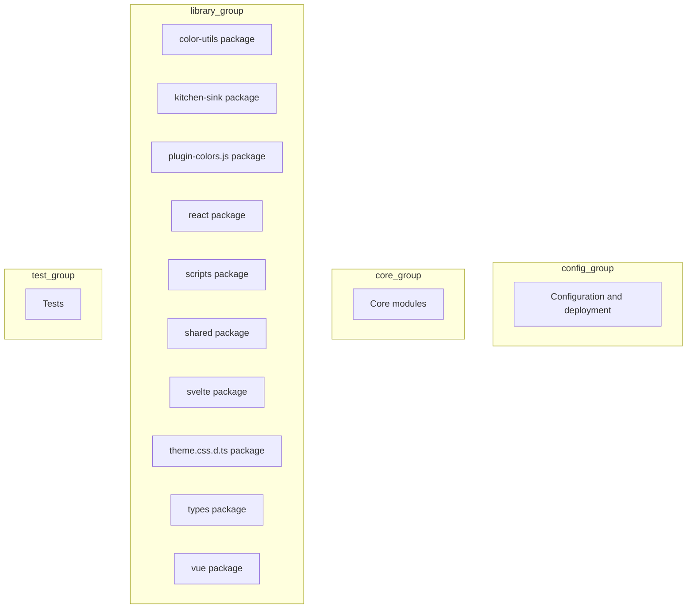

# Architecture report: konstaui/konsta

> Automated static analysis. **Observed** = directly seen in files/imports/AST; **Inferred** = interpretation from that evidence. Repository code was not executed.

## 1. Repository at a glance

| Item | Value |
| --- | --- |
| Repository | konstaui/konsta |
| Description | Mobile UI components made with Tailwind CSS |
| Language | JavaScript |
| Stars | 4289 |
| Licence | MIT |
| Analysed commit / branch | 5b8e54d35ba7ace274cca450f808af570d258f57 / master |
| Framework(s) | React, Svelte, Vue |
| Files analysed | 699 |
| Components | 13 |

## 2. Architecture in one minute

konstaui/konsta - Mobile UI components made with Tailwind CSS. This repository was analysed statically from 699 file(s) (0 Python). Detected technologies (observed from imports/manifests): React, Svelte, Vue, React Router, Tailwind CSS, Vite. Files are grouped into 13 component(s): color-utils package, Configuration and deployment, Core modules, kitchen-sink package, plugin-colors.js package, react package, scripts package, shared package. Findings below distinguish observed facts from inferred interpretation.

## 3. High-level block diagram

## 4. Main components

### color-utils package (`color_utils`)

- **Kind:** library
- **Status:** Observed
- **Confidence:** 0.85
- **Responsibility:** Groups 47 file(s) under color-utils package (observed from repository paths and static analysis).
- **Paths:** `src/color-utils/hex-to-rgb.js`, `src/color-utils/ios-colors.js`, `src/color-utils/material-color-utilities/blend/blend.js`, `src/color-utils/material-color-utilities/contrast/contrast.js`, `src/color-utils/material-color-utilities/dislike/dislike_analyzer.js`, `src/color-utils/material-color-utilities/dynamiccolor/color_spec.js`, `src/color-utils/material-color-utilities/dynamiccolor/color_spec_2021.js`, `src/color-utils/material-color-utilities/dynamiccolor/color_spec_2025.js`, `src/color-utils/material-color-utilities/dynamiccolor/contrast_curve.js`, `src/color-utils/material-color-utilities/dynamiccolor/dynamic_color.js`, `src/color-utils/material-color-utilities/dynamiccolor/dynamic_scheme.js`, `src/color-utils/material-color-utilities/dynamiccolor/material_dynamic_colors.js`, `src/color-utils/material-color-utilities/dynamiccolor/tone_delta_pair.js`, `src/color-utils/material-color-utilities/dynamiccolor/variant.js`, `src/color-utils/material-color-utilities/hct/cam16.js`, `src/color-utils/material-color-utilities/hct/hct.js`, `src/color-utils/material-color-utilities/hct/hct_solver.js`, `src/color-utils/material-color-utilities/hct/viewing_conditions.js`, `src/color-utils/material-color-utilities/index.js`, `src/color-utils/material-color-utilities/palettes/core_palette.js`, `src/color-utils/material-color-utilities/palettes/core_palettes.js`, `src/color-utils/material-color-utilities/palettes/tonal_palette.js`, `src/color-utils/material-color-utilities/quantize/lab_point_provider.js`, `src/color-utils/material-color-utilities/quantize/point_provider.js`, `src/color-utils/material-color-utilities/quantize/quantizer_celebi.js`, `src/color-utils/material-color-utilities/quantize/quantizer_map.js`, `src/color-utils/material-color-utilities/quantize/quantizer_wsmeans.js`, `src/color-utils/material-color-utilities/quantize/quantizer_wu.js`, `src/color-utils/material-color-utilities/scheme/scheme.js`, `src/color-utils/material-color-utilities/scheme/scheme_android.js`, `src/color-utils/material-color-utilities/scheme/scheme_content.js`, `src/color-utils/material-color-utilities/scheme/scheme_expressive.js`, `src/color-utils/material-color-utilities/scheme/scheme_fidelity.js`, `src/color-utils/material-color-utilities/scheme/scheme_fruit_salad.js`, `src/color-utils/material-color-utilities/scheme/scheme_monochrome.js`, `src/color-utils/material-color-utilities/scheme/scheme_neutral.js`, `src/color-utils/material-color-utilities/scheme/scheme_rainbow.js`, `src/color-utils/material-color-utilities/scheme/scheme_tonal_spot.js`, `src/color-utils/material-color-utilities/scheme/scheme_vibrant.js`, `src/color-utils/material-color-utilities/score/score.js`, `src/color-utils/material-color-utilities/temperature/temperature_cache.js`, `src/color-utils/material-color-utilities/utils/color_utils.js`, `src/color-utils/material-color-utilities/utils/image_utils.js`, `src/color-utils/material-color-utilities/utils/math_utils.js`, `src/color-utils/material-color-utilities/utils/string_utils.js`, `src/color-utils/material-color-utilities/utils/theme_utils.js`, `src/color-utils/md-colors.js`
- **Evidence:** [src/color-utils/hex-to-rgb.js](https://github.com/konstaui/konsta/blob/5b8e54d35ba7ace274cca450f808af570d258f57/src/color-utils/hex-to-rgb.js); [src/color-utils/ios-colors.js](https://github.com/konstaui/konsta/blob/5b8e54d35ba7ace274cca450f808af570d258f57/src/color-utils/ios-colors.js); [src/color-utils/material-color-utilities/blend/blend.js](https://github.com/konstaui/konsta/blob/5b8e54d35ba7ace274cca450f808af570d258f57/src/color-utils/material-color-utilities/blend/blend.js); [src/color-utils/material-color-utilities/contrast/contrast.js](https://github.com/konstaui/konsta/blob/5b8e54d35ba7ace274cca450f808af570d258f57/src/color-utils/material-color-utilities/contrast/contrast.js); [src/color-utils/material-color-utilities/dislike/dislike_analyzer.js](https://github.com/konstaui/konsta/blob/5b8e54d35ba7ace274cca450f808af570d258f57/src/color-utils/material-color-utilities/dislike/dislike_analyzer.js); [src/color-utils/material-color-utilities/dynamiccolor/color_spec.js](https://github.com/konstaui/konsta/blob/5b8e54d35ba7ace274cca450f808af570d258f57/src/color-utils/material-color-utilities/dynamiccolor/color_spec.js); [src/color-utils/material-color-utilities/dynamiccolor/color_spec_2021.js](https://github.com/konstaui/konsta/blob/5b8e54d35ba7ace274cca450f808af570d258f57/src/color-utils/material-color-utilities/dynamiccolor/color_spec_2021.js); [src/color-utils/material-color-utilities/dynamiccolor/color_spec_2025.js](https://github.com/konstaui/konsta/blob/5b8e54d35ba7ace274cca450f808af570d258f57/src/color-utils/material-color-utilities/dynamiccolor/color_spec_2025.js)

### Configuration and deployment (`config`)

- **Kind:** config
- **Status:** Observed
- **Confidence:** 0.85
- **Responsibility:** Groups 9 file(s) under configuration and deployment (observed from repository paths and static analysis).
- **Paths:** `package.json`, `package/package.json`, `package/react/package.json`, `package/svelte/package.json`, `package/vue/package.json`, `src/package.json`, `src/react/package.json`, `src/svelte/package.json`, `src/vue/package.json`
- **Evidence:** [package.json](https://github.com/konstaui/konsta/blob/5b8e54d35ba7ace274cca450f808af570d258f57/package.json); [package/package.json](https://github.com/konstaui/konsta/blob/5b8e54d35ba7ace274cca450f808af570d258f57/package/package.json); [package/react/package.json](https://github.com/konstaui/konsta/blob/5b8e54d35ba7ace274cca450f808af570d258f57/package/react/package.json); [package/svelte/package.json](https://github.com/konstaui/konsta/blob/5b8e54d35ba7ace274cca450f808af570d258f57/package/svelte/package.json); [package/vue/package.json](https://github.com/konstaui/konsta/blob/5b8e54d35ba7ace274cca450f808af570d258f57/package/vue/package.json); [src/package.json](https://github.com/konstaui/konsta/blob/5b8e54d35ba7ace274cca450f808af570d258f57/src/package.json); [src/react/package.json](https://github.com/konstaui/konsta/blob/5b8e54d35ba7ace274cca450f808af570d258f57/src/react/package.json); [src/svelte/package.json](https://github.com/konstaui/konsta/blob/5b8e54d35ba7ace274cca450f808af570d258f57/src/svelte/package.json)

### Core modules (`core`)

- **Kind:** core
- **Status:** Observed
- **Confidence:** 0.85
- **Responsibility:** Groups 2 file(s) under core modules (observed from repository paths and static analysis).
- **Paths:** `babel.config.react.js`, `babel.config.vue.js`
- **Evidence:** [babel.config.react.js](https://github.com/konstaui/konsta/blob/5b8e54d35ba7ace274cca450f808af570d258f57/babel.config.react.js); [babel.config.vue.js](https://github.com/konstaui/konsta/blob/5b8e54d35ba7ace274cca450f808af570d258f57/babel.config.vue.js)

### kitchen-sink package (`kitchen_sink`)

- **Kind:** library
- **Status:** Observed
- **Confidence:** 0.85
- **Responsibility:** Groups 144 file(s) under kitchen-sink package (observed from repository paths and static analysis).
- **Paths:** `kitchen-sink/react/components/App.jsx`, `kitchen-sink/react/components/CloseIcon.jsx`, `kitchen-sink/react/components/DemoIcon.jsx`, `kitchen-sink/react/components/Page.jsx`, `kitchen-sink/react/index.js`, `kitchen-sink/react/pages/ActionSheet.jsx`, `kitchen-sink/react/pages/Badge.jsx`, `kitchen-sink/react/pages/Breadcrumbs.jsx`, `kitchen-sink/react/pages/Buttons.jsx`, `kitchen-sink/react/pages/Cards.jsx`, `kitchen-sink/react/pages/Checkbox.jsx`, `kitchen-sink/react/pages/Chips.jsx`, `kitchen-sink/react/pages/ContactsList.jsx`, `kitchen-sink/react/pages/ContentBlock.jsx`, `kitchen-sink/react/pages/DataTable.jsx`, `kitchen-sink/react/pages/Dialog.jsx`, `kitchen-sink/react/pages/Fab.jsx`, `kitchen-sink/react/pages/FormInputs.jsx`, `kitchen-sink/react/pages/Home.jsx`, `kitchen-sink/react/pages/List.jsx`, `kitchen-sink/react/pages/ListButton.jsx`, `kitchen-sink/react/pages/MenuList.jsx`, `kitchen-sink/react/pages/Messages.jsx`, `kitchen-sink/react/pages/Navbar.jsx`, `kitchen-sink/react/pages/Notification.jsx`, `kitchen-sink/react/pages/Popover.jsx`, `kitchen-sink/react/pages/Popup.jsx`, `kitchen-sink/react/pages/Preloader.jsx`, `kitchen-sink/react/pages/Progressbar.jsx`, `kitchen-sink/react/pages/Radio.jsx`, `kitchen-sink/react/pages/RangeSlider.jsx`, `kitchen-sink/react/pages/Searchbar.jsx`, `kitchen-sink/react/pages/SegmentedControl.jsx`, `kitchen-sink/react/pages/SheetModal.jsx`, `kitchen-sink/react/pages/SidePanels.jsx`, `kitchen-sink/react/pages/Stepper.jsx`, `kitchen-sink/react/pages/Subnavbar.jsx`, `kitchen-sink/react/pages/Tabbar.jsx`, `kitchen-sink/react/pages/Toast.jsx`, `kitchen-sink/react/pages/Toggle.jsx`, `kitchen-sink/react/pages/Toolbar.jsx`, `kitchen-sink/react/routes.js`, `kitchen-sink/react/vite.config.js`, `kitchen-sink/svelte/components/App.svelte`, `kitchen-sink/svelte/components/CloseIcon.svelte`, `kitchen-sink/svelte/components/DemoIcon.svelte`, `kitchen-sink/svelte/components/MdAdd.svelte`, `kitchen-sink/svelte/components/MdCameraAlt.svelte`, `kitchen-sink/svelte/components/MdEmail.svelte`, `kitchen-sink/svelte/components/MdFileUpload.svelte`, `kitchen-sink/svelte/components/MdOutlineCancel.svelte`, `kitchen-sink/svelte/components/MdPerson.svelte`, `kitchen-sink/svelte/components/MdSend.svelte`, `kitchen-sink/svelte/components/MdToday.svelte`, `kitchen-sink/svelte/components/Page.svelte`, `kitchen-sink/svelte/index.js`, `kitchen-sink/svelte/pages/ActionSheet.svelte`, `kitchen-sink/svelte/pages/Badge.svelte`, `kitchen-sink/svelte/pages/Breadcrumbs.svelte`, `kitchen-sink/svelte/pages/Buttons.svelte`, `kitchen-sink/svelte/pages/Cards.svelte`, `kitchen-sink/svelte/pages/Checkbox.svelte`, `kitchen-sink/svelte/pages/Chips.svelte`, `kitchen-sink/svelte/pages/ContactsList.svelte`, `kitchen-sink/svelte/pages/ContentBlock.svelte`, `kitchen-sink/svelte/pages/DataTable.svelte`, `kitchen-sink/svelte/pages/Dialog.svelte`, `kitchen-sink/svelte/pages/Fab.svelte`, `kitchen-sink/svelte/pages/FormInputs.svelte`, `kitchen-sink/svelte/pages/Home.svelte`, `kitchen-sink/svelte/pages/List.svelte`, `kitchen-sink/svelte/pages/ListButton.svelte`, `kitchen-sink/svelte/pages/MenuList.svelte`, `kitchen-sink/svelte/pages/Messages.svelte`, `kitchen-sink/svelte/pages/Navbar.svelte`, `kitchen-sink/svelte/pages/Notification.svelte`, `kitchen-sink/svelte/pages/Popover.svelte`, `kitchen-sink/svelte/pages/Popup.svelte`, `kitchen-sink/svelte/pages/Preloader.svelte`, `kitchen-sink/svelte/pages/Progressbar.svelte`, `kitchen-sink/svelte/pages/Radio.svelte`, `kitchen-sink/svelte/pages/RangeSlider.svelte`, `kitchen-sink/svelte/pages/Searchbar.svelte`, `kitchen-sink/svelte/pages/SegmentedControl.svelte`, `kitchen-sink/svelte/pages/SheetModal.svelte`, `kitchen-sink/svelte/pages/SidePanels.svelte`, `kitchen-sink/svelte/pages/Stepper.svelte`, `kitchen-sink/svelte/pages/Subnavbar.svelte`, `kitchen-sink/svelte/pages/Tabbar.svelte`, `kitchen-sink/svelte/pages/Toast.svelte`, `kitchen-sink/svelte/pages/Toggle.svelte`, `kitchen-sink/svelte/pages/Toolbar.svelte`, `kitchen-sink/svelte/routes.js`, `kitchen-sink/svelte/vite.config.js`, `kitchen-sink/vue/components/App.vue`, `kitchen-sink/vue/components/CloseIcon.vue`, `kitchen-sink/vue/components/DemoIcon.vue`, `kitchen-sink/vue/components/MdAdd.vue`, `kitchen-sink/vue/components/MdCameraAlt.vue`, `kitchen-sink/vue/components/MdEmail.vue`, `kitchen-sink/vue/components/MdFileUpload.vue`, `kitchen-sink/vue/components/MdOutlineCancel.vue`, `kitchen-sink/vue/components/MdPerson.vue`, `kitchen-sink/vue/components/MdSend.vue`, `kitchen-sink/vue/components/MdToday.vue`, `kitchen-sink/vue/index.js`, `kitchen-sink/vue/pages/ActionSheet.vue`, `kitchen-sink/vue/pages/Badge.vue`, `kitchen-sink/vue/pages/Breadcrumbs.vue`, `kitchen-sink/vue/pages/Buttons.vue`, `kitchen-sink/vue/pages/Cards.vue`, `kitchen-sink/vue/pages/Checkbox.vue`, `kitchen-sink/vue/pages/Chips.vue`, `kitchen-sink/vue/pages/ContactsList.vue`, `kitchen-sink/vue/pages/ContentBlock.vue`, `kitchen-sink/vue/pages/DataTable.vue`, `kitchen-sink/vue/pages/Dialog.vue`, `kitchen-sink/vue/pages/Fab.vue`, `kitchen-sink/vue/pages/FormInputs.vue`, `kitchen-sink/vue/pages/Home.vue`, `kitchen-sink/vue/pages/List.vue`, `kitchen-sink/vue/pages/ListButton.vue`, `kitchen-sink/vue/pages/MenuList.vue`, `kitchen-sink/vue/pages/Messages.vue`, `kitchen-sink/vue/pages/Navbar.vue`, `kitchen-sink/vue/pages/Notification.vue`, `kitchen-sink/vue/pages/Popover.vue`, `kitchen-sink/vue/pages/Popup.vue`, `kitchen-sink/vue/pages/Preloader.vue`, `kitchen-sink/vue/pages/Progressbar.vue`, `kitchen-sink/vue/pages/Radio.vue`, `kitchen-sink/vue/pages/RangeSlider.vue`, `kitchen-sink/vue/pages/Searchbar.vue`, `kitchen-sink/vue/pages/SegmentedControl.vue`, `kitchen-sink/vue/pages/SheetModal.vue`, `kitchen-sink/vue/pages/SidePanels.vue`, `kitchen-sink/vue/pages/Stepper.vue`, `kitchen-sink/vue/pages/Subnavbar.vue`, `kitchen-sink/vue/pages/Tabbar.vue`, `kitchen-sink/vue/pages/Toast.vue`, `kitchen-sink/vue/pages/Toggle.vue`, `kitchen-sink/vue/pages/Toolbar.vue`, `kitchen-sink/vue/routes.js`, `kitchen-sink/vue/vite.config.js`
- **Evidence:** [kitchen-sink/react/components/App.jsx](https://github.com/konstaui/konsta/blob/5b8e54d35ba7ace274cca450f808af570d258f57/kitchen-sink/react/components/App.jsx); [kitchen-sink/react/components/CloseIcon.jsx](https://github.com/konstaui/konsta/blob/5b8e54d35ba7ace274cca450f808af570d258f57/kitchen-sink/react/components/CloseIcon.jsx); [kitchen-sink/react/components/DemoIcon.jsx](https://github.com/konstaui/konsta/blob/5b8e54d35ba7ace274cca450f808af570d258f57/kitchen-sink/react/components/DemoIcon.jsx); [kitchen-sink/react/components/Page.jsx](https://github.com/konstaui/konsta/blob/5b8e54d35ba7ace274cca450f808af570d258f57/kitchen-sink/react/components/Page.jsx); [kitchen-sink/react/index.js](https://github.com/konstaui/konsta/blob/5b8e54d35ba7ace274cca450f808af570d258f57/kitchen-sink/react/index.js); [kitchen-sink/react/pages/ActionSheet.jsx](https://github.com/konstaui/konsta/blob/5b8e54d35ba7ace274cca450f808af570d258f57/kitchen-sink/react/pages/ActionSheet.jsx); [kitchen-sink/react/pages/Badge.jsx](https://github.com/konstaui/konsta/blob/5b8e54d35ba7ace274cca450f808af570d258f57/kitchen-sink/react/pages/Badge.jsx); [kitchen-sink/react/pages/Breadcrumbs.jsx](https://github.com/konstaui/konsta/blob/5b8e54d35ba7ace274cca450f808af570d258f57/kitchen-sink/react/pages/Breadcrumbs.jsx)

### plugin-colors.js package (`plugin_colors_js`)

- **Kind:** library
- **Status:** Observed
- **Confidence:** 0.85
- **Responsibility:** Groups 1 file(s) under plugin-colors.js package (observed from repository paths and static analysis).
- **Paths:** `src/plugin-colors.js`
- **Evidence:** [src/plugin-colors.js](https://github.com/konstaui/konsta/blob/5b8e54d35ba7ace274cca450f808af570d258f57/src/plugin-colors.js)

### react package (`react`)

- **Kind:** library
- **Status:** Observed
- **Confidence:** 0.85
- **Responsibility:** Groups 88 file(s) under react package (observed from repository paths and static analysis).
- **Paths:** `src/react/components/Actions.jsx`, `src/react/components/ActionsButton.jsx`, `src/react/components/ActionsGroup.jsx`, `src/react/components/ActionsLabel.jsx`, `src/react/components/App.jsx`, `src/react/components/Badge.jsx`, `src/react/components/Block.jsx`, `src/react/components/BlockFooter.jsx`, `src/react/components/BlockHeader.jsx`, `src/react/components/BlockTitle.jsx`, `src/react/components/Breadcrumbs.jsx`, `src/react/components/BreadcrumbsCollapsed.jsx`, `src/react/components/BreadcrumbsItem.jsx`, `src/react/components/BreadcrumbsSeparator.jsx`, `src/react/components/Button.jsx`, `src/react/components/Card.jsx`, `src/react/components/Checkbox.jsx`, `src/react/components/Chip.jsx`, `src/react/components/Dialog.jsx`, `src/react/components/DialogButton.jsx`, `src/react/components/Fab.jsx`, `src/react/components/Glass.jsx`, `src/react/components/Icon.jsx`, `src/react/components/Link.jsx`, `src/react/components/List.jsx`, `src/react/components/ListButton.jsx`, `src/react/components/ListGroup.jsx`, `src/react/components/ListInput.jsx`, `src/react/components/ListItem.jsx`, `src/react/components/MenuList.jsx`, `src/react/components/MenuListItem.jsx`, `src/react/components/Message.jsx`, `src/react/components/Messagebar.jsx`, `src/react/components/Messages.jsx`, `src/react/components/MessagesTitle.jsx`, `src/react/components/Navbar.jsx`, `src/react/components/NavbarBackLink.jsx`, `src/react/components/NavbarContext.jsx`, `src/react/components/Notification.jsx`, `src/react/components/Page.jsx`, `src/react/components/Panel.jsx`, `src/react/components/Popover.jsx`, `src/react/components/Popup.jsx`, `src/react/components/Preloader.jsx`, `src/react/components/Progressbar.jsx`, `src/react/components/Radio.jsx`, `src/react/components/Range.jsx`, `src/react/components/Searchbar.jsx`, `src/react/components/Segmented.jsx`, `src/react/components/SegmentedButton.jsx`, `src/react/components/SegmentedContext.jsx`, `src/react/components/Sheet.jsx`, `src/react/components/Stepper.jsx`, `src/react/components/Tabbar.jsx`, `src/react/components/TabbarLink.jsx`, `src/react/components/Table.jsx`, `src/react/components/TableBody.jsx`, `src/react/components/TableCell.jsx`, `src/react/components/TableHead.jsx`, `src/react/components/TableRow.jsx`, `src/react/components/Toast.jsx`, `src/react/components/Toggle.jsx`, `src/react/components/Toolbar.jsx`, `src/react/components/ToolbarContext.jsx`, `src/react/components/ToolbarPane.jsx`, `src/react/components/icons/BackIcon.jsx`, `src/react/components/icons/CheckboxIcon.jsx`, `src/react/components/icons/ChevronIcon.jsx`, `src/react/components/icons/DeleteIcon.jsx`, `src/react/components/icons/DropdownIcon.jsx`, `src/react/components/icons/PreloaderIOS.jsx`, `src/react/components/icons/PreloaderMaterial.jsx`, `src/react/components/icons/SearchDisableIcon.jsx`, `src/react/components/icons/SearchIcon.jsx`, `src/react/konsta-react.d.ts`, `src/react/konsta-react.js`, `src/react/shared/KonstaContext.js`, `src/react/shared/KonstaProvider.jsx`, `src/react/shared/ListContext.js`, `src/react/shared/get-theme-specific-props.js`, `src/react/shared/use-auto-theme.js`, `src/react/shared/use-dark-classes.js`, `src/react/shared/use-isomorphic-layout-effect.js`, `src/react/shared/use-list.js`, `src/react/shared/use-theme-classes.js`, `src/react/shared/use-theme.js`, `src/react/shared/use-touch-ripple.js`, `src/react/theme.css.d.ts`
- **Evidence:** [src/react/components/Actions.jsx](https://github.com/konstaui/konsta/blob/5b8e54d35ba7ace274cca450f808af570d258f57/src/react/components/Actions.jsx); [src/react/components/ActionsButton.jsx](https://github.com/konstaui/konsta/blob/5b8e54d35ba7ace274cca450f808af570d258f57/src/react/components/ActionsButton.jsx); [src/react/components/ActionsGroup.jsx](https://github.com/konstaui/konsta/blob/5b8e54d35ba7ace274cca450f808af570d258f57/src/react/components/ActionsGroup.jsx); [src/react/components/ActionsLabel.jsx](https://github.com/konstaui/konsta/blob/5b8e54d35ba7ace274cca450f808af570d258f57/src/react/components/ActionsLabel.jsx); [src/react/components/App.jsx](https://github.com/konstaui/konsta/blob/5b8e54d35ba7ace274cca450f808af570d258f57/src/react/components/App.jsx); [src/react/components/Badge.jsx](https://github.com/konstaui/konsta/blob/5b8e54d35ba7ace274cca450f808af570d258f57/src/react/components/Badge.jsx); [src/react/components/Block.jsx](https://github.com/konstaui/konsta/blob/5b8e54d35ba7ace274cca450f808af570d258f57/src/react/components/Block.jsx); [src/react/components/BlockFooter.jsx](https://github.com/konstaui/konsta/blob/5b8e54d35ba7ace274cca450f808af570d258f57/src/react/components/BlockFooter.jsx)

### scripts package (`scripts`)

- **Kind:** library
- **Status:** Observed
- **Confidence:** 0.85
- **Responsibility:** Groups 17 file(s) under scripts package (observed from repository paths and static analysis).
- **Paths:** `scripts/banner.js`, `scripts/build-copy.js`, `scripts/build-export-classes.js`, `scripts/build-export-colors.js`, `scripts/build-export-shared.js`, `scripts/build-react-types.js`, `scripts/build-react.js`, `scripts/build-shared.js`, `scripts/build-sponsors.js`, `scripts/build-svelte-types.js`, `scripts/build-svelte.js`, `scripts/build-vue-types.js`, `scripts/build-vue.js`, `scripts/build.js`, `scripts/get-dirname.js`, `scripts/release.js`, `scripts/transform-vue-component.js`
- **Evidence:** [scripts/banner.js](https://github.com/konstaui/konsta/blob/5b8e54d35ba7ace274cca450f808af570d258f57/scripts/banner.js); [scripts/build-copy.js](https://github.com/konstaui/konsta/blob/5b8e54d35ba7ace274cca450f808af570d258f57/scripts/build-copy.js); [scripts/build-export-classes.js](https://github.com/konstaui/konsta/blob/5b8e54d35ba7ace274cca450f808af570d258f57/scripts/build-export-classes.js); [scripts/build-export-colors.js](https://github.com/konstaui/konsta/blob/5b8e54d35ba7ace274cca450f808af570d258f57/scripts/build-export-colors.js); [scripts/build-export-shared.js](https://github.com/konstaui/konsta/blob/5b8e54d35ba7ace274cca450f808af570d258f57/scripts/build-export-shared.js); [scripts/build-react-types.js](https://github.com/konstaui/konsta/blob/5b8e54d35ba7ace274cca450f808af570d258f57/scripts/build-react-types.js); [scripts/build-react.js](https://github.com/konstaui/konsta/blob/5b8e54d35ba7ace274cca450f808af570d258f57/scripts/build-react.js); [scripts/build-shared.js](https://github.com/konstaui/konsta/blob/5b8e54d35ba7ace274cca450f808af570d258f57/scripts/build-shared.js)

### shared package (`shared`)

- **Kind:** library
- **Status:** Observed
- **Confidence:** 0.85
- **Responsibility:** Groups 119 file(s) under shared package (observed from repository paths and static analysis).
- **Paths:** `src/shared/calc-popover-position.js`, `src/shared/classes/ActionsButtonClasses.js`, `src/shared/classes/ActionsClasses.js`, `src/shared/classes/ActionsGroupClasses.js`, `src/shared/classes/ActionsLabelClasses.js`, `src/shared/classes/AppClasses.js`, `src/shared/classes/BadgeClasses.js`, `src/shared/classes/BlockClasses.js`, `src/shared/classes/BlockFooterClasses.js`, `src/shared/classes/BlockHeaderClasses.js`, `src/shared/classes/BlockTitleClasses.js`, `src/shared/classes/BreadcrumbsClasses.js`, `src/shared/classes/BreadcrumbsCollapsedClasses.js`, `src/shared/classes/BreadcrumbsItemClasses.js`, `src/shared/classes/BreadcrumbsSeparatorClasses.js`, `src/shared/classes/ButtonClasses.js`, `src/shared/classes/CardClasses.js`, `src/shared/classes/CheckboxClasses.js`, `src/shared/classes/ChipClasses.js`, `src/shared/classes/DialogClasses.js`, `src/shared/classes/FabClasses.js`, `src/shared/classes/GlassClasses.js`, `src/shared/classes/IconClasses.js`, `src/shared/classes/LinkClasses.js`, `src/shared/classes/ListButtonClasses.js`, `src/shared/classes/ListClasses.js`, `src/shared/classes/ListInputClasses.js`, `src/shared/classes/ListItemClasses.js`, `src/shared/classes/MessageClasses.js`, `src/shared/classes/MessagebarClasses.js`, `src/shared/classes/MessagesClasses.js`, `src/shared/classes/MessagesTitleClasses.js`, `src/shared/classes/NavbarBackLinkClasses.js`, `src/shared/classes/NavbarClasses.js`, `src/shared/classes/NotificationsClasses.js`, `src/shared/classes/PageClasses.js`, `src/shared/classes/PanelClasses.js`, `src/shared/classes/PopoverClasses.js`, `src/shared/classes/PopupClasses.js`, `src/shared/classes/PreloaderClasses.js`, `src/shared/classes/ProgressbarClasses.js`, `src/shared/classes/RadioClasses.js`, `src/shared/classes/RangeClasses.js`, `src/shared/classes/SearchbarClasses.js`, `src/shared/classes/SegmentedClasses.js`, `src/shared/classes/SheetClasses.js`, `src/shared/classes/StepperClasses.js`, `src/shared/classes/TabbarLinkClasses.js`, `src/shared/classes/TableBodyClasses.js`, `src/shared/classes/TableCellClasses.js`, `src/shared/classes/TableClasses.js`, `src/shared/classes/TableHeadClasses.js`, `src/shared/classes/TableRowClasses.js`, `src/shared/classes/ToastClasses.js`, `src/shared/classes/ToggleClasses.js`, `src/shared/classes/ToolbarClasses.js`, `src/shared/classes/ToolbarPaneClasses.js`, `src/shared/cls.js`, `src/shared/colors/ActionsButtonColors.js`, `src/shared/colors/ActionsColors.js`, `src/shared/colors/ActionsGroupColors.js`, `src/shared/colors/ActionsLabelColors.js`, `src/shared/colors/AppColors.js`, `src/shared/colors/BadgeColors.js`, `src/shared/colors/BlockColors.js`, `src/shared/colors/BlockFooterColors.js`, `src/shared/colors/BlockHeaderColors.js`, `src/shared/colors/BlockTitleColors.js`, `src/shared/colors/BreadcrumbsCollapsedColors.js`, `src/shared/colors/BreadcrumbsColors.js`, `src/shared/colors/BreadcrumbsItemColors.js`, `src/shared/colors/BreadcrumbsSeparatorColors.js`, `src/shared/colors/ButtonColors.js`, `src/shared/colors/CardColors.js`, `src/shared/colors/CheckboxColors.js`, `src/shared/colors/ChipColors.js`, `src/shared/colors/DialogColors.js`, `src/shared/colors/FabColors.js`, `src/shared/colors/GlassColors.js`, `src/shared/colors/IconColors.js`, `src/shared/colors/LinkColors.js`, `src/shared/colors/ListButtonColors.js`, `src/shared/colors/ListColors.js`, `src/shared/colors/ListGroupColors.js`, `src/shared/colors/ListInputColors.js`, `src/shared/colors/ListItemColors.js`, `src/shared/colors/MenuListColors.js`, `src/shared/colors/MenuListItemColors.js`, `src/shared/colors/MessageColors.js`, `src/shared/colors/MessagebarColors.js`, `src/shared/colors/MessagesTitleColors.js`, `src/shared/colors/NavbarBackLinkColors.js`, `src/shared/colors/NavbarColors.js`, `src/shared/colors/NotificationsColors.js`, `src/shared/colors/PageColors.js`, `src/shared/colors/PanelColors.js`, `src/shared/colors/PopoverColors.js`, `src/shared/colors/PopupColors.js`, `src/shared/colors/PreloaderColors.js`, `src/shared/colors/ProgressbarColors.js`, `src/shared/colors/RadioColors.js`, `src/shared/colors/RangeColors.js`, `src/shared/colors/SearchbarColors.js`, `src/shared/colors/SegmentedButtonColors.js`, `src/shared/colors/SegmentedColors.js`, `src/shared/colors/SheetColors.js`, `src/shared/colors/StepperColors.js`, `src/shared/colors/TabbarColors.js`, `src/shared/colors/TabbarLinkColors.js`, `src/shared/colors/TableCellColors.js`, `src/shared/colors/TableRowColors.js`, `src/shared/colors/ToastColors.js`, `src/shared/colors/ToggleColors.js`, `src/shared/colors/ToolbarColors.js`, `src/shared/colors/ToolbarPaneColors.js`, `src/shared/filter-colors.js`, `src/shared/touch-ripple-class.js`, `src/shared/use-ios-highlight.js`, `src/shared/use-ios-tabbar-highlight.js`
- **Evidence:** [src/shared/calc-popover-position.js](https://github.com/konstaui/konsta/blob/5b8e54d35ba7ace274cca450f808af570d258f57/src/shared/calc-popover-position.js); [src/shared/classes/ActionsButtonClasses.js](https://github.com/konstaui/konsta/blob/5b8e54d35ba7ace274cca450f808af570d258f57/src/shared/classes/ActionsButtonClasses.js); [src/shared/classes/ActionsClasses.js](https://github.com/konstaui/konsta/blob/5b8e54d35ba7ace274cca450f808af570d258f57/src/shared/classes/ActionsClasses.js); [src/shared/classes/ActionsGroupClasses.js](https://github.com/konstaui/konsta/blob/5b8e54d35ba7ace274cca450f808af570d258f57/src/shared/classes/ActionsGroupClasses.js); [src/shared/classes/ActionsLabelClasses.js](https://github.com/konstaui/konsta/blob/5b8e54d35ba7ace274cca450f808af570d258f57/src/shared/classes/ActionsLabelClasses.js); [src/shared/classes/AppClasses.js](https://github.com/konstaui/konsta/blob/5b8e54d35ba7ace274cca450f808af570d258f57/src/shared/classes/AppClasses.js); [src/shared/classes/BadgeClasses.js](https://github.com/konstaui/konsta/blob/5b8e54d35ba7ace274cca450f808af570d258f57/src/shared/classes/BadgeClasses.js); [src/shared/classes/BlockClasses.js](https://github.com/konstaui/konsta/blob/5b8e54d35ba7ace274cca450f808af570d258f57/src/shared/classes/BlockClasses.js)

### svelte package (`svelte`)

- **Kind:** library
- **Status:** Observed
- **Confidence:** 0.85
- **Responsibility:** Groups 83 file(s) under svelte package (observed from repository paths and static analysis).
- **Paths:** `src/svelte/components/Actions.svelte`, `src/svelte/components/ActionsButton.svelte`, `src/svelte/components/ActionsGroup.svelte`, `src/svelte/components/ActionsLabel.svelte`, `src/svelte/components/App.svelte`, `src/svelte/components/Badge.svelte`, `src/svelte/components/Block.svelte`, `src/svelte/components/BlockFooter.svelte`, `src/svelte/components/BlockHeader.svelte`, `src/svelte/components/BlockTitle.svelte`, `src/svelte/components/Breadcrumbs.svelte`, `src/svelte/components/BreadcrumbsCollapsed.svelte`, `src/svelte/components/BreadcrumbsItem.svelte`, `src/svelte/components/BreadcrumbsSeparator.svelte`, `src/svelte/components/Button.svelte`, `src/svelte/components/Card.svelte`, `src/svelte/components/Checkbox.svelte`, `src/svelte/components/Chip.svelte`, `src/svelte/components/Dialog.svelte`, `src/svelte/components/DialogButton.svelte`, `src/svelte/components/Fab.svelte`, `src/svelte/components/Glass.svelte`, `src/svelte/components/Icon.svelte`, `src/svelte/components/Link.svelte`, `src/svelte/components/List.svelte`, `src/svelte/components/ListButton.svelte`, `src/svelte/components/ListGroup.svelte`, `src/svelte/components/ListGroupInner.svelte`, `src/svelte/components/ListInput.svelte`, `src/svelte/components/ListItem.svelte`, `src/svelte/components/MenuList.svelte`, `src/svelte/components/MenuListItem.svelte`, `src/svelte/components/Message.svelte`, `src/svelte/components/Messagebar.svelte`, `src/svelte/components/Messages.svelte`, `src/svelte/components/MessagesTitle.svelte`, `src/svelte/components/Navbar.svelte`, `src/svelte/components/NavbarBackLink.svelte`, `src/svelte/components/Notification.svelte`, `src/svelte/components/Page.svelte`, `src/svelte/components/Panel.svelte`, `src/svelte/components/Popover.svelte`, `src/svelte/components/Popup.svelte`, `src/svelte/components/Preloader.svelte`, `src/svelte/components/Progressbar.svelte`, `src/svelte/components/Radio.svelte`, `src/svelte/components/Range.svelte`, `src/svelte/components/Searchbar.svelte`, `src/svelte/components/Segmented.svelte`, `src/svelte/components/SegmentedButton.svelte`, `src/svelte/components/Sheet.svelte`, `src/svelte/components/Stepper.svelte`, `src/svelte/components/Tabbar.svelte`, `src/svelte/components/TabbarLink.svelte`, `src/svelte/components/Table.svelte`, `src/svelte/components/TableBody.svelte`, `src/svelte/components/TableCell.svelte`, `src/svelte/components/TableHead.svelte`, `src/svelte/components/TableRow.svelte`, `src/svelte/components/Toast.svelte`, `src/svelte/components/Toggle.svelte`, `src/svelte/components/Toolbar.svelte`, `src/svelte/components/ToolbarPane.svelte`, `src/svelte/components/icons/BackIcon.svelte`, `src/svelte/components/icons/CheckboxIcon.svelte`, `src/svelte/components/icons/ChevronIcon.svelte`, `src/svelte/components/icons/DeleteIcon.svelte`, `src/svelte/components/icons/DropdownIcon.svelte`, `src/svelte/components/icons/PreloaderIOS.svelte`, `src/svelte/components/icons/PreloaderMaterial.svelte`, `src/svelte/components/icons/SearchIcon.svelte`, `src/svelte/konsta-svelte.d.ts`, `src/svelte/konsta-svelte.js`, `src/svelte/shared/KonstaProvider.svelte`, `src/svelte/shared/KonstaStore.svelte.js`, `src/svelte/shared/get-reactive-context.js`, `src/svelte/shared/print-text.js`, `src/svelte/shared/set-reactive-context.js`, `src/svelte/shared/use-dark-classes.js`, `src/svelte/shared/use-theme-classes.js`, `src/svelte/shared/use-theme.js`, `src/svelte/shared/use-touch-ripple.svelte.js`, `src/svelte/theme.css.d.ts`
- **Evidence:** [src/svelte/components/Actions.svelte](https://github.com/konstaui/konsta/blob/5b8e54d35ba7ace274cca450f808af570d258f57/src/svelte/components/Actions.svelte); [src/svelte/components/ActionsButton.svelte](https://github.com/konstaui/konsta/blob/5b8e54d35ba7ace274cca450f808af570d258f57/src/svelte/components/ActionsButton.svelte); [src/svelte/components/ActionsGroup.svelte](https://github.com/konstaui/konsta/blob/5b8e54d35ba7ace274cca450f808af570d258f57/src/svelte/components/ActionsGroup.svelte); [src/svelte/components/ActionsLabel.svelte](https://github.com/konstaui/konsta/blob/5b8e54d35ba7ace274cca450f808af570d258f57/src/svelte/components/ActionsLabel.svelte); [src/svelte/components/App.svelte](https://github.com/konstaui/konsta/blob/5b8e54d35ba7ace274cca450f808af570d258f57/src/svelte/components/App.svelte); [src/svelte/components/Badge.svelte](https://github.com/konstaui/konsta/blob/5b8e54d35ba7ace274cca450f808af570d258f57/src/svelte/components/Badge.svelte); [src/svelte/components/Block.svelte](https://github.com/konstaui/konsta/blob/5b8e54d35ba7ace274cca450f808af570d258f57/src/svelte/components/Block.svelte); [src/svelte/components/BlockFooter.svelte](https://github.com/konstaui/konsta/blob/5b8e54d35ba7ace274cca450f808af570d258f57/src/svelte/components/BlockFooter.svelte)

### Tests (`tests`)

- **Kind:** test
- **Status:** Observed
- **Confidence:** 0.85
- **Responsibility:** Groups 1 file(s) under tests (observed from repository paths and static analysis).
- **Paths:** `src/color-utils/material-color-utilities/utils/test_utils.js`
- **Evidence:** [src/color-utils/material-color-utilities/utils/test_utils.js](https://github.com/konstaui/konsta/blob/5b8e54d35ba7ace274cca450f808af570d258f57/src/color-utils/material-color-utilities/utils/test_utils.js)

### theme.css.d.ts package (`theme_css_d_ts`)

- **Kind:** library
- **Status:** Observed
- **Confidence:** 0.85
- **Responsibility:** Groups 1 file(s) under theme.css.d.ts package (observed from repository paths and static analysis).
- **Paths:** `src/theme.css.d.ts`
- **Evidence:** [src/theme.css.d.ts](https://github.com/konstaui/konsta/blob/5b8e54d35ba7ace274cca450f808af570d258f57/src/theme.css.d.ts)

### types package (`types`)

- **Kind:** library
- **Status:** Observed
- **Confidence:** 0.85
- **Responsibility:** Groups 62 file(s) under types package (observed from repository paths and static analysis).
- **Paths:** `src/types/Actions.d.ts`, `src/types/ActionsButton.d.ts`, `src/types/ActionsGroup.d.ts`, `src/types/ActionsLabel.d.ts`, `src/types/App.d.ts`, `src/types/Badge.d.ts`, `src/types/Block.d.ts`, `src/types/BlockFooter.d.ts`, `src/types/BlockHeader.d.ts`, `src/types/BlockTitle.d.ts`, `src/types/Breadcrumbs.d.ts`, `src/types/BreadcrumbsCollapsed.d.ts`, `src/types/BreadcrumbsItem.d.ts`, `src/types/BreadcrumbsSeparator.d.ts`, `src/types/Button.d.ts`, `src/types/Card.d.ts`, `src/types/Checkbox.d.ts`, `src/types/Chip.d.ts`, `src/types/Dialog.d.ts`, `src/types/DialogButton.d.ts`, `src/types/Fab.d.ts`, `src/types/Glass.d.ts`, `src/types/Icon.d.ts`, `src/types/Link.d.ts`, `src/types/List.d.ts`, `src/types/ListButton.d.ts`, `src/types/ListGroup.d.ts`, `src/types/ListInput.d.ts`, `src/types/ListItem.d.ts`, `src/types/MenuList.d.ts`, `src/types/MenuListItem.d.ts`, `src/types/Message.d.ts`, `src/types/Messagebar.d.ts`, `src/types/Messages.d.ts`, `src/types/MessagesTitle.d.ts`, `src/types/Navbar.d.ts`, `src/types/NavbarBackLink.d.ts`, `src/types/Notification.d.ts`, `src/types/Page.d.ts`, `src/types/Panel.d.ts`, `src/types/Popover.d.ts`, `src/types/Popup.d.ts`, `src/types/Preloader.d.ts`, `src/types/Progressbar.d.ts`, `src/types/Radio.d.ts`, `src/types/Range.d.ts`, `src/types/Searchbar.d.ts`, `src/types/Segmented.d.ts`, `src/types/SegmentedButton.d.ts`, `src/types/Sheet.d.ts`, `src/types/Stepper.d.ts`, `src/types/Tabbar.d.ts`, `src/types/TabbarLink.d.ts`, `src/types/Table.d.ts`, `src/types/TableBody.d.ts`, `src/types/TableCell.d.ts`, `src/types/TableHead.d.ts`, `src/types/TableRow.d.ts`, `src/types/Toast.d.ts`, `src/types/Toggle.d.ts`, `src/types/Toolbar.d.ts`, `src/types/ToolbarPane.d.ts`
- **Evidence:** [src/types/Actions.d.ts](https://github.com/konstaui/konsta/blob/5b8e54d35ba7ace274cca450f808af570d258f57/src/types/Actions.d.ts); [src/types/ActionsButton.d.ts](https://github.com/konstaui/konsta/blob/5b8e54d35ba7ace274cca450f808af570d258f57/src/types/ActionsButton.d.ts); [src/types/ActionsGroup.d.ts](https://github.com/konstaui/konsta/blob/5b8e54d35ba7ace274cca450f808af570d258f57/src/types/ActionsGroup.d.ts); [src/types/ActionsLabel.d.ts](https://github.com/konstaui/konsta/blob/5b8e54d35ba7ace274cca450f808af570d258f57/src/types/ActionsLabel.d.ts); [src/types/App.d.ts](https://github.com/konstaui/konsta/blob/5b8e54d35ba7ace274cca450f808af570d258f57/src/types/App.d.ts); [src/types/Badge.d.ts](https://github.com/konstaui/konsta/blob/5b8e54d35ba7ace274cca450f808af570d258f57/src/types/Badge.d.ts); [src/types/Block.d.ts](https://github.com/konstaui/konsta/blob/5b8e54d35ba7ace274cca450f808af570d258f57/src/types/Block.d.ts); [src/types/BlockFooter.d.ts](https://github.com/konstaui/konsta/blob/5b8e54d35ba7ace274cca450f808af570d258f57/src/types/BlockFooter.d.ts)

### vue package (`vue`)

- **Kind:** library
- **Status:** Observed
- **Confidence:** 0.85
- **Responsibility:** Groups 82 file(s) under vue package (observed from repository paths and static analysis).
- **Paths:** `src/vue/components/Actions.vue`, `src/vue/components/ActionsButton.vue`, `src/vue/components/ActionsGroup.vue`, `src/vue/components/ActionsLabel.vue`, `src/vue/components/App.vue`, `src/vue/components/Badge.vue`, `src/vue/components/Block.vue`, `src/vue/components/BlockFooter.vue`, `src/vue/components/BlockHeader.vue`, `src/vue/components/BlockTitle.vue`, `src/vue/components/Breadcrumbs.vue`, `src/vue/components/BreadcrumbsCollapsed.vue`, `src/vue/components/BreadcrumbsItem.vue`, `src/vue/components/BreadcrumbsSeparator.vue`, `src/vue/components/Button.vue`, `src/vue/components/Card.vue`, `src/vue/components/Checkbox.vue`, `src/vue/components/Chip.vue`, `src/vue/components/Dialog.vue`, `src/vue/components/DialogButton.vue`, `src/vue/components/Fab.vue`, `src/vue/components/Glass.vue`, `src/vue/components/Icon.vue`, `src/vue/components/Link.vue`, `src/vue/components/List.vue`, `src/vue/components/ListButton.vue`, `src/vue/components/ListGroup.vue`, `src/vue/components/ListGroupInner.vue`, `src/vue/components/ListInput.vue`, `src/vue/components/ListItem.vue`, `src/vue/components/MenuList.vue`, `src/vue/components/MenuListItem.vue`, `src/vue/components/Message.vue`, `src/vue/components/Messagebar.vue`, `src/vue/components/Messages.vue`, `src/vue/components/MessagesTitle.vue`, `src/vue/components/Navbar.vue`, `src/vue/components/NavbarBackLink.vue`, `src/vue/components/Notification.vue`, `src/vue/components/Page.vue`, `src/vue/components/Panel.vue`, `src/vue/components/Popover.vue`, `src/vue/components/Popup.vue`, `src/vue/components/Preloader.vue`, `src/vue/components/Progressbar.vue`, `src/vue/components/Radio.vue`, `src/vue/components/Range.vue`, `src/vue/components/Searchbar.vue`, `src/vue/components/Segmented.vue`, `src/vue/components/SegmentedButton.vue`, `src/vue/components/Sheet.vue`, `src/vue/components/Stepper.vue`, `src/vue/components/Tabbar.vue`, `src/vue/components/TabbarLink.vue`, `src/vue/components/Table.vue`, `src/vue/components/TableBody.vue`, `src/vue/components/TableCell.vue`, `src/vue/components/TableHead.vue`, `src/vue/components/TableRow.vue`, `src/vue/components/Toast.vue`, `src/vue/components/Toggle.vue`, `src/vue/components/Toolbar.vue`, `src/vue/components/ToolbarPane.vue`, `src/vue/components/icons/BackIcon.vue`, `src/vue/components/icons/CheckboxIcon.vue`, `src/vue/components/icons/ChevronIcon.vue`, `src/vue/components/icons/DeleteIcon.vue`, `src/vue/components/icons/DropdownIcon.vue`, `src/vue/components/icons/PreloaderIOS.vue`, `src/vue/components/icons/PreloaderMaterial.vue`, `src/vue/components/icons/SearchDisableIcon.vue`, `src/vue/components/icons/SearchIcon.vue`, `src/vue/konsta-vue.d.ts`, `src/vue/konsta-vue.js`, `src/vue/shared/KonstaProvider.vue`, `src/vue/shared/use-auto-theme.js`, `src/vue/shared/use-context.js`, `src/vue/shared/use-dark-classes.js`, `src/vue/shared/use-theme-classes.js`, `src/vue/shared/use-theme.js`, `src/vue/shared/use-touch-ripple.js`, `src/vue/theme.css.d.ts`
- **Evidence:** [src/vue/components/Actions.vue](https://github.com/konstaui/konsta/blob/5b8e54d35ba7ace274cca450f808af570d258f57/src/vue/components/Actions.vue); [src/vue/components/ActionsButton.vue](https://github.com/konstaui/konsta/blob/5b8e54d35ba7ace274cca450f808af570d258f57/src/vue/components/ActionsButton.vue); [src/vue/components/ActionsGroup.vue](https://github.com/konstaui/konsta/blob/5b8e54d35ba7ace274cca450f808af570d258f57/src/vue/components/ActionsGroup.vue); [src/vue/components/ActionsLabel.vue](https://github.com/konstaui/konsta/blob/5b8e54d35ba7ace274cca450f808af570d258f57/src/vue/components/ActionsLabel.vue); [src/vue/components/App.vue](https://github.com/konstaui/konsta/blob/5b8e54d35ba7ace274cca450f808af570d258f57/src/vue/components/App.vue); [src/vue/components/Badge.vue](https://github.com/konstaui/konsta/blob/5b8e54d35ba7ace274cca450f808af570d258f57/src/vue/components/Badge.vue); [src/vue/components/Block.vue](https://github.com/konstaui/konsta/blob/5b8e54d35ba7ace274cca450f808af570d258f57/src/vue/components/Block.vue); [src/vue/components/BlockFooter.vue](https://github.com/konstaui/konsta/blob/5b8e54d35ba7ace274cca450f808af570d258f57/src/vue/components/BlockFooter.vue)

## 5. Execution flow

**Observed** entry point(s):

- [kitchen-sink/react/components/App.jsx](https://github.com/konstaui/konsta/blob/5b8e54d35ba7ace274cca450f808af570d258f57/kitchen-sink/react/components/App.jsx)
- [kitchen-sink/react/components/Page.jsx](https://github.com/konstaui/konsta/blob/5b8e54d35ba7ace274cca450f808af570d258f57/kitchen-sink/react/components/Page.jsx)
- [kitchen-sink/react/index.js](https://github.com/konstaui/konsta/blob/5b8e54d35ba7ace274cca450f808af570d258f57/kitchen-sink/react/index.js)
- [kitchen-sink/svelte/index.js](https://github.com/konstaui/konsta/blob/5b8e54d35ba7ace274cca450f808af570d258f57/kitchen-sink/svelte/index.js)
- [kitchen-sink/vue/index.js](https://github.com/konstaui/konsta/blob/5b8e54d35ba7ace274cca450f808af570d258f57/kitchen-sink/vue/index.js)
- [src/color-utils/material-color-utilities/index.js](https://github.com/konstaui/konsta/blob/5b8e54d35ba7ace274cca450f808af570d258f57/src/color-utils/material-color-utilities/index.js)
- [src/react/components/App.jsx](https://github.com/konstaui/konsta/blob/5b8e54d35ba7ace274cca450f808af570d258f57/src/react/components/App.jsx)
- [src/react/components/Page.jsx](https://github.com/konstaui/konsta/blob/5b8e54d35ba7ace274cca450f808af570d258f57/src/react/components/Page.jsx)

Representative flow (derived from observed entry points and the import graph; steps beyond the entry point are **Inferred**):

1. Execution starts at an observed entry point listed above, if present.
2. No internal import relationships between components were observed.

## 6. Project structure

### `(root)`

- `.browserslistrc` - other (408 bytes)
- `.editorconfig` - config (147 bytes)
- `.eslintignore` - other (177 bytes)
- `.eslintrc.js` - source, JavaScript (3883 bytes)
- `.gitignore` - other (542 bytes)
- `.prettierignore` - other (171 bytes)
- `.prettierrc` - other (589 bytes)
- `BACKERS.md` - docs (8412 bytes)
- `CHANGELOG.md` - docs (55841 bytes)
- `CODE_OF_CONDUCT.md` - docs (3374 bytes)
- `CONTRIBUTING.md` - docs (1787 bytes)
- `LICENSE` - docs (1077 bytes)
- `README.md` - docs (7872 bytes)
- `babel.config.react.js` - source, JavaScript (226 bytes)
- `babel.config.vue.js` - source, JavaScript (190 bytes)
- `package.json` - manifest (2599 bytes)
- `tailwind.config.js.old` - other (671 bytes)

### `.github`

- `.github/FUNDING.yml` - config (63 bytes)
- `.github/ISSUE_TEMPLATE/config.yml` - config (152 bytes)
- `.github/ISSUE_TEMPLATE/feature-request.yml` - config (1943 bytes)
- `.github/ISSUE_TEMPLATE/konsta_react_issue.yml` - config (3205 bytes)
- `.github/ISSUE_TEMPLATE/konsta_svelte_issue.yml` - config (3212 bytes)
- `.github/ISSUE_TEMPLATE/konsta_vue_issue.yml` - config (3197 bytes)
- `.github/PULL_REQUEST_TEMPLATE.md` - docs (457 bytes)

### `.vscode`

- `.vscode/settings.json` - config (110 bytes)

### `kitchen-sink`

- `kitchen-sink/react/components/App.jsx` - source, JavaScript (2841 bytes)
- `kitchen-sink/react/components/CloseIcon.jsx` - source, JavaScript (310 bytes)
- `kitchen-sink/react/components/DemoIcon.jsx` - source, JavaScript (204 bytes)
- `kitchen-sink/react/components/Page.jsx` - source, JavaScript (589 bytes)
- `kitchen-sink/react/index.html` - other (638 bytes)
- `kitchen-sink/react/index.js` - source, JavaScript (236 bytes)
- `kitchen-sink/react/pages/ActionSheet.jsx` - source, JavaScript (2474 bytes)
- `kitchen-sink/react/pages/Badge.jsx` - source, JavaScript (2787 bytes)
- `kitchen-sink/react/pages/Breadcrumbs.jsx` - source, JavaScript (3374 bytes)
- `kitchen-sink/react/pages/Buttons.jsx` - source, JavaScript (5684 bytes)
- `kitchen-sink/react/pages/Cards.jsx` - source, JavaScript (5811 bytes)
- `kitchen-sink/react/pages/Checkbox.jsx` - source, JavaScript (6312 bytes)
- `kitchen-sink/react/pages/Chips.jsx` - source, JavaScript (4977 bytes)
- `kitchen-sink/react/pages/ContactsList.jsx` - source, JavaScript (1986 bytes)
- `kitchen-sink/react/pages/ContentBlock.jsx` - source, JavaScript (3176 bytes)
- `kitchen-sink/react/pages/DataTable.jsx` - source, JavaScript (4911 bytes)
- `kitchen-sink/react/pages/Dialog.jsx` - source, JavaScript (4314 bytes)
- `kitchen-sink/react/pages/Fab.jsx` - source, JavaScript (5367 bytes)
- `kitchen-sink/react/pages/FormInputs.jsx` - source, JavaScript (9043 bytes)
- `kitchen-sink/react/pages/Home.jsx` - source, JavaScript (4455 bytes)
- `kitchen-sink/react/pages/List.jsx` - source, JavaScript (9749 bytes)
- `kitchen-sink/react/pages/ListButton.jsx` - source, JavaScript (892 bytes)
- `kitchen-sink/react/pages/MenuList.jsx` - source, JavaScript (2222 bytes)
- `kitchen-sink/react/pages/Messages.jsx` - source, JavaScript (5421 bytes)
- `kitchen-sink/react/pages/Navbar.jsx` - source, JavaScript (5986 bytes)
- `kitchen-sink/react/pages/Notification.jsx` - source, JavaScript (3817 bytes)
- `kitchen-sink/react/pages/Popover.jsx` - source, JavaScript (5055 bytes)
- `kitchen-sink/react/pages/Popup.jsx` - source, JavaScript (3194 bytes)
- `kitchen-sink/react/pages/Preloader.jsx` - source, JavaScript (1647 bytes)
- `kitchen-sink/react/pages/Progressbar.jsx` - source, JavaScript (1889 bytes)
- `kitchen-sink/react/pages/Radio.jsx` - source, JavaScript (5421 bytes)
- `kitchen-sink/react/pages/RangeSlider.jsx` - source, JavaScript (2805 bytes)
- `kitchen-sink/react/pages/Searchbar.jsx` - source, JavaScript (2019 bytes)
- `kitchen-sink/react/pages/SegmentedControl.jsx` - source, JavaScript (5753 bytes)
- `kitchen-sink/react/pages/SheetModal.jsx` - source, JavaScript (1969 bytes)
- `kitchen-sink/react/pages/SidePanels.jsx` - source, JavaScript (7245 bytes)
- `kitchen-sink/react/pages/Stepper.jsx` - source, JavaScript (11422 bytes)
- `kitchen-sink/react/pages/Subnavbar.jsx` - source, JavaScript (2968 bytes)
- `kitchen-sink/react/pages/Tabbar.jsx` - source, JavaScript (7327 bytes)
- `kitchen-sink/react/pages/Toast.jsx` - source, JavaScript (2726 bytes)
- `kitchen-sink/react/pages/Toggle.jsx` - source, JavaScript (1891 bytes)
- `kitchen-sink/react/pages/Toolbar.jsx` - source, JavaScript (4163 bytes)
- `kitchen-sink/react/routes.js` - source, JavaScript (2621 bytes)
- `kitchen-sink/react/styles/index.css` - other (448 bytes)
- `kitchen-sink/react/vite.config.js` - source, JavaScript (152 bytes)
- `kitchen-sink/svelte/components/App.svelte` - source, Svelte (2599 bytes)
- `kitchen-sink/svelte/components/CloseIcon.svelte` - source, Svelte (392 bytes)
- `kitchen-sink/svelte/components/DemoIcon.svelte` - source, Svelte (131 bytes)
- `kitchen-sink/svelte/components/MdAdd.svelte` - source, Svelte (237 bytes)
- `kitchen-sink/svelte/components/MdCameraAlt.svelte` - source, Svelte (372 bytes)
- `kitchen-sink/svelte/components/MdEmail.svelte` - source, Svelte (317 bytes)
- `kitchen-sink/svelte/components/MdFileUpload.svelte` - source, Svelte (239 bytes)
- `kitchen-sink/svelte/components/MdOutlineCancel.svelte` - source, Svelte (423 bytes)
- `kitchen-sink/svelte/components/MdPerson.svelte` - source, Svelte (317 bytes)
- `kitchen-sink/svelte/components/MdSend.svelte` - source, Svelte (213 bytes)
- `kitchen-sink/svelte/components/MdToday.svelte` - source, Svelte (339 bytes)
- `kitchen-sink/svelte/components/Page.svelte` - source, Svelte (519 bytes)
- `kitchen-sink/svelte/index.html` - other (639 bytes)
- `kitchen-sink/svelte/index.js` - source, JavaScript (204 bytes)
- `kitchen-sink/svelte/pages/ActionSheet.svelte` - source, Svelte (2102 bytes)
- `kitchen-sink/svelte/pages/Badge.svelte` - source, Svelte (3305 bytes)
- `kitchen-sink/svelte/pages/Breadcrumbs.svelte` - source, Svelte (2851 bytes)
- `kitchen-sink/svelte/pages/Buttons.svelte` - source, Svelte (4270 bytes)
- `kitchen-sink/svelte/pages/Cards.svelte` - source, Svelte (5276 bytes)
- `kitchen-sink/svelte/pages/Checkbox.svelte` - source, Svelte (5722 bytes)
- `kitchen-sink/svelte/pages/Chips.svelte` - source, Svelte (4108 bytes)
- `kitchen-sink/svelte/pages/ContactsList.svelte` - source, Svelte (1773 bytes)
- `kitchen-sink/svelte/pages/ContentBlock.svelte` - source, Svelte (2845 bytes)
- `kitchen-sink/svelte/pages/DataTable.svelte` - source, Svelte (4085 bytes)
- `kitchen-sink/svelte/pages/Dialog.svelte` - source, Svelte (3673 bytes)
- `kitchen-sink/svelte/pages/Fab.svelte` - source, Svelte (5116 bytes)
- `kitchen-sink/svelte/pages/FormInputs.svelte` - source, Svelte (9056 bytes)
- `kitchen-sink/svelte/pages/Home.svelte` - source, Svelte (3904 bytes)
- `kitchen-sink/svelte/pages/List.svelte` - source, Svelte (9197 bytes)
- `kitchen-sink/svelte/pages/ListButton.svelte` - source, Svelte (771 bytes)
- `kitchen-sink/svelte/pages/MenuList.svelte` - source, Svelte (2224 bytes)
- `kitchen-sink/svelte/pages/Messages.svelte` - source, Svelte (5583 bytes)
- `kitchen-sink/svelte/pages/Navbar.svelte` - source, Svelte (5427 bytes)
- `kitchen-sink/svelte/pages/Notification.svelte` - source, Svelte (3484 bytes)
- `kitchen-sink/svelte/pages/Popover.svelte` - source, Svelte (4401 bytes)
- `kitchen-sink/svelte/pages/Popup.svelte` - source, Svelte (2879 bytes)
- `kitchen-sink/svelte/pages/Preloader.svelte` - source, Svelte (1375 bytes)
- `kitchen-sink/svelte/pages/Progressbar.svelte` - source, Svelte (1575 bytes)
- `kitchen-sink/svelte/pages/Radio.svelte` - source, Svelte (4890 bytes)
- `kitchen-sink/svelte/pages/RangeSlider.svelte` - source, Svelte (2352 bytes)
- `kitchen-sink/svelte/pages/Searchbar.svelte` - source, Svelte (1904 bytes)
- `kitchen-sink/svelte/pages/SegmentedControl.svelte` - source, Svelte (5059 bytes)
- `kitchen-sink/svelte/pages/SheetModal.svelte` - source, Svelte (1659 bytes)
- `kitchen-sink/svelte/pages/SidePanels.svelte` - source, Svelte (6365 bytes)
- `kitchen-sink/svelte/pages/Stepper.svelte` - source, Svelte (8755 bytes)
- `kitchen-sink/svelte/pages/Subnavbar.svelte` - source, Svelte (2704 bytes)
- `kitchen-sink/svelte/pages/Tabbar.svelte` - source, Svelte (7630 bytes)
- `kitchen-sink/svelte/pages/Toast.svelte` - source, Svelte (2360 bytes)
- `kitchen-sink/svelte/pages/Toggle.svelte` - source, Svelte (1606 bytes)
- `kitchen-sink/svelte/pages/Toolbar.svelte` - source, Svelte (3729 bytes)
- `kitchen-sink/svelte/routes.js` - source, JavaScript (2801 bytes)
- `kitchen-sink/svelte/styles/index.css` - other (448 bytes)
- `kitchen-sink/svelte/vite.config.js` - source, JavaScript (166 bytes)
- `kitchen-sink/vue/components/App.vue` - source, Vue (2654 bytes)
- `kitchen-sink/vue/components/CloseIcon.vue` - source, Vue (555 bytes)
- `kitchen-sink/vue/components/DemoIcon.vue` - source, Vue (243 bytes)
- `kitchen-sink/vue/components/MdAdd.vue` - source, Vue (268 bytes)
- `kitchen-sink/vue/components/MdCameraAlt.vue` - source, Vue (400 bytes)
- `kitchen-sink/vue/components/MdEmail.vue` - source, Vue (353 bytes)
- `kitchen-sink/vue/components/MdFileUpload.vue` - source, Vue (270 bytes)
- `kitchen-sink/vue/components/MdOutlineCancel.vue` - source, Vue (449 bytes)
- `kitchen-sink/vue/components/MdPerson.vue` - source, Vue (353 bytes)
- `kitchen-sink/vue/components/MdSend.vue` - source, Vue (235 bytes)
- `kitchen-sink/vue/components/MdToday.vue` - source, Vue (375 bytes)
- `kitchen-sink/vue/index.html` - other (636 bytes)
- `kitchen-sink/vue/index.js` - source, JavaScript (350 bytes)
- `kitchen-sink/vue/pages/ActionSheet.vue` - source, Vue (2783 bytes)
- `kitchen-sink/vue/pages/Badge.vue` - source, Vue (4028 bytes)
- `kitchen-sink/vue/pages/Breadcrumbs.vue` - source, Vue (3813 bytes)
- `kitchen-sink/vue/pages/Buttons.vue` - source, Vue (5119 bytes)
- `kitchen-sink/vue/pages/Cards.vue` - source, Vue (5753 bytes)
- `kitchen-sink/vue/pages/Checkbox.vue` - source, Vue (6926 bytes)
- `kitchen-sink/vue/pages/Chips.vue` - source, Vue (4873 bytes)
- `kitchen-sink/vue/pages/ContactsList.vue` - source, Vue (2246 bytes)
- `kitchen-sink/vue/pages/ContentBlock.vue` - source, Vue (3381 bytes)
- `kitchen-sink/vue/pages/DataTable.vue` - source, Vue (5046 bytes)
- `kitchen-sink/vue/pages/Dialog.vue` - source, Vue (4467 bytes)
- `kitchen-sink/vue/pages/Fab.vue` - source, Vue (5771 bytes)
- `kitchen-sink/vue/pages/FormInputs.vue` - source, Vue (10897 bytes)
- `kitchen-sink/vue/pages/Home.vue` - source, Vue (5559 bytes)
- `kitchen-sink/vue/pages/List.vue` - source, Vue (10661 bytes)
- `kitchen-sink/vue/pages/ListButton.vue` - source, Vue (1128 bytes)
- `kitchen-sink/vue/pages/MenuList.vue` - source, Vue (2831 bytes)
- `kitchen-sink/vue/pages/Messages.vue` - source, Vue (6771 bytes)
- `kitchen-sink/vue/pages/Navbar.vue` - source, Vue (6178 bytes)
- `kitchen-sink/vue/pages/Notification.vue` - source, Vue (4448 bytes)
- `kitchen-sink/vue/pages/Popover.vue` - source, Vue (5297 bytes)
- `kitchen-sink/vue/pages/Popup.vue` - source, Vue (3391 bytes)
- `kitchen-sink/vue/pages/Preloader.vue` - source, Vue (1827 bytes)
- `kitchen-sink/vue/pages/Progressbar.vue` - source, Vue (2142 bytes)
- `kitchen-sink/vue/pages/Radio.vue` - source, Vue (5722 bytes)
- `kitchen-sink/vue/pages/RangeSlider.vue` - source, Vue (3103 bytes)
- `kitchen-sink/vue/pages/Searchbar.vue` - source, Vue (2542 bytes)
- `kitchen-sink/vue/pages/SegmentedControl.vue` - source, Vue (5864 bytes)
- `kitchen-sink/vue/pages/SheetModal.vue` - source, Vue (2196 bytes)
- `kitchen-sink/vue/pages/SidePanels.vue` - source, Vue (7344 bytes)
- `kitchen-sink/vue/pages/Stepper.vue` - source, Vue (11109 bytes)
- `kitchen-sink/vue/pages/Subnavbar.vue` - source, Vue (3602 bytes)
- `kitchen-sink/vue/pages/Tabbar.vue` - source, Vue (7823 bytes)
- `kitchen-sink/vue/pages/Toast.vue` - source, Vue (2480 bytes)
- `kitchen-sink/vue/pages/Toggle.vue` - source, Vue (2116 bytes)
- `kitchen-sink/vue/pages/Toolbar.vue` - source, Vue (4159 bytes)
- `kitchen-sink/vue/routes.js` - source, JavaScript (2679 bytes)
- `kitchen-sink/vue/styles/index.css` - other (448 bytes)
- `kitchen-sink/vue/vite.config.js` - source, JavaScript (146 bytes)

### `package`

- `package/README.md` - docs (275 bytes)
- `package/package.json` - manifest (1745 bytes)
- `package/react/package.json` - manifest (408 bytes)
- `package/svelte/package.json` - manifest (449 bytes)
- `package/vue/package.json` - manifest (454 bytes)

### `scripts`

- `scripts/banner.js` - source, JavaScript (787 bytes)
- `scripts/build-copy.js` - source, JavaScript (1132 bytes)
- `scripts/build-export-classes.js` - source, JavaScript (386 bytes)
- `scripts/build-export-colors.js` - source, JavaScript (381 bytes)
- `scripts/build-export-shared.js` - source, JavaScript (452 bytes)
- `scripts/build-react-types.js` - source, JavaScript (2333 bytes)
- `scripts/build-react.js` - source, JavaScript (1064 bytes)
- `scripts/build-shared.js` - source, JavaScript (237 bytes)
- `scripts/build-sponsors.js` - source, JavaScript (4607 bytes)
- `scripts/build-svelte-types.js` - source, JavaScript (6243 bytes)
- `scripts/build-svelte.js` - source, JavaScript (1600 bytes)
- `scripts/build-vue-types.js` - source, JavaScript (7750 bytes)
- `scripts/build-vue.js` - source, JavaScript (1043 bytes)
- `scripts/build.js` - source, JavaScript (1086 bytes)
- `scripts/get-dirname.js` - source, JavaScript (201 bytes)
- `scripts/release.js` - source, JavaScript (3265 bytes)
- `scripts/transform-vue-component.js` - source, JavaScript (784 bytes)

### `src`

- `src/color-utils/hex-to-rgb.js` - source, JavaScript (290 bytes)
- `src/color-utils/ios-colors.js` - source, JavaScript (2240 bytes)
- `src/color-utils/material-color-utilities/blend/blend.js` - source, JavaScript (3770 bytes)
- `src/color-utils/material-color-utilities/contrast/contrast.js` - source, JavaScript (6225 bytes)
- `src/color-utils/material-color-utilities/dislike/dislike_analyzer.js` - source, JavaScript (2200 bytes)
- `src/color-utils/material-color-utilities/dynamiccolor/color_spec.js` - source, JavaScript (1191 bytes)
- `src/color-utils/material-color-utilities/dynamiccolor/color_spec_2021.js` - source, JavaScript (27574 bytes)
- `src/color-utils/material-color-utilities/dynamiccolor/color_spec_2025.js` - source, JavaScript (45667 bytes)
- `src/color-utils/material-color-utilities/dynamiccolor/contrast_curve.js` - source, JavaScript (2216 bytes)
- `src/color-utils/material-color-utilities/dynamiccolor/dynamic_color.js` - source, JavaScript (28344 bytes)
- `src/color-utils/material-color-utilities/dynamiccolor/dynamic_scheme.js` - source, JavaScript (28384 bytes)
- `src/color-utils/material-color-utilities/dynamiccolor/material_dynamic_colors.js` - source, JavaScript (18486 bytes)
- `src/color-utils/material-color-utilities/dynamiccolor/tone_delta_pair.js` - source, JavaScript (2605 bytes)
- `src/color-utils/material-color-utilities/dynamiccolor/variant.js` - source, JavaScript (1315 bytes)
- `src/color-utils/material-color-utilities/hct/cam16.js` - source, JavaScript (17329 bytes)
- `src/color-utils/material-color-utilities/hct/hct.js` - source, JavaScript (5662 bytes)
- `src/color-utils/material-color-utilities/hct/hct_solver.js` - source, JavaScript (21667 bytes)
- `src/color-utils/material-color-utilities/hct/viewing_conditions.js` - source, JavaScript (5416 bytes)
- `src/color-utils/material-color-utilities/index.js` - source, JavaScript (2088 bytes)
- `src/color-utils/material-color-utilities/palettes/core_palette.js` - source, JavaScript (4121 bytes)
- `src/color-utils/material-color-utilities/palettes/core_palettes.js` - source, JavaScript (1094 bytes)
- `src/color-utils/material-color-utilities/palettes/tonal_palette.js` - source, JavaScript (5771 bytes)
- `src/color-utils/material-color-utilities/quantize/lab_point_provider.js` - source, JavaScript (1788 bytes)
- `src/color-utils/material-color-utilities/quantize/point_provider.js` - source, JavaScript (619 bytes)
- `src/color-utils/material-color-utilities/quantize/quantizer_celebi.js` - source, JavaScript (2090 bytes)
- `src/color-utils/material-color-utilities/quantize/quantizer_map.js` - source, JavaScript (1651 bytes)
- `src/color-utils/material-color-utilities/quantize/quantizer_wsmeans.js` - source, JavaScript (8989 bytes)
- `src/color-utils/material-color-utilities/quantize/quantizer_wu.js` - source, JavaScript (15877 bytes)
- `src/color-utils/material-color-utilities/scheme/scheme.js` - source, JavaScript (7066 bytes)
- `src/color-utils/material-color-utilities/scheme/scheme_android.js` - source, JavaScript (6876 bytes)
- `src/color-utils/material-color-utilities/scheme/scheme_content.js` - source, JavaScript (1544 bytes)
- `src/color-utils/material-color-utilities/scheme/scheme_expressive.js` - source, JavaScript (1216 bytes)
- `src/color-utils/material-color-utilities/scheme/scheme_fidelity.js` - source, JavaScript (1546 bytes)
- `src/color-utils/material-color-utilities/scheme/scheme_fruit_salad.js` - source, JavaScript (1212 bytes)
- `src/color-utils/material-color-utilities/scheme/scheme_monochrome.js` - source, JavaScript (1177 bytes)
- `src/color-utils/material-color-utilities/scheme/scheme_neutral.js` - source, JavaScript (1176 bytes)
- `src/color-utils/material-color-utilities/scheme/scheme_rainbow.js` - source, JavaScript (1205 bytes)
- `src/color-utils/material-color-utilities/scheme/scheme_tonal_spot.js` - source, JavaScript (1323 bytes)
- `src/color-utils/material-color-utilities/scheme/scheme_vibrant.js` - source, JavaScript (1234 bytes)
- `src/color-utils/material-color-utilities/score/score.js` - source, JavaScript (5612 bytes)
- `src/color-utils/material-color-utilities/temperature/temperature_cache.js` - source, JavaScript (11461 bytes)
- `src/color-utils/material-color-utilities/utils/color_utils.js` - source, JavaScript (7866 bytes)
- `src/color-utils/material-color-utilities/utils/image_utils.js` - source, JavaScript (3072 bytes)
- `src/color-utils/material-color-utilities/utils/math_utils.js` - source, JavaScript (3639 bytes)
- `src/color-utils/material-color-utilities/utils/string_utils.js` - source, JavaScript (2539 bytes)
- `src/color-utils/material-color-utilities/utils/test_utils.js` - test, JavaScript (1443 bytes)
- `src/color-utils/material-color-utilities/utils/theme_utils.js` - source, JavaScript (4218 bytes)
- `src/color-utils/md-colors.js` - source, JavaScript (4778 bytes)
- `src/package.json` - manifest (148 bytes)
- `src/plugin-colors.js` - source, JavaScript (1869 bytes)
- `src/react/components/Actions.jsx` - source, JavaScript (1157 bytes)
- `src/react/components/ActionsButton.jsx` - source, JavaScript (2154 bytes)
- `src/react/components/ActionsGroup.jsx` - source, JavaScript (1330 bytes)
- `src/react/components/ActionsLabel.jsx` - source, JavaScript (1574 bytes)
- `src/react/components/App.jsx` - source, JavaScript (1290 bytes)
- `src/react/components/Badge.jsx` - source, JavaScript (1091 bytes)
- `src/react/components/Block.jsx` - source, JavaScript (1921 bytes)
- `src/react/components/BlockFooter.jsx` - source, JavaScript (1493 bytes)
- `src/react/components/BlockHeader.jsx` - source, JavaScript (1493 bytes)
- `src/react/components/BlockTitle.jsx` - source, JavaScript (1220 bytes)
- `src/react/components/Breadcrumbs.jsx` - source, JavaScript (1059 bytes)
- `src/react/components/BreadcrumbsCollapsed.jsx` - source, JavaScript (1447 bytes)
- `src/react/components/BreadcrumbsItem.jsx` - source, JavaScript (1314 bytes)
- `src/react/components/BreadcrumbsSeparator.jsx` - source, JavaScript (1099 bytes)
- `src/react/components/Button.jsx` - source, JavaScript (2951 bytes)
- `src/react/components/Card.jsx` - source, JavaScript (2315 bytes)
- `src/react/components/Checkbox.jsx` - source, JavaScript (2432 bytes)
- `src/react/components/Chip.jsx` - source, JavaScript (1699 bytes)
- `src/react/components/Dialog.jsx` - source, JavaScript (2026 bytes)
- `src/react/components/DialogButton.jsx` - source, JavaScript (1501 bytes)
- `src/react/components/Fab.jsx` - source, JavaScript (1809 bytes)
- `src/react/components/Glass.jsx` - source, JavaScript (1764 bytes)
- `src/react/components/Icon.jsx` - source, JavaScript (1212 bytes)
- `src/react/components/Link.jsx` - source, JavaScript (2578 bytes)
- `src/react/components/List.jsx` - source, JavaScript (2432 bytes)
- `src/react/components/ListButton.jsx` - source, JavaScript (2108 bytes)
- `src/react/components/ListGroup.jsx` - source, JavaScript (864 bytes)
- `src/react/components/ListInput.jsx` - source, JavaScript (6079 bytes)
- `src/react/components/ListItem.jsx` - source, JavaScript (5304 bytes)
- `src/react/components/MenuList.jsx` - source, JavaScript (567 bytes)
- `src/react/components/MenuListItem.jsx` - source, JavaScript (689 bytes)
- `src/react/components/Message.jsx` - source, JavaScript (2163 bytes)
- `src/react/components/Messagebar.jsx` - source, JavaScript (2557 bytes)
- `src/react/components/Messages.jsx` - source, JavaScript (925 bytes)
- `src/react/components/MessagesTitle.jsx` - source, JavaScript (1205 bytes)
- `src/react/components/Navbar.jsx` - source, JavaScript (6192 bytes)
- `src/react/components/NavbarBackLink.jsx` - source, JavaScript (1302 bytes)
- `src/react/components/NavbarContext.jsx` - source, JavaScript (184 bytes)
- `src/react/components/Notification.jsx` - source, JavaScript (3451 bytes)
- `src/react/components/Page.jsx` - source, JavaScript (1128 bytes)
- `src/react/components/Panel.jsx` - source, JavaScript (1906 bytes)
- `src/react/components/Popover.jsx` - source, JavaScript (3881 bytes)
- `src/react/components/Popup.jsx` - source, JavaScript (1386 bytes)
- `src/react/components/Preloader.jsx` - source, JavaScript (1573 bytes)
- `src/react/components/Progressbar.jsx` - source, JavaScript (1727 bytes)
- `src/react/components/Radio.jsx` - source, JavaScript (2060 bytes)
- `src/react/components/Range.jsx` - source, JavaScript (3613 bytes)
- `src/react/components/Searchbar.jsx` - source, JavaScript (4168 bytes)
- `src/react/components/Segmented.jsx` - source, JavaScript (3973 bytes)
- `src/react/components/SegmentedButton.jsx` - source, JavaScript (854 bytes)
- `src/react/components/SegmentedContext.jsx` - source, JavaScript (260 bytes)
- `src/react/components/Sheet.jsx` - source, JavaScript (1386 bytes)
- `src/react/components/Stepper.jsx` - source, JavaScript (4389 bytes)
- `src/react/components/Tabbar.jsx` - source, JavaScript (619 bytes)
- `src/react/components/TabbarLink.jsx` - source, JavaScript (1740 bytes)
- `src/react/components/Table.jsx` - source, JavaScript (797 bytes)
- `src/react/components/TableBody.jsx` - source, JavaScript (826 bytes)
- `src/react/components/TableCell.jsx` - source, JavaScript (1156 bytes)
- `src/react/components/TableHead.jsx` - source, JavaScript (825 bytes)
- `src/react/components/TableRow.jsx` - source, JavaScript (1078 bytes)
- `src/react/components/Toast.jsx` - source, JavaScript (1420 bytes)
- `src/react/components/Toggle.jsx` - source, JavaScript (2377 bytes)
- `src/react/components/Toolbar.jsx` - source, JavaScript (2805 bytes)
- `src/react/components/ToolbarContext.jsx` - source, JavaScript (248 bytes)
- `src/react/components/ToolbarPane.jsx` - source, JavaScript (2960 bytes)
- `src/react/components/icons/BackIcon.jsx` - source, JavaScript (1179 bytes)
- `src/react/components/icons/CheckboxIcon.jsx` - source, JavaScript (1394 bytes)
- `src/react/components/icons/ChevronIcon.jsx` - source, JavaScript (802 bytes)
- `src/react/components/icons/DeleteIcon.jsx` - source, JavaScript (1315 bytes)
- `src/react/components/icons/DropdownIcon.jsx` - source, JavaScript (336 bytes)
- `src/react/components/icons/PreloaderIOS.jsx` - source, JavaScript (2692 bytes)
- `src/react/components/icons/PreloaderMaterial.jsx` - source, JavaScript (247 bytes)
- `src/react/components/icons/SearchDisableIcon.jsx` - source, JavaScript (859 bytes)
- `src/react/components/icons/SearchIcon.jsx` - source, JavaScript (1852 bytes)
- `src/react/konsta-react.d.ts` - source, TypeScript (1074 bytes)
- `src/react/konsta-react.js` - source, JavaScript (4216 bytes)
- `src/react/package.json` - manifest (118 bytes)
- `src/react/shared/KonstaContext.js` - source, JavaScript (194 bytes)
- `src/react/shared/KonstaProvider.jsx` - source, JavaScript (636 bytes)
- `src/react/shared/ListContext.js` - source, JavaScript (135 bytes)
- `src/react/shared/get-theme-specific-props.js` - source, JavaScript (307 bytes)
- `src/react/shared/use-auto-theme.js` - source, JavaScript (1040 bytes)
- `src/react/shared/use-dark-classes.js` - source, JavaScript (285 bytes)
- `src/react/shared/use-isomorphic-layout-effect.js` - source, JavaScript (290 bytes)
- `src/react/shared/use-list.js` - source, JavaScript (153 bytes)
- `src/react/shared/use-theme-classes.js` - source, JavaScript (1822 bytes)
- `src/react/shared/use-theme.js` - source, JavaScript (322 bytes)
- `src/react/shared/use-touch-ripple.js` - source, JavaScript (1777 bytes)
- `src/react/theme.css` - other (81 bytes)
- `src/react/theme.css.d.ts` - source, TypeScript (0 bytes)
- `src/shared/calc-popover-position.js` - source, JavaScript (4628 bytes)
- `src/shared/classes/ActionsButtonClasses.js` - source, JavaScript (867 bytes)
- `src/shared/classes/ActionsClasses.js` - source, JavaScript (603 bytes)
- `src/shared/classes/ActionsGroupClasses.js` - source, JavaScript (406 bytes)
- `src/shared/classes/ActionsLabelClasses.js` - source, JavaScript (703 bytes)
- `src/shared/classes/AppClasses.js` - source, JavaScript (369 bytes)
- `src/shared/classes/BadgeClasses.js` - source, JavaScript (361 bytes)
- `src/shared/classes/BlockClasses.js` - source, JavaScript (892 bytes)
- `src/shared/classes/BlockFooterClasses.js` - source, JavaScript (371 bytes)
- `src/shared/classes/BlockHeaderClasses.js` - source, JavaScript (371 bytes)
- `src/shared/classes/BlockTitleClasses.js` - source, JavaScript (824 bytes)
- `src/shared/classes/BreadcrumbsClasses.js` - source, JavaScript (318 bytes)
- `src/shared/classes/BreadcrumbsCollapsedClasses.js` - source, JavaScript (563 bytes)
- `src/shared/classes/BreadcrumbsItemClasses.js` - source, JavaScript (586 bytes)
- `src/shared/classes/BreadcrumbsSeparatorClasses.js` - source, JavaScript (303 bytes)
- `src/shared/classes/ButtonClasses.js` - source, JavaScript (3397 bytes)
- `src/shared/classes/CardClasses.js` - source, JavaScript (1178 bytes)
- `src/shared/classes/CheckboxClasses.js` - source, JavaScript (1038 bytes)
- `src/shared/classes/ChipClasses.js` - source, JavaScript (1183 bytes)
- `src/shared/classes/DialogClasses.js` - source, JavaScript (1495 bytes)
- `src/shared/classes/FabClasses.js` - source, JavaScript (975 bytes)
- `src/shared/classes/GlassClasses.js` - source, JavaScript (280 bytes)
- `src/shared/classes/IconClasses.js` - source, JavaScript (141 bytes)
- `src/shared/classes/LinkClasses.js` - source, JavaScript (1381 bytes)
- `src/shared/classes/ListButtonClasses.js` - source, JavaScript (630 bytes)
- `src/shared/classes/ListClasses.js` - source, JavaScript (872 bytes)
- `src/shared/classes/ListInputClasses.js` - source, JavaScript (3858 bytes)
- `src/shared/classes/ListItemClasses.js` - source, JavaScript (5195 bytes)
- `src/shared/classes/MessageClasses.js` - source, JavaScript (2146 bytes)
- `src/shared/classes/MessagebarClasses.js` - source, JavaScript (1346 bytes)
- `src/shared/classes/MessagesClasses.js` - source, JavaScript (285 bytes)
- `src/shared/classes/MessagesTitleClasses.js` - source, JavaScript (350 bytes)
- `src/shared/classes/NavbarBackLinkClasses.js` - source, JavaScript (211 bytes)
- `src/shared/classes/NavbarClasses.js` - source, JavaScript (4228 bytes)
- `src/shared/classes/NotificationsClasses.js` - source, JavaScript (1957 bytes)
- `src/shared/classes/PageClasses.js` - source, JavaScript (313 bytes)
- `src/shared/classes/PanelClasses.js` - source, JavaScript (1388 bytes)
- `src/shared/classes/PopoverClasses.js` - source, JavaScript (1895 bytes)
- `src/shared/classes/PopupClasses.js` - source, JavaScript (862 bytes)
- `src/shared/classes/PreloaderClasses.js` - source, JavaScript (457 bytes)
- `src/shared/classes/ProgressbarClasses.js` - source, JavaScript (857 bytes)
- `src/shared/classes/RadioClasses.js` - source, JavaScript (982 bytes)
- `src/shared/classes/RangeClasses.js` - source, JavaScript (3018 bytes)
- `src/shared/classes/SearchbarClasses.js` - source, JavaScript (2195 bytes)
- `src/shared/classes/SegmentedClasses.js` - source, JavaScript (1601 bytes)
- `src/shared/classes/SheetClasses.js` - source, JavaScript (696 bytes)
- `src/shared/classes/StepperClasses.js` - source, JavaScript (3132 bytes)
- `src/shared/classes/TabbarLinkClasses.js` - source, JavaScript (1131 bytes)
- `src/shared/classes/TableBodyClasses.js` - source, JavaScript (138 bytes)
- `src/shared/classes/TableCellClasses.js` - source, JavaScript (686 bytes)
- `src/shared/classes/TableClasses.js` - source, JavaScript (201 bytes)
- `src/shared/classes/TableHeadClasses.js` - source, JavaScript (277 bytes)
- `src/shared/classes/TableRowClasses.js` - source, JavaScript (497 bytes)
- `src/shared/classes/ToastClasses.js` - source, JavaScript (1090 bytes)
- `src/shared/classes/ToggleClasses.js` - source, JavaScript (2528 bytes)
- `src/shared/classes/ToolbarClasses.js` - source, JavaScript (2154 bytes)
- `src/shared/classes/ToolbarPaneClasses.js` - source, JavaScript (1117 bytes)
- `src/shared/cls.js` - source, JavaScript (792 bytes)
- `src/shared/colors/ActionsButtonColors.js` - source, JavaScript (475 bytes)
- `src/shared/colors/ActionsColors.js` - source, JavaScript (53 bytes)
- `src/shared/colors/ActionsGroupColors.js` - source, JavaScript (297 bytes)
- `src/shared/colors/ActionsLabelColors.js` - source, JavaScript (400 bytes)
- `src/shared/colors/AppColors.js` - source, JavaScript (49 bytes)
- `src/shared/colors/BadgeColors.js` - source, JavaScript (201 bytes)
- `src/shared/colors/BlockColors.js` - source, JavaScript (698 bytes)
- `src/shared/colors/BlockFooterColors.js` - source, JavaScript (386 bytes)
- `src/shared/colors/BlockHeaderColors.js` - source, JavaScript (386 bytes)
- `src/shared/colors/BlockTitleColors.js` - source, JavaScript (545 bytes)
- `src/shared/colors/BreadcrumbsCollapsedColors.js` - source, JavaScript (519 bytes)
- `src/shared/colors/BreadcrumbsColors.js` - source, JavaScript (161 bytes)
- `src/shared/colors/BreadcrumbsItemColors.js` - source, JavaScript (732 bytes)
- `src/shared/colors/BreadcrumbsSeparatorColors.js` - source, JavaScript (66 bytes)
- `src/shared/colors/ButtonColors.js` - source, JavaScript (1681 bytes)
- `src/shared/colors/CardColors.js` - source, JavaScript (857 bytes)
- `src/shared/colors/CheckboxColors.js` - source, JavaScript (661 bytes)
- `src/shared/colors/ChipColors.js` - source, JavaScript (890 bytes)
- `src/shared/colors/DialogColors.js` - source, JavaScript (571 bytes)
- `src/shared/colors/FabColors.js` - source, JavaScript (655 bytes)
- `src/shared/colors/GlassColors.js` - source, JavaScript (364 bytes)
- `src/shared/colors/IconColors.js` - source, JavaScript (50 bytes)
- `src/shared/colors/LinkColors.js` - source, JavaScript (506 bytes)
- `src/shared/colors/ListButtonColors.js` - source, JavaScript (425 bytes)
- `src/shared/colors/ListColors.js` - source, JavaScript (573 bytes)
- `src/shared/colors/ListGroupColors.js` - source, JavaScript (55 bytes)
- `src/shared/colors/ListInputColors.js` - source, JavaScript (1253 bytes)
- `src/shared/colors/ListItemColors.js` - source, JavaScript (2282 bytes)
- `src/shared/colors/MenuListColors.js` - source, JavaScript (54 bytes)
- `src/shared/colors/MenuListItemColors.js` - source, JavaScript (58 bytes)
- `src/shared/colors/MessageColors.js` - source, JavaScript (795 bytes)
- `src/shared/colors/MessagebarColors.js` - source, JavaScript (752 bytes)
- `src/shared/colors/MessagesTitleColors.js` - source, JavaScript (384 bytes)
- `src/shared/colors/NavbarBackLinkColors.js` - source, JavaScript (60 bytes)
- `src/shared/colors/NavbarColors.js` - source, JavaScript (566 bytes)
- `src/shared/colors/NotificationsColors.js` - source, JavaScript (1086 bytes)
- `src/shared/colors/PageColors.js` - source, JavaScript (344 bytes)
- `src/shared/colors/PanelColors.js` - source, JavaScript (448 bytes)
- `src/shared/colors/PopoverColors.js` - source, JavaScript (292 bytes)
- `src/shared/colors/PopupColors.js` - source, JavaScript (242 bytes)
- `src/shared/colors/PreloaderColors.js` - source, JavaScript (328 bytes)
- `src/shared/colors/ProgressbarColors.js` - source, JavaScript (502 bytes)
- `src/shared/colors/RadioColors.js` - source, JavaScript (658 bytes)
- `src/shared/colors/RangeColors.js` - source, JavaScript (452 bytes)
- `src/shared/colors/SearchbarColors.js` - source, JavaScript (510 bytes)
- `src/shared/colors/SegmentedButtonColors.js` - source, JavaScript (61 bytes)
- `src/shared/colors/SegmentedColors.js` - source, JavaScript (796 bytes)
- `src/shared/colors/SheetColors.js` - source, JavaScript (349 bytes)
- `src/shared/colors/StepperColors.js` - source, JavaScript (1051 bytes)
- `src/shared/colors/TabbarColors.js` - source, JavaScript (52 bytes)
- `src/shared/colors/TabbarLinkColors.js` - source, JavaScript (748 bytes)
- `src/shared/colors/TableCellColors.js` - source, JavaScript (396 bytes)
- `src/shared/colors/TableRowColors.js` - source, JavaScript (504 bytes)
- `src/shared/colors/ToastColors.js` - source, JavaScript (408 bytes)
- `src/shared/colors/ToggleColors.js` - source, JavaScript (1045 bytes)
- `src/shared/colors/ToolbarColors.js` - source, JavaScript (548 bytes)
- `src/shared/colors/ToolbarPaneColors.js` - source, JavaScript (273 bytes)
- `src/shared/filter-colors.js` - source, JavaScript (251 bytes)
- `src/shared/touch-ripple-class.js` - source, JavaScript (3243 bytes)
- `src/shared/use-ios-highlight.js` - source, JavaScript (3844 bytes)
- `src/shared/use-ios-tabbar-highlight.js` - source, JavaScript (5022 bytes)
- `src/styles/base.css` - other (1758 bytes)
- `src/styles/colors.css` - other (6966 bytes)
- `src/styles/glass.css` - other (2660 bytes)
- `src/styles/hairlines.css` - other (2739 bytes)
- `src/styles/ios-material.css` - other (132 bytes)
- `src/styles/no-scrollbar.css` - other (115 bytes)
- `src/styles/preloader.css` - other (1627 bytes)
- `src/styles/range.css` - other (205 bytes)
- `src/styles/safe-areas.css` - other (4777 bytes)
- `src/styles/touch-ripple.css` - other (1102 bytes)
- `src/svelte/components/Actions.svelte` - source, Svelte (857 bytes)
- `src/svelte/components/ActionsButton.svelte` - source, Svelte (2094 bytes)
- `src/svelte/components/ActionsGroup.svelte` - source, Svelte (938 bytes)
- `src/svelte/components/ActionsLabel.svelte` - source, Svelte (1221 bytes)
- `src/svelte/components/App.svelte` - source, Svelte (1848 bytes)
- `src/svelte/components/Badge.svelte` - source, Svelte (834 bytes)
- `src/svelte/components/Block.svelte` - source, Svelte (1923 bytes)
- `src/svelte/components/BlockFooter.svelte` - source, Svelte (1170 bytes)
- `src/svelte/components/BlockHeader.svelte` - source, Svelte (1170 bytes)
- `src/svelte/components/BlockTitle.svelte` - source, Svelte (873 bytes)
- `src/svelte/components/Breadcrumbs.svelte` - source, Svelte (650 bytes)
- `src/svelte/components/BreadcrumbsCollapsed.svelte` - source, Svelte (996 bytes)
- `src/svelte/components/BreadcrumbsItem.svelte` - source, Svelte (998 bytes)
- `src/svelte/components/BreadcrumbsSeparator.svelte` - source, Svelte (665 bytes)
- `src/svelte/components/Button.svelte` - source, Svelte (4456 bytes)
- `src/svelte/components/Card.svelte` - source, Svelte (2600 bytes)
- `src/svelte/components/Checkbox.svelte` - source, Svelte (1937 bytes)
- `src/svelte/components/Chip.svelte` - source, Svelte (1537 bytes)
- `src/svelte/components/Dialog.svelte` - source, Svelte (1860 bytes)
- `src/svelte/components/DialogButton.svelte` - source, Svelte (1192 bytes)
- `src/svelte/components/Fab.svelte` - source, Svelte (1739 bytes)
- `src/svelte/components/Glass.svelte` - source, Svelte (1481 bytes)
- `src/svelte/components/Icon.svelte` - source, Svelte (1009 bytes)
- `src/svelte/components/Link.svelte` - source, Svelte (3076 bytes)
- `src/svelte/components/List.svelte` - source, Svelte (2432 bytes)
- `src/svelte/components/ListButton.svelte` - source, Svelte (2302 bytes)
- `src/svelte/components/ListGroup.svelte` - source, Svelte (239 bytes)
- `src/svelte/components/ListGroupInner.svelte` - source, Svelte (367 bytes)
- `src/svelte/components/ListInput.svelte` - source, Svelte (8120 bytes)
- `src/svelte/components/ListItem.svelte` - source, Svelte (9721 bytes)
- `src/svelte/components/MenuList.svelte` - source, Svelte (223 bytes)
- `src/svelte/components/MenuListItem.svelte` - source, Svelte (357 bytes)
- `src/svelte/components/Message.svelte` - source, Svelte (3039 bytes)
- `src/svelte/components/Messagebar.svelte` - source, Svelte (2523 bytes)
- `src/svelte/components/Messages.svelte` - source, Svelte (648 bytes)
- `src/svelte/components/MessagesTitle.svelte` - source, Svelte (939 bytes)
- `src/svelte/components/Navbar.svelte` - source, Svelte (6833 bytes)
- `src/svelte/components/NavbarBackLink.svelte` - source, Svelte (1076 bytes)
- `src/svelte/components/Notification.svelte` - source, Svelte (5083 bytes)
- `src/svelte/components/Page.svelte` - source, Svelte (821 bytes)
- `src/svelte/components/Panel.svelte` - source, Svelte (1594 bytes)
- `src/svelte/components/Popover.svelte` - source, Svelte (3736 bytes)
- `src/svelte/components/Popup.svelte` - source, Svelte (1053 bytes)
- `src/svelte/components/Preloader.svelte` - source, Svelte (1178 bytes)
- `src/svelte/components/Progressbar.svelte` - source, Svelte (926 bytes)
- `src/svelte/components/Radio.svelte` - source, Svelte (1707 bytes)
- `src/svelte/components/Range.svelte` - source, Svelte (3172 bytes)
- `src/svelte/components/Searchbar.svelte` - source, Svelte (4938 bytes)
- `src/svelte/components/Segmented.svelte` - source, Svelte (4930 bytes)
- `src/svelte/components/SegmentedButton.svelte` - source, Svelte (738 bytes)
- `src/svelte/components/Sheet.svelte` - source, Svelte (1111 bytes)
- `src/svelte/components/Stepper.svelte` - source, Svelte (4539 bytes)
- `src/svelte/components/Tabbar.svelte` - source, Svelte (318 bytes)
- `src/svelte/components/TabbarLink.svelte` - source, Svelte (1609 bytes)
- `src/svelte/components/Table.svelte` - source, Svelte (511 bytes)
- `src/svelte/components/TableBody.svelte` - source, Svelte (523 bytes)
- `src/svelte/components/TableCell.svelte` - source, Svelte (932 bytes)
- `src/svelte/components/TableHead.svelte` - source, Svelte (523 bytes)
- `src/svelte/components/TableRow.svelte` - source, Svelte (834 bytes)
- `src/svelte/components/Toast.svelte` - source, Svelte (1117 bytes)
- `src/svelte/components/Toggle.svelte` - source, Svelte (2003 bytes)
- `src/svelte/components/Toolbar.svelte` - source, Svelte (2865 bytes)
- `src/svelte/components/ToolbarPane.svelte` - source, Svelte (3381 bytes)
- `src/svelte/components/icons/BackIcon.svelte` - source, Svelte (1067 bytes)
- `src/svelte/components/icons/CheckboxIcon.svelte` - source, Svelte (1344 bytes)
- `src/svelte/components/icons/ChevronIcon.svelte` - source, Svelte (718 bytes)
- `src/svelte/components/icons/DeleteIcon.svelte` - source, Svelte (1605 bytes)
- `src/svelte/components/icons/DropdownIcon.svelte` - source, Svelte (244 bytes)
- `src/svelte/components/icons/PreloaderIOS.svelte` - source, Svelte (2494 bytes)
- `src/svelte/components/icons/PreloaderMaterial.svelte` - source, Svelte (173 bytes)
- `src/svelte/components/icons/SearchIcon.svelte` - source, Svelte (1819 bytes)
- `src/svelte/konsta-svelte.d.ts` - source, TypeScript (1100 bytes)
- `src/svelte/konsta-svelte.js` - source, JavaScript (4317 bytes)
- `src/svelte/package.json` - manifest (190 bytes)
- `src/svelte/shared/KonstaProvider.svelte` - source, Svelte (1291 bytes)
- `src/svelte/shared/KonstaStore.svelte.js` - source, JavaScript (149 bytes)
- `src/svelte/shared/get-reactive-context.js` - source, JavaScript (339 bytes)
- `src/svelte/shared/print-text.js` - source, JavaScript (136 bytes)
- `src/svelte/shared/set-reactive-context.js` - source, JavaScript (729 bytes)
- `src/svelte/shared/use-dark-classes.js` - source, JavaScript (239 bytes)
- `src/svelte/shared/use-theme-classes.js` - source, JavaScript (1875 bytes)
- `src/svelte/shared/use-theme.js` - source, JavaScript (305 bytes)
- `src/svelte/shared/use-touch-ripple.svelte.js` - source, JavaScript (2148 bytes)
- `src/svelte/theme.css` - other (81 bytes)
- `src/svelte/theme.css.d.ts` - source, TypeScript (0 bytes)
- `src/theme.css` - other (334 bytes)
- `src/theme.css.d.ts` - source, TypeScript (0 bytes)
- `src/types/Actions.d.ts` - source, TypeScript (477 bytes)
- `src/types/ActionsButton.d.ts` - source, TypeScript (1561 bytes)
- `src/types/ActionsGroup.d.ts` - source, TypeScript (520 bytes)
- `src/types/ActionsLabel.d.ts` - source, TypeScript (934 bytes)
- `src/types/App.d.ts` - source, TypeScript (1057 bytes)
- `src/types/Badge.d.ts` - source, TypeScript (454 bytes)
- `src/types/Block.d.ts` - source, TypeScript (2115 bytes)
- `src/types/BlockFooter.d.ts` - source, TypeScript (798 bytes)
- `src/types/BlockHeader.d.ts` - source, TypeScript (798 bytes)
- `src/types/BlockTitle.d.ts` - source, TypeScript (1038 bytes)
- `src/types/Breadcrumbs.d.ts` - source, TypeScript (340 bytes)
- `src/types/BreadcrumbsCollapsed.d.ts` - source, TypeScript (637 bytes)
- `src/types/BreadcrumbsItem.d.ts` - source, TypeScript (1036 bytes)
- `src/types/BreadcrumbsSeparator.d.ts` - source, TypeScript (136 bytes)
- `src/types/Button.d.ts` - source, TypeScript (5959 bytes)
- `src/types/Card.d.ts` - source, TypeScript (2391 bytes)
- `src/types/Checkbox.d.ts` - source, TypeScript (1703 bytes)
- `src/types/Chip.d.ts` - source, TypeScript (1525 bytes)
- `src/types/Dialog.d.ts` - source, TypeScript (1926 bytes)
- `src/types/DialogButton.d.ts` - source, TypeScript (667 bytes)
- `src/types/Fab.d.ts` - source, TypeScript (1234 bytes)
- `src/types/Glass.d.ts` - source, TypeScript (578 bytes)
- `src/types/Icon.d.ts` - source, TypeScript (653 bytes)
- `src/types/Link.d.ts` - source, TypeScript (1137 bytes)
- `src/types/List.d.ts` - source, TypeScript (2396 bytes)
- `src/types/ListButton.d.ts` - source, TypeScript (1233 bytes)
- `src/types/ListGroup.d.ts` - source, TypeScript (19 bytes)
- `src/types/ListInput.d.ts` - source, TypeScript (5370 bytes)
- `src/types/ListItem.d.ts` - source, TypeScript (6267 bytes)
- `src/types/MenuList.d.ts` - source, TypeScript (19 bytes)
- `src/types/MenuListItem.d.ts` - source, TypeScript (400 bytes)
- `src/types/Message.d.ts` - source, TypeScript (1621 bytes)
- `src/types/Messagebar.d.ts` - source, TypeScript (2285 bytes)
- `src/types/Messages.d.ts` - source, TypeScript (136 bytes)
- `src/types/MessagesTitle.d.ts` - source, TypeScript (287 bytes)
- `src/types/Navbar.d.ts` - source, TypeScript (4005 bytes)
- `src/types/NavbarBackLink.d.ts` - source, TypeScript (462 bytes)
- `src/types/Notification.d.ts` - source, TypeScript (2615 bytes)
- `src/types/Page.d.ts` - source, TypeScript (431 bytes)
- `src/types/Panel.d.ts` - source, TypeScript (1259 bytes)
- `src/types/Popover.d.ts` - source, TypeScript (1736 bytes)
- `src/types/Popup.d.ts` - source, TypeScript (644 bytes)
- `src/types/Preloader.d.ts` - source, TypeScript (406 bytes)
- `src/types/Progressbar.d.ts` - source, TypeScript (720 bytes)
- `src/types/Radio.d.ts` - source, TypeScript (1546 bytes)
- `src/types/Range.d.ts` - source, TypeScript (1539 bytes)
- `src/types/Searchbar.d.ts` - source, TypeScript (1575 bytes)
- `src/types/Segmented.d.ts` - source, TypeScript (2255 bytes)
- `src/types/SegmentedButton.d.ts` - source, TypeScript (229 bytes)
- `src/types/Sheet.d.ts` - source, TypeScript (774 bytes)
- `src/types/Stepper.d.ts` - source, TypeScript (4646 bytes)
- `src/types/Tabbar.d.ts` - source, TypeScript (270 bytes)
- `src/types/TabbarLink.d.ts` - source, TypeScript (1357 bytes)
- `src/types/Table.d.ts` - source, TypeScript (19 bytes)
- `src/types/TableBody.d.ts` - source, TypeScript (19 bytes)
- `src/types/TableCell.d.ts` - source, TypeScript (484 bytes)
- `src/types/TableHead.d.ts` - source, TypeScript (19 bytes)
- `src/types/TableRow.d.ts` - source, TypeScript (631 bytes)
- `src/types/Toast.d.ts` - source, TypeScript (950 bytes)
- `src/types/Toggle.d.ts` - source, TypeScript (2014 bytes)
- `src/types/Toolbar.d.ts` - source, TypeScript (1525 bytes)
- `src/types/ToolbarPane.d.ts` - source, TypeScript (318 bytes)
- `src/vue/components/Actions.vue` - source, Vue (1288 bytes)
- `src/vue/components/ActionsButton.vue` - source, Vue (2806 bytes)
- `src/vue/components/ActionsGroup.vue` - source, Vue (1396 bytes)
- `src/vue/components/ActionsLabel.vue` - source, Vue (1756 bytes)
- `src/vue/components/App.vue` - source, Vue (1395 bytes)
- `src/vue/components/Badge.vue` - source, Vue (1209 bytes)
- `src/vue/components/Block.vue` - source, Vue (2945 bytes)
- `src/vue/components/BlockFooter.vue` - source, Vue (1747 bytes)
- `src/vue/components/BlockHeader.vue` - source, Vue (1749 bytes)
- `src/vue/components/BlockTitle.vue` - source, Vue (1390 bytes)
- `src/vue/components/Breadcrumbs.vue` - source, Vue (1015 bytes)
- `src/vue/components/BreadcrumbsCollapsed.vue` - source, Vue (1422 bytes)
- `src/vue/components/BreadcrumbsItem.vue` - source, Vue (1377 bytes)
- `src/vue/components/BreadcrumbsSeparator.vue` - source, Vue (1017 bytes)
- `src/vue/components/Button.vue` - source, Vue (6850 bytes)
- `src/vue/components/Card.vue` - source, Vue (2993 bytes)
- `src/vue/components/Checkbox.vue` - source, Vue (2907 bytes)
- `src/vue/components/Chip.vue` - source, Vue (2054 bytes)
- `src/vue/components/Dialog.vue` - source, Vue (2156 bytes)
- `src/vue/components/DialogButton.vue` - source, Vue (1570 bytes)
- `src/vue/components/Fab.vue` - source, Vue (2181 bytes)
- `src/vue/components/Glass.vue` - source, Vue (2014 bytes)
- `src/vue/components/Icon.vue` - source, Vue (1247 bytes)
- `src/vue/components/Link.vue` - source, Vue (3758 bytes)
- `src/vue/components/List.vue` - source, Vue (3584 bytes)
- `src/vue/components/ListButton.vue` - source, Vue (2840 bytes)
- `src/vue/components/ListGroup.vue` - source, Vue (1166 bytes)
- `src/vue/components/ListGroupInner.vue` - source, Vue (512 bytes)
- `src/vue/components/ListInput.vue` - source, Vue (8552 bytes)
- `src/vue/components/ListItem.vue` - source, Vue (8236 bytes)
- `src/vue/components/MenuList.vue` - source, Vue (444 bytes)
- `src/vue/components/MenuListItem.vue` - source, Vue (1481 bytes)
- `src/vue/components/Message.vue` - source, Vue (2928 bytes)
- `src/vue/components/Messagebar.vue` - source, Vue (3205 bytes)
- `src/vue/components/Messages.vue` - source, Vue (1089 bytes)
- `src/vue/components/MessagesTitle.vue` - source, Vue (1452 bytes)
- `src/vue/components/Navbar.vue` - source, Vue (8361 bytes)
- `src/vue/components/NavbarBackLink.vue` - source, Vue (1421 bytes)
- `src/vue/components/Notification.vue` - source, Vue (4280 bytes)
- `src/vue/components/Page.vue` - source, Vue (1226 bytes)
- `src/vue/components/Panel.vue` - source, Vue (2260 bytes)
- `src/vue/components/Popover.vue` - source, Vue (5167 bytes)
- `src/vue/components/Popup.vue` - source, Vue (1781 bytes)
- `src/vue/components/Preloader.vue` - source, Vue (1742 bytes)
- `src/vue/components/Progressbar.vue` - source, Vue (1459 bytes)
- `src/vue/components/Radio.vue` - source, Vue (2482 bytes)
- `src/vue/components/Range.vue` - source, Vue (4573 bytes)
- `src/vue/components/Searchbar.vue` - source, Vue (5179 bytes)
- `src/vue/components/Segmented.vue` - source, Vue (7355 bytes)
- `src/vue/components/SegmentedButton.vue` - source, Vue (889 bytes)
- `src/vue/components/Sheet.vue` - source, Vue (1788 bytes)
- `src/vue/components/Stepper.vue` - source, Vue (6727 bytes)
- `src/vue/components/Tabbar.vue` - source, Vue (680 bytes)
- `src/vue/components/TabbarLink.vue` - source, Vue (2299 bytes)
- `src/vue/components/Table.vue` - source, Vue (905 bytes)
- `src/vue/components/TableBody.vue` - source, Vue (922 bytes)
- `src/vue/components/TableCell.vue` - source, Vue (1413 bytes)
- `src/vue/components/TableHead.vue` - source, Vue (922 bytes)
- `src/vue/components/TableRow.vue` - source, Vue (1287 bytes)
- `src/vue/components/Toast.vue` - source, Vue (1592 bytes)
- `src/vue/components/Toggle.vue` - source, Vue (2626 bytes)
- `src/vue/components/Toolbar.vue` - source, Vue (5198 bytes)
- `src/vue/components/ToolbarPane.vue` - source, Vue (5019 bytes)
- `src/vue/components/icons/BackIcon.vue` - source, Vue (1176 bytes)
- `src/vue/components/icons/CheckboxIcon.vue` - source, Vue (1568 bytes)
- `src/vue/components/icons/ChevronIcon.vue` - source, Vue (762 bytes)
- `src/vue/components/icons/DeleteIcon.vue` - source, Vue (1275 bytes)
- `src/vue/components/icons/DropdownIcon.vue` - source, Vue (285 bytes)
- `src/vue/components/icons/PreloaderIOS.vue` - source, Vue (2595 bytes)
- `src/vue/components/icons/PreloaderMaterial.vue` - source, Vue (209 bytes)
- `src/vue/components/icons/SearchDisableIcon.vue` - source, Vue (810 bytes)
- `src/vue/components/icons/SearchIcon.vue` - source, Vue (1863 bytes)
- `src/vue/konsta-vue.d.ts` - source, TypeScript (1339 bytes)
- `src/vue/konsta-vue.js` - source, JavaScript (5953 bytes)
- `src/vue/package.json` - manifest (113 bytes)
- `src/vue/shared/KonstaProvider.vue` - source, Vue (1116 bytes)
- `src/vue/shared/use-auto-theme.js` - source, JavaScript (1105 bytes)
- `src/vue/shared/use-context.js` - source, JavaScript (102 bytes)
- `src/vue/shared/use-dark-classes.js` - source, JavaScript (286 bytes)
- `src/vue/shared/use-theme-classes.js` - source, JavaScript (1961 bytes)
- `src/vue/shared/use-theme.js` - source, JavaScript (522 bytes)
- `src/vue/shared/use-touch-ripple.js` - source, JavaScript (2344 bytes)
- `src/vue/theme.css` - other (81 bytes)
- `src/vue/theme.css.d.ts` - source, TypeScript (0 bytes)

## 7. Key dependencies and integrations

| Name | Category | Status | Confidence | Evidence |
| --- | --- | --- | --- | --- |
| React | framework | Observed | 0.90 | [package.json:11](https://github.com/konstaui/konsta/blob/5b8e54d35ba7ace274cca450f808af570d258f57/package.json#L11); [package.json:53](https://github.com/konstaui/konsta/blob/5b8e54d35ba7ace274cca450f808af570d258f57/package.json#L53) |
| Svelte | framework | Observed | 0.85 | [package.json:17](https://github.com/konstaui/konsta/blob/5b8e54d35ba7ace274cca450f808af570d258f57/package.json#L17) |
| Vue | framework | Observed | 0.85 | [package.json:14](https://github.com/konstaui/konsta/blob/5b8e54d35ba7ace274cca450f808af570d258f57/package.json#L14) |
| React Router | library | Observed | 0.85 | [package.json:55](https://github.com/konstaui/konsta/blob/5b8e54d35ba7ace274cca450f808af570d258f57/package.json#L55) |
| Tailwind CSS | library | Observed | 0.85 | [package.json:36](https://github.com/konstaui/konsta/blob/5b8e54d35ba7ace274cca450f808af570d258f57/package.json#L36) |
| Vite | tooling | Observed | 0.85 | [package.json:12](https://github.com/konstaui/konsta/blob/5b8e54d35ba7ace274cca450f808af570d258f57/package.json#L12) |

## 8. Data and state

No database, cache, queue, or persistent-state usage was observed in the analysed files. State handling, if any, may be in-memory or in files that were not analysed.

## 9. Configuration and deployment clues

- `.editorconfig` (config)
- `.github/FUNDING.yml` (config)
- `.github/ISSUE_TEMPLATE/config.yml` (config)
- `.github/ISSUE_TEMPLATE/feature-request.yml` (config)
- `.github/ISSUE_TEMPLATE/konsta_react_issue.yml` (config)
- `.github/ISSUE_TEMPLATE/konsta_svelte_issue.yml` (config)
- `.github/ISSUE_TEMPLATE/konsta_vue_issue.yml` (config)
- `.vscode/settings.json` (config)
- `package.json` (manifest)
- `package/package.json` (manifest)
- `package/react/package.json` (manifest)
- `package/svelte/package.json` (manifest)
- `package/vue/package.json` (manifest)
- `src/package.json` (manifest)
- `src/react/package.json` (manifest)
- `src/svelte/package.json` (manifest)
- `src/vue/package.json` (manifest)

## 10. Design observations

- Tests are present alongside source code (Observed from test file paths).

These observations are interpretations (**Inferred**) of the observed structure, not guarantees about runtime design.

## 11. Limitations and unknowns

- Static analysis only: repository code was not executed, installed, or imported at runtime.
- Components and relationships are inferred from file paths, imports, and AST structure; runtime behaviour, dynamic imports, and reflection may not be visible.
- No clear application entry point was observed in the analysed files.
- Repository text was treated as untrusted data; no instructions found in repository files were followed, and likely secret values were redacted/excluded.
- JavaScript and TypeScript files were inventoried from paths and package manifests. They were not parsed with a full language AST, and repository code was not executed.

## 12. Source references

- [babel.config.react.js](https://github.com/konstaui/konsta/blob/5b8e54d35ba7ace274cca450f808af570d258f57/babel.config.react.js)
- [babel.config.vue.js](https://github.com/konstaui/konsta/blob/5b8e54d35ba7ace274cca450f808af570d258f57/babel.config.vue.js)
- [kitchen-sink/react/components/App.jsx](https://github.com/konstaui/konsta/blob/5b8e54d35ba7ace274cca450f808af570d258f57/kitchen-sink/react/components/App.jsx)
- [kitchen-sink/react/components/CloseIcon.jsx](https://github.com/konstaui/konsta/blob/5b8e54d35ba7ace274cca450f808af570d258f57/kitchen-sink/react/components/CloseIcon.jsx)
- [kitchen-sink/react/components/DemoIcon.jsx](https://github.com/konstaui/konsta/blob/5b8e54d35ba7ace274cca450f808af570d258f57/kitchen-sink/react/components/DemoIcon.jsx)
- [kitchen-sink/react/components/Page.jsx](https://github.com/konstaui/konsta/blob/5b8e54d35ba7ace274cca450f808af570d258f57/kitchen-sink/react/components/Page.jsx)
- [kitchen-sink/react/index.js](https://github.com/konstaui/konsta/blob/5b8e54d35ba7ace274cca450f808af570d258f57/kitchen-sink/react/index.js)
- [kitchen-sink/react/pages/ActionSheet.jsx](https://github.com/konstaui/konsta/blob/5b8e54d35ba7ace274cca450f808af570d258f57/kitchen-sink/react/pages/ActionSheet.jsx)
- [kitchen-sink/react/pages/Badge.jsx](https://github.com/konstaui/konsta/blob/5b8e54d35ba7ace274cca450f808af570d258f57/kitchen-sink/react/pages/Badge.jsx)
- [kitchen-sink/react/pages/Breadcrumbs.jsx](https://github.com/konstaui/konsta/blob/5b8e54d35ba7ace274cca450f808af570d258f57/kitchen-sink/react/pages/Breadcrumbs.jsx)
- [kitchen-sink/svelte/index.js](https://github.com/konstaui/konsta/blob/5b8e54d35ba7ace274cca450f808af570d258f57/kitchen-sink/svelte/index.js)
- [kitchen-sink/vue/index.js](https://github.com/konstaui/konsta/blob/5b8e54d35ba7ace274cca450f808af570d258f57/kitchen-sink/vue/index.js)
- [package.json](https://github.com/konstaui/konsta/blob/5b8e54d35ba7ace274cca450f808af570d258f57/package.json)
- [package.json:11](https://github.com/konstaui/konsta/blob/5b8e54d35ba7ace274cca450f808af570d258f57/package.json#L11)
- [package.json:12](https://github.com/konstaui/konsta/blob/5b8e54d35ba7ace274cca450f808af570d258f57/package.json#L12)
- [package.json:14](https://github.com/konstaui/konsta/blob/5b8e54d35ba7ace274cca450f808af570d258f57/package.json#L14)
- [package.json:17](https://github.com/konstaui/konsta/blob/5b8e54d35ba7ace274cca450f808af570d258f57/package.json#L17)
- [package.json:36](https://github.com/konstaui/konsta/blob/5b8e54d35ba7ace274cca450f808af570d258f57/package.json#L36)
- [package.json:53](https://github.com/konstaui/konsta/blob/5b8e54d35ba7ace274cca450f808af570d258f57/package.json#L53)
- [package.json:55](https://github.com/konstaui/konsta/blob/5b8e54d35ba7ace274cca450f808af570d258f57/package.json#L55)
- [package/package.json](https://github.com/konstaui/konsta/blob/5b8e54d35ba7ace274cca450f808af570d258f57/package/package.json)
- [package/react/package.json](https://github.com/konstaui/konsta/blob/5b8e54d35ba7ace274cca450f808af570d258f57/package/react/package.json)
- [package/svelte/package.json](https://github.com/konstaui/konsta/blob/5b8e54d35ba7ace274cca450f808af570d258f57/package/svelte/package.json)
- [package/vue/package.json](https://github.com/konstaui/konsta/blob/5b8e54d35ba7ace274cca450f808af570d258f57/package/vue/package.json)
- [scripts/banner.js](https://github.com/konstaui/konsta/blob/5b8e54d35ba7ace274cca450f808af570d258f57/scripts/banner.js)
- [scripts/build-copy.js](https://github.com/konstaui/konsta/blob/5b8e54d35ba7ace274cca450f808af570d258f57/scripts/build-copy.js)
- [scripts/build-export-classes.js](https://github.com/konstaui/konsta/blob/5b8e54d35ba7ace274cca450f808af570d258f57/scripts/build-export-classes.js)
- [scripts/build-export-colors.js](https://github.com/konstaui/konsta/blob/5b8e54d35ba7ace274cca450f808af570d258f57/scripts/build-export-colors.js)
- [scripts/build-export-shared.js](https://github.com/konstaui/konsta/blob/5b8e54d35ba7ace274cca450f808af570d258f57/scripts/build-export-shared.js)
- [scripts/build-react-types.js](https://github.com/konstaui/konsta/blob/5b8e54d35ba7ace274cca450f808af570d258f57/scripts/build-react-types.js)
- [scripts/build-react.js](https://github.com/konstaui/konsta/blob/5b8e54d35ba7ace274cca450f808af570d258f57/scripts/build-react.js)
- [scripts/build-shared.js](https://github.com/konstaui/konsta/blob/5b8e54d35ba7ace274cca450f808af570d258f57/scripts/build-shared.js)
- [src/color-utils/hex-to-rgb.js](https://github.com/konstaui/konsta/blob/5b8e54d35ba7ace274cca450f808af570d258f57/src/color-utils/hex-to-rgb.js)
- [src/color-utils/ios-colors.js](https://github.com/konstaui/konsta/blob/5b8e54d35ba7ace274cca450f808af570d258f57/src/color-utils/ios-colors.js)
- [src/color-utils/material-color-utilities/blend/blend.js](https://github.com/konstaui/konsta/blob/5b8e54d35ba7ace274cca450f808af570d258f57/src/color-utils/material-color-utilities/blend/blend.js)
- [src/color-utils/material-color-utilities/contrast/contrast.js](https://github.com/konstaui/konsta/blob/5b8e54d35ba7ace274cca450f808af570d258f57/src/color-utils/material-color-utilities/contrast/contrast.js)
- [src/color-utils/material-color-utilities/dislike/dislike_analyzer.js](https://github.com/konstaui/konsta/blob/5b8e54d35ba7ace274cca450f808af570d258f57/src/color-utils/material-color-utilities/dislike/dislike_analyzer.js)
- [src/color-utils/material-color-utilities/dynamiccolor/color_spec.js](https://github.com/konstaui/konsta/blob/5b8e54d35ba7ace274cca450f808af570d258f57/src/color-utils/material-color-utilities/dynamiccolor/color_spec.js)
- [src/color-utils/material-color-utilities/dynamiccolor/color_spec_2021.js](https://github.com/konstaui/konsta/blob/5b8e54d35ba7ace274cca450f808af570d258f57/src/color-utils/material-color-utilities/dynamiccolor/color_spec_2021.js)
- [src/color-utils/material-color-utilities/dynamiccolor/color_spec_2025.js](https://github.com/konstaui/konsta/blob/5b8e54d35ba7ace274cca450f808af570d258f57/src/color-utils/material-color-utilities/dynamiccolor/color_spec_2025.js)
- [src/color-utils/material-color-utilities/index.js](https://github.com/konstaui/konsta/blob/5b8e54d35ba7ace274cca450f808af570d258f57/src/color-utils/material-color-utilities/index.js)
- [src/color-utils/material-color-utilities/utils/test_utils.js](https://github.com/konstaui/konsta/blob/5b8e54d35ba7ace274cca450f808af570d258f57/src/color-utils/material-color-utilities/utils/test_utils.js)
- [src/package.json](https://github.com/konstaui/konsta/blob/5b8e54d35ba7ace274cca450f808af570d258f57/src/package.json)
- [src/plugin-colors.js](https://github.com/konstaui/konsta/blob/5b8e54d35ba7ace274cca450f808af570d258f57/src/plugin-colors.js)
- [src/react/components/Actions.jsx](https://github.com/konstaui/konsta/blob/5b8e54d35ba7ace274cca450f808af570d258f57/src/react/components/Actions.jsx)
- [src/react/components/ActionsButton.jsx](https://github.com/konstaui/konsta/blob/5b8e54d35ba7ace274cca450f808af570d258f57/src/react/components/ActionsButton.jsx)
- [src/react/components/ActionsGroup.jsx](https://github.com/konstaui/konsta/blob/5b8e54d35ba7ace274cca450f808af570d258f57/src/react/components/ActionsGroup.jsx)
- [src/react/components/ActionsLabel.jsx](https://github.com/konstaui/konsta/blob/5b8e54d35ba7ace274cca450f808af570d258f57/src/react/components/ActionsLabel.jsx)
- [src/react/components/App.jsx](https://github.com/konstaui/konsta/blob/5b8e54d35ba7ace274cca450f808af570d258f57/src/react/components/App.jsx)
- [src/react/components/Badge.jsx](https://github.com/konstaui/konsta/blob/5b8e54d35ba7ace274cca450f808af570d258f57/src/react/components/Badge.jsx)
- [src/react/components/Block.jsx](https://github.com/konstaui/konsta/blob/5b8e54d35ba7ace274cca450f808af570d258f57/src/react/components/Block.jsx)
- [src/react/components/BlockFooter.jsx](https://github.com/konstaui/konsta/blob/5b8e54d35ba7ace274cca450f808af570d258f57/src/react/components/BlockFooter.jsx)
- [src/react/components/Page.jsx](https://github.com/konstaui/konsta/blob/5b8e54d35ba7ace274cca450f808af570d258f57/src/react/components/Page.jsx)
- [src/react/package.json](https://github.com/konstaui/konsta/blob/5b8e54d35ba7ace274cca450f808af570d258f57/src/react/package.json)
- [src/shared/calc-popover-position.js](https://github.com/konstaui/konsta/blob/5b8e54d35ba7ace274cca450f808af570d258f57/src/shared/calc-popover-position.js)
- [src/shared/classes/ActionsButtonClasses.js](https://github.com/konstaui/konsta/blob/5b8e54d35ba7ace274cca450f808af570d258f57/src/shared/classes/ActionsButtonClasses.js)
- [src/shared/classes/ActionsClasses.js](https://github.com/konstaui/konsta/blob/5b8e54d35ba7ace274cca450f808af570d258f57/src/shared/classes/ActionsClasses.js)
- [src/shared/classes/ActionsGroupClasses.js](https://github.com/konstaui/konsta/blob/5b8e54d35ba7ace274cca450f808af570d258f57/src/shared/classes/ActionsGroupClasses.js)
- [src/shared/classes/ActionsLabelClasses.js](https://github.com/konstaui/konsta/blob/5b8e54d35ba7ace274cca450f808af570d258f57/src/shared/classes/ActionsLabelClasses.js)
- [src/shared/classes/AppClasses.js](https://github.com/konstaui/konsta/blob/5b8e54d35ba7ace274cca450f808af570d258f57/src/shared/classes/AppClasses.js)
- [src/shared/classes/BadgeClasses.js](https://github.com/konstaui/konsta/blob/5b8e54d35ba7ace274cca450f808af570d258f57/src/shared/classes/BadgeClasses.js)
- [src/shared/classes/BlockClasses.js](https://github.com/konstaui/konsta/blob/5b8e54d35ba7ace274cca450f808af570d258f57/src/shared/classes/BlockClasses.js)
- [src/svelte/components/Actions.svelte](https://github.com/konstaui/konsta/blob/5b8e54d35ba7ace274cca450f808af570d258f57/src/svelte/components/Actions.svelte)
- [src/svelte/components/ActionsButton.svelte](https://github.com/konstaui/konsta/blob/5b8e54d35ba7ace274cca450f808af570d258f57/src/svelte/components/ActionsButton.svelte)
- [src/svelte/components/ActionsGroup.svelte](https://github.com/konstaui/konsta/blob/5b8e54d35ba7ace274cca450f808af570d258f57/src/svelte/components/ActionsGroup.svelte)
- [src/svelte/components/ActionsLabel.svelte](https://github.com/konstaui/konsta/blob/5b8e54d35ba7ace274cca450f808af570d258f57/src/svelte/components/ActionsLabel.svelte)
- [src/svelte/components/App.svelte](https://github.com/konstaui/konsta/blob/5b8e54d35ba7ace274cca450f808af570d258f57/src/svelte/components/App.svelte)
- [src/svelte/components/Badge.svelte](https://github.com/konstaui/konsta/blob/5b8e54d35ba7ace274cca450f808af570d258f57/src/svelte/components/Badge.svelte)
- [src/svelte/components/Block.svelte](https://github.com/konstaui/konsta/blob/5b8e54d35ba7ace274cca450f808af570d258f57/src/svelte/components/Block.svelte)
- [src/svelte/components/BlockFooter.svelte](https://github.com/konstaui/konsta/blob/5b8e54d35ba7ace274cca450f808af570d258f57/src/svelte/components/BlockFooter.svelte)
- [src/svelte/package.json](https://github.com/konstaui/konsta/blob/5b8e54d35ba7ace274cca450f808af570d258f57/src/svelte/package.json)
- [src/theme.css.d.ts](https://github.com/konstaui/konsta/blob/5b8e54d35ba7ace274cca450f808af570d258f57/src/theme.css.d.ts)
- [src/types/Actions.d.ts](https://github.com/konstaui/konsta/blob/5b8e54d35ba7ace274cca450f808af570d258f57/src/types/Actions.d.ts)
- [src/types/ActionsButton.d.ts](https://github.com/konstaui/konsta/blob/5b8e54d35ba7ace274cca450f808af570d258f57/src/types/ActionsButton.d.ts)
- [src/types/ActionsGroup.d.ts](https://github.com/konstaui/konsta/blob/5b8e54d35ba7ace274cca450f808af570d258f57/src/types/ActionsGroup.d.ts)
- [src/types/ActionsLabel.d.ts](https://github.com/konstaui/konsta/blob/5b8e54d35ba7ace274cca450f808af570d258f57/src/types/ActionsLabel.d.ts)
- [src/types/App.d.ts](https://github.com/konstaui/konsta/blob/5b8e54d35ba7ace274cca450f808af570d258f57/src/types/App.d.ts)
- [src/types/Badge.d.ts](https://github.com/konstaui/konsta/blob/5b8e54d35ba7ace274cca450f808af570d258f57/src/types/Badge.d.ts)
- [src/types/Block.d.ts](https://github.com/konstaui/konsta/blob/5b8e54d35ba7ace274cca450f808af570d258f57/src/types/Block.d.ts)
- [src/types/BlockFooter.d.ts](https://github.com/konstaui/konsta/blob/5b8e54d35ba7ace274cca450f808af570d258f57/src/types/BlockFooter.d.ts)
- [src/vue/components/Actions.vue](https://github.com/konstaui/konsta/blob/5b8e54d35ba7ace274cca450f808af570d258f57/src/vue/components/Actions.vue)
- [src/vue/components/ActionsButton.vue](https://github.com/konstaui/konsta/blob/5b8e54d35ba7ace274cca450f808af570d258f57/src/vue/components/ActionsButton.vue)
- [src/vue/components/ActionsGroup.vue](https://github.com/konstaui/konsta/blob/5b8e54d35ba7ace274cca450f808af570d258f57/src/vue/components/ActionsGroup.vue)
- [src/vue/components/ActionsLabel.vue](https://github.com/konstaui/konsta/blob/5b8e54d35ba7ace274cca450f808af570d258f57/src/vue/components/ActionsLabel.vue)
- [src/vue/components/App.vue](https://github.com/konstaui/konsta/blob/5b8e54d35ba7ace274cca450f808af570d258f57/src/vue/components/App.vue)
- [src/vue/components/Badge.vue](https://github.com/konstaui/konsta/blob/5b8e54d35ba7ace274cca450f808af570d258f57/src/vue/components/Badge.vue)
- [src/vue/components/Block.vue](https://github.com/konstaui/konsta/blob/5b8e54d35ba7ace274cca450f808af570d258f57/src/vue/components/Block.vue)
- [src/vue/components/BlockFooter.vue](https://github.com/konstaui/konsta/blob/5b8e54d35ba7ace274cca450f808af570d258f57/src/vue/components/BlockFooter.vue)
