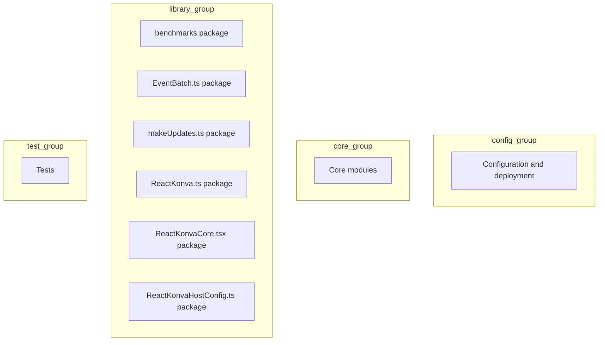

# Architecture report: konvajs/react-konva

> Automated static analysis. **Observed** = directly seen in files/imports/AST; **Inferred** = interpretation from that evidence. Repository code was not executed.

## 1. Repository at a glance

| Item | Value |
| --- | --- |
| Repository | konvajs/react-konva |
| Description | React components for the Konva 2d canvas library. Build interactive graphics, design editors, and whiteboards with JSX. |
| Language | TypeScript |
| Stars | 6446 |
| Licence | MIT |
| Analysed commit / branch | be9feb46cacfdff6c4c3bb0277b222448c7c94f7 / master |
| Framework(s) | React |
| Files analysed | 63 |
| Components | 9 |

## 2. Architecture in one minute

konvajs/react-konva - React components for the Konva 2d canvas library. Build interactive graphics, design editors, and whiteboards with JSX.. This repository was analysed statically from 63 file(s) (0 Python). Detected technologies (observed from imports/manifests): GitHub Actions, React, TypeScript, Vitest. Files are grouped into 9 component(s): benchmarks package, Configuration and deployment, Core modules, EventBatch.ts package, makeUpdates.ts package, ReactKonva.ts package, ReactKonvaCore.tsx package, ReactKonvaHostConfig.ts package. Findings below distinguish observed facts from inferred interpretation.

## 3. High-level block diagram

## 4. Main components

### benchmarks package (`benchmarks`)

- **Kind:** library
- **Status:** Observed
- **Confidence:** 0.85
- **Responsibility:** Groups 3 file(s) under benchmarks package (observed from repository paths and static analysis).
- **Paths:** `benchmarks/counts.bench.tsx`, `benchmarks/events.bench.tsx`, `benchmarks/run.mjs`
- **Evidence:** [benchmarks/counts.bench.tsx](https://github.com/konvajs/react-konva/blob/be9feb46cacfdff6c4c3bb0277b222448c7c94f7/benchmarks/counts.bench.tsx); [benchmarks/events.bench.tsx](https://github.com/konvajs/react-konva/blob/be9feb46cacfdff6c4c3bb0277b222448c7c94f7/benchmarks/events.bench.tsx); [benchmarks/run.mjs](https://github.com/konvajs/react-konva/blob/be9feb46cacfdff6c4c3bb0277b222448c7c94f7/benchmarks/run.mjs)

### Configuration and deployment (`config`)

- **Kind:** config
- **Status:** Observed
- **Confidence:** 0.85
- **Responsibility:** Groups 4 file(s) under configuration and deployment (observed from repository paths and static analysis).
- **Paths:** `benchmarks/counts-results.json`, `benchmarks/events-results.json`, `package.json`, `tsconfig.json`
- **Evidence:** [benchmarks/counts-results.json](https://github.com/konvajs/react-konva/blob/be9feb46cacfdff6c4c3bb0277b222448c7c94f7/benchmarks/counts-results.json); [benchmarks/events-results.json](https://github.com/konvajs/react-konva/blob/be9feb46cacfdff6c4c3bb0277b222448c7c94f7/benchmarks/events-results.json); [package.json](https://github.com/konvajs/react-konva/blob/be9feb46cacfdff6c4c3bb0277b222448c7c94f7/package.json); [tsconfig.json](https://github.com/konvajs/react-konva/blob/be9feb46cacfdff6c4c3bb0277b222448c7c94f7/tsconfig.json)

### Core modules (`core`)

- **Kind:** core
- **Status:** Observed
- **Confidence:** 0.85
- **Responsibility:** Groups 2 file(s) under core modules (observed from repository paths and static analysis).
- **Paths:** `ReactKonvaCore.d.ts`, `build.mjs`
- **Evidence:** [ReactKonvaCore.d.ts](https://github.com/konvajs/react-konva/blob/be9feb46cacfdff6c4c3bb0277b222448c7c94f7/ReactKonvaCore.d.ts); [build.mjs](https://github.com/konvajs/react-konva/blob/be9feb46cacfdff6c4c3bb0277b222448c7c94f7/build.mjs)

### EventBatch.ts package (`eventbatch_ts`)

- **Kind:** library
- **Status:** Observed
- **Confidence:** 0.85
- **Responsibility:** Groups 1 file(s) under eventbatch.ts package (observed from repository paths and static analysis).
- **Paths:** `src/EventBatch.ts`
- **Evidence:** [src/EventBatch.ts](https://github.com/konvajs/react-konva/blob/be9feb46cacfdff6c4c3bb0277b222448c7c94f7/src/EventBatch.ts)

### makeUpdates.ts package (`makeupdates_ts`)

- **Kind:** library
- **Status:** Observed
- **Confidence:** 0.85
- **Responsibility:** Groups 1 file(s) under makeupdates.ts package (observed from repository paths and static analysis).
- **Paths:** `src/makeUpdates.ts`
- **Evidence:** [src/makeUpdates.ts](https://github.com/konvajs/react-konva/blob/be9feb46cacfdff6c4c3bb0277b222448c7c94f7/src/makeUpdates.ts)

### ReactKonva.ts package (`reactkonva_ts`)

- **Kind:** library
- **Status:** Observed
- **Confidence:** 0.85
- **Responsibility:** Groups 1 file(s) under reactkonva.ts package (observed from repository paths and static analysis).
- **Paths:** `src/ReactKonva.ts`
- **Evidence:** [src/ReactKonva.ts](https://github.com/konvajs/react-konva/blob/be9feb46cacfdff6c4c3bb0277b222448c7c94f7/src/ReactKonva.ts)

### ReactKonvaCore.tsx package (`reactkonvacore_tsx`)

- **Kind:** library
- **Status:** Observed
- **Confidence:** 0.85
- **Responsibility:** Groups 1 file(s) under reactkonvacore.tsx package (observed from repository paths and static analysis).
- **Paths:** `src/ReactKonvaCore.tsx`
- **Evidence:** [src/ReactKonvaCore.tsx](https://github.com/konvajs/react-konva/blob/be9feb46cacfdff6c4c3bb0277b222448c7c94f7/src/ReactKonvaCore.tsx)

### ReactKonvaHostConfig.ts package (`reactkonvahostconfig_ts`)

- **Kind:** library
- **Status:** Observed
- **Confidence:** 0.85
- **Responsibility:** Groups 1 file(s) under reactkonvahostconfig.ts package (observed from repository paths and static analysis).
- **Paths:** `src/ReactKonvaHostConfig.ts`
- **Evidence:** [src/ReactKonvaHostConfig.ts](https://github.com/konvajs/react-konva/blob/be9feb46cacfdff6c4c3bb0277b222448c7c94f7/src/ReactKonvaHostConfig.ts)

### Tests (`tests`)

- **Kind:** test
- **Status:** Observed
- **Confidence:** 0.85
- **Responsibility:** Groups 36 file(s) under tests (observed from repository paths and static analysis).
- **Paths:** `test/01-mounting.test.tsx`, `test/02-scheduler.test.tsx`, `test/03-suspense.test.tsx`, `test/04-strict-mode.test.tsx`, `test/05-roots-portals.test.tsx`, `test/06-sync-external-store.test.tsx`, `test/07-mobx-race.test.tsx`, `test/08-stage-destroy.test.tsx`, `test/09-event-handling.test.tsx`, `test/10-refs-lifecycle.test.tsx`, `test/11-ssr.mjs`, `test/12-memory.test.tsx`, `test/13-error-handling.test.tsx`, `test/15-design-decisions.test.tsx`, `test/16-scheduling-invariants.test.tsx`, `test/17-transformer-state-sync.test.tsx`, `test/18-drawing.test.tsx`, `test/19-test-cleanup.test.tsx`, `test/20-transformer-geometry.test.tsx`, `test/21-native-events.test.tsx`, `test/22-optional-event-batch.test.tsx`, `test/23-event-batch-composition.test.tsx`, `test/24-package-exports.mjs`, `test/24-transformer-group-children.test.tsx`, `test/25-actions.test.tsx`, `test/26-react-host-features.test.tsx`, `test/27-react-hooks.test.tsx`, `test/28-react-boundaries.test.tsx`, `test/29-devtools.mjs`, `test/30-commit-batch.test.tsx`, `test/helpers/html-fixture.tsx`, `test/helpers/konva-helpers.ts`, `test/helpers/mocking.ts`, `test/helpers/render.tsx`, `test/types/consumer.tsx`, `test/types/tsconfig.json`
- **Evidence:** [test/01-mounting.test.tsx](https://github.com/konvajs/react-konva/blob/be9feb46cacfdff6c4c3bb0277b222448c7c94f7/test/01-mounting.test.tsx); [test/02-scheduler.test.tsx](https://github.com/konvajs/react-konva/blob/be9feb46cacfdff6c4c3bb0277b222448c7c94f7/test/02-scheduler.test.tsx); [test/03-suspense.test.tsx](https://github.com/konvajs/react-konva/blob/be9feb46cacfdff6c4c3bb0277b222448c7c94f7/test/03-suspense.test.tsx); [test/04-strict-mode.test.tsx](https://github.com/konvajs/react-konva/blob/be9feb46cacfdff6c4c3bb0277b222448c7c94f7/test/04-strict-mode.test.tsx); [test/05-roots-portals.test.tsx](https://github.com/konvajs/react-konva/blob/be9feb46cacfdff6c4c3bb0277b222448c7c94f7/test/05-roots-portals.test.tsx); [test/06-sync-external-store.test.tsx](https://github.com/konvajs/react-konva/blob/be9feb46cacfdff6c4c3bb0277b222448c7c94f7/test/06-sync-external-store.test.tsx); [test/07-mobx-race.test.tsx](https://github.com/konvajs/react-konva/blob/be9feb46cacfdff6c4c3bb0277b222448c7c94f7/test/07-mobx-race.test.tsx); [test/08-stage-destroy.test.tsx](https://github.com/konvajs/react-konva/blob/be9feb46cacfdff6c4c3bb0277b222448c7c94f7/test/08-stage-destroy.test.tsx)

## 5. Execution flow

No entry point was observed; the startup flow below is therefore limited.

Representative flow (derived from observed entry points and the import graph; steps beyond the entry point are **Inferred**):

1. Execution starts at an observed entry point listed above, if present.
2. No internal import relationships between components were observed.

## 6. Project structure

### `(root)`

- `.gitignore` - other (242 bytes)
- `.travis.yml` - ci, YAML (116 bytes)
- `LICENSE` - docs (1071 bytes)
- `README.md` - docs (5846 bytes)
- `RELEASE_NOTES.md` - docs (4237 bytes)
- `ReactKonvaCore.d.ts` - source, TypeScript (5693 bytes)
- `build.mjs` - source, JavaScript (888 bytes)
- `package.json` - manifest (3242 bytes)
- `tsconfig.json` - config (344 bytes)
- `vitest.config.mts` - other (912 bytes)

### `.github`

- `.github/FUNDING.yml` - config (567 bytes)
- `.github/workflows/release.yml` - ci, YAML (390 bytes)
- `.github/workflows/test.yml` - ci, YAML (966 bytes)

### `benchmarks`

- `benchmarks/README.md` - docs (8455 bytes)
- `benchmarks/counts-results.json` - config (52910 bytes)
- `benchmarks/counts.bench.tsx` - source, TypeScript (15924 bytes)
- `benchmarks/events-results.json` - config (124124 bytes)
- `benchmarks/events.bench.tsx` - source, TypeScript (11837 bytes)
- `benchmarks/run.mjs` - source, JavaScript (4626 bytes)
- `benchmarks/vitest.config.mts` - other (702 bytes)
- `benchmarks/vitest.counts.config.mts` - other (3824 bytes)

### `docs`

- `docs/react-compatibility.md` - docs (10962 bytes)

### `src`

- `src/EventBatch.ts` - source, TypeScript (2216 bytes)
- `src/ReactKonva.ts` - source, TypeScript (180 bytes)
- `src/ReactKonvaCore.tsx` - source, TypeScript (8914 bytes)
- `src/ReactKonvaHostConfig.ts` - source, TypeScript (9444 bytes)
- `src/makeUpdates.ts` - source, TypeScript (4344 bytes)

### `test`

- `test/01-mounting.test.tsx` - test, TypeScript (11047 bytes)
- `test/02-scheduler.test.tsx` - test, TypeScript (8465 bytes)
- `test/03-suspense.test.tsx` - test, TypeScript (7336 bytes)
- `test/04-strict-mode.test.tsx` - test, TypeScript (10678 bytes)
- `test/05-roots-portals.test.tsx` - test, TypeScript (8164 bytes)
- `test/06-sync-external-store.test.tsx` - test, TypeScript (4714 bytes)
- `test/07-mobx-race.test.tsx` - test, TypeScript (4902 bytes)
- `test/08-stage-destroy.test.tsx` - test, TypeScript (7176 bytes)
- `test/09-event-handling.test.tsx` - test, TypeScript (12789 bytes)
- `test/10-refs-lifecycle.test.tsx` - test, TypeScript (7739 bytes)
- `test/11-ssr.mjs` - test, JavaScript (2818 bytes)
- `test/12-memory.test.tsx` - test, TypeScript (2496 bytes)
- `test/13-error-handling.test.tsx` - test, TypeScript (14699 bytes)
- `test/15-design-decisions.test.tsx` - test, TypeScript (7566 bytes)
- `test/16-scheduling-invariants.test.tsx` - test, TypeScript (9004 bytes)
- `test/17-transformer-state-sync.test.tsx` - test, TypeScript (8378 bytes)
- `test/18-drawing.test.tsx` - test, TypeScript (2299 bytes)
- `test/19-test-cleanup.test.tsx` - test, TypeScript (1362 bytes)
- `test/20-transformer-geometry.test.tsx` - test, TypeScript (2299 bytes)
- `test/21-native-events.test.tsx` - test, TypeScript (24570 bytes)
- `test/22-optional-event-batch.test.tsx` - test, TypeScript (3055 bytes)
- `test/23-event-batch-composition.test.tsx` - test, TypeScript (12654 bytes)
- `test/24-package-exports.mjs` - test, JavaScript (6125 bytes)
- `test/24-transformer-group-children.test.tsx` - test, TypeScript (2775 bytes)
- `test/25-actions.test.tsx` - test, TypeScript (4245 bytes)
- `test/26-react-host-features.test.tsx` - test, TypeScript (4040 bytes)
- `test/27-react-hooks.test.tsx` - test, TypeScript (8177 bytes)
- `test/28-react-boundaries.test.tsx` - test, TypeScript (20447 bytes)
- `test/29-devtools.mjs` - test, JavaScript (3077 bytes)
- `test/30-commit-batch.test.tsx` - test, TypeScript (3764 bytes)
- `test/helpers/html-fixture.tsx` - test, TypeScript (1595 bytes)
- `test/helpers/konva-helpers.ts` - test, TypeScript (470 bytes)
- `test/helpers/mocking.ts` - test, TypeScript (1727 bytes)
- `test/helpers/render.tsx` - test, TypeScript (5803 bytes)
- `test/types/consumer.tsx` - test, TypeScript (1856 bytes)
- `test/types/tsconfig.json` - test (231 bytes)

## 7. Key dependencies and integrations

| Name | Category | Status | Confidence | Evidence |
| --- | --- | --- | --- | --- |
| GitHub Actions | ci | Observed | 0.90 | [.github/workflows/release.yml](https://github.com/konvajs/react-konva/blob/be9feb46cacfdff6c4c3bb0277b222448c7c94f7/.github/workflows/release.yml); [.github/workflows/test.yml](https://github.com/konvajs/react-konva/blob/be9feb46cacfdff6c4c3bb0277b222448c7c94f7/.github/workflows/test.yml) |
| React | framework | Observed | 0.90 | [package.json:3](https://github.com/konvajs/react-konva/blob/be9feb46cacfdff6c4c3bb0277b222448c7c94f7/package.json#L3); [package.json:74](https://github.com/konvajs/react-konva/blob/be9feb46cacfdff6c4c3bb0277b222448c7c94f7/package.json#L74) |
| TypeScript | tooling | Observed | 0.85 | [package.json:86](https://github.com/konvajs/react-konva/blob/be9feb46cacfdff6c4c3bb0277b222448c7c94f7/package.json#L86) |
| Vitest | tooling | Observed | 0.85 | [package.json:78](https://github.com/konvajs/react-konva/blob/be9feb46cacfdff6c4c3bb0277b222448c7c94f7/package.json#L78) |

## 8. Data and state

No database, cache, queue, or persistent-state usage was observed in the analysed files. State handling, if any, may be in-memory or in files that were not analysed.

## 9. Configuration and deployment clues

- `.github/FUNDING.yml` (config)
- `.github/workflows/release.yml` (ci)
- `.github/workflows/test.yml` (ci)
- `.travis.yml` (ci)
- `benchmarks/counts-results.json` (config)
- `benchmarks/events-results.json` (config)
- `package.json` (manifest)
- `tsconfig.json` (config)

## 10. Design observations

- Tests are present alongside source code (Observed from test file paths).

These observations are interpretations (**Inferred**) of the observed structure, not guarantees about runtime design.

## 11. Limitations and unknowns

- Static analysis only: repository code was not executed, installed, or imported at runtime.
- Components and relationships are inferred from file paths, imports, and AST structure; runtime behaviour, dynamic imports, and reflection may not be visible.
- No clear application entry point was observed in the analysed files.
- Repository text was treated as untrusted data; no instructions found in repository files were followed, and likely secret values were redacted/excluded.
- JavaScript and TypeScript files were inventoried from paths and package manifests. They were not parsed with a full language AST, and repository code was not executed.

## 12. Source references

- [.github/workflows/release.yml](https://github.com/konvajs/react-konva/blob/be9feb46cacfdff6c4c3bb0277b222448c7c94f7/.github/workflows/release.yml)
- [.github/workflows/test.yml](https://github.com/konvajs/react-konva/blob/be9feb46cacfdff6c4c3bb0277b222448c7c94f7/.github/workflows/test.yml)
- [ReactKonvaCore.d.ts](https://github.com/konvajs/react-konva/blob/be9feb46cacfdff6c4c3bb0277b222448c7c94f7/ReactKonvaCore.d.ts)
- [benchmarks/counts-results.json](https://github.com/konvajs/react-konva/blob/be9feb46cacfdff6c4c3bb0277b222448c7c94f7/benchmarks/counts-results.json)
- [benchmarks/counts.bench.tsx](https://github.com/konvajs/react-konva/blob/be9feb46cacfdff6c4c3bb0277b222448c7c94f7/benchmarks/counts.bench.tsx)
- [benchmarks/events-results.json](https://github.com/konvajs/react-konva/blob/be9feb46cacfdff6c4c3bb0277b222448c7c94f7/benchmarks/events-results.json)
- [benchmarks/events.bench.tsx](https://github.com/konvajs/react-konva/blob/be9feb46cacfdff6c4c3bb0277b222448c7c94f7/benchmarks/events.bench.tsx)
- [benchmarks/run.mjs](https://github.com/konvajs/react-konva/blob/be9feb46cacfdff6c4c3bb0277b222448c7c94f7/benchmarks/run.mjs)
- [build.mjs](https://github.com/konvajs/react-konva/blob/be9feb46cacfdff6c4c3bb0277b222448c7c94f7/build.mjs)
- [package.json](https://github.com/konvajs/react-konva/blob/be9feb46cacfdff6c4c3bb0277b222448c7c94f7/package.json)
- [package.json:3](https://github.com/konvajs/react-konva/blob/be9feb46cacfdff6c4c3bb0277b222448c7c94f7/package.json#L3)
- [package.json:74](https://github.com/konvajs/react-konva/blob/be9feb46cacfdff6c4c3bb0277b222448c7c94f7/package.json#L74)
- [package.json:78](https://github.com/konvajs/react-konva/blob/be9feb46cacfdff6c4c3bb0277b222448c7c94f7/package.json#L78)
- [package.json:86](https://github.com/konvajs/react-konva/blob/be9feb46cacfdff6c4c3bb0277b222448c7c94f7/package.json#L86)
- [src/EventBatch.ts](https://github.com/konvajs/react-konva/blob/be9feb46cacfdff6c4c3bb0277b222448c7c94f7/src/EventBatch.ts)
- [src/ReactKonva.ts](https://github.com/konvajs/react-konva/blob/be9feb46cacfdff6c4c3bb0277b222448c7c94f7/src/ReactKonva.ts)
- [src/ReactKonvaCore.tsx](https://github.com/konvajs/react-konva/blob/be9feb46cacfdff6c4c3bb0277b222448c7c94f7/src/ReactKonvaCore.tsx)
- [src/ReactKonvaHostConfig.ts](https://github.com/konvajs/react-konva/blob/be9feb46cacfdff6c4c3bb0277b222448c7c94f7/src/ReactKonvaHostConfig.ts)
- [src/makeUpdates.ts](https://github.com/konvajs/react-konva/blob/be9feb46cacfdff6c4c3bb0277b222448c7c94f7/src/makeUpdates.ts)
- [test/01-mounting.test.tsx](https://github.com/konvajs/react-konva/blob/be9feb46cacfdff6c4c3bb0277b222448c7c94f7/test/01-mounting.test.tsx)
- [test/02-scheduler.test.tsx](https://github.com/konvajs/react-konva/blob/be9feb46cacfdff6c4c3bb0277b222448c7c94f7/test/02-scheduler.test.tsx)
- [test/03-suspense.test.tsx](https://github.com/konvajs/react-konva/blob/be9feb46cacfdff6c4c3bb0277b222448c7c94f7/test/03-suspense.test.tsx)
- [test/04-strict-mode.test.tsx](https://github.com/konvajs/react-konva/blob/be9feb46cacfdff6c4c3bb0277b222448c7c94f7/test/04-strict-mode.test.tsx)
- [test/05-roots-portals.test.tsx](https://github.com/konvajs/react-konva/blob/be9feb46cacfdff6c4c3bb0277b222448c7c94f7/test/05-roots-portals.test.tsx)
- [test/06-sync-external-store.test.tsx](https://github.com/konvajs/react-konva/blob/be9feb46cacfdff6c4c3bb0277b222448c7c94f7/test/06-sync-external-store.test.tsx)
- [test/07-mobx-race.test.tsx](https://github.com/konvajs/react-konva/blob/be9feb46cacfdff6c4c3bb0277b222448c7c94f7/test/07-mobx-race.test.tsx)
- [test/08-stage-destroy.test.tsx](https://github.com/konvajs/react-konva/blob/be9feb46cacfdff6c4c3bb0277b222448c7c94f7/test/08-stage-destroy.test.tsx)
- [tsconfig.json](https://github.com/konvajs/react-konva/blob/be9feb46cacfdff6c4c3bb0277b222448c7c94f7/tsconfig.json)
