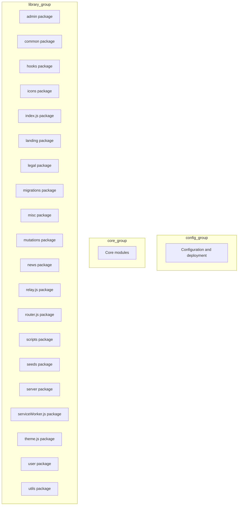

# Architecture report: kriasoft/react-firebase-starter

> Automated static analysis. **Observed** = directly seen in files/imports/AST; **Inferred** = interpretation from that evidence. Repository code was not executed.

## 1. Repository at a glance

| Item | Value |
| --- | --- |
| Repository | kriasoft/react-firebase-starter |
| Description | Boilerplate (seed) project for creating web apps with React.js, GraphQL.js and Relay |
| Language | JavaScript |
| Stars | 4511 |
| Licence | MIT |
| Analysed commit / branch | 69328e57cbc832c87b9cce9a9955fa21515545de / master |
| Framework(s) | Express, React |
| Files analysed | 139 |
| Components | 22 |

## 2. Architecture in one minute

kriasoft/react-firebase-starter - Boilerplate (seed) project for creating web apps with React.js, GraphQL.js and Relay. This repository was analysed statically from 139 file(s) (0 Python). Detected technologies (observed from imports/manifests): Express, React, Docker. Files are grouped into 22 component(s): admin package, common package, Configuration and deployment, Core modules, hooks package, icons package, index.js package, landing package. Findings below distinguish observed facts from inferred interpretation.

## 3. High-level block diagram

## 4. Main components

### admin package (`admin`)

- **Kind:** library
- **Status:** Observed
- **Confidence:** 0.85
- **Responsibility:** Groups 4 file(s) under admin package (observed from repository paths and static analysis).
- **Paths:** `src/admin/AdminLayout.js`, `src/admin/AdminStoryList.js`, `src/admin/AdminUserList.js`, `src/admin/index.js`
- **Evidence:** [src/admin/AdminLayout.js](https://github.com/kriasoft/react-firebase-starter/blob/69328e57cbc832c87b9cce9a9955fa21515545de/src/admin/AdminLayout.js); [src/admin/AdminStoryList.js](https://github.com/kriasoft/react-firebase-starter/blob/69328e57cbc832c87b9cce9a9955fa21515545de/src/admin/AdminStoryList.js); [src/admin/AdminUserList.js](https://github.com/kriasoft/react-firebase-starter/blob/69328e57cbc832c87b9cce9a9955fa21515545de/src/admin/AdminUserList.js); [src/admin/index.js](https://github.com/kriasoft/react-firebase-starter/blob/69328e57cbc832c87b9cce9a9955fa21515545de/src/admin/index.js)

### common package (`common`)

- **Kind:** library
- **Status:** Observed
- **Confidence:** 0.85
- **Responsibility:** Groups 15 file(s) under common package (observed from repository paths and static analysis).
- **Paths:** `src/common/App.js`, `src/common/App.test.js`, `src/common/AppBar.js`, `src/common/AutoUpdater.js`, `src/common/CustomerChat.js`, `src/common/ErrorPage.js`, `src/common/Layout.js`, `src/common/LayoutFooter.js`, `src/common/Link.js`, `src/common/LoginButton.js`, `src/common/LoginDialog.js`, `src/common/LoginForm.js`, `src/common/TextField.js`, `src/common/UserMenu.js`, `src/common/UserSettingsDialog.js`
- **Evidence:** [src/common/App.js](https://github.com/kriasoft/react-firebase-starter/blob/69328e57cbc832c87b9cce9a9955fa21515545de/src/common/App.js); [src/common/App.test.js](https://github.com/kriasoft/react-firebase-starter/blob/69328e57cbc832c87b9cce9a9955fa21515545de/src/common/App.test.js); [src/common/AppBar.js](https://github.com/kriasoft/react-firebase-starter/blob/69328e57cbc832c87b9cce9a9955fa21515545de/src/common/AppBar.js); [src/common/AutoUpdater.js](https://github.com/kriasoft/react-firebase-starter/blob/69328e57cbc832c87b9cce9a9955fa21515545de/src/common/AutoUpdater.js); [src/common/CustomerChat.js](https://github.com/kriasoft/react-firebase-starter/blob/69328e57cbc832c87b9cce9a9955fa21515545de/src/common/CustomerChat.js); [src/common/ErrorPage.js](https://github.com/kriasoft/react-firebase-starter/blob/69328e57cbc832c87b9cce9a9955fa21515545de/src/common/ErrorPage.js); [src/common/Layout.js](https://github.com/kriasoft/react-firebase-starter/blob/69328e57cbc832c87b9cce9a9955fa21515545de/src/common/Layout.js); [src/common/LayoutFooter.js](https://github.com/kriasoft/react-firebase-starter/blob/69328e57cbc832c87b9cce9a9955fa21515545de/src/common/LayoutFooter.js)

### Configuration and deployment (`config`)

- **Kind:** config
- **Status:** Observed
- **Confidence:** 0.85
- **Responsibility:** Groups 3 file(s) under configuration and deployment (observed from repository paths and static analysis).
- **Paths:** `firebase.json`, `package.json`, `public/manifest.json`
- **Evidence:** [firebase.json](https://github.com/kriasoft/react-firebase-starter/blob/69328e57cbc832c87b9cce9a9955fa21515545de/firebase.json); [package.json](https://github.com/kriasoft/react-firebase-starter/blob/69328e57cbc832c87b9cce9a9955fa21515545de/package.json); [public/manifest.json](https://github.com/kriasoft/react-firebase-starter/blob/69328e57cbc832c87b9cce9a9955fa21515545de/public/manifest.json)

### Core modules (`core`)

- **Kind:** core
- **Status:** Observed
- **Confidence:** 0.85
- **Responsibility:** Groups 1 file(s) under core modules (observed from repository paths and static analysis).
- **Paths:** `knexfile.js`
- **Evidence:** [knexfile.js](https://github.com/kriasoft/react-firebase-starter/blob/69328e57cbc832c87b9cce9a9955fa21515545de/knexfile.js)

### hooks package (`hooks`)

- **Kind:** library
- **Status:** Observed
- **Confidence:** 0.85
- **Responsibility:** Groups 9 file(s) under hooks package (observed from repository paths and static analysis).
- **Paths:** `src/hooks/index.js`, `src/hooks/useAuth.js`, `src/hooks/useConfig.js`, `src/hooks/useFacebook.js`, `src/hooks/useFirebase.js`, `src/hooks/useGoogleMaps.js`, `src/hooks/useHistory.js`, `src/hooks/useRelay.js`, `src/hooks/useReset.js`
- **Evidence:** [src/hooks/index.js](https://github.com/kriasoft/react-firebase-starter/blob/69328e57cbc832c87b9cce9a9955fa21515545de/src/hooks/index.js); [src/hooks/useAuth.js](https://github.com/kriasoft/react-firebase-starter/blob/69328e57cbc832c87b9cce9a9955fa21515545de/src/hooks/useAuth.js); [src/hooks/useConfig.js](https://github.com/kriasoft/react-firebase-starter/blob/69328e57cbc832c87b9cce9a9955fa21515545de/src/hooks/useConfig.js); [src/hooks/useFacebook.js](https://github.com/kriasoft/react-firebase-starter/blob/69328e57cbc832c87b9cce9a9955fa21515545de/src/hooks/useFacebook.js); [src/hooks/useFirebase.js](https://github.com/kriasoft/react-firebase-starter/blob/69328e57cbc832c87b9cce9a9955fa21515545de/src/hooks/useFirebase.js); [src/hooks/useGoogleMaps.js](https://github.com/kriasoft/react-firebase-starter/blob/69328e57cbc832c87b9cce9a9955fa21515545de/src/hooks/useGoogleMaps.js); [src/hooks/useHistory.js](https://github.com/kriasoft/react-firebase-starter/blob/69328e57cbc832c87b9cce9a9955fa21515545de/src/hooks/useHistory.js); [src/hooks/useRelay.js](https://github.com/kriasoft/react-firebase-starter/blob/69328e57cbc832c87b9cce9a9955fa21515545de/src/hooks/useRelay.js)

### icons package (`icons`)

- **Kind:** library
- **Status:** Observed
- **Confidence:** 0.85
- **Responsibility:** Groups 7 file(s) under icons package (observed from repository paths and static analysis).
- **Paths:** `src/icons/Facebook.js`, `src/icons/GitHub.js`, `src/icons/Google.js`, `src/icons/Instagram.js`, `src/icons/Logout.js`, `src/icons/Settings.js`, `src/icons/Twitter.js`
- **Evidence:** [src/icons/Facebook.js](https://github.com/kriasoft/react-firebase-starter/blob/69328e57cbc832c87b9cce9a9955fa21515545de/src/icons/Facebook.js); [src/icons/GitHub.js](https://github.com/kriasoft/react-firebase-starter/blob/69328e57cbc832c87b9cce9a9955fa21515545de/src/icons/GitHub.js); [src/icons/Google.js](https://github.com/kriasoft/react-firebase-starter/blob/69328e57cbc832c87b9cce9a9955fa21515545de/src/icons/Google.js); [src/icons/Instagram.js](https://github.com/kriasoft/react-firebase-starter/blob/69328e57cbc832c87b9cce9a9955fa21515545de/src/icons/Instagram.js); [src/icons/Logout.js](https://github.com/kriasoft/react-firebase-starter/blob/69328e57cbc832c87b9cce9a9955fa21515545de/src/icons/Logout.js); [src/icons/Settings.js](https://github.com/kriasoft/react-firebase-starter/blob/69328e57cbc832c87b9cce9a9955fa21515545de/src/icons/Settings.js); [src/icons/Twitter.js](https://github.com/kriasoft/react-firebase-starter/blob/69328e57cbc832c87b9cce9a9955fa21515545de/src/icons/Twitter.js)

### index.js package (`index_js`)

- **Kind:** library
- **Status:** Observed
- **Confidence:** 0.85
- **Responsibility:** Groups 1 file(s) under index.js package (observed from repository paths and static analysis).
- **Paths:** `src/index.js`
- **Evidence:** [src/index.js](https://github.com/kriasoft/react-firebase-starter/blob/69328e57cbc832c87b9cce9a9955fa21515545de/src/index.js)

### landing package (`landing`)

- **Kind:** library
- **Status:** Observed
- **Confidence:** 0.85
- **Responsibility:** Groups 5 file(s) under landing package (observed from repository paths and static analysis).
- **Paths:** `src/landing/Home.js`, `src/landing/HomeHero.js`, `src/landing/HomeSponsors.js`, `src/landing/HomeStack.js`, `src/landing/index.js`
- **Evidence:** [src/landing/Home.js](https://github.com/kriasoft/react-firebase-starter/blob/69328e57cbc832c87b9cce9a9955fa21515545de/src/landing/Home.js); [src/landing/HomeHero.js](https://github.com/kriasoft/react-firebase-starter/blob/69328e57cbc832c87b9cce9a9955fa21515545de/src/landing/HomeHero.js); [src/landing/HomeSponsors.js](https://github.com/kriasoft/react-firebase-starter/blob/69328e57cbc832c87b9cce9a9955fa21515545de/src/landing/HomeSponsors.js); [src/landing/HomeStack.js](https://github.com/kriasoft/react-firebase-starter/blob/69328e57cbc832c87b9cce9a9955fa21515545de/src/landing/HomeStack.js); [src/landing/index.js](https://github.com/kriasoft/react-firebase-starter/blob/69328e57cbc832c87b9cce9a9955fa21515545de/src/landing/index.js)

### legal package (`legal`)

- **Kind:** library
- **Status:** Observed
- **Confidence:** 0.85
- **Responsibility:** Groups 3 file(s) under legal package (observed from repository paths and static analysis).
- **Paths:** `src/legal/Privacy.js`, `src/legal/Terms.js`, `src/legal/index.js`
- **Evidence:** [src/legal/Privacy.js](https://github.com/kriasoft/react-firebase-starter/blob/69328e57cbc832c87b9cce9a9955fa21515545de/src/legal/Privacy.js); [src/legal/Terms.js](https://github.com/kriasoft/react-firebase-starter/blob/69328e57cbc832c87b9cce9a9955fa21515545de/src/legal/Terms.js); [src/legal/index.js](https://github.com/kriasoft/react-firebase-starter/blob/69328e57cbc832c87b9cce9a9955fa21515545de/src/legal/index.js)

### migrations package (`migrations`)

- **Kind:** library
- **Status:** Observed
- **Confidence:** 0.85
- **Responsibility:** Groups 1 file(s) under migrations package (observed from repository paths and static analysis).
- **Paths:** `migrations/20180101000000_initial.js`
- **Evidence:** [migrations/20180101000000_initial.js](https://github.com/kriasoft/react-firebase-starter/blob/69328e57cbc832c87b9cce9a9955fa21515545de/migrations/20180101000000_initial.js)

### misc package (`misc`)

- **Kind:** library
- **Status:** Observed
- **Confidence:** 0.85
- **Responsibility:** Groups 2 file(s) under misc package (observed from repository paths and static analysis).
- **Paths:** `src/misc/About.js`, `src/misc/index.js`
- **Evidence:** [src/misc/About.js](https://github.com/kriasoft/react-firebase-starter/blob/69328e57cbc832c87b9cce9a9955fa21515545de/src/misc/About.js); [src/misc/index.js](https://github.com/kriasoft/react-firebase-starter/blob/69328e57cbc832c87b9cce9a9955fa21515545de/src/misc/index.js)

### mutations package (`mutations`)

- **Kind:** library
- **Status:** Observed
- **Confidence:** 0.85
- **Responsibility:** Groups 4 file(s) under mutations package (observed from repository paths and static analysis).
- **Paths:** `src/mutations/DeleteUser.js`, `src/mutations/LikeStory.js`, `src/mutations/UpdateUser.js`, `src/mutations/UpsertStory.js`
- **Evidence:** [src/mutations/DeleteUser.js](https://github.com/kriasoft/react-firebase-starter/blob/69328e57cbc832c87b9cce9a9955fa21515545de/src/mutations/DeleteUser.js); [src/mutations/LikeStory.js](https://github.com/kriasoft/react-firebase-starter/blob/69328e57cbc832c87b9cce9a9955fa21515545de/src/mutations/LikeStory.js); [src/mutations/UpdateUser.js](https://github.com/kriasoft/react-firebase-starter/blob/69328e57cbc832c87b9cce9a9955fa21515545de/src/mutations/UpdateUser.js); [src/mutations/UpsertStory.js](https://github.com/kriasoft/react-firebase-starter/blob/69328e57cbc832c87b9cce9a9955fa21515545de/src/mutations/UpsertStory.js)

### news package (`news`)

- **Kind:** library
- **Status:** Observed
- **Confidence:** 0.85
- **Responsibility:** Groups 4 file(s) under news package (observed from repository paths and static analysis).
- **Paths:** `src/news/News.js`, `src/news/Story.js`, `src/news/SubmitDialog.js`, `src/news/index.js`
- **Evidence:** [src/news/News.js](https://github.com/kriasoft/react-firebase-starter/blob/69328e57cbc832c87b9cce9a9955fa21515545de/src/news/News.js); [src/news/Story.js](https://github.com/kriasoft/react-firebase-starter/blob/69328e57cbc832c87b9cce9a9955fa21515545de/src/news/Story.js); [src/news/SubmitDialog.js](https://github.com/kriasoft/react-firebase-starter/blob/69328e57cbc832c87b9cce9a9955fa21515545de/src/news/SubmitDialog.js); [src/news/index.js](https://github.com/kriasoft/react-firebase-starter/blob/69328e57cbc832c87b9cce9a9955fa21515545de/src/news/index.js)

### relay.js package (`relay_js`)

- **Kind:** library
- **Status:** Observed
- **Confidence:** 0.85
- **Responsibility:** Groups 1 file(s) under relay.js package (observed from repository paths and static analysis).
- **Paths:** `src/relay.js`
- **Evidence:** [src/relay.js](https://github.com/kriasoft/react-firebase-starter/blob/69328e57cbc832c87b9cce9a9955fa21515545de/src/relay.js)

### router.js package (`router_js`)

- **Kind:** library
- **Status:** Observed
- **Confidence:** 0.85
- **Responsibility:** Groups 1 file(s) under router.js package (observed from repository paths and static analysis).
- **Paths:** `src/router.js`
- **Evidence:** [src/router.js](https://github.com/kriasoft/react-firebase-starter/blob/69328e57cbc832c87b9cce9a9955fa21515545de/src/router.js)

### scripts package (`scripts`)

- **Kind:** library
- **Status:** Observed
- **Confidence:** 0.85
- **Responsibility:** Groups 8 file(s) under scripts package (observed from repository paths and static analysis).
- **Paths:** `scripts/db-backup.js`, `scripts/db-restore.js`, `scripts/db.js`, `scripts/post-deploy.js`, `scripts/pre-deploy.js`, `scripts/psql.js`, `scripts/setup.js`, `scripts/update-schema.js`
- **Evidence:** [scripts/db-backup.js](https://github.com/kriasoft/react-firebase-starter/blob/69328e57cbc832c87b9cce9a9955fa21515545de/scripts/db-backup.js); [scripts/db-restore.js](https://github.com/kriasoft/react-firebase-starter/blob/69328e57cbc832c87b9cce9a9955fa21515545de/scripts/db-restore.js); [scripts/db.js](https://github.com/kriasoft/react-firebase-starter/blob/69328e57cbc832c87b9cce9a9955fa21515545de/scripts/db.js); [scripts/post-deploy.js](https://github.com/kriasoft/react-firebase-starter/blob/69328e57cbc832c87b9cce9a9955fa21515545de/scripts/post-deploy.js); [scripts/pre-deploy.js](https://github.com/kriasoft/react-firebase-starter/blob/69328e57cbc832c87b9cce9a9955fa21515545de/scripts/pre-deploy.js); [scripts/psql.js](https://github.com/kriasoft/react-firebase-starter/blob/69328e57cbc832c87b9cce9a9955fa21515545de/scripts/psql.js); [scripts/setup.js](https://github.com/kriasoft/react-firebase-starter/blob/69328e57cbc832c87b9cce9a9955fa21515545de/scripts/setup.js); [scripts/update-schema.js](https://github.com/kriasoft/react-firebase-starter/blob/69328e57cbc832c87b9cce9a9955fa21515545de/scripts/update-schema.js)

### seeds package (`seeds`)

- **Kind:** library
- **Status:** Observed
- **Confidence:** 0.85
- **Responsibility:** Groups 1 file(s) under seeds package (observed from repository paths and static analysis).
- **Paths:** `seeds/seed.js`
- **Evidence:** [seeds/seed.js](https://github.com/kriasoft/react-firebase-starter/blob/69328e57cbc832c87b9cce9a9955fa21515545de/seeds/seed.js)

### server package (`server`)

- **Kind:** library
- **Status:** Observed
- **Confidence:** 0.85
- **Responsibility:** Groups 33 file(s) under server package (observed from repository paths and static analysis).
- **Paths:** `src/server/api.js`, `src/server/app.js`, `src/server/config.js`, `src/server/context.js`, `src/server/db.js`, `src/server/errors.js`, `src/server/index.js`, `src/server/login.js`, `src/server/mutations/index.js`, `src/server/mutations/story.js`, `src/server/mutations/user.js`, `src/server/node.js`, `src/server/passport.js`, `src/server/queries/index.js`, `src/server/queries/story.js`, `src/server/queries/user.js`, `src/server/relay.js`, `src/server/schema.js`, `src/server/ssr.js`, `src/server/templates/index.js`, `src/server/types/comment.js`, `src/server/types/identity.js`, `src/server/types/index.js`, `src/server/types/story.js`, `src/server/types/user.js`, `src/server/utils/fields.js`, `src/server/utils/index.js`, `src/server/utils/map.js`, `src/server/utils/relay.js`, `src/server/utils/type.js`, `src/server/utils/user.js`, `src/server/utils/username.js`, `src/server/validator.js`
- **Evidence:** [src/server/api.js](https://github.com/kriasoft/react-firebase-starter/blob/69328e57cbc832c87b9cce9a9955fa21515545de/src/server/api.js); [src/server/app.js](https://github.com/kriasoft/react-firebase-starter/blob/69328e57cbc832c87b9cce9a9955fa21515545de/src/server/app.js); [src/server/config.js](https://github.com/kriasoft/react-firebase-starter/blob/69328e57cbc832c87b9cce9a9955fa21515545de/src/server/config.js); [src/server/context.js](https://github.com/kriasoft/react-firebase-starter/blob/69328e57cbc832c87b9cce9a9955fa21515545de/src/server/context.js); [src/server/db.js](https://github.com/kriasoft/react-firebase-starter/blob/69328e57cbc832c87b9cce9a9955fa21515545de/src/server/db.js); [src/server/errors.js](https://github.com/kriasoft/react-firebase-starter/blob/69328e57cbc832c87b9cce9a9955fa21515545de/src/server/errors.js); [src/server/index.js](https://github.com/kriasoft/react-firebase-starter/blob/69328e57cbc832c87b9cce9a9955fa21515545de/src/server/index.js); [src/server/login.js](https://github.com/kriasoft/react-firebase-starter/blob/69328e57cbc832c87b9cce9a9955fa21515545de/src/server/login.js)

### serviceWorker.js package (`serviceworker_js`)

- **Kind:** library
- **Status:** Observed
- **Confidence:** 0.85
- **Responsibility:** Groups 1 file(s) under serviceworker.js package (observed from repository paths and static analysis).
- **Paths:** `src/serviceWorker.js`
- **Evidence:** [src/serviceWorker.js](https://github.com/kriasoft/react-firebase-starter/blob/69328e57cbc832c87b9cce9a9955fa21515545de/src/serviceWorker.js)

### theme.js package (`theme_js`)

- **Kind:** library
- **Status:** Observed
- **Confidence:** 0.85
- **Responsibility:** Groups 1 file(s) under theme.js package (observed from repository paths and static analysis).
- **Paths:** `src/theme.js`
- **Evidence:** [src/theme.js](https://github.com/kriasoft/react-firebase-starter/blob/69328e57cbc832c87b9cce9a9955fa21515545de/src/theme.js)

### user package (`user`)

- **Kind:** library
- **Status:** Observed
- **Confidence:** 0.85
- **Responsibility:** Groups 4 file(s) under user package (observed from repository paths and static analysis).
- **Paths:** `src/user/Account.js`, `src/user/Login.js`, `src/user/UserProfile.js`, `src/user/index.js`
- **Evidence:** [src/user/Account.js](https://github.com/kriasoft/react-firebase-starter/blob/69328e57cbc832c87b9cce9a9955fa21515545de/src/user/Account.js); [src/user/Login.js](https://github.com/kriasoft/react-firebase-starter/blob/69328e57cbc832c87b9cce9a9955fa21515545de/src/user/Login.js); [src/user/UserProfile.js](https://github.com/kriasoft/react-firebase-starter/blob/69328e57cbc832c87b9cce9a9955fa21515545de/src/user/UserProfile.js); [src/user/index.js](https://github.com/kriasoft/react-firebase-starter/blob/69328e57cbc832c87b9cce9a9955fa21515545de/src/user/index.js)

### utils package (`utils`)

- **Kind:** library
- **Status:** Observed
- **Confidence:** 0.85
- **Responsibility:** Groups 6 file(s) under utils package (observed from repository paths and static analysis).
- **Paths:** `src/utils/env.js`, `src/utils/gtag.js`, `src/utils/index.js`, `src/utils/loading.js`, `src/utils/openWindow.js`, `src/utils/scrolling.js`
- **Evidence:** [src/utils/env.js](https://github.com/kriasoft/react-firebase-starter/blob/69328e57cbc832c87b9cce9a9955fa21515545de/src/utils/env.js); [src/utils/gtag.js](https://github.com/kriasoft/react-firebase-starter/blob/69328e57cbc832c87b9cce9a9955fa21515545de/src/utils/gtag.js); [src/utils/index.js](https://github.com/kriasoft/react-firebase-starter/blob/69328e57cbc832c87b9cce9a9955fa21515545de/src/utils/index.js); [src/utils/loading.js](https://github.com/kriasoft/react-firebase-starter/blob/69328e57cbc832c87b9cce9a9955fa21515545de/src/utils/loading.js); [src/utils/openWindow.js](https://github.com/kriasoft/react-firebase-starter/blob/69328e57cbc832c87b9cce9a9955fa21515545de/src/utils/openWindow.js); [src/utils/scrolling.js](https://github.com/kriasoft/react-firebase-starter/blob/69328e57cbc832c87b9cce9a9955fa21515545de/src/utils/scrolling.js)

## 5. Execution flow

**Observed** entry point(s):

- [src/admin/index.js](https://github.com/kriasoft/react-firebase-starter/blob/69328e57cbc832c87b9cce9a9955fa21515545de/src/admin/index.js)
- [src/common/App.js](https://github.com/kriasoft/react-firebase-starter/blob/69328e57cbc832c87b9cce9a9955fa21515545de/src/common/App.js)
- [src/hooks/index.js](https://github.com/kriasoft/react-firebase-starter/blob/69328e57cbc832c87b9cce9a9955fa21515545de/src/hooks/index.js)
- [src/index.js](https://github.com/kriasoft/react-firebase-starter/blob/69328e57cbc832c87b9cce9a9955fa21515545de/src/index.js)
- [src/landing/index.js](https://github.com/kriasoft/react-firebase-starter/blob/69328e57cbc832c87b9cce9a9955fa21515545de/src/landing/index.js)
- [src/legal/index.js](https://github.com/kriasoft/react-firebase-starter/blob/69328e57cbc832c87b9cce9a9955fa21515545de/src/legal/index.js)
- [src/misc/index.js](https://github.com/kriasoft/react-firebase-starter/blob/69328e57cbc832c87b9cce9a9955fa21515545de/src/misc/index.js)
- [src/news/index.js](https://github.com/kriasoft/react-firebase-starter/blob/69328e57cbc832c87b9cce9a9955fa21515545de/src/news/index.js)
- [src/server/app.js](https://github.com/kriasoft/react-firebase-starter/blob/69328e57cbc832c87b9cce9a9955fa21515545de/src/server/app.js)
- [src/server/index.js](https://github.com/kriasoft/react-firebase-starter/blob/69328e57cbc832c87b9cce9a9955fa21515545de/src/server/index.js)
- [src/server/mutations/index.js](https://github.com/kriasoft/react-firebase-starter/blob/69328e57cbc832c87b9cce9a9955fa21515545de/src/server/mutations/index.js)
- [src/server/queries/index.js](https://github.com/kriasoft/react-firebase-starter/blob/69328e57cbc832c87b9cce9a9955fa21515545de/src/server/queries/index.js)

Representative flow (derived from observed entry points and the import graph; steps beyond the entry point are **Inferred**):

1. Execution starts at an observed entry point listed above, if present.
2. No internal import relationships between components were observed.

## 6. Project structure

### `(root)`

- `.babelrc` - other (159 bytes)
- `.editorconfig` - config (421 bytes)
- `.eslintrc` - other (57 bytes)
- `.gitattributes` - other (604 bytes)
- `.gitignore` - other (495 bytes)
- `.prettierignore` - other (46 bytes)
- `.prettierrc` - other (125 bytes)
- `LICENSE.txt` - docs (1127 bytes)
- `README.md` - docs (15909 bytes)
- `firebase.json` - config (1067 bytes)
- `knexfile.js` - source, JavaScript (2230 bytes)
- `package.json` - manifest (3967 bytes)
- `schema.graphql` - other (3404 bytes)
- `storage.rules` - other (138 bytes)

### `.circleci`

- `.circleci/Dockerfile` - ci, YAML (664 bytes)
- `.circleci/config.yml` - ci, YAML (1131 bytes)

### `.github`

- `.github/FUNDING.yml` - config (103 bytes)

### `.vscode`

- `.vscode/launch.json` - config (963 bytes)
- `.vscode/settings.json` - config (314 bytes)
- `.vscode/snippets/javascript.json` - config (3470 bytes)

### `migrations`

- `migrations/20180101000000_initial.js` - source, JavaScript (3787 bytes)

### `public`

- `public/manifest.json` - config (324 bytes)

### `scripts`

- `scripts/db-backup.js` - source, JavaScript (2388 bytes)
- `scripts/db-restore.js` - source, JavaScript (653 bytes)
- `scripts/db.js` - source, JavaScript (566 bytes)
- `scripts/post-deploy.js` - source, JavaScript (601 bytes)
- `scripts/pre-deploy.js` - source, JavaScript (887 bytes)
- `scripts/psql.js` - source, JavaScript (529 bytes)
- `scripts/setup.js` - source, JavaScript (1406 bytes)
- `scripts/update-schema.js` - source, JavaScript (649 bytes)

### `seeds`

- `seeds/seed.js` - source, JavaScript (750 bytes)

### `src`

- `src/admin/AdminLayout.js` - source, JavaScript (471 bytes)
- `src/admin/AdminStoryList.js` - source, JavaScript (839 bytes)
- `src/admin/AdminUserList.js` - source, JavaScript (831 bytes)
- `src/admin/index.js` - source, JavaScript (1134 bytes)
- `src/common/App.js` - source, JavaScript (3046 bytes)
- `src/common/App.test.js` - source, JavaScript (226 bytes)
- `src/common/AppBar.js` - source, JavaScript (3610 bytes)
- `src/common/AutoUpdater.js` - source, JavaScript (1490 bytes)
- `src/common/CustomerChat.js` - source, JavaScript (1639 bytes)
- `src/common/ErrorPage.js` - source, JavaScript (3175 bytes)
- `src/common/Layout.js` - source, JavaScript (1848 bytes)
- `src/common/LayoutFooter.js` - source, JavaScript (1698 bytes)
- `src/common/Link.js` - source, JavaScript (1135 bytes)
- `src/common/LoginButton.js` - source, JavaScript (1916 bytes)
- `src/common/LoginDialog.js` - source, JavaScript (1012 bytes)
- `src/common/LoginForm.js` - source, JavaScript (1766 bytes)
- `src/common/TextField.js` - source, JavaScript (1501 bytes)
- `src/common/UserMenu.js` - source, JavaScript (1914 bytes)
- `src/common/UserSettingsDialog.js` - source, JavaScript (3591 bytes)
- `src/hooks/index.js` - source, JavaScript (387 bytes)
- `src/hooks/useAuth.js` - source, JavaScript (3574 bytes)
- `src/hooks/useConfig.js` - source, JavaScript (307 bytes)
- `src/hooks/useFacebook.js` - source, JavaScript (1190 bytes)
- `src/hooks/useFirebase.js` - source, JavaScript (2176 bytes)
- `src/hooks/useGoogleMaps.js` - source, JavaScript (793 bytes)
- `src/hooks/useHistory.js` - source, JavaScript (395 bytes)
- `src/hooks/useRelay.js` - source, JavaScript (304 bytes)
- `src/hooks/useReset.js` - source, JavaScript (310 bytes)
- `src/icons/Facebook.js` - source, JavaScript (1237 bytes)
- `src/icons/GitHub.js` - source, JavaScript (1216 bytes)
- `src/icons/Google.js` - source, JavaScript (1793 bytes)
- `src/icons/Instagram.js` - source, JavaScript (2291 bytes)
- `src/icons/Logout.js` - source, JavaScript (744 bytes)
- `src/icons/Settings.js` - source, JavaScript (1456 bytes)
- `src/icons/Twitter.js` - source, JavaScript (1263 bytes)
- `src/index.js` - source, JavaScript (1823 bytes)
- `src/landing/Home.js` - source, JavaScript (2073 bytes)
- `src/landing/HomeHero.js` - source, JavaScript (1693 bytes)
- `src/landing/HomeSponsors.js` - source, JavaScript (1303 bytes)
- `src/landing/HomeStack.js` - source, JavaScript (2322 bytes)
- `src/landing/index.js` - source, JavaScript (778 bytes)
- `src/legal/Privacy.js` - source, JavaScript (2817 bytes)
- `src/legal/Terms.js` - source, JavaScript (6214 bytes)
- `src/legal/index.js` - source, JavaScript (1154 bytes)
- `src/misc/About.js` - source, JavaScript (1287 bytes)
- `src/misc/index.js` - source, JavaScript (703 bytes)
- `src/mutations/DeleteUser.js` - source, JavaScript (548 bytes)
- `src/mutations/LikeStory.js` - source, JavaScript (1072 bytes)
- `src/mutations/UpdateUser.js` - source, JavaScript (761 bytes)
- `src/mutations/UpsertStory.js` - source, JavaScript (828 bytes)
- `src/news/News.js` - source, JavaScript (5804 bytes)
- `src/news/Story.js` - source, JavaScript (1350 bytes)
- `src/news/SubmitDialog.js` - source, JavaScript (2979 bytes)
- `src/news/index.js` - source, JavaScript (1459 bytes)
- `src/relay.js` - source, JavaScript (1480 bytes)
- `src/router.js` - source, JavaScript (2619 bytes)
- `src/server/api.js` - source, JavaScript (1402 bytes)
- `src/server/app.js` - source, JavaScript (475 bytes)
- `src/server/config.js` - source, JavaScript (1308 bytes)
- `src/server/context.js` - source, JavaScript (4155 bytes)
- `src/server/db.js` - source, JavaScript (1106 bytes)
- `src/server/errors.js` - source, JavaScript (869 bytes)
- `src/server/index.js` - source, JavaScript (1570 bytes)
- `src/server/login.js` - source, JavaScript (2133 bytes)
- `src/server/mutations/README.md` - docs (1978 bytes)
- `src/server/mutations/index.js` - source, JavaScript (199 bytes)
- `src/server/mutations/story.js` - source, JavaScript (3578 bytes)
- `src/server/mutations/user.js` - source, JavaScript (2931 bytes)
- `src/server/node.js` - source, JavaScript (1071 bytes)
- `src/server/passport.js` - source, JavaScript (2643 bytes)
- `src/server/queries/README.md` - docs (1382 bytes)
- `src/server/queries/index.js` - source, JavaScript (199 bytes)
- `src/server/queries/story.js` - source, JavaScript (1167 bytes)
- `src/server/queries/user.js` - source, JavaScript (1724 bytes)
- `src/server/relay.js` - source, JavaScript (1061 bytes)
- `src/server/schema.js` - source, JavaScript (612 bytes)
- `src/server/ssr.js` - source, JavaScript (2482 bytes)
- `src/server/templates/data-model.ejs` - other (1324 bytes)
- `src/server/templates/error.ejs` - other (1046 bytes)
- `src/server/templates/index.js` - source, JavaScript (479 bytes)
- `src/server/templates/ok.ejs` - other (1547 bytes)
- `src/server/types/README.md` - docs (1625 bytes)
- `src/server/types/comment.js` - source, JavaScript (1567 bytes)
- `src/server/types/identity.js` - source, JavaScript (2194 bytes)
- `src/server/types/index.js` - source, JavaScript (254 bytes)
- `src/server/types/story.js` - source, JavaScript (2131 bytes)
- `src/server/types/user.js` - source, JavaScript (1974 bytes)
- `src/server/utils/fields.js` - source, JavaScript (1040 bytes)
- `src/server/utils/index.js` - source, JavaScript (300 bytes)
- `src/server/utils/map.js` - source, JavaScript (856 bytes)
- `src/server/utils/relay.js` - source, JavaScript (466 bytes)
- `src/server/utils/type.js` - source, JavaScript (454 bytes)
- `src/server/utils/user.js` - source, JavaScript (2502 bytes)
- `src/server/utils/username.js` - source, JavaScript (1149 bytes)
- `src/server/validator.js` - source, JavaScript (4340 bytes)
- `src/serviceWorker.js` - source, JavaScript (4956 bytes)
- `src/theme.js` - source, JavaScript (983 bytes)
- `src/user/Account.js` - source, JavaScript (1143 bytes)
- `src/user/Login.js` - source, JavaScript (959 bytes)
- `src/user/UserProfile.js` - source, JavaScript (1814 bytes)
- `src/user/index.js` - source, JavaScript (1522 bytes)
- `src/utils/env.js` - source, JavaScript (270 bytes)
- `src/utils/gtag.js` - source, JavaScript (294 bytes)
- `src/utils/index.js` - source, JavaScript (286 bytes)
- `src/utils/loading.js` - source, JavaScript (787 bytes)
- `src/utils/openWindow.js` - source, JavaScript (1553 bytes)
- `src/utils/scrolling.js` - source, JavaScript (1009 bytes)

### `ssl`

- `ssl/README.md` - docs (365 bytes)

## 7. Key dependencies and integrations

| Name | Category | Status | Confidence | Evidence |
| --- | --- | --- | --- | --- |
| Express | framework | Observed | 0.85 | [package.json:29](https://github.com/kriasoft/react-firebase-starter/blob/69328e57cbc832c87b9cce9a9955fa21515545de/package.json#L29) |
| React | framework | Observed | 0.90 | [package.json:37](https://github.com/kriasoft/react-firebase-starter/blob/69328e57cbc832c87b9cce9a9955fa21515545de/package.json#L37); [package.json:52](https://github.com/kriasoft/react-firebase-starter/blob/69328e57cbc832c87b9cce9a9955fa21515545de/package.json#L52) |
| Docker | tooling | Observed | 0.85 | [.circleci/Dockerfile](https://github.com/kriasoft/react-firebase-starter/blob/69328e57cbc832c87b9cce9a9955fa21515545de/.circleci/Dockerfile) |

## 8. Data and state

No database, cache, queue, or persistent-state usage was observed in the analysed files. State handling, if any, may be in-memory or in files that were not analysed.

## 9. Configuration and deployment clues

- `.circleci/Dockerfile` (ci)
- `.circleci/config.yml` (ci)
- `.editorconfig` (config)
- `.github/FUNDING.yml` (config)
- `.vscode/launch.json` (config)
- `.vscode/settings.json` (config)
- `.vscode/snippets/javascript.json` (config)
- `firebase.json` (config)
- `package.json` (manifest)
- `public/manifest.json` (config)

## 10. Design observations

- No strong design patterns could be established from the available evidence.

These observations are interpretations (**Inferred**) of the observed structure, not guarantees about runtime design.

## 11. Limitations and unknowns

- Static analysis only: repository code was not executed, installed, or imported at runtime.
- Components and relationships are inferred from file paths, imports, and AST structure; runtime behaviour, dynamic imports, and reflection may not be visible.
- 3 file(s) were skipped during inventory (3 x likely secret file excluded).
- No clear application entry point was observed in the analysed files.
- Repository text was treated as untrusted data; no instructions found in repository files were followed, and likely secret values were redacted/excluded.
- JavaScript and TypeScript files were inventoried from paths and package manifests. They were not parsed with a full language AST, and repository code was not executed.

## 12. Source references

- [.circleci/Dockerfile](https://github.com/kriasoft/react-firebase-starter/blob/69328e57cbc832c87b9cce9a9955fa21515545de/.circleci/Dockerfile)
- [firebase.json](https://github.com/kriasoft/react-firebase-starter/blob/69328e57cbc832c87b9cce9a9955fa21515545de/firebase.json)
- [knexfile.js](https://github.com/kriasoft/react-firebase-starter/blob/69328e57cbc832c87b9cce9a9955fa21515545de/knexfile.js)
- [migrations/20180101000000_initial.js](https://github.com/kriasoft/react-firebase-starter/blob/69328e57cbc832c87b9cce9a9955fa21515545de/migrations/20180101000000_initial.js)
- [package.json](https://github.com/kriasoft/react-firebase-starter/blob/69328e57cbc832c87b9cce9a9955fa21515545de/package.json)
- [package.json:29](https://github.com/kriasoft/react-firebase-starter/blob/69328e57cbc832c87b9cce9a9955fa21515545de/package.json#L29)
- [package.json:37](https://github.com/kriasoft/react-firebase-starter/blob/69328e57cbc832c87b9cce9a9955fa21515545de/package.json#L37)
- [package.json:52](https://github.com/kriasoft/react-firebase-starter/blob/69328e57cbc832c87b9cce9a9955fa21515545de/package.json#L52)
- [public/manifest.json](https://github.com/kriasoft/react-firebase-starter/blob/69328e57cbc832c87b9cce9a9955fa21515545de/public/manifest.json)
- [scripts/db-backup.js](https://github.com/kriasoft/react-firebase-starter/blob/69328e57cbc832c87b9cce9a9955fa21515545de/scripts/db-backup.js)
- [scripts/db-restore.js](https://github.com/kriasoft/react-firebase-starter/blob/69328e57cbc832c87b9cce9a9955fa21515545de/scripts/db-restore.js)
- [scripts/db.js](https://github.com/kriasoft/react-firebase-starter/blob/69328e57cbc832c87b9cce9a9955fa21515545de/scripts/db.js)
- [scripts/post-deploy.js](https://github.com/kriasoft/react-firebase-starter/blob/69328e57cbc832c87b9cce9a9955fa21515545de/scripts/post-deploy.js)
- [scripts/pre-deploy.js](https://github.com/kriasoft/react-firebase-starter/blob/69328e57cbc832c87b9cce9a9955fa21515545de/scripts/pre-deploy.js)
- [scripts/psql.js](https://github.com/kriasoft/react-firebase-starter/blob/69328e57cbc832c87b9cce9a9955fa21515545de/scripts/psql.js)
- [scripts/setup.js](https://github.com/kriasoft/react-firebase-starter/blob/69328e57cbc832c87b9cce9a9955fa21515545de/scripts/setup.js)
- [scripts/update-schema.js](https://github.com/kriasoft/react-firebase-starter/blob/69328e57cbc832c87b9cce9a9955fa21515545de/scripts/update-schema.js)
- [seeds/seed.js](https://github.com/kriasoft/react-firebase-starter/blob/69328e57cbc832c87b9cce9a9955fa21515545de/seeds/seed.js)
- [src/admin/AdminLayout.js](https://github.com/kriasoft/react-firebase-starter/blob/69328e57cbc832c87b9cce9a9955fa21515545de/src/admin/AdminLayout.js)
- [src/admin/AdminStoryList.js](https://github.com/kriasoft/react-firebase-starter/blob/69328e57cbc832c87b9cce9a9955fa21515545de/src/admin/AdminStoryList.js)
- [src/admin/AdminUserList.js](https://github.com/kriasoft/react-firebase-starter/blob/69328e57cbc832c87b9cce9a9955fa21515545de/src/admin/AdminUserList.js)
- [src/admin/index.js](https://github.com/kriasoft/react-firebase-starter/blob/69328e57cbc832c87b9cce9a9955fa21515545de/src/admin/index.js)
- [src/common/App.js](https://github.com/kriasoft/react-firebase-starter/blob/69328e57cbc832c87b9cce9a9955fa21515545de/src/common/App.js)
- [src/common/App.test.js](https://github.com/kriasoft/react-firebase-starter/blob/69328e57cbc832c87b9cce9a9955fa21515545de/src/common/App.test.js)
- [src/common/AppBar.js](https://github.com/kriasoft/react-firebase-starter/blob/69328e57cbc832c87b9cce9a9955fa21515545de/src/common/AppBar.js)
- [src/common/AutoUpdater.js](https://github.com/kriasoft/react-firebase-starter/blob/69328e57cbc832c87b9cce9a9955fa21515545de/src/common/AutoUpdater.js)
- [src/common/CustomerChat.js](https://github.com/kriasoft/react-firebase-starter/blob/69328e57cbc832c87b9cce9a9955fa21515545de/src/common/CustomerChat.js)
- [src/common/ErrorPage.js](https://github.com/kriasoft/react-firebase-starter/blob/69328e57cbc832c87b9cce9a9955fa21515545de/src/common/ErrorPage.js)
- [src/common/Layout.js](https://github.com/kriasoft/react-firebase-starter/blob/69328e57cbc832c87b9cce9a9955fa21515545de/src/common/Layout.js)
- [src/common/LayoutFooter.js](https://github.com/kriasoft/react-firebase-starter/blob/69328e57cbc832c87b9cce9a9955fa21515545de/src/common/LayoutFooter.js)
- [src/hooks/index.js](https://github.com/kriasoft/react-firebase-starter/blob/69328e57cbc832c87b9cce9a9955fa21515545de/src/hooks/index.js)
- [src/hooks/useAuth.js](https://github.com/kriasoft/react-firebase-starter/blob/69328e57cbc832c87b9cce9a9955fa21515545de/src/hooks/useAuth.js)
- [src/hooks/useConfig.js](https://github.com/kriasoft/react-firebase-starter/blob/69328e57cbc832c87b9cce9a9955fa21515545de/src/hooks/useConfig.js)
- [src/hooks/useFacebook.js](https://github.com/kriasoft/react-firebase-starter/blob/69328e57cbc832c87b9cce9a9955fa21515545de/src/hooks/useFacebook.js)
- [src/hooks/useFirebase.js](https://github.com/kriasoft/react-firebase-starter/blob/69328e57cbc832c87b9cce9a9955fa21515545de/src/hooks/useFirebase.js)
- [src/hooks/useGoogleMaps.js](https://github.com/kriasoft/react-firebase-starter/blob/69328e57cbc832c87b9cce9a9955fa21515545de/src/hooks/useGoogleMaps.js)
- [src/hooks/useHistory.js](https://github.com/kriasoft/react-firebase-starter/blob/69328e57cbc832c87b9cce9a9955fa21515545de/src/hooks/useHistory.js)
- [src/hooks/useRelay.js](https://github.com/kriasoft/react-firebase-starter/blob/69328e57cbc832c87b9cce9a9955fa21515545de/src/hooks/useRelay.js)
- [src/icons/Facebook.js](https://github.com/kriasoft/react-firebase-starter/blob/69328e57cbc832c87b9cce9a9955fa21515545de/src/icons/Facebook.js)
- [src/icons/GitHub.js](https://github.com/kriasoft/react-firebase-starter/blob/69328e57cbc832c87b9cce9a9955fa21515545de/src/icons/GitHub.js)
- [src/icons/Google.js](https://github.com/kriasoft/react-firebase-starter/blob/69328e57cbc832c87b9cce9a9955fa21515545de/src/icons/Google.js)
- [src/icons/Instagram.js](https://github.com/kriasoft/react-firebase-starter/blob/69328e57cbc832c87b9cce9a9955fa21515545de/src/icons/Instagram.js)
- [src/icons/Logout.js](https://github.com/kriasoft/react-firebase-starter/blob/69328e57cbc832c87b9cce9a9955fa21515545de/src/icons/Logout.js)
- [src/icons/Settings.js](https://github.com/kriasoft/react-firebase-starter/blob/69328e57cbc832c87b9cce9a9955fa21515545de/src/icons/Settings.js)
- [src/icons/Twitter.js](https://github.com/kriasoft/react-firebase-starter/blob/69328e57cbc832c87b9cce9a9955fa21515545de/src/icons/Twitter.js)
- [src/index.js](https://github.com/kriasoft/react-firebase-starter/blob/69328e57cbc832c87b9cce9a9955fa21515545de/src/index.js)
- [src/landing/Home.js](https://github.com/kriasoft/react-firebase-starter/blob/69328e57cbc832c87b9cce9a9955fa21515545de/src/landing/Home.js)
- [src/landing/HomeHero.js](https://github.com/kriasoft/react-firebase-starter/blob/69328e57cbc832c87b9cce9a9955fa21515545de/src/landing/HomeHero.js)
- [src/landing/HomeSponsors.js](https://github.com/kriasoft/react-firebase-starter/blob/69328e57cbc832c87b9cce9a9955fa21515545de/src/landing/HomeSponsors.js)
- [src/landing/HomeStack.js](https://github.com/kriasoft/react-firebase-starter/blob/69328e57cbc832c87b9cce9a9955fa21515545de/src/landing/HomeStack.js)
- [src/landing/index.js](https://github.com/kriasoft/react-firebase-starter/blob/69328e57cbc832c87b9cce9a9955fa21515545de/src/landing/index.js)
- [src/legal/Privacy.js](https://github.com/kriasoft/react-firebase-starter/blob/69328e57cbc832c87b9cce9a9955fa21515545de/src/legal/Privacy.js)
- [src/legal/Terms.js](https://github.com/kriasoft/react-firebase-starter/blob/69328e57cbc832c87b9cce9a9955fa21515545de/src/legal/Terms.js)
- [src/legal/index.js](https://github.com/kriasoft/react-firebase-starter/blob/69328e57cbc832c87b9cce9a9955fa21515545de/src/legal/index.js)
- [src/misc/About.js](https://github.com/kriasoft/react-firebase-starter/blob/69328e57cbc832c87b9cce9a9955fa21515545de/src/misc/About.js)
- [src/misc/index.js](https://github.com/kriasoft/react-firebase-starter/blob/69328e57cbc832c87b9cce9a9955fa21515545de/src/misc/index.js)
- [src/mutations/DeleteUser.js](https://github.com/kriasoft/react-firebase-starter/blob/69328e57cbc832c87b9cce9a9955fa21515545de/src/mutations/DeleteUser.js)
- [src/mutations/LikeStory.js](https://github.com/kriasoft/react-firebase-starter/blob/69328e57cbc832c87b9cce9a9955fa21515545de/src/mutations/LikeStory.js)
- [src/mutations/UpdateUser.js](https://github.com/kriasoft/react-firebase-starter/blob/69328e57cbc832c87b9cce9a9955fa21515545de/src/mutations/UpdateUser.js)
- [src/mutations/UpsertStory.js](https://github.com/kriasoft/react-firebase-starter/blob/69328e57cbc832c87b9cce9a9955fa21515545de/src/mutations/UpsertStory.js)
- [src/news/News.js](https://github.com/kriasoft/react-firebase-starter/blob/69328e57cbc832c87b9cce9a9955fa21515545de/src/news/News.js)
- [src/news/Story.js](https://github.com/kriasoft/react-firebase-starter/blob/69328e57cbc832c87b9cce9a9955fa21515545de/src/news/Story.js)
- [src/news/SubmitDialog.js](https://github.com/kriasoft/react-firebase-starter/blob/69328e57cbc832c87b9cce9a9955fa21515545de/src/news/SubmitDialog.js)
- [src/news/index.js](https://github.com/kriasoft/react-firebase-starter/blob/69328e57cbc832c87b9cce9a9955fa21515545de/src/news/index.js)
- [src/relay.js](https://github.com/kriasoft/react-firebase-starter/blob/69328e57cbc832c87b9cce9a9955fa21515545de/src/relay.js)
- [src/router.js](https://github.com/kriasoft/react-firebase-starter/blob/69328e57cbc832c87b9cce9a9955fa21515545de/src/router.js)
- [src/server/api.js](https://github.com/kriasoft/react-firebase-starter/blob/69328e57cbc832c87b9cce9a9955fa21515545de/src/server/api.js)
- [src/server/app.js](https://github.com/kriasoft/react-firebase-starter/blob/69328e57cbc832c87b9cce9a9955fa21515545de/src/server/app.js)
- [src/server/config.js](https://github.com/kriasoft/react-firebase-starter/blob/69328e57cbc832c87b9cce9a9955fa21515545de/src/server/config.js)
- [src/server/context.js](https://github.com/kriasoft/react-firebase-starter/blob/69328e57cbc832c87b9cce9a9955fa21515545de/src/server/context.js)
- [src/server/db.js](https://github.com/kriasoft/react-firebase-starter/blob/69328e57cbc832c87b9cce9a9955fa21515545de/src/server/db.js)
- [src/server/errors.js](https://github.com/kriasoft/react-firebase-starter/blob/69328e57cbc832c87b9cce9a9955fa21515545de/src/server/errors.js)
- [src/server/index.js](https://github.com/kriasoft/react-firebase-starter/blob/69328e57cbc832c87b9cce9a9955fa21515545de/src/server/index.js)
- [src/server/login.js](https://github.com/kriasoft/react-firebase-starter/blob/69328e57cbc832c87b9cce9a9955fa21515545de/src/server/login.js)
- [src/server/mutations/index.js](https://github.com/kriasoft/react-firebase-starter/blob/69328e57cbc832c87b9cce9a9955fa21515545de/src/server/mutations/index.js)
- [src/server/queries/index.js](https://github.com/kriasoft/react-firebase-starter/blob/69328e57cbc832c87b9cce9a9955fa21515545de/src/server/queries/index.js)
- [src/serviceWorker.js](https://github.com/kriasoft/react-firebase-starter/blob/69328e57cbc832c87b9cce9a9955fa21515545de/src/serviceWorker.js)
- [src/theme.js](https://github.com/kriasoft/react-firebase-starter/blob/69328e57cbc832c87b9cce9a9955fa21515545de/src/theme.js)
- [src/user/Account.js](https://github.com/kriasoft/react-firebase-starter/blob/69328e57cbc832c87b9cce9a9955fa21515545de/src/user/Account.js)
- [src/user/Login.js](https://github.com/kriasoft/react-firebase-starter/blob/69328e57cbc832c87b9cce9a9955fa21515545de/src/user/Login.js)
- [src/user/UserProfile.js](https://github.com/kriasoft/react-firebase-starter/blob/69328e57cbc832c87b9cce9a9955fa21515545de/src/user/UserProfile.js)
- [src/user/index.js](https://github.com/kriasoft/react-firebase-starter/blob/69328e57cbc832c87b9cce9a9955fa21515545de/src/user/index.js)
- [src/utils/env.js](https://github.com/kriasoft/react-firebase-starter/blob/69328e57cbc832c87b9cce9a9955fa21515545de/src/utils/env.js)
- [src/utils/gtag.js](https://github.com/kriasoft/react-firebase-starter/blob/69328e57cbc832c87b9cce9a9955fa21515545de/src/utils/gtag.js)
- [src/utils/index.js](https://github.com/kriasoft/react-firebase-starter/blob/69328e57cbc832c87b9cce9a9955fa21515545de/src/utils/index.js)
- [src/utils/loading.js](https://github.com/kriasoft/react-firebase-starter/blob/69328e57cbc832c87b9cce9a9955fa21515545de/src/utils/loading.js)
- [src/utils/openWindow.js](https://github.com/kriasoft/react-firebase-starter/blob/69328e57cbc832c87b9cce9a9955fa21515545de/src/utils/openWindow.js)
- [src/utils/scrolling.js](https://github.com/kriasoft/react-firebase-starter/blob/69328e57cbc832c87b9cce9a9955fa21515545de/src/utils/scrolling.js)
