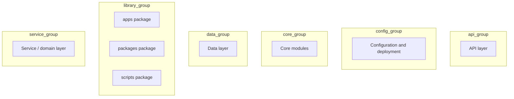

# Architecture report: kriasoft/react-starter-kit

> Automated static analysis. **Observed** = directly seen in files/imports/AST; **Inferred** = interpretation from that evidence. Repository code was not executed.

## 1. Repository at a glance

| Item | Value |
| --- | --- |
| Repository | kriasoft/react-starter-kit |
| Description | Modern React starter kit with Bun, TypeScript, Tailwind CSS, tRPC, Stripe, and Cloudflare Workers. Production-ready monorepo for building fast web apps. |
| Language | TypeScript |
| Stars | 23717 |
| Licence | MIT |
| Analysed commit / branch | dbdb0d4991bbaae1671ff62180089f2733dd406a / main |
| Framework(s) | React |
| Files analysed | 312 |
| Components | 8 |

## 2. Architecture in one minute

kriasoft/react-starter-kit - Modern React starter kit with Bun, TypeScript, Tailwind CSS, tRPC, Stripe, and Cloudflare Workers. Production-ready monorepo for building fast web apps.. This repository was analysed statically from 312 file(s) (0 Python). Detected technologies (observed from imports/manifests): GitHub Actions, React, Tailwind CSS, Docker, TypeScript, Vite. Files are grouped into 8 component(s): API layer, apps package, Configuration and deployment, Core modules, Data layer, packages package, scripts package, Service / domain layer. Findings below distinguish observed facts from inferred interpretation.

## 3. High-level block diagram

## 4. Main components

### API layer (`api_layer`)

- **Kind:** api
- **Status:** Observed
- **Confidence:** 0.85
- **Responsibility:** Groups 24 file(s) under api layer (observed from repository paths and static analysis).
- **Paths:** `apps/api/dev.ts`, `apps/api/index.ts`, `apps/api/lib/app.ts`, `apps/api/lib/auth.test.ts`, `apps/api/lib/auth.ts`, `apps/api/lib/context.ts`, `apps/api/lib/db.ts`, `apps/api/lib/email.ts`, `apps/api/lib/env.ts`, `apps/api/lib/middleware.ts`, `apps/api/lib/plans.ts`, `apps/api/lib/trpc.ts`, `apps/api/routers/billing.test.ts`, `apps/api/routers/billing.ts`, `apps/api/routers/config.ts`, `apps/api/vitest.config.ts`, `apps/api/worker.ts`, `apps/app/routes/(app)/index.tsx`, `apps/app/routes/(app)/members.tsx`, `apps/app/routes/(app)/route.tsx`, `apps/app/routes/(app)/settings.tsx`, `apps/app/routes/(auth)/login.tsx`, `apps/app/routes/(auth)/signup.tsx`, `apps/app/routes/__root.tsx`
- **Evidence:** [apps/api/dev.ts](https://github.com/kriasoft/react-starter-kit/blob/dbdb0d4991bbaae1671ff62180089f2733dd406a/apps/api/dev.ts); [apps/api/index.ts](https://github.com/kriasoft/react-starter-kit/blob/dbdb0d4991bbaae1671ff62180089f2733dd406a/apps/api/index.ts); [apps/api/lib/app.ts](https://github.com/kriasoft/react-starter-kit/blob/dbdb0d4991bbaae1671ff62180089f2733dd406a/apps/api/lib/app.ts); [apps/api/lib/auth.test.ts](https://github.com/kriasoft/react-starter-kit/blob/dbdb0d4991bbaae1671ff62180089f2733dd406a/apps/api/lib/auth.test.ts); [apps/api/lib/auth.ts](https://github.com/kriasoft/react-starter-kit/blob/dbdb0d4991bbaae1671ff62180089f2733dd406a/apps/api/lib/auth.ts); [apps/api/lib/context.ts](https://github.com/kriasoft/react-starter-kit/blob/dbdb0d4991bbaae1671ff62180089f2733dd406a/apps/api/lib/context.ts); [apps/api/lib/db.ts](https://github.com/kriasoft/react-starter-kit/blob/dbdb0d4991bbaae1671ff62180089f2733dd406a/apps/api/lib/db.ts); [apps/api/lib/email.ts](https://github.com/kriasoft/react-starter-kit/blob/dbdb0d4991bbaae1671ff62180089f2733dd406a/apps/api/lib/email.ts)

### apps package (`apps`)

- **Kind:** library
- **Status:** Observed
- **Confidence:** 0.85
- **Responsibility:** Groups 49 file(s) under apps package (observed from repository paths and static analysis).
- **Paths:** `apps/app/components/auth/auth-error-boundary.tsx`, `apps/app/components/auth/auth-form.tsx`, `apps/app/components/auth/google-login.tsx`, `apps/app/components/auth/index.ts`, `apps/app/components/auth/otp-verification.tsx`, `apps/app/components/auth/passkey-login.tsx`, `apps/app/components/auth/use-auth-form.ts`, `apps/app/components/devtools.tsx`, `apps/app/components/layout/constants.ts`, `apps/app/components/layout/header.tsx`, `apps/app/components/layout/index.tsx`, `apps/app/components/layout/sidebar-nav.tsx`, `apps/app/components/layout/sidebar.tsx`, `apps/app/components/not-found.tsx`, `apps/app/components/user-menu.tsx`, `apps/app/global.d.ts`, `apps/app/index.tsx`, `apps/app/lib/auth-config.ts`, `apps/app/lib/auth.ts`, `apps/app/lib/edge-routing.test.ts`, `apps/app/lib/errors.test.ts`, `apps/app/lib/errors.ts`, `apps/app/lib/queries/billing.test.ts`, `apps/app/lib/queries/billing.ts`, `apps/app/lib/queries/config.ts`, `apps/app/lib/queries/organization.ts`, `apps/app/lib/queries/session.test.ts`, `apps/app/lib/queries/session.ts`, `apps/app/lib/query.ts`, `apps/app/lib/routeTree.gen.ts`, `apps/app/lib/store.ts`, `apps/app/lib/theme.test.tsx`, `apps/app/lib/theme.tsx`, `apps/app/lib/trpc.ts`, `apps/app/vite.config.ts`, `apps/app/vitest.setup.ts`, `apps/email/components/BaseTemplate.tsx`, `apps/email/emails/email-verification.tsx`, `apps/email/emails/otp-password-reset.tsx`, `apps/email/emails/otp-sign-in.tsx`, `apps/email/emails/otp-verification.tsx`, `apps/email/emails/password-reset.tsx`, `apps/email/index.ts`, `apps/email/templates/email-verification.tsx`, `apps/email/templates/otp-email.tsx`, `apps/email/templates/password-reset.tsx`, `apps/email/utils/render.ts`, `apps/web/astro.config.mjs`, `apps/web/worker.ts`
- **Evidence:** [apps/app/components/auth/auth-error-boundary.tsx](https://github.com/kriasoft/react-starter-kit/blob/dbdb0d4991bbaae1671ff62180089f2733dd406a/apps/app/components/auth/auth-error-boundary.tsx); [apps/app/components/auth/auth-form.tsx](https://github.com/kriasoft/react-starter-kit/blob/dbdb0d4991bbaae1671ff62180089f2733dd406a/apps/app/components/auth/auth-form.tsx); [apps/app/components/auth/google-login.tsx](https://github.com/kriasoft/react-starter-kit/blob/dbdb0d4991bbaae1671ff62180089f2733dd406a/apps/app/components/auth/google-login.tsx); [apps/app/components/auth/index.ts](https://github.com/kriasoft/react-starter-kit/blob/dbdb0d4991bbaae1671ff62180089f2733dd406a/apps/app/components/auth/index.ts); [apps/app/components/auth/otp-verification.tsx](https://github.com/kriasoft/react-starter-kit/blob/dbdb0d4991bbaae1671ff62180089f2733dd406a/apps/app/components/auth/otp-verification.tsx); [apps/app/components/auth/passkey-login.tsx](https://github.com/kriasoft/react-starter-kit/blob/dbdb0d4991bbaae1671ff62180089f2733dd406a/apps/app/components/auth/passkey-login.tsx); [apps/app/components/auth/use-auth-form.ts](https://github.com/kriasoft/react-starter-kit/blob/dbdb0d4991bbaae1671ff62180089f2733dd406a/apps/app/components/auth/use-auth-form.ts); [apps/app/components/devtools.tsx](https://github.com/kriasoft/react-starter-kit/blob/dbdb0d4991bbaae1671ff62180089f2733dd406a/apps/app/components/devtools.tsx)

### Configuration and deployment (`config`)

- **Kind:** config
- **Status:** Observed
- **Confidence:** 0.85
- **Responsibility:** Groups 28 file(s) under configuration and deployment (observed from repository paths and static analysis).
- **Paths:** `apps/api/Dockerfile`, `apps/api/package.json`, `apps/api/tsconfig.json`, `apps/app/components.json`, `apps/app/package.json`, `apps/app/tsconfig.json`, `apps/email/package.json`, `apps/email/tsconfig.json`, `apps/web/.env.example`, `apps/web/package.json`, `apps/web/tsconfig.json`, `db/migrations/meta/0000_snapshot.json`, `db/migrations/meta/_journal.json`, `db/package.json`, `db/tsconfig.json`, `package.json`, `packages/core/package.json`, `packages/core/tsconfig.json`, `packages/typescript-config/package.json`, `packages/ui/components.json`, `packages/ui/package.json`, `packages/ui/tsconfig.json`, `packages/ws-protocol/package.json`, `packages/ws-protocol/tsconfig.json`, `scripts/package.json`, `scripts/tsconfig.json`, `skills-lock.json`, `tsconfig.json`
- **Evidence:** [apps/api/Dockerfile](https://github.com/kriasoft/react-starter-kit/blob/dbdb0d4991bbaae1671ff62180089f2733dd406a/apps/api/Dockerfile); [apps/api/package.json](https://github.com/kriasoft/react-starter-kit/blob/dbdb0d4991bbaae1671ff62180089f2733dd406a/apps/api/package.json); [apps/api/tsconfig.json](https://github.com/kriasoft/react-starter-kit/blob/dbdb0d4991bbaae1671ff62180089f2733dd406a/apps/api/tsconfig.json); [apps/app/components.json](https://github.com/kriasoft/react-starter-kit/blob/dbdb0d4991bbaae1671ff62180089f2733dd406a/apps/app/components.json); [apps/app/package.json](https://github.com/kriasoft/react-starter-kit/blob/dbdb0d4991bbaae1671ff62180089f2733dd406a/apps/app/package.json); [apps/app/tsconfig.json](https://github.com/kriasoft/react-starter-kit/blob/dbdb0d4991bbaae1671ff62180089f2733dd406a/apps/app/tsconfig.json); [apps/email/package.json](https://github.com/kriasoft/react-starter-kit/blob/dbdb0d4991bbaae1671ff62180089f2733dd406a/apps/email/package.json); [apps/email/tsconfig.json](https://github.com/kriasoft/react-starter-kit/blob/dbdb0d4991bbaae1671ff62180089f2733dd406a/apps/email/tsconfig.json)

### Core modules (`core`)

- **Kind:** core
- **Status:** Observed
- **Confidence:** 0.85
- **Responsibility:** Groups 1 file(s) under core modules (observed from repository paths and static analysis).
- **Paths:** `vitest.config.ts`
- **Evidence:** [vitest.config.ts](https://github.com/kriasoft/react-starter-kit/blob/dbdb0d4991bbaae1671ff62180089f2733dd406a/vitest.config.ts)

### Data layer (`data_layer`)

- **Kind:** data
- **Status:** Observed
- **Confidence:** 0.85
- **Responsibility:** Groups 19 file(s) under data layer (observed from repository paths and static analysis).
- **Paths:** `db/drizzle.config.ts`, `db/index.ts`, `db/schema/id.ts`, `db/schema/index.test.ts`, `db/schema/index.ts`, `db/schema/invitation.ts`, `db/schema/organization.ts`, `db/schema/passkey.ts`, `db/schema/subscription.ts`, `db/schema/user.ts`, `db/scripts/export.ts`, `db/scripts/generate-auth-schema.ts`, `db/scripts/guard-push.ts`, `db/scripts/local-database.test.ts`, `db/scripts/local-database.ts`, `db/scripts/seed.ts`, `db/seeds/users.ts`, `db/testing.ts`, `db/vitest.config.ts`
- **Evidence:** [db/drizzle.config.ts](https://github.com/kriasoft/react-starter-kit/blob/dbdb0d4991bbaae1671ff62180089f2733dd406a/db/drizzle.config.ts); [db/index.ts](https://github.com/kriasoft/react-starter-kit/blob/dbdb0d4991bbaae1671ff62180089f2733dd406a/db/index.ts); [db/schema/id.ts](https://github.com/kriasoft/react-starter-kit/blob/dbdb0d4991bbaae1671ff62180089f2733dd406a/db/schema/id.ts); [db/schema/index.test.ts](https://github.com/kriasoft/react-starter-kit/blob/dbdb0d4991bbaae1671ff62180089f2733dd406a/db/schema/index.test.ts); [db/schema/index.ts](https://github.com/kriasoft/react-starter-kit/blob/dbdb0d4991bbaae1671ff62180089f2733dd406a/db/schema/index.ts); [db/schema/invitation.ts](https://github.com/kriasoft/react-starter-kit/blob/dbdb0d4991bbaae1671ff62180089f2733dd406a/db/schema/invitation.ts); [db/schema/organization.ts](https://github.com/kriasoft/react-starter-kit/blob/dbdb0d4991bbaae1671ff62180089f2733dd406a/db/schema/organization.ts); [db/schema/passkey.ts](https://github.com/kriasoft/react-starter-kit/blob/dbdb0d4991bbaae1671ff62180089f2733dd406a/db/schema/passkey.ts)

### packages package (`packages`)

- **Kind:** library
- **Status:** Observed
- **Confidence:** 0.85
- **Responsibility:** Groups 25 file(s) under packages package (observed from repository paths and static analysis).
- **Paths:** `packages/ui/components/avatar.tsx`, `packages/ui/components/button.tsx`, `packages/ui/components/card.tsx`, `packages/ui/components/checkbox.tsx`, `packages/ui/components/dialog.tsx`, `packages/ui/components/input.tsx`, `packages/ui/components/label.tsx`, `packages/ui/components/radio-group.tsx`, `packages/ui/components/scroll-area.tsx`, `packages/ui/components/select.tsx`, `packages/ui/components/separator.tsx`, `packages/ui/components/skeleton.tsx`, `packages/ui/components/switch.tsx`, `packages/ui/components/textarea.tsx`, `packages/ui/components/toggle-group.tsx`, `packages/ui/components/toggle.tsx`, `packages/ui/index.ts`, `packages/ui/lib/utils.ts`, `packages/ui/scripts/add.ts`, `packages/ui/scripts/postprocess.ts`, `packages/ui/scripts/update.ts`, `packages/ws-protocol/example.ts`, `packages/ws-protocol/index.ts`, `packages/ws-protocol/messages.ts`, `packages/ws-protocol/router.ts`
- **Evidence:** [packages/ui/components/avatar.tsx](https://github.com/kriasoft/react-starter-kit/blob/dbdb0d4991bbaae1671ff62180089f2733dd406a/packages/ui/components/avatar.tsx); [packages/ui/components/button.tsx](https://github.com/kriasoft/react-starter-kit/blob/dbdb0d4991bbaae1671ff62180089f2733dd406a/packages/ui/components/button.tsx); [packages/ui/components/card.tsx](https://github.com/kriasoft/react-starter-kit/blob/dbdb0d4991bbaae1671ff62180089f2733dd406a/packages/ui/components/card.tsx); [packages/ui/components/checkbox.tsx](https://github.com/kriasoft/react-starter-kit/blob/dbdb0d4991bbaae1671ff62180089f2733dd406a/packages/ui/components/checkbox.tsx); [packages/ui/components/dialog.tsx](https://github.com/kriasoft/react-starter-kit/blob/dbdb0d4991bbaae1671ff62180089f2733dd406a/packages/ui/components/dialog.tsx); [packages/ui/components/input.tsx](https://github.com/kriasoft/react-starter-kit/blob/dbdb0d4991bbaae1671ff62180089f2733dd406a/packages/ui/components/input.tsx); [packages/ui/components/label.tsx](https://github.com/kriasoft/react-starter-kit/blob/dbdb0d4991bbaae1671ff62180089f2733dd406a/packages/ui/components/label.tsx); [packages/ui/components/radio-group.tsx](https://github.com/kriasoft/react-starter-kit/blob/dbdb0d4991bbaae1671ff62180089f2733dd406a/packages/ui/components/radio-group.tsx)

### scripts package (`scripts`)

- **Kind:** library
- **Status:** Observed
- **Confidence:** 0.85
- **Responsibility:** Groups 3 file(s) under scripts package (observed from repository paths and static analysis).
- **Paths:** `scripts/deploy.ts`, `scripts/mcp.ts`, `scripts/post-install.ts`
- **Evidence:** [scripts/deploy.ts](https://github.com/kriasoft/react-starter-kit/blob/dbdb0d4991bbaae1671ff62180089f2733dd406a/scripts/deploy.ts); [scripts/mcp.ts](https://github.com/kriasoft/react-starter-kit/blob/dbdb0d4991bbaae1671ff62180089f2733dd406a/scripts/mcp.ts); [scripts/post-install.ts](https://github.com/kriasoft/react-starter-kit/blob/dbdb0d4991bbaae1671ff62180089f2733dd406a/scripts/post-install.ts)

### Service / domain layer (`service_layer`)

- **Kind:** service
- **Status:** Observed
- **Confidence:** 0.85
- **Responsibility:** Groups 1 file(s) under service / domain layer (observed from repository paths and static analysis).
- **Paths:** `packages/core/index.ts`
- **Evidence:** [packages/core/index.ts](https://github.com/kriasoft/react-starter-kit/blob/dbdb0d4991bbaae1671ff62180089f2733dd406a/packages/core/index.ts)

## 5. Execution flow

**Observed** entry point(s):

- [apps/api/index.ts](https://github.com/kriasoft/react-starter-kit/blob/dbdb0d4991bbaae1671ff62180089f2733dd406a/apps/api/index.ts)
- [apps/api/lib/app.ts](https://github.com/kriasoft/react-starter-kit/blob/dbdb0d4991bbaae1671ff62180089f2733dd406a/apps/api/lib/app.ts)
- [apps/app/index.tsx](https://github.com/kriasoft/react-starter-kit/blob/dbdb0d4991bbaae1671ff62180089f2733dd406a/apps/app/index.tsx)
- [apps/email/index.ts](https://github.com/kriasoft/react-starter-kit/blob/dbdb0d4991bbaae1671ff62180089f2733dd406a/apps/email/index.ts)
- [db/index.ts](https://github.com/kriasoft/react-starter-kit/blob/dbdb0d4991bbaae1671ff62180089f2733dd406a/db/index.ts)
- [db/schema/index.ts](https://github.com/kriasoft/react-starter-kit/blob/dbdb0d4991bbaae1671ff62180089f2733dd406a/db/schema/index.ts)
- [packages/core/index.ts](https://github.com/kriasoft/react-starter-kit/blob/dbdb0d4991bbaae1671ff62180089f2733dd406a/packages/core/index.ts)
- [packages/ui/index.ts](https://github.com/kriasoft/react-starter-kit/blob/dbdb0d4991bbaae1671ff62180089f2733dd406a/packages/ui/index.ts)
- [packages/ws-protocol/index.ts](https://github.com/kriasoft/react-starter-kit/blob/dbdb0d4991bbaae1671ff62180089f2733dd406a/packages/ws-protocol/index.ts)

Representative flow (derived from observed entry points and the import graph; steps beyond the entry point are **Inferred**):

1. Execution starts at an observed entry point listed above, if present.
2. No internal import relationships between components were observed.

## 6. Project structure

### `(root)`

- `.editorconfig` - config (325 bytes)
- `.gitattributes` - other (619 bytes)
- `.gitignore` - other (1206 bytes)
- `.oxfmtrc.json` - config (1204 bytes)
- `.oxlintrc.json` - config (2004 bytes)
- `AGENTS.md` - docs (5807 bytes)
- `CLAUDE.md` - docs (251 bytes)
- `LICENSE` - docs (1100 bytes)
- `README.md` - docs (13979 bytes)
- `package.json` - manifest (3750 bytes)
- `skills-lock.json` - config (253 bytes)
- `tsconfig.json` - config (325 bytes)
- `vitest.config.ts` - source, TypeScript (1100 bytes)

### `.agents`

- `.agents/skills/merge-seed/SKILL.md` - docs (6694 bytes)
- `.agents/skills/shadcn/SKILL.md` - docs (18406 bytes)
- `.agents/skills/shadcn/agents/openai.yml` - config (238 bytes)
- `.agents/skills/shadcn/cli.md` - docs (13588 bytes)
- `.agents/skills/shadcn/customization.md` - docs (5593 bytes)
- `.agents/skills/shadcn/evals/evals.json` - config (6330 bytes)
- `.agents/skills/shadcn/mcp.md` - docs (3510 bytes)
- `.agents/skills/shadcn/registry.md` - docs (8366 bytes)
- `.agents/skills/shadcn/rules/base-vs-radix.md` - docs (6977 bytes)
- `.agents/skills/shadcn/rules/chat.md` - docs (6930 bytes)
- `.agents/skills/shadcn/rules/composition.md` - docs (5023 bytes)
- `.agents/skills/shadcn/rules/forms.md` - docs (4886 bytes)
- `.agents/skills/shadcn/rules/icons.md` - docs (1965 bytes)
- `.agents/skills/shadcn/rules/styling.md` - docs (4685 bytes)

### `.claude`

- `.claude/commands/validate-auth-schema.md` - docs (2166 bytes)

### `.gemini`

- `.gemini/settings.json` - config (185 bytes)

### `.github`

- `.github/CODE_OF_CONDUCT.md` - docs (4992 bytes)
- `.github/CONTRIBUTING.md` - docs (5462 bytes)
- `.github/FUNDING.yml` - config (166 bytes)
- `.github/SECURITY.md` - docs (5789 bytes)
- `.github/copilot-instructions.md` - docs (157 bytes)
- `.github/dependabot.yml` - config (1373 bytes)
- `.github/workflows/ci.yml` - ci, YAML (8113 bytes)
- `.github/workflows/deploy.yml` - ci, YAML (8851 bytes)
- `.github/workflows/infra.yml` - ci, YAML (10704 bytes)
- `.github/workflows/pr-title.yml` - ci, YAML (1725 bytes)

### `.husky`

- `.husky/.gitignore` - other (2 bytes)
- `.husky/pre-commit` - other (326 bytes)

### `.vscode`

- `.vscode/extensions.json` - config (485 bytes)
- `.vscode/mcp.json` - config (117 bytes)
- `.vscode/settings.json` - config (2429 bytes)

### `apps`

- `apps/api/AGENTS.md` - docs (4051 bytes)
- `apps/api/CLAUDE.md` - docs (11 bytes)
- `apps/api/Dockerfile` - container (1990 bytes)
- `apps/api/README.md` - docs (653 bytes)
- `apps/api/dev.ts` - source, TypeScript (2703 bytes)
- `apps/api/index.ts` - source, TypeScript (667 bytes)
- `apps/api/lib/app.ts` - source, TypeScript (2767 bytes)
- `apps/api/lib/auth.test.ts` - source, TypeScript (3697 bytes)
- `apps/api/lib/auth.ts` - source, TypeScript (11095 bytes)
- `apps/api/lib/context.ts` - source, TypeScript (1381 bytes)
- `apps/api/lib/db.ts` - source, TypeScript (1334 bytes)
- `apps/api/lib/email.ts` - source, TypeScript (4560 bytes)
- `apps/api/lib/env.ts` - source, TypeScript (1645 bytes)
- `apps/api/lib/middleware.ts` - source, TypeScript (1373 bytes)
- `apps/api/lib/plans.ts` - source, TypeScript (710 bytes)
- `apps/api/lib/trpc.ts` - source, TypeScript (1670 bytes)
- `apps/api/package.json` - manifest (1356 bytes)
- `apps/api/routers/billing.test.ts` - source, TypeScript (9581 bytes)
- `apps/api/routers/billing.ts` - source, TypeScript (2849 bytes)
- `apps/api/routers/config.ts` - source, TypeScript (455 bytes)
- `apps/api/tsconfig.json` - config (548 bytes)
- `apps/api/vitest.config.ts` - source, TypeScript (201 bytes)
- `apps/api/worker.ts` - source, TypeScript (1610 bytes)
- `apps/api/wrangler.jsonc` - other (3316 bytes)
- `apps/app/AGENTS.md` - docs (4654 bytes)
- `apps/app/CLAUDE.md` - docs (11 bytes)
- `apps/app/README.md` - docs (762 bytes)
- `apps/app/components.json` - config (428 bytes)
- `apps/app/components/auth/auth-error-boundary.tsx` - source, TypeScript (3916 bytes)
- `apps/app/components/auth/auth-form.tsx` - source, TypeScript (8540 bytes)
- `apps/app/components/auth/google-login.tsx` - source, TypeScript (2654 bytes)
- `apps/app/components/auth/index.ts` - source, TypeScript (261 bytes)
- `apps/app/components/auth/otp-verification.tsx` - source, TypeScript (4295 bytes)
- `apps/app/components/auth/passkey-login.tsx` - source, TypeScript (2583 bytes)
- `apps/app/components/auth/use-auth-form.ts` - source, TypeScript (4090 bytes)
- `apps/app/components/devtools.tsx` - source, TypeScript (1974 bytes)
- `apps/app/components/layout/constants.ts` - source, TypeScript (370 bytes)
- `apps/app/components/layout/header.tsx` - source, TypeScript (969 bytes)
- `apps/app/components/layout/index.tsx` - source, TypeScript (707 bytes)
- `apps/app/components/layout/sidebar-nav.tsx` - source, TypeScript (899 bytes)
- `apps/app/components/layout/sidebar.tsx` - source, TypeScript (979 bytes)
- `apps/app/components/not-found.tsx` - source, TypeScript (540 bytes)
- `apps/app/components/user-menu.tsx` - source, TypeScript (2170 bytes)
- `apps/app/global.d.ts` - source, TypeScript (251 bytes)
- `apps/app/index.html` - other (2318 bytes)
- `apps/app/index.tsx` - source, TypeScript (1190 bytes)
- `apps/app/lib/auth-config.ts` - source, TypeScript (863 bytes)
- `apps/app/lib/auth.ts` - source, TypeScript (1150 bytes)
- `apps/app/lib/edge-routing.test.ts` - source, TypeScript (7254 bytes)
- `apps/app/lib/errors.test.ts` - source, TypeScript (3666 bytes)
- `apps/app/lib/errors.ts` - source, TypeScript (1768 bytes)
- `apps/app/lib/queries/README.md` - docs (3704 bytes)
- `apps/app/lib/queries/billing.test.ts` - source, TypeScript (1338 bytes)
- `apps/app/lib/queries/billing.ts` - source, TypeScript (2475 bytes)
- `apps/app/lib/queries/config.ts` - source, TypeScript (670 bytes)
- `apps/app/lib/queries/organization.ts` - source, TypeScript (3390 bytes)
- `apps/app/lib/queries/session.test.ts` - source, TypeScript (3450 bytes)
- `apps/app/lib/queries/session.ts` - source, TypeScript (3335 bytes)
- `apps/app/lib/query.ts` - source, TypeScript (994 bytes)
- `apps/app/lib/routeTree.gen.ts` - source, TypeScript (4918 bytes)
- `apps/app/lib/store.ts` - source, TypeScript (422 bytes)
- `apps/app/lib/theme.test.tsx` - source, TypeScript (6540 bytes)
- `apps/app/lib/theme.tsx` - source, TypeScript (4584 bytes)
- `apps/app/lib/trpc.ts` - source, TypeScript (1293 bytes)
- `apps/app/package.json` - manifest (1706 bytes)
- `apps/app/public/_headers` - other (901 bytes)
- `apps/app/public/robots.txt` - docs (78 bytes)
- `apps/app/public/site.manifest` - other (507 bytes)
- `apps/app/routes/(app)/index.tsx` - source, TypeScript (3824 bytes)
- `apps/app/routes/(app)/members.tsx` - source, TypeScript (4913 bytes)
- `apps/app/routes/(app)/route.tsx` - source, TypeScript (2449 bytes)
- `apps/app/routes/(app)/settings.tsx` - source, TypeScript (7796 bytes)
- `apps/app/routes/(auth)/login.tsx` - source, TypeScript (2188 bytes)
- `apps/app/routes/(auth)/signup.tsx` - source, TypeScript (2193 bytes)
- `apps/app/routes/__root.tsx` - source, TypeScript (630 bytes)
- `apps/app/styles/globals.css` - other (3318 bytes)
- `apps/app/tailwind.config.css` - other (2444 bytes)
- `apps/app/tsconfig.json` - config (1141 bytes)
- `apps/app/vite.config.ts` - source, TypeScript (3584 bytes)
- `apps/app/vitest.setup.ts` - source, TypeScript (566 bytes)
- `apps/app/wrangler.jsonc` - other (940 bytes)
- `apps/email/README.md` - docs (1154 bytes)
- `apps/email/assets/logo.svg` - other (350 bytes)
- `apps/email/components/BaseTemplate.tsx` - source, TypeScript (3748 bytes)
- `apps/email/emails/email-verification.tsx` - source, TypeScript (330 bytes)
- `apps/email/emails/otp-password-reset.tsx` - source, TypeScript (260 bytes)
- `apps/email/emails/otp-sign-in.tsx` - source, TypeScript (245 bytes)
- `apps/email/emails/otp-verification.tsx` - source, TypeScript (262 bytes)
- `apps/email/emails/password-reset.tsx` - source, TypeScript (306 bytes)
- `apps/email/index.ts` - source, TypeScript (261 bytes)
- `apps/email/package.json` - manifest (829 bytes)
- `apps/email/templates/email-verification.tsx` - source, TypeScript (2278 bytes)
- `apps/email/templates/otp-email.tsx` - source, TypeScript (2907 bytes)
- `apps/email/templates/password-reset.tsx` - source, TypeScript (2869 bytes)
- `apps/email/tsconfig.json` - config (680 bytes)
- `apps/email/utils/render.ts` - source, TypeScript (638 bytes)
- `apps/web/.env.example` - config (630 bytes)
- `apps/web/README.md` - docs (526 bytes)
- `apps/web/astro.config.mjs` - source, JavaScript (659 bytes)
- `apps/web/layouts/BaseLayout.astro` - other (7033 bytes)
- `apps/web/package.json` - manifest (971 bytes)
- `apps/web/pages/about.astro` - other (9199 bytes)
- `apps/web/pages/features.astro` - other (9317 bytes)
- `apps/web/pages/index.astro` - other (5547 bytes)
- `apps/web/pages/pricing.astro` - other (7397 bytes)
- `apps/web/public/_headers` - other (1046 bytes)
- `apps/web/public/robots.txt` - docs (78 bytes)
- `apps/web/public/site.manifest` - other (507 bytes)
- `apps/web/styles/globals.css` - other (2960 bytes)
- `apps/web/tailwind.config.css` - other (2141 bytes)
- `apps/web/tsconfig.json` - config (570 bytes)
- `apps/web/worker.ts` - source, TypeScript (2289 bytes)
- `apps/web/wrangler.jsonc` - other (2230 bytes)

### `db`

- `db/AGENTS.md` - docs (4697 bytes)
- `db/CLAUDE.md` - docs (11 bytes)
- `db/README.md` - docs (3584 bytes)
- `db/backups/.gitignore` - other (73 bytes)
- `db/drizzle.config.ts` - source, TypeScript (3460 bytes)
- `db/index.ts` - source, TypeScript (749 bytes)
- `db/migrations/0000_init.sql` - data, SQL (7516 bytes)
- `db/migrations/meta/0000_snapshot.json` - config (28395 bytes)
- `db/migrations/meta/_journal.json` - config (199 bytes)
- `db/package.json` - manifest (1778 bytes)
- `db/schema/id.ts` - source, TypeScript (1550 bytes)
- `db/schema/index.test.ts` - source, TypeScript (7734 bytes)
- `db/schema/index.ts` - source, TypeScript (167 bytes)
- `db/schema/invitation.ts` - source, TypeScript (2889 bytes)
- `db/schema/organization.ts` - source, TypeScript (3275 bytes)
- `db/schema/passkey.ts` - source, TypeScript (1650 bytes)
- `db/schema/subscription.ts` - source, TypeScript (1933 bytes)
- `db/schema/user.ts` - source, TypeScript (6220 bytes)
- `db/scripts/export.ts` - source, TypeScript (3865 bytes)
- `db/scripts/generate-auth-schema.ts` - source, TypeScript (3741 bytes)
- `db/scripts/grant-app-role.sql` - data, SQL (3938 bytes)
- `db/scripts/guard-push.ts` - source, TypeScript (1913 bytes)
- `db/scripts/local-database.test.ts` - source, TypeScript (1569 bytes)
- `db/scripts/local-database.ts` - source, TypeScript (1467 bytes)
- `db/scripts/seed.ts` - source, TypeScript (928 bytes)
- `db/seeds/users.ts` - source, TypeScript (1276 bytes)
- `db/testing.ts` - source, TypeScript (2407 bytes)
- `db/tsconfig.json` - config (608 bytes)
- `db/vitest.config.ts` - source, TypeScript (201 bytes)

### `docs`

- `docs/.vitepress/config.ts` - docs (7938 bytes)
- `docs/.vitepress/public/robots.txt` - docs (113 bytes)
- `docs/.vitepress/theme/components/GitHubStats.vue` - docs (1845 bytes)
- `docs/.vitepress/theme/components/Mermaid.vue` - docs (2423 bytes)
- `docs/.vitepress/theme/index.ts` - docs (1112 bytes)
- `docs/.vitepress/theme/style.css` - docs (4284 bytes)
- `docs/adr/000-template.md` - docs (410 bytes)
- `docs/adr/001-auth-hint-cookie.md` - docs (1395 bytes)
- `docs/adr/002-terraform-wrangler-boundary.md` - docs (2684 bytes)
- `docs/adr/003-hcp-terraform-state.md` - docs (4319 bytes)
- `docs/adr/004-typescript-7-native-compiler.md` - docs (3386 bytes)
- `docs/adr/005-oxlint-oxfmt.md` - docs (4143 bytes)
- `docs/adr/006-subpath-imports.md` - docs (3777 bytes)
- `docs/adr/007-oxfmt-sorts-imports.md` - docs (2792 bytes)
- `docs/api/context.md` - docs (4525 bytes)
- `docs/api/index.md` - docs (5141 bytes)
- `docs/api/procedures.md` - docs (5133 bytes)
- `docs/api/validation-errors.md` - docs (5086 bytes)
- `docs/architecture/edge.md` - docs (7722 bytes)
- `docs/architecture/index.md` - docs (8098 bytes)
- `docs/auth/email-otp.md` - docs (5621 bytes)
- `docs/auth/index.md` - docs (6901 bytes)
- `docs/auth/organizations.md` - docs (8203 bytes)
- `docs/auth/passkeys.md` - docs (4358 bytes)
- `docs/auth/sessions.md` - docs (8821 bytes)
- `docs/auth/social-providers.md` - docs (4092 bytes)
- `docs/billing/checkout.md` - docs (3355 bytes)
- `docs/billing/index.md` - docs (6504 bytes)
- `docs/billing/plans.md` - docs (3683 bytes)
- `docs/billing/webhooks.md` - docs (2184 bytes)
- `docs/database/index.md` - docs (8737 bytes)
- `docs/database/migrations.md` - docs (2450 bytes)
- `docs/database/queries.md` - docs (4031 bytes)
- `docs/database/schema.md` - docs (10368 bytes)
- `docs/database/seeding.md` - docs (2273 bytes)
- `docs/deployment/ci-cd.md` - docs (27942 bytes)
- `docs/deployment/cloudflare.md` - docs (8790 bytes)
- `docs/deployment/index.md` - docs (4889 bytes)
- `docs/deployment/monitoring.md` - docs (2820 bytes)
- `docs/deployment/production-database.md` - docs (3700 bytes)
- `docs/email.md` - docs (5850 bytes)
- `docs/frontend/forms.md` - docs (5291 bytes)
- `docs/frontend/routing.md` - docs (6634 bytes)
- `docs/frontend/state.md` - docs (7916 bytes)
- `docs/frontend/ui.md` - docs (10607 bytes)
- `docs/getting-started/environment-variables.md` - docs (4948 bytes)
- `docs/getting-started/index.md` - docs (2637 bytes)
- `docs/getting-started/project-structure.md` - docs (3611 bytes)
- `docs/getting-started/quick-start.md` - docs (3790 bytes)
- `docs/index.md` - docs (1873 bytes)
- `docs/public/CNAME` - docs (17 bytes)
- `docs/recipes/file-uploads.md` - docs (19327 bytes)
- `docs/recipes/new-page.md` - docs (3848 bytes)
- `docs/recipes/new-procedure.md` - docs (4894 bytes)
- `docs/recipes/new-table.md` - docs (4017 bytes)
- `docs/recipes/teams.md` - docs (4853 bytes)
- `docs/recipes/websockets.md` - docs (4152 bytes)
- `docs/security/checklist.md` - docs (6429 bytes)
- `docs/security/incident-playbook.md` - docs (6931 bytes)
- `docs/security/policy-template.md` - docs (5512 bytes)
- `docs/specs/auth-form.md` - docs (4517 bytes)
- `docs/specs/billing.md` - docs (8293 bytes)
- `docs/specs/infra-terraform.md` - docs (10730 bytes)
- `docs/specs/prefixed-ids.md` - docs (2061 bytes)
- `docs/testing.md` - docs (13117 bytes)

### `infra`

- `infra/.gitignore` - other (540 bytes)
- `infra/AGENTS.md` - docs (3532 bytes)
- `infra/CLAUDE.md` - docs (11 bytes)
- `infra/README.md` - docs (16906 bytes)
- `infra/envs/production/.terraform.lock.hcl` - other (1184 bytes)
- `infra/envs/production/main.tf` - other (2828 bytes)
- `infra/envs/staging/.terraform.lock.hcl` - other (1184 bytes)
- `infra/envs/staging/main.tf` - other (2831 bytes)
- `infra/modules/cloudflare/main.tf` - other (3632 bytes)
- `infra/modules/cloudflare/outputs.tf` - other (978 bytes)
- `infra/modules/cloudflare/variables.tf` - other (5434 bytes)

### `packages`

- `packages/core/README.md` - docs (71 bytes)
- `packages/core/index.ts` - source, TypeScript (130 bytes)
- `packages/core/package.json` - manifest (351 bytes)
- `packages/core/tsconfig.json` - config (277 bytes)
- `packages/typescript-config/README.md` - docs (682 bytes)
- `packages/typescript-config/base.jsonc` - other (1447 bytes)
- `packages/typescript-config/cloudflare.jsonc` - other (180 bytes)
- `packages/typescript-config/node.jsonc` - other (158 bytes)
- `packages/typescript-config/package.json` - manifest (484 bytes)
- `packages/typescript-config/react.jsonc` - other (245 bytes)
- `packages/ui/AGENTS.md` - docs (4984 bytes)
- `packages/ui/CLAUDE.md` - docs (11 bytes)
- `packages/ui/README.md` - docs (930 bytes)
- `packages/ui/components.json` - config (415 bytes)
- `packages/ui/components/avatar.tsx` - source, TypeScript (2917 bytes)
- `packages/ui/components/button.tsx` - source, TypeScript (2401 bytes)
- `packages/ui/components/card.tsx` - source, TypeScript (1999 bytes)
- `packages/ui/components/checkbox.tsx` - source, TypeScript (1206 bytes)
- `packages/ui/components/dialog.tsx` - source, TypeScript (4305 bytes)
- `packages/ui/components/input.tsx` - source, TypeScript (966 bytes)
- `packages/ui/components/label.tsx` - source, TypeScript (597 bytes)
- `packages/ui/components/radio-group.tsx` - source, TypeScript (1453 bytes)
- `packages/ui/components/scroll-area.tsx` - source, TypeScript (1631 bytes)
- `packages/ui/components/select.tsx` - source, TypeScript (6360 bytes)
- `packages/ui/components/separator.tsx` - source, TypeScript (685 bytes)
- `packages/ui/components/skeleton.tsx` - source, TypeScript (278 bytes)
- `packages/ui/components/switch.tsx` - source, TypeScript (1401 bytes)
- `packages/ui/components/textarea.tsx` - source, TypeScript (763 bytes)
- `packages/ui/components/toggle-group.tsx` - source, TypeScript (2278 bytes)
- `packages/ui/components/toggle.tsx` - source, TypeScript (1558 bytes)
- `packages/ui/index.ts` - source, TypeScript (844 bytes)
- `packages/ui/lib/utils.ts` - source, TypeScript (169 bytes)
- `packages/ui/package.json` - manifest (1163 bytes)
- `packages/ui/scripts/add.ts` - source, TypeScript (1199 bytes)
- `packages/ui/scripts/postprocess.ts` - source, TypeScript (3466 bytes)
- `packages/ui/scripts/update.ts` - source, TypeScript (2085 bytes)
- `packages/ui/styles.css` - other (138 bytes)
- `packages/ui/tsconfig.json` - config (392 bytes)
- `packages/ws-protocol/README.md` - docs (830 bytes)
- `packages/ws-protocol/example.ts` - source, TypeScript (2749 bytes)
- `packages/ws-protocol/index.ts` - source, TypeScript (263 bytes)
- `packages/ws-protocol/messages.ts` - source, TypeScript (2699 bytes)
- `packages/ws-protocol/package.json` - manifest (687 bytes)
- `packages/ws-protocol/router.ts` - source, TypeScript (3248 bytes)
- `packages/ws-protocol/tsconfig.json` - config (277 bytes)

### `scripts`

- `scripts/deploy.ts` - source, TypeScript (3648 bytes)
- `scripts/mcp.ts` - source, TypeScript (1847 bytes)
- `scripts/package.json` - manifest (385 bytes)
- `scripts/post-install.ts` - source, TypeScript (682 bytes)
- `scripts/tsconfig.json` - config (232 bytes)

## 7. Key dependencies and integrations

| Name | Category | Status | Confidence | Evidence |
| --- | --- | --- | --- | --- |
| GitHub Actions | ci | Observed | 0.90 | [.github/workflows/ci.yml](https://github.com/kriasoft/react-starter-kit/blob/dbdb0d4991bbaae1671ff62180089f2733dd406a/.github/workflows/ci.yml); [.github/workflows/deploy.yml](https://github.com/kriasoft/react-starter-kit/blob/dbdb0d4991bbaae1671ff62180089f2733dd406a/.github/workflows/deploy.yml); [.github/workflows/infra.yml](https://github.com/kriasoft/react-starter-kit/blob/dbdb0d4991bbaae1671ff62180089f2733dd406a/.github/workflows/infra.yml); [.github/workflows/pr-title.yml](https://github.com/kriasoft/react-starter-kit/blob/dbdb0d4991bbaae1671ff62180089f2733dd406a/.github/workflows/pr-title.yml) |
| React | framework | Observed | 0.90 | [apps/app/package.json:22](https://github.com/kriasoft/react-starter-kit/blob/dbdb0d4991bbaae1671ff62180089f2733dd406a/apps/app/package.json#L22); [apps/app/package.json:29](https://github.com/kriasoft/react-starter-kit/blob/dbdb0d4991bbaae1671ff62180089f2733dd406a/apps/app/package.json#L29); [apps/email/package.json:18](https://github.com/kriasoft/react-starter-kit/blob/dbdb0d4991bbaae1671ff62180089f2733dd406a/apps/email/package.json#L18); [apps/web/package.json:18](https://github.com/kriasoft/react-starter-kit/blob/dbdb0d4991bbaae1671ff62180089f2733dd406a/apps/web/package.json#L18) |
| Tailwind CSS | library | Observed | 0.90 | [apps/app/package.json:36](https://github.com/kriasoft/react-starter-kit/blob/dbdb0d4991bbaae1671ff62180089f2733dd406a/apps/app/package.json#L36); [apps/web/package.json:29](https://github.com/kriasoft/react-starter-kit/blob/dbdb0d4991bbaae1671ff62180089f2733dd406a/apps/web/package.json#L29); [packages/ui/package.json:44](https://github.com/kriasoft/react-starter-kit/blob/dbdb0d4991bbaae1671ff62180089f2733dd406a/packages/ui/package.json#L44) |
| Docker | tooling | Observed | 0.90 | [.github/workflows/ci.yml:103](https://github.com/kriasoft/react-starter-kit/blob/dbdb0d4991bbaae1671ff62180089f2733dd406a/.github/workflows/ci.yml#L103); [apps/api/Dockerfile](https://github.com/kriasoft/react-starter-kit/blob/dbdb0d4991bbaae1671ff62180089f2733dd406a/apps/api/Dockerfile) |
| TypeScript | tooling | Observed | 0.90 | [apps/api/package.json:35](https://github.com/kriasoft/react-starter-kit/blob/dbdb0d4991bbaae1671ff62180089f2733dd406a/apps/api/package.json#L35); [apps/app/package.json:35](https://github.com/kriasoft/react-starter-kit/blob/dbdb0d4991bbaae1671ff62180089f2733dd406a/apps/app/package.json#L35); [apps/email/package.json:30](https://github.com/kriasoft/react-starter-kit/blob/dbdb0d4991bbaae1671ff62180089f2733dd406a/apps/email/package.json#L30); [apps/web/package.json:28](https://github.com/kriasoft/react-starter-kit/blob/dbdb0d4991bbaae1671ff62180089f2733dd406a/apps/web/package.json#L28) |
| Vite | tooling | Observed | 0.90 | [apps/app/package.json:10](https://github.com/kriasoft/react-starter-kit/blob/dbdb0d4991bbaae1671ff62180089f2733dd406a/apps/app/package.json#L10); [package.json:17](https://github.com/kriasoft/react-starter-kit/blob/dbdb0d4991bbaae1671ff62180089f2733dd406a/package.json#L17) |
| Vitest | tooling | Observed | 0.90 | [apps/api/package.json:15](https://github.com/kriasoft/react-starter-kit/blob/dbdb0d4991bbaae1671ff62180089f2733dd406a/apps/api/package.json#L15); [apps/app/package.json:13](https://github.com/kriasoft/react-starter-kit/blob/dbdb0d4991bbaae1671ff62180089f2733dd406a/apps/app/package.json#L13); [db/package.json:30](https://github.com/kriasoft/react-starter-kit/blob/dbdb0d4991bbaae1671ff62180089f2733dd406a/db/package.json#L30); [package.json:17](https://github.com/kriasoft/react-starter-kit/blob/dbdb0d4991bbaae1671ff62180089f2733dd406a/package.json#L17) |

## 8. Data and state

- Data component `data_layer` (Observed): Groups 19 file(s) under data layer (observed from repository paths and static analysis).

## 9. Configuration and deployment clues

- `.agents/skills/shadcn/agents/openai.yml` (config)
- `.agents/skills/shadcn/evals/evals.json` (config)
- `.editorconfig` (config)
- `.gemini/settings.json` (config)
- `.github/FUNDING.yml` (config)
- `.github/dependabot.yml` (config)
- `.github/workflows/ci.yml` (ci)
- `.github/workflows/deploy.yml` (ci)
- `.github/workflows/infra.yml` (ci)
- `.github/workflows/pr-title.yml` (ci)
- `.oxfmtrc.json` (config)
- `.oxlintrc.json` (config)
- `.vscode/extensions.json` (config)
- `.vscode/mcp.json` (config)
- `.vscode/settings.json` (config)
- `apps/api/Dockerfile` (container)
- `apps/api/package.json` (manifest)
- `apps/api/tsconfig.json` (config)
- `apps/app/components.json` (config)
- `apps/app/package.json` (manifest)
- `apps/app/tsconfig.json` (config)
- `apps/email/package.json` (manifest)
- `apps/email/tsconfig.json` (config)
- `apps/web/.env.example` (config)
- `apps/web/package.json` (manifest)
- `apps/web/tsconfig.json` (config)
- `db/migrations/meta/0000_snapshot.json` (config)
- `db/migrations/meta/_journal.json` (config)
- `db/package.json` (manifest)
- `db/tsconfig.json` (config)
- `package.json` (manifest)
- `packages/core/package.json` (manifest)
- `packages/core/tsconfig.json` (config)
- `packages/typescript-config/package.json` (manifest)
- `packages/ui/components.json` (config)
- `packages/ui/package.json` (manifest)
- `packages/ui/tsconfig.json` (config)
- `packages/ws-protocol/package.json` (manifest)
- `packages/ws-protocol/tsconfig.json` (config)
- `scripts/package.json` (manifest)
- `scripts/tsconfig.json` (config)
- `skills-lock.json` (config)
- `tsconfig.json` (config)

Environment variable *names* seen in example env files (values never recorded):

- `apps/web/.env.example`: `NODE_ENV`, `PUBLIC_APP_NAME`, `PUBLIC_APP_ORIGIN`

## 10. Design observations

- An entry/API layer is separated from other code (Inferred from paths and decorators).
- Data-related code is grouped separately, suggesting a data-layer boundary (Inferred).
- Service/domain code is distinct from entry and data code, suggesting layered separation (Inferred).

These observations are interpretations (**Inferred**) of the observed structure, not guarantees about runtime design.

## 11. Limitations and unknowns

- Static analysis only: repository code was not executed, installed, or imported at runtime.
- Components and relationships are inferred from file paths, imports, and AST structure; runtime behaviour, dynamic imports, and reflection may not be visible.
- 1 file(s) were skipped during inventory (1 x likely secret file excluded).
- No clear application entry point was observed in the analysed files.
- Repository text was treated as untrusted data; no instructions found in repository files were followed, and likely secret values were redacted/excluded.
- JavaScript and TypeScript files were inventoried from paths and package manifests. They were not parsed with a full language AST, and repository code was not executed.

## 12. Source references

- [.github/workflows/ci.yml](https://github.com/kriasoft/react-starter-kit/blob/dbdb0d4991bbaae1671ff62180089f2733dd406a/.github/workflows/ci.yml)
- [.github/workflows/ci.yml:103](https://github.com/kriasoft/react-starter-kit/blob/dbdb0d4991bbaae1671ff62180089f2733dd406a/.github/workflows/ci.yml#L103)
- [.github/workflows/deploy.yml](https://github.com/kriasoft/react-starter-kit/blob/dbdb0d4991bbaae1671ff62180089f2733dd406a/.github/workflows/deploy.yml)
- [.github/workflows/infra.yml](https://github.com/kriasoft/react-starter-kit/blob/dbdb0d4991bbaae1671ff62180089f2733dd406a/.github/workflows/infra.yml)
- [.github/workflows/pr-title.yml](https://github.com/kriasoft/react-starter-kit/blob/dbdb0d4991bbaae1671ff62180089f2733dd406a/.github/workflows/pr-title.yml)
- [apps/api/Dockerfile](https://github.com/kriasoft/react-starter-kit/blob/dbdb0d4991bbaae1671ff62180089f2733dd406a/apps/api/Dockerfile)
- [apps/api/dev.ts](https://github.com/kriasoft/react-starter-kit/blob/dbdb0d4991bbaae1671ff62180089f2733dd406a/apps/api/dev.ts)
- [apps/api/index.ts](https://github.com/kriasoft/react-starter-kit/blob/dbdb0d4991bbaae1671ff62180089f2733dd406a/apps/api/index.ts)
- [apps/api/lib/app.ts](https://github.com/kriasoft/react-starter-kit/blob/dbdb0d4991bbaae1671ff62180089f2733dd406a/apps/api/lib/app.ts)
- [apps/api/lib/auth.test.ts](https://github.com/kriasoft/react-starter-kit/blob/dbdb0d4991bbaae1671ff62180089f2733dd406a/apps/api/lib/auth.test.ts)
- [apps/api/lib/auth.ts](https://github.com/kriasoft/react-starter-kit/blob/dbdb0d4991bbaae1671ff62180089f2733dd406a/apps/api/lib/auth.ts)
- [apps/api/lib/context.ts](https://github.com/kriasoft/react-starter-kit/blob/dbdb0d4991bbaae1671ff62180089f2733dd406a/apps/api/lib/context.ts)
- [apps/api/lib/db.ts](https://github.com/kriasoft/react-starter-kit/blob/dbdb0d4991bbaae1671ff62180089f2733dd406a/apps/api/lib/db.ts)
- [apps/api/lib/email.ts](https://github.com/kriasoft/react-starter-kit/blob/dbdb0d4991bbaae1671ff62180089f2733dd406a/apps/api/lib/email.ts)
- [apps/api/package.json](https://github.com/kriasoft/react-starter-kit/blob/dbdb0d4991bbaae1671ff62180089f2733dd406a/apps/api/package.json)
- [apps/api/package.json:15](https://github.com/kriasoft/react-starter-kit/blob/dbdb0d4991bbaae1671ff62180089f2733dd406a/apps/api/package.json#L15)
- [apps/api/package.json:35](https://github.com/kriasoft/react-starter-kit/blob/dbdb0d4991bbaae1671ff62180089f2733dd406a/apps/api/package.json#L35)
- [apps/api/tsconfig.json](https://github.com/kriasoft/react-starter-kit/blob/dbdb0d4991bbaae1671ff62180089f2733dd406a/apps/api/tsconfig.json)
- [apps/app/components.json](https://github.com/kriasoft/react-starter-kit/blob/dbdb0d4991bbaae1671ff62180089f2733dd406a/apps/app/components.json)
- [apps/app/components/auth/auth-error-boundary.tsx](https://github.com/kriasoft/react-starter-kit/blob/dbdb0d4991bbaae1671ff62180089f2733dd406a/apps/app/components/auth/auth-error-boundary.tsx)
- [apps/app/components/auth/auth-form.tsx](https://github.com/kriasoft/react-starter-kit/blob/dbdb0d4991bbaae1671ff62180089f2733dd406a/apps/app/components/auth/auth-form.tsx)
- [apps/app/components/auth/google-login.tsx](https://github.com/kriasoft/react-starter-kit/blob/dbdb0d4991bbaae1671ff62180089f2733dd406a/apps/app/components/auth/google-login.tsx)
- [apps/app/components/auth/index.ts](https://github.com/kriasoft/react-starter-kit/blob/dbdb0d4991bbaae1671ff62180089f2733dd406a/apps/app/components/auth/index.ts)
- [apps/app/components/auth/otp-verification.tsx](https://github.com/kriasoft/react-starter-kit/blob/dbdb0d4991bbaae1671ff62180089f2733dd406a/apps/app/components/auth/otp-verification.tsx)
- [apps/app/components/auth/passkey-login.tsx](https://github.com/kriasoft/react-starter-kit/blob/dbdb0d4991bbaae1671ff62180089f2733dd406a/apps/app/components/auth/passkey-login.tsx)
- [apps/app/components/auth/use-auth-form.ts](https://github.com/kriasoft/react-starter-kit/blob/dbdb0d4991bbaae1671ff62180089f2733dd406a/apps/app/components/auth/use-auth-form.ts)
- [apps/app/components/devtools.tsx](https://github.com/kriasoft/react-starter-kit/blob/dbdb0d4991bbaae1671ff62180089f2733dd406a/apps/app/components/devtools.tsx)
- [apps/app/index.tsx](https://github.com/kriasoft/react-starter-kit/blob/dbdb0d4991bbaae1671ff62180089f2733dd406a/apps/app/index.tsx)
- [apps/app/package.json](https://github.com/kriasoft/react-starter-kit/blob/dbdb0d4991bbaae1671ff62180089f2733dd406a/apps/app/package.json)
- [apps/app/package.json:10](https://github.com/kriasoft/react-starter-kit/blob/dbdb0d4991bbaae1671ff62180089f2733dd406a/apps/app/package.json#L10)
- [apps/app/package.json:13](https://github.com/kriasoft/react-starter-kit/blob/dbdb0d4991bbaae1671ff62180089f2733dd406a/apps/app/package.json#L13)
- [apps/app/package.json:22](https://github.com/kriasoft/react-starter-kit/blob/dbdb0d4991bbaae1671ff62180089f2733dd406a/apps/app/package.json#L22)
- [apps/app/package.json:29](https://github.com/kriasoft/react-starter-kit/blob/dbdb0d4991bbaae1671ff62180089f2733dd406a/apps/app/package.json#L29)
- [apps/app/package.json:35](https://github.com/kriasoft/react-starter-kit/blob/dbdb0d4991bbaae1671ff62180089f2733dd406a/apps/app/package.json#L35)
- [apps/app/package.json:36](https://github.com/kriasoft/react-starter-kit/blob/dbdb0d4991bbaae1671ff62180089f2733dd406a/apps/app/package.json#L36)
- [apps/app/tsconfig.json](https://github.com/kriasoft/react-starter-kit/blob/dbdb0d4991bbaae1671ff62180089f2733dd406a/apps/app/tsconfig.json)
- [apps/email/index.ts](https://github.com/kriasoft/react-starter-kit/blob/dbdb0d4991bbaae1671ff62180089f2733dd406a/apps/email/index.ts)
- [apps/email/package.json](https://github.com/kriasoft/react-starter-kit/blob/dbdb0d4991bbaae1671ff62180089f2733dd406a/apps/email/package.json)
- [apps/email/package.json:18](https://github.com/kriasoft/react-starter-kit/blob/dbdb0d4991bbaae1671ff62180089f2733dd406a/apps/email/package.json#L18)
- [apps/email/package.json:30](https://github.com/kriasoft/react-starter-kit/blob/dbdb0d4991bbaae1671ff62180089f2733dd406a/apps/email/package.json#L30)
- [apps/email/tsconfig.json](https://github.com/kriasoft/react-starter-kit/blob/dbdb0d4991bbaae1671ff62180089f2733dd406a/apps/email/tsconfig.json)
- [apps/web/package.json:18](https://github.com/kriasoft/react-starter-kit/blob/dbdb0d4991bbaae1671ff62180089f2733dd406a/apps/web/package.json#L18)
- [apps/web/package.json:23](https://github.com/kriasoft/react-starter-kit/blob/dbdb0d4991bbaae1671ff62180089f2733dd406a/apps/web/package.json#L23)
- [apps/web/package.json:28](https://github.com/kriasoft/react-starter-kit/blob/dbdb0d4991bbaae1671ff62180089f2733dd406a/apps/web/package.json#L28)
- [apps/web/package.json:29](https://github.com/kriasoft/react-starter-kit/blob/dbdb0d4991bbaae1671ff62180089f2733dd406a/apps/web/package.json#L29)
- [db/drizzle.config.ts](https://github.com/kriasoft/react-starter-kit/blob/dbdb0d4991bbaae1671ff62180089f2733dd406a/db/drizzle.config.ts)
- [db/index.ts](https://github.com/kriasoft/react-starter-kit/blob/dbdb0d4991bbaae1671ff62180089f2733dd406a/db/index.ts)
- [db/package.json:30](https://github.com/kriasoft/react-starter-kit/blob/dbdb0d4991bbaae1671ff62180089f2733dd406a/db/package.json#L30)
- [db/package.json:39](https://github.com/kriasoft/react-starter-kit/blob/dbdb0d4991bbaae1671ff62180089f2733dd406a/db/package.json#L39)
- [db/schema/id.ts](https://github.com/kriasoft/react-starter-kit/blob/dbdb0d4991bbaae1671ff62180089f2733dd406a/db/schema/id.ts)
- [db/schema/index.test.ts](https://github.com/kriasoft/react-starter-kit/blob/dbdb0d4991bbaae1671ff62180089f2733dd406a/db/schema/index.test.ts)
- [db/schema/index.ts](https://github.com/kriasoft/react-starter-kit/blob/dbdb0d4991bbaae1671ff62180089f2733dd406a/db/schema/index.ts)
- [db/schema/invitation.ts](https://github.com/kriasoft/react-starter-kit/blob/dbdb0d4991bbaae1671ff62180089f2733dd406a/db/schema/invitation.ts)
- [db/schema/organization.ts](https://github.com/kriasoft/react-starter-kit/blob/dbdb0d4991bbaae1671ff62180089f2733dd406a/db/schema/organization.ts)
- [db/schema/passkey.ts](https://github.com/kriasoft/react-starter-kit/blob/dbdb0d4991bbaae1671ff62180089f2733dd406a/db/schema/passkey.ts)
- [package.json:17](https://github.com/kriasoft/react-starter-kit/blob/dbdb0d4991bbaae1671ff62180089f2733dd406a/package.json#L17)
- [package.json:76](https://github.com/kriasoft/react-starter-kit/blob/dbdb0d4991bbaae1671ff62180089f2733dd406a/package.json#L76)
- [package.json:78](https://github.com/kriasoft/react-starter-kit/blob/dbdb0d4991bbaae1671ff62180089f2733dd406a/package.json#L78)
- [packages/core/index.ts](https://github.com/kriasoft/react-starter-kit/blob/dbdb0d4991bbaae1671ff62180089f2733dd406a/packages/core/index.ts)
- [packages/core/package.json:14](https://github.com/kriasoft/react-starter-kit/blob/dbdb0d4991bbaae1671ff62180089f2733dd406a/packages/core/package.json#L14)
- [packages/ui/components/avatar.tsx](https://github.com/kriasoft/react-starter-kit/blob/dbdb0d4991bbaae1671ff62180089f2733dd406a/packages/ui/components/avatar.tsx)
- [packages/ui/components/button.tsx](https://github.com/kriasoft/react-starter-kit/blob/dbdb0d4991bbaae1671ff62180089f2733dd406a/packages/ui/components/button.tsx)
- [packages/ui/components/card.tsx](https://github.com/kriasoft/react-starter-kit/blob/dbdb0d4991bbaae1671ff62180089f2733dd406a/packages/ui/components/card.tsx)
- [packages/ui/components/checkbox.tsx](https://github.com/kriasoft/react-starter-kit/blob/dbdb0d4991bbaae1671ff62180089f2733dd406a/packages/ui/components/checkbox.tsx)
- [packages/ui/components/dialog.tsx](https://github.com/kriasoft/react-starter-kit/blob/dbdb0d4991bbaae1671ff62180089f2733dd406a/packages/ui/components/dialog.tsx)
- [packages/ui/components/input.tsx](https://github.com/kriasoft/react-starter-kit/blob/dbdb0d4991bbaae1671ff62180089f2733dd406a/packages/ui/components/input.tsx)
- [packages/ui/components/label.tsx](https://github.com/kriasoft/react-starter-kit/blob/dbdb0d4991bbaae1671ff62180089f2733dd406a/packages/ui/components/label.tsx)
- [packages/ui/components/radio-group.tsx](https://github.com/kriasoft/react-starter-kit/blob/dbdb0d4991bbaae1671ff62180089f2733dd406a/packages/ui/components/radio-group.tsx)
- [packages/ui/index.ts](https://github.com/kriasoft/react-starter-kit/blob/dbdb0d4991bbaae1671ff62180089f2733dd406a/packages/ui/index.ts)
- [packages/ui/package.json:4](https://github.com/kriasoft/react-starter-kit/blob/dbdb0d4991bbaae1671ff62180089f2733dd406a/packages/ui/package.json#L4)
- [packages/ui/package.json:43](https://github.com/kriasoft/react-starter-kit/blob/dbdb0d4991bbaae1671ff62180089f2733dd406a/packages/ui/package.json#L43)
- [packages/ui/package.json:44](https://github.com/kriasoft/react-starter-kit/blob/dbdb0d4991bbaae1671ff62180089f2733dd406a/packages/ui/package.json#L44)
- [packages/ui/package.json:45](https://github.com/kriasoft/react-starter-kit/blob/dbdb0d4991bbaae1671ff62180089f2733dd406a/packages/ui/package.json#L45)
- [packages/ws-protocol/index.ts](https://github.com/kriasoft/react-starter-kit/blob/dbdb0d4991bbaae1671ff62180089f2733dd406a/packages/ws-protocol/index.ts)
- [scripts/deploy.ts](https://github.com/kriasoft/react-starter-kit/blob/dbdb0d4991bbaae1671ff62180089f2733dd406a/scripts/deploy.ts)
- [scripts/mcp.ts](https://github.com/kriasoft/react-starter-kit/blob/dbdb0d4991bbaae1671ff62180089f2733dd406a/scripts/mcp.ts)
- [scripts/post-install.ts](https://github.com/kriasoft/react-starter-kit/blob/dbdb0d4991bbaae1671ff62180089f2733dd406a/scripts/post-install.ts)
- [vitest.config.ts](https://github.com/kriasoft/react-starter-kit/blob/dbdb0d4991bbaae1671ff62180089f2733dd406a/vitest.config.ts)
