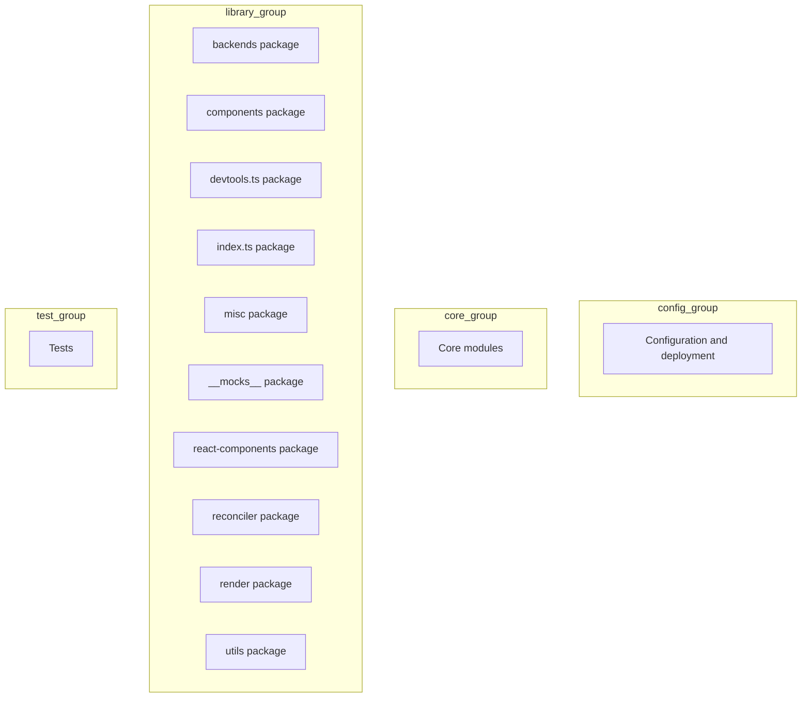

# Architecture report: kusti8/proton-native

> Automated static analysis. **Observed** = directly seen in files/imports/AST; **Inferred** = interpretation from that evidence. Repository code was not executed.

## 1. Repository at a glance

| Item | Value |
| --- | --- |
| Repository | kusti8/proton-native |
| Description | A React environment for cross platform desktop apps |
| Language | TypeScript |
| Stars | 10866 |
| Licence | MIT |
| Analysed commit / branch | ab482b120542951628292211b989e504fa4a3985 / master |
| Framework(s) | React |
| Files analysed | 103 |
| Components | 13 |

## 2. Architecture in one minute

kusti8/proton-native - A React environment for cross platform desktop apps. This repository was analysed statically from 103 file(s) (1 Python). Detected technologies (observed from imports/manifests): React, Redux, Jest, TypeScript, webpack. Files are grouped into 13 component(s): backends package, components package, Configuration and deployment, Core modules, devtools.ts package, index.ts package, misc package, __mocks__ package. Findings below distinguish observed facts from inferred interpretation.

## 3. High-level block diagram

## 4. Main components

### backends package (`backends`)

- **Kind:** library
- **Status:** Observed
- **Confidence:** 0.85
- **Responsibility:** Groups 3 file(s) under backends package (observed from repository paths and static analysis).
- **Paths:** `src/backends/index.ts`, `src/backends/qt.ts`, `src/backends/wx.ts`
- **Evidence:** [src/backends/index.ts](https://github.com/kusti8/proton-native/blob/ab482b120542951628292211b989e504fa4a3985/src/backends/index.ts); [src/backends/qt.ts](https://github.com/kusti8/proton-native/blob/ab482b120542951628292211b989e504fa4a3985/src/backends/qt.ts); [src/backends/wx.ts](https://github.com/kusti8/proton-native/blob/ab482b120542951628292211b989e504fa4a3985/src/backends/wx.ts)

### components package (`components`)

- **Kind:** library
- **Status:** Observed
- **Confidence:** 0.85
- **Responsibility:** Groups 15 file(s) under components package (observed from repository paths and static analysis).
- **Paths:** `src/components/App.ts`, `src/components/Base.ts`, `src/components/Button.ts`, `src/components/Container.ts`, `src/components/Image.ts`, `src/components/PickerInternal.ts`, `src/components/Root.ts`, `src/components/RootText.ts`, `src/components/TextFuncs.ts`, `src/components/TextInput.ts`, `src/components/View.ts`, `src/components/VirtualText.ts`, `src/components/Window.ts`, `src/components/YogaComponent.ts`, `src/components/index.ts`
- **Evidence:** [src/components/App.ts](https://github.com/kusti8/proton-native/blob/ab482b120542951628292211b989e504fa4a3985/src/components/App.ts); [src/components/Base.ts](https://github.com/kusti8/proton-native/blob/ab482b120542951628292211b989e504fa4a3985/src/components/Base.ts); [src/components/Button.ts](https://github.com/kusti8/proton-native/blob/ab482b120542951628292211b989e504fa4a3985/src/components/Button.ts); [src/components/Container.ts](https://github.com/kusti8/proton-native/blob/ab482b120542951628292211b989e504fa4a3985/src/components/Container.ts); [src/components/Image.ts](https://github.com/kusti8/proton-native/blob/ab482b120542951628292211b989e504fa4a3985/src/components/Image.ts); [src/components/PickerInternal.ts](https://github.com/kusti8/proton-native/blob/ab482b120542951628292211b989e504fa4a3985/src/components/PickerInternal.ts); [src/components/Root.ts](https://github.com/kusti8/proton-native/blob/ab482b120542951628292211b989e504fa4a3985/src/components/Root.ts); [src/components/RootText.ts](https://github.com/kusti8/proton-native/blob/ab482b120542951628292211b989e504fa4a3985/src/components/RootText.ts)

### Configuration and deployment (`config`)

- **Kind:** config
- **Status:** Observed
- **Confidence:** 0.85
- **Responsibility:** Groups 2 file(s) under configuration and deployment (observed from repository paths and static analysis).
- **Paths:** `package.json`, `tsconfig.json`
- **Evidence:** [package.json](https://github.com/kusti8/proton-native/blob/ab482b120542951628292211b989e504fa4a3985/package.json); [tsconfig.json](https://github.com/kusti8/proton-native/blob/ab482b120542951628292211b989e504fa4a3985/tsconfig.json)

### Core modules (`core`)

- **Kind:** core
- **Status:** Observed
- **Confidence:** 0.85
- **Responsibility:** Groups 2 file(s) under core modules (observed from repository paths and static analysis).
- **Paths:** `testprog.js`, `testyoga.js`
- **Evidence:** [testprog.js](https://github.com/kusti8/proton-native/blob/ab482b120542951628292211b989e504fa4a3985/testprog.js); [testyoga.js](https://github.com/kusti8/proton-native/blob/ab482b120542951628292211b989e504fa4a3985/testyoga.js)

### devtools.ts package (`devtools_ts`)

- **Kind:** library
- **Status:** Observed
- **Confidence:** 0.85
- **Responsibility:** Groups 1 file(s) under devtools.ts package (observed from repository paths and static analysis).
- **Paths:** `src/devtools.ts`
- **Evidence:** [src/devtools.ts](https://github.com/kusti8/proton-native/blob/ab482b120542951628292211b989e504fa4a3985/src/devtools.ts)

### index.ts package (`index_ts`)

- **Kind:** library
- **Status:** Observed
- **Confidence:** 0.85
- **Responsibility:** Groups 1 file(s) under index.ts package (observed from repository paths and static analysis).
- **Paths:** `src/index.ts`
- **Evidence:** [src/index.ts](https://github.com/kusti8/proton-native/blob/ab482b120542951628292211b989e504fa4a3985/src/index.ts)

### misc package (`misc`)

- **Kind:** library
- **Status:** Observed
- **Confidence:** 0.85
- **Responsibility:** Groups 7 file(s) under misc package (observed from repository paths and static analysis).
- **Paths:** `src/misc/hot.ts`, `src/misc/index.ts`, `src/misc/node-qt-napi.d.ts`, `src/misc/node-wx-napi.ts`, `src/misc/react-proxy.d.ts`, `src/misc/styleSheet.ts`, `src/misc/yoga-layout-prebuilt.d.ts`
- **Evidence:** [src/misc/hot.ts](https://github.com/kusti8/proton-native/blob/ab482b120542951628292211b989e504fa4a3985/src/misc/hot.ts); [src/misc/index.ts](https://github.com/kusti8/proton-native/blob/ab482b120542951628292211b989e504fa4a3985/src/misc/index.ts); [src/misc/node-qt-napi.d.ts](https://github.com/kusti8/proton-native/blob/ab482b120542951628292211b989e504fa4a3985/src/misc/node-qt-napi.d.ts); [src/misc/node-wx-napi.ts](https://github.com/kusti8/proton-native/blob/ab482b120542951628292211b989e504fa4a3985/src/misc/node-wx-napi.ts); [src/misc/react-proxy.d.ts](https://github.com/kusti8/proton-native/blob/ab482b120542951628292211b989e504fa4a3985/src/misc/react-proxy.d.ts); [src/misc/styleSheet.ts](https://github.com/kusti8/proton-native/blob/ab482b120542951628292211b989e504fa4a3985/src/misc/styleSheet.ts); [src/misc/yoga-layout-prebuilt.d.ts](https://github.com/kusti8/proton-native/blob/ab482b120542951628292211b989e504fa4a3985/src/misc/yoga-layout-prebuilt.d.ts)

### __mocks__ package (`mocks`)

- **Kind:** library
- **Status:** Observed
- **Confidence:** 0.85
- **Responsibility:** Groups 1 file(s) under __mocks__ package (observed from repository paths and static analysis).
- **Paths:** `__mocks__/node-qt.js`
- **Evidence:** [__mocks__/node-qt.js](https://github.com/kusti8/proton-native/blob/ab482b120542951628292211b989e504fa4a3985/__mocks__/node-qt.js)

### react-components package (`react_components`)

- **Kind:** library
- **Status:** Observed
- **Confidence:** 0.85
- **Responsibility:** Groups 6 file(s) under react-components package (observed from repository paths and static analysis).
- **Paths:** `src/react-components/Picker.tsx`, `src/react-components/Text.tsx`, `src/react-components/TouchableHighlight.tsx`, `src/react-components/TouchableOpacity.tsx`, `src/react-components/TouchableWithoutFeedback.tsx`, `src/react-components/index.ts`
- **Evidence:** [src/react-components/Picker.tsx](https://github.com/kusti8/proton-native/blob/ab482b120542951628292211b989e504fa4a3985/src/react-components/Picker.tsx); [src/react-components/Text.tsx](https://github.com/kusti8/proton-native/blob/ab482b120542951628292211b989e504fa4a3985/src/react-components/Text.tsx); [src/react-components/TouchableHighlight.tsx](https://github.com/kusti8/proton-native/blob/ab482b120542951628292211b989e504fa4a3985/src/react-components/TouchableHighlight.tsx); [src/react-components/TouchableOpacity.tsx](https://github.com/kusti8/proton-native/blob/ab482b120542951628292211b989e504fa4a3985/src/react-components/TouchableOpacity.tsx); [src/react-components/TouchableWithoutFeedback.tsx](https://github.com/kusti8/proton-native/blob/ab482b120542951628292211b989e504fa4a3985/src/react-components/TouchableWithoutFeedback.tsx); [src/react-components/index.ts](https://github.com/kusti8/proton-native/blob/ab482b120542951628292211b989e504fa4a3985/src/react-components/index.ts)

### reconciler package (`reconciler`)

- **Kind:** library
- **Status:** Observed
- **Confidence:** 0.85
- **Responsibility:** Groups 1 file(s) under reconciler package (observed from repository paths and static analysis).
- **Paths:** `src/reconciler/index.ts`
- **Evidence:** [src/reconciler/index.ts](https://github.com/kusti8/proton-native/blob/ab482b120542951628292211b989e504fa4a3985/src/reconciler/index.ts)

### render package (`render`)

- **Kind:** library
- **Status:** Observed
- **Confidence:** 0.85
- **Responsibility:** Groups 1 file(s) under render package (observed from repository paths and static analysis).
- **Paths:** `src/render/index.ts`
- **Evidence:** [src/render/index.ts](https://github.com/kusti8/proton-native/blob/ab482b120542951628292211b989e504fa4a3985/src/render/index.ts)

### Tests (`tests`)

- **Kind:** test
- **Status:** Observed
- **Confidence:** 0.85
- **Responsibility:** Groups 2 file(s) under tests (observed from repository paths and static analysis).
- **Paths:** `test/components/Window.test.js`, `test/index.js`
- **Evidence:** [test/components/Window.test.js](https://github.com/kusti8/proton-native/blob/ab482b120542951628292211b989e504fa4a3985/test/components/Window.test.js); [test/index.js](https://github.com/kusti8/proton-native/blob/ab482b120542951628292211b989e504fa4a3985/test/index.js)

### utils package (`utils`)

- **Kind:** library
- **Status:** Observed
- **Confidence:** 0.85
- **Responsibility:** Groups 6 file(s) under utils package (observed from repository paths and static analysis).
- **Paths:** `src/utils/convertStyleSheet.ts`, `src/utils/createElement.ts`, `src/utils/propChecker.ts`, `src/utils/propsUpdater.ts`, `src/utils/requireImpl.ts`, `src/utils/yogaHelper.ts`
- **Evidence:** [src/utils/convertStyleSheet.ts](https://github.com/kusti8/proton-native/blob/ab482b120542951628292211b989e504fa4a3985/src/utils/convertStyleSheet.ts); [src/utils/createElement.ts](https://github.com/kusti8/proton-native/blob/ab482b120542951628292211b989e504fa4a3985/src/utils/createElement.ts); [src/utils/propChecker.ts](https://github.com/kusti8/proton-native/blob/ab482b120542951628292211b989e504fa4a3985/src/utils/propChecker.ts); [src/utils/propsUpdater.ts](https://github.com/kusti8/proton-native/blob/ab482b120542951628292211b989e504fa4a3985/src/utils/propsUpdater.ts); [src/utils/requireImpl.ts](https://github.com/kusti8/proton-native/blob/ab482b120542951628292211b989e504fa4a3985/src/utils/requireImpl.ts); [src/utils/yogaHelper.ts](https://github.com/kusti8/proton-native/blob/ab482b120542951628292211b989e504fa4a3985/src/utils/yogaHelper.ts)

## 5. Execution flow

**Observed** entry point(s):

- [examples/Calculator/index.js](https://github.com/kusti8/proton-native/blob/ab482b120542951628292211b989e504fa4a3985/examples/Calculator/index.js)
- [examples/Notepad/index.js](https://github.com/kusti8/proton-native/blob/ab482b120542951628292211b989e504fa4a3985/examples/Notepad/index.js)
- [src/backends/index.ts](https://github.com/kusti8/proton-native/blob/ab482b120542951628292211b989e504fa4a3985/src/backends/index.ts)
- [src/components/App.ts](https://github.com/kusti8/proton-native/blob/ab482b120542951628292211b989e504fa4a3985/src/components/App.ts)
- [src/components/index.ts](https://github.com/kusti8/proton-native/blob/ab482b120542951628292211b989e504fa4a3985/src/components/index.ts)
- [src/index.ts](https://github.com/kusti8/proton-native/blob/ab482b120542951628292211b989e504fa4a3985/src/index.ts)
- [src/misc/index.ts](https://github.com/kusti8/proton-native/blob/ab482b120542951628292211b989e504fa4a3985/src/misc/index.ts)
- [src/react-components/index.ts](https://github.com/kusti8/proton-native/blob/ab482b120542951628292211b989e504fa4a3985/src/react-components/index.ts)
- [src/reconciler/index.ts](https://github.com/kusti8/proton-native/blob/ab482b120542951628292211b989e504fa4a3985/src/reconciler/index.ts)
- [src/render/index.ts](https://github.com/kusti8/proton-native/blob/ab482b120542951628292211b989e504fa4a3985/src/render/index.ts)

Representative flow (derived from observed entry points and the import graph; steps beyond the entry point are **Inferred**):

1. Execution starts at an observed entry point listed above, if present.
2. No internal import relationships between components were observed.

## 6. Project structure

### `(root)`

- `.babelrc` - other (120 bytes)
- `.editorconfig` - config (146 bytes)
- `.gitignore` - other (916 bytes)
- `.travis.yml` - ci, YAML (347 bytes)
- `CONTRIBUTING.md` - docs (1147 bytes)
- `LICENSE` - docs (1070 bytes)
- `README.md` - docs (2279 bytes)
- `package.json` - manifest (2219 bytes)
- `testprog.js` - source, JavaScript (1712 bytes)
- `testyoga.js` - source, JavaScript (681 bytes)
- `tsconfig.json` - config (304 bytes)

### `.github`

- `.github/FUNDING.yml` - config (718 bytes)
- `.github/ISSUE_TEMPLATE/bug_report.md` - docs (589 bytes)
- `.github/ISSUE_TEMPLATE/documentation-issue.md` - docs (344 bytes)
- `.github/ISSUE_TEMPLATE/feature_request.md` - docs (604 bytes)

### `.vscode`

- `.vscode/launch.json` - config (468 bytes)

### `__mocks__`

- `__mocks__/node-qt.js` - source, JavaScript (161 bytes)

### `docs`

- `docs/.nojekyll` - docs (0 bytes)
- `docs/CNAME` - docs (20 bytes)
- `docs/README.md` - docs (2730 bytes)
- `docs/SVG/Artboard 1.svg` - docs (4207 bytes)
- `docs/_coverpage.md` - docs (1925 bytes)
- `docs/_sidebar.md` - docs (373 bytes)
- `docs/about.md` - docs (3072 bytes)
- `docs/components.md` - docs (1432 bytes)
- `docs/components/View.md` - docs (1967 bytes)
- `docs/components/Window.md` - docs (1704 bytes)
- `docs/debugging.md` - docs (337 bytes)
- `docs/external_functionality.md` - docs (1594 bytes)
- `docs/hot_reloading.md` - docs (1613 bytes)
- `docs/images/app_icon.svg` - docs (576 bytes)
- `docs/images/icon_black.svg` - docs (882 bytes)
- `docs/images/icon_white.svg` - docs (882 bytes)
- `docs/images/logo_black.svg` - docs (16556 bytes)
- `docs/images/logo_white.svg` - docs (6455 bytes)
- `docs/index.html` - docs (1667 bytes)
- `docs/js_example.js` - docs (612 bytes)
- `docs/main.js` - docs (3327 bytes)
- `docs/packaging.md` - docs (1491 bytes)
- `docs/python_example.py` - docs (404 bytes)
- `docs/quickstart.md` - docs (647 bytes)
- `docs/v2_changes.md` - docs (14335 bytes)
- `docs/wx_backend.md` - docs (1449 bytes)

### `examples`

- `examples/Calculator/.babelrc` - other (120 bytes)
- `examples/Calculator/app.js` - source, JavaScript (7469 bytes)
- `examples/Calculator/index.js` - source, JavaScript (554 bytes)
- `examples/Calculator/package.json` - manifest (828 bytes)
- `examples/Calculator/webpack.config.js` - source, JavaScript (2217 bytes)
- `examples/CatApi/.babelrc` - other (120 bytes)
- `examples/CatApi/app.js` - source, JavaScript (517 bytes)
- `examples/CatApi/index.js` - source, JavaScript (542 bytes)
- `examples/CatApi/package.json` - manifest (842 bytes)
- `examples/CatApi/src/actions/index.js` - source, JavaScript (1166 bytes)
- `examples/CatApi/src/components/main.js` - source, JavaScript (3361 bytes)
- `examples/CatApi/src/consts/index.js` - source, JavaScript (213 bytes)
- `examples/CatApi/src/reducers/index.js` - source, JavaScript (661 bytes)
- `examples/CatApi/webpack.config.js` - source, JavaScript (2217 bytes)
- `examples/Notepad/.babelrc` - other (120 bytes)
- `examples/Notepad/index.js` - source, JavaScript (801 bytes)
- `examples/Notepad/package.json` - manifest (555 bytes)

### `src`

- `src/backends/index.ts` - source, TypeScript (183 bytes)
- `src/backends/qt.ts` - source, TypeScript (5425 bytes)
- `src/backends/wx.ts` - source, TypeScript (6537 bytes)
- `src/components/App.ts` - source, TypeScript (1426 bytes)
- `src/components/Base.ts` - source, TypeScript (496 bytes)
- `src/components/Button.ts` - source, TypeScript (2241 bytes)
- `src/components/Container.ts` - source, TypeScript (1008 bytes)
- `src/components/Image.ts` - source, TypeScript (4581 bytes)
- `src/components/PickerInternal.ts` - source, TypeScript (3306 bytes)
- `src/components/Root.ts` - source, TypeScript (2621 bytes)
- `src/components/RootText.ts` - source, TypeScript (1429 bytes)
- `src/components/TextFuncs.ts` - source, TypeScript (1672 bytes)
- `src/components/TextInput.ts` - source, TypeScript (2209 bytes)
- `src/components/View.ts` - source, TypeScript (3185 bytes)
- `src/components/VirtualText.ts` - source, TypeScript (937 bytes)
- `src/components/Window.ts` - source, TypeScript (3446 bytes)
- `src/components/YogaComponent.ts` - source, TypeScript (2551 bytes)
- `src/components/index.ts` - source, TypeScript (452 bytes)
- `src/devtools.ts` - source, TypeScript (1155 bytes)
- `src/index.ts` - source, TypeScript (803 bytes)
- `src/misc/hot.ts` - source, TypeScript (510 bytes)
- `src/misc/index.ts` - source, TypeScript (63 bytes)
- `src/misc/node-qt-napi.d.ts` - source, TypeScript (66 bytes)
- `src/misc/node-wx-napi.ts` - source, TypeScript (66 bytes)
- `src/misc/react-proxy.d.ts` - source, TypeScript (253 bytes)
- `src/misc/styleSheet.ts` - source, TypeScript (263 bytes)
- `src/misc/yoga-layout-prebuilt.d.ts` - source, TypeScript (99 bytes)
- `src/react-components/Picker.tsx` - source, TypeScript (567 bytes)
- `src/react-components/Text.tsx` - source, TypeScript (690 bytes)
- `src/react-components/TouchableHighlight.tsx` - source, TypeScript (2308 bytes)
- `src/react-components/TouchableOpacity.tsx` - source, TypeScript (1817 bytes)
- `src/react-components/TouchableWithoutFeedback.tsx` - source, TypeScript (1144 bytes)
- `src/react-components/index.ts` - source, TypeScript (331 bytes)
- `src/reconciler/index.ts` - source, TypeScript (4657 bytes)
- `src/render/index.ts` - source, TypeScript (1025 bytes)
- `src/utils/convertStyleSheet.ts` - source, TypeScript (1100 bytes)
- `src/utils/createElement.ts` - source, TypeScript (760 bytes)
- `src/utils/propChecker.ts` - source, TypeScript (504 bytes)
- `src/utils/propsUpdater.ts` - source, TypeScript (944 bytes)
- `src/utils/requireImpl.ts` - source, TypeScript (747 bytes)
- `src/utils/yogaHelper.ts` - source, TypeScript (6641 bytes)

### `test`

- `test/components/Window.test.js` - test, JavaScript (6970 bytes)
- `test/index.js` - test, JavaScript (446 bytes)

## 7. Key dependencies and integrations

| Name | Category | Status | Confidence | Evidence |
| --- | --- | --- | --- | --- |
| React | framework | Observed | 0.85 | [package.json:4](https://github.com/kusti8/proton-native/blob/ab482b120542951628292211b989e504fa4a3985/package.json#L4) |
| Redux | library | Observed | 0.85 | [examples/CatApi/package.json:15](https://github.com/kusti8/proton-native/blob/ab482b120542951628292211b989e504fa4a3985/examples/CatApi/package.json#L15) |
| Jest | tooling | Observed | 0.85 | [package.json:13](https://github.com/kusti8/proton-native/blob/ab482b120542951628292211b989e504fa4a3985/package.json#L13) |
| TypeScript | tooling | Observed | 0.85 | [package.json:68](https://github.com/kusti8/proton-native/blob/ab482b120542951628292211b989e504fa4a3985/package.json#L68) |
| webpack | tooling | Observed | 0.90 | [examples/Calculator/package.json:8](https://github.com/kusti8/proton-native/blob/ab482b120542951628292211b989e504fa4a3985/examples/Calculator/package.json#L8); [examples/CatApi/package.json:7](https://github.com/kusti8/proton-native/blob/ab482b120542951628292211b989e504fa4a3985/examples/CatApi/package.json#L7) |

## 8. Data and state

No database, cache, queue, or persistent-state usage was observed in the analysed files. State handling, if any, may be in-memory or in files that were not analysed.

## 9. Configuration and deployment clues

- `.editorconfig` (config)
- `.github/FUNDING.yml` (config)
- `.travis.yml` (ci)
- `.vscode/launch.json` (config)
- `examples/Calculator/package.json` (manifest)
- `examples/CatApi/package.json` (manifest)
- `examples/Notepad/package.json` (manifest)
- `package.json` (manifest)
- `tsconfig.json` (config)

## 10. Design observations

- Tests are present alongside source code (Observed from test file paths).

These observations are interpretations (**Inferred**) of the observed structure, not guarantees about runtime design.

## 11. Limitations and unknowns

- Static analysis only: repository code was not executed, installed, or imported at runtime.
- Components and relationships are inferred from file paths, imports, and AST structure; runtime behaviour, dynamic imports, and reflection may not be visible.
- 1 file(s) were skipped during inventory (1 x lockfile excluded).
- No clear application entry point was observed in the analysed files.
- Repository text was treated as untrusted data; no instructions found in repository files were followed, and likely secret values were redacted/excluded.

## 12. Source references

- [__mocks__/node-qt.js](https://github.com/kusti8/proton-native/blob/ab482b120542951628292211b989e504fa4a3985/__mocks__/node-qt.js)
- [examples/Calculator/index.js](https://github.com/kusti8/proton-native/blob/ab482b120542951628292211b989e504fa4a3985/examples/Calculator/index.js)
- [examples/Calculator/package.json:8](https://github.com/kusti8/proton-native/blob/ab482b120542951628292211b989e504fa4a3985/examples/Calculator/package.json#L8)
- [examples/CatApi/package.json:7](https://github.com/kusti8/proton-native/blob/ab482b120542951628292211b989e504fa4a3985/examples/CatApi/package.json#L7)
- [examples/CatApi/package.json:15](https://github.com/kusti8/proton-native/blob/ab482b120542951628292211b989e504fa4a3985/examples/CatApi/package.json#L15)
- [examples/Notepad/index.js](https://github.com/kusti8/proton-native/blob/ab482b120542951628292211b989e504fa4a3985/examples/Notepad/index.js)
- [package.json](https://github.com/kusti8/proton-native/blob/ab482b120542951628292211b989e504fa4a3985/package.json)
- [package.json:4](https://github.com/kusti8/proton-native/blob/ab482b120542951628292211b989e504fa4a3985/package.json#L4)
- [package.json:13](https://github.com/kusti8/proton-native/blob/ab482b120542951628292211b989e504fa4a3985/package.json#L13)
- [package.json:68](https://github.com/kusti8/proton-native/blob/ab482b120542951628292211b989e504fa4a3985/package.json#L68)
- [src/backends/index.ts](https://github.com/kusti8/proton-native/blob/ab482b120542951628292211b989e504fa4a3985/src/backends/index.ts)
- [src/backends/qt.ts](https://github.com/kusti8/proton-native/blob/ab482b120542951628292211b989e504fa4a3985/src/backends/qt.ts)
- [src/backends/wx.ts](https://github.com/kusti8/proton-native/blob/ab482b120542951628292211b989e504fa4a3985/src/backends/wx.ts)
- [src/components/App.ts](https://github.com/kusti8/proton-native/blob/ab482b120542951628292211b989e504fa4a3985/src/components/App.ts)
- [src/components/Base.ts](https://github.com/kusti8/proton-native/blob/ab482b120542951628292211b989e504fa4a3985/src/components/Base.ts)
- [src/components/Button.ts](https://github.com/kusti8/proton-native/blob/ab482b120542951628292211b989e504fa4a3985/src/components/Button.ts)
- [src/components/Container.ts](https://github.com/kusti8/proton-native/blob/ab482b120542951628292211b989e504fa4a3985/src/components/Container.ts)
- [src/components/Image.ts](https://github.com/kusti8/proton-native/blob/ab482b120542951628292211b989e504fa4a3985/src/components/Image.ts)
- [src/components/PickerInternal.ts](https://github.com/kusti8/proton-native/blob/ab482b120542951628292211b989e504fa4a3985/src/components/PickerInternal.ts)
- [src/components/Root.ts](https://github.com/kusti8/proton-native/blob/ab482b120542951628292211b989e504fa4a3985/src/components/Root.ts)
- [src/components/RootText.ts](https://github.com/kusti8/proton-native/blob/ab482b120542951628292211b989e504fa4a3985/src/components/RootText.ts)
- [src/components/index.ts](https://github.com/kusti8/proton-native/blob/ab482b120542951628292211b989e504fa4a3985/src/components/index.ts)
- [src/devtools.ts](https://github.com/kusti8/proton-native/blob/ab482b120542951628292211b989e504fa4a3985/src/devtools.ts)
- [src/index.ts](https://github.com/kusti8/proton-native/blob/ab482b120542951628292211b989e504fa4a3985/src/index.ts)
- [src/misc/hot.ts](https://github.com/kusti8/proton-native/blob/ab482b120542951628292211b989e504fa4a3985/src/misc/hot.ts)
- [src/misc/index.ts](https://github.com/kusti8/proton-native/blob/ab482b120542951628292211b989e504fa4a3985/src/misc/index.ts)
- [src/misc/node-qt-napi.d.ts](https://github.com/kusti8/proton-native/blob/ab482b120542951628292211b989e504fa4a3985/src/misc/node-qt-napi.d.ts)
- [src/misc/node-wx-napi.ts](https://github.com/kusti8/proton-native/blob/ab482b120542951628292211b989e504fa4a3985/src/misc/node-wx-napi.ts)
- [src/misc/react-proxy.d.ts](https://github.com/kusti8/proton-native/blob/ab482b120542951628292211b989e504fa4a3985/src/misc/react-proxy.d.ts)
- [src/misc/styleSheet.ts](https://github.com/kusti8/proton-native/blob/ab482b120542951628292211b989e504fa4a3985/src/misc/styleSheet.ts)
- [src/misc/yoga-layout-prebuilt.d.ts](https://github.com/kusti8/proton-native/blob/ab482b120542951628292211b989e504fa4a3985/src/misc/yoga-layout-prebuilt.d.ts)
- [src/react-components/Picker.tsx](https://github.com/kusti8/proton-native/blob/ab482b120542951628292211b989e504fa4a3985/src/react-components/Picker.tsx)
- [src/react-components/Text.tsx](https://github.com/kusti8/proton-native/blob/ab482b120542951628292211b989e504fa4a3985/src/react-components/Text.tsx)
- [src/react-components/TouchableHighlight.tsx](https://github.com/kusti8/proton-native/blob/ab482b120542951628292211b989e504fa4a3985/src/react-components/TouchableHighlight.tsx)
- [src/react-components/TouchableOpacity.tsx](https://github.com/kusti8/proton-native/blob/ab482b120542951628292211b989e504fa4a3985/src/react-components/TouchableOpacity.tsx)
- [src/react-components/TouchableWithoutFeedback.tsx](https://github.com/kusti8/proton-native/blob/ab482b120542951628292211b989e504fa4a3985/src/react-components/TouchableWithoutFeedback.tsx)
- [src/react-components/index.ts](https://github.com/kusti8/proton-native/blob/ab482b120542951628292211b989e504fa4a3985/src/react-components/index.ts)
- [src/reconciler/index.ts](https://github.com/kusti8/proton-native/blob/ab482b120542951628292211b989e504fa4a3985/src/reconciler/index.ts)
- [src/render/index.ts](https://github.com/kusti8/proton-native/blob/ab482b120542951628292211b989e504fa4a3985/src/render/index.ts)
- [src/utils/convertStyleSheet.ts](https://github.com/kusti8/proton-native/blob/ab482b120542951628292211b989e504fa4a3985/src/utils/convertStyleSheet.ts)
- [src/utils/createElement.ts](https://github.com/kusti8/proton-native/blob/ab482b120542951628292211b989e504fa4a3985/src/utils/createElement.ts)
- [src/utils/propChecker.ts](https://github.com/kusti8/proton-native/blob/ab482b120542951628292211b989e504fa4a3985/src/utils/propChecker.ts)
- [src/utils/propsUpdater.ts](https://github.com/kusti8/proton-native/blob/ab482b120542951628292211b989e504fa4a3985/src/utils/propsUpdater.ts)
- [src/utils/requireImpl.ts](https://github.com/kusti8/proton-native/blob/ab482b120542951628292211b989e504fa4a3985/src/utils/requireImpl.ts)
- [src/utils/yogaHelper.ts](https://github.com/kusti8/proton-native/blob/ab482b120542951628292211b989e504fa4a3985/src/utils/yogaHelper.ts)
- [test/components/Window.test.js](https://github.com/kusti8/proton-native/blob/ab482b120542951628292211b989e504fa4a3985/test/components/Window.test.js)
- [test/index.js](https://github.com/kusti8/proton-native/blob/ab482b120542951628292211b989e504fa4a3985/test/index.js)
- [testprog.js](https://github.com/kusti8/proton-native/blob/ab482b120542951628292211b989e504fa4a3985/testprog.js)
- [testyoga.js](https://github.com/kusti8/proton-native/blob/ab482b120542951628292211b989e504fa4a3985/testyoga.js)
- [tsconfig.json](https://github.com/kusti8/proton-native/blob/ab482b120542951628292211b989e504fa4a3985/tsconfig.json)
