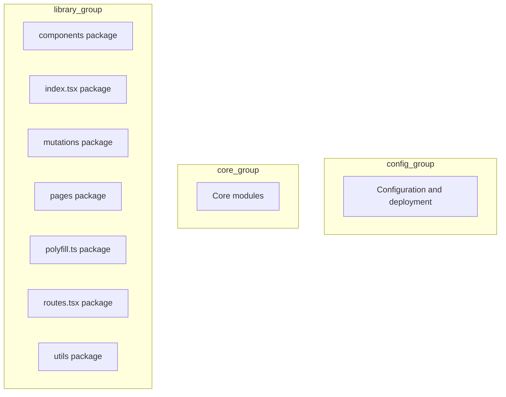

# Architecture report: learnapollo/learnapollo

> Automated static analysis. **Observed** = directly seen in files/imports/AST; **Inferred** = interpretation from that evidence. Repository code was not executed.

## 1. Repository at a glance

| Item | Value |
| --- | --- |
| Repository | learnapollo/learnapollo |
| Description | 👩🏻‍🏫   Learn Apollo - A hands-on tutorial for Apollo GraphQL Client (created by Graphcool) |
| Language | TypeScript |
| Stars | 5143 |
| Licence | MIT |
| Analysed commit / branch | dea1677ead6ed590599f9f29b69215d49ea6a0a9 / master |
| Framework(s) | React |
| Files analysed | 101 |
| Components | 9 |

## 2. Architecture in one minute

learnapollo/learnapollo - 👩🏻‍🏫   Learn Apollo - A hands-on tutorial for Apollo GraphQL Client (created by Graphcool). This repository was analysed statically from 101 file(s) (0 Python). Detected technologies (observed from imports/manifests): React, React Router, TypeScript, webpack. Files are grouped into 9 component(s): components package, Configuration and deployment, Core modules, index.tsx package, mutations package, pages package, polyfill.ts package, routes.tsx package. Findings below distinguish observed facts from inferred interpretation.

## 3. High-level block diagram

## 4. Main components

### components package (`components`)

- **Kind:** library
- **Status:** Observed
- **Confidence:** 0.85
- **Responsibility:** Groups 12 file(s) under components package (observed from repository paths and static analysis).
- **Paths:** `src/components/App/App.tsx`, `src/components/BrowserRow/BrowserRow.tsx`, `src/components/BrowserView/BrowserView.tsx`, `src/components/ContentEndpoint/ContentEndpoint.tsx`, `src/components/Download/Download.tsx`, `src/components/Loading/Loading.tsx`, `src/components/Markdown/Markdown.tsx`, `src/components/ServerLayover/ServerLayover.tsx`, `src/components/SetTrack/SetTrack.tsx`, `src/components/SharePanel/SharePanel.tsx`, `src/components/Sharing/Sharing.tsx`, `src/components/TrackLink/TrackLink.tsx`
- **Evidence:** [src/components/App/App.tsx](https://github.com/learnapollo/learnapollo/blob/dea1677ead6ed590599f9f29b69215d49ea6a0a9/src/components/App/App.tsx); [src/components/BrowserRow/BrowserRow.tsx](https://github.com/learnapollo/learnapollo/blob/dea1677ead6ed590599f9f29b69215d49ea6a0a9/src/components/BrowserRow/BrowserRow.tsx); [src/components/BrowserView/BrowserView.tsx](https://github.com/learnapollo/learnapollo/blob/dea1677ead6ed590599f9f29b69215d49ea6a0a9/src/components/BrowserView/BrowserView.tsx); [src/components/ContentEndpoint/ContentEndpoint.tsx](https://github.com/learnapollo/learnapollo/blob/dea1677ead6ed590599f9f29b69215d49ea6a0a9/src/components/ContentEndpoint/ContentEndpoint.tsx); [src/components/Download/Download.tsx](https://github.com/learnapollo/learnapollo/blob/dea1677ead6ed590599f9f29b69215d49ea6a0a9/src/components/Download/Download.tsx); [src/components/Loading/Loading.tsx](https://github.com/learnapollo/learnapollo/blob/dea1677ead6ed590599f9f29b69215d49ea6a0a9/src/components/Loading/Loading.tsx); [src/components/Markdown/Markdown.tsx](https://github.com/learnapollo/learnapollo/blob/dea1677ead6ed590599f9f29b69215d49ea6a0a9/src/components/Markdown/Markdown.tsx); [src/components/ServerLayover/ServerLayover.tsx](https://github.com/learnapollo/learnapollo/blob/dea1677ead6ed590599f9f29b69215d49ea6a0a9/src/components/ServerLayover/ServerLayover.tsx)

### Configuration and deployment (`config`)

- **Kind:** config
- **Status:** Observed
- **Confidence:** 0.85
- **Responsibility:** Groups 4 file(s) under configuration and deployment (observed from repository paths and static analysis).
- **Paths:** `circle.yml`, `package.json`, `tsconfig.json`, `tslint.json`
- **Evidence:** [circle.yml](https://github.com/learnapollo/learnapollo/blob/dea1677ead6ed590599f9f29b69215d49ea6a0a9/circle.yml); [package.json](https://github.com/learnapollo/learnapollo/blob/dea1677ead6ed590599f9f29b69215d49ea6a0a9/package.json); [tsconfig.json](https://github.com/learnapollo/learnapollo/blob/dea1677ead6ed590599f9f29b69215d49ea6a0a9/tsconfig.json); [tslint.json](https://github.com/learnapollo/learnapollo/blob/dea1677ead6ed590599f9f29b69215d49ea6a0a9/tslint.json)

### Core modules (`core`)

- **Kind:** core
- **Status:** Observed
- **Confidence:** 0.85
- **Responsibility:** Groups 4 file(s) under core modules (observed from repository paths and static analysis).
- **Paths:** `custom.d.ts`, `prep.ts`, `webpack.config.build.js`, `webpack.config.js`
- **Evidence:** [custom.d.ts](https://github.com/learnapollo/learnapollo/blob/dea1677ead6ed590599f9f29b69215d49ea6a0a9/custom.d.ts); [prep.ts](https://github.com/learnapollo/learnapollo/blob/dea1677ead6ed590599f9f29b69215d49ea6a0a9/prep.ts); [webpack.config.build.js](https://github.com/learnapollo/learnapollo/blob/dea1677ead6ed590599f9f29b69215d49ea6a0a9/webpack.config.build.js); [webpack.config.js](https://github.com/learnapollo/learnapollo/blob/dea1677ead6ed590599f9f29b69215d49ea6a0a9/webpack.config.js)

### index.tsx package (`index_tsx`)

- **Kind:** library
- **Status:** Observed
- **Confidence:** 0.85
- **Responsibility:** Groups 1 file(s) under index.tsx package (observed from repository paths and static analysis).
- **Paths:** `src/index.tsx`
- **Evidence:** [src/index.tsx](https://github.com/learnapollo/learnapollo/blob/dea1677ead6ed590599f9f29b69215d49ea6a0a9/src/index.tsx)

### mutations package (`mutations`)

- **Kind:** library
- **Status:** Observed
- **Confidence:** 0.85
- **Responsibility:** Groups 3 file(s) under mutations package (observed from repository paths and static analysis).
- **Paths:** `src/mutations/AddPokemonMutation.ts`, `src/mutations/DeletePokemonMutation.ts`, `src/mutations/UpdatePokemonMutation.ts`
- **Evidence:** [src/mutations/AddPokemonMutation.ts](https://github.com/learnapollo/learnapollo/blob/dea1677ead6ed590599f9f29b69215d49ea6a0a9/src/mutations/AddPokemonMutation.ts); [src/mutations/DeletePokemonMutation.ts](https://github.com/learnapollo/learnapollo/blob/dea1677ead6ed590599f9f29b69215d49ea6a0a9/src/mutations/DeletePokemonMutation.ts); [src/mutations/UpdatePokemonMutation.ts](https://github.com/learnapollo/learnapollo/blob/dea1677ead6ed590599f9f29b69215d49ea6a0a9/src/mutations/UpdatePokemonMutation.ts)

### pages package (`pages`)

- **Kind:** library
- **Status:** Observed
- **Confidence:** 0.85
- **Responsibility:** Groups 2 file(s) under pages package (observed from repository paths and static analysis).
- **Paths:** `src/pages/landing/LandingPage.tsx`, `src/pages/markdown/MarkdownPage.tsx`
- **Evidence:** [src/pages/landing/LandingPage.tsx](https://github.com/learnapollo/learnapollo/blob/dea1677ead6ed590599f9f29b69215d49ea6a0a9/src/pages/landing/LandingPage.tsx); [src/pages/markdown/MarkdownPage.tsx](https://github.com/learnapollo/learnapollo/blob/dea1677ead6ed590599f9f29b69215d49ea6a0a9/src/pages/markdown/MarkdownPage.tsx)

### polyfill.ts package (`polyfill_ts`)

- **Kind:** library
- **Status:** Observed
- **Confidence:** 0.85
- **Responsibility:** Groups 1 file(s) under polyfill.ts package (observed from repository paths and static analysis).
- **Paths:** `src/polyfill.ts`
- **Evidence:** [src/polyfill.ts](https://github.com/learnapollo/learnapollo/blob/dea1677ead6ed590599f9f29b69215d49ea6a0a9/src/polyfill.ts)

### routes.tsx package (`routes_tsx`)

- **Kind:** library
- **Status:** Observed
- **Confidence:** 0.85
- **Responsibility:** Groups 1 file(s) under routes.tsx package (observed from repository paths and static analysis).
- **Paths:** `src/routes.tsx`
- **Evidence:** [src/routes.tsx](https://github.com/learnapollo/learnapollo/blob/dea1677ead6ed590599f9f29b69215d49ea6a0a9/src/routes.tsx)

### utils package (`utils`)

- **Kind:** library
- **Status:** Observed
- **Confidence:** 0.85
- **Responsibility:** Groups 8 file(s) under utils package (observed from repository paths and static analysis).
- **Paths:** `src/utils/content.ts`, `src/utils/dom.ts`, `src/utils/events.ts`, `src/utils/location.tsx`, `src/utils/markdown.ts`, `src/utils/smooch.ts`, `src/utils/statestore.ts`, `src/utils/string.ts`
- **Evidence:** [src/utils/content.ts](https://github.com/learnapollo/learnapollo/blob/dea1677ead6ed590599f9f29b69215d49ea6a0a9/src/utils/content.ts); [src/utils/dom.ts](https://github.com/learnapollo/learnapollo/blob/dea1677ead6ed590599f9f29b69215d49ea6a0a9/src/utils/dom.ts); [src/utils/events.ts](https://github.com/learnapollo/learnapollo/blob/dea1677ead6ed590599f9f29b69215d49ea6a0a9/src/utils/events.ts); [src/utils/location.tsx](https://github.com/learnapollo/learnapollo/blob/dea1677ead6ed590599f9f29b69215d49ea6a0a9/src/utils/location.tsx); [src/utils/markdown.ts](https://github.com/learnapollo/learnapollo/blob/dea1677ead6ed590599f9f29b69215d49ea6a0a9/src/utils/markdown.ts); [src/utils/smooch.ts](https://github.com/learnapollo/learnapollo/blob/dea1677ead6ed590599f9f29b69215d49ea6a0a9/src/utils/smooch.ts); [src/utils/statestore.ts](https://github.com/learnapollo/learnapollo/blob/dea1677ead6ed590599f9f29b69215d49ea6a0a9/src/utils/statestore.ts); [src/utils/string.ts](https://github.com/learnapollo/learnapollo/blob/dea1677ead6ed590599f9f29b69215d49ea6a0a9/src/utils/string.ts)

## 5. Execution flow

**Observed** entry point(s):

- [src/components/App/App.tsx](https://github.com/learnapollo/learnapollo/blob/dea1677ead6ed590599f9f29b69215d49ea6a0a9/src/components/App/App.tsx)
- [src/index.tsx](https://github.com/learnapollo/learnapollo/blob/dea1677ead6ed590599f9f29b69215d49ea6a0a9/src/index.tsx)

Representative flow (derived from observed entry points and the import graph; steps beyond the entry point are **Inferred**):

1. Execution starts at an observed entry point listed above, if present.
2. No internal import relationships between components were observed.

## 6. Project structure

### `(root)`

- `.babelrc` - other (383 bytes)
- `.gitignore` - other (70 bytes)
- `CONTRIBUTING.md` - docs (1303 bytes)
- `LICENSE` - docs (1069 bytes)
- `README.md` - docs (1871 bytes)
- `circle.yml` - config (231 bytes)
- `custom.d.ts` - source, TypeScript (3587 bytes)
- `package.json` - manifest (2884 bytes)
- `prep.ts` - source, TypeScript (404 bytes)
- `tsconfig.json` - config (394 bytes)
- `tslint.json` - config (189 bytes)
- `webpack.config.build.js` - source, JavaScript (2758 bytes)
- `webpack.config.js` - source, JavaScript (2039 bytes)

### `content`

- `content/excursions/excursion-01.md` - docs (403 bytes)
- `content/excursions/excursion-02.md` - docs (5736 bytes)
- `content/go-further/wrap-up.md` - docs (210 bytes)
- `content/introduction/get-started-bottom.md` - docs (672 bytes)
- `content/introduction/get-started.md` - docs (2722 bytes)
- `content/tutorial-angular/angular-playground.md` - docs (690 bytes)
- `content/tutorial-ios/ios-01.md` - docs (8173 bytes)
- `content/tutorial-ios/ios-02.md` - docs (10255 bytes)
- `content/tutorial-ios/ios-03.md` - docs (8776 bytes)
- `content/tutorial-ios/ios-04.md` - docs (9793 bytes)
- `content/tutorial-ios/ios-05.md` - docs (12933 bytes)
- `content/tutorial-ios/ios-06.md` - docs (7222 bytes)
- `content/tutorial-react-native/react-native-01.md` - docs (5556 bytes)
- `content/tutorial-react-native/react-native-02.md` - docs (7443 bytes)
- `content/tutorial-react-native/react-native-03.md` - docs (10569 bytes)
- `content/tutorial-react-native/react-native-04.md` - docs (5712 bytes)
- `content/tutorial-react-native/react-native-05.md` - docs (7820 bytes)
- `content/tutorial-react-native/react-native-06.md` - docs (9375 bytes)
- `content/tutorial-react/react-01.md` - docs (4673 bytes)
- `content/tutorial-react/react-02.md` - docs (6587 bytes)
- `content/tutorial-react/react-03.md` - docs (9242 bytes)
- `content/tutorial-react/react-04.md` - docs (8077 bytes)
- `content/tutorial-react/react-05.md` - docs (8002 bytes)
- `content/tutorial-react/react-06.md` - docs (9678 bytes)
- `content/tutorial-react/react-07.md` - docs (6459 bytes)
- `content/tutorial-vue/vue-playground.md` - docs (670 bytes)

### `src`

- `src/assets/icons/chat.svg` - other (4312 bytes)
- `src/assets/icons/check.svg` - other (1159 bytes)
- `src/assets/icons/check_chapter.svg` - other (697 bytes)
- `src/assets/icons/close.svg` - other (760 bytes)
- `src/assets/icons/copy.svg` - other (2832 bytes)
- `src/assets/icons/delete.svg` - other (1439 bytes)
- `src/assets/icons/github.svg` - other (1256 bytes)
- `src/assets/icons/graph-logo.svg` - other (4480 bytes)
- `src/assets/icons/graphcool-logo.svg` - other (2485 bytes)
- `src/assets/icons/logo-angular.svg` - other (1085 bytes)
- `src/assets/icons/logo-expo.svg` - other (416 bytes)
- `src/assets/icons/logo-ios.svg` - other (2155 bytes)
- `src/assets/icons/logo-react.svg` - other (5571 bytes)
- `src/assets/icons/logo-vue.svg` - other (569 bytes)
- `src/assets/icons/logo.svg` - other (1489 bytes)
- `src/assets/icons/next.svg` - other (731 bytes)
- `src/assets/icons/previous.svg` - other (727 bytes)
- `src/components/App/App.module.styl` - other (2418 bytes)
- `src/components/App/App.tsx` - source, TypeScript (15335 bytes)
- `src/components/App/style.css` - other (1340 bytes)
- `src/components/BrowserRow/BrowserRow.module.styl` - other (155 bytes)
- `src/components/BrowserRow/BrowserRow.tsx` - source, TypeScript (3007 bytes)
- `src/components/BrowserView/BrowserView.module.styl` - other (468 bytes)
- `src/components/BrowserView/BrowserView.tsx` - source, TypeScript (3993 bytes)
- `src/components/ContentEndpoint/ContentEndpoint.module.styl` - other (357 bytes)
- `src/components/ContentEndpoint/ContentEndpoint.tsx` - source, TypeScript (4151 bytes)
- `src/components/Download/Download.module.styl` - other (352 bytes)
- `src/components/Download/Download.tsx` - source, TypeScript (1687 bytes)
- `src/components/Loading/Loading.module.css` - other (203 bytes)
- `src/components/Loading/Loading.tsx` - source, TypeScript (556 bytes)
- `src/components/Markdown/Markdown.module.css` - other (1761 bytes)
- `src/components/Markdown/Markdown.tsx` - source, TypeScript (5670 bytes)
- `src/components/ServerLayover/ServerLayover.tsx` - source, TypeScript (4807 bytes)
- `src/components/SetTrack/SetTrack.module.styl` - other (171 bytes)
- `src/components/SetTrack/SetTrack.tsx` - source, TypeScript (1952 bytes)
- `src/components/SharePanel/SharePanel.tsx` - source, TypeScript (3807 bytes)
- `src/components/SharePanel/SharingPanel.module.styl` - other (749 bytes)
- `src/components/Sharing/Sharing.module.styl` - other (679 bytes)
- `src/components/Sharing/Sharing.tsx` - source, TypeScript (4520 bytes)
- `src/components/TrackLink/TrackLink.tsx` - source, TypeScript (811 bytes)
- `src/index.html` - other (1538 bytes)
- `src/index.tsx` - source, TypeScript (1124 bytes)
- `src/mutations/AddPokemonMutation.ts` - source, TypeScript (1167 bytes)
- `src/mutations/DeletePokemonMutation.ts` - source, TypeScript (749 bytes)
- `src/mutations/UpdatePokemonMutation.ts` - source, TypeScript (823 bytes)
- `src/pages/landing/LandingPage.module.styl` - other (1408 bytes)
- `src/pages/landing/LandingPage.tsx` - source, TypeScript (3133 bytes)
- `src/pages/markdown/MarkdownPage.module.styl` - other (233 bytes)
- `src/pages/markdown/MarkdownPage.tsx` - source, TypeScript (2728 bytes)
- `src/polyfill.ts` - source, TypeScript (2612 bytes)
- `src/routes.tsx` - source, TypeScript (727 bytes)
- `src/utils/content.ts` - source, TypeScript (5930 bytes)
- `src/utils/dom.ts` - source, TypeScript (455 bytes)
- `src/utils/events.ts` - source, TypeScript (1847 bytes)
- `src/utils/location.tsx` - source, TypeScript (361 bytes)
- `src/utils/markdown.ts` - source, TypeScript (1338 bytes)
- `src/utils/smooch.ts` - source, TypeScript (417 bytes)
- `src/utils/statestore.ts` - source, TypeScript (931 bytes)
- `src/utils/string.ts` - source, TypeScript (115 bytes)

### `static`

- `static/_redirects` - other (274 bytes)
- `static/humans.txt` - docs (103 bytes)
- `static/robots.txt` - docs (24 bytes)

## 7. Key dependencies and integrations

| Name | Category | Status | Confidence | Evidence |
| --- | --- | --- | --- | --- |
| React | framework | Observed | 0.90 | [package.json:15](https://github.com/learnapollo/learnapollo/blob/dea1677ead6ed590599f9f29b69215d49ea6a0a9/package.json#L15); [package.json:16](https://github.com/learnapollo/learnapollo/blob/dea1677ead6ed590599f9f29b69215d49ea6a0a9/package.json#L16) |
| React Router | library | Observed | 0.85 | [package.json:37](https://github.com/learnapollo/learnapollo/blob/dea1677ead6ed590599f9f29b69215d49ea6a0a9/package.json#L37) |
| TypeScript | tooling | Observed | 0.85 | [package.json:51](https://github.com/learnapollo/learnapollo/blob/dea1677ead6ed590599f9f29b69215d49ea6a0a9/package.json#L51) |
| webpack | tooling | Observed | 0.85 | [package.json:44](https://github.com/learnapollo/learnapollo/blob/dea1677ead6ed590599f9f29b69215d49ea6a0a9/package.json#L44) |

## 8. Data and state

No database, cache, queue, or persistent-state usage was observed in the analysed files. State handling, if any, may be in-memory or in files that were not analysed.

## 9. Configuration and deployment clues

- `circle.yml` (config)
- `package.json` (manifest)
- `tsconfig.json` (config)
- `tslint.json` (config)

## 10. Design observations

- No strong design patterns could be established from the available evidence.

These observations are interpretations (**Inferred**) of the observed structure, not guarantees about runtime design.

## 11. Limitations and unknowns

- Static analysis only: repository code was not executed, installed, or imported at runtime.
- Components and relationships are inferred from file paths, imports, and AST structure; runtime behaviour, dynamic imports, and reflection may not be visible.
- No clear application entry point was observed in the analysed files.
- Repository text was treated as untrusted data; no instructions found in repository files were followed, and likely secret values were redacted/excluded.
- JavaScript and TypeScript files were inventoried from paths and package manifests. They were not parsed with a full language AST, and repository code was not executed.

## 12. Source references

- [circle.yml](https://github.com/learnapollo/learnapollo/blob/dea1677ead6ed590599f9f29b69215d49ea6a0a9/circle.yml)
- [custom.d.ts](https://github.com/learnapollo/learnapollo/blob/dea1677ead6ed590599f9f29b69215d49ea6a0a9/custom.d.ts)
- [package.json](https://github.com/learnapollo/learnapollo/blob/dea1677ead6ed590599f9f29b69215d49ea6a0a9/package.json)
- [package.json:15](https://github.com/learnapollo/learnapollo/blob/dea1677ead6ed590599f9f29b69215d49ea6a0a9/package.json#L15)
- [package.json:16](https://github.com/learnapollo/learnapollo/blob/dea1677ead6ed590599f9f29b69215d49ea6a0a9/package.json#L16)
- [package.json:37](https://github.com/learnapollo/learnapollo/blob/dea1677ead6ed590599f9f29b69215d49ea6a0a9/package.json#L37)
- [package.json:44](https://github.com/learnapollo/learnapollo/blob/dea1677ead6ed590599f9f29b69215d49ea6a0a9/package.json#L44)
- [package.json:51](https://github.com/learnapollo/learnapollo/blob/dea1677ead6ed590599f9f29b69215d49ea6a0a9/package.json#L51)
- [prep.ts](https://github.com/learnapollo/learnapollo/blob/dea1677ead6ed590599f9f29b69215d49ea6a0a9/prep.ts)
- [src/components/App/App.tsx](https://github.com/learnapollo/learnapollo/blob/dea1677ead6ed590599f9f29b69215d49ea6a0a9/src/components/App/App.tsx)
- [src/components/BrowserRow/BrowserRow.tsx](https://github.com/learnapollo/learnapollo/blob/dea1677ead6ed590599f9f29b69215d49ea6a0a9/src/components/BrowserRow/BrowserRow.tsx)
- [src/components/BrowserView/BrowserView.tsx](https://github.com/learnapollo/learnapollo/blob/dea1677ead6ed590599f9f29b69215d49ea6a0a9/src/components/BrowserView/BrowserView.tsx)
- [src/components/ContentEndpoint/ContentEndpoint.tsx](https://github.com/learnapollo/learnapollo/blob/dea1677ead6ed590599f9f29b69215d49ea6a0a9/src/components/ContentEndpoint/ContentEndpoint.tsx)
- [src/components/Download/Download.tsx](https://github.com/learnapollo/learnapollo/blob/dea1677ead6ed590599f9f29b69215d49ea6a0a9/src/components/Download/Download.tsx)
- [src/components/Loading/Loading.tsx](https://github.com/learnapollo/learnapollo/blob/dea1677ead6ed590599f9f29b69215d49ea6a0a9/src/components/Loading/Loading.tsx)
- [src/components/Markdown/Markdown.tsx](https://github.com/learnapollo/learnapollo/blob/dea1677ead6ed590599f9f29b69215d49ea6a0a9/src/components/Markdown/Markdown.tsx)
- [src/components/ServerLayover/ServerLayover.tsx](https://github.com/learnapollo/learnapollo/blob/dea1677ead6ed590599f9f29b69215d49ea6a0a9/src/components/ServerLayover/ServerLayover.tsx)
- [src/index.tsx](https://github.com/learnapollo/learnapollo/blob/dea1677ead6ed590599f9f29b69215d49ea6a0a9/src/index.tsx)
- [src/mutations/AddPokemonMutation.ts](https://github.com/learnapollo/learnapollo/blob/dea1677ead6ed590599f9f29b69215d49ea6a0a9/src/mutations/AddPokemonMutation.ts)
- [src/mutations/DeletePokemonMutation.ts](https://github.com/learnapollo/learnapollo/blob/dea1677ead6ed590599f9f29b69215d49ea6a0a9/src/mutations/DeletePokemonMutation.ts)
- [src/mutations/UpdatePokemonMutation.ts](https://github.com/learnapollo/learnapollo/blob/dea1677ead6ed590599f9f29b69215d49ea6a0a9/src/mutations/UpdatePokemonMutation.ts)
- [src/pages/landing/LandingPage.tsx](https://github.com/learnapollo/learnapollo/blob/dea1677ead6ed590599f9f29b69215d49ea6a0a9/src/pages/landing/LandingPage.tsx)
- [src/pages/markdown/MarkdownPage.tsx](https://github.com/learnapollo/learnapollo/blob/dea1677ead6ed590599f9f29b69215d49ea6a0a9/src/pages/markdown/MarkdownPage.tsx)
- [src/polyfill.ts](https://github.com/learnapollo/learnapollo/blob/dea1677ead6ed590599f9f29b69215d49ea6a0a9/src/polyfill.ts)
- [src/routes.tsx](https://github.com/learnapollo/learnapollo/blob/dea1677ead6ed590599f9f29b69215d49ea6a0a9/src/routes.tsx)
- [src/utils/content.ts](https://github.com/learnapollo/learnapollo/blob/dea1677ead6ed590599f9f29b69215d49ea6a0a9/src/utils/content.ts)
- [src/utils/dom.ts](https://github.com/learnapollo/learnapollo/blob/dea1677ead6ed590599f9f29b69215d49ea6a0a9/src/utils/dom.ts)
- [src/utils/events.ts](https://github.com/learnapollo/learnapollo/blob/dea1677ead6ed590599f9f29b69215d49ea6a0a9/src/utils/events.ts)
- [src/utils/location.tsx](https://github.com/learnapollo/learnapollo/blob/dea1677ead6ed590599f9f29b69215d49ea6a0a9/src/utils/location.tsx)
- [src/utils/markdown.ts](https://github.com/learnapollo/learnapollo/blob/dea1677ead6ed590599f9f29b69215d49ea6a0a9/src/utils/markdown.ts)
- [src/utils/smooch.ts](https://github.com/learnapollo/learnapollo/blob/dea1677ead6ed590599f9f29b69215d49ea6a0a9/src/utils/smooch.ts)
- [src/utils/statestore.ts](https://github.com/learnapollo/learnapollo/blob/dea1677ead6ed590599f9f29b69215d49ea6a0a9/src/utils/statestore.ts)
- [src/utils/string.ts](https://github.com/learnapollo/learnapollo/blob/dea1677ead6ed590599f9f29b69215d49ea6a0a9/src/utils/string.ts)
- [tsconfig.json](https://github.com/learnapollo/learnapollo/blob/dea1677ead6ed590599f9f29b69215d49ea6a0a9/tsconfig.json)
- [tslint.json](https://github.com/learnapollo/learnapollo/blob/dea1677ead6ed590599f9f29b69215d49ea6a0a9/tslint.json)
- [webpack.config.build.js](https://github.com/learnapollo/learnapollo/blob/dea1677ead6ed590599f9f29b69215d49ea6a0a9/webpack.config.build.js)
- [webpack.config.js](https://github.com/learnapollo/learnapollo/blob/dea1677ead6ed590599f9f29b69215d49ea6a0a9/webpack.config.js)
