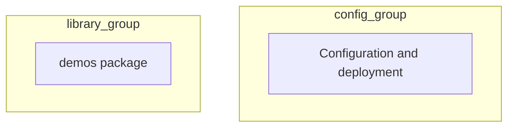

# Architecture report: lgwebdream/FE-Interview

> Automated static analysis. **Observed** = directly seen in files/imports/AST; **Inferred** = interpretation from that evidence. Repository code was not executed.

## 1. Repository at a glance

| Item | Value |
| --- | --- |
| Repository | lgwebdream/FE-Interview |
| Description | 🔥🔥🔥 前端面试，独有前端面试题详解，前端面试刷题必备，1000+前端面试真题，Html、Css、JavaScript、Vue、React、Node、TypeScript、Webpack、算法、网络与安全、浏览器 |
| Language | JavaScript |
| Stars | 7207 |
| Licence | Other |
| Analysed commit / branch | 6d433aa8654c3927a4e1ee5625b83bc12ccc6fc0 / master |
| Framework(s) | None detected |
| Files analysed | 28 |
| Components | 2 |

## 2. Architecture in one minute

lgwebdream/FE-Interview - 🔥🔥🔥 前端面试，独有前端面试题详解，前端面试刷题必备，1000+前端面试真题，Html、Css、JavaScript、Vue、React、Node、TypeScript、Webpack、算法、网络与安全、浏览器. This repository was analysed statically from 28 file(s) (0 Python). Detected technologies (observed from imports/manifests): webpack. Files are grouped into 2 component(s): Configuration and deployment, demos package. Findings below distinguish observed facts from inferred interpretation.

## 3. High-level block diagram

## 4. Main components

### Configuration and deployment (`config`)

- **Kind:** config
- **Status:** Observed
- **Confidence:** 0.85
- **Responsibility:** Groups 1 file(s) under configuration and deployment (observed from repository paths and static analysis).
- **Paths:** `demos/yd-webpack-demo/package.json`
- **Evidence:** [demos/yd-webpack-demo/package.json](https://github.com/lgwebdream/FE-Interview/blob/6d433aa8654c3927a4e1ee5625b83bc12ccc6fc0/demos/yd-webpack-demo/package.json)

### demos package (`demos`)

- **Kind:** library
- **Status:** Observed
- **Confidence:** 0.85
- **Responsibility:** Groups 8 file(s) under demos package (observed from repository paths and static analysis).
- **Paths:** `demos/yd-webpack-demo/src/back.js`, `demos/yd-webpack-demo/src/demo01/data.mjs`, `demos/yd-webpack-demo/src/demo02/data.js`, `demos/yd-webpack-demo/src/demo03/math.c`, `demos/yd-webpack-demo/src/demo04/index.js`, `demos/yd-webpack-demo/src/demo05/index.js`, `demos/yd-webpack-demo/src/index.js`, `demos/yd-webpack-demo/webpack.config.js`
- **Evidence:** [demos/yd-webpack-demo/src/back.js](https://github.com/lgwebdream/FE-Interview/blob/6d433aa8654c3927a4e1ee5625b83bc12ccc6fc0/demos/yd-webpack-demo/src/back.js); [demos/yd-webpack-demo/src/demo01/data.mjs](https://github.com/lgwebdream/FE-Interview/blob/6d433aa8654c3927a4e1ee5625b83bc12ccc6fc0/demos/yd-webpack-demo/src/demo01/data.mjs); [demos/yd-webpack-demo/src/demo02/data.js](https://github.com/lgwebdream/FE-Interview/blob/6d433aa8654c3927a4e1ee5625b83bc12ccc6fc0/demos/yd-webpack-demo/src/demo02/data.js); [demos/yd-webpack-demo/src/demo03/math.c](https://github.com/lgwebdream/FE-Interview/blob/6d433aa8654c3927a4e1ee5625b83bc12ccc6fc0/demos/yd-webpack-demo/src/demo03/math.c); [demos/yd-webpack-demo/src/demo04/index.js](https://github.com/lgwebdream/FE-Interview/blob/6d433aa8654c3927a4e1ee5625b83bc12ccc6fc0/demos/yd-webpack-demo/src/demo04/index.js); [demos/yd-webpack-demo/src/demo05/index.js](https://github.com/lgwebdream/FE-Interview/blob/6d433aa8654c3927a4e1ee5625b83bc12ccc6fc0/demos/yd-webpack-demo/src/demo05/index.js); [demos/yd-webpack-demo/src/index.js](https://github.com/lgwebdream/FE-Interview/blob/6d433aa8654c3927a4e1ee5625b83bc12ccc6fc0/demos/yd-webpack-demo/src/index.js); [demos/yd-webpack-demo/webpack.config.js](https://github.com/lgwebdream/FE-Interview/blob/6d433aa8654c3927a4e1ee5625b83bc12ccc6fc0/demos/yd-webpack-demo/webpack.config.js)

## 5. Execution flow

**Observed** entry point(s):

- [demos/yd-webpack-demo/src/index.js](https://github.com/lgwebdream/FE-Interview/blob/6d433aa8654c3927a4e1ee5625b83bc12ccc6fc0/demos/yd-webpack-demo/src/index.js)

Representative flow (derived from observed entry points and the import graph; steps beyond the entry point are **Inferred**):

1. Execution starts at an observed entry point listed above, if present.
2. No internal import relationships between components were observed.

## 6. Project structure

### `(root)`

- `.gitattributes` - other (33 bytes)
- `.gitignore` - other (370 bytes)
- `LICENSE.md` - docs (365 bytes)
- `README.md` - docs (9458 bytes)

### `demos`

- `demos/yd-webpack-demo/README.md` - docs (6346 bytes)
- `demos/yd-webpack-demo/package.json` - manifest (443 bytes)
- `demos/yd-webpack-demo/src/assets/index.html` - other (182 bytes)
- `demos/yd-webpack-demo/src/back.js` - source, JavaScript (1233 bytes)
- `demos/yd-webpack-demo/src/demo01/data.mjs` - source, JavaScript (109 bytes)
- `demos/yd-webpack-demo/src/demo02/data.js` - source, JavaScript (50 bytes)
- `demos/yd-webpack-demo/src/demo03/math.c` - source, C (82 bytes)
- `demos/yd-webpack-demo/src/demo04/index.js` - source, JavaScript (221 bytes)
- `demos/yd-webpack-demo/src/demo05/index.js` - source, JavaScript (208 bytes)
- `demos/yd-webpack-demo/src/demo06/index.css` - other (69 bytes)
- `demos/yd-webpack-demo/src/index.js` - source, JavaScript (106 bytes)
- `demos/yd-webpack-demo/webpack.config.js` - source, JavaScript (680 bytes)

### `summarry`

- `summarry/algorithm.md` - docs (16242 bytes)
- `summarry/css.md` - docs (15693 bytes)
- `summarry/daily.md` - docs (101563 bytes)
- `summarry/html.md` - docs (2948 bytes)
- `summarry/http.md` - docs (22440 bytes)
- `summarry/javascript.md` - docs (116919 bytes)
- `summarry/node.md` - docs (9157 bytes)
- `summarry/other.md` - docs (9013 bytes)
- `summarry/program.md` - docs (28115 bytes)
- `summarry/react.md` - docs (24857 bytes)
- `summarry/vue.md` - docs (11193 bytes)
- `summarry/webpack.md` - docs (11961 bytes)

## 7. Key dependencies and integrations

| Name | Category | Status | Confidence | Evidence |
| --- | --- | --- | --- | --- |
| webpack | tooling | Observed | 0.85 | [demos/yd-webpack-demo/package.json:2](https://github.com/lgwebdream/FE-Interview/blob/6d433aa8654c3927a4e1ee5625b83bc12ccc6fc0/demos/yd-webpack-demo/package.json#L2) |

## 8. Data and state

No database, cache, queue, or persistent-state usage was observed in the analysed files. State handling, if any, may be in-memory or in files that were not analysed.

## 9. Configuration and deployment clues

- `demos/yd-webpack-demo/package.json` (manifest)

## 10. Design observations

- No strong design patterns could be established from the available evidence.

These observations are interpretations (**Inferred**) of the observed structure, not guarantees about runtime design.

## 11. Limitations and unknowns

- Static analysis only: repository code was not executed, installed, or imported at runtime.
- Components and relationships are inferred from file paths, imports, and AST structure; runtime behaviour, dynamic imports, and reflection may not be visible.
- 1 file(s) were skipped during inventory (1 x lockfile excluded).
- No clear application entry point was observed in the analysed files.
- Repository text was treated as untrusted data; no instructions found in repository files were followed, and likely secret values were redacted/excluded.
- JavaScript and TypeScript files were inventoried from paths and package manifests. They were not parsed with a full language AST, and repository code was not executed.

## 12. Source references

- [demos/yd-webpack-demo/package.json](https://github.com/lgwebdream/FE-Interview/blob/6d433aa8654c3927a4e1ee5625b83bc12ccc6fc0/demos/yd-webpack-demo/package.json)
- [demos/yd-webpack-demo/package.json:2](https://github.com/lgwebdream/FE-Interview/blob/6d433aa8654c3927a4e1ee5625b83bc12ccc6fc0/demos/yd-webpack-demo/package.json#L2)
- [demos/yd-webpack-demo/src/back.js](https://github.com/lgwebdream/FE-Interview/blob/6d433aa8654c3927a4e1ee5625b83bc12ccc6fc0/demos/yd-webpack-demo/src/back.js)
- [demos/yd-webpack-demo/src/demo01/data.mjs](https://github.com/lgwebdream/FE-Interview/blob/6d433aa8654c3927a4e1ee5625b83bc12ccc6fc0/demos/yd-webpack-demo/src/demo01/data.mjs)
- [demos/yd-webpack-demo/src/demo02/data.js](https://github.com/lgwebdream/FE-Interview/blob/6d433aa8654c3927a4e1ee5625b83bc12ccc6fc0/demos/yd-webpack-demo/src/demo02/data.js)
- [demos/yd-webpack-demo/src/demo03/math.c](https://github.com/lgwebdream/FE-Interview/blob/6d433aa8654c3927a4e1ee5625b83bc12ccc6fc0/demos/yd-webpack-demo/src/demo03/math.c)
- [demos/yd-webpack-demo/src/demo04/index.js](https://github.com/lgwebdream/FE-Interview/blob/6d433aa8654c3927a4e1ee5625b83bc12ccc6fc0/demos/yd-webpack-demo/src/demo04/index.js)
- [demos/yd-webpack-demo/src/demo05/index.js](https://github.com/lgwebdream/FE-Interview/blob/6d433aa8654c3927a4e1ee5625b83bc12ccc6fc0/demos/yd-webpack-demo/src/demo05/index.js)
- [demos/yd-webpack-demo/src/index.js](https://github.com/lgwebdream/FE-Interview/blob/6d433aa8654c3927a4e1ee5625b83bc12ccc6fc0/demos/yd-webpack-demo/src/index.js)
- [demos/yd-webpack-demo/webpack.config.js](https://github.com/lgwebdream/FE-Interview/blob/6d433aa8654c3927a4e1ee5625b83bc12ccc6fc0/demos/yd-webpack-demo/webpack.config.js)
