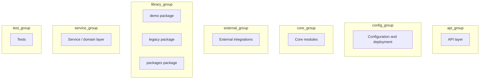

# Architecture report: lingodotdev/lingo.dev

> Automated static analysis. **Observed** = directly seen in files/imports/AST; **Inferred** = interpretation from that evidence. Repository code was not executed.

## 1. Repository at a glance

| Item | Value |
| --- | --- |
| Repository | lingodotdev/lingo.dev |
| Description | Open-source localization engineering tools. Connects to Lingo.dev localization engineering platform for consistent, quality translations. |
| Language | TypeScript |
| Stars | 5402 |
| Licence | Apache-2.0 |
| Analysed commit / branch | fbc666cf717bbe80a57ce49b8d0fce690ee1766f / main |
| Framework(s) | Next.js, React |
| Files analysed | 800 |
| Components | 9 |

## 2. Architecture in one minute

lingodotdev/lingo.dev - Open-source localization engineering tools. Connects to Lingo.dev localization engineering platform for consistent, quality translations.. This repository was analysed statically from 800 file(s) (0 Python). Detected technologies (observed from imports/manifests): GitHub Actions, Next.js, React, Tailwind CSS, Docker, Docker Compose. Files are grouped into 9 component(s): API layer, Configuration and deployment, Core modules, demo package, External integrations, legacy package, packages package, Service / domain layer. Findings below distinguish observed facts from inferred interpretation.

## 3. High-level block diagram

## 4. Main components

### API layer (`api_layer`)

- **Kind:** api
- **Status:** Observed
- **Confidence:** 0.85
- **Responsibility:** Groups 11 file(s) under api layer (observed from repository paths and static analysis).
- **Paths:** `demo/new-compiler-vite-react-spa/src/routes/__root.tsx`, `demo/new-compiler-vite-react-spa/src/routes/about.tsx`, `demo/new-compiler-vite-react-spa/src/routes/index.tsx`, `packages/compiler/src/lib/lcp/api/index.ts`, `packages/compiler/src/lib/lcp/api/prompt.spec.ts`, `packages/compiler/src/lib/lcp/api/prompt.ts`, `packages/compiler/src/lib/lcp/api/provider-details.spec.ts`, `packages/compiler/src/lib/lcp/api/provider-details.ts`, `packages/compiler/src/lib/lcp/api/shots.ts`, `packages/compiler/src/lib/lcp/api/xml2obj.spec.ts`, `packages/compiler/src/lib/lcp/api/xml2obj.ts`
- **Evidence:** [demo/new-compiler-vite-react-spa/src/routes/__root.tsx](https://github.com/lingodotdev/lingo.dev/blob/fbc666cf717bbe80a57ce49b8d0fce690ee1766f/demo/new-compiler-vite-react-spa/src/routes/__root.tsx); [demo/new-compiler-vite-react-spa/src/routes/about.tsx](https://github.com/lingodotdev/lingo.dev/blob/fbc666cf717bbe80a57ce49b8d0fce690ee1766f/demo/new-compiler-vite-react-spa/src/routes/about.tsx); [demo/new-compiler-vite-react-spa/src/routes/index.tsx](https://github.com/lingodotdev/lingo.dev/blob/fbc666cf717bbe80a57ce49b8d0fce690ee1766f/demo/new-compiler-vite-react-spa/src/routes/index.tsx); [packages/compiler/src/lib/lcp/api/index.ts](https://github.com/lingodotdev/lingo.dev/blob/fbc666cf717bbe80a57ce49b8d0fce690ee1766f/packages/compiler/src/lib/lcp/api/index.ts); [packages/compiler/src/lib/lcp/api/prompt.spec.ts](https://github.com/lingodotdev/lingo.dev/blob/fbc666cf717bbe80a57ce49b8d0fce690ee1766f/packages/compiler/src/lib/lcp/api/prompt.spec.ts); [packages/compiler/src/lib/lcp/api/prompt.ts](https://github.com/lingodotdev/lingo.dev/blob/fbc666cf717bbe80a57ce49b8d0fce690ee1766f/packages/compiler/src/lib/lcp/api/prompt.ts); [packages/compiler/src/lib/lcp/api/provider-details.spec.ts](https://github.com/lingodotdev/lingo.dev/blob/fbc666cf717bbe80a57ce49b8d0fce690ee1766f/packages/compiler/src/lib/lcp/api/provider-details.spec.ts); [packages/compiler/src/lib/lcp/api/provider-details.ts](https://github.com/lingodotdev/lingo.dev/blob/fbc666cf717bbe80a57ce49b8d0fce690ee1766f/packages/compiler/src/lib/lcp/api/provider-details.ts)

### Configuration and deployment (`config`)

- **Kind:** config
- **Status:** Observed
- **Confidence:** 0.85
- **Responsibility:** Groups 96 file(s) under configuration and deployment (observed from repository paths and static analysis).
- **Paths:** `Dockerfile`, `action.yml`, `composer.json`, `demo/new-cli/.lingo/config.json`, `demo/new-cli/.lingo/lock.json`, `demo/new-cli/content/de/api.yaml`, `demo/new-cli/content/de/app.json`, `demo/new-cli/content/en/api.yaml`, `demo/new-cli/content/en/app.json`, `demo/new-cli/content/es/api.yaml`, `demo/new-cli/content/es/app.json`, `demo/new-cli/content/fr/api.yaml`, `demo/new-cli/content/fr/app.json`, `demo/new-cli/package.json`, `demo/new-compiler-next16/app/.lingo/cache/de.json`, `demo/new-compiler-next16/app/.lingo/cache/en.json`, `demo/new-compiler-next16/app/.lingo/cache/es.json`, `demo/new-compiler-next16/app/.lingo/cache/ru.json`, `demo/new-compiler-next16/package.json`, `demo/new-compiler-next16/tsconfig.json`, `demo/new-compiler-vite-react-spa/.cta.json`, `demo/new-compiler-vite-react-spa/package.json`, `demo/new-compiler-vite-react-spa/public/manifest.json`, `demo/new-compiler-vite-react-spa/public/translations/de.json`, `demo/new-compiler-vite-react-spa/public/translations/en.json`, `demo/new-compiler-vite-react-spa/public/translations/es.json`, `demo/new-compiler-vite-react-spa/public/translations/fr.json`, `demo/new-compiler-vite-react-spa/src/.lingo/cache/de.json`, `demo/new-compiler-vite-react-spa/src/.lingo/cache/en.json`, `demo/new-compiler-vite-react-spa/src/.lingo/cache/es.json`, `demo/new-compiler-vite-react-spa/src/.lingo/cache/fr.json`, `demo/new-compiler-vite-react-spa/tsconfig.json`, `integrations/directus/Dockerfile`, `integrations/directus/docker-compose.yml`, `integrations/directus/package.json`, `integrations/directus/tsconfig.json`, `integrations/directus/tsconfig.test.json`, `legacy/cli/package.json`, `legacy/sdk/package.json`, `package.json`, `packages/cli/demo/ail/i18n.json`, `packages/cli/demo/android/i18n.json`, `packages/cli/demo/csv-per-locale/i18n.json`, `packages/cli/demo/csv/i18n.json`, `packages/cli/demo/ejs/i18n.json`, `packages/cli/demo/flutter/i18n.json`, `packages/cli/demo/html/i18n.json`, `packages/cli/demo/json-dictionary/example.json`, `packages/cli/demo/json-dictionary/i18n.json`, `packages/cli/demo/json/en/example.json`, `packages/cli/demo/json/es/example.json`, `packages/cli/demo/json/i18n.json`, `packages/cli/demo/json5/i18n.json`, `packages/cli/demo/jsonc/i18n.json`, `packages/cli/demo/markdoc/i18n.json`, `packages/cli/demo/markdown/i18n.json`, `packages/cli/demo/mdx/i18n.json`, `packages/cli/demo/mjml/i18n.json`, `packages/cli/demo/php/i18n.json`, `packages/cli/demo/po/i18n.json`, `packages/cli/demo/properties/i18n.json`, `packages/cli/demo/srt/i18n.json`, `packages/cli/demo/twig/i18n.json`, `packages/cli/demo/txt/i18n.json`, `packages/cli/demo/typescript/i18n.json`, `packages/cli/demo/vtt/i18n.json`, `packages/cli/demo/vue-json/i18n.json`, `packages/cli/demo/xcode-strings/i18n.json`, `packages/cli/demo/xcode-stringsdict/i18n.json`, `packages/cli/demo/xcode-xcstrings-v2/i18n.json`, `packages/cli/demo/xcode-xcstrings/i18n.json`, `packages/cli/demo/xliff/i18n.json`, `packages/cli/demo/xml/i18n.json`, `packages/cli/demo/yaml-root-key/en/example.yml`, `packages/cli/demo/yaml-root-key/es/example.yml`, `packages/cli/demo/yaml-root-key/i18n.json`, `packages/cli/demo/yaml/en/example.yml`, `packages/cli/demo/yaml/es/example.yml`, `packages/cli/demo/yaml/i18n.json`, `packages/cli/i18n.json`, `packages/cli/package.json`, `packages/cli/src/cli/cmd/config/get.ts`, `packages/cli/src/cli/cmd/config/index.ts`, `packages/cli/src/cli/cmd/config/set.ts`, `packages/cli/src/cli/cmd/config/unset.ts`, `packages/cli/tsconfig.json`, `packages/cli/tsconfig.test.json`, `packages/compiler/package.json`, `packages/compiler/tsconfig.json`, `packages/locales/package.json`, `packages/locales/tsconfig.json`, `packages/logging/package.json`, `packages/logging/tsconfig.json`, `packages/new-compiler/package.json`, `packages/new-compiler/tsconfig.json`, `packages/react/package.json`
- **Evidence:** [Dockerfile](https://github.com/lingodotdev/lingo.dev/blob/fbc666cf717bbe80a57ce49b8d0fce690ee1766f/Dockerfile); [action.yml](https://github.com/lingodotdev/lingo.dev/blob/fbc666cf717bbe80a57ce49b8d0fce690ee1766f/action.yml); [composer.json](https://github.com/lingodotdev/lingo.dev/blob/fbc666cf717bbe80a57ce49b8d0fce690ee1766f/composer.json); [demo/new-cli/.lingo/config.json](https://github.com/lingodotdev/lingo.dev/blob/fbc666cf717bbe80a57ce49b8d0fce690ee1766f/demo/new-cli/.lingo/config.json); [demo/new-cli/.lingo/lock.json](https://github.com/lingodotdev/lingo.dev/blob/fbc666cf717bbe80a57ce49b8d0fce690ee1766f/demo/new-cli/.lingo/lock.json); [demo/new-cli/content/de/api.yaml](https://github.com/lingodotdev/lingo.dev/blob/fbc666cf717bbe80a57ce49b8d0fce690ee1766f/demo/new-cli/content/de/api.yaml); [demo/new-cli/content/de/app.json](https://github.com/lingodotdev/lingo.dev/blob/fbc666cf717bbe80a57ce49b8d0fce690ee1766f/demo/new-cli/content/de/app.json); [demo/new-cli/content/en/api.yaml](https://github.com/lingodotdev/lingo.dev/blob/fbc666cf717bbe80a57ce49b8d0fce690ee1766f/demo/new-cli/content/en/api.yaml)

### Core modules (`core`)

- **Kind:** core
- **Status:** Observed
- **Confidence:** 0.85
- **Responsibility:** Groups 1 file(s) under core modules (observed from repository paths and static analysis).
- **Paths:** `commitlint.config.js`
- **Evidence:** [commitlint.config.js](https://github.com/lingodotdev/lingo.dev/blob/fbc666cf717bbe80a57ce49b8d0fce690ee1766f/commitlint.config.js)

### demo package (`demo`)

- **Kind:** library
- **Status:** Observed
- **Confidence:** 0.85
- **Responsibility:** Groups 14 file(s) under demo package (observed from repository paths and static analysis).
- **Paths:** `demo/new-compiler-next16/app/layout.tsx`, `demo/new-compiler-next16/app/page.tsx`, `demo/new-compiler-next16/components/ClientChildWrapper.tsx`, `demo/new-compiler-next16/components/Counter.tsx`, `demo/new-compiler-next16/components/CounterClientChild.tsx`, `demo/new-compiler-next16/components/ServerChild.tsx`, `demo/new-compiler-next16/next.config.ts`, `demo/new-compiler-next16/postcss.config.mjs`, `demo/new-compiler-vite-react-spa/analyze-bundle.sh`, `demo/new-compiler-vite-react-spa/src/components/Header.tsx`, `demo/new-compiler-vite-react-spa/src/main.tsx`, `demo/new-compiler-vite-react-spa/src/reportWebVitals.ts`, `demo/new-compiler-vite-react-spa/src/routeTree.gen.ts`, `demo/new-compiler-vite-react-spa/vite.config.ts`
- **Evidence:** [demo/new-compiler-next16/app/layout.tsx](https://github.com/lingodotdev/lingo.dev/blob/fbc666cf717bbe80a57ce49b8d0fce690ee1766f/demo/new-compiler-next16/app/layout.tsx); [demo/new-compiler-next16/app/page.tsx](https://github.com/lingodotdev/lingo.dev/blob/fbc666cf717bbe80a57ce49b8d0fce690ee1766f/demo/new-compiler-next16/app/page.tsx); [demo/new-compiler-next16/components/ClientChildWrapper.tsx](https://github.com/lingodotdev/lingo.dev/blob/fbc666cf717bbe80a57ce49b8d0fce690ee1766f/demo/new-compiler-next16/components/ClientChildWrapper.tsx); [demo/new-compiler-next16/components/Counter.tsx](https://github.com/lingodotdev/lingo.dev/blob/fbc666cf717bbe80a57ce49b8d0fce690ee1766f/demo/new-compiler-next16/components/Counter.tsx); [demo/new-compiler-next16/components/CounterClientChild.tsx](https://github.com/lingodotdev/lingo.dev/blob/fbc666cf717bbe80a57ce49b8d0fce690ee1766f/demo/new-compiler-next16/components/CounterClientChild.tsx); [demo/new-compiler-next16/components/ServerChild.tsx](https://github.com/lingodotdev/lingo.dev/blob/fbc666cf717bbe80a57ce49b8d0fce690ee1766f/demo/new-compiler-next16/components/ServerChild.tsx); [demo/new-compiler-next16/next.config.ts](https://github.com/lingodotdev/lingo.dev/blob/fbc666cf717bbe80a57ce49b8d0fce690ee1766f/demo/new-compiler-next16/next.config.ts); [demo/new-compiler-next16/postcss.config.mjs](https://github.com/lingodotdev/lingo.dev/blob/fbc666cf717bbe80a57ce49b8d0fce690ee1766f/demo/new-compiler-next16/postcss.config.mjs)

### External integrations (`external_integrations`)

- **Kind:** external
- **Status:** Observed
- **Confidence:** 0.85
- **Responsibility:** Groups 24 file(s) under external integrations (observed from repository paths and static analysis).
- **Paths:** `integrations/directus/src/api.ts`, `integrations/directus/src/app.ts`, `integrations/directus/src/index.spec.ts`, `integrations/directus/tsup.config.ts`, `packages/new-compiler/src/react/client/index.ts`, `packages/new-compiler/src/react/client/useTranslation.ts`, `packages/react/src/client/attribute-component.spec.tsx`, `packages/react/src/client/attribute-component.tsx`, `packages/react/src/client/component.lingo-component.spec.tsx`, `packages/react/src/client/component.spec.tsx`, `packages/react/src/client/component.tsx`, `packages/react/src/client/context.spec.tsx`, `packages/react/src/client/context.ts`, `packages/react/src/client/index.ts`, `packages/react/src/client/loader.spec.ts`, `packages/react/src/client/loader.ts`, `packages/react/src/client/locale-switcher.spec.tsx`, `packages/react/src/client/locale-switcher.tsx`, `packages/react/src/client/locale.spec.ts`, `packages/react/src/client/locale.ts`, `packages/react/src/client/provider.spec.tsx`, `packages/react/src/client/provider.tsx`, `packages/react/src/client/utils.spec.ts`, `packages/react/src/client/utils.ts`
- **Evidence:** [integrations/directus/src/api.ts](https://github.com/lingodotdev/lingo.dev/blob/fbc666cf717bbe80a57ce49b8d0fce690ee1766f/integrations/directus/src/api.ts); [integrations/directus/src/app.ts](https://github.com/lingodotdev/lingo.dev/blob/fbc666cf717bbe80a57ce49b8d0fce690ee1766f/integrations/directus/src/app.ts); [integrations/directus/src/index.spec.ts](https://github.com/lingodotdev/lingo.dev/blob/fbc666cf717bbe80a57ce49b8d0fce690ee1766f/integrations/directus/src/index.spec.ts); [integrations/directus/tsup.config.ts](https://github.com/lingodotdev/lingo.dev/blob/fbc666cf717bbe80a57ce49b8d0fce690ee1766f/integrations/directus/tsup.config.ts); [packages/new-compiler/src/react/client/index.ts](https://github.com/lingodotdev/lingo.dev/blob/fbc666cf717bbe80a57ce49b8d0fce690ee1766f/packages/new-compiler/src/react/client/index.ts); [packages/new-compiler/src/react/client/useTranslation.ts](https://github.com/lingodotdev/lingo.dev/blob/fbc666cf717bbe80a57ce49b8d0fce690ee1766f/packages/new-compiler/src/react/client/useTranslation.ts); [packages/react/src/client/attribute-component.spec.tsx](https://github.com/lingodotdev/lingo.dev/blob/fbc666cf717bbe80a57ce49b8d0fce690ee1766f/packages/react/src/client/attribute-component.spec.tsx); [packages/react/src/client/attribute-component.tsx](https://github.com/lingodotdev/lingo.dev/blob/fbc666cf717bbe80a57ce49b8d0fce690ee1766f/packages/react/src/client/attribute-component.tsx)

### legacy package (`legacy`)

- **Kind:** library
- **Status:** Observed
- **Confidence:** 0.85
- **Responsibility:** Groups 3 file(s) under legacy package (observed from repository paths and static analysis).
- **Paths:** `legacy/cli/bin/cli.mjs`, `legacy/sdk/index.d.ts`, `legacy/sdk/index.js`
- **Evidence:** [legacy/cli/bin/cli.mjs](https://github.com/lingodotdev/lingo.dev/blob/fbc666cf717bbe80a57ce49b8d0fce690ee1766f/legacy/cli/bin/cli.mjs); [legacy/sdk/index.d.ts](https://github.com/lingodotdev/lingo.dev/blob/fbc666cf717bbe80a57ce49b8d0fce690ee1766f/legacy/sdk/index.d.ts); [legacy/sdk/index.js](https://github.com/lingodotdev/lingo.dev/blob/fbc666cf717bbe80a57ce49b8d0fce690ee1766f/legacy/sdk/index.js)

### packages package (`packages`)

- **Kind:** library
- **Status:** Observed
- **Confidence:** 0.85
- **Responsibility:** Groups 446 file(s) under packages package (observed from repository paths and static analysis).
- **Paths:** `packages/cli/bin/cli.mjs`, `packages/cli/demo/demo.spec.ts`, `packages/cli/demo/php/en/example.php`, `packages/cli/demo/php/es/example.php`, `packages/cli/demo/run_i18n.sh`, `packages/cli/demo/typescript/en/example.ts`, `packages/cli/demo/typescript/es/example.ts`, `packages/cli/demo/vue-json/example.vue`, `packages/cli/src/cli/cmd/auth.ts`, `packages/cli/src/cli/cmd/ci/flows/_base.ts`, `packages/cli/src/cli/cmd/ci/flows/in-branch.spec.ts`, `packages/cli/src/cli/cmd/ci/flows/in-branch.ts`, `packages/cli/src/cli/cmd/ci/flows/pull-request.ts`, `packages/cli/src/cli/cmd/ci/index.ts`, `packages/cli/src/cli/cmd/ci/platforms/_base.ts`, `packages/cli/src/cli/cmd/ci/platforms/bitbucket.ts`, `packages/cli/src/cli/cmd/ci/platforms/github.ts`, `packages/cli/src/cli/cmd/ci/platforms/gitlab.ts`, `packages/cli/src/cli/cmd/ci/platforms/index.ts`, `packages/cli/src/cli/cmd/cleanup.ts`, `packages/cli/src/cli/cmd/i18n.ts`, `packages/cli/src/cli/cmd/init.ts`, `packages/cli/src/cli/cmd/init/cursor.ts`, `packages/cli/src/cli/cmd/lockfile.spec.ts`, `packages/cli/src/cli/cmd/lockfile.ts`, `packages/cli/src/cli/cmd/login.spec.ts`, `packages/cli/src/cli/cmd/login.ts`, `packages/cli/src/cli/cmd/logout.ts`, `packages/cli/src/cli/cmd/may-the-fourth.ts`, `packages/cli/src/cli/cmd/parseListInput.spec.ts`, `packages/cli/src/cli/cmd/purge.ts`, `packages/cli/src/cli/cmd/run/_const.ts`, `packages/cli/src/cli/cmd/run/_types.ts`, `packages/cli/src/cli/cmd/run/_utils.ts`, `packages/cli/src/cli/cmd/run/estimate.spec.ts`, `packages/cli/src/cli/cmd/run/estimate.ts`, `packages/cli/src/cli/cmd/run/execute-checksums.spec.ts`, `packages/cli/src/cli/cmd/run/execute.spec.ts`, `packages/cli/src/cli/cmd/run/execute.ts`, `packages/cli/src/cli/cmd/run/exit-code.spec.ts`, `packages/cli/src/cli/cmd/run/exit-code.ts`, `packages/cli/src/cli/cmd/run/frozen.ts`, `packages/cli/src/cli/cmd/run/index.ts`, `packages/cli/src/cli/cmd/run/plan.ts`, `packages/cli/src/cli/cmd/run/setup.ts`, `packages/cli/src/cli/cmd/run/watch.ts`, `packages/cli/src/cli/cmd/show/_shared-key-command.ts`, `packages/cli/src/cli/cmd/show/config.ts`, `packages/cli/src/cli/cmd/show/files.ts`, `packages/cli/src/cli/cmd/show/ignored-keys.ts`, `packages/cli/src/cli/cmd/show/index.ts`, `packages/cli/src/cli/cmd/show/locale.ts`, `packages/cli/src/cli/cmd/show/locked-keys.ts`, `packages/cli/src/cli/cmd/show/preserved-keys.ts`, `packages/cli/src/cli/cmd/status.ts`, `packages/cli/src/cli/constants.ts`, `packages/cli/src/cli/index.spec.ts`, `packages/cli/src/cli/index.ts`, `packages/cli/src/cli/loaders/_frontmatter.ts`, `packages/cli/src/cli/loaders/_types.ts`, `packages/cli/src/cli/loaders/_utils.ts`, `packages/cli/src/cli/loaders/ail.spec.ts`, `packages/cli/src/cli/loaders/ail.ts`, `packages/cli/src/cli/loaders/android.spec.ts`, `packages/cli/src/cli/loaders/android.ts`, `packages/cli/src/cli/loaders/csv-per-locale.spec.ts`, `packages/cli/src/cli/loaders/csv-per-locale.ts`, `packages/cli/src/cli/loaders/csv.spec.ts`, `packages/cli/src/cli/loaders/csv.ts`, `packages/cli/src/cli/loaders/dato/_base.ts`, `packages/cli/src/cli/loaders/dato/_utils.spec.ts`, `packages/cli/src/cli/loaders/dato/_utils.ts`, `packages/cli/src/cli/loaders/dato/api.ts`, `packages/cli/src/cli/loaders/dato/extract.ts`, `packages/cli/src/cli/loaders/dato/filter.ts`, `packages/cli/src/cli/loaders/dato/index.ts`, `packages/cli/src/cli/loaders/ejs.spec.ts`, `packages/cli/src/cli/loaders/ejs.ts`, `packages/cli/src/cli/loaders/ensure-key-order.spec.ts`, `packages/cli/src/cli/loaders/ensure-key-order.ts`, `packages/cli/src/cli/loaders/flat.spec.ts`, `packages/cli/src/cli/loaders/flat.ts`, `packages/cli/src/cli/loaders/flutter.spec.ts`, `packages/cli/src/cli/loaders/flutter.ts`, `packages/cli/src/cli/loaders/formatters/_base.ts`, `packages/cli/src/cli/loaders/formatters/biome.spec.ts`, `packages/cli/src/cli/loaders/formatters/biome.ts`, `packages/cli/src/cli/loaders/formatters/index.ts`, `packages/cli/src/cli/loaders/formatters/prettier.ts`, `packages/cli/src/cli/loaders/html.spec.ts`, `packages/cli/src/cli/loaders/html.ts`, `packages/cli/src/cli/loaders/ignored-keys-buckets.spec.ts`, `packages/cli/src/cli/loaders/ignored-keys.spec.ts`, `packages/cli/src/cli/loaders/ignored-keys.ts`, `packages/cli/src/cli/loaders/index.spec.ts`, `packages/cli/src/cli/loaders/index.ts`, `packages/cli/src/cli/loaders/inject-locale.spec.ts`, `packages/cli/src/cli/loaders/inject-locale.ts`, `packages/cli/src/cli/loaders/json-dictionary.spec.ts`, `packages/cli/src/cli/loaders/json-dictionary.ts`, `packages/cli/src/cli/loaders/json-sorting.test.ts`, `packages/cli/src/cli/loaders/json-sorting.ts`, `packages/cli/src/cli/loaders/json.ts`, `packages/cli/src/cli/loaders/json5.spec.ts`, `packages/cli/src/cli/loaders/json5.ts`, `packages/cli/src/cli/loaders/jsonc.spec.ts`, `packages/cli/src/cli/loaders/jsonc.ts`, `packages/cli/src/cli/loaders/locked-keys.spec.ts`, `packages/cli/src/cli/loaders/locked-keys.ts`, `packages/cli/src/cli/loaders/locked-patterns.spec.ts`, `packages/cli/src/cli/loaders/locked-patterns.ts`, `packages/cli/src/cli/loaders/markdoc.spec.ts`, `packages/cli/src/cli/loaders/markdoc.ts`, `packages/cli/src/cli/loaders/markdown.ts`, `packages/cli/src/cli/loaders/mdx.spec.ts`, `packages/cli/src/cli/loaders/mdx.ts`, `packages/cli/src/cli/loaders/mdx2/_types.ts`, `packages/cli/src/cli/loaders/mdx2/_utils.ts`, `packages/cli/src/cli/loaders/mdx2/code-placeholder.spec.ts`, `packages/cli/src/cli/loaders/mdx2/code-placeholder.ts`, `packages/cli/src/cli/loaders/mdx2/frontmatter-split.spec.ts`, `packages/cli/src/cli/loaders/mdx2/frontmatter-split.ts`, `packages/cli/src/cli/loaders/mdx2/localizable-document.spec.ts`, `packages/cli/src/cli/loaders/mdx2/localizable-document.ts`, `packages/cli/src/cli/loaders/mdx2/section-split.spec.ts`, `packages/cli/src/cli/loaders/mdx2/section-split.ts`, `packages/cli/src/cli/loaders/mdx2/sections-split-2.ts`, `packages/cli/src/cli/loaders/mjml.spec.ts`, `packages/cli/src/cli/loaders/mjml.ts`, `packages/cli/src/cli/loaders/passthrough.ts`, `packages/cli/src/cli/loaders/php.ts`, `packages/cli/src/cli/loaders/plutil-json-loader.ts`, `packages/cli/src/cli/loaders/po/_types.ts`, `packages/cli/src/cli/loaders/po/index.spec.ts`, `packages/cli/src/cli/loaders/po/index.ts`, `packages/cli/src/cli/loaders/preserved-keys.spec.ts`, `packages/cli/src/cli/loaders/preserved-keys.ts`, `packages/cli/src/cli/loaders/properties.ts`, `packages/cli/src/cli/loaders/root-key.ts`, `packages/cli/src/cli/loaders/srt.ts`, `packages/cli/src/cli/loaders/sync.ts`, `packages/cli/src/cli/loaders/text-file.ts`, `packages/cli/src/cli/loaders/twig.spec.ts`, `packages/cli/src/cli/loaders/twig.ts`, `packages/cli/src/cli/loaders/txt.ts`, `packages/cli/src/cli/loaders/typescript/cjs-interop.ts`, `packages/cli/src/cli/loaders/typescript/index.spec.ts`, `packages/cli/src/cli/loaders/typescript/index.ts`, `packages/cli/src/cli/loaders/unlocalizable.spec.ts`, `packages/cli/src/cli/loaders/unlocalizable.ts`, `packages/cli/src/cli/loaders/variable/index.spec.ts`, `packages/cli/src/cli/loaders/variable/index.ts`, `packages/cli/src/cli/loaders/vtt.ts`, `packages/cli/src/cli/loaders/vue-json.ts`, `packages/cli/src/cli/loaders/xcode-strings.spec.ts`, `packages/cli/src/cli/loaders/xcode-strings.ts`, `packages/cli/src/cli/loaders/xcode-strings/escape.ts`, `packages/cli/src/cli/loaders/xcode-strings/parser.ts`, `packages/cli/src/cli/loaders/xcode-strings/tokenizer.ts`, `packages/cli/src/cli/loaders/xcode-strings/types.ts`, `packages/cli/src/cli/loaders/xcode-stringsdict.ts`, `packages/cli/src/cli/loaders/xcode-xcstrings-lock-compatibility.spec.ts`, `packages/cli/src/cli/loaders/xcode-xcstrings-v2.spec.ts`, `packages/cli/src/cli/loaders/xcode-xcstrings-v2.ts`, `packages/cli/src/cli/loaders/xcode-xcstrings.spec.ts`, `packages/cli/src/cli/loaders/xcode-xcstrings.ts`, `packages/cli/src/cli/loaders/xliff.spec.ts`, `packages/cli/src/cli/loaders/xliff.ts`, `packages/cli/src/cli/loaders/xml.ts`, `packages/cli/src/cli/loaders/yaml.spec.ts`, `packages/cli/src/cli/loaders/yaml.ts`, `packages/cli/src/cli/localizer/_types.ts`, `packages/cli/src/cli/localizer/explicit.ts`, `packages/cli/src/cli/localizer/index.ts`, `packages/cli/src/cli/localizer/lingodotdev.ts`, `packages/cli/src/cli/localizer/pseudo.ts`, `packages/cli/src/cli/processor/_base.ts`, `packages/cli/src/cli/processor/basic.spec.ts`, `packages/cli/src/cli/processor/basic.ts`, `packages/cli/src/cli/processor/index.ts`, `packages/cli/src/cli/processor/lingo.ts`, `packages/cli/src/cli/utils/auth.ts`, `packages/cli/src/cli/utils/buckets.spec.ts`, `packages/cli/src/cli/utils/buckets.ts`, `packages/cli/src/cli/utils/cache.ts`, `packages/cli/src/cli/utils/cloudflare-status.ts`, `packages/cli/src/cli/utils/config.ts`, `packages/cli/src/cli/utils/delta-lockfile-load.spec.ts`, `packages/cli/src/cli/utils/delta.spec.ts`, `packages/cli/src/cli/utils/delta.ts`, `packages/cli/src/cli/utils/element-extraction.spec.ts`, `packages/cli/src/cli/utils/element-extraction.ts`, `packages/cli/src/cli/utils/ensure-patterns.ts`, `packages/cli/src/cli/utils/env.spec.ts`, `packages/cli/src/cli/utils/env.ts`, `packages/cli/src/cli/utils/errors.ts`, `packages/cli/src/cli/utils/exec.spec.ts`, `packages/cli/src/cli/utils/exec.ts`, `packages/cli/src/cli/utils/exit-gracefully.spec.ts`, `packages/cli/src/cli/utils/exit-gracefully.ts`, `packages/cli/src/cli/utils/exp-backoff.ts`, `packages/cli/src/cli/utils/find-locale-paths.spec.ts`, `packages/cli/src/cli/utils/find-locale-paths.ts`, `packages/cli/src/cli/utils/fs.ts`, `packages/cli/src/cli/utils/init-ci-cd.ts`, `packages/cli/src/cli/utils/key-matching.spec.ts`, `packages/cli/src/cli/utils/key-matching.ts`, `packages/cli/src/cli/utils/lockfile.test.ts`, `packages/cli/src/cli/utils/lockfile.ts`, `packages/cli/src/cli/utils/md5.ts`, `packages/cli/src/cli/utils/model-response.test.ts`, `packages/cli/src/cli/utils/model-response.ts`, `packages/cli/src/cli/utils/observability.spec.ts`, `packages/cli/src/cli/utils/observability.ts`, `packages/cli/src/cli/utils/open-editor.ts`, `packages/cli/src/cli/utils/org-id.spec.ts`, `packages/cli/src/cli/utils/org-id.ts`, `packages/cli/src/cli/utils/plutil-formatter.spec.ts`, `packages/cli/src/cli/utils/plutil-formatter.ts`, `packages/cli/src/cli/utils/settings.ts`, `packages/cli/src/cli/utils/test-helpers.ts`, `packages/cli/src/cli/utils/ui.ts`, `packages/cli/src/cli/utils/update-gitignore.ts`, `packages/cli/src/locale-codes/index.ts`, `packages/cli/src/sdk/index.ts`, `packages/cli/src/spec/index.ts`, `packages/cli/src/utils/pseudo-localize.spec.ts`, `packages/cli/src/utils/pseudo-localize.ts`, `packages/cli/tsup.config.ts`, `packages/cli/types/vtt.d.ts`, `packages/cli/types/xliff.d.ts`, `packages/cli/vitest.config.ts`, `packages/compiler/src/_base.ts`, `packages/compiler/src/_const.ts`, `packages/compiler/src/_deprecation.ts`, `packages/compiler/src/_loader-utils.spec.ts`, `packages/compiler/src/_loader-utils.ts`, `packages/compiler/src/_utils.spec.ts`, `packages/compiler/src/_utils.ts`, `packages/compiler/src/babel-interop.ts`, `packages/compiler/src/client-dictionary-loader.ts`, `packages/compiler/src/i18n-directive.spec.ts`, `packages/compiler/src/i18n-directive.ts`, `packages/compiler/src/index.spec.ts`, `packages/compiler/src/index.ts`, `packages/compiler/src/jsx-attribute-flag.spec.ts`, `packages/compiler/src/jsx-attribute-flag.ts`, `packages/compiler/src/jsx-attribute-scope-inject.spec.ts`, `packages/compiler/src/jsx-attribute-scope-inject.ts`, `packages/compiler/src/jsx-attribute-scopes-export.spec.ts`, `packages/compiler/src/jsx-attribute-scopes-export.ts`, `packages/compiler/src/jsx-attribute.spec.ts`, `packages/compiler/src/jsx-attribute.ts`, `packages/compiler/src/jsx-fragment.spec.ts`, `packages/compiler/src/jsx-fragment.ts`, `packages/compiler/src/jsx-html-lang.spec.ts`, `packages/compiler/src/jsx-html-lang.ts`, `packages/compiler/src/jsx-provider.spec.ts`, `packages/compiler/src/jsx-provider.ts`, `packages/compiler/src/jsx-remove-attributes.spec.ts`, `packages/compiler/src/jsx-remove-attributes.ts`, `packages/compiler/src/jsx-root-flag.spec.ts`, `packages/compiler/src/jsx-root-flag.ts`, `packages/compiler/src/jsx-scope-flag.spec.ts`, `packages/compiler/src/jsx-scope-flag.ts`, `packages/compiler/src/jsx-scope-inject.spec.ts`, `packages/compiler/src/jsx-scope-inject.ts`, `packages/compiler/src/jsx-scopes-export.spec.ts`, `packages/compiler/src/jsx-scopes-export.ts`, `packages/compiler/src/lib/lcp/api.spec.ts`, `packages/compiler/src/lib/lcp/cache.spec.ts`, `packages/compiler/src/lib/lcp/cache.ts`, `packages/compiler/src/lib/lcp/index.spec.ts`, `packages/compiler/src/lib/lcp/index.ts`, `packages/compiler/src/lib/lcp/schema.ts`, `packages/compiler/src/lib/lcp/server.spec.ts`, `packages/compiler/src/lib/lcp/server.ts`, `packages/compiler/src/lingo-turbopack-loader.ts`, `packages/compiler/src/react-router-dictionary-loader.ts`, `packages/compiler/src/rsc-dictionary-loader.ts`, `packages/compiler/src/utils/ast-key.spec.ts`, `packages/compiler/src/utils/ast-key.ts`, `packages/compiler/src/utils/create-locale-import-map.spec.ts`, `packages/compiler/src/utils/create-locale-import-map.ts`, `packages/compiler/src/utils/env.spec.ts`, `packages/compiler/src/utils/env.ts`, `packages/compiler/src/utils/hash.spec.ts`, `packages/compiler/src/utils/hash.ts`, `packages/compiler/src/utils/index.spec.ts`, `packages/compiler/src/utils/index.ts`, `packages/compiler/src/utils/invokations.spec.ts`, `packages/compiler/src/utils/invokations.ts`, `packages/compiler/src/utils/jsx-attribute-scope.ts`, `packages/compiler/src/utils/jsx-attribute.spec.ts`, `packages/compiler/src/utils/jsx-attribute.ts`, `packages/compiler/src/utils/jsx-content-whitespace.spec.ts`, `packages/compiler/src/utils/jsx-content.spec.ts`, `packages/compiler/src/utils/jsx-content.ts`, `packages/compiler/src/utils/jsx-element.spec.ts`, `packages/compiler/src/utils/jsx-element.ts`, `packages/compiler/src/utils/jsx-expressions.test.ts`, `packages/compiler/src/utils/jsx-expressions.ts`, `packages/compiler/src/utils/jsx-functions.spec.ts`, `packages/compiler/src/utils/jsx-functions.ts`, `packages/compiler/src/utils/jsx-scope.spec.ts`, `packages/compiler/src/utils/jsx-scope.ts`, `packages/compiler/src/utils/jsx-variables.spec.ts`, `packages/compiler/src/utils/jsx-variables.ts`, `packages/compiler/src/utils/llm-api-key.ts`, `packages/compiler/src/utils/llm-api-keys.spec.ts`, `packages/compiler/src/utils/locales.spec.ts`, `packages/compiler/src/utils/locales.ts`, `packages/compiler/src/utils/module-params.spec.ts`, `packages/compiler/src/utils/module-params.ts`, `packages/compiler/src/utils/observability.spec.ts`, `packages/compiler/src/utils/observability.ts`, `packages/compiler/src/utils/org-id.ts`, `packages/compiler/src/utils/rc.spec.ts`, `packages/compiler/src/utils/rc.ts`, `packages/compiler/tsup.config.ts`, `packages/compiler/vitest.config.ts`, `packages/locales/src/constants.ts`, `packages/locales/src/index.ts`, `packages/locales/src/names/index.spec.ts`, `packages/locales/src/names/index.ts`, `packages/locales/src/names/integration.spec.ts`, `packages/locales/src/names/loader.ts`, `packages/locales/src/parser.spec.ts`, `packages/locales/src/parser.ts`, `packages/locales/src/types.ts`, `packages/locales/src/validation.spec.ts`, `packages/locales/src/validation.ts`, `packages/locales/tsup.config.ts`, `packages/logging/src/constants.ts`, `packages/logging/src/detect-project-path.spec.ts`, `packages/logging/src/detect-project-path.ts`, `packages/logging/src/index.ts`, `packages/logging/src/init-logger.spec.ts`, `packages/logging/src/init-logger.ts`, `packages/logging/src/types.ts`, `packages/logging/tsup.config.ts`, `packages/new-compiler/playwright.config.ts`, `packages/new-compiler/src/__test-utils__/mocks.ts`, `packages/new-compiler/src/index.ts`, `packages/new-compiler/src/metadata/manager.test.ts`, `packages/new-compiler/src/metadata/manager.ts`, `packages/new-compiler/src/plugin/build-translator.ts`, `packages/new-compiler/src/plugin/cleanup.ts`, `packages/new-compiler/src/plugin/index.ts`, `packages/new-compiler/src/plugin/next-compiler-loader.ts`, `packages/new-compiler/src/plugin/next-config-loader.ts`, `packages/new-compiler/src/plugin/next-locale-client-loader.ts`, `packages/new-compiler/src/plugin/next-locale-server-loader.ts`, `packages/new-compiler/src/plugin/next.ts`, `packages/new-compiler/src/plugin/transform/babel-compat.ts`, `packages/new-compiler/src/plugin/transform/index.ts`, `packages/new-compiler/src/plugin/transform/metadata.ts`, `packages/new-compiler/src/plugin/transform/parse-override.ts`, `packages/new-compiler/src/plugin/transform/process-file.ts`, `packages/new-compiler/src/plugin/transform/transform.test.ts`, `packages/new-compiler/src/plugin/transform/use-i18n.ts`, `packages/new-compiler/src/plugin/transform/utils.test.ts`, `packages/new-compiler/src/plugin/transform/utils.ts`, `packages/new-compiler/src/plugin/unplugin.ts`, `packages/new-compiler/src/plugin/vite.ts`, `packages/new-compiler/src/plugin/webpack.ts`, `packages/new-compiler/src/react/next/client.tsx`, `packages/new-compiler/src/react/next/cookie-locale-resolver.ts`, `packages/new-compiler/src/react/next/server.tsx`, `packages/new-compiler/src/react/server-only/index.test.tsx`, `packages/new-compiler/src/react/server-only/index.ts`, `packages/new-compiler/src/react/server-only/translations.ts`, `packages/new-compiler/src/react/server/ServerLingoProvider.tsx`, `packages/new-compiler/src/react/server/index.ts`, `packages/new-compiler/src/react/server/useTranslation.ts`, `packages/new-compiler/src/react/shared/LingoContext.ts`, `packages/new-compiler/src/react/shared/LingoProvider.tsx`, `packages/new-compiler/src/react/shared/LocaleSwitcher.tsx`, `packages/new-compiler/src/react/shared/render-rich-text.test.tsx`, `packages/new-compiler/src/react/shared/render-rich-text.tsx`, `packages/new-compiler/src/react/shared/test-serializer.ts`, `packages/new-compiler/src/react/shared/utils.ts`, `packages/new-compiler/src/react/types.ts`, `packages/new-compiler/src/translation-server/cli.ts`, `packages/new-compiler/src/translation-server/index.ts`, `packages/new-compiler/src/translation-server/logger.ts`, `packages/new-compiler/src/translation-server/translation-server.test.ts`, `packages/new-compiler/src/translation-server/translation-server.ts`, `packages/new-compiler/src/translation-server/ws-events.ts`, `packages/new-compiler/src/translators/ai-timeout-wiring.test.ts`, `packages/new-compiler/src/translators/api.ts`, `packages/new-compiler/src/translators/cache-factory.ts`, `packages/new-compiler/src/translators/cache.ts`, `packages/new-compiler/src/translators/index.ts`, `packages/new-compiler/src/translators/lingo/ai-timeout.test.ts`, `packages/new-compiler/src/translators/lingo/index.ts`, `packages/new-compiler/src/translators/lingo/model-factory.test.ts`, `packages/new-compiler/src/translators/lingo/model-factory.ts`, `packages/new-compiler/src/translators/lingo/prompt.ts`, `packages/new-compiler/src/translators/lingo/provider-details.ts`, `packages/new-compiler/src/translators/lingo/shots.ts`, `packages/new-compiler/src/translators/lingo/timeout-repro.test.ts`, `packages/new-compiler/src/translators/lingo/translator.test.ts`, `packages/new-compiler/src/translators/lingo/translator.ts`, `packages/new-compiler/src/translators/local-cache.ts`, `packages/new-compiler/src/translators/memory-cache.ts`, `packages/new-compiler/src/translators/parse-xml.test.ts`, `packages/new-compiler/src/translators/parse-xml.ts`, `packages/new-compiler/src/translators/pluralization/ai-timeout.test.ts`, `packages/new-compiler/src/translators/pluralization/icu-validator.test.ts`, `packages/new-compiler/src/translators/pluralization/icu-validator.ts`, `packages/new-compiler/src/translators/pluralization/index.ts`, `packages/new-compiler/src/translators/pluralization/pattern-detector.test.ts`, `packages/new-compiler/src/translators/pluralization/pattern-detector.ts`, `packages/new-compiler/src/translators/pluralization/prompt.ts`, `packages/new-compiler/src/translators/pluralization/service.ts`, `packages/new-compiler/src/translators/pluralization/shots.ts`, `packages/new-compiler/src/translators/pluralization/types.ts`, `packages/new-compiler/src/translators/pseudotranslator/index.test.ts`, `packages/new-compiler/src/translators/pseudotranslator/index.ts`, `packages/new-compiler/src/translators/translation-service.test.ts`, `packages/new-compiler/src/translators/translation-service.ts`, `packages/new-compiler/src/types.ts`, `packages/new-compiler/src/utils/config-factory.test.ts`, `packages/new-compiler/src/utils/config-factory.ts`, `packages/new-compiler/src/utils/hash.spec.ts`, `packages/new-compiler/src/utils/hash.ts`, `packages/new-compiler/src/utils/is-valid-locale.ts`, `packages/new-compiler/src/utils/logger.ts`, `packages/new-compiler/src/utils/observability.ts`, `packages/new-compiler/src/utils/org-id.ts`, `packages/new-compiler/src/utils/path-helpers.ts`, `packages/new-compiler/src/utils/rc.ts`, `packages/new-compiler/src/utils/timeout.ts`, `packages/new-compiler/src/utils/tracking-events.ts`, `packages/new-compiler/src/virtual/code-generator.ts`, `packages/new-compiler/src/virtual/config.ts`, `packages/new-compiler/src/virtual/locale/client.ts`, `packages/new-compiler/src/virtual/locale/server.ts`, `packages/new-compiler/src/widget/lingo-dev-widget.ts`, `packages/new-compiler/src/widget/types.ts`, `packages/new-compiler/tsdown.config.ts`, `packages/new-compiler/vitest.config.ts`, `packages/react/build.config.ts`, `packages/react/src/react-router/index.ts`, `packages/react/src/react-router/loader.spec.ts`
- **Evidence:** [packages/cli/bin/cli.mjs](https://github.com/lingodotdev/lingo.dev/blob/fbc666cf717bbe80a57ce49b8d0fce690ee1766f/packages/cli/bin/cli.mjs); [packages/cli/demo/demo.spec.ts](https://github.com/lingodotdev/lingo.dev/blob/fbc666cf717bbe80a57ce49b8d0fce690ee1766f/packages/cli/demo/demo.spec.ts); [packages/cli/demo/php/en/example.php](https://github.com/lingodotdev/lingo.dev/blob/fbc666cf717bbe80a57ce49b8d0fce690ee1766f/packages/cli/demo/php/en/example.php); [packages/cli/demo/php/es/example.php](https://github.com/lingodotdev/lingo.dev/blob/fbc666cf717bbe80a57ce49b8d0fce690ee1766f/packages/cli/demo/php/es/example.php); [packages/cli/demo/run_i18n.sh](https://github.com/lingodotdev/lingo.dev/blob/fbc666cf717bbe80a57ce49b8d0fce690ee1766f/packages/cli/demo/run_i18n.sh); [packages/cli/demo/typescript/en/example.ts](https://github.com/lingodotdev/lingo.dev/blob/fbc666cf717bbe80a57ce49b8d0fce690ee1766f/packages/cli/demo/typescript/en/example.ts); [packages/cli/demo/typescript/es/example.ts](https://github.com/lingodotdev/lingo.dev/blob/fbc666cf717bbe80a57ce49b8d0fce690ee1766f/packages/cli/demo/typescript/es/example.ts); [packages/cli/demo/vue-json/example.vue](https://github.com/lingodotdev/lingo.dev/blob/fbc666cf717bbe80a57ce49b8d0fce690ee1766f/packages/cli/demo/vue-json/example.vue)

### Service / domain layer (`service_layer`)

- **Kind:** service
- **Status:** Observed
- **Confidence:** 0.85
- **Responsibility:** Groups 8 file(s) under service / domain layer (observed from repository paths and static analysis).
- **Paths:** `packages/react/src/core/attribute-component.spec.tsx`, `packages/react/src/core/attribute-component.tsx`, `packages/react/src/core/component.spec.tsx`, `packages/react/src/core/component.tsx`, `packages/react/src/core/const.ts`, `packages/react/src/core/get-dictionary.spec.ts`, `packages/react/src/core/get-dictionary.ts`, `packages/react/src/core/index.ts`
- **Evidence:** [packages/react/src/core/attribute-component.spec.tsx](https://github.com/lingodotdev/lingo.dev/blob/fbc666cf717bbe80a57ce49b8d0fce690ee1766f/packages/react/src/core/attribute-component.spec.tsx); [packages/react/src/core/attribute-component.tsx](https://github.com/lingodotdev/lingo.dev/blob/fbc666cf717bbe80a57ce49b8d0fce690ee1766f/packages/react/src/core/attribute-component.tsx); [packages/react/src/core/component.spec.tsx](https://github.com/lingodotdev/lingo.dev/blob/fbc666cf717bbe80a57ce49b8d0fce690ee1766f/packages/react/src/core/component.spec.tsx); [packages/react/src/core/component.tsx](https://github.com/lingodotdev/lingo.dev/blob/fbc666cf717bbe80a57ce49b8d0fce690ee1766f/packages/react/src/core/component.tsx); [packages/react/src/core/const.ts](https://github.com/lingodotdev/lingo.dev/blob/fbc666cf717bbe80a57ce49b8d0fce690ee1766f/packages/react/src/core/const.ts); [packages/react/src/core/get-dictionary.spec.ts](https://github.com/lingodotdev/lingo.dev/blob/fbc666cf717bbe80a57ce49b8d0fce690ee1766f/packages/react/src/core/get-dictionary.spec.ts); [packages/react/src/core/get-dictionary.ts](https://github.com/lingodotdev/lingo.dev/blob/fbc666cf717bbe80a57ce49b8d0fce690ee1766f/packages/react/src/core/get-dictionary.ts); [packages/react/src/core/index.ts](https://github.com/lingodotdev/lingo.dev/blob/fbc666cf717bbe80a57ce49b8d0fce690ee1766f/packages/react/src/core/index.ts)

### Tests (`tests`)

- **Kind:** test
- **Status:** Observed
- **Confidence:** 0.85
- **Responsibility:** Groups 10 file(s) under tests (observed from repository paths and static analysis).
- **Paths:** `demo/new-compiler-next16/app/test/page.tsx`, `packages/cli/tests/mock-storage.ts`, `packages/new-compiler/tests/.gitignore`, `packages/new-compiler/tests/QUICK_START.md`, `packages/new-compiler/tests/README.md`, `packages/new-compiler/tests/e2e/shared/development.test.ts`, `packages/new-compiler/tests/helpers/fixture-integrity.ts`, `packages/new-compiler/tests/helpers/locale-switcher.ts`, `packages/new-compiler/tests/helpers/prepare-fixtures.ts`, `packages/new-compiler/tests/helpers/setup-fixture.ts`
- **Evidence:** [demo/new-compiler-next16/app/test/page.tsx](https://github.com/lingodotdev/lingo.dev/blob/fbc666cf717bbe80a57ce49b8d0fce690ee1766f/demo/new-compiler-next16/app/test/page.tsx); [packages/cli/tests/mock-storage.ts](https://github.com/lingodotdev/lingo.dev/blob/fbc666cf717bbe80a57ce49b8d0fce690ee1766f/packages/cli/tests/mock-storage.ts); [packages/new-compiler/tests/.gitignore](https://github.com/lingodotdev/lingo.dev/blob/fbc666cf717bbe80a57ce49b8d0fce690ee1766f/packages/new-compiler/tests/.gitignore); [packages/new-compiler/tests/QUICK_START.md](https://github.com/lingodotdev/lingo.dev/blob/fbc666cf717bbe80a57ce49b8d0fce690ee1766f/packages/new-compiler/tests/QUICK_START.md); [packages/new-compiler/tests/README.md](https://github.com/lingodotdev/lingo.dev/blob/fbc666cf717bbe80a57ce49b8d0fce690ee1766f/packages/new-compiler/tests/README.md); [packages/new-compiler/tests/e2e/shared/development.test.ts](https://github.com/lingodotdev/lingo.dev/blob/fbc666cf717bbe80a57ce49b8d0fce690ee1766f/packages/new-compiler/tests/e2e/shared/development.test.ts); [packages/new-compiler/tests/helpers/fixture-integrity.ts](https://github.com/lingodotdev/lingo.dev/blob/fbc666cf717bbe80a57ce49b8d0fce690ee1766f/packages/new-compiler/tests/helpers/fixture-integrity.ts); [packages/new-compiler/tests/helpers/locale-switcher.ts](https://github.com/lingodotdev/lingo.dev/blob/fbc666cf717bbe80a57ce49b8d0fce690ee1766f/packages/new-compiler/tests/helpers/locale-switcher.ts)

## 5. Execution flow

**Observed** entry point(s):

- [demo/new-compiler-next16/app/page.tsx](https://github.com/lingodotdev/lingo.dev/blob/fbc666cf717bbe80a57ce49b8d0fce690ee1766f/demo/new-compiler-next16/app/page.tsx)
- [demo/new-compiler-vite-react-spa/src/main.tsx](https://github.com/lingodotdev/lingo.dev/blob/fbc666cf717bbe80a57ce49b8d0fce690ee1766f/demo/new-compiler-vite-react-spa/src/main.tsx)
- [integrations/directus/src/app.ts](https://github.com/lingodotdev/lingo.dev/blob/fbc666cf717bbe80a57ce49b8d0fce690ee1766f/integrations/directus/src/app.ts)
- [legacy/cli/bin/cli.mjs](https://github.com/lingodotdev/lingo.dev/blob/fbc666cf717bbe80a57ce49b8d0fce690ee1766f/legacy/cli/bin/cli.mjs)
- [legacy/sdk/index.js](https://github.com/lingodotdev/lingo.dev/blob/fbc666cf717bbe80a57ce49b8d0fce690ee1766f/legacy/sdk/index.js)
- [packages/cli/bin/cli.mjs](https://github.com/lingodotdev/lingo.dev/blob/fbc666cf717bbe80a57ce49b8d0fce690ee1766f/packages/cli/bin/cli.mjs)
- [packages/compiler/src/index.ts](https://github.com/lingodotdev/lingo.dev/blob/fbc666cf717bbe80a57ce49b8d0fce690ee1766f/packages/compiler/src/index.ts)
- [packages/locales/src/index.ts](https://github.com/lingodotdev/lingo.dev/blob/fbc666cf717bbe80a57ce49b8d0fce690ee1766f/packages/locales/src/index.ts)
- [packages/logging/src/index.ts](https://github.com/lingodotdev/lingo.dev/blob/fbc666cf717bbe80a57ce49b8d0fce690ee1766f/packages/logging/src/index.ts)
- [packages/new-compiler/src/index.ts](https://github.com/lingodotdev/lingo.dev/blob/fbc666cf717bbe80a57ce49b8d0fce690ee1766f/packages/new-compiler/src/index.ts)

Representative flow (derived from observed entry points and the import graph; steps beyond the entry point are **Inferred**):

1. Execution starts at an observed entry point listed above, if present.
2. No internal import relationships between components were observed.

## 6. Project structure

### `(root)`

- `.editorconfig` - config (98 bytes)
- `.gitignore` - other (416 bytes)
- `.prettierrc` - other (126 bytes)
- `.syncpackrc.json` - config (232 bytes)
- `CLAUDE.md` - docs (372 bytes)
- `CODE_OF_CONDUCT.md` - docs (5218 bytes)
- `CONTRIBUTING.md` - docs (2632 bytes)
- `Dockerfile` - container (576 bytes)
- `LICENSE.md` - docs (10929 bytes)
- `action.yml` - config (2634 bytes)
- `commitlint.config.js` - source, JavaScript (65 bytes)
- `composer.json` - config (355 bytes)
- `package.json` - manifest (923 bytes)

### `.changeset`

- `.changeset/README.md` - docs (510 bytes)
- `.changeset/config.json` - config (433 bytes)

### `.claude`

- `.claude/agents/code-architect-reviewer.md` - docs (3642 bytes)
- `.claude/commands/analyze-bucket-type.md` - docs (3128 bytes)
- `.claude/commands/create-bucket-docs.md` - docs (7846 bytes)
- `.claude/settings.local.json` - config (74 bytes)

### `.github`

- `.github/ISSUE_TEMPLATE/bug_report.yml` - config (1307 bytes)
- `.github/ISSUE_TEMPLATE/documentation.yml` - config (928 bytes)
- `.github/ISSUE_TEMPLATE/feature_request.yml` - config (726 bytes)
- `.github/dependabot.yml` - config (108 bytes)
- `.github/pull_request_template.md` - docs (589 bytes)
- `.github/workflows/docker.yml` - ci, YAML (869 bytes)
- `.github/workflows/pr-assignment-check.yml` - ci, YAML (1489 bytes)
- `.github/workflows/pr-check.yml` - ci, YAML (3125 bytes)
- `.github/workflows/pr-lint.yml` - ci, YAML (359 bytes)
- `.github/workflows/pr-merge-conflict-check.yml` - ci, YAML (2364 bytes)
- `.github/workflows/pr-stale-check.yml` - ci, YAML (2299 bytes)
- `.github/workflows/release.yml` - ci, YAML (2170 bytes)

### `.husky`

- `.husky/commit-msg` - other (26 bytes)

### `.lingo`

- `.lingo/config.json` - config (754 bytes)

### `.vscode`

- `.vscode/extensions.json` - config (81 bytes)
- `.vscode/launch.json` - config (786 bytes)
- `.vscode/settings.json` - config (156 bytes)

### `community`

- `community/README.md` - docs (710 bytes)

### `demo`

- `demo/new-cli/.lingo/config.json` - config (1026 bytes)
- `demo/new-cli/.lingo/lock.json` - config (2223 bytes)
- `demo/new-cli/README.md` - docs (2161 bytes)
- `demo/new-cli/content/de/api.yaml` - config (723 bytes)
- `demo/new-cli/content/de/app.json` - config (322 bytes)
- `demo/new-cli/content/de/changelog.mdoc` - other (369 bytes)
- `demo/new-cli/content/de/guide.md` - docs (617 bytes)
- `demo/new-cli/content/de/landing.mdx` - other (508 bytes)
- `demo/new-cli/content/de/settings.jsonc` - other (190 bytes)
- `demo/new-cli/content/en/api.yaml` - config (626 bytes)
- `demo/new-cli/content/en/app.json` - config (296 bytes)
- `demo/new-cli/content/en/changelog.mdoc` - other (341 bytes)
- `demo/new-cli/content/en/guide.md` - docs (522 bytes)
- `demo/new-cli/content/en/landing.mdx` - other (445 bytes)
- `demo/new-cli/content/en/settings.jsonc` - other (309 bytes)
- `demo/new-cli/content/es/api.yaml` - config (718 bytes)
- `demo/new-cli/content/es/app.json` - config (292 bytes)
- `demo/new-cli/content/es/changelog.mdoc` - other (427 bytes)
- `demo/new-cli/content/es/guide.md` - docs (595 bytes)
- `demo/new-cli/content/es/landing.mdx` - other (504 bytes)
- `demo/new-cli/content/es/settings.jsonc` - other (183 bytes)
- `demo/new-cli/content/fr/api.yaml` - config (721 bytes)
- `demo/new-cli/content/fr/app.json` - config (314 bytes)
- `demo/new-cli/content/fr/changelog.mdoc` - other (419 bytes)
- `demo/new-cli/content/fr/guide.md` - docs (598 bytes)
- `demo/new-cli/content/fr/landing.mdx` - other (519 bytes)
- `demo/new-cli/content/fr/settings.jsonc` - other (184 bytes)
- `demo/new-cli/package.json` - manifest (81 bytes)
- `demo/new-compiler-next16/.gitignore` - other (480 bytes)
- `demo/new-compiler-next16/CHANGELOG.md` - docs (7020 bytes)
- `demo/new-compiler-next16/README.md` - docs (1450 bytes)
- `demo/new-compiler-next16/app/.lingo/cache/de.json` - config (3358 bytes)
- `demo/new-compiler-next16/app/.lingo/cache/en.json` - config (3094 bytes)
- `demo/new-compiler-next16/app/.lingo/cache/es.json` - config (3337 bytes)
- `demo/new-compiler-next16/app/.lingo/cache/ru.json` - config (4654 bytes)
- `demo/new-compiler-next16/app/globals.css` - other (628 bytes)
- `demo/new-compiler-next16/app/layout.tsx` - source, TypeScript (798 bytes)
- `demo/new-compiler-next16/app/page.tsx` - source, TypeScript (2782 bytes)
- `demo/new-compiler-next16/app/test/page.tsx` - test, TypeScript (3535 bytes)
- `demo/new-compiler-next16/components/ClientChildWrapper.tsx` - source, TypeScript (198 bytes)
- `demo/new-compiler-next16/components/Counter.tsx` - source, TypeScript (496 bytes)
- `demo/new-compiler-next16/components/CounterClientChild.tsx` - source, TypeScript (310 bytes)
- `demo/new-compiler-next16/components/ServerChild.tsx` - source, TypeScript (144 bytes)
- `demo/new-compiler-next16/next.config.ts` - source, TypeScript (511 bytes)
- `demo/new-compiler-next16/package.json` - manifest (521 bytes)
- `demo/new-compiler-next16/postcss.config.mjs` - source, JavaScript (94 bytes)
- `demo/new-compiler-next16/public/file.svg` - other (391 bytes)
- `demo/new-compiler-next16/public/globe.svg` - other (1035 bytes)
- `demo/new-compiler-next16/public/next.svg` - other (1375 bytes)
- `demo/new-compiler-next16/public/vercel.svg` - other (128 bytes)
- `demo/new-compiler-next16/public/window.svg` - other (385 bytes)
- `demo/new-compiler-next16/tsconfig.json` - config (666 bytes)
- `demo/new-compiler-vite-react-spa/.cta.json` - config (242 bytes)
- `demo/new-compiler-vite-react-spa/.gitignore` - other (115 bytes)
- `demo/new-compiler-vite-react-spa/README.md` - docs (7809 bytes)
- `demo/new-compiler-vite-react-spa/analyze-bundle.sh` - source, Shell (2050 bytes)
- `demo/new-compiler-vite-react-spa/index.html` - other (623 bytes)
- `demo/new-compiler-vite-react-spa/package.json` - manifest (944 bytes)
- `demo/new-compiler-vite-react-spa/public/manifest.json` - config (498 bytes)
- `demo/new-compiler-vite-react-spa/public/robots.txt` - docs (67 bytes)
- `demo/new-compiler-vite-react-spa/public/tanstack-word-logo-white.svg` - other (15002 bytes)
- `demo/new-compiler-vite-react-spa/public/translations/de.json` - config (1845 bytes)
- `demo/new-compiler-vite-react-spa/public/translations/en.json` - config (1725 bytes)
- `demo/new-compiler-vite-react-spa/public/translations/es.json` - config (1886 bytes)
- `demo/new-compiler-vite-react-spa/public/translations/fr.json` - config (1954 bytes)
- `demo/new-compiler-vite-react-spa/src/.lingo/cache/de.json` - config (4642 bytes)
- `demo/new-compiler-vite-react-spa/src/.lingo/cache/en.json` - config (4336 bytes)
- `demo/new-compiler-vite-react-spa/src/.lingo/cache/es.json` - config (4513 bytes)
- `demo/new-compiler-vite-react-spa/src/.lingo/cache/fr.json` - config (4746 bytes)
- `demo/new-compiler-vite-react-spa/src/components/Header.tsx` - source, TypeScript (1443 bytes)
- `demo/new-compiler-vite-react-spa/src/logo.svg` - other (19290 bytes)
- `demo/new-compiler-vite-react-spa/src/main.tsx` - source, TypeScript (1201 bytes)
- `demo/new-compiler-vite-react-spa/src/reportWebVitals.ts` - source, TypeScript (367 bytes)
- `demo/new-compiler-vite-react-spa/src/routeTree.gen.ts` - source, TypeScript (2048 bytes)
- `demo/new-compiler-vite-react-spa/src/routes/__root.tsx` - source, TypeScript (657 bytes)
- `demo/new-compiler-vite-react-spa/src/routes/about.tsx` - source, TypeScript (1689 bytes)
- `demo/new-compiler-vite-react-spa/src/routes/index.tsx` - source, TypeScript (1530 bytes)
- `demo/new-compiler-vite-react-spa/src/styles.css` - other (540 bytes)
- `demo/new-compiler-vite-react-spa/tsconfig.json` - config (623 bytes)
- `demo/new-compiler-vite-react-spa/vite.config.ts` - source, TypeScript (981 bytes)

### `docs`

- `docs/svelte-integration-guide.md` - docs (6064 bytes)
- `docs/vue-integration-guide.md` - docs (7825 bytes)

### `integrations`

- `integrations/directus/.gitignore` - other (10 bytes)
- `integrations/directus/CHANGELOG.md` - docs (4628 bytes)
- `integrations/directus/Dockerfile` - container (156 bytes)
- `integrations/directus/README.md` - docs (4580 bytes)
- `integrations/directus/docker-compose.yml` - container (507 bytes)
- `integrations/directus/package.json` - manifest (838 bytes)
- `integrations/directus/src/api.ts` - source, TypeScript (8763 bytes)
- `integrations/directus/src/app.ts` - source, TypeScript (2049 bytes)
- `integrations/directus/src/index.spec.ts` - source, TypeScript (140 bytes)
- `integrations/directus/tsconfig.json` - config (465 bytes)
- `integrations/directus/tsconfig.test.json` - config (128 bytes)
- `integrations/directus/tsup.config.ts` - source, TypeScript (344 bytes)

### `legacy`

- `legacy/cli/CHANGELOG.md` - docs (41825 bytes)
- `legacy/cli/bin/cli.mjs` - source, JavaScript (1043 bytes)
- `legacy/cli/package.json` - manifest (737 bytes)
- `legacy/cli/readme.md` - docs (66 bytes)
- `legacy/sdk/CHANGELOG.md` - docs (10968 bytes)
- `legacy/sdk/README.md` - docs (66 bytes)
- `legacy/sdk/index.d.ts` - source, TypeScript (31 bytes)
- `legacy/sdk/index.js` - source, JavaScript (337 bytes)
- `legacy/sdk/package.json` - manifest (630 bytes)

### `packages`

- `packages/cli/CHANGELOG.md` - docs (154803 bytes)
- `packages/cli/README.md` - docs (5027 bytes)
- `packages/cli/WATCH_MODE.md` - docs (5513 bytes)
- `packages/cli/agents.md` - docs (2070 bytes)
- `packages/cli/bin/cli.mjs` - source, JavaScript (94 bytes)
- `packages/cli/demo/ail/example.ail` - other (6301 bytes)
- `packages/cli/demo/ail/i18n.json` - config (204 bytes)
- `packages/cli/demo/ail/i18n.lock` - other (0 bytes)
- `packages/cli/demo/android/en/example.xml` - other (3962 bytes)
- `packages/cli/demo/android/es/example.xml` - other (1771 bytes)
- `packages/cli/demo/android/i18n.json` - config (250 bytes)
- `packages/cli/demo/android/i18n.lock` - other (808 bytes)
- `packages/cli/demo/csv-per-locale/en/example.csv` - data (308 bytes)
- `packages/cli/demo/csv-per-locale/es/example.csv` - data (333 bytes)
- `packages/cli/demo/csv-per-locale/i18n.json` - config (308 bytes)
- `packages/cli/demo/csv-per-locale/i18n.lock` - other (2300 bytes)
- `packages/cli/demo/csv/example.csv` - data (367 bytes)
- `packages/cli/demo/csv/i18n.json` - config (263 bytes)
- `packages/cli/demo/csv/i18n.lock` - other (620 bytes)
- `packages/cli/demo/demo.spec.ts` - source, TypeScript (2696 bytes)
- `packages/cli/demo/ejs/en/example.ejs` - other (3031 bytes)
- `packages/cli/demo/ejs/es/example.ejs` - other (3103 bytes)
- `packages/cli/demo/ejs/i18n.json` - config (246 bytes)
- `packages/cli/demo/ejs/i18n.lock` - other (830 bytes)
- `packages/cli/demo/flutter/en/example.arb` - other (1654 bytes)
- `packages/cli/demo/flutter/es/example.arb` - other (1747 bytes)
- `packages/cli/demo/flutter/i18n.json` - config (250 bytes)
- `packages/cli/demo/flutter/i18n.lock` - other (699 bytes)
- `packages/cli/demo/html/en/advanced-example.html` - other (35044 bytes)
- `packages/cli/demo/html/en/example.html` - other (1615 bytes)
- `packages/cli/demo/html/es/advanced-example.html` - other (37455 bytes)
- `packages/cli/demo/html/es/example.html` - other (1709 bytes)
- `packages/cli/demo/html/i18n.json` - config (257 bytes)
- `packages/cli/demo/html/i18n.lock` - other (10738 bytes)
- `packages/cli/demo/json-dictionary/example.json` - config (771 bytes)
- `packages/cli/demo/json-dictionary/i18n.json` - config (251 bytes)
- `packages/cli/demo/json-dictionary/i18n.lock` - other (996 bytes)
- `packages/cli/demo/json/en/example.json` - config (895 bytes)
- `packages/cli/demo/json/es/example.json` - config (873 bytes)
- `packages/cli/demo/json/i18n.json` - config (329 bytes)
- `packages/cli/demo/json/i18n.lock` - other (849 bytes)
- `packages/cli/demo/json5/en/example.json5` - other (816 bytes)
- `packages/cli/demo/json5/es/example.json5` - other (730 bytes)
- `packages/cli/demo/json5/i18n.json` - config (288 bytes)
- `packages/cli/demo/json5/i18n.lock` - other (783 bytes)
- `packages/cli/demo/jsonc/en/example.jsonc` - other (708 bytes)
- `packages/cli/demo/jsonc/es/example.jsonc` - other (286 bytes)
- `packages/cli/demo/jsonc/i18n.json` - config (251 bytes)
- `packages/cli/demo/jsonc/i18n.lock` - other (735 bytes)
- `packages/cli/demo/jsonc/ru/example.jsonc` - other (352 bytes)
- `packages/cli/demo/markdoc/en/example.markdoc` - other (3166 bytes)
- `packages/cli/demo/markdoc/es/example.markdoc` - other (3524 bytes)
- `packages/cli/demo/markdoc/i18n.json` - config (254 bytes)
- `packages/cli/demo/markdoc/i18n.lock` - other (3653 bytes)
- `packages/cli/demo/markdown/en/example.md` - docs (864 bytes)
- `packages/cli/demo/markdown/es/example.md` - docs (995 bytes)
- `packages/cli/demo/markdown/i18n.json` - config (250 bytes)
- `packages/cli/demo/markdown/i18n.lock` - other (886 bytes)
- `packages/cli/demo/mdx/en/example.mdx` - other (1574 bytes)
- `packages/cli/demo/mdx/es/example.mdx` - other (1689 bytes)
- `packages/cli/demo/mdx/i18n.json` - config (323 bytes)
- `packages/cli/demo/mdx/i18n.lock` - other (1280 bytes)
- `packages/cli/demo/mjml/en/example.mjml` - other (2764 bytes)
- `packages/cli/demo/mjml/es/example.mjml` - other (2891 bytes)
- `packages/cli/demo/mjml/i18n.json` - config (221 bytes)
- `packages/cli/demo/mjml/i18n.lock` - other (1786 bytes)
- `packages/cli/demo/php/en/example.php` - source, PHP (754 bytes)
- `packages/cli/demo/php/es/example.php` - source, PHP (842 bytes)
- `packages/cli/demo/php/i18n.json` - config (246 bytes)
- `packages/cli/demo/php/i18n.lock` - other (789 bytes)
- `packages/cli/demo/po/en/example.po` - other (1182 bytes)
- `packages/cli/demo/po/es/example.po` - other (1225 bytes)
- `packages/cli/demo/po/i18n.json` - config (245 bytes)
- `packages/cli/demo/po/i18n.lock` - other (1045 bytes)
- `packages/cli/demo/properties/en/example.properties` - other (315 bytes)
- `packages/cli/demo/properties/es/example.properties` - other (339 bytes)
- `packages/cli/demo/properties/i18n.json` - config (260 bytes)
- `packages/cli/demo/properties/i18n.lock` - other (539 bytes)
- `packages/cli/demo/run_i18n.sh` - source, Shell (329 bytes)
- `packages/cli/demo/srt/en/example.srt` - other (366 bytes)
- `packages/cli/demo/srt/es/example.srt` - other (403 bytes)
- `packages/cli/demo/srt/i18n.json` - config (246 bytes)
- `packages/cli/demo/srt/i18n.lock` - other (388 bytes)
- `packages/cli/demo/twig/en/example.html.twig` - other (5010 bytes)
- `packages/cli/demo/twig/es/example.html.twig` - other (5170 bytes)
- `packages/cli/demo/twig/i18n.json` - config (221 bytes)
- `packages/cli/demo/twig/i18n.lock` - other (1093 bytes)
- `packages/cli/demo/txt/en/example.txt` - docs (215 bytes)
- `packages/cli/demo/txt/es/example.txt` - docs (250 bytes)
- `packages/cli/demo/txt/i18n.json` - config (246 bytes)
- `packages/cli/demo/txt/i18n.lock` - other (268 bytes)
- `packages/cli/demo/typescript/en/example.ts` - source, TypeScript (529 bytes)
- `packages/cli/demo/typescript/es/example.ts` - source, TypeScript (572 bytes)
- `packages/cli/demo/typescript/i18n.json` - config (331 bytes)
- `packages/cli/demo/typescript/i18n.lock` - other (729 bytes)
- `packages/cli/demo/vtt/en/example.vtt` - other (464 bytes)
- `packages/cli/demo/vtt/es/example.vtt` - other (393 bytes)
- `packages/cli/demo/vtt/i18n.json` - config (246 bytes)
- `packages/cli/demo/vtt/i18n.lock` - other (317 bytes)
- `packages/cli/demo/vue-json/example.vue` - source, Vue (1150 bytes)
- `packages/cli/demo/vue-json/i18n.json` - config (242 bytes)
- `packages/cli/demo/vue-json/i18n.lock` - other (690 bytes)
- `packages/cli/demo/xcode-strings/en/example.strings` - other (1957 bytes)
- `packages/cli/demo/xcode-strings/es/example.strings` - other (1411 bytes)
- `packages/cli/demo/xcode-strings/i18n.json` - config (260 bytes)
- `packages/cli/demo/xcode-strings/i18n.lock` - other (1272 bytes)
- `packages/cli/demo/xcode-stringsdict/en/example.stringsdict` - other (1086 bytes)
- `packages/cli/demo/xcode-stringsdict/es/example.stringsdict` - other (1266 bytes)
- `packages/cli/demo/xcode-stringsdict/i18n.json` - config (268 bytes)
- `packages/cli/demo/xcode-stringsdict/i18n.lock` - other (932 bytes)
- `packages/cli/demo/xcode-xcstrings-v2/complex-example.xcstrings` - other (26035 bytes)
- `packages/cli/demo/xcode-xcstrings-v2/example.xcstrings` - other (4644 bytes)
- `packages/cli/demo/xcode-xcstrings-v2/i18n.json` - config (258 bytes)
- `packages/cli/demo/xcode-xcstrings-v2/i18n.lock` - other (25 bytes)
- `packages/cli/demo/xcode-xcstrings/example.xcstrings` - other (1662 bytes)
- `packages/cli/demo/xcode-xcstrings/i18n.json` - config (255 bytes)
- `packages/cli/demo/xcode-xcstrings/i18n.lock` - other (526 bytes)
- `packages/cli/demo/xliff/en/example-v1.2.xliff` - other (1155 bytes)
- `packages/cli/demo/xliff/en/example-v2.xliff` - other (915 bytes)
- `packages/cli/demo/xliff/es/example-v1.2.xliff` - other (1515 bytes)
- `packages/cli/demo/xliff/es/example-v2.xliff` - other (908 bytes)
- `packages/cli/demo/xliff/es/example.xliff` - other (1166 bytes)
- `packages/cli/demo/xliff/i18n.json` - config (250 bytes)
- `packages/cli/demo/xliff/i18n.lock` - other (217 bytes)
- `packages/cli/demo/xml/en/example.xml` - other (772 bytes)
- `packages/cli/demo/xml/es/example.xml` - other (710 bytes)
- `packages/cli/demo/xml/i18n.json` - config (246 bytes)
- `packages/cli/demo/xml/i18n.lock` - other (1180 bytes)
- `packages/cli/demo/yaml-root-key/en/example.yml` - config (1054 bytes)
- `packages/cli/demo/yaml-root-key/es/example.yml` - config (1103 bytes)
- `packages/cli/demo/yaml-root-key/i18n.json` - config (257 bytes)
- `packages/cli/demo/yaml-root-key/i18n.lock` - other (658 bytes)
- `packages/cli/demo/yaml/en/example.yml` - config (520 bytes)
- `packages/cli/demo/yaml/es/example.yml` - config (557 bytes)
- `packages/cli/demo/yaml/i18n.json` - config (285 bytes)
- `packages/cli/demo/yaml/i18n.lock` - other (799 bytes)
- `packages/cli/i18n.json` - config (3251 bytes)
- `packages/cli/i18n.lock` - other (50456 bytes)
- `packages/cli/package.json` - manifest (4911 bytes)
- `packages/cli/src/cli/cmd/auth.ts` - source, TypeScript (1670 bytes)
- `packages/cli/src/cli/cmd/ci/flows/_base.ts` - source, TypeScript (764 bytes)
- `packages/cli/src/cli/cmd/ci/flows/in-branch.spec.ts` - source, TypeScript (2922 bytes)
- `packages/cli/src/cli/cmd/ci/flows/in-branch.ts` - source, TypeScript (4988 bytes)
- `packages/cli/src/cli/cmd/ci/flows/pull-request.ts` - source, TypeScript (7879 bytes)
- `packages/cli/src/cli/cmd/ci/index.ts` - source, TypeScript (4704 bytes)
- `packages/cli/src/cli/cmd/ci/platforms/_base.ts` - source, TypeScript (2820 bytes)
- `packages/cli/src/cli/cmd/ci/platforms/bitbucket.ts` - source, TypeScript (4058 bytes)
- `packages/cli/src/cli/cmd/ci/platforms/github.ts` - source, TypeScript (3484 bytes)
- `packages/cli/src/cli/cmd/ci/platforms/gitlab.ts` - source, TypeScript (3414 bytes)
- `packages/cli/src/cli/cmd/ci/platforms/index.ts` - source, TypeScript (476 bytes)
- `packages/cli/src/cli/cmd/cleanup.ts` - source, TypeScript (5467 bytes)
- `packages/cli/src/cli/cmd/config/get.ts` - source, TypeScript (1372 bytes)
- `packages/cli/src/cli/cmd/config/index.ts` - source, TypeScript (400 bytes)
- `packages/cli/src/cli/cmd/config/set.ts` - source, TypeScript (1453 bytes)
- `packages/cli/src/cli/cmd/config/unset.ts` - source, TypeScript (1822 bytes)
- `packages/cli/src/cli/cmd/i18n.ts` - source, TypeScript (28290 bytes)
- `packages/cli/src/cli/cmd/init.ts` - source, TypeScript (8154 bytes)
- `packages/cli/src/cli/cmd/init/cursor.ts` - source, TypeScript (2113 bytes)
- `packages/cli/src/cli/cmd/lockfile.spec.ts` - source, TypeScript (7177 bytes)
- `packages/cli/src/cli/cmd/lockfile.ts` - source, TypeScript (3420 bytes)
- `packages/cli/src/cli/cmd/login.spec.ts` - source, TypeScript (1042 bytes)
- `packages/cli/src/cli/cmd/login.ts` - source, TypeScript (4089 bytes)
- `packages/cli/src/cli/cmd/logout.ts` - source, TypeScript (827 bytes)
- `packages/cli/src/cli/cmd/may-the-fourth.ts` - source, TypeScript (2525 bytes)
- `packages/cli/src/cli/cmd/parseListInput.spec.ts` - source, TypeScript (1167 bytes)
- `packages/cli/src/cli/cmd/purge.ts` - source, TypeScript (8278 bytes)
- `packages/cli/src/cli/cmd/run/_const.ts` - source, TypeScript (419 bytes)
- `packages/cli/src/cli/cmd/run/_types.ts` - source, TypeScript (1735 bytes)
- `packages/cli/src/cli/cmd/run/_utils.ts` - source, TypeScript (2322 bytes)
- `packages/cli/src/cli/cmd/run/estimate.spec.ts` - source, TypeScript (2310 bytes)
- `packages/cli/src/cli/cmd/run/estimate.ts` - source, TypeScript (4400 bytes)
- `packages/cli/src/cli/cmd/run/execute-checksums.spec.ts` - source, TypeScript (4831 bytes)
- `packages/cli/src/cli/cmd/run/execute.spec.ts` - source, TypeScript (10754 bytes)
- `packages/cli/src/cli/cmd/run/execute.ts` - source, TypeScript (15790 bytes)
- `packages/cli/src/cli/cmd/run/exit-code.spec.ts` - source, TypeScript (3699 bytes)
- `packages/cli/src/cli/cmd/run/exit-code.ts` - source, TypeScript (301 bytes)
- `packages/cli/src/cli/cmd/run/frozen.ts` - source, TypeScript (6970 bytes)
- `packages/cli/src/cli/cmd/run/index.ts` - source, TypeScript (7310 bytes)
- `packages/cli/src/cli/cmd/run/plan.ts` - source, TypeScript (4885 bytes)
- `packages/cli/src/cli/cmd/run/setup.ts` - source, TypeScript (4948 bytes)
- `packages/cli/src/cli/cmd/run/watch.ts` - source, TypeScript (5263 bytes)
- `packages/cli/src/cli/cmd/show/_shared-key-command.ts` - source, TypeScript (3158 bytes)
- `packages/cli/src/cli/cmd/show/config.ts` - source, TypeScript (906 bytes)
- `packages/cli/src/cli/cmd/show/files.ts` - source, TypeScript (2618 bytes)
- `packages/cli/src/cli/cmd/show/ignored-keys.ts` - source, TypeScript (1155 bytes)
- `packages/cli/src/cli/cmd/show/index.ts` - source, TypeScript (631 bytes)
- `packages/cli/src/cli/cmd/show/locale.ts` - source, TypeScript (1073 bytes)
- `packages/cli/src/cli/cmd/show/locked-keys.ts` - source, TypeScript (1150 bytes)
- `packages/cli/src/cli/cmd/show/preserved-keys.ts` - source, TypeScript (1165 bytes)
- `packages/cli/src/cli/cmd/status.ts` - source, TypeScript (25344 bytes)
- `packages/cli/src/cli/constants.ts` - source, TypeScript (165 bytes)
- `packages/cli/src/cli/index.spec.ts` - source, TypeScript (145 bytes)
- `packages/cli/src/cli/index.ts` - source, TypeScript (2078 bytes)
- `packages/cli/src/cli/loaders/_frontmatter.ts` - source, TypeScript (1360 bytes)
- `packages/cli/src/cli/loaders/_types.ts` - source, TypeScript (710 bytes)
- `packages/cli/src/cli/loaders/_utils.ts` - source, TypeScript (3842 bytes)
- `packages/cli/src/cli/loaders/ail.spec.ts` - source, TypeScript (13272 bytes)
- `packages/cli/src/cli/loaders/ail.ts` - source, TypeScript (4692 bytes)
- `packages/cli/src/cli/loaders/android.spec.ts` - source, TypeScript (30389 bytes)
- `packages/cli/src/cli/loaders/android.ts` - source, TypeScript (39238 bytes)
- `packages/cli/src/cli/loaders/csv-per-locale.spec.ts` - source, TypeScript (3885 bytes)
- `packages/cli/src/cli/loaders/csv-per-locale.ts` - source, TypeScript (1696 bytes)
- `packages/cli/src/cli/loaders/csv.spec.ts` - source, TypeScript (6803 bytes)
- `packages/cli/src/cli/loaders/csv.ts` - source, TypeScript (5713 bytes)
- `packages/cli/src/cli/loaders/dato/_base.ts` - source, TypeScript (1233 bytes)
- `packages/cli/src/cli/loaders/dato/_utils.spec.ts` - source, TypeScript (1093 bytes)
- `packages/cli/src/cli/loaders/dato/_utils.ts` - source, TypeScript (8917 bytes)
- `packages/cli/src/cli/loaders/dato/api.ts` - source, TypeScript (7468 bytes)
- `packages/cli/src/cli/loaders/dato/extract.ts` - source, TypeScript (9427 bytes)
- `packages/cli/src/cli/loaders/dato/filter.ts` - source, TypeScript (2232 bytes)
- `packages/cli/src/cli/loaders/dato/index.ts` - source, TypeScript (936 bytes)
- `packages/cli/src/cli/loaders/ejs.spec.ts` - source, TypeScript (5752 bytes)
- `packages/cli/src/cli/loaders/ejs.ts` - source, TypeScript (5398 bytes)
- `packages/cli/src/cli/loaders/ensure-key-order.spec.ts` - source, TypeScript (3230 bytes)
- `packages/cli/src/cli/loaders/ensure-key-order.ts` - source, TypeScript (1233 bytes)
- `packages/cli/src/cli/loaders/flat.spec.ts` - source, TypeScript (8624 bytes)
- `packages/cli/src/cli/loaders/flat.ts` - source, TypeScript (6442 bytes)
- `packages/cli/src/cli/loaders/flutter.spec.ts` - source, TypeScript (3473 bytes)
- `packages/cli/src/cli/loaders/flutter.ts` - source, TypeScript (795 bytes)
- `packages/cli/src/cli/loaders/formatters/_base.ts` - source, TypeScript (1039 bytes)
- `packages/cli/src/cli/loaders/formatters/biome.spec.ts` - source, TypeScript (5722 bytes)
- `packages/cli/src/cli/loaders/formatters/biome.ts` - source, TypeScript (6498 bytes)
- `packages/cli/src/cli/loaders/formatters/index.ts` - source, TypeScript (1091 bytes)
- `packages/cli/src/cli/loaders/formatters/prettier.ts` - source, TypeScript (2147 bytes)
- `packages/cli/src/cli/loaders/html.spec.ts` - source, TypeScript (18077 bytes)
- `packages/cli/src/cli/loaders/html.ts` - source, TypeScript (7596 bytes)
- `packages/cli/src/cli/loaders/ignored-keys-buckets.spec.ts` - source, TypeScript (18304 bytes)
- `packages/cli/src/cli/loaders/ignored-keys.spec.ts` - source, TypeScript (5656 bytes)
- `packages/cli/src/cli/loaders/ignored-keys.ts` - source, TypeScript (760 bytes)
- `packages/cli/src/cli/loaders/index.spec.ts` - source, TypeScript (123475 bytes)
- `packages/cli/src/cli/loaders/index.ts` - source, TypeScript (23380 bytes)
- `packages/cli/src/cli/loaders/inject-locale.spec.ts` - source, TypeScript (6612 bytes)
- `packages/cli/src/cli/loaders/inject-locale.ts` - source, TypeScript (1786 bytes)
- `packages/cli/src/cli/loaders/json-dictionary.spec.ts` - source, TypeScript (3606 bytes)
- `packages/cli/src/cli/loaders/json-dictionary.ts` - source, TypeScript (4276 bytes)
- `packages/cli/src/cli/loaders/json-sorting.test.ts` - source, TypeScript (2480 bytes)
- `packages/cli/src/cli/loaders/json-sorting.ts` - source, TypeScript (770 bytes)
- `packages/cli/src/cli/loaders/json.ts` - source, TypeScript (654 bytes)
- `packages/cli/src/cli/loaders/json5.spec.ts` - source, TypeScript (4131 bytes)
- `packages/cli/src/cli/loaders/json5.ts` - source, TypeScript (484 bytes)
- `packages/cli/src/cli/loaders/jsonc.spec.ts` - source, TypeScript (6848 bytes)
- `packages/cli/src/cli/loaders/jsonc.ts` - source, TypeScript (10321 bytes)
- `packages/cli/src/cli/loaders/locked-keys.spec.ts` - source, TypeScript (5468 bytes)
- `packages/cli/src/cli/loaders/locked-keys.ts` - source, TypeScript (717 bytes)
- `packages/cli/src/cli/loaders/locked-patterns.spec.ts` - source, TypeScript (8053 bytes)
- `packages/cli/src/cli/loaders/locked-patterns.ts` - source, TypeScript (3044 bytes)
- `packages/cli/src/cli/loaders/markdoc.spec.ts` - source, TypeScript (17289 bytes)
- `packages/cli/src/cli/loaders/markdoc.ts` - source, TypeScript (6995 bytes)
- `packages/cli/src/cli/loaders/markdown.ts` - source, TypeScript (1737 bytes)
- `packages/cli/src/cli/loaders/mdx.spec.ts` - source, TypeScript (3750 bytes)
- `packages/cli/src/cli/loaders/mdx.ts` - source, TypeScript (3634 bytes)
- `packages/cli/src/cli/loaders/mdx2/_types.ts` - source, TypeScript (395 bytes)
- `packages/cli/src/cli/loaders/mdx2/_utils.ts` - source, TypeScript (316 bytes)
- `packages/cli/src/cli/loaders/mdx2/code-placeholder.spec.ts` - source, TypeScript (33518 bytes)
- `packages/cli/src/cli/loaders/mdx2/code-placeholder.ts` - source, TypeScript (6622 bytes)
- `packages/cli/src/cli/loaders/mdx2/frontmatter-split.spec.ts` - source, TypeScript (1455 bytes)
- `packages/cli/src/cli/loaders/mdx2/frontmatter-split.ts` - source, TypeScript (756 bytes)
- `packages/cli/src/cli/loaders/mdx2/localizable-document.spec.ts` - source, TypeScript (1107 bytes)
- `packages/cli/src/cli/loaders/mdx2/localizable-document.ts` - source, TypeScript (650 bytes)
- `packages/cli/src/cli/loaders/mdx2/section-split.spec.ts` - source, TypeScript (2421 bytes)
- `packages/cli/src/cli/loaders/mdx2/section-split.ts` - source, TypeScript (14476 bytes)
- `packages/cli/src/cli/loaders/mdx2/sections-split-2.ts` - source, TypeScript (998 bytes)
- `packages/cli/src/cli/loaders/mjml.spec.ts` - source, TypeScript (24132 bytes)
- `packages/cli/src/cli/loaders/mjml.ts` - source, TypeScript (9022 bytes)
- `packages/cli/src/cli/loaders/passthrough.ts` - source, TypeScript (302 bytes)
- `packages/cli/src/cli/loaders/php.ts` - source, TypeScript (2424 bytes)
- `packages/cli/src/cli/loaders/plutil-json-loader.ts` - source, TypeScript (497 bytes)
- `packages/cli/src/cli/loaders/po/_types.ts` - source, TypeScript (170 bytes)
- `packages/cli/src/cli/loaders/po/index.spec.ts` - source, TypeScript (12100 bytes)
- `packages/cli/src/cli/loaders/po/index.ts` - source, TypeScript (8154 bytes)
- `packages/cli/src/cli/loaders/preserved-keys.spec.ts` - source, TypeScript (7229 bytes)
- `packages/cli/src/cli/loaders/preserved-keys.ts` - source, TypeScript (1256 bytes)
- `packages/cli/src/cli/loaders/properties.ts` - source, TypeScript (1193 bytes)
- `packages/cli/src/cli/loaders/root-key.ts` - source, TypeScript (504 bytes)
- `packages/cli/src/cli/loaders/srt.ts` - source, TypeScript (1267 bytes)
- `packages/cli/src/cli/loaders/sync.ts` - source, TypeScript (725 bytes)
- `packages/cli/src/cli/loaders/text-file.ts` - source, TypeScript (1973 bytes)
- `packages/cli/src/cli/loaders/twig.spec.ts` - source, TypeScript (23622 bytes)
- `packages/cli/src/cli/loaders/twig.ts` - source, TypeScript (10151 bytes)
- `packages/cli/src/cli/loaders/txt.ts` - source, TypeScript (749 bytes)
- `packages/cli/src/cli/loaders/typescript/cjs-interop.ts` - source, TypeScript (2688 bytes)
- `packages/cli/src/cli/loaders/typescript/index.spec.ts` - source, TypeScript (8440 bytes)
- `packages/cli/src/cli/loaders/typescript/index.ts` - source, TypeScript (10586 bytes)
- `packages/cli/src/cli/loaders/unlocalizable.spec.ts` - source, TypeScript (5540 bytes)
- `packages/cli/src/cli/loaders/unlocalizable.ts` - source, TypeScript (2276 bytes)
- `packages/cli/src/cli/loaders/variable/index.spec.ts` - source, TypeScript (9082 bytes)
- `packages/cli/src/cli/loaders/variable/index.ts` - source, TypeScript (3366 bytes)
- `packages/cli/src/cli/loaders/vtt.ts` - source, TypeScript (2369 bytes)
- `packages/cli/src/cli/loaders/vue-json.ts` - source, TypeScript (1121 bytes)
- `packages/cli/src/cli/loaders/xcode-strings.spec.ts` - source, TypeScript (5213 bytes)
- `packages/cli/src/cli/loaders/xcode-strings.ts` - source, TypeScript (978 bytes)
- `packages/cli/src/cli/loaders/xcode-strings/escape.ts` - source, TypeScript (1577 bytes)
- `packages/cli/src/cli/loaders/xcode-strings/parser.ts` - source, TypeScript (2225 bytes)
- `packages/cli/src/cli/loaders/xcode-strings/tokenizer.ts` - source, TypeScript (4257 bytes)
- `packages/cli/src/cli/loaders/xcode-strings/types.ts` - source, TypeScript (345 bytes)
- `packages/cli/src/cli/loaders/xcode-stringsdict.ts` - source, TypeScript (1187 bytes)
- `packages/cli/src/cli/loaders/xcode-xcstrings-lock-compatibility.spec.ts` - source, TypeScript (4254 bytes)
- `packages/cli/src/cli/loaders/xcode-xcstrings-v2.spec.ts` - source, TypeScript (44990 bytes)
- `packages/cli/src/cli/loaders/xcode-xcstrings-v2.ts` - source, TypeScript (13161 bytes)
- `packages/cli/src/cli/loaders/xcode-xcstrings.spec.ts` - source, TypeScript (19935 bytes)
- `packages/cli/src/cli/loaders/xcode-xcstrings.ts` - source, TypeScript (6025 bytes)
- `packages/cli/src/cli/loaders/xliff.spec.ts` - source, TypeScript (3586 bytes)
- `packages/cli/src/cli/loaders/xliff.ts` - source, TypeScript (16957 bytes)
- `packages/cli/src/cli/loaders/xml.ts` - source, TypeScript (1292 bytes)
- `packages/cli/src/cli/loaders/yaml.spec.ts` - source, TypeScript (12409 bytes)
- `packages/cli/src/cli/loaders/yaml.ts` - source, TypeScript (8679 bytes)
- `packages/cli/src/cli/localizer/_types.ts` - source, TypeScript (1198 bytes)
- `packages/cli/src/cli/localizer/explicit.ts` - source, TypeScript (7241 bytes)
- `packages/cli/src/cli/localizer/index.ts` - source, TypeScript (614 bytes)
- `packages/cli/src/cli/localizer/lingodotdev.ts` - source, TypeScript (2502 bytes)
- `packages/cli/src/cli/localizer/pseudo.ts` - source, TypeScript (1190 bytes)
- `packages/cli/src/cli/processor/_base.ts` - source, TypeScript (465 bytes)
- `packages/cli/src/cli/processor/basic.spec.ts` - source, TypeScript (2359 bytes)
- `packages/cli/src/cli/processor/basic.ts` - source, TypeScript (3678 bytes)
- `packages/cli/src/cli/processor/index.ts` - source, TypeScript (4100 bytes)
- `packages/cli/src/cli/processor/lingo.ts` - source, TypeScript (932 bytes)
- `packages/cli/src/cli/utils/auth.ts` - source, TypeScript (2277 bytes)
- `packages/cli/src/cli/utils/buckets.spec.ts` - source, TypeScript (21905 bytes)
- `packages/cli/src/cli/utils/buckets.ts` - source, TypeScript (17201 bytes)
- `packages/cli/src/cli/utils/cache.ts` - source, TypeScript (2140 bytes)
- `packages/cli/src/cli/utils/cloudflare-status.ts` - source, TypeScript (815 bytes)
- `packages/cli/src/cli/utils/config.ts` - source, TypeScript (1031 bytes)
- `packages/cli/src/cli/utils/delta-lockfile-load.spec.ts` - source, TypeScript (4052 bytes)
- `packages/cli/src/cli/utils/delta.spec.ts` - source, TypeScript (7647 bytes)
- `packages/cli/src/cli/utils/delta.ts` - source, TypeScript (4665 bytes)
- `packages/cli/src/cli/utils/element-extraction.spec.ts` - source, TypeScript (9597 bytes)
- `packages/cli/src/cli/utils/element-extraction.ts` - source, TypeScript (10101 bytes)
- `packages/cli/src/cli/utils/ensure-patterns.ts` - source, TypeScript (2292 bytes)
- `packages/cli/src/cli/utils/env.spec.ts` - source, TypeScript (1677 bytes)
- `packages/cli/src/cli/utils/env.ts` - source, TypeScript (585 bytes)
- `packages/cli/src/cli/utils/errors.ts` - source, TypeScript (6751 bytes)
- `packages/cli/src/cli/utils/exec.spec.ts` - source, TypeScript (3286 bytes)
- `packages/cli/src/cli/utils/exec.ts` - source, TypeScript (2392 bytes)
- `packages/cli/src/cli/utils/exit-gracefully.spec.ts` - source, TypeScript (5518 bytes)
- `packages/cli/src/cli/utils/exit-gracefully.ts` - source, TypeScript (1765 bytes)
- `packages/cli/src/cli/utils/exp-backoff.ts` - source, TypeScript (611 bytes)
- `packages/cli/src/cli/utils/find-locale-paths.spec.ts` - source, TypeScript (4372 bytes)
- `packages/cli/src/cli/utils/find-locale-paths.ts` - source, TypeScript (3667 bytes)
- `packages/cli/src/cli/utils/fs.ts` - source, TypeScript (626 bytes)
- `packages/cli/src/cli/utils/init-ci-cd.ts` - source, TypeScript (3572 bytes)
- `packages/cli/src/cli/utils/key-matching.spec.ts` - source, TypeScript (4530 bytes)
- `packages/cli/src/cli/utils/key-matching.ts` - source, TypeScript (2014 bytes)
- `packages/cli/src/cli/utils/lockfile.test.ts` - source, TypeScript (9982 bytes)
- `packages/cli/src/cli/utils/lockfile.ts` - source, TypeScript (5419 bytes)
- `packages/cli/src/cli/utils/md5.ts` - source, TypeScript (93 bytes)
- `packages/cli/src/cli/utils/model-response.test.ts` - source, TypeScript (7475 bytes)
- `packages/cli/src/cli/utils/model-response.ts` - source, TypeScript (6151 bytes)
- `packages/cli/src/cli/utils/observability.spec.ts` - source, TypeScript (2063 bytes)
- `packages/cli/src/cli/utils/observability.ts` - source, TypeScript (5637 bytes)
- `packages/cli/src/cli/utils/open-editor.ts` - source, TypeScript (1395 bytes)
- `packages/cli/src/cli/utils/org-id.spec.ts` - source, TypeScript (4764 bytes)
- `packages/cli/src/cli/utils/org-id.ts` - source, TypeScript (2492 bytes)
- `packages/cli/src/cli/utils/plutil-formatter.spec.ts` - source, TypeScript (2530 bytes)
- `packages/cli/src/cli/utils/plutil-formatter.ts` - source, TypeScript (1830 bytes)
- `packages/cli/src/cli/utils/settings.ts` - source, TypeScript (7537 bytes)
- `packages/cli/src/cli/utils/test-helpers.ts` - source, TypeScript (486 bytes)
- `packages/cli/src/cli/utils/ui.ts` - source, TypeScript (4362 bytes)
- `packages/cli/src/cli/utils/update-gitignore.ts` - source, TypeScript (1123 bytes)
- `packages/cli/src/locale-codes/index.ts` - source, TypeScript (126 bytes)
- `packages/cli/src/sdk/index.ts` - source, TypeScript (118 bytes)
- `packages/cli/src/spec/index.ts` - source, TypeScript (120 bytes)
- `packages/cli/src/utils/pseudo-localize.spec.ts` - source, TypeScript (3794 bytes)
- `packages/cli/src/utils/pseudo-localize.ts` - source, TypeScript (3507 bytes)
- `packages/cli/tests/mock-storage.ts` - test, TypeScript (1227 bytes)
- `packages/cli/troubleshooting.md` - docs (721 bytes)
- `packages/cli/tsconfig.json` - config (551 bytes)
- `packages/cli/tsconfig.test.json` - config (128 bytes)
- `packages/cli/tsup.config.ts` - source, TypeScript (684 bytes)
- `packages/cli/types/vtt.d.ts` - source, TypeScript (123 bytes)
- `packages/cli/types/xliff.d.ts` - source, TypeScript (121 bytes)
- `packages/cli/vitest.config.ts` - source, TypeScript (141 bytes)
- `packages/compiler/CHANGELOG.md` - docs (35424 bytes)
- `packages/compiler/README.md` - docs (2031 bytes)
- `packages/compiler/package.json` - manifest (2055 bytes)
- `packages/compiler/src/_base.ts` - source, TypeScript (5558 bytes)
- `packages/compiler/src/_const.ts` - source, TypeScript (291 bytes)
- `packages/compiler/src/_deprecation.ts` - source, TypeScript (764 bytes)
- `packages/compiler/src/_loader-utils.spec.ts` - source, TypeScript (4931 bytes)
- `packages/compiler/src/_loader-utils.ts` - source, TypeScript (3854 bytes)
- `packages/compiler/src/_utils.spec.ts` - source, TypeScript (2221 bytes)
- `packages/compiler/src/_utils.ts` - source, TypeScript (640 bytes)
- `packages/compiler/src/babel-interop.ts` - source, TypeScript (559 bytes)
- `packages/compiler/src/client-dictionary-loader.ts` - source, TypeScript (1502 bytes)
- `packages/compiler/src/i18n-directive.spec.ts` - source, TypeScript (1441 bytes)
- `packages/compiler/src/i18n-directive.ts` - source, TypeScript (321 bytes)
- `packages/compiler/src/index.spec.ts` - source, TypeScript (1265 bytes)
- `packages/compiler/src/index.ts` - source, TypeScript (16294 bytes)
- `packages/compiler/src/jsx-attribute-flag.spec.ts` - source, TypeScript (4317 bytes)
- `packages/compiler/src/jsx-attribute-flag.ts` - source, TypeScript (1076 bytes)
- `packages/compiler/src/jsx-attribute-scope-inject.spec.ts` - source, TypeScript (4949 bytes)
- `packages/compiler/src/jsx-attribute-scope-inject.ts` - source, TypeScript (3469 bytes)
- `packages/compiler/src/jsx-attribute-scopes-export.spec.ts` - source, TypeScript (1893 bytes)
- `packages/compiler/src/jsx-attribute-scopes-export.ts` - source, TypeScript (1605 bytes)
- `packages/compiler/src/jsx-attribute.spec.ts` - source, TypeScript (952 bytes)
- `packages/compiler/src/jsx-attribute.ts` - source, TypeScript (139 bytes)
- `packages/compiler/src/jsx-fragment.spec.ts` - source, TypeScript (5224 bytes)
- `packages/compiler/src/jsx-fragment.ts` - source, TypeScript (2761 bytes)
- `packages/compiler/src/jsx-html-lang.spec.ts` - source, TypeScript (1028 bytes)
- `packages/compiler/src/jsx-html-lang.ts` - source, TypeScript (1211 bytes)
- `packages/compiler/src/jsx-provider.spec.ts` - source, TypeScript (1051 bytes)
- `packages/compiler/src/jsx-provider.ts` - source, TypeScript (3419 bytes)
- `packages/compiler/src/jsx-remove-attributes.spec.ts` - source, TypeScript (1321 bytes)
- `packages/compiler/src/jsx-remove-attributes.ts` - source, TypeScript (968 bytes)
- `packages/compiler/src/jsx-root-flag.spec.ts` - source, TypeScript (1735 bytes)
- `packages/compiler/src/jsx-root-flag.ts` - source, TypeScript (519 bytes)
- `packages/compiler/src/jsx-scope-flag.spec.ts` - source, TypeScript (3521 bytes)
- `packages/compiler/src/jsx-scope-flag.ts` - source, TypeScript (582 bytes)
- `packages/compiler/src/jsx-scope-inject.spec.ts` - source, TypeScript (14664 bytes)
- `packages/compiler/src/jsx-scope-inject.ts` - source, TypeScript (3852 bytes)
- `packages/compiler/src/jsx-scopes-export.spec.ts` - source, TypeScript (1633 bytes)
- `packages/compiler/src/jsx-scopes-export.ts` - source, TypeScript (2028 bytes)
- `packages/compiler/src/lib/lcp/api.spec.ts` - source, TypeScript (5545 bytes)
- `packages/compiler/src/lib/lcp/api/index.ts` - source, TypeScript (19175 bytes)
- `packages/compiler/src/lib/lcp/api/prompt.spec.ts` - source, TypeScript (1634 bytes)
- `packages/compiler/src/lib/lcp/api/prompt.ts` - source, TypeScript (2198 bytes)
- `packages/compiler/src/lib/lcp/api/provider-details.spec.ts` - source, TypeScript (409 bytes)
- `packages/compiler/src/lib/lcp/api/provider-details.ts` - source, TypeScript (2247 bytes)
- `packages/compiler/src/lib/lcp/api/shots.ts` - source, TypeScript (1111 bytes)
- `packages/compiler/src/lib/lcp/api/xml2obj.spec.ts` - source, TypeScript (3109 bytes)
- `packages/compiler/src/lib/lcp/api/xml2obj.ts` - source, TypeScript (3911 bytes)
- `packages/compiler/src/lib/lcp/cache.spec.ts` - source, TypeScript (11033 bytes)
- `packages/compiler/src/lib/lcp/cache.ts` - source, TypeScript (6075 bytes)
- `packages/compiler/src/lib/lcp/index.spec.ts` - source, TypeScript (3793 bytes)
- `packages/compiler/src/lib/lcp/index.ts` - source, TypeScript (5923 bytes)
- `packages/compiler/src/lib/lcp/schema.ts` - source, TypeScript (1469 bytes)
- `packages/compiler/src/lib/lcp/server.spec.ts` - source, TypeScript (15650 bytes)
- `packages/compiler/src/lib/lcp/server.ts` - source, TypeScript (8708 bytes)
- `packages/compiler/src/lingo-turbopack-loader.ts` - source, TypeScript (1500 bytes)
- `packages/compiler/src/react-router-dictionary-loader.ts` - source, TypeScript (1876 bytes)
- `packages/compiler/src/rsc-dictionary-loader.ts` - source, TypeScript (1692 bytes)
- `packages/compiler/src/utils/ast-key.spec.ts` - source, TypeScript (1291 bytes)
- `packages/compiler/src/utils/ast-key.ts` - source, TypeScript (1775 bytes)
- `packages/compiler/src/utils/create-locale-import-map.spec.ts` - source, TypeScript (2027 bytes)
- `packages/compiler/src/utils/create-locale-import-map.ts` - source, TypeScript (483 bytes)
- `packages/compiler/src/utils/env.spec.ts` - source, TypeScript (1061 bytes)
- `packages/compiler/src/utils/env.ts` - source, TypeScript (339 bytes)
- `packages/compiler/src/utils/hash.spec.ts` - source, TypeScript (1249 bytes)
- `packages/compiler/src/utils/hash.ts` - source, TypeScript (547 bytes)
- `packages/compiler/src/utils/index.spec.ts` - source, TypeScript (4089 bytes)
- `packages/compiler/src/utils/index.ts` - source, TypeScript (6660 bytes)
- `packages/compiler/src/utils/invokations.spec.ts` - source, TypeScript (3212 bytes)
- `packages/compiler/src/utils/invokations.ts` - source, TypeScript (2143 bytes)
- `packages/compiler/src/utils/jsx-attribute-scope.ts` - source, TypeScript (3330 bytes)
- `packages/compiler/src/utils/jsx-attribute.spec.ts` - source, TypeScript (4359 bytes)
- `packages/compiler/src/utils/jsx-attribute.ts` - source, TypeScript (3836 bytes)
- `packages/compiler/src/utils/jsx-content-whitespace.spec.ts` - source, TypeScript (3147 bytes)
- `packages/compiler/src/utils/jsx-content.spec.ts` - source, TypeScript (10123 bytes)
- `packages/compiler/src/utils/jsx-content.ts` - source, TypeScript (7007 bytes)
- `packages/compiler/src/utils/jsx-element.spec.ts` - source, TypeScript (3748 bytes)
- `packages/compiler/src/utils/jsx-element.ts` - source, TypeScript (1763 bytes)
- `packages/compiler/src/utils/jsx-expressions.test.ts` - source, TypeScript (2793 bytes)
- `packages/compiler/src/utils/jsx-expressions.ts` - source, TypeScript (863 bytes)
- `packages/compiler/src/utils/jsx-functions.spec.ts` - source, TypeScript (3223 bytes)
- `packages/compiler/src/utils/jsx-functions.ts` - source, TypeScript (2084 bytes)
- `packages/compiler/src/utils/jsx-scope.spec.ts` - source, TypeScript (3510 bytes)
- `packages/compiler/src/utils/jsx-scope.ts` - source, TypeScript (2050 bytes)
- `packages/compiler/src/utils/jsx-variables.spec.ts` - source, TypeScript (5536 bytes)
- `packages/compiler/src/utils/jsx-variables.ts` - source, TypeScript (1645 bytes)
- `packages/compiler/src/utils/llm-api-key.ts` - source, TypeScript (2725 bytes)
- `packages/compiler/src/utils/llm-api-keys.spec.ts` - source, TypeScript (1695 bytes)
- `packages/compiler/src/utils/locales.spec.ts` - source, TypeScript (1491 bytes)
- `packages/compiler/src/utils/locales.ts` - source, TypeScript (1399 bytes)
- `packages/compiler/src/utils/module-params.spec.ts` - source, TypeScript (1596 bytes)
- `packages/compiler/src/utils/module-params.ts` - source, TypeScript (239 bytes)
- `packages/compiler/src/utils/observability.spec.ts` - source, TypeScript (1336 bytes)
- `packages/compiler/src/utils/observability.ts` - source, TypeScript (2980 bytes)
- `packages/compiler/src/utils/org-id.ts` - source, TypeScript (2417 bytes)
- `packages/compiler/src/utils/rc.spec.ts` - source, TypeScript (926 bytes)
- `packages/compiler/src/utils/rc.ts` - source, TypeScript (412 bytes)
- `packages/compiler/tsconfig.json` - config (542 bytes)
- `packages/compiler/tsup.config.ts` - source, TypeScript (362 bytes)
- `packages/compiler/vitest.config.ts` - source, TypeScript (179 bytes)
- `packages/locales/CHANGELOG.md` - docs (3317 bytes)
- `packages/locales/README.md` - docs (5887 bytes)
- `packages/locales/package.json` - manifest (927 bytes)
- `packages/locales/src/constants.ts` - source, TypeScript (1180 bytes)
- `packages/locales/src/index.ts` - source, TypeScript (574 bytes)
- `packages/locales/src/names/index.spec.ts` - source, TypeScript (9689 bytes)
- `packages/locales/src/names/index.ts` - source, TypeScript (3308 bytes)
- `packages/locales/src/names/integration.spec.ts` - source, TypeScript (7884 bytes)
- `packages/locales/src/names/loader.ts` - source, TypeScript (4280 bytes)
- `packages/locales/src/parser.spec.ts` - source, TypeScript (3493 bytes)
- `packages/locales/src/parser.ts` - source, TypeScript (5318 bytes)
- `packages/locales/src/types.ts` - source, TypeScript (780 bytes)
- `packages/locales/src/validation.spec.ts` - source, TypeScript (8767 bytes)
- `packages/locales/src/validation.ts` - source, TypeScript (8770 bytes)
- `packages/locales/tsconfig.json` - config (481 bytes)
- `packages/locales/tsup.config.ts` - source, TypeScript (414 bytes)
- `packages/logging/CHANGELOG.md` - docs (2184 bytes)
- `packages/logging/package.json` - manifest (981 bytes)
- `packages/logging/src/constants.ts` - source, TypeScript (696 bytes)
- `packages/logging/src/detect-project-path.spec.ts` - source, TypeScript (5581 bytes)
- `packages/logging/src/detect-project-path.ts` - source, TypeScript (815 bytes)
- `packages/logging/src/index.ts` - source, TypeScript (145 bytes)
- `packages/logging/src/init-logger.spec.ts` - source, TypeScript (4133 bytes)
- `packages/logging/src/init-logger.ts` - source, TypeScript (2658 bytes)
- `packages/logging/src/types.ts` - source, TypeScript (205 bytes)
- `packages/logging/tsconfig.json` - config (447 bytes)
- `packages/logging/tsup.config.ts` - source, TypeScript (313 bytes)
- `packages/new-compiler/.gitignore` - other (188 bytes)
- `packages/new-compiler/CHANGELOG.md` - docs (24192 bytes)
- `packages/new-compiler/README.md` - docs (15498 bytes)
- `packages/new-compiler/Requirements.md` - docs (2715 bytes)
- `packages/new-compiler/docs/TRANSLATION_ARCHITECTURE.md` - docs (4828 bytes)
- `packages/new-compiler/package.json` - manifest (6098 bytes)
- `packages/new-compiler/playwright.config.ts` - source, TypeScript (1680 bytes)
- `packages/new-compiler/src/__test-utils__/mocks.ts` - source, TypeScript (703 bytes)
- `packages/new-compiler/src/index.ts` - source, TypeScript (51 bytes)
- `packages/new-compiler/src/metadata/manager.test.ts` - source, TypeScript (6194 bytes)
- `packages/new-compiler/src/metadata/manager.ts` - source, TypeScript (3662 bytes)
- `packages/new-compiler/src/plugin/README.md` - docs (54 bytes)
- `packages/new-compiler/src/plugin/build-translator.ts` - source, TypeScript (10496 bytes)
- `packages/new-compiler/src/plugin/cleanup.ts` - source, TypeScript (638 bytes)
- `packages/new-compiler/src/plugin/index.ts` - source, TypeScript (54 bytes)
- `packages/new-compiler/src/plugin/next-compiler-loader.ts` - source, TypeScript (2599 bytes)
- `packages/new-compiler/src/plugin/next-config-loader.ts` - source, TypeScript (398 bytes)
- `packages/new-compiler/src/plugin/next-locale-client-loader.ts` - source, TypeScript (431 bytes)
- `packages/new-compiler/src/plugin/next-locale-server-loader.ts` - source, TypeScript (431 bytes)
- `packages/new-compiler/src/plugin/next.ts` - source, TypeScript (10506 bytes)
- `packages/new-compiler/src/plugin/transform/TESTING.md` - docs (1900 bytes)
- `packages/new-compiler/src/plugin/transform/TRANSFORMATION_PIPELINE.md` - docs (10172 bytes)
- `packages/new-compiler/src/plugin/transform/__snapshots__/transform.test.ts.snap` - other (36859 bytes)
- `packages/new-compiler/src/plugin/transform/babel-compat.ts` - source, TypeScript (492 bytes)
- `packages/new-compiler/src/plugin/transform/index.ts` - source, TypeScript (1772 bytes)
- `packages/new-compiler/src/plugin/transform/metadata.ts` - source, TypeScript (8931 bytes)
- `packages/new-compiler/src/plugin/transform/parse-override.ts` - source, TypeScript (6586 bytes)
- `packages/new-compiler/src/plugin/transform/process-file.ts` - source, TypeScript (24978 bytes)
- `packages/new-compiler/src/plugin/transform/transform.test.ts` - source, TypeScript (84888 bytes)
- `packages/new-compiler/src/plugin/transform/use-i18n.ts` - source, TypeScript (97 bytes)
- `packages/new-compiler/src/plugin/transform/utils.test.ts` - source, TypeScript (5060 bytes)
- `packages/new-compiler/src/plugin/transform/utils.ts` - source, TypeScript (12731 bytes)
- `packages/new-compiler/src/plugin/unplugin.ts` - source, TypeScript (12614 bytes)
- `packages/new-compiler/src/plugin/vite.ts` - source, TypeScript (592 bytes)
- `packages/new-compiler/src/plugin/webpack.ts` - source, TypeScript (550 bytes)
- `packages/new-compiler/src/react/README.md` - docs (6197 bytes)
- `packages/new-compiler/src/react/client/index.ts` - source, TypeScript (497 bytes)
- `packages/new-compiler/src/react/client/useTranslation.ts` - source, TypeScript (2156 bytes)
- `packages/new-compiler/src/react/next/client.tsx` - source, TypeScript (643 bytes)
- `packages/new-compiler/src/react/next/cookie-locale-resolver.ts` - source, TypeScript (1663 bytes)
- `packages/new-compiler/src/react/next/server.tsx` - source, TypeScript (825 bytes)
- `packages/new-compiler/src/react/server-only/index.test.tsx` - source, TypeScript (3013 bytes)
- `packages/new-compiler/src/react/server-only/index.ts` - source, TypeScript (2237 bytes)
- `packages/new-compiler/src/react/server-only/translations.ts` - source, TypeScript (3942 bytes)
- `packages/new-compiler/src/react/server/ServerLingoProvider.tsx` - source, TypeScript (631 bytes)
- `packages/new-compiler/src/react/server/index.ts` - source, TypeScript (723 bytes)
- `packages/new-compiler/src/react/server/useTranslation.ts` - source, TypeScript (2285 bytes)
- `packages/new-compiler/src/react/shared/LingoContext.ts` - source, TypeScript (1291 bytes)
- `packages/new-compiler/src/react/shared/LingoProvider.tsx` - source, TypeScript (14186 bytes)
- `packages/new-compiler/src/react/shared/LocaleSwitcher.tsx` - source, TypeScript (2198 bytes)
- `packages/new-compiler/src/react/shared/__snapshots__/render-rich-text.test.tsx.snap` - other (3703 bytes)
- `packages/new-compiler/src/react/shared/render-rich-text.test.tsx` - source, TypeScript (5434 bytes)
- `packages/new-compiler/src/react/shared/render-rich-text.tsx` - source, TypeScript (2721 bytes)
- `packages/new-compiler/src/react/shared/test-serializer.ts` - source, TypeScript (1324 bytes)
- `packages/new-compiler/src/react/shared/utils.ts` - source, TypeScript (1654 bytes)
- `packages/new-compiler/src/react/types.ts` - source, TypeScript (421 bytes)
- `packages/new-compiler/src/translation-server/README.md` - docs (4741 bytes)
- `packages/new-compiler/src/translation-server/cli.ts` - source, TypeScript (8795 bytes)
- `packages/new-compiler/src/translation-server/index.ts` - source, TypeScript (282 bytes)
- `packages/new-compiler/src/translation-server/logger.ts` - source, TypeScript (1655 bytes)
- `packages/new-compiler/src/translation-server/translation-server.test.ts` - source, TypeScript (7215 bytes)
- `packages/new-compiler/src/translation-server/translation-server.ts` - source, TypeScript (25403 bytes)
- `packages/new-compiler/src/translation-server/ws-events.ts` - source, TypeScript (3049 bytes)
- `packages/new-compiler/src/translators/README.md` - docs (4978 bytes)
- `packages/new-compiler/src/translators/USAGE.md` - docs (6982 bytes)
- `packages/new-compiler/src/translators/ai-timeout-wiring.test.ts` - source, TypeScript (2572 bytes)
- `packages/new-compiler/src/translators/api.ts` - source, TypeScript (1490 bytes)
- `packages/new-compiler/src/translators/cache-factory.ts` - source, TypeScript (1149 bytes)
- `packages/new-compiler/src/translators/cache.ts` - source, TypeScript (1352 bytes)
- `packages/new-compiler/src/translators/index.ts` - source, TypeScript (722 bytes)
- `packages/new-compiler/src/translators/lingo/README.md` - docs (6979 bytes)
- `packages/new-compiler/src/translators/lingo/ai-timeout.test.ts` - source, TypeScript (2056 bytes)
- `packages/new-compiler/src/translators/lingo/index.ts` - source, TypeScript (206 bytes)
- `packages/new-compiler/src/translators/lingo/model-factory.test.ts` - source, TypeScript (7140 bytes)
- `packages/new-compiler/src/translators/lingo/model-factory.ts` - source, TypeScript (8807 bytes)
- `packages/new-compiler/src/translators/lingo/prompt.ts` - source, TypeScript (1902 bytes)
- `packages/new-compiler/src/translators/lingo/provider-details.ts` - source, TypeScript (3360 bytes)
- `packages/new-compiler/src/translators/lingo/shots.ts` - source, TypeScript (744 bytes)
- `packages/new-compiler/src/translators/lingo/timeout-repro.test.ts` - source, TypeScript (2321 bytes)
- `packages/new-compiler/src/translators/lingo/translator.test.ts` - source, TypeScript (2854 bytes)
- `packages/new-compiler/src/translators/lingo/translator.ts` - source, TypeScript (8369 bytes)
- `packages/new-compiler/src/translators/local-cache.ts` - source, TypeScript (4132 bytes)
- `packages/new-compiler/src/translators/memory-cache.ts` - source, TypeScript (1582 bytes)
- `packages/new-compiler/src/translators/parse-xml.test.ts` - source, TypeScript (3141 bytes)
- `packages/new-compiler/src/translators/parse-xml.ts` - source, TypeScript (3769 bytes)
- `packages/new-compiler/src/translators/pluralization/ai-timeout.test.ts` - source, TypeScript (1890 bytes)
- `packages/new-compiler/src/translators/pluralization/icu-validator.test.ts` - source, TypeScript (2917 bytes)
- `packages/new-compiler/src/translators/pluralization/icu-validator.ts` - source, TypeScript (1588 bytes)
- `packages/new-compiler/src/translators/pluralization/index.ts` - source, TypeScript (459 bytes)
- `packages/new-compiler/src/translators/pluralization/pattern-detector.test.ts` - source, TypeScript (998 bytes)
- `packages/new-compiler/src/translators/pluralization/pattern-detector.ts` - source, TypeScript (1010 bytes)
- `packages/new-compiler/src/translators/pluralization/prompt.ts` - source, TypeScript (2579 bytes)
- `packages/new-compiler/src/translators/pluralization/service.ts` - source, TypeScript (11020 bytes)
- `packages/new-compiler/src/translators/pluralization/shots.ts` - source, TypeScript (2024 bytes)
- `packages/new-compiler/src/translators/pluralization/types.ts` - source, TypeScript (1733 bytes)
- `packages/new-compiler/src/translators/pseudotranslator/index.test.ts` - source, TypeScript (2240 bytes)
- `packages/new-compiler/src/translators/pseudotranslator/index.ts` - source, TypeScript (4064 bytes)
- `packages/new-compiler/src/translators/translation-service.test.ts` - source, TypeScript (4031 bytes)
- `packages/new-compiler/src/translators/translation-service.ts` - source, TypeScript (11799 bytes)
- `packages/new-compiler/src/types.ts` - source, TypeScript (7164 bytes)
- `packages/new-compiler/src/utils/config-factory.test.ts` - source, TypeScript (2810 bytes)
- `packages/new-compiler/src/utils/config-factory.ts` - source, TypeScript (4382 bytes)
- `packages/new-compiler/src/utils/hash.spec.ts` - source, TypeScript (1778 bytes)
- `packages/new-compiler/src/utils/hash.ts` - source, TypeScript (1151 bytes)
- `packages/new-compiler/src/utils/is-valid-locale.ts` - source, TypeScript (588 bytes)
- `packages/new-compiler/src/utils/logger.ts` - source, TypeScript (2020 bytes)
- `packages/new-compiler/src/utils/observability.ts` - source, TypeScript (3063 bytes)
- `packages/new-compiler/src/utils/org-id.ts` - source, TypeScript (2417 bytes)
- `packages/new-compiler/src/utils/path-helpers.ts` - source, TypeScript (1362 bytes)
- `packages/new-compiler/src/utils/rc.ts` - source, TypeScript (412 bytes)
- `packages/new-compiler/src/utils/timeout.ts` - source, TypeScript (1675 bytes)
- `packages/new-compiler/src/utils/tracking-events.ts` - source, TypeScript (781 bytes)
- `packages/new-compiler/src/virtual/code-generator.ts` - source, TypeScript (2004 bytes)
- `packages/new-compiler/src/virtual/config.ts` - source, TypeScript (198 bytes)
- `packages/new-compiler/src/virtual/locale/client.ts` - source, TypeScript (464 bytes)
- `packages/new-compiler/src/virtual/locale/server.ts` - source, TypeScript (270 bytes)
- `packages/new-compiler/src/widget/lingo-dev-widget.ts` - source, TypeScript (14597 bytes)
- `packages/new-compiler/src/widget/types.ts` - source, TypeScript (733 bytes)
- `packages/new-compiler/tests/.gitignore` - test (107 bytes)
- `packages/new-compiler/tests/QUICK_START.md` - test (4686 bytes)
- `packages/new-compiler/tests/README.md` - test (4075 bytes)
- `packages/new-compiler/tests/e2e/shared/development.test.ts` - test, TypeScript (6288 bytes)
- `packages/new-compiler/tests/helpers/fixture-integrity.ts` - test, TypeScript (4064 bytes)
- `packages/new-compiler/tests/helpers/locale-switcher.ts` - test, TypeScript (1144 bytes)
- `packages/new-compiler/tests/helpers/prepare-fixtures.ts` - test, TypeScript (6363 bytes)
- `packages/new-compiler/tests/helpers/setup-fixture.ts` - test, TypeScript (13287 bytes)
- `packages/new-compiler/tsconfig.json` - config (576 bytes)
- `packages/new-compiler/tsdown.config.ts` - source, TypeScript (1170 bytes)
- `packages/new-compiler/vitest.config.ts` - source, TypeScript (285 bytes)
- `packages/react/CHANGELOG.md` - docs (11235 bytes)
- `packages/react/README.md` - docs (191 bytes)
- `packages/react/build.config.ts` - source, TypeScript (1247 bytes)
- `packages/react/package.json` - manifest (1722 bytes)
- `packages/react/src/client/attribute-component.spec.tsx` - source, TypeScript (1269 bytes)
- `packages/react/src/client/attribute-component.tsx` - source, TypeScript (669 bytes)
- `packages/react/src/client/component.lingo-component.spec.tsx` - source, TypeScript (1333 bytes)
- `packages/react/src/client/component.spec.tsx` - source, TypeScript (785 bytes)
- `packages/react/src/client/component.tsx` - source, TypeScript (836 bytes)
- `packages/react/src/client/context.spec.tsx` - source, TypeScript (1238 bytes)
- `packages/react/src/client/context.ts` - source, TypeScript (274 bytes)
- `packages/react/src/client/index.ts` - source, TypeScript (210 bytes)
- `packages/react/src/client/loader.spec.ts` - source, TypeScript (882 bytes)
- `packages/react/src/client/loader.ts` - source, TypeScript (1327 bytes)
- `packages/react/src/client/locale-switcher.spec.tsx` - source, TypeScript (2125 bytes)
- `packages/react/src/client/locale-switcher.tsx` - source, TypeScript (1956 bytes)
- `packages/react/src/client/locale.spec.ts` - source, TypeScript (1979 bytes)
- `packages/react/src/client/locale.ts` - source, TypeScript (1406 bytes)
- `packages/react/src/client/provider.spec.tsx` - source, TypeScript (4477 bytes)
- `packages/react/src/client/provider.tsx` - source, TypeScript (5955 bytes)
- `packages/react/src/client/utils.spec.ts` - source, TypeScript (1559 bytes)
- `packages/react/src/client/utils.ts` - source, TypeScript (1554 bytes)
- `packages/react/src/core/attribute-component.spec.tsx` - source, TypeScript (2371 bytes)
- `packages/react/src/core/attribute-component.tsx` - source, TypeScript (691 bytes)
- `packages/react/src/core/component.spec.tsx` - source, TypeScript (16745 bytes)
- `packages/react/src/core/component.tsx` - source, TypeScript (7519 bytes)
- `packages/react/src/core/const.ts` - source, TypeScript (235 bytes)
- `packages/react/src/core/get-dictionary.spec.ts` - source, TypeScript (1479 bytes)
- `packages/react/src/core/get-dictionary.ts` - source, TypeScript (1662 bytes)
- `packages/react/src/core/index.ts` - source, TypeScript (127 bytes)
- `packages/react/src/react-router/index.ts` - source, TypeScript (26 bytes)
- `packages/react/src/react-router/loader.spec.ts` - source, TypeScript (4485 bytes)

## 7. Key dependencies and integrations

| Name | Category | Status | Confidence | Evidence |
| --- | --- | --- | --- | --- |
| GitHub Actions | ci | Observed | 0.90 | [.github/workflows/docker.yml](https://github.com/lingodotdev/lingo.dev/blob/fbc666cf717bbe80a57ce49b8d0fce690ee1766f/.github/workflows/docker.yml); [.github/workflows/pr-assignment-check.yml](https://github.com/lingodotdev/lingo.dev/blob/fbc666cf717bbe80a57ce49b8d0fce690ee1766f/.github/workflows/pr-assignment-check.yml); [.github/workflows/pr-check.yml](https://github.com/lingodotdev/lingo.dev/blob/fbc666cf717bbe80a57ce49b8d0fce690ee1766f/.github/workflows/pr-check.yml); [.github/workflows/pr-lint.yml](https://github.com/lingodotdev/lingo.dev/blob/fbc666cf717bbe80a57ce49b8d0fce690ee1766f/.github/workflows/pr-lint.yml) |
| Next.js | framework | Observed | 0.90 | [demo/new-compiler-next16/package.json:2](https://github.com/lingodotdev/lingo.dev/blob/fbc666cf717bbe80a57ce49b8d0fce690ee1766f/demo/new-compiler-next16/package.json#L2); [packages/compiler/package.json:48](https://github.com/lingodotdev/lingo.dev/blob/fbc666cf717bbe80a57ce49b8d0fce690ee1766f/packages/compiler/package.json#L48); [packages/new-compiler/package.json:58](https://github.com/lingodotdev/lingo.dev/blob/fbc666cf717bbe80a57ce49b8d0fce690ee1766f/packages/new-compiler/package.json#L58); [packages/react/package.json:56](https://github.com/lingodotdev/lingo.dev/blob/fbc666cf717bbe80a57ce49b8d0fce690ee1766f/packages/react/package.json#L56) |
| React | framework | Observed | 0.90 | [demo/new-compiler-next16/package.json:13](https://github.com/lingodotdev/lingo.dev/blob/fbc666cf717bbe80a57ce49b8d0fce690ee1766f/demo/new-compiler-next16/package.json#L13); [demo/new-compiler-next16/package.json:14](https://github.com/lingodotdev/lingo.dev/blob/fbc666cf717bbe80a57ce49b8d0fce690ee1766f/demo/new-compiler-next16/package.json#L14); [demo/new-compiler-vite-react-spa/package.json:2](https://github.com/lingodotdev/lingo.dev/blob/fbc666cf717bbe80a57ce49b8d0fce690ee1766f/demo/new-compiler-vite-react-spa/package.json#L2); [demo/new-compiler-vite-react-spa/package.json:19](https://github.com/lingodotdev/lingo.dev/blob/fbc666cf717bbe80a57ce49b8d0fce690ee1766f/demo/new-compiler-vite-react-spa/package.json#L19) |
| Tailwind CSS | library | Observed | 0.90 | [demo/new-compiler-next16/package.json:17](https://github.com/lingodotdev/lingo.dev/blob/fbc666cf717bbe80a57ce49b8d0fce690ee1766f/demo/new-compiler-next16/package.json#L17); [demo/new-compiler-vite-react-spa/package.json:12](https://github.com/lingodotdev/lingo.dev/blob/fbc666cf717bbe80a57ce49b8d0fce690ee1766f/demo/new-compiler-vite-react-spa/package.json#L12) |
| Docker | tooling | Observed | 0.90 | [.github/workflows/docker.yml:1](https://github.com/lingodotdev/lingo.dev/blob/fbc666cf717bbe80a57ce49b8d0fce690ee1766f/.github/workflows/docker.yml#L1); [Dockerfile](https://github.com/lingodotdev/lingo.dev/blob/fbc666cf717bbe80a57ce49b8d0fce690ee1766f/Dockerfile); [integrations/directus/Dockerfile](https://github.com/lingodotdev/lingo.dev/blob/fbc666cf717bbe80a57ce49b8d0fce690ee1766f/integrations/directus/Dockerfile) |
| Docker Compose | tooling | Observed | 0.85 | [integrations/directus/docker-compose.yml](https://github.com/lingodotdev/lingo.dev/blob/fbc666cf717bbe80a57ce49b8d0fce690ee1766f/integrations/directus/docker-compose.yml) |
| TypeScript | tooling | Observed | 0.90 | [demo/new-compiler-next16/package.json:23](https://github.com/lingodotdev/lingo.dev/blob/fbc666cf717bbe80a57ce49b8d0fce690ee1766f/demo/new-compiler-next16/package.json#L23); [demo/new-compiler-vite-react-spa/package.json:31](https://github.com/lingodotdev/lingo.dev/blob/fbc666cf717bbe80a57ce49b8d0fce690ee1766f/demo/new-compiler-vite-react-spa/package.json#L31); [integrations/directus/package.json:37](https://github.com/lingodotdev/lingo.dev/blob/fbc666cf717bbe80a57ce49b8d0fce690ee1766f/integrations/directus/package.json#L37); [packages/cli/package.json:185](https://github.com/lingodotdev/lingo.dev/blob/fbc666cf717bbe80a57ce49b8d0fce690ee1766f/packages/cli/package.json#L185) |
| Vite | tooling | Observed | 0.85 | [demo/new-compiler-vite-react-spa/package.json:2](https://github.com/lingodotdev/lingo.dev/blob/fbc666cf717bbe80a57ce49b8d0fce690ee1766f/demo/new-compiler-vite-react-spa/package.json#L2) |
| Vitest | tooling | Observed | 0.90 | [integrations/directus/package.json:27](https://github.com/lingodotdev/lingo.dev/blob/fbc666cf717bbe80a57ce49b8d0fce690ee1766f/integrations/directus/package.json#L27); [packages/cli/package.json:70](https://github.com/lingodotdev/lingo.dev/blob/fbc666cf717bbe80a57ce49b8d0fce690ee1766f/packages/cli/package.json#L70); [packages/compiler/package.json:35](https://github.com/lingodotdev/lingo.dev/blob/fbc666cf717bbe80a57ce49b8d0fce690ee1766f/packages/compiler/package.json#L35); [packages/locales/package.json:28](https://github.com/lingodotdev/lingo.dev/blob/fbc666cf717bbe80a57ce49b8d0fce690ee1766f/packages/locales/package.json#L28) |

## 8. Data and state

No database, cache, queue, or persistent-state usage was observed in the analysed files. State handling, if any, may be in-memory or in files that were not analysed.

## 9. Configuration and deployment clues

- `.changeset/config.json` (config)
- `.claude/settings.local.json` (config)
- `.editorconfig` (config)
- `.github/ISSUE_TEMPLATE/bug_report.yml` (config)
- `.github/ISSUE_TEMPLATE/documentation.yml` (config)
- `.github/ISSUE_TEMPLATE/feature_request.yml` (config)
- `.github/dependabot.yml` (config)
- `.github/workflows/docker.yml` (ci)
- `.github/workflows/pr-assignment-check.yml` (ci)
- `.github/workflows/pr-check.yml` (ci)
- `.github/workflows/pr-lint.yml` (ci)
- `.github/workflows/pr-merge-conflict-check.yml` (ci)
- `.github/workflows/pr-stale-check.yml` (ci)
- `.github/workflows/release.yml` (ci)
- `.lingo/config.json` (config)
- `.syncpackrc.json` (config)
- `.vscode/extensions.json` (config)
- `.vscode/launch.json` (config)
- `.vscode/settings.json` (config)
- `Dockerfile` (container)
- `action.yml` (config)
- `composer.json` (config)
- `demo/new-cli/.lingo/config.json` (config)
- `demo/new-cli/.lingo/lock.json` (config)
- `demo/new-cli/content/de/api.yaml` (config)
- `demo/new-cli/content/de/app.json` (config)
- `demo/new-cli/content/en/api.yaml` (config)
- `demo/new-cli/content/en/app.json` (config)
- `demo/new-cli/content/es/api.yaml` (config)
- `demo/new-cli/content/es/app.json` (config)
- `demo/new-cli/content/fr/api.yaml` (config)
- `demo/new-cli/content/fr/app.json` (config)
- `demo/new-cli/package.json` (manifest)
- `demo/new-compiler-next16/app/.lingo/cache/de.json` (config)
- `demo/new-compiler-next16/app/.lingo/cache/en.json` (config)
- `demo/new-compiler-next16/app/.lingo/cache/es.json` (config)
- `demo/new-compiler-next16/app/.lingo/cache/ru.json` (config)
- `demo/new-compiler-next16/package.json` (manifest)
- `demo/new-compiler-next16/tsconfig.json` (config)
- `demo/new-compiler-vite-react-spa/.cta.json` (config)
- `demo/new-compiler-vite-react-spa/package.json` (manifest)
- `demo/new-compiler-vite-react-spa/public/manifest.json` (config)
- `demo/new-compiler-vite-react-spa/public/translations/de.json` (config)
- `demo/new-compiler-vite-react-spa/public/translations/en.json` (config)
- `demo/new-compiler-vite-react-spa/public/translations/es.json` (config)
- `demo/new-compiler-vite-react-spa/public/translations/fr.json` (config)
- `demo/new-compiler-vite-react-spa/src/.lingo/cache/de.json` (config)
- `demo/new-compiler-vite-react-spa/src/.lingo/cache/en.json` (config)
- `demo/new-compiler-vite-react-spa/src/.lingo/cache/es.json` (config)
- `demo/new-compiler-vite-react-spa/src/.lingo/cache/fr.json` (config)
- `demo/new-compiler-vite-react-spa/tsconfig.json` (config)
- `integrations/directus/Dockerfile` (container)
- `integrations/directus/docker-compose.yml` (container)
- `integrations/directus/package.json` (manifest)
- `integrations/directus/tsconfig.json` (config)
- `integrations/directus/tsconfig.test.json` (config)
- `legacy/cli/package.json` (manifest)
- `legacy/sdk/package.json` (manifest)
- `package.json` (manifest)
- `packages/cli/demo/ail/i18n.json` (config)
- `packages/cli/demo/android/i18n.json` (config)
- `packages/cli/demo/csv-per-locale/i18n.json` (config)
- `packages/cli/demo/csv/i18n.json` (config)
- `packages/cli/demo/ejs/i18n.json` (config)
- `packages/cli/demo/flutter/i18n.json` (config)
- `packages/cli/demo/html/i18n.json` (config)
- `packages/cli/demo/json-dictionary/example.json` (config)
- `packages/cli/demo/json-dictionary/i18n.json` (config)
- `packages/cli/demo/json/en/example.json` (config)
- `packages/cli/demo/json/es/example.json` (config)
- `packages/cli/demo/json/i18n.json` (config)
- `packages/cli/demo/json5/i18n.json` (config)
- `packages/cli/demo/jsonc/i18n.json` (config)
- `packages/cli/demo/markdoc/i18n.json` (config)
- `packages/cli/demo/markdown/i18n.json` (config)
- `packages/cli/demo/mdx/i18n.json` (config)
- `packages/cli/demo/mjml/i18n.json` (config)
- `packages/cli/demo/php/i18n.json` (config)
- `packages/cli/demo/po/i18n.json` (config)
- `packages/cli/demo/properties/i18n.json` (config)
- `packages/cli/demo/srt/i18n.json` (config)
- `packages/cli/demo/twig/i18n.json` (config)
- `packages/cli/demo/txt/i18n.json` (config)
- `packages/cli/demo/typescript/i18n.json` (config)
- `packages/cli/demo/vtt/i18n.json` (config)
- `packages/cli/demo/vue-json/i18n.json` (config)
- `packages/cli/demo/xcode-strings/i18n.json` (config)
- `packages/cli/demo/xcode-stringsdict/i18n.json` (config)
- `packages/cli/demo/xcode-xcstrings-v2/i18n.json` (config)
- `packages/cli/demo/xcode-xcstrings/i18n.json` (config)
- `packages/cli/demo/xliff/i18n.json` (config)
- `packages/cli/demo/xml/i18n.json` (config)
- `packages/cli/demo/yaml-root-key/en/example.yml` (config)
- `packages/cli/demo/yaml-root-key/es/example.yml` (config)
- `packages/cli/demo/yaml-root-key/i18n.json` (config)
- `packages/cli/demo/yaml/en/example.yml` (config)
- `packages/cli/demo/yaml/es/example.yml` (config)
- `packages/cli/demo/yaml/i18n.json` (config)
- `packages/cli/i18n.json` (config)
- `packages/cli/package.json` (manifest)
- `packages/cli/tsconfig.json` (config)
- `packages/cli/tsconfig.test.json` (config)
- `packages/compiler/package.json` (manifest)
- `packages/compiler/tsconfig.json` (config)
- `packages/locales/package.json` (manifest)
- `packages/locales/tsconfig.json` (config)
- `packages/logging/package.json` (manifest)
- `packages/logging/tsconfig.json` (config)
- `packages/new-compiler/package.json` (manifest)
- `packages/new-compiler/tsconfig.json` (config)
- `packages/react/package.json` (manifest)

## 10. Design observations

- An entry/API layer is separated from other code (Inferred from paths and decorators).
- Service/domain code is distinct from entry and data code, suggesting layered separation (Inferred).
- Tests are present alongside source code (Observed from test file paths).
- External integrations appear isolated behind a boundary component (Inferred from imports/paths).

These observations are interpretations (**Inferred**) of the observed structure, not guarantees about runtime design.

## 11. Limitations and unknowns

- Static analysis only: repository code was not executed, installed, or imported at runtime.
- Components and relationships are inferred from file paths, imports, and AST structure; runtime behaviour, dynamic imports, and reflection may not be visible.
- No clear application entry point was observed in the analysed files.
- Repository text was treated as untrusted data; no instructions found in repository files were followed, and likely secret values were redacted/excluded.
- JavaScript and TypeScript files were inventoried from paths and package manifests. They were not parsed with a full language AST, and repository code was not executed.

## 12. Source references

- [.github/workflows/docker.yml](https://github.com/lingodotdev/lingo.dev/blob/fbc666cf717bbe80a57ce49b8d0fce690ee1766f/.github/workflows/docker.yml)
- [.github/workflows/docker.yml:1](https://github.com/lingodotdev/lingo.dev/blob/fbc666cf717bbe80a57ce49b8d0fce690ee1766f/.github/workflows/docker.yml#L1)
- [.github/workflows/pr-assignment-check.yml](https://github.com/lingodotdev/lingo.dev/blob/fbc666cf717bbe80a57ce49b8d0fce690ee1766f/.github/workflows/pr-assignment-check.yml)
- [.github/workflows/pr-check.yml](https://github.com/lingodotdev/lingo.dev/blob/fbc666cf717bbe80a57ce49b8d0fce690ee1766f/.github/workflows/pr-check.yml)
- [.github/workflows/pr-lint.yml](https://github.com/lingodotdev/lingo.dev/blob/fbc666cf717bbe80a57ce49b8d0fce690ee1766f/.github/workflows/pr-lint.yml)
- [.github/workflows/pr-merge-conflict-check.yml](https://github.com/lingodotdev/lingo.dev/blob/fbc666cf717bbe80a57ce49b8d0fce690ee1766f/.github/workflows/pr-merge-conflict-check.yml)
- [.github/workflows/pr-stale-check.yml](https://github.com/lingodotdev/lingo.dev/blob/fbc666cf717bbe80a57ce49b8d0fce690ee1766f/.github/workflows/pr-stale-check.yml)
- [.github/workflows/release.yml](https://github.com/lingodotdev/lingo.dev/blob/fbc666cf717bbe80a57ce49b8d0fce690ee1766f/.github/workflows/release.yml)
- [Dockerfile](https://github.com/lingodotdev/lingo.dev/blob/fbc666cf717bbe80a57ce49b8d0fce690ee1766f/Dockerfile)
- [action.yml](https://github.com/lingodotdev/lingo.dev/blob/fbc666cf717bbe80a57ce49b8d0fce690ee1766f/action.yml)
- [commitlint.config.js](https://github.com/lingodotdev/lingo.dev/blob/fbc666cf717bbe80a57ce49b8d0fce690ee1766f/commitlint.config.js)
- [composer.json](https://github.com/lingodotdev/lingo.dev/blob/fbc666cf717bbe80a57ce49b8d0fce690ee1766f/composer.json)
- [demo/new-cli/.lingo/config.json](https://github.com/lingodotdev/lingo.dev/blob/fbc666cf717bbe80a57ce49b8d0fce690ee1766f/demo/new-cli/.lingo/config.json)
- [demo/new-cli/.lingo/lock.json](https://github.com/lingodotdev/lingo.dev/blob/fbc666cf717bbe80a57ce49b8d0fce690ee1766f/demo/new-cli/.lingo/lock.json)
- [demo/new-cli/content/de/api.yaml](https://github.com/lingodotdev/lingo.dev/blob/fbc666cf717bbe80a57ce49b8d0fce690ee1766f/demo/new-cli/content/de/api.yaml)
- [demo/new-cli/content/de/app.json](https://github.com/lingodotdev/lingo.dev/blob/fbc666cf717bbe80a57ce49b8d0fce690ee1766f/demo/new-cli/content/de/app.json)
- [demo/new-cli/content/en/api.yaml](https://github.com/lingodotdev/lingo.dev/blob/fbc666cf717bbe80a57ce49b8d0fce690ee1766f/demo/new-cli/content/en/api.yaml)
- [demo/new-compiler-next16/app/layout.tsx](https://github.com/lingodotdev/lingo.dev/blob/fbc666cf717bbe80a57ce49b8d0fce690ee1766f/demo/new-compiler-next16/app/layout.tsx)
- [demo/new-compiler-next16/app/page.tsx](https://github.com/lingodotdev/lingo.dev/blob/fbc666cf717bbe80a57ce49b8d0fce690ee1766f/demo/new-compiler-next16/app/page.tsx)
- [demo/new-compiler-next16/app/test/page.tsx](https://github.com/lingodotdev/lingo.dev/blob/fbc666cf717bbe80a57ce49b8d0fce690ee1766f/demo/new-compiler-next16/app/test/page.tsx)
- [demo/new-compiler-next16/components/ClientChildWrapper.tsx](https://github.com/lingodotdev/lingo.dev/blob/fbc666cf717bbe80a57ce49b8d0fce690ee1766f/demo/new-compiler-next16/components/ClientChildWrapper.tsx)
- [demo/new-compiler-next16/components/Counter.tsx](https://github.com/lingodotdev/lingo.dev/blob/fbc666cf717bbe80a57ce49b8d0fce690ee1766f/demo/new-compiler-next16/components/Counter.tsx)
- [demo/new-compiler-next16/components/CounterClientChild.tsx](https://github.com/lingodotdev/lingo.dev/blob/fbc666cf717bbe80a57ce49b8d0fce690ee1766f/demo/new-compiler-next16/components/CounterClientChild.tsx)
- [demo/new-compiler-next16/components/ServerChild.tsx](https://github.com/lingodotdev/lingo.dev/blob/fbc666cf717bbe80a57ce49b8d0fce690ee1766f/demo/new-compiler-next16/components/ServerChild.tsx)
- [demo/new-compiler-next16/next.config.ts](https://github.com/lingodotdev/lingo.dev/blob/fbc666cf717bbe80a57ce49b8d0fce690ee1766f/demo/new-compiler-next16/next.config.ts)
- [demo/new-compiler-next16/package.json:2](https://github.com/lingodotdev/lingo.dev/blob/fbc666cf717bbe80a57ce49b8d0fce690ee1766f/demo/new-compiler-next16/package.json#L2)
- [demo/new-compiler-next16/package.json:13](https://github.com/lingodotdev/lingo.dev/blob/fbc666cf717bbe80a57ce49b8d0fce690ee1766f/demo/new-compiler-next16/package.json#L13)
- [demo/new-compiler-next16/package.json:14](https://github.com/lingodotdev/lingo.dev/blob/fbc666cf717bbe80a57ce49b8d0fce690ee1766f/demo/new-compiler-next16/package.json#L14)
- [demo/new-compiler-next16/package.json:17](https://github.com/lingodotdev/lingo.dev/blob/fbc666cf717bbe80a57ce49b8d0fce690ee1766f/demo/new-compiler-next16/package.json#L17)
- [demo/new-compiler-next16/package.json:23](https://github.com/lingodotdev/lingo.dev/blob/fbc666cf717bbe80a57ce49b8d0fce690ee1766f/demo/new-compiler-next16/package.json#L23)
- [demo/new-compiler-next16/postcss.config.mjs](https://github.com/lingodotdev/lingo.dev/blob/fbc666cf717bbe80a57ce49b8d0fce690ee1766f/demo/new-compiler-next16/postcss.config.mjs)
- [demo/new-compiler-vite-react-spa/package.json:2](https://github.com/lingodotdev/lingo.dev/blob/fbc666cf717bbe80a57ce49b8d0fce690ee1766f/demo/new-compiler-vite-react-spa/package.json#L2)
- [demo/new-compiler-vite-react-spa/package.json:12](https://github.com/lingodotdev/lingo.dev/blob/fbc666cf717bbe80a57ce49b8d0fce690ee1766f/demo/new-compiler-vite-react-spa/package.json#L12)
- [demo/new-compiler-vite-react-spa/package.json:19](https://github.com/lingodotdev/lingo.dev/blob/fbc666cf717bbe80a57ce49b8d0fce690ee1766f/demo/new-compiler-vite-react-spa/package.json#L19)
- [demo/new-compiler-vite-react-spa/package.json:31](https://github.com/lingodotdev/lingo.dev/blob/fbc666cf717bbe80a57ce49b8d0fce690ee1766f/demo/new-compiler-vite-react-spa/package.json#L31)
- [demo/new-compiler-vite-react-spa/src/main.tsx](https://github.com/lingodotdev/lingo.dev/blob/fbc666cf717bbe80a57ce49b8d0fce690ee1766f/demo/new-compiler-vite-react-spa/src/main.tsx)
- [demo/new-compiler-vite-react-spa/src/routes/__root.tsx](https://github.com/lingodotdev/lingo.dev/blob/fbc666cf717bbe80a57ce49b8d0fce690ee1766f/demo/new-compiler-vite-react-spa/src/routes/__root.tsx)
- [demo/new-compiler-vite-react-spa/src/routes/about.tsx](https://github.com/lingodotdev/lingo.dev/blob/fbc666cf717bbe80a57ce49b8d0fce690ee1766f/demo/new-compiler-vite-react-spa/src/routes/about.tsx)
- [demo/new-compiler-vite-react-spa/src/routes/index.tsx](https://github.com/lingodotdev/lingo.dev/blob/fbc666cf717bbe80a57ce49b8d0fce690ee1766f/demo/new-compiler-vite-react-spa/src/routes/index.tsx)
- [integrations/directus/Dockerfile](https://github.com/lingodotdev/lingo.dev/blob/fbc666cf717bbe80a57ce49b8d0fce690ee1766f/integrations/directus/Dockerfile)
- [integrations/directus/docker-compose.yml](https://github.com/lingodotdev/lingo.dev/blob/fbc666cf717bbe80a57ce49b8d0fce690ee1766f/integrations/directus/docker-compose.yml)
- [integrations/directus/package.json:27](https://github.com/lingodotdev/lingo.dev/blob/fbc666cf717bbe80a57ce49b8d0fce690ee1766f/integrations/directus/package.json#L27)
- [integrations/directus/package.json:37](https://github.com/lingodotdev/lingo.dev/blob/fbc666cf717bbe80a57ce49b8d0fce690ee1766f/integrations/directus/package.json#L37)
- [integrations/directus/src/api.ts](https://github.com/lingodotdev/lingo.dev/blob/fbc666cf717bbe80a57ce49b8d0fce690ee1766f/integrations/directus/src/api.ts)
- [integrations/directus/src/app.ts](https://github.com/lingodotdev/lingo.dev/blob/fbc666cf717bbe80a57ce49b8d0fce690ee1766f/integrations/directus/src/app.ts)
- [integrations/directus/src/index.spec.ts](https://github.com/lingodotdev/lingo.dev/blob/fbc666cf717bbe80a57ce49b8d0fce690ee1766f/integrations/directus/src/index.spec.ts)
- [integrations/directus/tsup.config.ts](https://github.com/lingodotdev/lingo.dev/blob/fbc666cf717bbe80a57ce49b8d0fce690ee1766f/integrations/directus/tsup.config.ts)
- [legacy/cli/bin/cli.mjs](https://github.com/lingodotdev/lingo.dev/blob/fbc666cf717bbe80a57ce49b8d0fce690ee1766f/legacy/cli/bin/cli.mjs)
- [legacy/sdk/index.d.ts](https://github.com/lingodotdev/lingo.dev/blob/fbc666cf717bbe80a57ce49b8d0fce690ee1766f/legacy/sdk/index.d.ts)
- [legacy/sdk/index.js](https://github.com/lingodotdev/lingo.dev/blob/fbc666cf717bbe80a57ce49b8d0fce690ee1766f/legacy/sdk/index.js)
- [packages/cli/bin/cli.mjs](https://github.com/lingodotdev/lingo.dev/blob/fbc666cf717bbe80a57ce49b8d0fce690ee1766f/packages/cli/bin/cli.mjs)
- [packages/cli/demo/demo.spec.ts](https://github.com/lingodotdev/lingo.dev/blob/fbc666cf717bbe80a57ce49b8d0fce690ee1766f/packages/cli/demo/demo.spec.ts)
- [packages/cli/demo/php/en/example.php](https://github.com/lingodotdev/lingo.dev/blob/fbc666cf717bbe80a57ce49b8d0fce690ee1766f/packages/cli/demo/php/en/example.php)
- [packages/cli/demo/php/es/example.php](https://github.com/lingodotdev/lingo.dev/blob/fbc666cf717bbe80a57ce49b8d0fce690ee1766f/packages/cli/demo/php/es/example.php)
- [packages/cli/demo/run_i18n.sh](https://github.com/lingodotdev/lingo.dev/blob/fbc666cf717bbe80a57ce49b8d0fce690ee1766f/packages/cli/demo/run_i18n.sh)
- [packages/cli/demo/typescript/en/example.ts](https://github.com/lingodotdev/lingo.dev/blob/fbc666cf717bbe80a57ce49b8d0fce690ee1766f/packages/cli/demo/typescript/en/example.ts)
- [packages/cli/demo/typescript/es/example.ts](https://github.com/lingodotdev/lingo.dev/blob/fbc666cf717bbe80a57ce49b8d0fce690ee1766f/packages/cli/demo/typescript/es/example.ts)
- [packages/cli/demo/vue-json/example.vue](https://github.com/lingodotdev/lingo.dev/blob/fbc666cf717bbe80a57ce49b8d0fce690ee1766f/packages/cli/demo/vue-json/example.vue)
- [packages/cli/package.json:70](https://github.com/lingodotdev/lingo.dev/blob/fbc666cf717bbe80a57ce49b8d0fce690ee1766f/packages/cli/package.json#L70)
- [packages/cli/package.json:185](https://github.com/lingodotdev/lingo.dev/blob/fbc666cf717bbe80a57ce49b8d0fce690ee1766f/packages/cli/package.json#L185)
- [packages/cli/tests/mock-storage.ts](https://github.com/lingodotdev/lingo.dev/blob/fbc666cf717bbe80a57ce49b8d0fce690ee1766f/packages/cli/tests/mock-storage.ts)
- [packages/compiler/package.json:35](https://github.com/lingodotdev/lingo.dev/blob/fbc666cf717bbe80a57ce49b8d0fce690ee1766f/packages/compiler/package.json#L35)
- [packages/compiler/package.json:48](https://github.com/lingodotdev/lingo.dev/blob/fbc666cf717bbe80a57ce49b8d0fce690ee1766f/packages/compiler/package.json#L48)
- [packages/compiler/package.json:50](https://github.com/lingodotdev/lingo.dev/blob/fbc666cf717bbe80a57ce49b8d0fce690ee1766f/packages/compiler/package.json#L50)
- [packages/compiler/src/index.ts](https://github.com/lingodotdev/lingo.dev/blob/fbc666cf717bbe80a57ce49b8d0fce690ee1766f/packages/compiler/src/index.ts)
- [packages/compiler/src/lib/lcp/api/index.ts](https://github.com/lingodotdev/lingo.dev/blob/fbc666cf717bbe80a57ce49b8d0fce690ee1766f/packages/compiler/src/lib/lcp/api/index.ts)
- [packages/compiler/src/lib/lcp/api/prompt.spec.ts](https://github.com/lingodotdev/lingo.dev/blob/fbc666cf717bbe80a57ce49b8d0fce690ee1766f/packages/compiler/src/lib/lcp/api/prompt.spec.ts)
- [packages/compiler/src/lib/lcp/api/prompt.ts](https://github.com/lingodotdev/lingo.dev/blob/fbc666cf717bbe80a57ce49b8d0fce690ee1766f/packages/compiler/src/lib/lcp/api/prompt.ts)
- [packages/compiler/src/lib/lcp/api/provider-details.spec.ts](https://github.com/lingodotdev/lingo.dev/blob/fbc666cf717bbe80a57ce49b8d0fce690ee1766f/packages/compiler/src/lib/lcp/api/provider-details.spec.ts)
- [packages/compiler/src/lib/lcp/api/provider-details.ts](https://github.com/lingodotdev/lingo.dev/blob/fbc666cf717bbe80a57ce49b8d0fce690ee1766f/packages/compiler/src/lib/lcp/api/provider-details.ts)
- [packages/locales/package.json:28](https://github.com/lingodotdev/lingo.dev/blob/fbc666cf717bbe80a57ce49b8d0fce690ee1766f/packages/locales/package.json#L28)
- [packages/locales/package.json:37](https://github.com/lingodotdev/lingo.dev/blob/fbc666cf717bbe80a57ce49b8d0fce690ee1766f/packages/locales/package.json#L37)
- [packages/locales/src/index.ts](https://github.com/lingodotdev/lingo.dev/blob/fbc666cf717bbe80a57ce49b8d0fce690ee1766f/packages/locales/src/index.ts)
- [packages/logging/package.json:27](https://github.com/lingodotdev/lingo.dev/blob/fbc666cf717bbe80a57ce49b8d0fce690ee1766f/packages/logging/package.json#L27)
- [packages/logging/package.json:41](https://github.com/lingodotdev/lingo.dev/blob/fbc666cf717bbe80a57ce49b8d0fce690ee1766f/packages/logging/package.json#L41)
- [packages/logging/src/index.ts](https://github.com/lingodotdev/lingo.dev/blob/fbc666cf717bbe80a57ce49b8d0fce690ee1766f/packages/logging/src/index.ts)
- [packages/new-compiler/package.json:26](https://github.com/lingodotdev/lingo.dev/blob/fbc666cf717bbe80a57ce49b8d0fce690ee1766f/packages/new-compiler/package.json#L26)
- [packages/new-compiler/package.json:58](https://github.com/lingodotdev/lingo.dev/blob/fbc666cf717bbe80a57ce49b8d0fce690ee1766f/packages/new-compiler/package.json#L58)
- [packages/new-compiler/package.json:124](https://github.com/lingodotdev/lingo.dev/blob/fbc666cf717bbe80a57ce49b8d0fce690ee1766f/packages/new-compiler/package.json#L124)
- [packages/new-compiler/package.json:147](https://github.com/lingodotdev/lingo.dev/blob/fbc666cf717bbe80a57ce49b8d0fce690ee1766f/packages/new-compiler/package.json#L147)
- [packages/new-compiler/package.json:152](https://github.com/lingodotdev/lingo.dev/blob/fbc666cf717bbe80a57ce49b8d0fce690ee1766f/packages/new-compiler/package.json#L152)
- [packages/new-compiler/src/index.ts](https://github.com/lingodotdev/lingo.dev/blob/fbc666cf717bbe80a57ce49b8d0fce690ee1766f/packages/new-compiler/src/index.ts)
- [packages/new-compiler/src/react/client/index.ts](https://github.com/lingodotdev/lingo.dev/blob/fbc666cf717bbe80a57ce49b8d0fce690ee1766f/packages/new-compiler/src/react/client/index.ts)
- [packages/new-compiler/src/react/client/useTranslation.ts](https://github.com/lingodotdev/lingo.dev/blob/fbc666cf717bbe80a57ce49b8d0fce690ee1766f/packages/new-compiler/src/react/client/useTranslation.ts)
- [packages/new-compiler/tests/.gitignore](https://github.com/lingodotdev/lingo.dev/blob/fbc666cf717bbe80a57ce49b8d0fce690ee1766f/packages/new-compiler/tests/.gitignore)
- [packages/new-compiler/tests/QUICK_START.md](https://github.com/lingodotdev/lingo.dev/blob/fbc666cf717bbe80a57ce49b8d0fce690ee1766f/packages/new-compiler/tests/QUICK_START.md)
- [packages/new-compiler/tests/README.md](https://github.com/lingodotdev/lingo.dev/blob/fbc666cf717bbe80a57ce49b8d0fce690ee1766f/packages/new-compiler/tests/README.md)
- [packages/new-compiler/tests/e2e/shared/development.test.ts](https://github.com/lingodotdev/lingo.dev/blob/fbc666cf717bbe80a57ce49b8d0fce690ee1766f/packages/new-compiler/tests/e2e/shared/development.test.ts)
- [packages/new-compiler/tests/helpers/fixture-integrity.ts](https://github.com/lingodotdev/lingo.dev/blob/fbc666cf717bbe80a57ce49b8d0fce690ee1766f/packages/new-compiler/tests/helpers/fixture-integrity.ts)
- [packages/new-compiler/tests/helpers/locale-switcher.ts](https://github.com/lingodotdev/lingo.dev/blob/fbc666cf717bbe80a57ce49b8d0fce690ee1766f/packages/new-compiler/tests/helpers/locale-switcher.ts)
- [packages/react/package.json:2](https://github.com/lingodotdev/lingo.dev/blob/fbc666cf717bbe80a57ce49b8d0fce690ee1766f/packages/react/package.json#L2)
- [packages/react/package.json:43](https://github.com/lingodotdev/lingo.dev/blob/fbc666cf717bbe80a57ce49b8d0fce690ee1766f/packages/react/package.json#L43)
- [packages/react/package.json:54](https://github.com/lingodotdev/lingo.dev/blob/fbc666cf717bbe80a57ce49b8d0fce690ee1766f/packages/react/package.json#L54)
- [packages/react/package.json:56](https://github.com/lingodotdev/lingo.dev/blob/fbc666cf717bbe80a57ce49b8d0fce690ee1766f/packages/react/package.json#L56)
- [packages/react/src/client/attribute-component.spec.tsx](https://github.com/lingodotdev/lingo.dev/blob/fbc666cf717bbe80a57ce49b8d0fce690ee1766f/packages/react/src/client/attribute-component.spec.tsx)
- [packages/react/src/client/attribute-component.tsx](https://github.com/lingodotdev/lingo.dev/blob/fbc666cf717bbe80a57ce49b8d0fce690ee1766f/packages/react/src/client/attribute-component.tsx)
- [packages/react/src/core/attribute-component.spec.tsx](https://github.com/lingodotdev/lingo.dev/blob/fbc666cf717bbe80a57ce49b8d0fce690ee1766f/packages/react/src/core/attribute-component.spec.tsx)
- [packages/react/src/core/attribute-component.tsx](https://github.com/lingodotdev/lingo.dev/blob/fbc666cf717bbe80a57ce49b8d0fce690ee1766f/packages/react/src/core/attribute-component.tsx)
- [packages/react/src/core/component.spec.tsx](https://github.com/lingodotdev/lingo.dev/blob/fbc666cf717bbe80a57ce49b8d0fce690ee1766f/packages/react/src/core/component.spec.tsx)
- [packages/react/src/core/component.tsx](https://github.com/lingodotdev/lingo.dev/blob/fbc666cf717bbe80a57ce49b8d0fce690ee1766f/packages/react/src/core/component.tsx)
- [packages/react/src/core/const.ts](https://github.com/lingodotdev/lingo.dev/blob/fbc666cf717bbe80a57ce49b8d0fce690ee1766f/packages/react/src/core/const.ts)
- [packages/react/src/core/get-dictionary.spec.ts](https://github.com/lingodotdev/lingo.dev/blob/fbc666cf717bbe80a57ce49b8d0fce690ee1766f/packages/react/src/core/get-dictionary.spec.ts)
- [packages/react/src/core/get-dictionary.ts](https://github.com/lingodotdev/lingo.dev/blob/fbc666cf717bbe80a57ce49b8d0fce690ee1766f/packages/react/src/core/get-dictionary.ts)
- [packages/react/src/core/index.ts](https://github.com/lingodotdev/lingo.dev/blob/fbc666cf717bbe80a57ce49b8d0fce690ee1766f/packages/react/src/core/index.ts)
